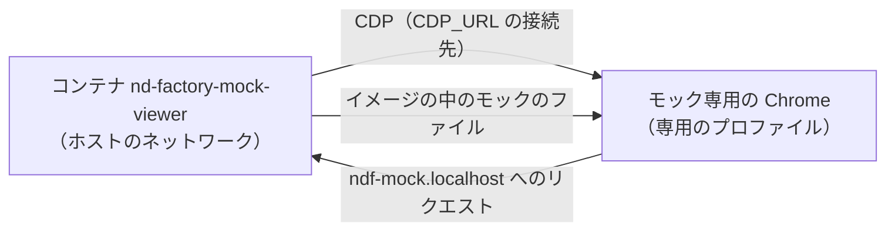

# 画面のモックのビューアー

`docs/design/mock/` のモックを、利用者の PC で起動するモック専用の Chrome の http://ndf-mock.localhost/ で見せる。配信はコンテナ `nd-factory-mock-viewer` が持ち、会話が終わっても止まらない。要らなくなったら止める。

## 仕組み



- コンテナは Chrome に CDP でつなぎ、接続ごとに作る別のコンテキスト（Cookie もキャッシュも持たない別ウィンドウ）の中だけで、`http://ndf-mock.localhost/**` へのリクエストを受けて、イメージに焼き込んだ `docs/design/mock/` のファイルで返す（`tools/mock-viewer/src/`）。Chrome の既定のコンテキストには、ルーティングもキャッシュの無効化も入れない
- 待ち受けのポートを開かない。`*.localhost` はどの端末でも自分を指すので、名前の登録も要らない
- Chrome との接続が切れると、このウィンドウは閉じる。コンテナは 10 秒ごとにつなぎ直し、つながるたびに開き直す
- 前提は、モック専用の Chrome が起動していて、このコンテナから CDP が届くこと（下の「モック専用の Chrome」）。**ログイン済みの Chrome（`/ndf:chrome-cdp` の 9222 のプロファイルを含む）にはつながない。** 接続先（`CDP_URL`）の既定は `http://127.0.0.1:9223` である

## モック専用の Chrome

利用者の PC で、モックだけに使う `--user-data-dir` と、9223 の口を付けて起動する。このプロファイルではどのサービスにもサインインしない。起動は利用者に頼む。

Windows ではコマンドプロンプト（`cmd.exe`）で打つ。`%LOCALAPPDATA%` は PowerShell では展開されない。

```bat
"C:\Program Files\Google\Chrome\Application\chrome.exe" --remote-debugging-port=9223 --user-data-dir="%LOCALAPPDATA%\chrome-mock"
```

macOS ではターミナルで打つ。

```bash
open -na "Google Chrome" --args --remote-debugging-port=9223 --user-data-dir="$HOME/.chrome-mock"
```

コンテナから届く経路の判定と、経路ごとの届け方は `/ndf:chrome-cdp` の手順を、ポートを 9223 に読み替えて使う（経路 B では SSH の設定に `RemoteForward 9223 127.0.0.1:9223` を足して張り直す）。

| 経路 | 立ち上げ方 |
| --- | --- |
| A（同じ PC の Docker） | `CDP_URL=http://host.docker.internal:9223 npm run mock:up` |
| B（リモートのホスト）で、SSH の転送先がホストの `127.0.0.1:9223` | `npm run mock:up` |
| ほかの場所に CDP が届いている | `CDP_URL=http://<ホスト>:<ポート> npm run mock:up` |

`mock:up` はコンテナを常に `--network host` で起動する。経路 A で Docker Desktop を使う場合は、4.34 以降で[ホストネットワーク](https://docs.docker.com/engine/network/drivers/host/)の設定を有効にしてから、表のコマンドを実行する。設定を変更できない場合は、「開かないとき」の HTTP サーバーの手順を使う。

下の「使い方」などの `npm run mock:up` も、経路に合わせて `CDP_URL` を付けて打つ。

## 使い方

| すること | コマンド |
| --- | --- |
| 立ち上げる（モックを直した後の焼き直しも同じ） | `npm run mock:up` |
| 様子を見る | `npm run mock:logs`（`配信中: http://ndf-mock.localhost/` が出ていれば動いている） |
| 止める | `npm run mock:down` |

- **モックを直したら `mock:up` を打ち直す。** ファイルはイメージに焼き込むので、打ち直すまで古いまま見える。打つのは worktree の中でよい（その worktree のファイルを焼く）
- つながると、別ウィンドウで `viewer.html#foundation`（ページ「画面の基盤（#12）」）を開く。キャンバスの別のページは、ウィンドウの上部のボタンで切り替えて見る。特定の画面だけを起動時に開くときは、`MOCK_START` に画面のファイルのパスを指定する（例: `MOCK_START=/project/Organizers.dc.html npm run mock:up`）
- モックはこのウィンドウの中でだけ開ける。同じ Chrome の別のウィンドウに URL を打っても配信されない
- 常設しない。コンテナはホストや Docker の再起動の後には戻らないので、見せ終えたら `mock:down` で止める
- ホストの再起動の後も戻る常設（`--restart unless-stopped`）は、利用者が明示的に選んだときだけにする。そのときは `MOCK_RESTART=unless-stopped npm run mock:up` を打つ。AI は自分の判断でこの指定を付けない

## 開かないとき

| 症状 | 見ること |
| --- | --- |
| ログが `Chrome につながらない` を繰り返す | モック専用の Chrome が専用のプロファイル（`--user-data-dir`）と `--remote-debugging-port=9223` を付けて動いているか。`CDP_URL` が経路に合っているか（上の「仕組み」の表）。経路 B では、Docker ホストのネットワークから Chrome が応答するか（下の「経路 B の接続の確かめ方」）。Chrome や転送が直れば、コンテナが自分でつなぎ直す。`CDP_URL` の誤りは、正しい値を付けて `mock:up` を打ち直す |
| タブが `ERR_CONNECTION_REFUSED` | モックの配信用でないウィンドウで URL を開いたか、コンテナが止まっているか、Chrome とつながっていない。`docker ps --filter name=nd-factory-mock-viewer` と `mock:logs` を見る |
| 直したのに古い | `mock:up` を打ち直していない |
| 利用者がウィンドウやタブを閉じた | `mock:up` を打ち直すと開き直す（経路 A では `CDP_URL` を付ける） |

Chrome を使えない場合は、リポジトリを取得した利用者の PC で `python3 -m http.server --bind 127.0.0.1 -d docs/design/mock 8000` を打ち、同じ PC のブラウザーで http://localhost:8000/viewer.html#foundation を開く。`--bind 127.0.0.1` は外さない。外すと、同じネットワークの第三者にも承認前のモックが配られる。

リモートのホストやコンテナでも同じコマンドを打つ。利用者の PC の `localhost` はそこに届かないため、ポート 8000 を転送してから、利用者の PC で同じ URL を開く。転送の方法は、サーバーを起動した場所で選ぶ。

- リモートのホスト上で起動した場合は、そのホストへ SSH で接続し、ポート 8000 を転送する（`ssh -L 8000:127.0.0.1:8000 <ホスト>`）
- コンテナの中で起動した場合は、そのコンテナのポート 8000 を転送できるエディタの機能を使う。コンテナの外のホストへ SSH で転送しても、コンテナの中の `127.0.0.1` には届かない

### 経路 B の接続の確かめ方

`mock:up` のコンテナはホストのネットワークで動き、中継を通さずに SSH の転送先へつなぐ。そのため、同じネットワークから `127.0.0.1:9223` の `/json/version` にアクセスする。`/ndf:chrome-cdp` の「3.」の中継と「4.」の確認は、ブリッジネットワークの開発コンテナ向けなので使わない。

```bash
docker run --rm --network host nd-factory-mock-viewer wget -qO- -T 5 http://127.0.0.1:9223/json/version
```

`Browser` を含む JSON が返れば、SSH の転送と Chrome は動いている。返らなければ、SSH の接続の張り直しと Chrome の起動を利用者に確かめてもらう。

## 書き換えない約束

- モックには作り物の値だけを使う（AGENTS.md）。イメージはローカルでだけ作り、レジストリへ push しない
- CDP の口（9223）をネットワークへ開かない（`/ndf:chrome-cdp`）。このコンテナは `CDP_URL` の接続先へつなぎに行くだけで、ポートを開かない
- ログイン済みの Chrome にはつながない。モックはモック専用の Chrome で見せる
