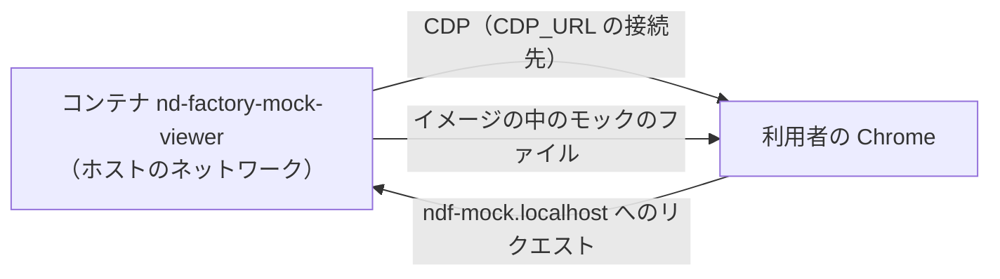

# 画面のモックのビューアー

`docs/design/mock/` のモックを、利用者の Chrome の http://ndf-mock.localhost/ で見せる。配信はコンテナ `nd-factory-mock-viewer` が持ち、会話が終わっても止まらない。要らなくなったら止める。

## 仕組み



- コンテナは Chrome に CDP でつなぎ、`http://ndf-mock.localhost/**` へのリクエストをブラウザの中で受けて、イメージに焼き込んだ `docs/design/mock/` のファイルで返す（`tools/mock-viewer/src/`）
- 待ち受けのポートを開かない。`*.localhost` はどの端末でも自分を指すので、名前の登録も要らない
- Chrome との接続が切れたら 10 秒ごとにつなぎ直す。タブを開くのは起動の最初の 1 回だけで、ndf-mock.localhost のタブが既にあれば読み直す
- 前提は、利用者の Chrome が専用プロファイルとリモート操作の口（9222）を付けて起動していて、このコンテナから CDP が届くこと。接続先（`CDP_URL`）の既定は `http://127.0.0.1:9222` で、`/ndf:chrome-cdp` の経路によって立ち上げ方が違う

| 経路 | 立ち上げ方 |
| --- | --- |
| A（同じ PC の Docker） | `CDP_URL=http://host.docker.internal:9222 npm run mock:up` |
| B（リモートのホスト）で、SSH の転送先がホストの `127.0.0.1:9222` | `npm run mock:up` |
| ほかの場所に CDP が届いている | `CDP_URL=http://<ホスト>:<ポート> npm run mock:up` |

下の「使い方」などの `npm run mock:up` も、経路に合わせて `CDP_URL` を付けて打つ。

## 使い方

| すること | コマンド |
| --- | --- |
| 立ち上げる（モックを直した後の焼き直しも同じ） | `npm run mock:up` |
| 様子を見る | `npm run mock:logs`（`配信中: http://ndf-mock.localhost/` が出ていれば動いている） |
| 止める | `npm run mock:down` |

- **モックを直したら `mock:up` を打ち直す。** ファイルはイメージに焼き込むので、打ち直すまで古いまま見える。打つのは worktree の中でよい（その worktree のファイルを焼く）
- ndf-mock.localhost のタブが無いときは、新しいタブで `viewer.html#foundation`（ページ「画面の基盤（#12）」）を開く。別のページを開くときは `MOCK_START=/project/Organizers.dc.html npm run mock:up`
- **ndf-mock.localhost のタブが残っているときは、そのタブを読み直すだけで、既定のページにも `MOCK_START` のページにも移らない。** 利用者にレビューを頼む前に、対象のページが開いていることを確かめる。違うページなら、利用者にそのタブをすべて閉じてもらってから `mock:up` を打ち直す
- `--restart unless-stopped` で動かすので、ホストの再起動の後も戻る。要らなくなったら `mock:down` で止める

## 開かないとき

| 症状 | 見ること |
| --- | --- |
| ログが `Chrome につながらない` を繰り返す | Chrome が専用プロファイル（`--user-data-dir`）と `--remote-debugging-port=9222` を付けて動いているか。`CDP_URL` が経路に合っているか（上の「仕組み」の表）。経路 B では、Docker ホストのネットワークから Chrome が応答するか（下の「経路 B の接続の確かめ方」）。Chrome や転送が直れば、コンテナが自分でつなぎ直す。`CDP_URL` の誤りは、正しい値を付けて `mock:up` を打ち直す |
| タブが `ERR_CONNECTION_REFUSED` | コンテナが止まっているか、Chrome とつながっていない。`docker ps --filter name=nd-factory-mock-viewer` と `mock:logs` を見る |
| 直したのに古い | `mock:up` を打ち直していない |
| 利用者がタブを閉じた | `mock:up` を打ち直すと新しいタブを開く（経路 A では `CDP_URL` を付ける） |

Chrome を使えない場合は、リポジトリを取得した利用者の PC で `python3 -m http.server -d docs/design/mock 8000` を打ち、同じ PC のブラウザーで http://localhost:8000/viewer.html#foundation を開く。リモートのホストやコンテナで打った場合、利用者の PC の `localhost` はそこに届かないため、ポート 8000 を転送して、転送先の URL を開く。

### 経路 B の接続の確かめ方

`mock:up` のコンテナはホストのネットワークで動き、中継を通さずに SSH の転送先へつなぐ。そのため、同じネットワークから `127.0.0.1:9222` の `/json/version` にアクセスする。`/ndf:chrome-cdp` の「3.」の中継と「4.」の確認は、ブリッジネットワークの開発コンテナ向けなので使わない。

```bash
docker run --rm --network host nd-factory-mock-viewer wget -qO- -T 5 http://127.0.0.1:9222/json/version
```

`Browser` を含む JSON が返れば、SSH の転送と Chrome は動いている。返らなければ、SSH の接続の張り直しと Chrome の起動を利用者に確かめてもらう。

## 書き換えない約束

- モックには作り物の値だけを使う（AGENTS.md）。イメージはローカルでだけ作り、レジストリへ push しない
- CDP の 9222 をネットワークへ開かない（`/ndf:chrome-cdp`）。このコンテナは `CDP_URL` の接続先へつなぎに行くだけで、ポートを開かない
