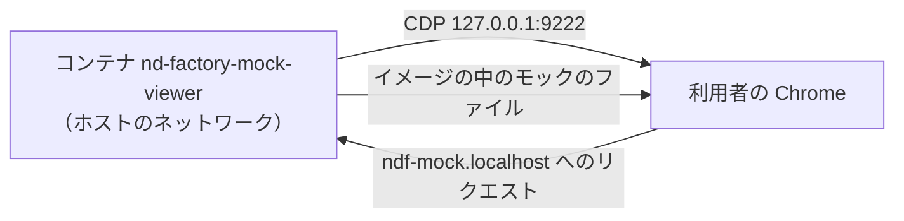

# 画面のモックのビューアー

`docs/design/mock/` のモックを、利用者の Chrome の http://ndf-mock.localhost/ で見せる。配信はコンテナ `nd-factory-mock-viewer` が持ち、会話が終わっても止まらない。要らなくなったら止める。

## 仕組み

- コンテナは Chrome に CDP でつなぎ、`http://ndf-mock.localhost/**` へのリクエストをブラウザの中で受けて、イメージに焼き込んだ `docs/design/mock/` のファイルで返す（`tools/mock-viewer/src/`）
- 待ち受けのポートを開かない。`*.localhost` はどの端末でも自分を指すので、名前の登録も要らない
- Chrome との接続が切れたら 10 秒ごとにつなぎ直す。タブを開くのは起動の最初の 1 回だけで、ndf-mock.localhost のタブが既にあれば読み直す
- 前提は、ホストの `127.0.0.1:9222` に利用者の Chrome の CDP が届いていること（`/ndf:chrome-cdp` の経路 A か B）。別の場所なら `CDP_URL=http://<ホスト>:<ポート> npm run mock:up`

## 使い方

| すること | コマンド |
| --- | --- |
| 立ち上げる（モックを直した後の焼き直しも同じ） | `npm run mock:up` |
| 様子を見る | `npm run mock:logs`（`配信中: http://ndf-mock.localhost/` が出ていれば動いている） |
| 止める | `npm run mock:down` |

- **モックを直したら `mock:up` を打ち直す。** ファイルはイメージに焼き込むので、打ち直すまで古いまま見える。打つのは worktree の中でよい（その worktree のファイルを焼く）
- 開くページは既定で `viewer.html#organizer`。変えるときは `MOCK_START=/project/Organizers.dc.html npm run mock:up`
- `--restart unless-stopped` で動かすので、ホストの再起動の後も戻る。要らなくなったら `mock:down` で止める

## 開かないとき

| 症状 | 見ること |
| --- | --- |
| ログが `Chrome につながらない` を繰り返す | Chrome が `--remote-debugging-port=9222` で動いているか、SSH の転送が生きているか（`/ndf:chrome-cdp` の「つながらないとき」）。直ればコンテナが自分でつなぎ直す |
| タブが `ERR_CONNECTION_REFUSED` | コンテナが止まっているか、Chrome とつながっていない。`docker ps --filter name=nd-factory-mock-viewer` と `mock:logs` を見る |
| 直したのに古い | `mock:up` を打ち直していない |
| 利用者がタブを閉じた | `mock:up` を打ち直すと新しいタブを開く |

Chrome を使えない場面（CI・ほかの人の手元）では、`python3 -m http.server -d docs/design/mock 8000` で http://localhost:8000/viewer.html を開く。

## 書き換えない約束

- モックには作り物の値だけを使う（AGENTS.md）。イメージはローカルでだけ作り、レジストリへ push しない
- CDP の 9222 をネットワークへ開かない（`/ndf:chrome-cdp`）。このコンテナはホストの `127.0.0.1` からつなぐだけである
