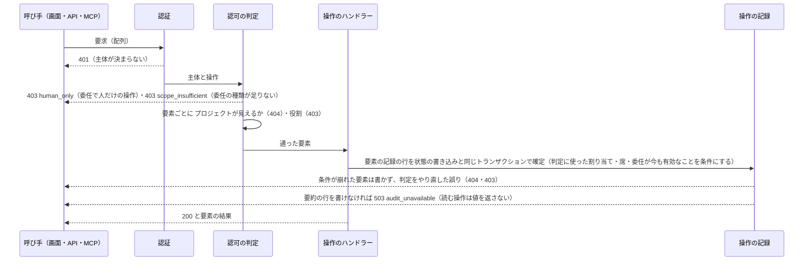
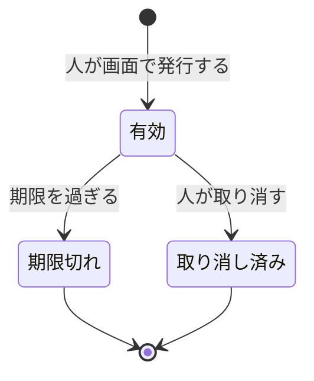
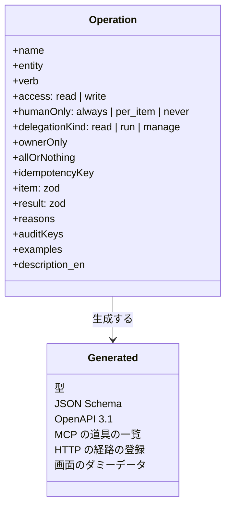

# API と MCP: 画面でできる操作を、人も AI のエージェントも同じ操作の表から同じ認可で行える

API と MCP の形を決める。[全体の設計](overview.md) の機能一覧（F1〜F20・F24・F25）・不変条件（I2〜I5・I9・I12・I14・I15・I23・I24）・集約を受ける。
API と MCP の外で決めるもの:

| 中身 | 文書 |
| --- | --- |
| 画面の項目 | [screens.md](screens.md) |
| ランナーと手元のマシンの振る舞い | [execution.md](execution.md) |
| 資源と費用 | [platform.md](platform.md) |

## この文書で決めること

理由は各決定の節にある。

| 節 | 決めること | 決定 |
| --- | --- | --- |
| [呼び出しの規約](#呼び出しの規約) | 操作の名前・HTTP の経路・MCP の道具の名前を 1 対 1 にし、メソッドを POST にそろえる | 40 |
| [呼び出しの規約](#呼び出しの規約) | 応答は要素ごとの結果を既定にし、誤りは理由のコードだけを返す。500 を返さず 503 にそろえる | 41・46 |
| [呼び出しの規約](#呼び出しの規約) | 冪等の鍵を要素ごとに持たせ、24 時間同じ結果を返す | 42 |
| [呼び出しの規約](#呼び出しの規約) | ページ送りは不透明なカーソルで行い、全体の件数を返さない | 43 |
| [呼び出しの規約](#呼び出しの規約) | 版を経路の頭の `/v1` に置く。書くエンティティに版の数を持たせ、条件つきで書く | 44・45 |
| [値の形](#値の形) | 日時・金額・言語・時刻帯・ID を 1 つの形に決める | 47 |
| [操作の一覧](#操作の一覧) | F1〜F20・F24・F25 を操作へ割り、人だけの操作を決める。要素の形と理由のコードは形の正本だけに置き、受け持つ子の課題を決める。問いの人だけの範囲は実行の文書の区分の表に従う | 56・57 |
| [認証と主体](#認証と主体) | 認証を API の Lambda の中の 1 か所に置く | 48 |
| [認可](#認可) | 一覧は見えるプロジェクトの ID から表を引き、知らせは送る直前にも照らす | 53 |
| [委任](#委任) | 範囲をプロジェクトと 3 つの操作の種類にし、期限を 1 時間〜30 日にする。MCP は画面で発行した token を貼り、OAuth 2.1 を後に回す | 49・50 |
| [MCP](#mcp) | 道具を操作の表から生成し、セッションを持たない。人だけの操作を道具にしない | 51・52 |
| [操作の記録](#操作の記録) | 状態の書き込みと同じトランザクションで追記する | 54 |
| [形の正本](#形の正本) | zod の操作の表を正本にし、OpenAPI は自前の生成のスクリプトで組む | 55 |

## 呼び出しの規約

API の操作は 1 つの画面に合わせず、エンティティ（スプリント・承認の依頼など）と操作（取得・作成・取り消しなど）から起こす（Value 2）。画面・API の呼び手・MCP の道具は、同じ操作の表の同じ操作を通る（Value 4、I14）。

### 操作の名前と HTTP の経路

| 決まり | 中身 |
| --- | --- |
| 操作の名前 | `<エンティティの複数形>.<動詞>`。例 `sprints.create`・`approvals.answer`。英小文字・数字・`_` と区切りの `.` だけ |
| HTTP の経路 | `POST /v1/<エンティティ>/<動詞>`。操作の名前と 1 対 1 で、`.` を `/` に替えただけ。例 `sprints.create` は `POST /v1/sprints/create` |
| メソッド | 利用者向けの操作はすべて `POST`。読む操作も本文に配列を持つため（下の「本文は配列」） |
| MCP の道具の名前 | 操作の名前そのもの（[MCP](#mcp)） |
| HTTP の経路の変数 | 持たない。プロジェクトやスプリントの ID は本文の要素に入れ、要素ごとに認可を掛ける |
| 動詞 | 読む: `get`（ID で指す）・`list`（条件で絞る）。書く: `create`・`update`・`delete` と、エンティティに固有の動詞（`cancel`・`answer`・`accept`・`revoke` など） |

### 本文は配列

| 決まり | 中身 |
| --- | --- |
| 要求の本文 | JSON の配列。1 件のときも要素 1 個の配列にする（I12）。要素の数は 1〜100 |
| 応答の本文 | 要求と同じ数・同じ順の配列。各要素は「要素の結果」 |
| 成功の要素 | `{"ok": true, "item": {…}}`。一覧（`list`）は `{"ok": true, "items": [...], "next_cursor": "…" \| null}` |
| 失敗の要素 | `{"ok": false, "status": 404, "reason": "not_found"}`。`status` は HTTP の状態の数、`reason` は理由のコード。項目の誤りは `"fields": ["/0/title"]` のように位置だけを足す |
| 要素が失敗した応答 | HTTP の状態は 200 のまま。要素の結果で読む |
| 要素ごとか、全部か無か | 既定は要素ごと（成功した要素は確定し、失敗した要素だけ失敗）。「全部か無か」の印を持つ操作は、1 つでも失敗すれば全部を確定せず、失敗しなかった要素は `409 not_applied` を返す（決定 41） |
| 全部か無かの要素の上限 | 全部か無かの操作は、すべての要素の書き込み（状態・記録の行・冪等の鍵の済みの行）を 1 つのトランザクションで確定する。要素の上限は 100 でなく、要素 1 つの書き込みの件の数から、DynamoDB の 1 つのトランザクションの件の上限（100 件）に収まる値にし、操作の定義に持つ。越えた要求は要求全体の 400 `too_many_items` |
| 同じ対象の重なり | 1 つの要求で同じ対象を 2 回指したら、要求全体を 400 `duplicate_item` で断る |

「全部か無か」の印を持つ操作は、要素どうしが合わせて 1 つの変化になる次の 2 つだけである。

| 操作 | 理由 |
| --- | --- |
| `projects.create` | プロジェクト・主リポジトリ・チームへの割り当てを同じ確定で作る。割り当ての無いプロジェクトを作らない（[全体の設計](overview.md) の「プロジェクトとチーム」） |
| `repositories.add` | 主リポジトリがちょうど 1 つ（I1）を、足すリポジトリの組で照らす |

### 誤りの形

文言を返さず、理由のコードだけを返す。文言は画面の翻訳のファイルが理由のコードから作る（Value 5）。

| 区分 | 形 | いつ |
| --- | --- | --- |
| 要求全体の誤り | `Content-Type: application/problem+json` で `{"type": "about:blank", "status": 400, "reason": "body_not_array"}`（RFC 9457 の形。`title`・`detail` を持たない） | 本文が JSON でない・配列でない・空・101 個以上か全部か無かの操作の上限を越える・重なり（400）、認証できない（401）、人だけの操作を委任から呼んだ・委任の種類が足りない（403）、記録を書けない・依存先に届かない（503）、呼びすぎ（429） |
| 要素の誤り | 上の「失敗の要素」 | 要素の形が違う（400 `item_invalid`）、見えない・無い（404 `not_found`）、役割が足りない（403 `role_insufficient`）、版が合わない（409 `version_mismatch`）、状態が合わない（409 `state_mismatch`）、冪等の鍵の使い回し（422 `idempotency_key_reused`）、同じ冪等の鍵の 1 回目が途中（409 `in_progress`）、使える量の上限（403。理由のコードは使える量の判定が返す `monthly_cap_reached`・`place_not_allowed`・`inference_not_allowed`・`currency_mismatch`（使った額と上限額の通貨が違う。換算しない）。同時に動くレーンの数の `concurrency_full` は待てば解けるため、要素の誤りにせずレーンの待ちの理由として返す。[実行の文書の使える量の判定](execution.md#使える量の判定)） |
| 401 の本文 | 理由によらず同じ `{"type": "about:blank", "status": 401, "reason": "unauthorized"}` | token の形・期限・取り消しのどれでも同じにし、何が違ったかを明かさない |
| 500 | 返さない | 想定しない失敗はハンドラーの外側で受けて 503 `unavailable` にし、要求の ID とともにログへ残す（決定 46） |

理由のコードは形の正本の 1 か所に操作ごとの一覧として置き、一覧に無いコードを返すと単体テストが落ちる。全体の設計の文が名を挙げる理由のコード（`project_transfer_in_progress`・`credential_rotation_in_progress`・`human_only`・`visibility_widened`・`destination_unregistered`・`rotation_superseded`・`answer_seq_unknown` など）も、その操作の一覧に置く（決定 56）。

### 冪等の鍵

| 決まり | 中身 |
| --- | --- |
| どこに置くか | 新しいものを作る操作と、外へ働きかける操作（`sprints.create`・`sprints.cancel`・`approvals.answer`・`questions.answer`・`delegations.create`・`machines.create` など）の要素に `idempotency_key`（UUID の形）を必ず持たせる |
| 何で見分けるか | 主体の利用者・呼び手・操作の名前・鍵の 4 つの組。呼び手は、人の直の操作なら「人」、委任なら委任の ID |
| 結果を共有する範囲 | 同じ利用者の人の直の操作は、セッション（端末やサインインし直し）が違っても 1 回目の結果を共有する。端末がサインインし直した後に送り直しても 2 重に作らないためである。委任の要求は、その委任の中でだけ共有し、人の直の操作とも、同じ利用者のほかの委任とも共有しない |
| 結果を返す前 | 2 回目も、今の主体で認可の判定（プロジェクトが見えるか・役割・委任の範囲・人だけか）を 1 回目と同じく要素ごとに掛ける。通った要素にだけ 1 回目の結果を返す。通らない要素には 1 回目の結果を返さず、今の判定の誤り（見えなければ 404 `not_found`）を返す |
| 2 回目 | 24 時間の間、同じ組の 2 回目は 1 回目の要素の結果を返し、状態を変えない。1 回だけ返す値（委任の token など）は 2 回目に `null` にする |
| 中身が違う | 同じ組で要素の中身が違えば 422 `idempotency_key_reused` |
| 1 回目が途中 | 409 `in_progress`。呼び手は待って同じ要素を送り直す |

### ページ送り

| 決まり | 中身 |
| --- | --- |
| 一覧の要素 | `{"project_ids": [...], <条件>, "limit": 50, "cursor": "…"}`。`limit` は 1〜100、既定 50 |
| 続き | 応答の `next_cursor` を次の要求の `cursor` へ渡す。無ければ `null` |
| カーソルの中身 | 主体・条件・位置をサーバーの鍵で暗号化した不透明な値。別の主体・別の条件で使うと 400 `cursor_invalid` |
| 全体の件数 | 一覧の応答に持たない。数が要る画面（未読の数・待ちの数）は、認可で絞った後の数を返す操作を別に持つ（[認可](#認可)の「件数」） |
| 並び | 操作ごとに 1 つに決め、形の正本に書く（例: 承認の依頼は待ち始めた時刻の古い順） |

### 版と条件つきの更新

| 決まり | 中身 |
| --- | --- |
| API の版 | HTTP の経路の頭の `/v1`。項目を足すことは `/v1` のまま行い、呼び手は知らない項目を読み飛ばす。項目を消す・意味を変えるときは `/v2` を並べて出し、`/v1` を残す期間を決めてから消す |
| エンティティの版 | 書き換えられる各エンティティ（上書きの行）は `version`（1 から始まる整数）を持つ。書くたびに 1 つ上げる。持つ行と列は [データの共通の列](data.md#共通の列) が正本 |
| 条件つきの更新 | `update`・`delete` と状態を変える動詞の要素は、読んだときの `version` を持つ。サーバーの今の値と違えば 409 `version_mismatch` で書かない |
| 承認の確定 | `approvals.answer` の要素は `version` に加えて、読んだ承認資料の要約値 `material_digest` を持つ。どちらかが今と違えば 409（I4） |
| オフラインの確定待ち | 画面はつながった後に、読んだときの `version` と `material_digest` のまま送る。サーバーは今の状態と照らし、合わなければ 409 を返す（[オフライン](screens.md#オフライン)） |

### 共通の頭書き

| 頭書き | 決まり |
| --- | --- |
| `Authorization` | `Bearer <token>`。種類は [認証と主体](#認証と主体) |
| `Content-Type` | 要求は `application/json`。要求全体の誤りの応答だけ `application/problem+json` |
| `Cache-Control` | 応答はすべて `no-store`。プロジェクトの中身を中継の装置や共有のキャッシュに残さない |
| `Accept-Language` | 読まない。API は言語で応答を変えない |

## 値の形

日時・金額・言語・時刻帯を、国や地域で読み違えない形で受け渡す（Value 5、I15）。形の正本の検証が、形に合わない値を 400 `item_invalid` で拒む。

| 値 | 形 | 例 | 拒むもの |
| --- | --- | --- | --- |
| 日時 | RFC 3339 の UTC。末尾は `Z`、秒の小数は 3 桁まで | `2026-11-17T03:04:05.123Z` | 時刻帯の無い日時・`+09:00` など `Z` でない差 |
| 日付だけ | `YYYY-MM-DD`。月の締めなど暦の日付だけに使い、どの時刻帯の日付かを隣の項目に持つ | `{"month": "2026-11", "time_zone": "UTC"}` | 時刻帯の無い月の境 |
| 金額 | `{"amount_minor": 1234, "currency": "USD"}`。最小単位（ISO 4217 の minor unit）の整数と ISO 4217 の英字 3 字 | 12.34 ドルは `1234`・`USD`。1,000 円は `1000`・`JPY` | 小数の金額・通貨の無い金額 |
| 言語 | BCP 47 の言語タグ | `ja`・`en`・`pt-BR` | 形の違うタグ。画面の翻訳のファイルが無い言語は利用者の設定で選べない |
| 時刻帯 | IANA の時刻帯の名前 | `Asia/Tokyo`・`America/New_York` | `JST` などの略称・`+09:00` などの差 |
| ID | `<種類の頭>_<UUIDv7>`（RFC 9562 の文字の形、小文字） | `spr_01935b4e-7c2a-7d10-8f3e-2b6f0c9a1d42` | 種類の頭が操作と合わない ID（404 と同じに扱う） |
| GitHub の参照 | リポジトリ `owner/name`、課題と PR `owner/name#N` | `acme/web#42` | — |

ID の種類の頭:

| 頭 | 種類 | 頭 | 種類 |
| --- | --- | --- | --- |
| `usr` | 利用者 | `apr` | 承認の依頼 |
| `team` | チーム | `qst` | 問い |
| `inv` | 招待 | `ntc` | 知らせ |
| `prj` | プロジェクト | `dst` | 通知先 |
| `repo` | リポジトリ | `dlg` | 委任 |
| `trf` | 割り当ての移し | `mch` | 手元のマシン |
| `spr` | スプリント | `key` | 持ち込みのキー（`byok`） |
| `lane` | レーン | `aud` | 操作の記録 |

## 操作の一覧

機能一覧の F1〜F20・F24・F25 を、エンティティごとの操作へ 1 行ずつ割る。HTTP の経路のメソッドはすべて `POST` で、表では HTTP の経路の path だけを書く。本文はすべて配列で受け渡す（[本文は配列](#本文は配列)）。

要素の項目・型・必須か・操作ごとの理由のコードは、形の正本の操作の定義（`packages/contracts/`）だけに置き、この文書に表を写さない（決定 56）。この文書は、全体の設計の文が答えを決めた変わり目（[入出力の変わり目](#入出力の変わり目)）だけを書く。形の正本へ書くのは次の子の課題である。

| 操作と HTTP の経路 | 受け持つ子の課題 |
| --- | --- |
| F1〜F3（`sessions.*`・`users.*`・`logins.*`・`teams.*`・`seats.*`・`invitations.*`） | #4 |
| F4〜F6（`projects.*`・`github_installations.*`・`repositories.*`・`project_transfers.*`） | #5 |
| F7〜F10・F17（`waiting_counts.get`・`issue_candidates.list`・`sprints.*`・`lanes.list`・`progress_events.list`・`execution_settings.*`・`model_keys.*`）とランナー向けの 5 つの HTTP の経路 | #6 |
| F18（`machines.*`）と手元のマシン向けの 2 つの HTTP の経路 | #7 |
| F11〜F15（`approvals.*`・`questions.*`・`notices.*`・`notification_targets.*`） | #8 |
| F16・F20（`delegations.*`・`audit_records.list`） | #11 |
| F19（`usage.get`・`usage_records.list`・`spend_caps.update`） | #29 |
| DB の用意の関数が呼ぶ 3 つの処理（`db_prep.is_current`・`db_prep.read_target`・`db_prep.record`）の本番の実装（終わりの記録の口）・DB の用意の関数を非同期で呼ぶ API の側と見回り・口を DB の用意の関数の起点へつなぐこと | #6（関数そのもの・呼び出しの値と終わりの結果の形・口の型は #13） |

表の列の読み方:

| 列の値 | 意味 |
| --- | --- |
| 「MCP の道具か」の「道具」 | 同じ名前の道具がある |
| 「MCP の道具か」の「依頼と材料の読み出しだけ」 | 人だけの操作で、MCP では対になる読み出しの道具だけを持つ（[人だけの操作の扱い](#人だけの操作の扱い)） |
| 「読む / 書く」の括弧 | 委任で呼ぶときに要る委任の種類（[委任](#委任)） |

### 利用者向けの操作

#### 利用者・チーム・プロジェクト（F1〜F6）

| 操作の名前 | HTTP の経路 | 機能 | MCP の道具か | 人だけか | 読む / 書く |
| --- | --- | --- | --- | --- | --- |
| `sessions.create` | `/v1/sessions/create` | F1 | 依頼と材料の読み出しだけ（`users.get`） | 人だけ | 書く |
| `sessions.delete` | `/v1/sessions/delete` | F1 | 依頼と材料の読み出しだけ（`users.get`） | 人だけ | 書く |
| `users.get` | `/v1/users/get` | F1・F2 | 道具 | — | 読む（read） |
| `users.update` | `/v1/users/update` | F2 | 道具 | — | 書く（manage） |
| `logins.create` | `/v1/logins/create` | F1 | 依頼と材料の読み出しだけ（`users.get`） | 人だけ | 書く |
| `logins.delete` | `/v1/logins/delete` | F1 | 依頼と材料の読み出しだけ（`users.get`） | 人だけ | 書く |
| `teams.list` | `/v1/teams/list` | F3 | 道具 | — | 読む（read） |
| `teams.get` | `/v1/teams/get` | F3 | 道具 | — | 読む（read） |
| `teams.create` | `/v1/teams/create` | F3 | 依頼と材料の読み出しだけ（`teams.list`） | 人だけ | 書く |
| `teams.update` | `/v1/teams/update` | F3 | 道具 | — | 書く（manage） |
| `seats.list` | `/v1/seats/list` | F3 | 道具 | — | 読む（read） |
| `seats.update` | `/v1/seats/update` | F3 | 依頼と材料の読み出しだけ（`seats.list`） | 人だけ | 書く |
| `seats.delete` | `/v1/seats/delete` | F3 | 依頼と材料の読み出しだけ（`seats.list`） | 人だけ | 書く |
| `invitations.list` | `/v1/invitations/list` | F3 | 道具 | — | 読む（read） |
| `invitations.create` | `/v1/invitations/create` | F3 | 依頼と材料の読み出しだけ（`invitations.list`） | 人だけ | 書く |
| `invitations.accept` | `/v1/invitations/accept` | F3 | 依頼と材料の読み出しだけ（`invitations.list`） | 人だけ | 書く |
| `invitations.delete` | `/v1/invitations/delete` | F3 | 依頼と材料の読み出しだけ（`invitations.list`） | 人だけ | 書く |
| `projects.list` | `/v1/projects/list` | F4・F7 | 道具 | — | 読む（read） |
| `projects.get` | `/v1/projects/get` | F4 | 道具 | — | 読む（read） |
| `projects.create` | `/v1/projects/create` | F4 | 依頼と材料の読み出しだけ（`teams.list`） | 人だけ | 書く（全部か無か） |
| `projects.update` | `/v1/projects/update` | F4 | 道具 | — | 書く（manage） |
| `github_installations.list` | `/v1/github_installations/list` | F5 | 道具 | — | 読む（read） |
| `github_installations.link` | `/v1/github_installations/link` | F5 | 依頼と材料の読み出しだけ（`github_installations.list`） | 人だけ | 書く |
| `repositories.list` | `/v1/repositories/list` | F5 | 道具 | — | 読む（read） |
| `repositories.add` | `/v1/repositories/add` | F5 | 道具 | — | 書く（manage、全部か無か） |
| `repositories.remove` | `/v1/repositories/remove` | F5 | 道具 | — | 書く（manage） |
| `project_transfers.list` | `/v1/project_transfers/list` | F6 | 道具 | — | 読む（read） |
| `project_transfers.create` | `/v1/project_transfers/create` | F6 | 依頼と材料の読み出しだけ（`project_transfers.list`） | 人だけ | 書く |
| `project_transfers.accept` | `/v1/project_transfers/accept` | F6 | 依頼と材料の読み出しだけ（`project_transfers.list`） | 人だけ | 書く |
| `project_transfers.delete` | `/v1/project_transfers/delete` | F6 | 依頼と材料の読み出しだけ（`project_transfers.list`） | 人だけ | 書く |
| `projects.close` | `/v1/projects/close` | F6 | 依頼と材料の読み出しだけ（`projects.get`） | 人だけ | 書く |

#### スプリント・承認・問い・知らせ（F7〜F14）

| 操作の名前 | HTTP の経路 | 機能 | MCP の道具か | 人だけか | 読む / 書く |
| --- | --- | --- | --- | --- | --- |
| `waiting_counts.get` | `/v1/waiting_counts/get` | F7・F14 | 道具 | — | 読む（read） |
| `issue_candidates.list` | `/v1/issue_candidates/list` | F8 | 道具 | — | 読む（read） |
| `sprints.create` | `/v1/sprints/create` | F8 | 道具 | — | 書く（run） |
| `sprints.list` | `/v1/sprints/list` | F7・F9 | 道具 | — | 読む（read） |
| `sprints.get` | `/v1/sprints/get` | F9 | 道具 | — | 読む（read） |
| `lanes.list` | `/v1/lanes/list` | F9 | 道具 | — | 読む（read） |
| `progress_events.list` | `/v1/progress_events/list` | F9 | 道具 | — | 読む（read） |
| `sprints.cancel` | `/v1/sprints/cancel` | F10 | 道具 | — | 書く（run） |
| `approvals.list` | `/v1/approvals/list` | F7・F11 | 道具 | — | 読む（read） |
| `approvals.get` | `/v1/approvals/get` | F11 | 道具（承認資料を含む） | — | 読む（read） |
| `approvals.answer` | `/v1/approvals/answer` | F12 | 依頼と材料の読み出しだけ（`approvals.get`） | 人だけ | 書く（要素は理由 `reason` と、設計承認ゲートだけ外す課題 `drop_issues` を持つ。[入出力の変わり目](#入出力の変わり目)） |
| `questions.list` | `/v1/questions/list` | F7・F13 | 道具 | — | 読む（read） |
| `questions.get` | `/v1/questions/get` | F13 | 道具 | — | 読む（read） |
| `questions.answer` | `/v1/questions/answer` | F13 | 道具（「人だけか」が真の問いの要素は 403 `human_only`） | 「人だけか」が真の問いだけ人だけ（[実行の文書の区分の表](execution.md#区分とだれが答えられるか)） | 書く（run） |
| `notices.list` | `/v1/notices/list` | F14 | 道具 | — | 読む（read） |
| `notices.mark_read` | `/v1/notices/mark_read` | F14 | 道具 | — | 書く（run） |

#### 通知先・委任・実行・費用・記録（F15〜F20）

| 操作の名前 | HTTP の経路 | 機能 | MCP の道具か | 人だけか | 読む / 書く |
| --- | --- | --- | --- | --- | --- |
| `notification_targets.list` | `/v1/notification_targets/list` | F15 | 道具 | — | 読む（read） |
| `notification_targets.authorize` | `/v1/notification_targets/authorize` | F15 | 依頼と材料の読み出しだけ（`notification_targets.list`） | 人だけ | 書く |
| `notification_targets.create` | `/v1/notification_targets/create` | F15 | 依頼と材料の読み出しだけ（`notification_targets.list`） | 人だけ | 書く |
| `notification_targets.test` | `/v1/notification_targets/test` | F15 | 道具 | — | 書く（manage） |
| `notification_targets.delete` | `/v1/notification_targets/delete` | F15 | 道具 | — | 書く（manage） |
| `delegations.list` | `/v1/delegations/list` | F16 | 道具 | — | 読む（read） |
| `delegations.create` | `/v1/delegations/create` | F16 | 依頼と材料の読み出しだけ（`delegations.list`） | 人だけ | 書く |
| `delegations.revoke` | `/v1/delegations/revoke` | F16 | 依頼と材料の読み出しだけ（`delegations.list`） | 人だけ | 書く |
| `execution_settings.get` | `/v1/execution_settings/get` | F17 | 道具 | — | 読む（read） |
| `execution_settings.update` | `/v1/execution_settings/update` | F17 | 依頼と材料の読み出しだけ（`execution_settings.get`） | 人だけ | 書く |
| `model_keys.list` | `/v1/model_keys/list` | F17 | 道具 | — | 読む（read） |
| `model_keys.create` | `/v1/model_keys/create` | F17 | 依頼と材料の読み出しだけ（`model_keys.list`） | 人だけ | 書く |
| `model_keys.delete` | `/v1/model_keys/delete` | F17 | 依頼と材料の読み出しだけ（`model_keys.list`） | 人だけ | 書く |
| `machines.list` | `/v1/machines/list` | F18 | 道具 | — | 読む（read） |
| `machines.create` | `/v1/machines/create` | F18 | 依頼と材料の読み出しだけ（`machines.list`） | 人だけ | 書く |
| `machines.delete` | `/v1/machines/delete` | F18 | 道具 | — | 書く（manage） |
| `usage.get` | `/v1/usage/get` | F19 | 道具 | — | 読む（read） |
| `usage_records.list` | `/v1/usage_records/list` | F9・F19 | 道具 | — | 読む（read） |
| `spend_caps.update` | `/v1/spend_caps/update` | F19 | 依頼と材料の読み出しだけ（`usage.get`） | 人だけ | 書く |
| `audit_records.list` | `/v1/audit_records/list` | F20 | 道具 | — | 読む（read） |

#### オーガナイザーと会話（F24・F25）

形と決まりは [オーガナイザー](organizer.md) にある。会話の操作は承認の依頼と問いを変えない（I23）。オーガナイザーの専用の委任からは、人だけの操作・`manage` の操作に加えて、`approvals.answer`・`questions.answer`・下の表の書き込み（会話へ送る・取り下げるを含む）・委任の操作を 403 で断る（I24）。会話へ送る・取り下げる・終える・再開するは、立てた人（送る・取り下げる・終えるは立てた人のふつうの委任も）だけが呼べ、ほかの人とその委任は 403 `organizer_owner_only` にする（[オーガナイザーの立てた人だけが動かす](organizer.md#立てた人だけが動かす)）。

| 操作の名前 | HTTP の経路 | 機能 | MCP の道具か | 人だけか | 読む / 書く |
| --- | --- | --- | --- | --- | --- |
| `organizers.list` | `/v1/organizers/list` | F24 | 道具 | — | 読む（read） |
| `organizers.get` | `/v1/organizers/get` | F24 | 道具 | — | 読む（read） |
| `organizers.create` | `/v1/organizers/create` | F24 | 依頼と材料の読み出しだけ（`organizers.list`） | 人だけ | 書く（要素はプロジェクトの ID・題。立てた人の名で専用の委任を作る） |
| `organizers.close` | `/v1/organizers/close` | F24 | 道具 | — | 書く（run。立てた人だけ。同じトランザクションで専用の委任を取り消す。その後の最初の要求から専用の委任の主体は 401） |
| `organizers.resume` | `/v1/organizers/resume` | F24 | 依頼と材料の読み出しだけ（`organizers.get`） | 人だけ | 書く（立てた人だけ。前の専用の委任を取り消し、新しい専用の委任を作る。期限は延ばさない） |
| `organizer_messages.list` | `/v1/organizer_messages/list` | F25 | 道具 | — | 読む（read） |
| `organizer_messages.create` | `/v1/organizer_messages/create` | F25 | 道具 | — | 書く（run。立てた人だけ。要素は種類（指示・質問・起票の依頼）・本文・冪等の鍵） |
| `organizer_messages.withdraw` | `/v1/organizer_messages/withdraw` | F25 | 道具 | — | 書く（run。立てた人だけ。オーガナイザーへ渡す前の項目だけで、渡した後は 409 `already_delivered`） |

### 人だけにした理由

| 操作 | 理由（MVV の項目） |
| --- | --- |
| `approvals.answer`・「人だけか」が真の問いの `questions.answer` | 承認ゲートとレッドラインの承認と、人だけの区分の問いの答えは人だけ（Value 4、I4）。問いの「人だけか」は、問いを作るときに [実行の文書の区分の表](execution.md#区分とだれが答えられるか) で決めて問いの行に持つ。区分の一覧はその表が正本で、この文書は写さない（決定 57） |
| `projects.create`・`project_transfers.*`・`projects.close` | プロジェクトの割り当ての作成・変更・外しは人だけ（P2、I3） |
| `teams.create`・`seats.update`・`seats.delete`・`invitations.create`・`invitations.accept`・`invitations.delete` | 席はプロジェクトを見られる人を決める。席を足すことはチームの外の人へ見せることに当たる（P2）。席を変える・外す操作も、同じ判断の流れに置くため人だけにそろえる |
| `delegations.create`・`delegations.revoke` | 委任が委任を作ると、人の確かめない範囲が広がる（Value 4） |
| `organizers.create`・`organizers.resume` | どちらも立てた人の名で専用の委任（期限 30 日）を作る。委任から呼べると、委任が委任を作ることになり、`delegations.create` を人だけにした理由と同じく人の確かめない範囲が広がる（Value 4） |
| `notification_targets.create`・`model_keys.create` | 宛先の値と持ち込みのキーは秘密の値で、秘密を受け取る操作は人だけ（[全体の設計](overview.md) の「人へ残す判断」の C1） |
| `model_keys.delete` | 持ち込みのキーは秘密で、消すと推論が止まり、同じ値を戻せない（C1）。MCP からは `model_keys.list` で消す対象（名前・作った日・最後に使った日。値は出さない）を確かめられる |
| `notification_targets.authorize` | Slack の登録を始め、認可の取引を人のサインインのセッションに結ぶ。`notification_targets.create` と同じセッションで呼ぶ必要がある（[実行の文書の Slack の登録](execution.md#slack-の登録)） |
| `execution_settings.update`・`spend_caps.update` | 推論の手段と上限額は請求の額を変える |
| `machines.create` | 登録の token（秘密）を発行する |
| `sessions.create`・`sessions.delete`・`logins.create`・`logins.delete`・`github_installations.link` | 人のブラウザーの中の流れ（サインイン・IdP のログインをつなぐ戻り・GitHub の導入の戻り）で、委任の主体が通る流れでない。`logins.delete` は最後の 1 つのログインを外す要求を 409 で拒む |

外す・狭める操作は、見える範囲も費用も広げないため委任から呼べる。当たるのは `repositories.remove`・`notification_targets.delete`・`machines.delete` である。`model_keys.delete` は秘密を扱うので、狭める操作でも人だけにする（上の表）。

### ランナー・手元のマシンの HTTP の経路

ランナー・手元のマシンは、利用者向けの操作の表に入らず、自分向けの HTTP の経路だけを通る。

オーガナイザーのレーンのランナーも同じ引き換え・心拍・事象・署名つき URL の経路を通るが、応答の中身はレーンの種類で分ける。オーガナイザーのレーンの引き換えと心拍の応答は、レーンの token と推論の資格情報（`managed` なら一時の資格情報、`byok` のホステッドならチームの API キー。キーはランナーだけが持ち、claude へは推論の中継を通して使わせる。[オーガナイザーの資格情報](organizer.md#資格情報)）だけを持ち、GitHub の token・進行表の DB の接続の値・NDF の起動の指示を持たない。事象は起動・休止・終わりと使った量だけで、署名つき URL は、PUT をそのオーガナイザーの今の世代の頭（`v1/projects/<プロジェクト>/organizers/<オーガナイザー>/<世代>/`）の下だけに、GET を復元に使う世代の頭の下だけに出す。`/v1/runner/answers/list`・`/v1/runner/answer_deliveries/create` は 401 で断る。スプリントのレーンの token で下の `organizer_` の経路と `/mcp` を呼ぶと 401 にする。本文は利用者向けと同じく配列で受け渡す（I12）。順序は [実行](execution.md) が持ち、要求と応答の項目は形の正本に受け持つ子の課題（上の操作の一覧の表）が書く。

| HTTP の経路 | 主体 | 要求の要素 | 応答の要素 | 何をするか |
| --- | --- | --- | --- | --- |
| `/v1/runner/exchanges/create` | ランナー（引き換えの token） | 要素 1 個（中身なし） | レーンの token・指示・プロジェクトの進行表の DB の接続の値・1 つのリポジトリに絞った GitHub の token・`managed` なら推論の一時の資格情報 | 起動の直後に 1 回だけ引き換える |
| `/v1/runner/events/create` | ランナー（レーンの token） | 進捗の事象（連番つき） | 事象ごとの受け取り | 進捗の事象を送る。同じ連番は 1 件だけ（I13） |
| `/v1/runner/heartbeats/create` | ランナー（レーンの token） | レーンの今の区切り | 取り直した token と資格情報・止める指示 | 生きていることを知らせ、期限の前に取り直す |
| `/v1/runner/state_urls/create` | ランナー（レーンの token） | そのレーンの頭の下のオブジェクトの名前と、GET か PUT か | そのオブジェクトとその方法だけに使える、15 分で切れる状態の S3 の署名つき URL | NDF のファイルを送る・受ける直前に URL を受ける。URL の期限を記す書き込みで、レーン（オーガナイザーのレーンではオーガナイザー）が同じ世代のまま書き込める状態であることを条件にする。レーンが終わった後・世代が替わった後は 401、移し中のプロジェクトでは 409（[データの署名つき URL](data.md#署名つき-url)） |
| `/v1/runner/answers/list` | ランナー（レーンの token） | レーンの ID | 渡す答え（答えの ID を冪等の鍵として。前の世代が受け取って渡し中のままの答えは `redeliver` が真）と、そのレーンの届いた答えの行に記した NDF の答えの事象の番号の並び（`delivered_seqs`） | 確定した答え（委任が確定した問いの答えを含む）を受け取る。送達の対象外の答えは載せない（[実行の文書の答えの送達](execution.md#答えの送達)）。レーンが終わった後・世代が替わった後はレーンの token を断つため 401 で、ランナーはこれでレーンの終わりを知って止まる。空の一覧はレーンの終わりを表さない（[実行の文書のレーンの状態](execution.md#レーンの状態)） |
| `/v1/runner/answer_deliveries/create` | ランナー（レーンの token） | 答えの ID と、`ndf answer` の結果の `metrics.seqs`（NDF の答えの事象の番号） | 受け取り（送達の状態を「届いた」にし番号を記す書き込みが確定してから返す。答えの語が `rejected`・`cancel` なら、その確定の後にレーンを「取り消した」にし E19 を出す書き込みも確定してから返す） | 答えを NDF へ渡したことを知らせる（E14、I5）。承認しない・取り消すの答えでは、送達の確定を受けた実行の制御がレーンを取り消す（[実行の文書の答えの送達](execution.md#答えの送達) の「渡した後の取り消し」）。番号は答えの行の `ndf_event_seqs` に記す。成功を返した後の `/v1/runner/answers/list` は、強い整合の読みでこの番号を `delivered_seqs` に含める（[実行の文書の答えの送達](execution.md#答えの送達)） |
| `/v1/runner/organizer_inputs/list` | オーガナイザーのレーン（レーンの token） | なし（オーガナイザーと世代はレーンの token から決め、要素からは受けない） | 次に渡す人の項目 1 件（項目の ID を重複を除く鍵として）。渡して受け取りの無い項目があれば、世代を問わずその項目だけを `redeliver` を真にし、答えが会話にあるか（`replied`）を添えて返す | オーガナイザーの行の処理中の項目（`inflight_message_id`）が空でなければ、その項目の `delivered_generation` を今の世代に書き直して返し、次の項目は渡さない。空なら次の項目について、`inflight_message_id` が空であることと、項目の `delivered_at` と `withdrawn_at` が空であることを条件に、`inflight_message_id`・`delivered_at`・`delivered_generation` を 1 つのトランザクションで書き、確定してから返す。条件が外れたら（重なった要求が先に渡した）、オーガナイザーの行を読み直し、確定した処理中の項目を `redeliver` を真にして返す。取り下げた項目は返さない（[オーガナイザーの渡し方と取り下げ](organizer.md#渡し方と取り下げ)） |
| `/v1/runner/organizer_replies/create` | オーガナイザーのレーン（レーンの token） | 応えた項目の ID・本文 | 受け取り | オーガナイザーの答えを会話へ追記する。応えた項目の ID を冪等の鍵にし、送り直しで 2 件にしない。項目がレーンの token のオーガナイザーのもので、`delivered_generation` が token の世代と同じことを条件に書き、外れたら 404 |
| `/v1/runner/organizer_receipts/create` | オーガナイザーのレーン（レーンの token） | 項目の ID | 受け取り | claude へ渡した項目の処理を終えたことを知らせ、`received_at` を空のときに 1 回だけ書く。同じトランザクションで、オーガナイザーの行の `inflight_message_id` がその項目であることを条件に空にする。項目がレーンの token のオーガナイザーのもので `delivered_generation` が token の世代と同じことを条件にし、外れたら 404。その項目への答えが会話に無ければ 409 `reply_missing` |
| `/v1/runner/organizer_transcripts/create` | オーガナイザーのレーン（レーンの token） | なし | 受け取り | 今の世代の頭へ会話の控えを書き終えたことを知らせる。token の世代が今の世代で、オーガナイザーが `active` か `paused` であることを条件に `transcript_generation` をその世代にし、前の世代の控えを消す対象にする（[オーガナイザーの会話の控え](organizer.md#会話の控え)） |
| `/v1/machine/heartbeats/create` | 手元のマシン（登録の token） | マシンの状態・受けられるレーンの数・作業の場所を消し終えたオーガナイザーのレーン（`wiped_organizer_lanes`。オーガナイザーの ID と世代の組の配列。空でよい） | 割り当てたレーン・差し替えた登録の token。最初の心拍（マシンが登録待ち）の応答はマシンの ID・心拍の間隔・差し替えた登録の token を持つ | 心拍。割り当てを受け取る。最初の心拍が登録を兼ねる（[実行の文書の決定 102](execution.md#決定の記録)）。`wiped_organizer_lanes` を受けたら、登録の token のマシンの行の `organizer_lanes` から、そのオーガナイザーの知らせた世代以下の記録を外す（[オーガナイザーの手元のマシンの会話の記録](organizer.md#会話の控え)） |
| `/v1/machine/lane_claims/create` | 手元のマシン（登録の token） | 受けるレーンの ID | 引き換えの token | 割り当てたレーンを受け、ランナーを起こす。オーガナイザーのレーンなら、引き換えの token を返す前に、マシンの行の `organizer_lanes` にオーガナイザーの ID と世代を同じトランザクションで記す |

見回りと DB の用意の関数は HTTP の経路を持たない。スケジュールで起きた関数（見回り）と、API と見回りが非同期で呼ぶ関数（DB の用意）が、持ち主のモジュールの操作を関数の中から呼び（HTTP で API を呼び直さない）、記録は同じ操作の記録の書き手で残す。DB の用意の順は [データの用意と差し替えの順](data.md#用意と差し替えの順) が持つ。

DB の用意の関数が関数の中から呼ぶプロジェクトのモジュールの処理は次の 3 つだけである。どれも読み出しを含めて認可の判定（主体 DB の用意の関数。範囲は呼び出しで渡された 1 つのプロジェクト。I2）と操作の記録の書き手（1 処理 1 件。I9）を通る。利用者向けの操作の表には入らず、画面と MCP の道具を持たないため、操作の一覧と画面と MCP の対応の検査（I14）の対象の外に置く（見回りの処理と同じ）。

| 処理の名前 | 何をするか | 外れたとき |
| --- | --- | --- |
| `db_prep.is_current` | 渡された用意の ID が、渡されたプロジェクトの今の `progress_db_prep_id` と同じかを強い整合で読む | 違えば偽。関数は SQL を打たずに終える |
| `db_prep.read_target` | そのプロジェクトのデータベースと役割の名前・秘密の器の名前・結んだ版の ID（`progress_db_secret_version`）を、同じ行の用意の ID と差し替えの番号と一緒に 1 回の強い整合の読みで返す（関数は用意の ID と番号が呼び出しと合わなければ、その版を読まずに終える） | ほかのプロジェクトは 404 と同じに扱う |
| `db_prep.record` | 用意の ID・差し替えの番号・版の ID が今の値と合うことを条件に、作るなら `有る`（失敗なら `無い`）、差し替えなら保留を下ろす書き込みをする。差し替えで保留を下ろせる結果は `applied` か記した番号（`recorded_seq`）= n の `rotation_superseded` だけで、記した番号 > n の `rotation_superseded` と `failed` では保留を残す（前者は結んだ版を `AWSCURRENT` へ移していない。I17・I18・I22） | 条件が外れれば書かずに `mismatch` を返す |

3 つの処理の本番の実装と、関数を呼ぶ API の側は #6 が同じ変更で作る（上の操作の一覧の受け持つ子の表）。それまでの #13 の版の関数は、呼ばれたら投げる口を持ち、呼ぶ側が無いため誰にも呼ばれない。用意の ID を置いて `作成中` にするのも保留を立てるのも #6 の API の側だけのため、その間は I18・I22 の守る `作成中` の行も保留も生まれず、決定 83・96 の安全性は変わらない。口を誤ってつなぎ忘れて呼ばれても、`db_prep.is_current` の前で投げて SQL を打たず、終わりも記さない。

### 入出力の変わり目

全体の設計の不変条件（I4・I5・I20）が、操作と HTTP の経路の要素に足した変わり目である。

| 操作・HTTP の経路 | 変える所 |
| --- | --- |
| `approvals.answer` | 要素に `reason`（文字列、0〜2,000 字、任意）と `drop_issues`（整数の配列、任意、設計承認ゲートの依頼だけ）を足す。外れたら要素の 400 `item_invalid` |
| `questions.answer` | 問いの「人だけか」が真の要素を 403 `human_only`。委任でない主体（人）の要素は受ける |
| `sprints.create`・`project_transfers.create` | 移しの間は要素の 409 `project_transfer_in_progress`、差し替えの保留の間は要素の 409 `credential_rotation_in_progress`（I20）。認可の判定に使った今の割り当ての ID（`current_assign_id`）が書き込みの時点で変わっていれば、存在しないときと同じ 404 で書かない（I20・I2） |
| `project_transfers.create`・`project_transfers.accept`・`project_transfers.delete` | 作成は移し中の印と止める依頼（移す途中の状態の「止め終えたか」が偽）を 1 つの書き込みで書いてから E18 を出す。受け入れは、印が対象の移しの ID と同じで「取り下げたか」が偽であることを条件に入れ、割り当ての行の追加・今の割り当ての差し替え・印を空にする更新を 1 つのトランザクションで書いて E17 を出す（条件が外れたら 409 `state_mismatch` で割り当てを変えない）。取り下げは「取り下げたか」を真にし、印を空にするのは[全体の設計の割り当てを変える流れ](overview.md#割り当てを変える流れ) の条件がそろった後だけ |
| `/v1/runner/answer_deliveries/create` | 要求の要素に、`ndf answer` の結果の `metrics.seqs`（NDF の答えの事象の番号）を足す（I5） |
| `/v1/runner/answers/list` | 応答の要素に `redeliver`（真偽）を足す。前の世代が受け取って渡し中のままの答えで真。応答に、そのレーンの「届いた」答えの行に記した NDF の答えの事象の番号の並び（`delivered_seqs`）を足す。届いた答えは要素に載せないが、番号はこの並びで返す（照らす守りの控え。I5） |
| `/v1/machine/heartbeats/create` | 最初の心拍（マシンが登録待ち）の応答に、マシンの ID・心拍の間隔・差し替えた登録の token を持たせる |

要素の項目の型と理由のコードの一覧は、形の正本の操作の定義が正本である（決定 56）。上の表は全体の設計の文に書く変わり目だけを示す。

### GitHub の Webhook

| HTTP の経路 | 主体 | 本文 | 応答 |
| --- | --- | --- | --- |
| `POST /v1/github/webhooks` | GitHub（`X-Hub-Signature-256` の署名） | GitHub が決める形（配列でない） | 署名が合えば、扱わない種類・宛先の無い事象も 202 で同じ本文。署名が合わなければ 401 |

GitHub が形を決める本文は配列にできないため、I12 の外に置く（[全体の設計の不変条件](overview.md#不変条件)の I12）。

## 認証と主体

すべての要求は、API が受けた時点で次のどれか 1 つの主体に決まる。決まらない要求は 401 で断る。主体の種類ごとに通れる HTTP の経路が決まっていて、ほかの HTTP の経路に出した token は 401 と同じに扱う。

| 主体 | token | 確かめること | 通れる HTTP の経路 | 操作の記録の入口 |
| --- | --- | --- | --- | --- |
| 人 | Cognito の access token（Google か GitHub でサインイン） | 署名・発行元・クライアント・期限・`token_use` が access | 利用者向けの操作（`/v1/<エンティティ>/…`） | 画面 |
| 委任 | 委任の token（`ndfd_<利用者の ID>.<委任の ID>.<秘密の部分>` の形の不透明な値） | 中の利用者と委任の ID で委任の行を強い整合で読み、秘密の部分の SHA-256 を一定時間で比べ、期限・取り消し・委任した人の今の席を照らす。だれの委任（利用者の ID）とどのクライアント（クライアントの名前）かを要求の文脈に置く | 利用者向けの操作と `/mcp` | API か MCP（受けた HTTP の経路で決める） |
| ランナー | 引き換えの token・レーンの token（Ed25519 で署名した JWT。宛先は「レーン」） | 署名・期限・宛先。レーンの行が終わっていないこと | `/v1/runner/…` だけ | ランナー |
| オーガナイザーのレーン | 引き換えの token・レーンの token（同じ JWT。宛先は「オーガナイザーのレーン」で、オーガナイザーの ID と世代を持つ） | 署名・期限・宛先・世代が今の値であること。オーガナイザーが `active` であること。`/mcp` では、オーガナイザーの専用の委任の行を強い整合で読み、期限・取り消し・立てた人の今の席を照らし、その委任を主体にする。書き込みでは、ランナーの MCP の中継が付けた発行元の項目の ID（見出し `Nd-Organizer-Item`）が、そのオーガナイザーの渡した項目であることを照らし、冪等の鍵の組に使う（[オーガナイザーの渡し方と取り下げ](organizer.md#渡し方と取り下げ)） | `/v1/runner/…` のうちオーガナイザーのレーンに許したもの（下の [ランナー・手元のマシンの HTTP の経路](#ランナー手元のマシンの-http-の経路)）と `/mcp` | ランナーか MCP（`/mcp` では、専用の委任・立てた人・オーガナイザーの ID を記録に残す） |
| 手元のマシン | 登録の token（`ndfm_<チームの ID>.<マシンの ID>.<秘密の部分>` の形の不透明な値） | 中のチームとマシンの ID でマシンの行を強い整合で読み、秘密の部分の SHA-256 を一定時間で比べ、取り消し・期限を照らす | `/v1/machine/…` だけ | 手元のマシン |
| GitHub | Webhook の署名 | 本文の HMAC-SHA256 を一定時間の比べ方で照らす | `/v1/github/webhooks` だけ | GitHub |
| 見回り | 持たない（スケジュールの規則が関数を起こす。関数を起こせるのは IAM で許したスケジュールだけ） | HTTP を通らないため token を照らさない。主体は関数の中で決まり、外から届く値で変えられない | 持たない（関数の中から持ち主のモジュールの操作を呼ぶ） | 見回り |
| DB の用意の関数 | 持たない（API の関数と見回りの関数が非同期で呼ぶ。関数を呼べるのは IAM で許したその 2 つの関数だけ） | HTTP を通らないため token を照らさない。主体は関数の中で決まり、呼び出しで渡された 1 つのプロジェクトと用意の ID に結ぶ | 持たない（関数の中から持ち主のモジュールの操作を呼ぶ） | DB の用意 |

認証は API の Lambda の中の 1 か所で行う。API Gateway の JWT の前段は、委任の token を読めないため利用者向けの HTTP の経路に置かない（決定 48）。入口は頭書きでなく token の種類と受けた HTTP の経路だけで決め、外から届く頭書きで変えられない。

### token の寿命

| token | 寿命 | 持つ者 | 断つとき |
| --- | --- | --- | --- |
| Cognito の access token | 15 分 | 画面（メモリだけ） | 期限。画面は refresh token で取り直す |
| Cognito の refresh token | 30 日 | 画面（端末の暗号化した保存） | サインアウト（`sessions.delete` が Cognito で取り消す）・期限 |
| 委任の token | 発行のときに 1 時間〜30 日から選ぶ。既定 7 日 | AI のエージェント・連携するシステム | 期限・取り消し（その後の最初の要求から効く）。委任した人が席を失えば、その分の範囲が次の要求から消える |
| 引き換えの token | 10 分・1 回だけ | ランナー（起動の指示） | 引き換えた時点 |
| レーンの token | 1 時間。心拍で取り直す | ランナー（オーガナイザーのレーンを含む） | レーンの終わり・取り消し・割り当ての移しで、期限の前でも断る（I11）。オーガナイザーのレーンでは、休止・止める・終える・世代が替わった時にも断る |
| オーガナイザーの専用の委任 | token を持たない。行の期限は作ってから 30 日 | サービスの表だけ（秘密の値を作らない） | 期限・終える・再開する（前の委任）・割り当ての移し・`delegations.revoke` |
| 登録の token | 90 日。心拍の応答で新しい値へ差し替える | 手元のマシン | `machines.delete`・期限（90 日つながらなければ登録し直す） |
| Webhook の署名の秘密 | 運用の手順で差し替えるまで | API（秘密の器） | 差し替え |

オーガナイザーの専用の委任は秘密の値を作らない。オーガナイザーのレーンはレーンの token で `/mcp` を呼び、API はその token のオーガナイザーの ID から専用の委任を引く（[オーガナイザーの資格情報](organizer.md#資格情報)）。そのため、委任の秘密を表・状態の S3・会話の控え・コンテナに置く経路が無い。

不透明な値（委任の token・登録の token）は発行の応答で 1 回だけ返し、サービスはその秘密の部分の SHA-256 の要約だけを持つ。照らす比べ方は一定時間で行う。頭と ID を平文で持つのは、ID から行を区切りの鍵で強い整合で読み、表を探さずに照らすためである。秘密の部分は 32 バイトの乱数の base64url（形の正本の token の形。[詳細設計の内部のデータと定数](detail.md#内部のデータと定数)）。

## 認可

プロジェクトを見られるのは、割り当てたチームの席を持つ人と、その人の委任だけである（Value 9、I2）。認可の判定はサーバーの側の 1 か所（認可の判定のモジュール）だけに置き、画面の表示を隠すことに頼らない。

### 判定の決まり

| 決まり | 中身 |
| --- | --- |
| 単位 | プロジェクト。チーム・利用者・委任の操作は、それぞれ席・本人・発行した人で判定する |
| 1 か所 | 操作の表の印（人だけか・委任の種類・役割）と主体から、`判定(主体, 操作, 対象)` の 1 つの関数が決める。ハンドラーは判定を通った要素だけを受ける |
| 見えないもの | 存在しないときと同じ 404 `not_found`。本文も同じにする |
| 要素ごと | 判定は要素ごとに掛ける。見える要素と見えない要素を混ぜた要求は、見えない要素だけが 404 になる |
| 読み出しの範囲 | 一覧は主体の見えるプロジェクトの ID の集まりを先に求め、その ID だけで表を引く。見えないプロジェクトの行を読んでから捨てる形にしない |
| 確定の時にも照らす | 状態を書き込むトランザクションには、判定に使った条件が今も成り立つことを条件に入れる（DynamoDB の `ConditionCheck`）。条件は、プロジェクトの割り当てが判定の時と同じチームのままであること、そのチームの席が残っていて、席の役割（`role`）が判定に使った役割と同じであること、委任の主体なら委任が取り消されていないことの 3 つである。役割の変更は席を消さずに席の行を書き換えるため、席が残っていることだけを照らすと、持ち主からメンバーへ変わった人が、変わる前に判定を通した持ち主だけの操作（プロジェクトを閉じるなど）を確定できてしまう。判定から確定までの間に割り当ての移し・席の削除・役割の変更・委任の取り消しが確定していれば、書き込みは失敗する。その要素は書かずに、今の割り当て・席・役割で判定をやり直し、今の誤り（見えなければ 404 `not_found`、役割が足りなければ 403 `role_insufficient`）を返す。やり直しの判定を通れば、その判定の条件で書き込みをやり直す |
| 迷うとき | 見せない |
| 主体ごとの範囲 | 人: 席を持つチームに割り当てたプロジェクト。委任: 委任した人の今の範囲と、委任の範囲の重なり（[委任](#委任)）。ランナー: 自分のレーンのプロジェクトの、自分向けの HTTP の経路の分だけ。手元のマシン: 自分に割り当てたレーンの分だけ。DB の用意の関数: 呼び出しで渡された 1 つのプロジェクトの分だけ（その用意の ID の読み直し・対象の読み出し・終わりの記録の 3 つの処理だけ。[ランナー・手元のマシンの HTTP の経路](#ランナー手元のマシンの-http-の経路) の下の表。ほかのプロジェクトの値は 404 と同じに扱う）。見回り: 人へ値を返さない保守の操作（心拍の切れたレーンとマシンの片付け・答えの送達のやり直し・失効のやり直し）だけで、利用者向けの操作を呼べない |

### 判定の順

### 7 つの出口での絞り方

プロジェクトの値が外へ出る出口を、次の 7 つとして扱う。割り当ての外の主体には、どの出口からも、プロジェクトの中身も存在も見えない（I2）。

| 出口 | 何を絞るか | どう絞るか |
| --- | --- | --- |
| 画面 | 画面が出すすべての値 | 画面は API だけを呼び、判定は API が行う。端末に残すのは API から受けた応答だけ。次の同期で 404 になったプロジェクトの値は端末から消す（[オフライン](screens.md#オフライン)） |
| API | 利用者向けの操作の要素 | 要素ごとに判定し、見えない対象は無い対象と同じ 404 |
| MCP | 道具の一覧と呼び出し | 道具の一覧はプロジェクトに依らない（プロジェクトの名前を道具の名前や説明に入れない）。呼び出しは API と同じ操作の振り分けを通り、同じ判定を受ける |
| 操作の記録 | 記録の読み出し | 記録はプロジェクトの ID を、主体がそのプロジェクトを見られたときだけ持つ。見られない対象を指した要求の記録は主体の分にだけ置き、プロジェクトの記録に混ぜない。読み出しは見えるプロジェクトの分と自分の分だけ |
| 知らせ | 画面の知らせ・Web Push・Slack | 知らせは作るときに今の割り当てのチームの席を持つ人へだけ作り、送る直前にもう一度照らす。割り当てを移したら、送っていない知らせを捨てる。Slack の通知先は、宛先の利用者と nd-factory の Slack アプリの 1 対 1 の DM だけで、チャンネルを宛先に受けない。Slack の本文はどの知らせでも同じ 1 文と承認待ちの一覧の共通の URL（`/approvals`） だけで、知らせの種類・プロジェクトや承認の ID・プロジェクトの名前・リポジトリ・課題の題を入れない。Web Push の暗号化した本文は種類・知らせの ID・画面の URL・OS に出す 1 文だけで、OS に出す文面は Slack と同じ 1 文（宛先の利用者の言語に訳したもの）だけにし、知らせの種類とプロジェクトの名前と ID を出さない（[実行の文書の通知先](execution.md#通知先)） |
| 検索 | 課題の候補・一覧の条件での絞り込み | 検索は見えるプロジェクトの中だけで行う。GitHub の課題の候補は、そのプロジェクトのリポジトリに絞った token で読む |
| 件数 | 未読の数・待ちの数・一覧 | 数は認可で絞った後の集まりから数える（`waiting_counts.get`）。一覧の応答は全体の件数を持たない。絞る前の数を応答・ログ・指標に出さない |

### 席の役割ごとの操作

| 操作の組 | 持ち主 | メンバー |
| --- | --- | --- |
| プロジェクトの中身を読む（スプリント・レーン・承認の依頼・問い・知らせ・費用の記録） | できる | できる |
| スプリントを始める・取り消す・問いに答える・承認ゲートで答える | できる | できる |
| オーガナイザーを立てる・オーガナイザーの一覧と会話を読む | できる | できる |
| 自分が立てたオーガナイザーを終える・再開する・会話へ送る・取り下げる | できる | できる（他人が立てたものは、持ち主でも 403 `organizer_owner_only`） |
| 自分の設定・自分の通知先・自分の委任 | できる | できる |
| チームの名前を変える・人を招く・役割を変える・外す | できる | できない（403 `role_insufficient`） |
| プロジェクトを作る・名前を変える・リポジトリを足す・外す・割り当てを移す・閉じる | できる | できない |
| 実行の場所と推論の手段・持ち込みのキー・手元のマシン・月の上限額 | できる | できない |
| 料金プランと使った額を読む | できる | できる |
| 操作の記録を読む | プロジェクトの記録すべて | 自分と自分の委任の記録だけ |

委任の判定は、委任した人の役割で上の表を引き、さらに委任の範囲で絞る。持ち主の委任でも人だけの操作は通らない。

## 委任

人が AI のエージェントか連携するシステムへ、範囲と期限を決めて自分の操作を任せる（Value 4、S9）。

| 項目 | 決まり |
| --- | --- |
| 発行 | `delegations.create`（人だけ）。画面で範囲・期限・クライアントの名前を選び、token を 1 回だけ見せる |
| 範囲のプロジェクト | プロジェクトの ID の 1 つ以上の並び。発行のときに委任した人が見られるものだけを選べる |
| 範囲の操作の種類 | `read`（読む）・`run`（読むに加え、スプリントを始める・取り消す・人だけでない問いに答える・知らせを既読にする）・`manage`（`run` に加え、操作の一覧で manage の印を持つ書き込み） |
| 効く範囲 | 要求のたびに「委任した人の今の範囲」と「委任の範囲」の重なりで判定する。委任した人がチームを外れれば、その次の要求から見えなくなる |
| 人だけの操作 | 範囲によらず 403 `human_only`。委任を発行・取り消す操作も含む |
| 期限 | 1 時間〜30 日から選ぶ。既定 7 日。延ばす操作は持たず、新しく発行する |
| オーガナイザーの専用の委任 | 人が `organizers.create`・`organizers.resume` で作る（人だけ）。範囲は 1 つのプロジェクトと `read`・`run`、期限は作ってから 30 日で、延ばさない。token を持たず、オーガナイザーのレーンの token からだけ使える。`approvals.answer`・`questions.answer`・オーガナイザーと会話の書き込みを 403 で断る（I24）。委任の一覧に出し、人が `delegations.revoke` で取り消せる。終える・再開する・割り当ての移しで取り消す（[オーガナイザー](organizer.md#単位と状態)） |
| 取り消し | `delegations.revoke`（人だけ）。その後の最初の要求から 401。照らした結果をキャッシュしない |
| クライアントの名前 | 1〜64 字。人が付ける。画面の一覧と操作の記録の読み出しで、どのクライアントの操作かを見分けるのに使う |
| 最後に使った時刻 | 委任ごとに持ち、一覧で見せる。使われていない委任を人が取り消せるようにする |
| 行の保存 | 期限を過ぎ・取り消した行も、操作の記録と同じ期間は消さない。記録から委任とクライアントの名前をたどれるようにする |

### MCP の認可

MCP のクライアントは、画面で発行した委任の token を、クライアントの設定の `Authorization: Bearer` に貼って使う。最初の版では OAuth 2.1 の認可の流れを持たない（決定 50）。

| 比べたこと | 画面で発行した token を貼る（採る） | OAuth 2.1 の流れで委任を発行する |
| --- | --- | --- |
| 人の手数 | 画面で範囲と期限を選び、値を 1 回貼る。期限ごとに貼り直す | クライアントが認可の画面を開き、人が範囲を確かめて許す。取り直しは自動 |
| 要るもの | 委任の表と、発行・取り消しの画面（どちらにしても要る） | 認可サーバー（認可の端点・token の端点・同意の画面・refresh token・クライアントの登録）。Cognito はクライアントの動的な登録とクライアント ID の資料を持たず（LIB44）、自前で作るか前に置く層が要る |
| 範囲の表し方 | 委任の範囲（プロジェクトと操作の種類）をそのまま持つ | OAuth の scope にプロジェクトの ID を入れる形を新たに決める |
| MCP の仕様との合い方 | 仕様は認可を任意とする（STD40）。HTTP で認可を持つなら仕様に倣うことが推し（SHOULD）で、外れる | 仕様に倣う |
| 使えるクライアント | 頭書きを設定できるクライアント（STD40 の範囲外のため、実機で確かめる） | OAuth に対応するクライアント |

OAuth 2.1 の流れを足すときは、委任の発行の画面を同意の画面として使い、委任の表・範囲・人だけの判定をそのまま使う。足すのは token の端点と保護された資源の資料（RFC 9728）である。

## MCP

AI のエージェントが、画面と同じ操作を MCP の道具として呼ぶ（Value 4）。

| 項目 | 決まり |
| --- | --- |
| HTTP の経路 | `POST /mcp`。API と同じ Lambda で受ける。MCP の 2026-07-28 版の streamable HTTP に倣い、セッションを持たず、要求ごとに JSON の 1 応答で返す（SSE の流れを開かない）。`GET`・`DELETE` は 405 |
| 受ける token | 委任の token だけ。Cognito の token は 401 |
| `Origin` | 頭書きがあり、画面のオリジンでなければ 403（STD40 の DNS の付け替えへの守り） |
| 道具の作り方 | 操作の表から生成する。手で書いた道具を持たない |
| 道具の名前 | 操作の名前（`sprints.create`）。仕様が許す字（英字・数字・`_`・`-`・`.`）の範囲 |
| 入力の形 | `{"items": [...]}`。`items` は HTTP の本文と同じ要素の配列（MCP の入力はオブジェクトでなければならないため、配列を 1 つの項目に包む） |
| 出力の形 | `structuredContent` に HTTP の応答と同じ要素の結果の配列、`content` に同じ値の JSON の文字列を 1 つ。要求全体の誤りは `isError: true` と problem の JSON |
| 道具の注記 | 読む操作は `readOnlyHint`、`delete`・`cancel`・`remove`・`revoke` は `destructiveHint`、冪等の鍵を持つ操作は `idempotentHint` |
| 道具の一覧の並び | 操作の表の順で毎回同じ。委任の種類で呼べない道具も一覧に出す（一覧を主体ごとに変えると、呼べない理由をエージェントが読めないため） |
| 資源（resources） | 使わない。読むものはすべて読む操作の道具で出す。資源の変化の知らせは長く開いた流れを要し、Lambda で受けない |
| 処理の振り分け | MCP の受け口は、道具の呼び出しを API と同じ操作の振り分けへ、入口「MCP」の印をつけて渡す。HTTP で自分を呼び直さない |

### 道具の説明を国際化しない理由

| 点 | 決まり |
| --- | --- |
| 何語で書くか | 英語の 1 通り。形の正本の操作ごとの説明から生成する |
| 理由 | 道具の説明の読み手は人でなく言語モデルで、画面の文言（翻訳のファイルで持つもの。Value 5）に当たらない。言語ごとに道具の一覧を変えると、同じ委任から見える道具の一覧が呼び手の言語で変わり、照らし合わせ（I14）と記録が言語ごとに分かれる |
| 人が読む文言 | 道具の結果は理由のコードだけを返す。人へ見せる文は、エージェントの側か画面の翻訳のファイルが作る |

### 人だけの操作の扱い

| 点 | 決まり |
| --- | --- |
| 道具 | 人だけの操作は MCP の道具にしない。対になる読み出しの道具（操作の一覧の括弧）で、依頼と材料を読める |
| 読み出しの結果 | 人の確定を待つ対象は `needs_human: true` と、画面で確定する場所のリンク（`confirm_url`）を持つ。エージェントは人へリンクを渡して待つ |
| API から呼んだとき | 委任の token で人だけの操作の HTTP の経路を呼ぶと、要求全体を 403 `human_only` で断り、何も保存しない |
| 要素ごとに人だけになる操作 | `questions.answer` は道具にある。問いの「人だけか」が真の要素だけを 403 `human_only` にし、ほかの要素は答えを受ける。「人だけか」は [実行の文書の区分の表](execution.md#区分とだれが答えられるか) で決まる（`ndf-ask:human-action` と知らない区分を含む） |

## 操作の記録

読み取りを含むすべての要求を、だれが・いつ・どの入口から・何を行ったかとして、追記だけの記録に残す（Value 4、I9）。

### 何を書くか

| 項目 | 中身 |
| --- | --- |
| 記録の ID | `aud_<UUIDv7>`。1 つの要求に 1 つ振り、要求の要約の行と要素ごとの行が同じ ID を持つ。要素の行は要素の番号を持ち、要約の行は持たない。要求の ID も持ち、ログの同じ要求の行とたどれる |
| 時刻 | 受けた時刻（UTC、ミリ秒まで） |
| 主体 | 主体の種類（人・委任・ランナー・手元のマシン・GitHub・見回り・DB の用意の関数）と、利用者の ID・レーンの ID・マシンの ID・用意するプロジェクトの ID のうち当たるもの。決まらなかった 401 は空 |
| 委任 | 委任の ID。人の直の操作では空 |
| クライアント | 委任のクライアントの名前。MCP のときは MCP の要求が名乗るクライアントの名前も並べて持つ（名乗りは確かめられないため、委任のクライアントの名前と分けて持つ） |
| 入口 | 画面・API・MCP・ランナー・手元のマシン・GitHub・見回り・DB の用意 |
| 操作 | 操作の名前か、ランナー・手元のマシンの HTTP の経路の名前か、見回りと DB の用意の関数の処理の名前。表に無い HTTP の経路は空 |
| 対象の ID | 形の正本が操作ごとに許した鍵（`project_id`・`sprint_id` など）の値だけを並べる |
| プロジェクト | 主体がそのプロジェクトを見られたときだけ、そのプロジェクトの ID |
| 結果 | `ok`（すべての要素が成功）・`partial`（一部の要素が失敗）・`rejected`（要求全体を断った）と、HTTP の状態・理由のコードの並び |

### 書かないもの

| 書かないもの | 理由 |
| --- | --- |
| 秘密の値（token・資格情報・通知先の宛先の値・持ち込みのキー） | I9。値の一部も残さない |
| 個人情報の値（呼び名・メールアドレス・IP アドレス・ブラウザーの名乗り） | I9。展開する国の法令で消す求めが来ても、記録を書き換えずに応じられるようにする（記録は ID だけで、ID と人を結ぶのは利用者の行） |
| 要求と応答の本文（課題の題・問いの答えの文・承認資料） | 本文は個人情報や秘密を含みうる。許した鍵の ID だけを写す |

### 書き方と失敗

| 決まり | 中身 |
| --- | --- |
| 1 つの要求 | 1 つの記録の ID で、要求の要約の行 1 件と、書いた要素ごとの行を残す（I9） |
| 書くとき | 書く要素は、状態の書き込み・要素の記録の行・冪等の鍵の済みの行を同じ DynamoDB のトランザクションで確定する。記録の行の無い状態の書き込みを作らない。外への働きかけ（タスクの起動・GitHub への書き込み）は、そのトランザクションで書いた「行う予定」の行から後で行う |
| 要約の行 | 要素を処理し終えた後に追記する。読む操作は要約の行を追記してから値を返す |
| 書けないとき | 要約の行を書けなければ要求全体を 503 `audit_unavailable` にし、読む操作は値を返さない。要素の確定の途中で記録の行を書けなければ、その要素は書かず、残りの要素を処理せずに 503 `audit_unavailable`。確定した要素は、冪等の鍵で送り直すと同じ結果を返す（I9） |
| 断った要求 | 400・401・403・404 で断った要求も、要約の行で 1 件ずつ記録する |
| 書き換え・消し | 持たない。API の役割に記録の表の更新と削除の権限を与えない |
| MCP の受け口そのもの | `/mcp` への要求のうち道具の一覧は要約の行 1 件、道具の呼び出しは呼んだ操作の要求として記録する |

### 保存期間と見られる人

| 項目 | 決まり |
| --- | --- |
| 保存期間 | 既定 1 年。過ぎた行は表の期限（TTL）で消す。設置する人は設定のファイルで長くできる |
| 見られる人 | プロジェクトの記録は、割り当てたチームの持ち主（`audit_records.list`）。プロジェクトを対象にしないチームの操作（席・招待・チームの設定など）の記録は、そのチームの持ち主。自分と自分の委任の記録は本人。どれも委任から読める（委任の範囲の内）。区切りの鍵の振り分けは [データの操作の記録](data.md#テーブル定義) |
| 運用する人 | API からは読まない（I2 のため、チームの席の無い人へ見せない）。障害の調べは AWS の側の構造化ログ（ID と結果だけ）で行う |

## 形の正本

`packages/contracts/` の操作の表（zod）を 1 か所の正本にし、ほかの表現はすべてそこから生成する。CI の `check` が、生成し直した結果とリポジトリに置いた生成物の差を落とす。

| 生成するもの | 生成元 | 使う所 |
| --- | --- | --- |
| 型 | `z.infer` | API のハンドラー・画面の API の呼び出し |
| JSON Schema | `z.toJSONSchema`（draft 2020-12） | 要素の検証・MCP の道具の入力と出力の形 |
| OpenAPI 3.1 の文書 | 操作の表と上の JSON Schema から、自前の生成のスクリプトで組む（決定 55） | 連携するシステム（A5）の呼び手の生成・公開の文書 |
| MCP の道具の一覧 | 操作の表のうち人だけでない操作 | `/mcp` の `tools/list` |
| HTTP の経路の登録 | 操作の表の HTTP の経路 | CDK が API Gateway の HTTP の経路を操作ごとに作る。Lambda の振り分けの表 |
| 画面のダミーデータ | 操作ごとの見本（`examples`。作り物の値だけ） | 画面先行の段で、API の中身の前に画面を作り切る偽の API（Value 2） |
| 理由のコードの一覧 | 操作ごとの `reasons` | 画面の翻訳のファイルの鍵の検査（鍵の欠けを落とす） |
| 記録に写す鍵 | 操作ごとの `auditKeys` | 操作の記録の組み立て |

### 照らす検査（I14）

| 検査 | 落とすもの |
| --- | --- |
| 画面の呼び出し | 画面のコードが、生成した呼び出しを通さずに `/v1/` の HTTP の経路を直に書いた呼び出し |
| 画面と操作の対応 | 利用者向けの操作のうち、画面のどこからも呼ばれないもの。画面が呼ぶのに表に無いもの |
| MCP と操作の対応 | `tools/list` の名前の集まりが「操作の表のうち人だけでない操作」と違う。人だけの操作の対になる読み出しの道具が無い |
| HTTP の経路の登録 | API Gateway の HTTP の経路と Lambda の振り分けに、操作の表に無い HTTP の経路がある |
| 機能の対応 | F1〜F20・F24・F25 のどれかが、操作の表の機能の列に無い |
| 値の形 | 時刻帯の無い日時・通貨の無い金額を受ける形（I15） |
| 配列 | 要求か応答の形が配列でない利用者向けの操作（I12） |

## 外部の調査

| 種類 | 調べるか | 理由 |
| --- | --- | --- |
| 標準・仕様 | 調べる | MCP・OAuth 2.1・誤りの形・冪等の鍵・日時と通貨と言語の形に、多くの実装が従う仕様がある |
| 主要な製品 | 調べる | 冪等の鍵の扱いと、範囲と期限を持つ委任の token と、遠くの MCP の認証の解き方を比べる |
| ライブラリとサービス | 調べる | MCP のサーバーの SDK・Cognito の token の検証・zod から OpenAPI を作るもの・UUIDv7 を組むものを使うかを決める |

### 標準・仕様

| # | 標準・仕様 | 何を定めているか | 設計への反映 | 出典 |
| --- | --- | --- | --- | --- |
| STD40 | MCP の仕様 2026-07-28 版（認可・streamable HTTP・道具） | 認可は任意。HTTP で認可を持つなら OAuth 2.1 に基づく形に倣う（SHOULD）。保護された資源の資料（RFC 9728）は必須、クライアント ID の資料が推し、動的な登録は非推奨。streamable HTTP は 1 つの端点へ POST、セッションと GET の流れを外した。`Origin` が不正なら 403（MUST）。道具の名前は 1〜128 字・英数字と `_` `-` `.`。入力の形はオブジェクト。出力は `structuredContent` と `outputSchema`（配列も可）。道具の一覧は認可で変えてよい | `/mcp` を POST だけ・セッションなし・JSON の 1 応答にする。`Origin` を照らす。道具の名前を操作の名前にする。入力を `{"items": [...]}` に包む。最初の版は貼る token で、OAuth の流れを後に回す（決定 50・51） | https://modelcontextprotocol.io/specification/2026-07-28/basic/authorization ・ https://modelcontextprotocol.io/specification/2026-07-28/basic/transports/streamable-http ・ https://modelcontextprotocol.io/specification/2026-07-28/server/tools （2026-11-17） |
| STD41 | OAuth 2.1（draft-ietf-oauth-v2-1-17、2026-10-31。RFC でない） | PKCE を必須にし、implicit と password の付与を外し、戻り先の完全一致を求める | OAuth の流れを足すときの形として残す。今は Internet-Draft のため、最初の版で認可サーバーを自前で作らない（決定 50） | https://datatracker.ietf.org/doc/draft-ietf-oauth-v2-1/ （2026-11-17） |
| STD42 | RFC 9457（HTTP API の problem details） | `application/problem+json`。`type`・`status`・`title`・`detail`・`instance` と拡張の項目。`detail` は人が読む文 | 要求全体の誤りをこの形で返し、拡張の `reason` に理由のコードを置く。文言の `title`・`detail` は持たない（決定 41） | https://www.rfc-editor.org/rfc/rfc9457.html （2026-11-17） |
| STD43 | HTTP の Idempotency-Key（draft-ietf-httpapi-idempotency-key-header-08、2026-10-22） | 鍵は呼び手が作る UUID などの値。違う中身での使い回しは 422、1 回目の途中は 409。期限の方針は資源が文書に書く | 違う中身は 422 `idempotency_key_reused`、途中は 409 `in_progress`、期限 24 時間。配列の要素ごとに持つため、頭書きでなく要素の項目に置く（決定 42） | https://datatracker.ietf.org/doc/draft-ietf-httpapi-idempotency-key-header/ （2026-11-17） |
| STD44 | RFC 3339 と IANA の時刻帯の DB（2026f、2026-10-27） | RFC 3339 の日時は `Z` が UTC。IANA の DB は場所ごとの時刻の歴史を持ち、定期に改まる | 日時は `Z` の UTC だけを受ける。利用者の時刻帯は IANA の名前で持ち、表示は画面が行う（決定 47） | https://www.rfc-editor.org/rfc/rfc3339.html ・ https://www.iana.org/time-zones （2026-11-17） |
| STD45 | ISO 4217（維持の機関 SIX）と BCP 47（RFC 5646・RFC 4647） | ISO 4217 は通貨ごとの英字 3 字・数字の符号・最小単位の桁。BCP 47 は言語タグの形と照らし方 | 金額を最小単位の整数と英字 3 字で持つ。言語を BCP 47 のタグで持つ（決定 47） | https://www.six-group.com/en/products-services/financial-information/market-reference-data/data-standards.html ・ https://www.rfc-editor.org/info/bcp47 （2026-11-17） |

### 主要な製品

| # | 製品 | どう解いているか | 設計への反映 | 出典 |
| --- | --- | --- | --- | --- |
| PRD40 | Stripe の API の冪等の要求 | `Idempotency-Key` で 1 回目の状態と本文を保存し、2 回目に同じ応答を返す。鍵は 24 時間より古ければ消せる。中身が違えば誤り。GET と DELETE には要らない | 24 時間・同じ応答・中身の違いを誤りにする形を採る（決定 42） | https://docs.stripe.com/api/idempotent_requests （2026-11-17） |
| PRD41 | GitHub の fine-grained personal access token | 持ち主・リポジトリ・権限の種類（read・write・admin、上は下を含む）を選ぶ。期限は既定 30 日、1〜366 日か無期限で、組織が上限を掛けられる | 範囲をプロジェクトと操作の種類（上は下を含む）で選び、期限を人が選ぶ形を採る。無期限は持たない（決定 49） | https://docs.github.com/en/authentication/keeping-your-account-and-data-secure/managing-your-personal-access-tokens （2026-11-17） |
| PRD42 | GitHub の遠くの MCP サーバー | OAuth と、`Authorization` の頭書きに貼る PAT の両方を受ける。遠くの MCP に対応する道具は PAT で使えるべきとする | 貼る token で始め、OAuth を後から足す順を採る（決定 50） | https://github.com/github/github-mcp-server （2026-11-17） |

### ライブラリとサービス

| # | 候補 | 版 | ライセンス | 最後のリリースの日付 | 終了のアナウンス | 要件を満たすか | 出典 |
| --- | --- | --- | --- | --- | --- | --- | --- |
| LIB40 | `@modelcontextprotocol/server` | 2.4.0 | Apache-2.0 | 2026-10-23 | 無し | 満たす。2026-07-28 版を実装する v2 の安定の系列。依存は zod 4。v1 の系列 `@modelcontextprotocol/sdk` 1.32.2（2026-10-23、MIT）は 2026-07-28 版の前の系列で、LIB40 が置き換える | https://registry.npmjs.org/@modelcontextprotocol/server （2026-11-17） |
| LIB41 | `aws-jwt-verify` | 5.2.1 | Apache-2.0 | 2026-06-05 | 無し | 満たす。Cognito の access token の署名・発行元・クライアント・`token_use` を確かめる | https://registry.npmjs.org/aws-jwt-verify （2026-11-17） |
| LIB42 | `zod-openapi` | 6.0.2 | MIT | 2026-08-31 | 無し | 満たす。zod 4 から OpenAPI を作る。依存が 1 つ増える | https://registry.npmjs.org/zod-openapi （2026-11-17） |
| LIB43 | `@asteasolutions/zod-to-openapi` | 9.1.0 | MIT | 2026-07-19 | 無し | 満たす。zod から OpenAPI を作る。依存が 1 つ増える | https://registry.npmjs.org/@asteasolutions/zod-to-openapi （2026-11-17） |
| LIB44 | Amazon Cognito の利用者プール（認可の端点） | —（サービス） | —（AWS のサービス） | — | 無し | 一部。PKCE（S256）と RFC 8707 の `resource` で宛先を縛れる。クライアントの動的な登録とクライアント ID の資料は第三者の資料が持たないとする（公式の文書では確かめていない） | https://docs.aws.amazon.com/cognito/latest/developerguide/authorization-endpoint.html （2026-11-17） |
| LIB46 | `uuid`（`v7`） | 14.0.3 | MIT | 2026-10-10 | 無し | 満たす。RFC 9562 の UUIDv7 を組む。`msecs` と `seq` を渡すと内側の状態を使わずにバイト列だけを組むため、注入した時計で作れる。実行の時の依存は無い | https://registry.npmjs.org/uuid ・ https://github.com/uuidjs/uuid/blob/main/src/v7.ts （2026-11-18） |

### 確かめられなかったこと

| 対象 | 試した手段 | 結果と理由 |
| --- | --- | --- |
| ISO の公式の頁 | https://www.iso.org/iso-4217-currency-codes.html | HTTP 403。維持の機関（SIX）の頁で代えた |
| Cognito がクライアントの動的な登録を持たないこと | 検索の語「Amazon Cognito user pool dynamic client registration RFC 7591 MCP authorization resource indicator」 | 第三者の資料だけが見つかった。公式の文書での確かめは試していない |
| OAuth 2.1 の草案の後半（refresh token の扱い） | https://datatracker.ietf.org/doc/draft-ietf-oauth-v2-1/ | 頁が長く、前半だけを読んだ。上限のため続きを読んでいない |

調べた量: 候補 16 件・取得の試み 26 回。

## 決定の記録

### 決定 40: 画面・API・MCP が同じ操作を同じ名前で指せるよう、操作の名前と HTTP の経路と道具の名前を 1 対 1 にし、メソッドを POST にそろえる

操作の名前 `sprints.create` を、HTTP の経路 `POST /v1/sprints/create` と MCP の道具の名前にそのまま使う。3 つの面の対応を名前の照らし合わせだけで検査でき（I14）、記録の操作の名前も 1 通りになる。読む操作も本文に配列を持つため（I12）、本文を持てない GET を使わず POST にそろえる。

採らなかった案:

| 形 | 理由 |
| --- | --- |
| 読むを GET と query の繰り返し、書くを POST・PATCH・DELETE にする | GET だけ本文が配列でなく、形が 2 通りになる。query の長さの上限で要素の数が縛られる |
| 1 つの端点で JSON-RPC を受ける | API Gateway で、操作ごとに HTTP の経路と呼ぶ回数の上限を分けられない |

根拠: Value 2 / Value 4（MVV バージョン 3）

### 決定 41: 一部の失敗で成功した分を失わないよう、応答は要素ごとの結果を既定にし、誤りは理由のコードだけを返す

要素ごとに成功と失敗を返し、HTTP の状態は 200 にする。1 つの要素の失敗で全体を投げると、1 回しか返せない値（委任の token）や成功した作成の結果を失う。要素どうしで 1 つの変化になる `projects.create` と `repositories.add` だけを全部か無かにする。要求全体の誤りは RFC 9457 の形に理由のコードを拡張で足し、文言の `title`・`detail` を持たない。文言は画面の翻訳のファイルが持ち、API が言語を持たないためである。成功の印は `{"ok": true, "item"}` の `ok` にし、失敗の要素が持つ HTTP の状態の数 `status` と名前を分ける。

採らなかった案:

| 形 | 理由 |
| --- | --- |
| すべての操作を全部か無かにする | 通知の既読や複数のスプリントの取り消しで、関係の無い 1 件の失敗が全部を止める |
| 誤りに文言を入れる | 言語を足すたびに API を直すことになる |

- 作り方: 標準に倣う・自前で作る
- 比べた候補: STD42

根拠: Value 2 / Value 5（MVV バージョン 3）

### 決定 42: 送り直しで 2 重に作らないよう、冪等の鍵を要素ごとに持たせ、24 時間同じ結果を返す

鍵は主体の利用者・呼び手（人の直の操作か、どの委任か）・操作の名前・鍵の組で見分け、24 時間の間は 1 回目の要素の結果を返す。結果を返す前にも今の認可を掛けるため、席を失った人や範囲を外れた委任は、送り直しで前の結果を受け取れない。委任ごとに結果を分けるため、ある委任の結果を同じ利用者の別の委任が読むこともない。中身が違えば 422、1 回目が途中なら 409 を返す。配列の要素ごとに結果を返すため、頭書きの鍵 1 つでなく要素の項目に置く。電波の弱い端末からの送り直し（Value 3）とエージェントの再試行で、スプリントや委任を 2 重に作らない。

採らなかった案: 頭書きの `Idempotency-Key` 1 つは、一部の要素だけを送り直すときに使えない。

- 作り方: 標準に倣う・自前で作る
- 比べた候補: STD43 / PRD40

根拠: Value 3 / Value 4（MVV バージョン 3）

### 決定 43: 件数から存在が漏れないよう、ページ送りは不透明なカーソルで行い、全体の件数を返さない

カーソルは主体と条件を暗号化して包み、別の主体や条件では使えない。一覧の応答は全体の件数を持たず、数が要る画面には認可で絞った後の数を返す `waiting_counts.get` を置く。

採らなかった案: 位置の数（offset）と全体の件数を返す形は、絞る前の数を出す誤りを作りやすく、行が増えると読み飛ばしが遅くなる。

根拠: Value 9（MVV バージョン 3）

### 決定 44: 呼び手を壊さずに形を変えられるよう、版を HTTP の経路の頭の `/v1` に置き、足すことだけを同じ版で行う

項目を足すことは `/v1` のまま行い、呼び手は知らない項目を読み飛ばす。消す・意味を変えるときは `/v2` を並べて出す。連携するシステム（A5）と MCP のクライアントは、人と違って画面の更新で直らないため、壊す変化を版で分ける。

採らなかった案: 頭書きで版を選ぶ形は、MCP の道具の呼び出しとログで版が見えにくい。

根拠: Value 4（MVV バージョン 3）

### 決定 45: 古い画面と後から来た確定で上書きしないよう、書くエンティティに版の数を持たせ、条件つきで書く

`update`・`delete` と状態を変える動詞は、読んだときの `version` を要素に持ち、今と違えば 409 で書かない。承認の確定は承認資料の要約値も照らす（I4）。つながらない間に積んだ操作は、この照らしでサーバーの今の状態と食い違いなくそろう。版は要素ごとに要るため、頭書きの `If-Match` 1 つでなく本文に置く。

採らなかった案: 後から来た書き込みが勝つ形は、オフラインの端末の古い値が新しい値を消す。

根拠: Value 3（MVV バージョン 3）

### 決定 46: 呼び手が送り直すかを決められるよう、500 を返さず、想定しない失敗を 503 にそろえる

ハンドラーの外側で想定しない失敗を受け、503 `unavailable` と要求の ID を返す。呼び手は 503 なら冪等の鍵で送り直し、4xx なら直す、の 2 つで判断できる。Lambda の起動自体の失敗で API Gateway が返す 5xx は、監視の警報で受ける（[検査](platform.md#検査)）。

採らなかった案: 500 と 503 を分ける形は、どちらでも呼び手の取る行動が同じで、分ける値が無い。

根拠: Value 4（MVV バージョン 3）

### 決定 47: 国や地域で読み違えないよう、日時・金額・言語・時刻帯・ID を 1 つの形に決める

| 値 | 形 |
| --- | --- |
| 日時 | `Z` の UTC の RFC 3339 |
| 金額 | 最小単位の整数と ISO 4217 の英字 3 字 |
| 言語 | BCP 47 |
| 時刻帯 | IANA の名前 |
| ID | 種類の頭と UUIDv7。頭で取り違えを読め、作った順に並べられる |

形の正本の検証で、外れた値を拒む（I15）。

採らなかった案:

| 形 | 理由 |
| --- | --- |
| 金額を小数で持つ | 通貨ごとの桁と丸めで食い違う |
| ID を UUIDv4 にする | 作った順に並ばず、表の並びの鍵に別の時刻が要る |

UUIDv7 のバイト列は `uuid` の `v7`（LIB46）で組み、単調性の状態と時計は `newId` が持つ（[詳細設計の関数の仕様](detail.md#関数の仕様)）。

- 作り方: 標準に倣う・ライブラリやサービスを使う
- 比べた候補: STD44 / STD45 / LIB46

根拠: Value 5（MVV バージョン 3）

### 決定 48: 人の token と委任の token を同じ操作で受けるよう、認証を API の Lambda の中の 1 か所に置く

同じ HTTP の経路が、Cognito の access token と委任の token の両方を受ける。そのため API Gateway の JWT の前段を、利用者向けの HTTP の経路に置かない。Lambda の中で token の種類を見分けて確かめる。Cognito の token は `aws-jwt-verify` で確かめる。委任の token は毎回、表を強い整合で読み、取り消しを次の要求から効かせる。

採らなかった案:

| 形 | 理由 |
| --- | --- |
| Lambda の前段（authorizer） | 呼び出しが 1 段増え、結果のキャッシュが取り消しを遅らせる |
| 人と委任で HTTP の経路を分ける | 同じ操作が 2 つの HTTP の経路に分かれる（Value 4） |

- 作り方: ライブラリやサービスを使う・自前で作る
- 比べた候補: LIB41 / LIB44

根拠: Value 4 / Value 9（MVV バージョン 3）

### 決定 49: 任せる範囲を人が読めて狭められるよう、委任の範囲をプロジェクトと 3 つの操作の種類にし、期限を 1 時間〜30 日にする

範囲はプロジェクトの並びと `read`・`run`・`manage`（上は下を含む）で、効くのは委任した人の今の範囲との重なりである。期限は人が選び、既定 7 日・上限 30 日で、無期限を持たない。token を貼って使う間（決定 50）、1 時間を上限にすると人が毎時貼り直すことになり、待ちと手間が増える（Mission）。漏れたときの害は、取り消しが次の要求から効くこと・人だけの操作を呼べないこと・最後に使った時刻と記録を人が読めることで抑える。

採らなかった案: 操作ごとに許す形は、人が選ぶ項目が操作の数だけ増え、読めなくなる。読むと書くの 2 つだけの形は、スプリントを始めさせたいだけの委任にリポジトリの登録まで許してしまう。

- 作り方: 自前で作る
- 比べた候補: PRD41

根拠: Value 1 / Value 4 / Value 9（MVV バージョン 3）

### 決定 50: 最初の版で MCP を使い始められるよう、MCP の認可は画面で発行した委任の token を貼る形にし、OAuth 2.1 の流れを後に回す

Cognito はクライアントの動的な登録とクライアント ID の資料を持たない（LIB44）。OAuth の流れには、認可サーバー（認可の端点・token の端点・同意の画面・refresh token）を自前で作るか、前に置く層が要る。OAuth 2.1 自体がまだ草案である（STD41）。MCP の仕様は認可を任意とし（STD40）、主要な遠くの MCP サーバーも貼る token を受ける（PRD42）。委任の表・範囲・人だけの判定は OAuth を足しても同じに使えるため、後から足しても捨てるものが無い。

採らなかった案: 最初から OAuth 2.1 の流れを持つ形は、認可サーバーを作る分だけ MCP を使える時期が遅れ、運用する資源も増える（Value 6）。

- 作り方: 自前で作る・標準に倣う
- 比べた候補: STD40 / STD41 / PRD42 / LIB44

根拠: Value 4 / Value 6（MVV バージョン 3）

### 決定 51: MCP の道具が API と食い違わないよう、道具を操作の表から生成し、セッションを持たない JSON の 1 応答で返す

道具は操作の表から生成し、呼び出しは API と同じ操作の振り分けへ渡す。MCP の 2026-07-28 版はセッションと GET の流れを外したため、Lambda で要求ごとに閉じて受けられる。資源（resources）は使わず、読むものを道具で出す。SDK は 2026-07-28 版を実装する `@modelcontextprotocol/server` を使う。道具の説明は英語の 1 通りにする（[道具の説明を国際化しない理由](#道具の説明を国際化しない理由)）。

採らなかった案: JSON-RPC と streamable HTTP を自前で書く形は、仕様の改訂に追い付く手間が増える。v1 の SDK（`@modelcontextprotocol/sdk`）は 2026-07-28 版の前の系列である（LIB40）。

- 作り方: ライブラリやサービスを使う
- 比べた候補: LIB40 / STD40

根拠: Value 4 / Value 6（MVV バージョン 3）

### 決定 52: エージェントが断られる道具を呼ばずに済むよう、人だけの操作を MCP の道具にせず、読み出しの道具で確定の場所を返す

人だけの操作は道具に出さず、対になる読み出しの道具の結果に `needs_human` と画面のリンクを持たせる。必ず断られる道具を一覧に置くと、エージェントが試して断られる呼び出しと記録が増える。API の HTTP の経路は残し、委任から呼べば 403 `human_only` で断る。照らし合わせ（I14）は、人だけの操作に対になる読み出しの道具があることで満たす。

採らなかった案: 人だけの操作も道具に載せて常に断る形は、エージェントの文脈と呼び出しを無駄にする。

根拠: Value 1 / Value 4（MVV バージョン 3）

### 決定 53: 見えないプロジェクトの行を読まないよう、一覧は見えるプロジェクトの ID から表を引き、知らせは送る直前にも照らす

認可の判定は、主体の見えるプロジェクトの ID の集まりを先に求め、ハンドラーはその ID だけで表を引く。読んでから捨てる形は、捨て忘れと件数の漏れを生む。知らせは作るときと送る直前の 2 回照らし、割り当ての移しの間に古いチームへ届かないようにする。

採らなかった案: 表をすべて引いてから認可で絞る形は、絞る前の件数や時間で存在が漏れる。

根拠: Value 9（MVV バージョン 3）

### 決定 54: 記録の無い操作を起こさないよう、操作の記録を状態の書き込みと同じトランザクションで追記する

書く操作は記録と状態を同じ DynamoDB のトランザクションで書き、記録を書けなければ状態も書かない。外への働きかけは、そのトランザクションで書いた予定の行から後で行う。読む操作は要約の行を書いてから値を返す。これで I9 の「記録の行の無い状態の書き込みを作らない」が、状態を書いた後に記録だけ失敗する隙間なく成り立つ。保存期間は既定 1 年で、設置する人が延ばせる。

採らなかった案: 操作の後に記録を書く形は、状態が変わった後に記録だけ失敗すると、記録の無い変化が残る。

根拠: Value 4（MVV バージョン 3）

### 決定 55: 依存を増やさずに OpenAPI を出せるよう、OpenAPI の文書を zod の JSON Schema から自前の生成のスクリプトで組む

HTTP の経路はすべて `POST` と配列の本文の 1 つの形で、OpenAPI の文書は操作の表と `z.toJSONSchema` の結果を並べるだけで組める。同じ生成のスクリプト（`packages/contracts/scripts/generate.ts`）が設定のファイルの JSON Schema も作り、差の検査は CI の `check` の生成物の差が担う。

採らなかった案: `zod-openapi` と `@asteasolutions/zod-to-openapi` はどちらも要件を満たす。ただ HTTP の経路の形が 1 つしか無いこの API では、依存を 1 つ増やす分の得が無い。

- 作り方: 自前で作る
- 比べた候補: LIB42 / LIB43

根拠: Value 6 / Value 2（MVV バージョン 3）

### 決定 56: 要素の形と理由のコードを 2 か所に持たないため、形の正本の操作の定義だけに置き、全体の設計には決まりと受け持つ子を書く

API の要素の項目・型・必須か・理由のコードは、形の正本の zod の操作の定義から型・JSON Schema・OpenAPI・MCP の道具が生成される（決定 55）。全体の設計に同じ表をコピーすると、正本と文書の 2 か所になる。全体の設計は、変わり目（[入出力の変わり目](#入出力の変わり目) の項目と理由のコード）だけを文に書き、残りは受け持つ子の課題が形の正本へ書く。テーブル定義の無い列と索引の列も、#2 の対象範囲（サービスの表と鍵の索引・列の細部）に入っているため #2 が書く（[データのテーブル定義](data.md#テーブル定義)）。

採らなかった案: api.md に全操作の要素の表を書く形は、利用者向けの 66 の操作の要素の表で api.md が 1,000 行を超え、形の正本との食い違いの検査がもう 1 つ要る。

根拠: Value 2 / Value 4（MVV バージョン 3）

### 決定 57: 問いに人だけが答える範囲を 1 つにするため、問いを作るときに実行の文書の区分の表で「人だけか」を決め、API はその値で要素ごとに断る

[実行の文書の区分の表](execution.md#区分とだれが答えられるか)（実行の文書の決定 72）は `ndf-ask:irreversible`・`ndf-ask:human-action` と知らない区分を人だけにする。「レッドラインに当たる問い」だけを人だけにする形では、レッドラインの区分は承認の依頼になり問いにならないため、人だけの問いが 0 件になる。区分の表を正本にすると、知らない区分も人だけ（強い側）になり Value 4 を弱めない。

採らなかった案: API の文書に区分の一覧をコピーする形は、答えが 2 か所になり、片方だけを直したときに食い違いが戻る（[決定 1](decisions.md#決定の記録)）。

根拠: Value 4（MVV バージョン 3）

## 未確認のまま残ること

| 項目 | 内容 |
| --- | --- |
| MCP のクライアントが貼る token を受けるか | 使う予定のクライアントが `Authorization` の頭書きを設定できるかを、実機で確かめる |
| Cognito の動的な登録 | 第三者の資料だけで確かめた。OAuth の流れを足すときに公式の文書で確かめる |
| MCP の仕様の改訂 | 2026-07-28 版で外れたセッションなどが次の版で変わるかを、作る時点の版で確かめる |
| 操作の記録の量と費用 | 画面の読み直し・心拍まで 1 件ずつ記録したときの 1 か月の書き込みの数と費用を、動く環境で測る |
| Cognito の access token を 15 分にしたときの画面の取り直し | 取り直しが画面の操作の速さを落とさないかを、実機で確かめる |
