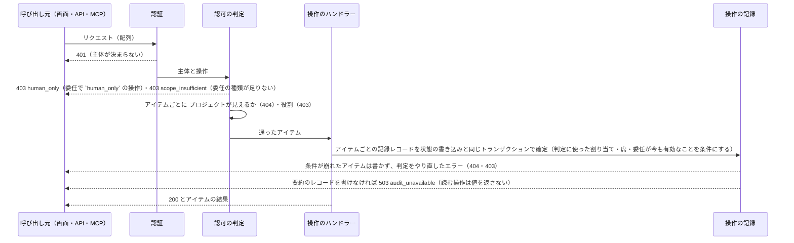
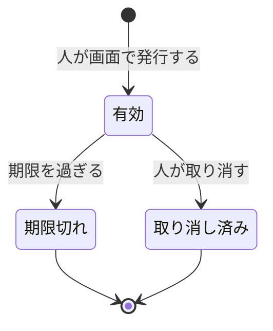
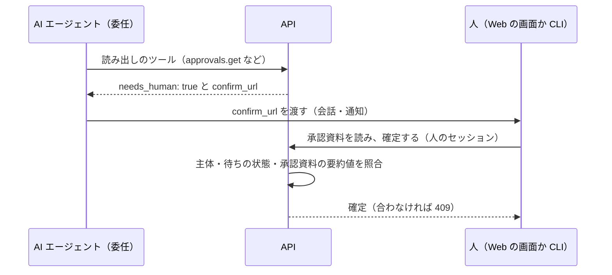
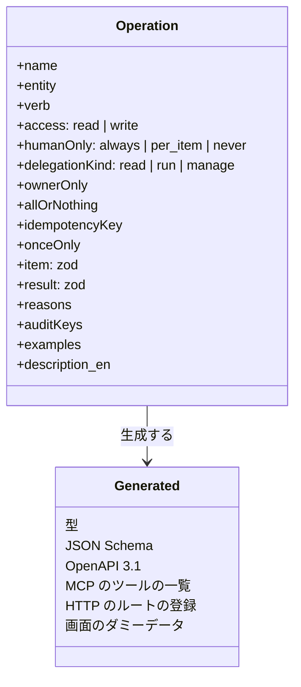

# API と MCP: 画面でできる操作を、人も AI エージェントも同じ操作の表から同じ認可で行える

API と MCP の形を決める。[全体の設計](overview.md) の機能一覧（F1〜F20・F24・F25）・不変条件（I2〜I5・I9・I12・I14・I15・I23・I24）・集約を受ける。
API と MCP の外で決めるもの:

| 中身 | 文書 |
| --- | --- |
| 画面の項目 | [screens.md](screens.md) |
| ランナーと手元のマシンの振る舞い | [execution.md](execution.md) |
| 資源と費用 | [platform.md](platform.md) |

## この文書で決めること

理由は各決定の節にある。

| 節 | 決めること | 決定 |
| --- | --- | --- |
| [呼び出しの規約](#呼び出しの規約) | 操作の名前・HTTP のルート・MCP のツールの名前を 1 対 1 にし、メソッドを POST にそろえる | 40 |
| [呼び出しの規約](#呼び出しの規約) | レスポンスはアイテムごとの結果を既定にし、エラーは理由のコードだけを返す。500 を返さず 503 にそろえる | 41・46 |
| [呼び出しの規約](#呼び出しの規約) | 冪等キーをアイテムごとに持たせ、24 時間同じ結果を返す | 42 |
| [呼び出しの規約](#呼び出しの規約) | ページ送りは不透明なカーソルで行い、全体の件数を返さない | 43 |
| [呼び出しの規約](#呼び出しの規約) | バージョンをルートのプレフィックスの `/v1` に置く。書くエンティティにバージョンの数を持たせ、条件付きで書く | 44・45 |
| [値の形](#値の形) | 日時・金額・言語・時刻帯・ID を 1 つの形に決める | 47 |
| [操作の一覧](#操作の一覧) | F1〜F20・F24・F25 を操作へ割り、`human_only` の操作を決める。アイテムの形と理由コードはスキーマの正本だけに置き、受け持つ子の課題を決める。問いで `human_only` になる範囲は実行の設計にある区分表に従う | 56・57 |
| [認証と主体](#認証と主体) | 認証を API の Lambda の中の 1 か所に置く | 48 |
| [認可](#認可) | 一覧は見えるプロジェクトの ID からテーブルを引き、通知は送る直前にも照合する | 53 |
| [委任](#委任) | 範囲をプロジェクトと 3 つの操作の種類にし、期限を 1 時間〜30 日にする。MCP は画面で発行した token を貼り、OAuth 2.1 を後に回す | 49・50 |
| [MCP](#mcp) | ツールを操作の表から生成し、セッションを持たない。`human_only` の操作をツールにしない | 51・52 |
| [操作の記録](#操作の記録) | 状態の書き込みと同じトランザクションで追記する | 54 |
| [スキーマの正本](#スキーマの正本) | zod の操作の表を正本にし、OpenAPI は自前の生成のスクリプトで組む | 55 |

## 呼び出しの規約

API の操作は 1 つの画面に合わせず、エンティティ（スプリント・承認の依頼など）と操作（取得・作成・取り消しなど）から起こす（Value 2）。画面・API の呼び出し元・MCP のツールは、同じ操作の表の同じ操作を通る（Value 4、I14）。

### 操作の名前と HTTP のルート

| 決まり | 中身 |
| --- | --- |
| 操作の名前 | `<エンティティの複数形>.<動詞>`。例 `sprints.create`・`approvals.answer`。英小文字・数字・`_` と区切りの `.` だけ |
| HTTP のルート | `POST /v1/<エンティティ>/<動詞>`。操作の名前と 1 対 1 で、`.` を `/` に替えただけ。例 `sprints.create` は `POST /v1/sprints/create` |
| メソッド | 利用者向けの操作はすべて `POST`。読む操作も本文に配列を持つため（下の「本文は配列」） |
| MCP のツールの名前 | 操作の名前そのもの（[MCP](#mcp)） |
| HTTP のルートの変数 | 持たない。プロジェクトやスプリントの ID は本文のアイテムに入れ、アイテムごとに認可を掛ける |
| 動詞 | 読む: `get`（ID で指す）・`list`（条件で絞る）。書く: `create`・`update`・`delete` と、エンティティに固有の動詞（`cancel`・`answer`・`accept`・`revoke` など） |

### 本文は配列

| 決まり | 中身 |
| --- | --- |
| リクエストの本文 | JSON の配列。1 件のときもアイテム 1 個の配列にする（I12）。アイテムの数は 1〜100 |
| レスポンスの本文 | リクエストと同じ数・同じ順の配列。各アイテムは「アイテムの結果」 |
| 成功のアイテム | `{"ok": true, "item": {…}}`。一覧（`list`）は `{"ok": true, "items": [...], "next_cursor": "…" \| null}` |
| 失敗したアイテム | `{"ok": false, "status": 404, "reason": "not_found"}`。`status` は HTTP の状態の数、`reason` は理由のコード。項目のエラーは `"fields": ["/0/title"]` のように位置だけを足す |
| アイテムが失敗したレスポンス | HTTP の状態は 200 のまま。アイテムの結果で読む |
| アイテムごとか、全部か無か | 既定はアイテムごと（成功したアイテムは確定し、失敗したアイテムだけ失敗）。「全部か無か」のフラグを持つ操作は、1 つでも失敗すれば全部を確定せず、失敗しなかったアイテムは `409 not_applied` を返す（決定 41） |
| 全部か無かのアイテムの上限 | 全部か無かの操作では、全アイテムの書き込み（状態・記録レコード・冪等キーの済みのレコード）を 1 つのトランザクションで確定する。アイテムの上限は 100 でなく、アイテム 1 つあたりの書き込み件数から、DynamoDB の 1 トランザクションあたりの件数上限（100 件）に収まる値にし、操作の定義に持つ。越えたリクエストはリクエスト全体の 400 `too_many_items` |
| 同じ対象の重なり | 1 つのリクエストで同じ対象を 2 回指したら、リクエスト全体を 400 `duplicate_item` で拒否する |

「全部か無か」のフラグを持つ操作は、アイテムどうしが合わせて 1 つの変化になる次の 2 つだけである。

| 操作 | 理由 |
| --- | --- |
| `projects.create` | プロジェクト・主リポジトリ・チームへの割り当てを同じ確定で作る。割り当ての無いプロジェクトを作らない（[全体の設計](overview.md) の「プロジェクトとチーム」） |
| `repositories.add` | 主リポジトリがちょうど 1 つ（I1）を、足すリポジトリの組で照合する |

### エラーの形

文言を返さず、理由コードだけを返す。文言は画面の翻訳ファイルが理由コードから作る（Value 5）。

| 区分 | 形 | いつ |
| --- | --- | --- |
| リクエスト全体のエラー | `Content-Type: application/problem+json` で `{"type": "about:blank", "status": 400, "reason": "body_not_array"}`（RFC 9457 の形。`title`・`detail` を持たない） | 本文が JSON でない・配列でない・空・101 個以上か全部か無かの操作の上限を越える・重なり（400）、認証できない（401 `unauthorized`）・検証を通した token のセッションが既に断たれている（401 `session_ended`）、人だけの操作を委任から呼んだ・委任の種類が足りない（403）、記録を書けない・依存先に届かない（503）、呼びすぎ（429） |
| アイテムのエラー | 上の「失敗したアイテム」 | アイテムの形が違う（400 `item_invalid`）、見えない・無い（404 `not_found`）、役割が足りない（403 `role_insufficient`）、バージョンが合わない（409 `version_mismatch`）、状態が合わない（409 `state_mismatch`）、冪等キーの使い回し（422 `idempotency_key_reused`）、同じ冪等キーの 1 回目が途中（409 `in_progress`）、使える量の上限（403。理由コードは使える量の判定が返す `monthly_cap_reached`・`place_not_allowed`・`inference_not_allowed`・`currency_mismatch`（使った額と上限額の通貨が違う。換算しない）。同時に動くレーンの数の `concurrency_full` は待てば解けるため、アイテムのエラーにせずレーンの待ちの理由として返す。[実行の設計にある使える量の判定](execution.md#使える量の判定)） |
| 401 の本文 | 既定は理由によらず同じ `{"type": "about:blank", "status": 401, "reason": "unauthorized"}`。`reason` が `session_ended` になるのは、人の Cognito の access token が、署名・発行元・クライアント・`token_use`・必須の claim（`exp`・`username`・`auth_time`・`origin_jti`）・期限（`sessions.delete` は `SESSION_DELETE_EXPIRED_GRACE_MS` の猶予の内）・エンドポイントの照合をすべて通した上で、強整合で読んだ行で、そのセッション（`sub` と `origin_jti`）が期限によらず API で断たれていると確認したときだけである。断たれているとは次のどれか: セッションの取り消しの行がある（`sessions.delete` を除く。こちらは成功で `revoked_at` を返す）・[対応の行](data.md#cognito-の主体の対応の行) が無い（`sessions.create` を除く。こちらは「まだ結んでいない人」として渡る）・対応の行があり token の `auth_time` が `bound_auth_time` より前。同じセッションの token は `sub`・`origin_jti`・`auth_time` が同じで、取り直しても同じ行に当たるため、`session_ended` はそのセッションのどの token も以後 API を通らないことを表す | token の形・署名・claim・期限・エンドポイントの外れと、`sessions.create` の「まだ結んでいない人」の照合の外れ（利用者プールに利用者が無い・別の `sub` が返る・サインインから 5 分を過ぎた）は `unauthorized` で区別せず、何が違ったかを明かさない。`session_ended` を返すのは署名を確認した token の持ち主だけで、明かすのはその持ち主のセッションが断たれたことだけである（画面がサインアウトの確定と取り違えないため。[画面の文書のサインアウトで消す](screens.md#サインアウトで消す)） |
| 500 | 返さない | 想定しない失敗はハンドラーの外側で受けて 503 `unavailable` にし、リクエストの ID とともにログへ残す（決定 46） |

理由のコードはスキーマの正本の 1 か所に操作ごとの一覧として置き、一覧に無いコードを返すと単体テストが落ちる。全体設計の文が名を挙げる理由のコード（`project_transfer_in_progress`・`credential_rotation_in_progress`・`human_only`・`visibility_widened`・`destination_unregistered`・`rotation_superseded`・`answer_seq_unknown` など）も、その操作の一覧に置く（決定 56）。

### 冪等キー

| 決まり | 中身 |
| --- | --- |
| どこに置くか | 新しいものを作る操作と、外へ働きかける操作（`sprints.create`・`sprints.cancel`・`approvals.answer`・`questions.answer`・`delegations.create`・`machines.create` など）と、レスポンスを失った送り直しに 1 回目の確定を返す要る `logins.delete`（外した行は消えるため、鍵が無いと送り直しが 404 になり、確定を知れない）のアイテムに `idempotency_key`（UUID の形）を必ず持たせる |
| 何で見分けるか | 主体の利用者・呼び出し元・操作の名前・キーの 4 つの組。呼び出し元は、人の直の操作なら「人」、委任なら委任の ID。`sessions.create` だけは主体の利用者の代わりに、認証が検証した Cognito の `sub` と token の `auth_time`（IdP でサインインした時刻）の組で区切る。初回は利用者がまだ無く（まだ結んでいない人）、初回の確定の後にレスポンスを失って送り直すと対応の行ができて主体が人に変わるため、どちらでも同じ鍵にして初回の結果を返す。refresh token で取り直した token も `auth_time` を変えないため、同じサインインの送り直しは同じ組になる。ログインを外した後にサインインし直すと `auth_time` が変わるため、外す前の鍵で送り直しても外す前の利用者の結果は返らない（[Cognito の主体の対応の行](data.md#cognito-の主体の対応の行) を消した `sub` が作り直しの後に同じでも）。`logins.create` は主体の利用者にリクエストのセッション（Cognito の `sub`・`origin_jti`・対応の行の `bound_auth_time`）を足して区切り、流れを始めたセッションの外の再送へ保存した連携の候補を返さない（[詳細設計の `idempotencyPrincipalKey`](detail.md#関数の仕様)） |
| 結果を共有する範囲 | 同じ利用者の人の直の操作は、セッション（端末やサインインし直し）が違っても 1 回目の結果を共有する。端末がサインインし直した後に送り直しても 2 重に作らないためである。委任のリクエストは、同じ委任の中でだけ共有し、人の直の操作とも、同じ利用者のほかの委任とも共有しない |
| 結果を返す前 | 2 回目も、今の主体で認可の判定（プロジェクトが見えるか・役割・委任の範囲・`human_only` か）を 1 回目と同じくアイテムごとに掛ける。通ったアイテムにだけ 1 回目の結果を返す。通らないアイテムには 1 回目の結果を返さず、今回の判定で出たエラー（見えなければ 404 `not_found`）を返す |
| 2 回目 | 24 時間の間、同じ組の 2 回目は 1 回目のアイテムの結果を返し、状態を変えない。1 回だけ返す値（委任の token など）は 2 回目に `null` にする。どの値かは操作ごとにスキーマの正本（`onceOnly`）が場所で決め、その場所の形は `null` を受ける |
| 中身が違う | 同じ組でアイテムの中身が違えば 422 `idempotency_key_reused` |
| 1 回目が途中 | 409 `in_progress`。呼び出し元は待って同じアイテムを送り直す |

### ページ送り

| 決まり | 中身 |
| --- | --- |
| 一覧のアイテム | `{"project_ids": [...], <条件>, "limit": 50, "cursor": "…"}`。`limit` は 1〜100、既定 50 |
| 続き | レスポンスの `next_cursor` を次のリクエストの `cursor` へ渡す。無ければ `null` |
| カーソルの中身 | 主体・条件・位置をサーバーのキーで暗号化した不透明な値。別の主体・別の条件で使うと 400 `cursor_invalid` |
| 全体の件数 | 一覧のレスポンスに持たない。数が要る画面（未読の数・待ちの数）は、認可で絞った後の数を返す操作を別に持つ（[認可](#認可)の「件数」） |
| 並び | 操作ごとに 1 つに決め、スキーマの正本に書く（例: 承認の依頼は待ち始めた時刻の古い順） |

### バージョンと条件付き更新

| 決まり | 中身 |
| --- | --- |
| API のバージョン | HTTP のルートのプレフィックスの `/v1`。項目を足すことは `/v1` のまま行い、呼び出し元は知らない項目を読み飛ばす。項目を消す・意味を変えるときは `/v2` を並べて出し、`/v1` を残す期間を決めてから消す |
| エンティティのバージョン | 書き換えられる各エンティティ（上書きの行）は `version`（1 から始まる整数）を持つ。書くたびに 1 つ上げる。持つ行と列は [データの共通のカラム](data.md#共通のカラム) が正本 |
| 条件付き更新 | `update`・`delete` と状態を変える動詞のアイテムは、読んだときの `version` を持つ。サーバーの今の値と違えば 409 `version_mismatch` で書かない |
| 承認の確定 | `approvals.answer` のアイテムは `version` に加えて、読んだ承認資料の要約値 `material_digest` を持つ。どちらかが今と違えば 409（I4） |
| オフラインの確定待ち | 画面はつながった後に、読んだときの `version` と `material_digest` のまま送る。サーバーは今の状態と照合し、合わなければ 409 を返す（[オフライン](screens.md#オフライン)） |

### 共通ヘッダ

| ヘッダ | 決まり |
| --- | --- |
| `Authorization` | `Bearer <token>`。種類は [認証と主体](#認証と主体) |
| `Content-Type` | リクエストは `application/json`。リクエスト全体のエラーレスポンスだけ `application/problem+json` |
| `Cache-Control` | レスポンスはすべて `no-store`。プロジェクトの中身を中継装置や共有キャッシュに残さない |
| `Accept-Language` | 読まない。API は言語でレスポンスを変えない |

## 値の形

日時・金額・言語・時刻帯を、国や地域で読み違えない形で受け渡す（Value 5、I15）。スキーマの正本の検証が、形に合わない値を 400 `item_invalid` で拒む。

| 値 | 形 | 例 | 拒むもの |
| --- | --- | --- | --- |
| 日時 | RFC 3339 の UTC。末尾は `Z`、秒の小数は 3 桁まで | `2026-11-17T03:04:05.123Z` | 時刻帯の無い日時・`+09:00` など `Z` でない差 |
| 日付だけ | `YYYY-MM-DD`。月の締めなど暦の日付だけに使い、どの時刻帯での日付かは隣の項目に持つ | `{"month": "2026-11", "time_zone": "UTC"}` | 時刻帯の無い月の境 |
| 金額 | `{"amount_minor": 1234, "currency": "USD"}`。最小単位（ISO 4217 の minor unit）の整数と ISO 4217 の英字 3 字 | 12.34 ドルは `1234`・`USD`。1,000 円は `1000`・`JPY` | 小数の金額・通貨の無い金額 |
| 言語 | BCP 47 の言語タグ | `ja`・`en`・`pt-BR` | 形の違うタグ。画面の翻訳ファイルが無い言語は利用者の設定で選べない |
| 時刻帯 | IANA の時刻帯の名前 | `Asia/Tokyo`・`America/New_York` | `JST` などの略称・`+09:00` などの差 |
| ID | `<種類のプレフィックス>_<UUIDv7>`（RFC 9562 の文字の形、小文字） | `spr_01935b4e-7c2a-7d10-8f3e-2b6f0c9a1d42` | 種類のプレフィックスが操作と合わない ID（404 と同じに扱う） |
| GitHub の参照 | リポジトリ `owner/name`、課題と PR `owner/name#N` | `acme/web#42` | — |

ID の種類のプレフィックス:

| プレフィックス | 種類 | プレフィックス | 種類 |
| --- | --- | --- | --- |
| `usr` | 利用者 | `apr` | 承認の依頼 |
| `team` | チーム | `qst` | 問い |
| `inv` | 招待 | `ntc` | 通知 |
| `prj` | プロジェクト | `dst` | 通知先 |
| `repo` | リポジトリ | `dlg` | 委任 |
| `trf` | 割り当ての移行 | `mch` | 手元のマシン |
| `spr` | スプリント | `key` | 持ち込みのキー（`byok`） |
| `lane` | レーン | `aud` | 操作の記録 |

## 操作の一覧

機能一覧の F1〜F20・F24・F25 を、エンティティごとの操作へ 1 行ずつ割る。HTTP のルートのメソッドはすべて `POST` で、表では HTTP のルートの path だけを書く。本文はすべて配列で受け渡す（[本文は配列](#本文は配列)）。

アイテムの項目・型・必須か・操作ごとの理由コードは、スキーマの正本にある操作定義（`packages/contracts/`）だけに置き、この文書に表を写さない（決定 56）。この文書は、全体設計の文で答えが決まった変わり目（[入出力の変わり目](#入出力の変わり目)）だけを書く。スキーマの正本へは次の子の課題が書く。

| 操作と HTTP のルート | 受け持つ子の課題 |
| --- | --- |
| F1〜F3（`sessions.*`・`users.*`・`login_links.*`・`logins.*`・`teams.*`・`seats.*`・`invitations.*`） | #4 |
| F4〜F6（`projects.*`・`github_installations.*`・`repositories.*`・`project_transfers.*`） | #5 |
| F7〜F10・F17（`waiting_counts.get`・`issue_candidates.list`・`sprints.*`・`lanes.list`・`progress_events.list`・`execution_settings.*`・`model_keys.*`）とランナー向けの 5 つの HTTP のルート | #6 |
| F18（`machines.*`）と手元のマシン向けの 2 つの HTTP のルート | #7 |
| F11〜F15（`approvals.*`・`questions.*`・`notices.*`・`notification_targets.*`） | #8 |
| F16・F20（`delegations.*`・`audit_records.list`） | #11 |
| F19（`usage.get`・`usage_records.list`・`spend_caps.update`） | #29 |
| DB セットアップ関数が呼ぶ 3 つの処理（`db_prep.is_current`・`db_prep.read_target`・`db_prep.record`）の本番の実装（終わりの記録のインタフェース）・DB セットアップ関数を非同期で呼ぶ API の側と定期ジョブ・インタフェースを DB セットアップ関数のエントリポイントへつなぐこと | #6（関数そのもの・呼び出しの値と終了結果の形・インタフェースの型は #13） |

表の列の読み方:

| 列の値 | 意味 |
| --- | --- |
| 「MCP のツールか」の「ツール」 | 同じ名前のツールがある |
| 「MCP のツールか」の「依頼と材料の読み出しだけ」 | `human_only` の操作で、MCP では対になる読み出しのツールだけを持つ（[`human_only` の操作の扱い](#`human_only` の操作の扱い)） |
| 「読む / 書く」の括弧 | 委任で呼ぶときに要る委任の種類（[委任](#委任)） |

### 利用者向けの操作

#### 利用者・チーム・プロジェクト（F1〜F6）

| 操作の名前 | HTTP のルート | 機能 | MCP のツールか | `human_only` か | 読む / 書く |
| --- | --- | --- | --- | --- | --- |
| `sessions.create` | `/v1/sessions/create` | F1 | 依頼と材料の読み出しだけ（`users.get`） | `human_only` | 書く |
| `sessions.delete` | `/v1/sessions/delete` | F1 | 依頼と材料の読み出しだけ（`users.get`） | `human_only` | 書く |
| `users.get` | `/v1/users/get` | F1・F2 | ツール | — | 読む（read） |
| `users.update` | `/v1/users/update` | F2 | ツール | — | 書く（manage） |
| `login_links.create` | `/v1/login_links/create` | F1 | 依頼と材料の読み出しだけ（`users.get`） | 人だけ | 書く |
| `logins.create` | `/v1/logins/create` | F1 | 依頼と材料の読み出しだけ（`users.get`） | `human_only` | 書く |
| `logins.delete` | `/v1/logins/delete` | F1 | 依頼と材料の読み出しだけ（`users.get`） | `human_only` | 書く |
| `teams.list` | `/v1/teams/list` | F3 | ツール | — | 読む（read） |
| `teams.get` | `/v1/teams/get` | F3 | ツール | — | 読む（read） |
| `teams.create` | `/v1/teams/create` | F3 | 依頼と材料の読み出しだけ（`teams.list`） | `human_only` | 書く |
| `teams.update` | `/v1/teams/update` | F3 | ツール | — | 書く（manage） |
| `seats.list` | `/v1/seats/list` | F3 | ツール | — | 読む（read） |
| `seats.update` | `/v1/seats/update` | F3 | 依頼と材料の読み出しだけ（`seats.list`） | `human_only` | 書く |
| `seats.delete` | `/v1/seats/delete` | F3 | 依頼と材料の読み出しだけ（`seats.list`） | `human_only` | 書く |
| `invitations.list` | `/v1/invitations/list` | F3 | ツール | — | 読む（read） |
| `invitations.create` | `/v1/invitations/create` | F3 | 依頼と材料の読み出しだけ（`invitations.list`） | `human_only` | 書く |
| `invitations.accept` | `/v1/invitations/accept` | F3 | 依頼と材料の読み出しだけ（`invitations.list`） | `human_only` | 書く |
| `invitations.delete` | `/v1/invitations/delete` | F3 | 依頼と材料の読み出しだけ（`invitations.list`） | `human_only` | 書く |
| `projects.list` | `/v1/projects/list` | F4・F7 | ツール | — | 読む（read） |
| `projects.get` | `/v1/projects/get` | F4 | ツール | — | 読む（read） |
| `projects.create` | `/v1/projects/create` | F4 | 依頼と材料の読み出しだけ（`teams.list`） | `human_only` | 書く（全部か無か） |
| `projects.update` | `/v1/projects/update` | F4 | ツール | — | 書く（manage。`ask_human_only` を変えるアイテムは `human_only`。AI エージェントが自分の答えられる範囲を広げないため） |
| `github_installations.list` | `/v1/github_installations/list` | F5 | ツール | — | 読む（read） |
| `github_installations.link` | `/v1/github_installations/link` | F5 | 依頼と材料の読み出しだけ（`github_installations.list`） | `human_only` | 書く |
| `repositories.list` | `/v1/repositories/list` | F5 | ツール | — | 読む（read） |
| `repositories.add` | `/v1/repositories/add` | F5 | ツール | — | 書く（manage、全部か無か） |
| `repositories.remove` | `/v1/repositories/remove` | F5 | ツール | — | 書く（manage） |
| `project_transfers.list` | `/v1/project_transfers/list` | F6 | ツール | — | 読む（read） |
| `project_transfers.create` | `/v1/project_transfers/create` | F6 | 依頼と材料の読み出しだけ（`project_transfers.list`） | `human_only` | 書く |
| `project_transfers.accept` | `/v1/project_transfers/accept` | F6 | 依頼と材料の読み出しだけ（`project_transfers.list`） | `human_only` | 書く |
| `project_transfers.delete` | `/v1/project_transfers/delete` | F6 | 依頼と材料の読み出しだけ（`project_transfers.list`） | `human_only` | 書く |
| `projects.close` | `/v1/projects/close` | F6 | 依頼と材料の読み出しだけ（`projects.get`） | `human_only` | 書く |

#### スプリント・承認・問い・通知（F7〜F14）

| 操作の名前 | HTTP のルート | 機能 | MCP のツールか | `human_only` か | 読む / 書く |
| --- | --- | --- | --- | --- | --- |
| `waiting_counts.get` | `/v1/waiting_counts/get` | F7・F14 | ツール | — | 読む（read） |
| `issue_candidates.list` | `/v1/issue_candidates/list` | F8 | ツール | — | 読む（read） |
| `sprints.create` | `/v1/sprints/create` | F8 | ツール | — | 書く（run） |
| `sprints.list` | `/v1/sprints/list` | F7・F9 | ツール | — | 読む（read） |
| `sprints.get` | `/v1/sprints/get` | F9 | ツール | — | 読む（read） |
| `lanes.list` | `/v1/lanes/list` | F9 | ツール | — | 読む（read） |
| `progress_events.list` | `/v1/progress_events/list` | F9 | ツール | — | 読む（read） |
| `sprints.cancel` | `/v1/sprints/cancel` | F10 | ツール | — | 書く（run） |
| `approvals.list` | `/v1/approvals/list` | F7・F11 | ツール | — | 読む（read） |
| `approvals.get` | `/v1/approvals/get` | F11 | ツール（承認資料を含む） | — | 読む（read） |
| `approvals.answer` | `/v1/approvals/answer` | F12 | 依頼と材料の読み出しだけ（`approvals.get`） | `human_only` | 書く（アイテムは理由 `reason` と、設計承認ゲートだけ外す課題 `drop_issues` を持つ。[入出力の変わり目](#入出力の変わり目)） |
| `questions.list` | `/v1/questions/list` | F7・F13 | ツール | — | 読む（read） |
| `questions.get` | `/v1/questions/get` | F13 | ツール | — | 読む（read） |
| `questions.answer` | `/v1/questions/answer` | F13 | ツール（「`human_only` か」が真の問いのアイテムは 403 `human_only`） | 「`human_only` か」が真の問いだけ `human_only`（[実行の設計にある区分表](execution.md#区分とだれが答えられるか)） | 書く（run） |
| `notices.list` | `/v1/notices/list` | F14 | ツール | — | 読む（read） |
| `notices.mark_read` | `/v1/notices/mark_read` | F14 | ツール | — | 書く（run） |

#### 通知先・委任・実行・費用・記録（F15〜F20）

| 操作の名前 | HTTP のルート | 機能 | MCP のツールか | `human_only` か | 読む / 書く |
| --- | --- | --- | --- | --- | --- |
| `notification_targets.list` | `/v1/notification_targets/list` | F15 | ツール | — | 読む（read） |
| `notification_targets.authorize` | `/v1/notification_targets/authorize` | F15 | 依頼と材料の読み出しだけ（`notification_targets.list`） | `human_only` | 書く |
| `notification_targets.create` | `/v1/notification_targets/create` | F15 | 依頼と材料の読み出しだけ（`notification_targets.list`） | `human_only` | 書く |
| `notification_targets.test` | `/v1/notification_targets/test` | F15 | ツール | — | 書く（manage） |
| `notification_targets.delete` | `/v1/notification_targets/delete` | F15 | 依頼と材料の読み出しだけ（`notification_targets.list`） | `human_only` | 書く |
| `delegations.list` | `/v1/delegations/list` | F16 | ツール | — | 読む（read） |
| `delegations.create` | `/v1/delegations/create` | F16 | 依頼と材料の読み出しだけ（`delegations.list`） | `human_only` | 書く |
| `delegations.revoke` | `/v1/delegations/revoke` | F16 | 依頼と材料の読み出しだけ（`delegations.list`） | `human_only` | 書く |
| `execution_settings.get` | `/v1/execution_settings/get` | F17 | ツール | — | 読む（read） |
| `execution_settings.update` | `/v1/execution_settings/update` | F17 | 依頼と材料の読み出しだけ（`execution_settings.get`） | `human_only` | 書く |
| `model_keys.list` | `/v1/model_keys/list` | F17 | ツール | — | 読む（read） |
| `model_keys.create` | `/v1/model_keys/create` | F17 | 依頼と材料の読み出しだけ（`model_keys.list`） | `human_only` | 書く |
| `model_keys.delete` | `/v1/model_keys/delete` | F17 | 依頼と材料の読み出しだけ（`model_keys.list`） | `human_only` | 書く |
| `machines.list` | `/v1/machines/list` | F18 | ツール | — | 読む（read） |
| `machines.create` | `/v1/machines/create` | F18 | 依頼と材料の読み出しだけ（`machines.list`） | `human_only` | 書く |
| `machines.delete` | `/v1/machines/delete` | F18 | 依頼と材料の読み出しだけ（`machines.list`） | `human_only` | 書く |
| `usage.get` | `/v1/usage/get` | F19 | ツール | — | 読む（read） |
| `usage_records.list` | `/v1/usage_records/list` | F9・F19 | ツール | — | 読む（read） |
| `spend_caps.update` | `/v1/spend_caps/update` | F19 | 依頼と材料の読み出しだけ（`usage.get`） | `human_only` | 書く |
| `audit_records.list` | `/v1/audit_records/list` | F20 | ツール | — | 読む（read） |

#### オーガナイザーと会話（F24・F25）

形と決まりは [オーガナイザー](organizer.md) にある。会話の操作は承認の依頼と問いを変えない（I23）。オーガナイザー専用の委任からは、`human_only` の操作・`manage` の操作に加えて、`approvals.answer`・`questions.answer`・下の表の書き込み（会話へ送る・取り下げるを含む）・委任の操作を 403 で拒否する（I24）。会話へ送る・取り下げる・終える・再開するは、立てた人（送る・取り下げるは立てた人のふつうの委任も。終える・再開するは `human_only` で、委任からは 403 `human_only`）だけが呼べ、ほかの人とその委任は 403 `organizer_owner_only` にする（[オーガナイザーの立てた人だけが動かす](organizer.md#立てた人だけが動かす)）。

| 操作の名前 | HTTP のルート | 機能 | MCP のツールか | `human_only` か | 読む / 書く |
| --- | --- | --- | --- | --- | --- |
| `organizers.list` | `/v1/organizers/list` | F24 | ツール | — | 読む（read） |
| `organizers.get` | `/v1/organizers/get` | F24 | ツール | — | 読む（read） |
| `organizers.create` | `/v1/organizers/create` | F24 | 依頼と材料の読み出しだけ（`organizers.list`） | `human_only` | 書く（アイテムはプロジェクトの ID・題。立てた人の名で専用の委任を作る） |
| `organizers.close` | `/v1/organizers/close` | F24 | 依頼と材料の読み出しだけ（`organizers.get`） | `human_only` | 書く（立てた人だけ。同じトランザクションで専用の委任を取り消す。その後の最初のリクエストから専用の委任の主体は 401） |
| `organizers.resume` | `/v1/organizers/resume` | F24 | 依頼と材料の読み出しだけ（`organizers.get`） | `human_only` | 書く（立てた人だけ。前の専用の委任を取り消し、新しい専用の委任を作る。期限は延ばさない） |
| `organizer_messages.list` | `/v1/organizer_messages/list` | F25 | ツール | — | 読む（read） |
| `organizer_messages.create` | `/v1/organizer_messages/create` | F25 | ツール | — | 書く（run。立てた人だけ。アイテムは種類（指示・質問・起票の依頼）・本文・冪等キー） |
| `organizer_messages.withdraw` | `/v1/organizer_messages/withdraw` | F25 | ツール | — | 書く（run。立てた人だけ。オーガナイザーへ渡す前の項目だけで、渡した後は 409 `already_delivered`） |
| `issue_requests.create` | `/v1/issue_requests/create` | F25 | ツール | — | 書く（run。オーガナイザー専用の委任だけ。アイテムは送信先・題・本文・ラベル・冪等キー。課題は作らず、起票の依頼（承認の依頼。C5。人か、その人の委任が答える）を作る。[実行の文書のオーガナイザーからの起票の依頼](execution.md#オーガナイザーからの起票の依頼)） |

### `human_only` にした理由

下の表の操作を人に限るのは、段階が `human` の設置だけである（[人の確定の段階](#人の確定の段階)）。

| 操作 | 理由（MVV の項目） |
| --- | --- |
| `approvals.answer`・「`human_only` か」が真の問いの `questions.answer` | 承認ゲートとレッドラインの承認と、`human_only` の区分の問いの答えは `human_only`（Value 4、I4）。問いの「`human_only` か」は、問いを作るときに [実行の設計にある区分表](execution.md#区分とだれが答えられるか) で決めて問いのレコードに持つ。区分の一覧はその表を正本とし、この文書は写さない（決定 57） |
| `projects.create`・`project_transfers.*`・`projects.close` | プロジェクトの割り当ての作成・変更・外しは `human_only`（P2、I3） |
| `teams.create`・`seats.update`・`seats.delete`・`invitations.create`・`invitations.accept`・`invitations.delete` | 席はプロジェクトを見られる人を決める。席を足すことはチームの外の人へ見せることに当たる（P2）。席を変える・外す操作も、同じ判断の流れに置くため `human_only` にそろえる |
| `delegations.create`・`delegations.revoke` | 委任が委任を作ると、人の確認しない範囲が広がる（Value 4） |
| `organizers.close` | 戻せない `ended` へ移し、状態用 S3 バケット にある会話のキャッシュ（claude の会話の記録）を消す期限を決める。取り消せない操作なので、オーガナイザーを立てた人が、画面で消える会話の記録と終えた後の状態を読んでから確定する（C4） |
| `notification_targets.delete` | Slack の通知先を外すと、bot token を置いた Secrets Manager の秘密も消す（[土台の文書の決定 90](platform.md#決定の記録)）。秘密に触れる操作なので `human_only` にする（C1） |
| `machines.delete` | 登録を外すと、そのマシンの登録の token で呼べる API は、会話の記録を消したことの通知の 1 つだけになる（C2）。マシンに残る会話の記録を消す手順に関わるので、人が画面で外すマシンと、そこに残る未消去の会話の記録を読んでから確定する |
| `organizers.create`・`organizers.resume` | どちらも立てた人の名で専用の委任（期限 30 日）を作る。委任から呼べると、委任が委任を作ることになり、`delegations.create` を `human_only` にした理由と同じく人の確認しない範囲が広がる（Value 4） |
| `notification_targets.create`・`model_keys.create` | 送信先の値と持ち込みのキーはどちらも秘密の値で、秘密を受け取る操作は `human_only`（[全体の設計](overview.md) の「人へ残す判断」の C1） |
| `model_keys.delete` | 持ち込みのキーは秘密で、消すと推論が止まり、同じ値を戻せない（C1）。MCP からは `model_keys.list` で消す対象（名前・作った日・最後に使った日。値は出さない）を確認できる |
| `notification_targets.authorize` | Slack の登録を始め、認可の取引を人のサインインセッションに結ぶ。`notification_targets.create` と同じセッションで呼ぶ必要がある（[実行の文書の Slack の登録](execution.md#slack-の登録)） |
| `execution_settings.update`・`spend_caps.update` | 推論の手段と上限額は請求の額を変える |
| `machines.create` | 登録の token（秘密）を発行する |
| `sessions.create`・`sessions.delete`・`login_links.create`・`logins.create`・`logins.delete`・`github_installations.link` | 人のブラウザーの中の流れ（サインイン・IdP のログインをつなぐ戻り・GitHub の導入の戻り）で、委任の主体が通る流れでない。`logins.delete` は最後の 1 つのログインを外すリクエストを 409 で拒む |

外す・狭める操作のうち、委任から呼べるのは `repositories.remove` だけである。見える範囲も費用も広げず、秘密にも触れないためである。ほかの外す・狭める操作は、上の表に書いた理由で `human_only` にする。たとえば `notification_targets.delete` は Slack の通知先の bot token の秘密を消し、`machines.delete` はそのマシンの登録の token で呼べる API を狭め、会話の記録を消す手順に関わるので、どちらも `human_only` にする（上の表）。また、`machines.delete` はマシンの登録を外すだけで、オーガナイザーの会話の記録を消した確認の代わりにはならない。外したマシンの未消去の記録は残り、割り当ての移行の受け入れを待たせ続ける（[オーガナイザーが手元のマシンに残す会話の記録](organizer.md#会話のキャッシュ)）。`model_keys.delete` は秘密を扱うので、狭める操作でも `human_only` にする（上の表）。

### 承認する以外の答えの理由

**承認する以外の答えと、取り消す・拒否する・外す操作には、どの入口（画面・API・MCP・CLI）からでも理由を添えることができる。理由が必須なのは差し戻すときだけである**（nd-factory の持ち主の決定、2026-11-24）。1 つのリクエストは複数の答えや操作の対象（アイテム）を持てる。理由はアイテムごとの `reason`（文字列、0〜10,000 字）で受け、答えか操作の記録（I9）と一緒に残し、通知と会話の項目にも載せる。

| 当たるもの | 理由 |
| --- | --- |
| `approvals.answer` の承認する（`approved`）以外の答え（差し戻す・承認しない・やり直す・終える・取り消す・起票しない） | 差し戻すは必須、ほかは任意 |
| `questions.answer` の答え | 任意。推奨の選択肢以外を選んだとき、または人の作業を求める問い（`ndf-ask:human-action`）を取り消すときは、画面が理由の欄を最初から開いて出す |
| `sprints.cancel`・`organizers.close`・`organizer_messages.withdraw`・`project_transfers.delete`・`projects.close`・`delegations.revoke` | 任意 |
| 外す操作（`seats.delete`・`invitations.delete`・`machines.delete`・`model_keys.delete`・`notification_targets.delete`・`repositories.remove`） | 任意 |

### 人の確定の段階

**この文書と他の文書が「`human_only`」とした確定を人に限るのは、商用利用を始めた後の本番の設置だけである。** それ以外の設置では、委任とオーガナイザー専用の委任（AI エージェント）も同じ確定を行える（nd-factory の持ち主の決定、2026-11-24。決定 156）。当たる確定は次のとおり。

- 承認の依頼すべての確定（[全体の設計](overview.md) の不変条件 I4）
- 区分が `human_only` の問いへの答え（同じく I4）
- オーガナイザー専用の委任に通さない操作（同じく I24。終える・`approvals.answer`・`questions.answer`）
- 上の表の `human_only` の操作

| 設置 | 段階 | `human_only` の確定 |
| --- | --- | --- |
| 商用利用を始める前のすべての設置 | `ai` | 委任・専用の委任からも確定できる。`human_only` で拒否しない |
| 商用利用を始めた後の開発の設置 | `ai` | 同上 |
| 商用利用を始めた後の本番の設置 | `human` | この文書のとおり、人のログインセッションからだけ確定する |

- **商用利用の開始**: 機能が一通りそろい、β テストを経て nd-factory を正式版として公開するとき。その設置を運用する人が、設定のファイルの `launch_declared` を真にして宣言する
- **段階の保存先**: API は、設置ごとの設定のファイル（[settings.md](../operations/settings.md)）の 2 つのキーから段階を決める
  - `launch_declared`: 商用利用を宣言したか。既定は偽
  - `environment_kind`: `development` か `production`
  - `human` になるのは、宣言した・本番の両方がそろったときだけ
  - 設定のファイルが読めない・キーが無い・値の形が違うときは、どれも `human` にする。「既定は偽」は、新しく設置するときに書く値を指す
  - キーは、それを読むコードを足す PR と同じ PR で `packages/contracts/` のスキーマに足す
- **段階を変えられる人**: API・MCP・画面には、この 2 つのキーを書き換える操作を置かない。変わるのは、人が設置のコマンドを打つか、反映パイプラインの承認（AWS の画面で人が押す）を通したときだけである。段階が `ai` の間も、AI エージェントは段階を変えられない
- **変わらないもの**: 確定の時点でサーバーの今の状態（待っている・承認資料の要約値が同じ）と照合すること、オフラインの端末から確定しないこと、操作の記録（I9）に確定した主体（人か、どの委任か）を書くことは、段階によらない
- **MCP**: 段階が `ai` の設置では、`human_only` の操作も MCP のツールとして出す。`human` の設置では上の表のとおり出さない
- **画面**: 段階が `ai` の設置では、承認の詳細画面と問いの画面に「この設置では AI も確定できます」のバッジを出す

### ランナー・手元のマシンの HTTP のルート

ランナー・手元のマシンは、利用者向けの操作の表に入らず、自分向けの HTTP のルートだけを通る。

オーガナイザーのレーンのランナーも同じ交換・ハートビート・事象・署名つき URL の経路を通るが、レスポンスの中身はレーンの種類で分ける。オーガナイザーのレーンの交換とハートビートのレスポンスは、レーンの token と推論の資格情報（`managed` なら一時の資格情報、`byok` のホステッドならチームの API キー。キーはランナーだけが持ち、claude へは推論の中継を通して使わせる。[オーガナイザーの資格情報](organizer.md#資格情報)）だけを持ち、GitHub の token・進行テーブルの DB の接続の値・NDF の起動の指示を持たない。事象は起動・休止・終わりと使った量だけで、署名つき URL は、PUT をそのオーガナイザーが持つ現世代のプレフィックス（`v1/projects/<プロジェクト>/organizers/<オーガナイザー>/<世代>/`）の下の、API がそのリクエストで作ったキャッシュの ID のオブジェクトだけに、1 回だけ書ける形（`If-None-Match: *` を署名に含める）で出す。レスポンスにキャッシュの ID を添える。GET は復元に使うキャッシュ（`transcript_generation` の世代の `transcript_object_id`）だけに出す。`/v1/runner/answers/list`・`/v1/runner/answer_deliveries/create` は 401 で拒否する。スプリントのレーンの token で下の `organizer_` の経路と `/mcp` を呼ぶと 401 にする。本文は利用者向けと同じく配列で受け渡す（I12）。順序は [実行](execution.md) が持ち、リクエストとレスポンスの項目はスキーマの正本に、受け持つ子の課題（上の操作の一覧の表）が書く。

| HTTP のルート | 主体 | リクエストのアイテム | レスポンスのアイテム | 何をするか |
| --- | --- | --- | --- | --- |
| `/v1/runner/exchanges/create` | ランナー（交換用トークン） | アイテム 1 個（中身なし） | レーンの token・指示・プロジェクトの進行テーブルの DB の接続の値・1 つのリポジトリに絞った GitHub の token・`managed` なら推論の一時の資格情報 | 起動の直後に 1 回だけ交換する |
| `/v1/runner/events/create` | ランナー（レーンの token） | 進捗の事象（連番つき） | 事象ごとの受け取り | 進捗の事象を送る。同じ連番は 1 件だけ（I13） |
| `/v1/runner/heartbeats/create` | ランナー（レーンの token） | レーンの今の区切り | 再取得した token と資格情報・止める指示 | 生きていることを通知し、期限の前に再取得する |
| `/v1/runner/state_urls/create` | ランナー（レーンの token） | GET か PUT か。スプリントのレーンは、そのレーン用プレフィックスの下のオブジェクトの名前も渡す。オーガナイザーのレーンはオブジェクトの名前を渡さない（渡すと 400） | 15 分で切れる状態用 S3 バケット の署名つき URL。スプリントのレーンでは、渡した名前とその方法だけに使える URL。オーガナイザーのレーンでは、PUT なら API が作ったキャッシュの ID と、現世代のプレフィックス下にあるそのキャッシュにだけ 1 回書ける URL。GET なら復元に使うキャッシュ（`transcript_generation` の世代の `transcript_object_id`）の URL とそのキャッシュの ID で、復元に使うキャッシュが無ければ URL を持たないレスポンス | NDF のファイルや会話のキャッシュを送る・受ける直前に URL を受ける。URL の期限を記す書き込みで、レーン（オーガナイザーのレーンではオーガナイザー）が同じ世代のまま書き込める状態であることを条件にする。レーンが終わった後・世代が替わった後は 401、移行中のプロジェクトでは 409（[データの署名つき URL](data.md#署名つき-url)） |
| `/v1/runner/answers/list` | ランナー（レーンの token） | レーンの ID | 渡す答え（答えの ID を冪等キーとして。前の世代が受け取って渡し中のままの答えは `redeliver` が真）と、そのレーンで届いた答えのレコードに記した NDF の答えの事象番号の並び（`delivered_seqs`） | 確定した答え（委任が確定した問いの答えを含む）を受け取る。送達の対象外の答えは載せない（[実行の設計の「答えの送達」](execution.md#答えの送達)）。レーンが終わった後・世代が替わった後はレーンの token を断つため 401 で、ランナーはこれでレーンの終わりを知って止まる。空の一覧はレーンの終わりを表さない（[実行の設計にあるレーンの状態](execution.md#レーンの状態)） |
| `/v1/runner/answer_deliveries/create` | ランナー（レーンの token） | 答えの ID と、`ndf answer` の結果の `metrics.seqs`（NDF の答えの事象の番号） | 受け取り（送達の状態を「届いた」にし番号を記す書き込みが確定してから返す。答えの語が `rejected`・`cancel` なら、その確定の後にレーンを「取り消した」にし E19 を出す書き込みも確定してから返す） | 答えを NDF へ渡したことを通知する（E14、I5）。承認しない・取り消すの答えでは、送達が確定すると実行の制御がレーンを取り消す（[実行の設計の「答えの送達」](execution.md#答えの送達) の「渡した後の取り消し」）。番号は答えのレコードの `ndf_event_seqs` に記す。成功を返した後の `/v1/runner/answers/list` は、強整合読み込みでこの番号を `delivered_seqs` に含める（[実行の設計の「答えの送達」](execution.md#答えの送達)） |
| `/v1/runner/organizer_inputs/list` | オーガナイザーのレーン（レーンの token） | なし（オーガナイザーと世代はレーンの token から決め、アイテムからは受けない） | 次に渡す人の項目 1 件（項目の ID を重複を除くキーとして）。渡して受け取りの無い項目があれば、世代を問わずその項目だけを `redeliver` を真にし、答えが会話にあるか（`replied`）を添えて返す | オーガナイザーのレコードにある処理中の項目（`inflight_message_id`）が空でなければ、その項目の `delivered_generation` を今の世代に書き直して返し、次の項目は渡さない。空なら次の項目について、`inflight_message_id` が空であることと、項目の `delivered_at` と `withdrawn_at` が空であることを条件に、`inflight_message_id`・`delivered_at`・`delivered_generation` を 1 つのトランザクションで書き、確定してから返す。渡す・渡し直すのどちらの書き込みも、オーガナイザーが `active` で世代が token と同じことを条件に入れ、渡し直すでは `inflight_message_id` がその項目で `received_at` が空であることも条件にする。条件が外れたら、オーガナイザーのレコードを読み直す。`active` でないか世代が違えば 401。処理中の項目があればそれを渡し直し、空なら（利用者が候補を先に取り下げた）次の候補を選び直す。候補が無ければ空の一覧を返す。取り下げた項目は返さない（[オーガナイザーの渡し方と取り下げ](organizer.md#渡し方と取り下げ)） |
| `/v1/runner/organizer_replies/create` | オーガナイザーのレーン（レーンの token） | 応えた項目の ID・本文 | 受け取り | オーガナイザーの答えを会話へ追記する。応えた項目の ID を冪等キーにし、送り直しで 2 件にしない。同じトランザクションで、オーガナイザーが `active` で世代が token と同じこと（オーガナイザーのレコードの `ConditionCheck`）と、項目がレーンの token のオーガナイザーのもので `delivered_generation` が token の世代と同じことを条件に書く。オーガナイザーの条件が外れたら 401、項目の条件が外れたら 404 |
| `/v1/runner/organizer_receipts/create` | オーガナイザーのレーン（レーンの token） | 項目の ID | 受け取り | claude へ渡した項目の処理を終えたことを通知し、`received_at` を空のときに 1 回だけ書く。同じトランザクションで、オーガナイザーのレコードの `inflight_message_id` を、オーガナイザーが `active` で世代が token と同じで、`inflight_message_id` がその項目であることを条件に空にする。項目がレーンの token のオーガナイザーのもので `delivered_generation` が token の世代と同じことも条件にする。オーガナイザーの状態か世代の条件が外れたら 401、項目の条件が外れたら 404。その項目への答えが会話に無ければ 409 `reply_missing` |
| `/v1/runner/organizer_transcripts/create` | オーガナイザーのレーン（レーンの token） | 書き終えたキャッシュの ID | 受け取り | 今の世代のプレフィックスへ会話のキャッシュを書き終えたことを通知する。そのキャッシュの ID のオブジェクトが token の世代のプレフィックスの下にあることを確認、token の世代が今の世代で、オーガナイザーが `active` で、記したキャッシュの ID が同じ世代ならそれより新しいことを条件に、`transcript_generation` と `transcript_object_id` をその世代とキャッシュの ID にし、前の世代のキャッシュを消す対象にする。token の世代が今の世代で、オーガナイザーが `active` で、通知したキャッシュの ID がすでに確定したキャッシュと同じなら、書き換えずに受け取りを返す。確定した後にレスポンスだけが途切れたときに、ランナーが送り直して確定を確認するためである（[オーガナイザーの会話のキャッシュ](organizer.md#会話のキャッシュ)） |
| `/v1/machine/heartbeats/create` | 手元のマシン（登録の token） | マシンの状態・受けられるレーンの数 | 割り当てたレーン・差し替えた登録の token。最初のハートビート（マシンが登録待ち）のレスポンスはマシンの ID・ハートビートの間隔・差し替えた登録の token を持つ | ハートビート。割り当てを受け取る。オーガナイザーのレーンの割り当ては、オーガナイザーの ID と世代を持つ。最初のハートビートが登録を兼ねる（[実行の文書の決定 102](execution.md#決定の記録)）。登録を外したマシン（`machines.delete`）は 401 `machine_deleted` |
| `/v1/machine/lane_claims/create` | 手元のマシン（登録の token） | 受けるレーンの ID | 交換用トークン。オーガナイザーのレーンなら、オーガナイザーの ID と世代も返す | 割り当てたレーンを受け、ランナーを起動する。オーガナイザーのレーンなら、交換用トークンを返す前に、同じトランザクションで、プロジェクトのレコードの `organizer_wipes_pending` にマシン・オーガナイザー・世代のアイテムを足す（移行中のフラグが空であることを条件にする）。同じマシンが同じレーンで呼び直したら、同じオーガナイザーの ID と世代を返す。交換用トークン は交換する前だけ出し直し、前の token を無効にする。交換した後・レーンが止まった後は 409 で、本文にオーガナイザーの ID と世代を添える（[オーガナイザーが手元のマシンに残す会話の記録](organizer.md#会話のキャッシュ)） |
| `/v1/machine/organizer_wipes/create` | 手元のマシン（登録の token。登録を外したマシンの token と、期限を過ぎた token も受ける） | 作業の場所を消し終えたオーガナイザーのレーン（オーガナイザーの ID と世代の組の配列。消した世代ごとに 1 組） | 受け取り | 組ごとに、プロジェクトのレコードの `organizer_wipes_pending` から、登録の token のマシンと通知した組が一致するアイテムだけを外す。ほかの世代のアイテムは外さない。一致するアイテムが無い組も受け取りを返す。nd ランタイムはレスポンスを受けるまで送り直す（[オーガナイザーが手元のマシンに残す会話の記録](organizer.md#会話のキャッシュ)） |

定期ジョブと DB セットアップ関数は HTTP のルートを持たない。スケジュールで起きた関数（定期ジョブ）と、API と定期ジョブが非同期で呼ぶ関数（DB セットアップ）が、持ち主のモジュールが持つ操作を関数の中から呼び（HTTP で API を呼び直さない）、記録は同じ操作の記録の書き手で残す。DB セットアップの順は [データの用意と差し替えの順](data.md#用意と差し替えの順) が持つ。

DB セットアップ関数が関数の中から呼ぶプロジェクトのモジュールの処理は次の 3 つだけである。どれも読み出しを含めて認可の判定（主体 DB セットアップ関数。範囲は呼び出しで渡された 1 つのプロジェクト。I2）と操作の記録の書き手（1 処理 1 件。I9）を通る。利用者向けの操作の表には入らず、画面と MCP のツールを持たないため、操作の一覧と画面と MCP の対応の検査（I14）の対象の外に置く（定期ジョブの処理と同じ）。

| 処理の名前 | 何をするか | 外れたとき |
| --- | --- | --- |
| `db_prep.is_current` | 渡された用意の ID が、渡されたプロジェクトの今の `progress_db_prep_id` と同じかを強整合で読む | 違えば偽。関数は SQL を打たずに終える |
| `db_prep.read_target` | そのプロジェクトのデータベースと役割の名前・シークレットの名前・結んだバージョンの ID（`progress_db_secret_version`）を、同じ行の用意の ID と差し替えの番号と一緒に 1 回の強整合読み込みで返す（関数は用意の ID と番号が呼び出しと合わなければ、そのバージョンを読まずに終える） | ほかのプロジェクトは 404 と同じに扱う |
| `db_prep.record` | 用意の ID・差し替えの番号・バージョンの ID が今の値と合うことを条件に、作るなら `有る`（失敗なら `無い`）、差し替えなら保留を下ろす書き込みをする。差し替えで保留を下ろせる結果は `applied` か記した番号（`recorded_seq`）= n の `rotation_superseded` だけで、記した番号 > n の `rotation_superseded` と `failed` では保留を残す（前者は結んだバージョンを `AWSCURRENT` へ移していない。I17・I18・I22） | 条件が外れれば書かずに `mismatch` を返す |

3 つの処理の本番の実装と、関数を呼ぶ API の側は #6 が同じ変更で作る（上の操作一覧にある、受け持つ子の課題の表）。それまでの #13 のバージョンの関数は、呼ばれたら投げるインタフェースを持ち、呼ぶ側が無いため誰にも呼ばれない。用意の ID を置いて `作成中` にするのも保留を立てるのも #6 の API の側だけのため、その間は I18・I22 の守る `作成中` の行も保留も生まれず、決定 83・96 の安全性は変わらない。インタフェースを誤ってつなぎ忘れて呼ばれても、`db_prep.is_current` の前で投げて SQL を打たず、終わりも記さない。

### 入出力の変わり目

全体の設計の不変条件（I4・I5・I20）が、操作と HTTP のルートのアイテムに足した変わり目である。

| 操作・HTTP のルート | 変える所 |
| --- | --- |
| `approvals.answer` | アイテムに `reason`（文字列、0〜10,000 字。差し戻すでは必須、ほかは任意。[承認する以外の答えの理由](#承認する以外の答えの理由)）と `drop_issues`（整数の配列、任意、設計承認ゲートの依頼だけ）を足す。外れたらアイテムの 400 `item_invalid` |
| `questions.answer` | 問いの「`human_only` か」が真のアイテムを 403 `human_only`。委任でない主体（人）のアイテムは受ける |
| `sprints.create`・`project_transfers.create` | 移行の間はアイテムの 409 `project_transfer_in_progress`、差し替えの保留の間はアイテムの 409 `credential_rotation_in_progress`（I20）。認可の判定に使った今の割り当ての ID（`current_assign_id`）が書き込みの時点で変わっていれば、存在しないときと同じ 404 で書かない（I20・I2） |
| `project_transfers.create`・`project_transfers.accept`・`project_transfers.delete` | 作成は移行中のフラグと止める依頼（移す途中の状態の「止め終えたか」が偽）を 1 つの書き込みで書いてから E18 を出す。受け入れは、フラグが対象の移行の ID と同じで「取り下げたか」が偽であることを条件に入れ、割り当てレコードの追加・今の割り当ての差し替え・フラグを空にする更新を 1 つのトランザクションで書いて E17 を出す（条件が外れたら 409 `state_mismatch` で割り当てを変えない）。取り下げは「取り下げたか」を真にし、フラグを空にするのは[全体設計の割り当てを変える流れ](overview.md#割り当てを変える流れ) の条件がそろった後だけ |
| `/v1/runner/answer_deliveries/create` | リクエストのアイテムに、`ndf answer` の結果の `metrics.seqs`（NDF の答えの事象の番号）を足す（I5） |
| `/v1/runner/answers/list` | レスポンスのアイテムに `redeliver`（真偽）を足す。前の世代が受け取って渡し中のままの答えで真。レスポンスに、そのレーンで「届いた」答えのレコードに記した NDF の答えの事象番号の並び（`delivered_seqs`）を足す。届いた答えはアイテムに載せないが、番号はこの並びで返す（照合する守りのキャッシュ。I5） |
| `/v1/machine/heartbeats/create` | 最初のハートビート（マシンが登録待ち）のレスポンスに、マシンの ID・ハートビートの間隔・差し替えた登録の token を持たせる |

アイテムの項目の型と理由コードの一覧は、スキーマの正本にある操作定義が正本である（決定 56）。上の表は全体設計の文に書く変わり目だけを示す。

### GitHub の Webhook

| HTTP のルート | 主体 | 本文 | レスポンス |
| --- | --- | --- | --- |
| `POST /v1/github/webhooks` | GitHub（`X-Hub-Signature-256` の署名） | GitHub が決める形（配列でない） | 署名が合えば、扱わない種類・送信先の無い事象も 202 で同じ本文。署名が合わなければ 401 |

GitHub が形を決める本文は配列にできないため、I12 の外に置く（[全体の設計の不変条件](overview.md#不変条件)の I12）。

## 認証と主体

すべてのリクエストは、API が受けた時点で次のどれか 1 つの主体に決まる。決まらないリクエストは 401 で拒否する。主体の種類ごとに通れる HTTP のルートが決まっていて、ほかの HTTP のルートに出した token は 401 と同じに扱う。

| 主体 | token | 確認すること | 通れる HTTP のルート | 操作の記録の入口 |
| --- | --- | --- | --- | --- |
| 人 | Cognito の access token（Google か GitHub でサインイン） | 署名・発行元・クライアント・期限・`token_use` が access。`sub` で [Cognito の主体の対応の行](data.md#cognito-の主体の対応の行) を強整合で読んで利用者を引き、token の `auth_time` が行を結んだ時（`bound_auth_time`）より前なら断つ（結ぶ前のサインインのセッション）。行が無い主体（まだ結んでいないか、ログインを外した）は利用者を引かない。ログインを外すと、その Cognito の利用者をサインアウトさせて消し、対応の行も消すため、外したログインの古い token は通らない。ログインを結ぶ（初めてのサインイン・ログインの付け替え・`logins.create`）ときは、IdP と主体をリクエストの本文から採らず、検証した token の `username` で利用者プールを読んで得て、`auth_time` が 5 分の内のサインインだけを受ける。`logins.create` は今の利用者の token（Authorization）を照合し、つなぐログインの token はリクエストから受けず、`login_links.create` で今の利用者とセッション（`sub`・セッションの識別子 `origin_jti`・対応の行の `bound_auth_time`）に結んだ流れの認可コードをサーバーが交換して得る。つなぐ流れの外れはアイテムの 409 `link_invalid`（始め直す）と `already_linked`（別のアカウントを選び直す）で返す（[詳細設計の `verifyLoginToLink`](detail.md#関数の仕様)）。access token は `origin_jti` を必須にし（アプリのクライアントの token の取り消しを有効にする。無いか空なら 401）、その値をセッションの識別子として主体に持つ。サインアウトしたセッション（[セッションの取り消しの行](data.md#セッションの取り消しの行) がある `origin_jti`）の token は 401。ただし `sessions.delete` だけはその token を通し、取り消しが確定済みであること（行の `revoked_at`）を成功で返す（レスポンスを失った送り直しが、期限切れの 401 と取り違えずに確定を知るため）。期限も `sessions.delete` だけは例外にし、`exp` を過ぎた token を、`exp` から `SESSION_DELETE_EXPIRED_GRACE_MS`（30 日。refresh token の寿命と同じ）の内なら取り消しの行の有無によらず期限で断たない（行がまだ無ければ書いて確定する。access token を取り直せない端末が、手元の期限切れの token で取り消しを確定するため。[データの文書のセッションの取り消しの行](data.md#セッションの取り消しの行) の「`sessions.delete` の再送と期限切れ」）。ほかの操作は期限を過ぎた token を 401 にする。主体が人のすべての書く操作は、リクエスト元の対応の行とセッションを書き込みと同じトランザクションで照合し直す。人だけの操作に限らず、委任からも呼べる操作を人が呼んだとき（`sprints.create`・`sprints.cancel`・`questions.answer`・`users.update` など）も照合する。除くのは、主体がまだ結んでいない人の `sessions.create` と、取り消しの行を書く側の `sessions.delete` だけである（既にある利用者の `sessions.create` は照合する。[人の書き込みのリクエスト元の照合し](data.md#人の書き込みの要求元の照らし)） | 利用者向けの操作（`/v1/<エンティティ>/…`）。対応の行がまだ無い主体（初めてのサインイン）は、利用者を作る `sessions.create` だけ | 画面 |
| 委任 | 委任の token（`ndfd_<利用者の ID>.<委任の ID>.<秘密の部分>` の形の不透明な値） | 中の利用者と委任の ID で委任のレコードを強整合で読み、秘密の部分の SHA-256 を一定時間で比べ、期限・取り消し・委任した人の今の席を照合する。だれの委任（利用者の ID）とどのクライアント（クライアントの名前）かをリクエストの文脈に置く | 利用者向けの操作と `/mcp` | API か MCP（受けた HTTP のルートで決める） |
| ランナー | 交換用トークン・レーンの token（Ed25519 で署名した JWT。送信先は「レーン」） | 署名・期限・送信先。レーンのレコードが終わっていないこと | `/v1/runner/…` だけ | ランナー |
| オーガナイザーのレーン | 交換用トークン・レーンの token（同じ JWT。送信先は「オーガナイザーのレーン」で、オーガナイザーの ID と世代を持つ） | 署名・期限・送信先・世代が今の値であること。オーガナイザーが `active` であること。`/mcp` では、オーガナイザー専用の委任レコードを強整合で読み、期限・取り消し・立てた人の今の席を照合し、その委任を主体にする。書き込みでは、ランナーの MCP の中継が付けた発行元の項目の ID（見出し `Nd-Organizer-Item`）が、そのオーガナイザーの渡した項目であることを照合し、冪等キーの組に使う（[オーガナイザーの渡し方と取り下げ](organizer.md#渡し方と取り下げ)） | `/v1/runner/…` のうちオーガナイザーのレーンに許したもの（下の [ランナー・手元のマシンの HTTP のルート](#ランナー手元のマシンの-http-のルート)）と `/mcp` | ランナーか MCP（`/mcp` では、専用の委任・立てた人・オーガナイザーの ID を記録に残す） |
| 手元のマシン | 登録の token（`ndfm_<チームの ID>.<マシンの ID>.<秘密の部分>` の形の不透明な値） | 中のチームとマシンの ID でマシンのレコードを強整合で読み、秘密の部分の SHA-256 を一定時間で比べ、取り消し・期限を照合する | `/v1/machine/…` だけ | 手元のマシン |
| GitHub | Webhook の署名 | 本文の HMAC-SHA256 を一定時間の比べ方で照合する | `/v1/github/webhooks` だけ | GitHub |
| 定期ジョブ | 持たない（スケジュールの規則が関数を起動する。関数を起こせるのは IAM で許したスケジュールだけ） | HTTP を通らないため token を照合しない。主体は関数の中で決まり、外から届く値で変えられない | 持たない（関数の中から、持ち主のモジュールが持つ操作を呼ぶ） | 定期ジョブ |
| DB セットアップ関数 | 持たない（API の関数と定期ジョブの関数が非同期で呼ぶ。関数を呼べるのは IAM で許したその 2 つの関数だけ） | HTTP を通らないため token を照合しない。主体は関数の中で決まり、呼び出しで渡された 1 つのプロジェクトと用意の ID に結ぶ | 持たない（関数の中から、持ち主のモジュールが持つ操作を呼ぶ） | DB セットアップ |

認証は API の Lambda の中の 1 か所で行う。API Gateway の JWT の前段は、委任の token を読めないため利用者向けの HTTP のルートに置かない（決定 48）。入口はヘッダでなく token の種類と受けた HTTP のルートだけで決め、外から届くヘッダで変えられない。

### token の有効期間

| token | 有効期間 | 持つ者 | 断つとき |
| --- | --- | --- | --- |
| Cognito の access token | 15 分 | 画面（メモリ。サインアウトの途中だけ、`sessions.delete` に送る 1 件を端末の暗号化した保存にも置き、サインアウトでデータベースと一緒に消す。[画面の文書のサインアウトで消す](screens.md#サインアウトで消す) の「サインアウトの証」） | 期限。画面は refresh token で取り直す。サインアウト（`sessions.delete`）の後は、同じセッション（`origin_jti`）の token を API が [セッションの取り消しの行](data.md#セッションの取り消しの行) で期限の前でも断つ（Cognito の取り消しは Cognito のエンドポイントだけが照合し、API の署名と期限の検証は通るため） |
| Cognito の refresh token | 30 日（サインインから数える。回し（rotation）を使わない） | 画面（端末の暗号化した保存） | サインアウト（`sessions.delete` がセッションの取り消しの行を確定した後に、画面が持つ refresh token を Cognito で取り消す。取り消しが成功しなくても、行がその refresh token の寿命の間そのセッションを API で断つ。[データの文書のセッションの取り消しの行](data.md#セッションの取り消しの行)）・期限 |
| 委任の token | 発行のときに 1 時間〜30 日から選ぶ。既定 7 日 | AI エージェント・連携するシステム | 期限・取り消し（その後の最初のリクエストから効く）。委任した人が席を失えば、その分の範囲が次のリクエストから消える |
| 交換用トークン | 10 分・1 回だけ | ランナー（起動の指示） | 交換した時点 |
| レーンの token | 1 時間。ハートビートで再取得する | ランナー（オーガナイザーのレーンを含む） | レーンの終わり・取り消し・割り当ての移行で、期限の前でも拒否する（I11）。オーガナイザーのレーンでは、休止・止める・終える・世代が替わった時にも拒否する。休止の前にキャッシュを残すときは、ランナーが `/v1/runner/organizer_transcripts/create` の確定を受けてから休止の事象を送る（[オーガナイザーの動く場所と休止](organizer.md#動く場所と休止)） |
| オーガナイザー専用の委任 | token を持たない。行の期限は作ってから 30 日 | サービスのテーブルだけ（秘密の値を作らない） | 期限・終える・再開する（前の委任）・割り当ての移行・`delegations.revoke` |
| 登録の token | 90 日。ハートビートのレスポンスで新しい値へ差し替える | 手元のマシン | `machines.delete`・期限（90 日つながらなければ登録し直す）。外した後と期限の後も、`/v1/machine/organizer_wipes/create` だけは受ける |
| Webhook の署名の秘密 | 運用の手順で差し替えるまで | API（シークレット） | 差し替え |

オーガナイザー専用の委任は秘密の値を作らない。オーガナイザーのレーンはレーンの token で `/mcp` を呼び、API はその token のオーガナイザーの ID から専用の委任を引く（[オーガナイザーの資格情報](organizer.md#資格情報)）。そのため、委任の秘密をテーブル・状態用 S3 バケット・会話のキャッシュ・コンテナに置く経路が無い。

不透明な値（委任の token・登録の token）は発行のレスポンスで 1 回だけ返し、サービスはその秘密の部分の SHA-256 の要約だけを持つ。照合する比べ方は一定時間で行う。プレフィックスと ID を平文で持つのは、ID から行をパーティションキーで強整合で読み、テーブルを探さずに照合するためである。秘密の部分は 32 バイトの乱数の base64url（スキーマの正本の token の形。[詳細設計の内部のデータと定数](detail.md#内部のデータと定数)）。

## 認可

プロジェクトを見られるのは、割り当てたチームの席を持つ人と、その人の委任だけである（Value 9、I2）。認可の判定はサーバーの側の 1 か所（認可の判定のモジュール）だけに置き、画面の表示を隠すことに頼らない。

### 判定の決まり

| 決まり | 中身 |
| --- | --- |
| 単位 | プロジェクト。チーム・利用者・委任の操作は、それぞれ席・本人・発行した人で判定する |
| 1 か所 | 操作の表のフラグ（`human_only` か・委任の種類・役割）と主体から、`判定(主体, 操作, 対象)` の 1 つの関数が決める。ハンドラーは判定を通ったアイテムだけを受ける |
| 見えないもの | 存在しないときと同じ 404 `not_found`。本文も同じにする |
| アイテムごと | 判定はアイテムごとに掛ける。見えるアイテムと見えないアイテムを混ぜたリクエストは、見えない要素だけが 404 になる |
| 読み出しの範囲 | 一覧は主体の見えるプロジェクトの ID の集まりを先に求め、その ID だけでテーブルを引く。見えないプロジェクトのレコードを読んでから捨てる形にしない |
| 確定の時にも照合する | 状態を書き込むトランザクションには、判定に使った条件が今も成り立つことを条件に入れる（DynamoDB の `ConditionCheck`）。条件は、プロジェクトの割り当てが判定時と同じチームのままであること、そのチームの席が残っていて、席の役割（`role`）が判定に使った役割と同じであること、委任の主体なら委任が取り消されていないことの 3 つである。役割の変更は席を消さずに席のレコードを書き換えるため、席が残っていることだけを照合すると、持ち主からメンバーへ変わった人が、変わる前に判定を通した持ち主だけの操作（プロジェクトを閉じるなど）を確定できてしまう。判定から確定までの間に割り当ての移行・席の削除・役割の変更・委任の取り消しが確定していれば、書き込みは失敗する。そのアイテムは書かずに、今の割り当て・席・役割で判定をやり直し、今のエラー（見えなければ 404 `not_found`、役割が足りなければ 403 `role_insufficient`）を返す。判定をやり直して通れば、その条件で書き込みをやり直す |
| 迷うとき | 見せない |
| 主体ごとの範囲 | 人: 席を持つチームに割り当てたプロジェクト。委任: 委任した人の今の範囲と委任の範囲との重なり（[委任](#委任)）。ランナー: 自分のレーンが扱うプロジェクトで、自分向けの HTTP のルートの分だけ。手元のマシン: 自分に割り当てたレーンの分だけ。DB セットアップ関数: 呼び出しで渡された 1 つのプロジェクトの分だけ（その用意の ID の読み直し・対象の読み出し・終わりの記録の 3 つの処理だけ。[ランナー・手元のマシンの HTTP のルート](#ランナー手元のマシンの-http-のルート) の下の表。ほかのプロジェクトにある値は 404 と同じに扱う）。定期ジョブ: 人へ値を返さない保守の操作（ハートビートの切れたレーンとマシンの片付け・答えの送達のやり直し・失効のやり直し）だけで、利用者向けの操作を呼べない |

### 判定の順

### 7 つの出口での絞り方

プロジェクトの値が外へ出る出口を、次の 7 つとして扱う。割り当ての外の主体には、どの出口からも、プロジェクトの中身も存在も見えない（I2）。

| 出口 | 何を絞るか | どう絞るか |
| --- | --- | --- |
| 画面 | 画面が出すすべての値 | 画面は API だけを呼び、判定は API が行う。端末に残すのは API から受けたレスポンスだけ。次の同期で 404 になったプロジェクトの値は端末から消す（[オフライン](screens.md#オフライン)） |
| API | 利用者向けの操作のアイテム | アイテムごとに判定し、見えない対象は無い対象と同じ 404 |
| MCP | ツールの一覧と呼び出し | ツールの一覧はプロジェクトに依らない（プロジェクトの名前をツールの名前や説明に入れない）。呼び出しは API と同じ操作の振り分けを通り、同じ判定を受ける |
| 操作の記録 | 記録の読み出し | 記録はプロジェクトの ID を、主体がそのプロジェクトを見られたときだけ持つ。見られない対象を指したリクエストの記録は主体の分にだけ置き、プロジェクトの記録に混ぜない。読み出しは見えるプロジェクトの分と自分の分だけ |
| 通知 | 画面の通知・Web Push・Slack | 通知は作るときに今割り当てられたチームに席を持つ人へだけ作り、送る直前にもう一度照合する。割り当てを移したら、送っていない通知を捨てる。Slack の通知先は、送信先の利用者と nd-factory の Slack アプリの 1 対 1 の DM だけで、チャンネルを送信先に受けない。Slack の本文はどの通知でも同じ 1 文と承認待ちの一覧の共通の URL（`/approvals`） だけで、通知の種類・プロジェクトや承認の ID・プロジェクトの名前・リポジトリ・課題の題を入れない。Web Push の暗号化した本文は種類・通知の ID・画面の URL・OS に出す 1 文だけで、OS に出す文面は Slack と同じ 1 文（送信先の利用者の言語へ訳したもの）だけにし、通知種別とプロジェクトの名前と ID を出さない（[実行の文書の通知先](execution.md#通知先)） |
| 検索 | 課題の候補・一覧の条件による絞り込み | 検索は見えるプロジェクトの中だけで行う。GitHub の課題の候補は、そのプロジェクトのリポジトリにあるものに絞った token で読む |
| 件数 | 未読の数・待ちの数・一覧 | 数は認可で絞った後の集まりから数える（`waiting_counts.get`）。一覧のレスポンスは全体の件数を持たない。絞る前の数をレスポンス・ログ・指標に出さない |

### 席の役割ごとの操作

| 操作の組 | 持ち主 | メンバー |
| --- | --- | --- |
| プロジェクトの中身を読む（スプリント・レーン・承認の依頼・問い・通知・費用の記録） | できる | できる |
| スプリントを始める・取り消す・問いに答える・承認ゲートで答える | できる | できる |
| オーガナイザーを立てる・オーガナイザーの一覧と会話を読む | できる | できる |
| 自分が立てたオーガナイザーを終える・再開する・会話へ送る・取り下げる | できる | できる（他人が立てたものは、持ち主でも 403 `organizer_owner_only`） |
| 自分の設定・自分の通知先・自分の委任 | できる | できる |
| チームの名前を変える・人を招く・役割を変える・外す | できる | できない（403 `role_insufficient`） |
| プロジェクトを作る・名前を変える・リポジトリを足す・外す・割り当てを移す・閉じる | できる | できない |
| 実行の場所と推論の手段・持ち込みのキー・手元のマシン・月間上限額 | できる | できない |
| 料金プランと使った額を読む | できる | できる |
| 操作の記録を読む | プロジェクトの記録すべて | 自分と自分の委任の記録だけ |

委任の判定は、委任した人の役割で上の表を引き、さらに委任の範囲で絞る。持ち主の委任でも `human_only` の操作は通らない。

## 委任

人が AI エージェントか連携するシステムへ、範囲と期限を決めて自分の操作を任せる（Value 4、S9）。

| 項目 | 決まり |
| --- | --- |
| 発行 | `delegations.create`（`human_only`）。画面で範囲・期限・クライアントの名前を選び、token を 1 回だけ見せる |
| 範囲のプロジェクト | プロジェクトの ID の 1 つ以上の並び。発行のときに委任した人が見られるものだけを選べる |
| 範囲の操作の種類 | `read`（読む）・`run`（読むに加え、スプリントを始める・取り消す・`human_only` でない問いに答える・通知を既読にする）・`manage`（`run` に加え、操作の一覧で manage のフラグを持つ書き込み） |
| 効く範囲 | リクエストのたびに「委任した人の今の範囲」と「委任の範囲」の重なりで判定する。委任した人がチームを外れれば、その次のリクエストから見えなくなる |
| `human_only` の操作 | 範囲によらず 403 `human_only`。委任を発行・取り消す操作も含む |
| 期限 | 1 時間〜30 日から選ぶ。既定 7 日。延ばす操作は持たず、新しく発行する |
| オーガナイザー専用の委任 | 人が `organizers.create`・`organizers.resume` で作る（`human_only`）。範囲は 1 つのプロジェクトと `read`・`run`、期限は作ってから 30 日で、延ばさない。token を持たず、オーガナイザーのレーンの token からだけ使える。`approvals.answer`・`questions.answer`・オーガナイザーと会話の書き込みを 403 で拒否する（I24）。委任の一覧に出し、人が `delegations.revoke` で取り消せる。終える・再開する・割り当ての移行で取り消す（[オーガナイザー](organizer.md#単位と状態)） |
| 取り消し | `delegations.revoke`（`human_only`）。その後の最初のリクエストから 401。照合した結果をキャッシュしない |
| クライアントの名前 | 1〜64 字。人が付ける。画面の一覧と操作記録の読み出しで、どのクライアントからの操作かを見分けるのに使う |
| 最後に使った時刻 | 委任ごとに持ち、一覧で見せる。使われていない委任を人が取り消せるようにする |
| 行の保存 | 期限を過ぎ・取り消した行も、操作の記録と同じ期間は消さない。記録から委任とクライアントの名前をたどれるようにする |

### MCP の認可

MCP のクライアントは、画面で発行した委任の token を、クライアントの設定の `Authorization: Bearer` に貼って使う。最初のバージョンでは OAuth 2.1 の認可の流れを持たない（決定 50）。

| 比べたこと | 画面で発行した token を貼る（採る） | OAuth 2.1 の流れで委任を発行する |
| --- | --- | --- |
| 人の手数 | 画面で範囲と期限を選び、値を 1 回貼る。期限ごとに貼り直す | クライアントが認可の画面を開き、人が範囲を確認して許す。再取得は自動 |
| 要るもの | 委任のテーブルと、発行・取り消しの画面（どちらにしても要る） | 認可サーバー（認可のエンドポイント・token のエンドポイント・同意の画面・refresh token・クライアントの登録）。Cognito はクライアントの動的な登録とクライアント ID の資料を持たず（LIB44）、自前で作るか前に置く層が要る |
| 範囲の表し方 | 委任の範囲（プロジェクトと操作の種類）をそのまま持つ | OAuth の scope にプロジェクトの ID を入れる形を新たに決める |
| MCP の仕様との合い方 | 仕様は認可を任意とする（STD40）。HTTP で認可を持つなら仕様に倣うことが推し（SHOULD）で、外れる | 仕様に倣う |
| 使えるクライアント | ヘッダを設定できるクライアント（STD40 の範囲外のため、実機で確認する） | OAuth に対応するクライアント |

OAuth 2.1 の流れを足すときは、委任の発行画面を同意画面として使い、委任のテーブル・範囲・`human_only` の判定をそのまま使う。足すのは token のエンドポイントと保護された資源の資料（RFC 9728）である。

## MCP

AI エージェントが、画面と同じ操作を MCP のツールとして呼ぶ（Value 4）。

| 項目 | 決まり |
| --- | --- |
| HTTP のルート | `POST /mcp`。API と同じ Lambda で受ける。MCP の 2026-07-28 バージョンの streamable HTTP に倣い、セッションを持たず、リクエストごとに JSON の 1 レスポンスで返す（SSE の流れを開かない）。`GET`・`DELETE` は 405 |
| 受ける token | 委任の token と、オーガナイザーのレーンのレーンの token（送信先が「オーガナイザーのレーン」のもの）の 2 つだけ。オーガナイザーのレーンの token は、[認証と主体](#認証と主体) の表の「オーガナイザーのレーン」の行にある照合をすべて通したときだけ、そのオーガナイザー専用の委任を主体にする。照合するのは、署名・期限・送信先、世代が今の値であること、オーガナイザーが `active` であること、専用の委任の期限・取り消し・立てた人の今の席である。外れたら 401 にする。Cognito の token・スプリントのレーンの token・交換用トークン も 401 |
| `Origin` | ヘッダがあり、画面のオリジンでなければ 403（STD40 の DNS の付け替えへの守り） |
| ツールの作り方 | 操作の表から生成する。手で書いたツールを持たない |
| ツールの名前 | 操作の名前（`sprints.create`）。仕様が許す字（英字・数字・`_`・`-`・`.`）の範囲 |
| 入力の形 | `{"items": [...]}`。`items` は HTTP の本文と同じアイテムの配列（MCP の入力はオブジェクトでなければならないため、配列を 1 つの項目に包む） |
| 出力の形 | `structuredContent` に HTTP のレスポンスと同じアイテムの結果の配列、`content` に同じ値の JSON の文字列を 1 つ。リクエスト全体のエラーは `isError: true` と problem の JSON |
| ツールの注記 | 読む操作は `readOnlyHint`、`delete`・`cancel`・`remove`・`revoke` は `destructiveHint`、冪等キーを持つ操作は `idempotentHint` |
| ツールの一覧の並び | 操作の表の順で毎回同じ。委任の種類で呼べないツールも一覧に出す（一覧を主体ごとに変えると、呼べない理由をエージェントが読めないため） |
| 資源（resources） | 使わない。読むものはすべて読む操作のツールで出す。資源の変化の通知は長く開いた流れを要し、Lambda で受けない |
| 処理の振り分け | MCP のエンドポイントは、ツールの呼び出しを API と同じ操作の振り分けへ、入口「MCP」のフラグをつけて渡す。HTTP で自分を呼び直さない |

### ツールの説明を国際化しない理由

| 点 | 決まり |
| --- | --- |
| 何語で書くか | 英語の 1 通り。スキーマの正本にある操作ごとの説明から生成する |
| 理由 | ツールの説明の読み手は人でなく言語モデルで、画面の文言（翻訳のファイルで持つもの。Value 5）に当たらない。言語ごとにツールの一覧を変えると、同じ委任から見えるツールの一覧が呼び出し元の言語で変わり、照合し合わせ（I14）と記録が言語ごとに分かれる |
| 人が読む文言 | ツールの結果は理由のコードだけを返す。人へ見せる文は、エージェント側か画面の翻訳ファイルが作る |

### `human_only` の操作の扱い

下の表は、段階が `human` の設置での決まりである。段階が `ai` の設置では、`human_only` の操作も MCP のツールとして出し、委任から呼んでも 403 で断らず、読み出しの結果の `needs_human` は偽にする（[人の確定の段階](#人の確定の段階)）。

| 点 | 決まり |
| --- | --- |
| ツール | `human_only` の操作は MCP のツールにしない。対になる読み出しのツール（例: `approvals.answer` に対する `approvals.get`）で、依頼と判断の材料を読める |
| 読み出しの結果 | 人の確定を待つ対象は `needs_human: true` と、画面で確定する場所のリンク（`confirm_url`）を持つ。エージェントは人へリンクを渡して待つ |
| API から呼んだとき | 委任の token で `human_only` の操作の HTTP のルートを呼ぶと、リクエスト全体を 403 `human_only` で断り、何も保存しない |
| アイテムごとに `human_only` になる操作 | `questions.answer` はツールにある。問いの「`human_only` か」が真のアイテムだけを 403 `human_only` にし、ほかのアイテムは答えを受ける。「`human_only` か」は [実行の設計にある区分表](execution.md#区分とだれが答えられるか) で決まる。`ndf-ask:human-action` の問いと、区分表に載っていない区分の問いは、`human_only` として扱う |

#### 実行の流れ

段階が `human` の設置では、`human_only` の操作を確定できる入口は、人がその場で IdP の認証を通した Web の画面と CLI（`nd`）の 2 つである。委任（MCP・API の直呼び・オーガナイザー）からは、どの入口でも 403 `human_only` で拒否する。段階が `ai` の設置では、委任からも同じ操作を直接実行できる（[人の確定の段階](#人の確定の段階)）。

#### CLI

画面を開かずに承認や `human_only` の操作を行うための CLI を用意する。CLI は利用者向けの API を同じ形で呼ぶだけで、別の操作を持たない。

| 点 | 決まり |
| --- | --- |
| ログイン | `nd login` で、ブラウザを開いて IdP（Google・GitHub）で認証する。OAuth 2.0 の認可コードフローと PKCE で、ループバックのリダイレクト（`http://127.0.0.1:<空きポート>/callback`）で受ける（RFC 8252）。得たリフレッシュトークンは OS のキーチェーンに保存する |
| ふつうの操作 | 読み出し・スプリントを始める・委任でもできる操作は、保存したセッションで実行する（例: `nd approvals list`・`nd sprints create`） |
| `human_only` の操作 | `nd approvals answer` などは、実行のたびにブラウザを開いて再認証を通す。CLI は Cognito の認可エンドポイントへ `prompt=login` と `max_age=300` を付けて送り、Google か GitHub での再ログインを求める。API は、Cognito が発行した ID トークンの `auth_time` が 5 分以内のときだけ受ける。保存したトークンだけでは確定できない。同じ端末で動く AI エージェントが CLI を呼んでも、人がブラウザで認証を終えない限り確定しない |
| 承認資料 | `nd approvals show <ID>` で承認資料を端末に出す。`answer` は表示した要約値を一緒に送り、API が今の値と照合する |
| 理由 | 承認する以外の答えには `--reason` を渡せる。差し戻すでは必須（[承認する以外の答えの理由](#承認する以外の答えの理由)） |
| 配布 | npm のパッケージとして配る。実装の置き場と受け入れ条件は子の課題で決める |

## 操作の記録

読み取りを含むすべてのリクエストを、だれが・いつ・どの入口から・何を行ったかとして、追記だけの記録に残す（Value 4、I9）。

### 何を書くか

| 項目 | 中身 |
| --- | --- |
| 記録の ID | `aud_<UUIDv7>`。1 つのリクエストに 1 つ振り、リクエストの要約のレコードとアイテムごとのレコードが同じ ID を持つ。アイテムの行はアイテム番号を持ち、要約レコードは持たない。リクエストの ID も持ち、ログの同じリクエストの行とたどれる |
| 時刻 | 受けた時刻（UTC、ミリ秒まで） |
| 主体 | 主体の種類（人・委任・ランナー・手元のマシン・GitHub・定期ジョブ・DB セットアップ関数・まだ結んでいない人）と、利用者の ID・レーンの ID・マシンの ID・用意するプロジェクトの ID のうち当たるもの。決まらなかった 401 は空。まだ結んでいない人（`sessions.create` の初回）は、利用者を作ったアイテムの行と、そのリクエストの要約の行を、主体の種類を人にして作った利用者の ID で書く（本人が自分の記録として読める）。利用者を作らなかったリクエスト（アイテムの 400・409・503 とリクエスト全体で拒否したリクエスト）は、主体の種類をまだ結んでいない人にして ID を空にし、Cognito の `sub`・`username`・IdP の主体を写さない（どれも利用者の行に結ばない識別子で、記録に残すと消す求めに応じられない）。初回の確定の後に送り直したリクエスト（主体は人）は、ふだんの人と同じに書く |
| 委任 | 委任の ID。人の直の操作では空 |
| クライアント | 委任のクライアントの名前。MCP のときは MCP のリクエストが名乗るクライアントの名前も並べて持つ（名乗りは確認できないため、委任のクライアントの名前と分けて持つ） |
| 入口 | 画面・API・MCP・ランナー・手元のマシン・GitHub・定期ジョブ・DB セットアップ |
| 操作 | 操作の名前か、ランナー・手元のマシンの HTTP のルートの名前か、定期ジョブと DB セットアップ関数の処理の名前。表に無い HTTP のルートは空 |
| 対象の ID | スキーマの正本が操作ごとに許した鍵（`project_id`・`sprint_id` など）の値のうち、ID の形（`<種類のプレフィックス>_<UUIDv7>`）の値だけを並べる。許した鍵に ID の形でない値（メールアドレスなど）が入っても写さない |
| プロジェクト | 主体がそのプロジェクトを見られたときだけ、そのプロジェクトの ID |
| 結果 | `ok`（すべてのアイテムが成功）・`partial`（一部のアイテムが失敗）・`rejected`（リクエスト全体を拒否した）と、HTTP の状態・理由のコードの並び |

### 書かないもの

| 書かないもの | 理由 |
| --- | --- |
| 秘密の値（token・資格情報・通知先に登録した送信先の値・持ち込みのキー） | I9。値の一部も残さない |
| 個人情報の値（呼び名・メールアドレス・IP アドレス・ブラウザーの名乗り） | I9。展開する国の法令で消す求めが来ても、記録を書き換えずに応じられるようにする（記録は ID だけで、ID と人を結ぶのは利用者の行） |
| リクエストとレスポンスの本文（課題の題・問いへの答えの文・承認資料） | 本文は個人情報や秘密を含みうる。許したキーの ID だけを写す |

### 書き方と失敗

| 決まり | 中身 |
| --- | --- |
| 1 つのリクエスト | 1 つの記録の ID で、リクエストの要約の行 1 件と、書いたアイテムごとのレコードを残す（I9） |
| 書くとき | 書くアイテムは、状態の書き込み・アイテムの記録レコード・冪等キーの済みのレコードを同じ DynamoDB のトランザクションで確定する。記録レコードの無い状態の書き込みを作らない。外への働きかけ（タスクの起動・GitHub への書き込み）は、そのトランザクションで書いた「行う予定」の行から後で行う |
| 要約の行 | アイテムを処理し終えた後に追記する。読む操作は要約のレコードを追記してから値を返す |
| 書けないとき | 要約のレコードを書けなければリクエスト全体を 503 `audit_unavailable` にし、読む操作は値を返さない。アイテムを確定する途中で記録レコードを書けなければ、そのアイテムは書かず、残りのアイテムを処理せずに 503 `audit_unavailable`。確定したアイテムは、冪等キーで送り直すと同じ結果を返す（I9） |
| 拒否したリクエスト | 400・401・403・404 で拒否したリクエストも、要約の行で 1 件ずつ記録する |
| 書き換え・消し | 持たない。API の役割に記録テーブルの更新・削除の権限を与えない |
| MCP のエンドポイントそのもの | `/mcp` へのリクエストのうちツールの一覧は要約行 1 件、ツールの呼び出しは呼んだ操作のリクエストとして記録する |

### 保存期間と見られる人

| 項目 | 決まり |
| --- | --- |
| 保存期間 | 既定 1 年。過ぎたレコードはテーブルの期限（TTL）で消す。設置する人は設定のファイルで長くできる |
| 見られる人 | プロジェクトの記録は、割り当てたチームの持ち主（`audit_records.list`）。プロジェクトを対象にしないチームの操作（席・招待・チームの設定など）の記録は、そのチームが持ち主。自分と自分の委任の記録は本人。どれも委任から読める（委任の範囲の内）。パーティションキーの振り分けは [データの操作の記録](data.md#テーブル定義) |
| 運用する人 | API からは読まない（I2 のため、チームの席の無い人へ見せない）。障害の調べは AWS の側の構造化ログ（ID と結果だけ）で行う |

## スキーマの正本

`packages/contracts/` の操作の表（zod）を 1 か所の正本にし、ほかの表現はすべてそこから生成する。CI の `check` が、生成し直した結果とリポジトリに置いた生成物の差を落とす。

| 生成するもの | 生成元 | 使う所 |
| --- | --- | --- |
| 型 | `z.infer` | API のハンドラー・画面の API の呼び出し |
| JSON Schema | `z.toJSONSchema`（draft 2020-12） | アイテムの検証・MCP のツールの入力と出力の形 |
| OpenAPI 3.1 の文書 | 操作の表と上の zod の形から `zod-openapi`（LIB42）で組む（決定 55）。中で `z.toJSONSchema` を呼ぶため、上の JSON Schema と生成元が同じ | 連携するシステム（A5）の呼び手の生成・公開の文書 |
| MCP のツールの一覧 | 操作の表のうち `human_only` でない操作 | `/mcp` の `tools/list` |
| HTTP のルートの登録 | 操作の表の HTTP のルート | CDK が API Gateway の HTTP のルートを操作ごとに作る。Lambda の振り分けの表 |
| 画面のダミーデータ | 操作ごとのサンプル（`examples`。作り物の値だけ） | 画面先行の段で、API の中身の前に画面を作り切る偽の API（Value 2） |
| 理由のコードの一覧 | 操作ごとの `reasons` | 画面の翻訳ファイルのキー検査（キーの欠けを落とす） |
| 記録に写すキー | 操作ごとの `auditKeys` | 操作の記録の組み立て |

### 照合する検査（I14）

| 検査 | 落とすもの |
| --- | --- |
| 画面の呼び出し | 画面のコードが、生成した呼び出しを通さずに `/v1/` の HTTP のルートを直に書いた呼び出し |
| 画面と操作の対応 | 利用者向け操作のうち、画面のどこからも呼ばれないもの。画面が呼ぶのに表に無いもの |
| MCP と操作の対応 | `tools/list` の名前の集まりが「操作の表のうち `human_only` でない操作」と違う。`human_only` の操作の対になる読み出しのツールが無い |
| HTTP のルートの登録 | API Gateway の HTTP のルートと Lambda の振り分けに、操作の表に無い HTTP のルートがある |
| 機能の対応 | F1〜F20・F24・F25 のどれかが、操作の表の機能の列に無い |
| 値の形 | 時刻帯の無い日時・通貨の無い金額を受ける形（I15） |
| 配列 | リクエストかレスポンスの形が配列でない利用者向けの操作（I12） |

## 外部の調査

| 種類 | 調べるか | 理由 |
| --- | --- | --- |
| 標準・仕様 | 調べる | MCP・OAuth 2.1・エラーの形・冪等キー・日時と通貨と言語の形に、多くの実装が従う仕様がある |
| 主要な製品 | 調べる | 冪等キーの扱いと、範囲と期限を持つ委任の token と、遠くの MCP の認証の解き方を比べる |
| ライブラリとサービス | 調べる | MCP のサーバーの SDK・Cognito の token の検証・zod から OpenAPI を作るもの・UUIDv7 を組むものを使うかを決める |

### 標準・仕様

| # | 標準・仕様 | 何を定めているか | 設計への反映 | 出典 |
| --- | --- | --- | --- | --- |
| STD40 | MCP の仕様 2026-07-28 バージョン（認可・streamable HTTP・ツール） | 認可は任意。HTTP で認可を持つなら OAuth 2.1 に基づく形に倣う（SHOULD）。保護された資源の資料（RFC 9728）は必須、クライアント ID の資料が推し、動的な登録は非推奨。streamable HTTP は 1 つのエンドポイントへ POST、セッションと GET の流れを外した。`Origin` が不正なら 403（MUST）。ツールの名前は 1〜128 字・英数字と `_` `-` `.`。入力の形はオブジェクト。出力は `structuredContent` と `outputSchema`（配列も可）。ツールの一覧は認可で変えてよい | `/mcp` を POST だけ・セッションなし・JSON の 1 レスポンスにする。`Origin` を照合する。ツールの名前を操作の名前にする。入力を `{"items": [...]}` に包む。最初のバージョンは貼る token で、OAuth の流れを後に回す（決定 50・51） | https://modelcontextprotocol.io/specification/2026-07-28/basic/authorization ・ https://modelcontextprotocol.io/specification/2026-07-28/basic/transports/streamable-http ・ https://modelcontextprotocol.io/specification/2026-07-28/server/tools （2026-11-17） |
| STD41 | OAuth 2.1（draft-ietf-oauth-v2-1-17、2026-10-31。RFC でない） | PKCE を必須にし、implicit と password の付与を外し、戻り先の完全一致を求める | OAuth の流れを足すときの形として残す。今は Internet-Draft のため、最初のバージョンで認可サーバーを自前で作らない（決定 50） | https://datatracker.ietf.org/doc/draft-ietf-oauth-v2-1/ （2026-11-17） |
| STD42 | RFC 9457（HTTP API の problem details） | `application/problem+json`。`type`・`status`・`title`・`detail`・`instance` と拡張の項目。`detail` は人が読む文 | リクエスト全体のエラーをこの形で返し、拡張の `reason` に理由のコードを置く。文言の `title`・`detail` は持たない（決定 41） | https://www.rfc-editor.org/rfc/rfc9457.html （2026-11-17） |
| STD43 | HTTP の Idempotency-Key（draft-ietf-httpapi-idempotency-key-header-08、2026-10-22） | キーは呼び出し元が作る UUID などの値。違う中身での使い回しは 422、1 回目の途中は 409。期限の方針は資源が文書に書く | 違う中身は 422 `idempotency_key_reused`、途中は 409 `in_progress`、期限 24 時間。配列のアイテムごとに持つため、ヘッダでなくアイテムの項目に置く（決定 42） | https://datatracker.ietf.org/doc/draft-ietf-httpapi-idempotency-key-header/ （2026-11-17） |
| STD44 | RFC 3339 と IANA の時刻帯の DB（2026f、2026-10-27） | RFC 3339 の日時は `Z` が UTC。IANA の DB は場所ごとの時刻の歴史を持ち、定期に改まる | 日時は `Z` の UTC だけを受ける。利用者の時刻帯は IANA の名前で持ち、表示は画面が行う（決定 47） | https://www.rfc-editor.org/rfc/rfc3339.html ・ https://www.iana.org/time-zones （2026-11-17） |
| STD45 | ISO 4217（維持の機関 SIX）と BCP 47（RFC 5646・RFC 4647） | ISO 4217 は通貨ごとの英字 3 字・数字の符号・最小単位の桁。BCP 47 は言語タグの形と照合し方 | 金額を最小単位の整数と英字 3 字で持つ。言語を BCP 47 のタグで持つ（決定 47） | https://www.six-group.com/en/products-services/financial-information/market-reference-data/data-standards.html ・ https://www.rfc-editor.org/info/bcp47 （2026-11-17） |

### 主要な製品

| # | 製品 | どう解いているか | 設計への反映 | 出典 |
| --- | --- | --- | --- | --- |
| PRD40 | Stripe の API の冪等のリクエスト | `Idempotency-Key` で 1 回目の状態と本文を保存し、2 回目に同じレスポンスを返す。キーは 24 時間より古ければ消せる。中身が違えばエラー。GET と DELETE には要らない | 24 時間・同じレスポンス・中身の違いをエラーにする形を採る（決定 42） | https://docs.stripe.com/api/idempotent_requests （2026-11-17） |
| PRD41 | GitHub の fine-grained personal access token | 持ち主・リポジトリ・権限の種類（read・write・admin、上は下を含む）を選ぶ。期限は既定 30 日、1〜366 日か無期限で、組織が上限を掛けられる | 範囲をプロジェクトと操作の種類（上は下を含む）で選び、期限を人が選ぶ形を採る。無期限は持たない（決定 49） | https://docs.github.com/en/authentication/keeping-your-account-and-data-secure/managing-your-personal-access-tokens （2026-11-17） |
| PRD42 | GitHub の遠くの MCP サーバー | OAuth と、`Authorization` のヘッダに貼る PAT の両方を受ける。遠くの MCP に対応するツールは PAT で使えるべきとする | 貼る token で始め、OAuth を後から足す順を採る（決定 50） | https://github.com/github/github-mcp-server （2026-11-17） |

### ライブラリとサービス

| # | 候補 | バージョン | ライセンス | 最後のリリースの日付 | 終了のアナウンス | 要件を満たすか | 出典 |
| --- | --- | --- | --- | --- | --- | --- | --- |
| LIB40 | `@modelcontextprotocol/server` | 2.4.0 | Apache-2.0 | 2026-10-23 | 無し | 満たす。2026-07-28 バージョンを実装する v2 の安定の系列。依存は zod 4。v1 の系列 `@modelcontextprotocol/sdk` 1.32.2（2026-10-23、MIT）は 2026-07-28 バージョンの前の系列で、LIB40 が置き換える | https://registry.npmjs.org/@modelcontextprotocol/server （2026-11-17） |
| LIB41 | `aws-jwt-verify` | 5.2.1 | Apache-2.0 | 2026-06-05 | 無し | 満たす。Cognito の access token の署名・発行元・クライアント・`token_use` を確認する。公開鍵のキャッシュ（`SimpleJwksCache`）は知らない `kid` で取り直し、失敗した取り直しの後は `SimplePenaltyBox`（既定 10 秒）が待たせる。取得側（`SimpleFetcher`）は `responseTimeout` を設定でき、失敗を 1 回だけすぐに再実行する | https://registry.npmjs.org/aws-jwt-verify （2026-11-17） |
| LIB42 | `zod-openapi` | 6.0.2 | MIT | 2026-08-31 | 無し | 満たす。zod 4 から OpenAPI を作る。依存が 1 つ増える | https://registry.npmjs.org/zod-openapi （2026-11-17） |
| LIB43 | `@asteasolutions/zod-to-openapi` | 9.1.0 | MIT | 2026-07-19 | 無し | 満たす。zod から OpenAPI を作る。依存が 1 つ増える | https://registry.npmjs.org/@asteasolutions/zod-to-openapi （2026-11-17） |
| LIB44 | Amazon Cognito の利用者プール（認可のエンドポイント） | —（サービス） | —（AWS のサービス） | — | 無し | 一部。PKCE（S256）と RFC 8707 の `resource` で送信先を縛れる。クライアントの動的な登録とクライアント ID の資料は第三者の資料が持たないとする（公式の文書では確認していない） | https://docs.aws.amazon.com/cognito/latest/developerguide/authorization-endpoint.html （2026-11-17） |
| LIB46 | `uuid`（`v7`） | 14.0.3 | MIT | 2026-10-10 | 無し | 満たす。RFC 9562 の UUIDv7 を組む。`msecs` と `seq` を渡すと内側の状態を使わずにバイト列だけを組むため、注入した時計で作れる。実行の時の依存は無い | https://registry.npmjs.org/uuid ・ https://github.com/uuidjs/uuid/blob/main/src/v7.ts （2026-11-18） |
| LIB91 | `ky` | 2.2.0 | MIT | 2026-10-09 | 無し | 満たす。組み込みの `fetch` の上で、再試行（回数・方法・状態のコード・`Retry-After` の上限・待ちの上限）・リクエストごとのタイムアウト・全体の期限・`fetch` の差し替えを設定で持つ。依存 0 | https://registry.npmjs.org/ky （2026-11-21） |
| LIB92 | `p-retry` | 9.0.0 | MIT | 2026-11-02 | 無し | 満たす。非同期の処理を回数・待ちの下限と上限・`shouldRetry` で繰り返す。HTTP と AWS SDK の再試行に当たらない所（トランザクションの衝突）に使う | https://registry.npmjs.org/p-retry （2026-11-21） |
| LIB93 | `pino` | 10.4.0 | MIT | 2026-10-02 | 無し | 満たす。1 行の JSON の構造化ログで、ブラウザーバージョンを持つ。伏せ字は鍵のパスだけで、値の形での伏せ字は持たない | https://registry.npmjs.org/pino （2026-11-21） |
| LIB94 | `cockatiel` | 4.0.0 | MIT | 2026-05-26 | 無し | 満たす。全幅のゆらぎ・`Retry-After` を返す待ちの関数・タイムアウトの方針を持つ。採らない（利用が `ky` と AWS SDK より狭く、両方が持つ再試行と二重になる） | https://registry.npmjs.org/cockatiel （2026-11-21） |
| LIB95 | `jose` | 6.2.18 | MIT | 2026-11-18 | 無し | 満たす。`createRemoteJWKSet` がキャッシュの保持・取り直しの間隔・同じ時の取り直しのまとめを設定で持つ。採らない（Cognito に固有の照合を自前で書くことになる。決定 48） | https://registry.npmjs.org/jose （2026-11-21） |

### 確認できなかったこと

| 対象 | 試した手段 | 結果と理由 |
| --- | --- | --- |
| ISO の公式のページ | https://www.iso.org/iso-4217-currency-codes.html | HTTP 403。維持の機関（SIX）のページで代えた |
| Cognito がクライアントの動的な登録を持たないこと | 検索の語「Amazon Cognito user pool dynamic client registration RFC 7591 MCP authorization resource indicator」 | 第三者の資料だけが見つかった。公式の文書での確認は試していない |
| OAuth 2.1 の草案の後半（refresh token の扱い） | https://datatracker.ietf.org/doc/draft-ietf-oauth-v2-1/ | ページが長く、前半だけを読んだ。上限のため続きを読んでいない |

調べた量: 候補 16 件・取得の試み 26 回。

## 決定の記録

### 決定 40: 画面・API・MCP が同じ操作を同じ名前で指せるよう、操作の名前と HTTP のルートとツールの名前を 1 対 1 にし、メソッドを POST にそろえる

操作の名前 `sprints.create` を、HTTP のルート `POST /v1/sprints/create` と MCP のツールの名前にそのまま使う。3 つの面の対応を名前の照合し合わせだけで検査でき（I14）、記録の操作の名前も 1 通りになる。読む操作も本文に配列を持つため（I12）、本文を持てない GET を使わず POST にそろえる。

採らなかった案:

| 形 | 理由 |
| --- | --- |
| 読むを GET と query の繰り返し、書くを POST・PATCH・DELETE にする | GET だけ本文が配列でなく、形が 2 通りになる。query の長さの上限でアイテムの数が縛られる |
| 1 つのエンドポイントで JSON-RPC を受ける | API Gateway で、操作ごとに HTTP のルートと呼ぶ回数の上限を分けられない |

根拠: Value 2 / Value 4（MVV バージョン 3）

### 決定 41: 一部の失敗で成功した分を失わないよう、レスポンスはアイテムごとの結果を既定にし、エラーは理由のコードだけを返す

アイテムごとに成功と失敗を返し、HTTP の状態は 200 にする。1 つのアイテムの失敗で全体を投げると、1 回しか返せない値（委任の token）や成功した作成の結果を失う。アイテムどうしで 1 つの変化になる `projects.create` と `repositories.add` だけを全部か無かにする。リクエスト全体のエラーは RFC 9457 の形に理由のコードを拡張で足し、文言の `title`・`detail` を持たない。文言は画面の翻訳ファイルが持ち、API が言語を持たないためである。成功のフラグは `{"ok": true, "item"}` の `ok` にし、失敗したアイテムが持つ HTTP の状態の数 `status` と名前を分ける。

採らなかった案:

| 形 | 理由 |
| --- | --- |
| すべての操作を全部か無かにする | 通知の既読や複数スプリントの取り消しで、関係の無い 1 件の失敗が全部を止める |
| エラーに文言を入れる | 言語を足すたびに API を直すことになる |

- 作り方: 標準に倣う・自前で作る
- 比べた候補: STD42

根拠: Value 2 / Value 5（MVV バージョン 3）

### 決定 42: 送り直しで 2 重に作らないよう、冪等キーをアイテムごとに持たせ、24 時間同じ結果を返す

キーは主体の利用者・呼び出し元（人の直の操作か、どの委任か）・操作名・キーの組で見分け、24 時間の間は 1 回目のアイテムの結果を返す。結果を返す前にも今の認可を掛けるため、席を失った人や範囲を外れた委任は、送り直しで前の結果を受け取れない。委任ごとに結果を分けるため、ある委任の結果を同じ利用者の別の委任が読むこともない。中身が違えば 422、1 回目が途中なら 409 を返す。配列のアイテムごとに結果を返すため、ヘッダのキー 1 つでなくアイテムの項目に置く。電波の弱い端末から送り直す（Value 3）とエージェントの再試行で、スプリントや委任を 2 重に作らない。

採らなかった案: ヘッダの `Idempotency-Key` 1 つは、一部のアイテムだけを送り直すときに使えない。

- 作り方: 標準に倣う・自前で作る
- 比べた候補: STD43 / PRD40

根拠: Value 3 / Value 4（MVV バージョン 3）

### 決定 43: 件数から存在が漏れないよう、ページ送りは不透明なカーソルで行い、全体の件数を返さない

カーソルは主体と条件を暗号化して包み、別の主体や条件では使えない。一覧のレスポンスは全体の件数を持たず、数が要る画面には認可で絞った後の数を返す `waiting_counts.get` を置く。

採らなかった案: 位置の数（offset）と全体の件数を返す形は、絞る前の数を出すエラーを作りやすく、行が増えると読み飛ばしが遅くなる。

根拠: Value 9（MVV バージョン 3）

### 決定 44: 呼び出し元を壊さずに形を変えられるよう、バージョンを HTTP のルートのプレフィックスの `/v1` に置き、足すことだけを同じバージョンで行う

項目を足すことは `/v1` のまま行い、呼び出し元は知らない項目を読み飛ばす。消す・意味を変えるときは `/v2` を並べて出す。連携するシステム（A5）と MCP のクライアントは、人と違って画面の更新で直らないため、壊す変化をバージョンで分ける。

採らなかった案: ヘッダでバージョンを選ぶ形は、MCP のツールの呼び出しとログでバージョンが見えにくい。

根拠: Value 4（MVV バージョン 3）

### 決定 45: 古い画面と後から来た確定で上書きしないよう、書くエンティティにバージョンの数を持たせ、条件付きで書く

`update`・`delete` と状態を変える動詞は、読んだときの `version` をアイテムに持ち、今と違えば 409 で書かない。承認の確定は承認資料の要約値も照合する（I4）。つながらない間に溜めた操作は、この照合でサーバーの今の状態と食い違いなくそろう。バージョンはアイテムごとに要るため、ヘッダの `If-Match` 1 つでなく本文に置く。

採らなかった案: 後から来た書き込みが勝つ形は、オフラインの端末の古い値が新しい値を消す。

根拠: Value 3（MVV バージョン 3）

### 決定 46: 呼び出し元が送り直すかを決められるよう、500 を返さず、想定しない失敗を 503 にそろえる

ハンドラーの外側で想定しない失敗を受け、503 `unavailable` とリクエストの ID を返す。呼び出し元は 503 なら冪等キーで送り直し、4xx なら直す、の 2 つで判断できる。Lambda の起動自体の失敗で API Gateway が返す 5xx は、監視の警報で受ける（[検査](platform.md#検査)）。

採らなかった案: 500 と 503 を分ける形は、どちらでも呼び出し元の取る行動が同じで、分ける値が無い。

根拠: Value 4（MVV バージョン 3）

### 決定 47: 国や地域で読み違えないよう、日時・金額・言語・時刻帯・ID を 1 つの形に決める

| 値 | 形 |
| --- | --- |
| 日時 | `Z` の UTC の RFC 3339 |
| 金額 | 最小単位の整数と ISO 4217 の英字 3 字 |
| 言語 | BCP 47 |
| 時刻帯 | IANA の名前 |
| ID | 種類のプレフィックスと UUIDv7。プレフィックスで取り違えを読め、作った順に並べられる |

スキーマの正本の検証で、外れた値を拒む（I15）。

採らなかった案:

| 形 | 理由 |
| --- | --- |
| 金額を小数で持つ | 通貨ごとの桁と丸めで食い違う |
| ID を UUIDv4 にする | 作った順に並ばず、テーブルのソートキーに別の時刻が要る |

UUIDv7 のバイト列は `uuid` の `v7`（LIB46）で組み、単調性の状態と時計は `newId` が持つ（[詳細設計の関数の仕様](detail.md#関数の仕様)）。

- 作り方: 標準に倣う・ライブラリやサービスを使う
- 比べた候補: STD44 / STD45 / LIB46

根拠: Value 5（MVV バージョン 3）

### 決定 48: 人の token と委任の token を同じ操作で受けるよう、認証を API の Lambda の中の 1 か所に置く

同じ HTTP のルートが、Cognito の access token と委任の token の両方を受ける。そのため API Gateway の JWT の前段を、利用者向けの HTTP のルートに置かない。Lambda の中で token の種類を見分けて確認する。Cognito の token は `aws-jwt-verify`（LIB41）の Cognito の検証で確認し、公開鍵のキャッシュは組み込みの `SimpleJwksCache` と `SimplePenaltyBox` を既定のまま使う。知らない `kid` の token を受けるとキャッシュを取り直すため、IdP の鍵の差し替えに付いていける。鍵の取得のタイムアウトだけを組み込みの取得側（`SimpleFetcher`）の `responseTimeout` で設定する。委任の token は毎回、表を強整合で読み、取り消しを次のリクエストから効かせる。

採らなかった案:

| 形 | 理由 |
| --- | --- |
| Lambda の前段（authorizer） | 呼び出しが 1 段増え、結果のキャッシュが取り消しを遅らせる |
| 人と委任で HTTP のルートを分ける | 同じ操作が 2 つの HTTP のルートに分かれる（Value 4） |
| 公開鍵のキャッシュを自前で作り（`createJwksCache`）、キャッシュを 1 時間で捨て、知らない `kid` の取り直しを 60 秒あける（この決定の直す前の結論） | 2 つの値は設計が自分で置いた要件で、組み込みのキャッシュは知らない `kid` で取り直すため鍵の差し替えに付いていける。自前のキャッシュは AWS の公式の部品が持つ機能を作り直すことになる（Value 15） |
| `jose`（LIB95）の `createRemoteJWKSet` で鍵を保存する | キャッシュの設定は揃うが、Cognito に固有の照合（`client_id`・`token_use`）を自前の層で書くことになる |

- 作り方: ライブラリやサービスを使う・自前で作る
- 比べた候補: LIB41 / LIB44 / LIB95

根拠: Value 4 / Value 9 / Value 15（MVV バージョン 3）

### 決定 49: 任せる範囲を人が読めて狭められるよう、委任の範囲をプロジェクトと 3 つの操作の種類にし、期限を 1 時間〜30 日にする

範囲はプロジェクトの並びと `read`・`run`・`manage`（上は下を含む）で、効くのは委任した人の今の範囲と重なる部分である。期限は人が選び、既定 7 日・上限 30 日で、無期限を持たない。token を貼って使う間（決定 50）、1 時間を上限にすると人が毎時貼り直すことになり、待ちと手間が増える（Mission）。漏れたときの害は、取り消しが次のリクエストから効くこと・`human_only` の操作を呼べないこと・最後に使った時刻と記録を人が読めることで抑える。

採らなかった案: 操作ごとに許す形は、人が選ぶ項目が操作の数だけ増え、読めなくなる。読むと書くの 2 つだけの形は、スプリントを始めさせたいだけの委任にリポジトリの登録まで許してしまう。

- 作り方: 自前で作る
- 比べた候補: PRD41

根拠: Value 1 / Value 4 / Value 9（MVV バージョン 3）

### 決定 50: 最初のバージョンで MCP を使い始められるよう、MCP の認可は画面で発行した委任の token を貼る形にし、OAuth 2.1 の流れを後に回す

Cognito はクライアントの動的な登録とクライアント ID の資料を持たない（LIB44）。OAuth の流れには、認可サーバー（認可のエンドポイント・token のエンドポイント・同意の画面・refresh token）を自前で作るか、前に置く層が要る。OAuth 2.1 自体がまだ草案である（STD41）。MCP の仕様は認可を任意とし（STD40）、主要な遠くの MCP サーバーも貼る token を受ける（PRD42）。委任のテーブル・範囲・`human_only` の判定は OAuth を足しても同じに使えるため、後から足しても捨てるものが無い。

採らなかった案: 最初から OAuth 2.1 の流れを持つ形は、認可サーバーを作る分だけ MCP を使える時期が遅れ、運用する資源も増える（Value 6）。

- 作り方: 自前で作る・標準に倣う
- 比べた候補: STD40 / STD41 / PRD42 / LIB44

根拠: Value 4 / Value 6（MVV バージョン 3）

### 決定 51: MCP のツールが API と食い違わないよう、ツールを操作の表から生成し、セッションを持たない JSON の 1 レスポンスで返す

ツールは操作の表から生成し、呼び出しは API と同じ操作の振り分けへ渡す。MCP の 2026-07-28 バージョンはセッションと GET の流れを外したため、Lambda でリクエストごとに閉じて受けられる。資源（resources）は使わず、読むものをツールで出す。SDK は 2026-07-28 バージョンを実装する `@modelcontextprotocol/server` を使う。ツールの説明は英語の 1 通りにする（[ツールの説明を国際化しない理由](#ツールの説明を国際化しない理由)）。

採らなかった案: JSON-RPC と streamable HTTP を自前で書く形は、仕様の改訂に追い付く手間が増える。v1 の SDK（`@modelcontextprotocol/sdk`）は 2026-07-28 バージョンの前の系列である（LIB40）。

- 作り方: ライブラリやサービスを使う
- 比べた候補: LIB40 / STD40

根拠: Value 4 / Value 6（MVV バージョン 3）

### 決定 52: エージェントが拒否されるツールを呼ばずに済むよう、`human_only` の操作を MCP のツールにせず、読み出しのツールで確定の場所を返す

`human_only` の操作はツールに出さず、対になる読み出しのツールの結果に `needs_human` と画面のリンクを持たせる。必ず拒否されるツールを一覧に置くと、エージェントが試して拒否される呼び出しと記録が増える。API の HTTP のルートは残し、委任から呼べば 403 `human_only` で拒否する。照合し合わせ（I14）は、`human_only` の操作に対になる読み出しのツールがあることで満たす。

採らなかった案: `human_only` の操作もツールに載せて常に拒否する形は、エージェントの文脈と呼び出しを無駄にする。

根拠: Value 1 / Value 4（MVV バージョン 3）

### 決定 53: 見えないプロジェクトのレコードを読まないよう、一覧は見えるプロジェクトの ID からテーブルを引き、通知は送る直前にも照合する

認可の判定は、主体の見えるプロジェクトの ID の集まりを先に求め、ハンドラーはその ID だけでテーブルを引く。読んでから捨てる形は、捨て忘れと件数の漏れを生む。通知は作るときと送る直前の 2 回照合し、割り当ての移行の間に古いチームへ届かないようにする。

採らなかった案: テーブルをすべて引いてから認可で絞る形は、絞る前の件数や時間で存在が漏れる。

根拠: Value 9（MVV バージョン 3）

### 決定 54: 記録の無い操作を起こさないよう、操作の記録を状態の書き込みと同じトランザクションで追記する

書く操作は記録と状態を同じ DynamoDB のトランザクションで書き、記録を書けなければ状態も書かない。外への働きかけは、そのトランザクションで書いた予定の行から後で行う。読む操作は要約のレコードを書いてから値を返す。これで I9 の「記録レコードの無い状態の書き込みを作らない」が、状態を書いた後に記録だけ失敗する隙間なく成り立つ。保存期間は既定 1 年で、設置する人が延ばせる。

採らなかった案: 操作の後に記録を書く形は、状態が変わった後に記録だけ失敗すると、記録の無い変化が残る。

根拠: Value 4（MVV バージョン 3）

### 決定 55: 自前の組み立てを持たずに OpenAPI を出せるよう、OpenAPI の文書を操作の表の zod の形から `zod-openapi` で組む

HTTP のルートはすべて `POST` と配列の本文の 1 つの形で、操作の表のアイテムと結果の zod の形を `zod-openapi`（LIB42）の `createDocument` に渡せば OpenAPI 3.1 の文書になる。`zod-openapi` は中で `z.toJSONSchema` を呼ぶため、アイテムの検証と MCP のツールが使う JSON Schema と生成元が同じになる。生成はスキーマの正本の生成のスクリプト（`packages/contracts/scripts/generate.ts`）が行い、差の検査は CI の `check` の生成物の差が担う。

採らなかった案:

| 形 | 理由 |
| --- | --- |
| 操作の表と `z.toJSONSchema` の結果を並べて、自前の生成のスクリプトで文書を組む（この決定の直す前の結論） | 依存を 1 つ増やさないことを得と見たが、文書の外枠（`paths`・`components`・`securitySchemes`）の組み立てと OpenAPI のバージョンの追随を自前で持ち続けることになる（Value 15） |
| `@asteasolutions/zod-to-openapi`（LIB43） | 要件は満たすが、JSON Schema を独自の生成器で作り、アイテムの検証の JSON Schema と生成元が分かれる。zod のプロトタイプを拡張する |

- 作り方: ライブラリを使う
- 比べた候補: LIB42 / LIB43

根拠: Value 2 / Value 13 / Value 15（MVV バージョン 3）

### 決定 56: アイテムの形と理由のコードを 2 か所に持たないため、スキーマの正本の操作の定義だけに置き、全体の設計には決まりと受け持つ子を書く

API のアイテムの項目・型・必須か・理由のコードは、スキーマの正本の zod の操作の定義から型・JSON Schema・OpenAPI・MCP のツールが生成される（決定 55）。全体の設計に同じ表をコピーすると、正本と文書の 2 か所になる。全体の設計は、変わり目（[入出力の変わり目](#入出力の変わり目) の項目と理由のコード）だけを文に書き、残りは受け持つ子の課題がスキーマの正本へ書く。テーブル定義の無い列とインデックスのカラムも、#2 の対象範囲（サービスのテーブルとキー・インデックス・列の細部）に入っているため #2 が書く（[データのテーブル定義](data.md#テーブル定義)）。

採らなかった案: api.md に全操作のアイテムの表を書く形は、利用者向けの 66 の操作のアイテムの表で api.md が 1,000 行を超え、スキーマの正本との食い違い検査がもう 1 つ要る。

根拠: Value 2 / Value 4（MVV バージョン 3）

### 決定 57: `human_only` の問いの範囲を 1 つにするため、問いを作るときに実行の文書の区分の表で「`human_only` か」を決め、API はその値でアイテムごとに拒否する

[実行の設計にある区分表](execution.md#区分とだれが答えられるか)（実行の文書の決定 72）は `ndf-ask:irreversible`・`ndf-ask:human-action` と知らない区分を `human_only` にする。「レッドラインに当たる問い」だけを `human_only` にする形では、レッドラインの区分は承認の依頼になり問いにならないため、`human_only` の問いが 0 件になる。区分の表を正本にすると、知らない区分も `human_only`（強い側）になり Value 4 を弱めない。

採らなかった案: API の文書に区分の一覧をコピーする形は、答えが 2 か所になり、片方だけを直したときに食い違いが戻る（[決定 1](decisions.md#決定の記録)）。

根拠: Value 4（MVV バージョン 3）

### 決定 156: 開発の初期に人の待ちを増やさないため、`human_only` の確定を商用利用を始めた後の本番の設置に限り、ほかの設置では AI エージェントも確定できるようにする

結論: `human_only` の確定（I4・I24・`human_only` の操作・`human_only` の区分の問い・レッドラインの承認）は、段階 `human`（商用利用を宣言した後の本番の設置）だけで人に限る。ほかの設置は段階 `ai` で、委任とオーガナイザー専用の委任も確定できる（[人の確定の段階](#人の確定の段階)）。

理由: 商用利用の前は、使う人が作り手だけで、人の承認が多いと待ちが開発を止める（利用者の決定、2026-11-24: 「人の承認が多すぎる。商用利用の開始前は人の承認が必要な指摘もすべて AI が判断し、開始後は開発環境に限って AI が判断する」）。`human_only` の範囲そのもの（どの操作か・どの区分か）は消さずに残し、段階で効かせるかを切り替える。商用利用後の本番では今の設計のまま効き、Value 4 の「承認の確定は人」を守る。

採らなかった案: `human_only` の範囲を設計から外す形は、商用利用の後に範囲を決め直すことになり、本番で効かせる範囲を誤りやすい。設置ごとに `human_only` の操作を 1 つずつ選ぶ形は、設定の組が増え、段階の宣言 1 つで切り替わらない。

根拠: Mission / Value 4（MVV バージョン 3）

### 決定 157: 画面を開かずに承認できるよう CLI を用意し、`human_only` の操作は実行のたびに IdP の再認証を求める

結論: CLI（`nd`）を用意し、ログインは認可コードフローと PKCE のループバックのリダイレクトで行う。`human_only` の操作は、実行のたびにブラウザで IdP の再認証を通した 5 分以内の認証だけで受ける（[CLI](#cli)）。

理由: 画面のボタンしか入口が無いと、端末で作業する人が承認のたびにブラウザへ移る（利用者の決定、2026-11-24）。CLI のセッションは同じ端末の AI エージェントも使えるため、保存したトークンで `human_only` を確定できると、委任を拒否する意味が無くなる。実行のたびの再認証なら、人がブラウザで認証を終えない限り確定しない。

採らなかった案: デバイスコードフローは Cognito が持たず、自前で作ると認証の層が増える。保存したセッションで確定する形は、上のとおりエージェントから確定できてしまう。

根拠: Value 4（MVV バージョン 3）

## 未確認のまま残ること

| 項目 | 内容 |
| --- | --- |
| MCP のクライアントが貼る token を受けるか | 使う予定のクライアントが `Authorization` のヘッダを設定できるかを、実機で確認する |
| Cognito の動的な登録 | 第三者の資料だけで確認した。OAuth の流れを足すときに公式の文書で確認する |
| MCP の仕様の改訂 | 2026-07-28 バージョンで外れたセッションなどが次のバージョンで変わるかを、作る時点のバージョンで確認する |
| 操作の記録の量と費用 | 画面の読み直し・ハートビートまで 1 件ずつ記録したときの 1 か月の書き込みの数と費用を、動く環境で測る |
| Cognito の access token を 15 分にしたときの画面の再取得 | 再取得が画面の操作の速さを落とさないかを、実機で確認する |
| CLI の再認証で外部の IdP までログインし直すか | Cognito に `prompt=login` を送ったとき、Google・GitHub でもログインし直させるか（Cognito のセッションだけで済ませないか）を実機で確認する。済ませてしまうなら、CLI の再認証の決まり（決定 157）を子の課題で決め直す |
