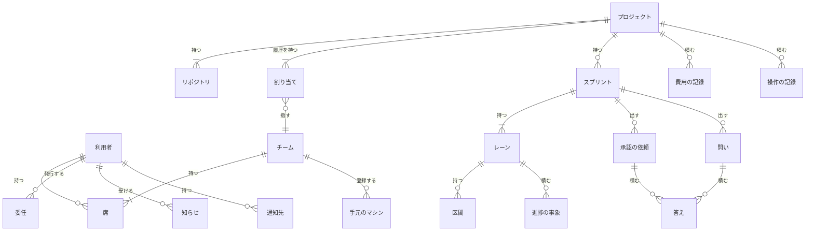
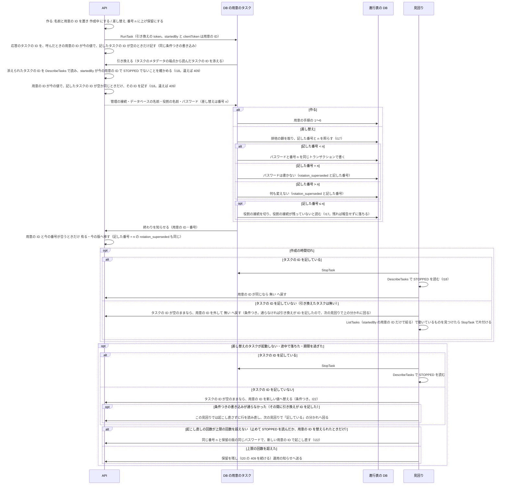

# データ: 状態を 3 つの置き場に分け、プロジェクトの割り当ての外へ見せず、承認と判断の跡を失わない

[全体の設計](overview.md)の集約と不変条件（I1〜I22）を、サービスの表・状態の S3・進行表の DB の 3 つの置き場へ下ろす。
状態の置き場の答えはこの文書が正本で、ほかの文書はここを指す。

| 扱うもの | 受ける節 |
| --- | --- |
| 集約の置き場と鍵・共通の列・テーブル定義 | [置き場の分け方](#置き場の分け方)・[サービスの表](#サービスの表) |
| 承認資料と NDF のファイル | [状態の S3](#状態の-s3)・[承認資料の保存期間](#承認資料の保存期間) |
| 進行表の DB の用意・資格情報の差し替え・GitHub の token の失効 | [進行表の DB](#進行表の-db)（不変条件 I17〜I19・I22） |
| 形の版と切り戻し | [形の版と移し方](#形の版と移し方) |
| 機能ごとの読み書き | [CRUD 図](#crud-図) |

置き場とインフラを選んだ理由（決定 80〜99・140）と外部の調査（LIB80〜LIB85）は [プラットフォーム](platform.md) にあり、この文書は答えだけを持つ。割り当てを移す流れの順は [全体の設計の割り当てを変える流れ](overview.md#割り当てを変える流れ)、実行の振る舞いは [実行](execution.md) が持つ。
値はすべて作り物か設計の既定値である。

## 置き場の分け方

状態は 3 つの置き場に分ける。どの置き場も、区切りの頭にプロジェクトかチーム（利用者だけに属するものは利用者）の ID を置き、認可の判定（I2）が同じ ID で絞れる形にする。

| 置き場 | 何を置くか | 書き手 | 読み手 |
| --- | --- | --- | --- |
| サービスの表（DynamoDB） | 全体の設計の集約のすべて（利用者・チーム・委任・プロジェクト・割り当て・スプリント・手元のマシン・進捗の事象・承認の依頼・問い・知らせ・通知先・費用の記録・操作の記録）と冪等の鍵 | API の各モジュール（集約の持ち主だけ）・見回り・知らせの送り手（送達の状態だけ）・表の移し | API |
| 状態の S3 | 承認資料の本文・NDF のファイルのうち進行表の DB に乗らないもの | API（承認資料）・ランナー（署名つき URL で NDF のファイル） | API・ランナー（署名つき URL） |
| 進行表の DB（Aurora PostgreSQL） | NDF の進行表と耐久の記録 | コンテナの中の NDF だけ | コンテナの中の NDF だけ。サービスは読まない |

サービスが NDF の状態を知る手段は、ランナーが送る進捗の事象だけにする。Lambda は VPC の外に置き、出口の無いサブネットの進行表の DB へ届かないためである（決定 83）。

## サービスの表

### ER 図

主な集約と関連だけを描く。属性は下のテーブル定義にある。

多重度の決まり: 割り当ては履歴の行を積み、今の割り当ては 1 つだけ（I3）。リポジトリのうち主はちょうど 1 つ（I1）。レーンを動かすコンテナは同時に 1 つ（I7）。

### 表と鍵

表はコンテキスト（集約の持ち主のモジュール）ごとに分ける（決定 81）。1 つの処理が書き換える集約は 1 つで、表をまたぐ反映はドメインイベントで後から行う。例外は割り当ての移しの受け入れだけで、同じ持ち主のモジュールの同じ表・同じ区切りの鍵にある割り当ての行の追加と、プロジェクトの行の今の割り当て（`current_team_id`・`current_assign_id`）の差し替え・移し中の印と移す途中の状態を空にする更新を、1 つのトランザクション（LIB81 の `TransactWriteItems`）で書く。分けると、途中で落ちたときに割り当ての履歴と今の割り当てが食い違うためである。表の名前は `<prefix>-<environment>-db-<用途>` にする。

| 表（用途） | 区切りの鍵 / 並びの鍵 | 持つ集約 | 時系列の扱い |
| --- | --- | --- | --- |
| `db-users` | `USER#<利用者>` / `USER`・`LOGIN#<IdP>#<主体>`・`LINK#<流れの ID>`・`DELEGATION#<委任>`。IdP の主体の一意の行は `LOGIN#<IdP>#<主体>` / `LOGIN`（下の [IdP の主体の一意の行](#idp-の主体の一意の行)）、Cognito の主体の対応の行は `COGNITO#<Cognito の sub>` / `COGNITO`（下の [Cognito の主体の対応の行](#cognito-の主体の対応の行)）、セッションの取り消しの行は `COGNITO#<Cognito の sub>` / `REVOKED#<origin_jti>`（下の [セッションの取り消しの行](#セッションの取り消しの行)） | 利用者・ログインの組・委任 | 上書き。変更の履歴は操作の記録が持つ。ログインをつなぐ流れの行とセッションの取り消しの行は期限で TTL |
| `db-teams` | `TEAM#<チーム>` / `TEAM`・`SEAT#<利用者>`・`MACHINE#<マシン>`・`USAGE#<UTC の年月>` | チーム・席・手元のマシン・月の使った量 | 上書き。席と役割の変更は操作の記録、使った量の元は費用の記録 |
| `db-projects` | `PROJECT#<プロジェクト>` / `PROJECT`・`REPO#<リポジトリ>`・`ASSIGN#<時刻>#<ID>`・`GHTOKEN#<期限>#<レーン>#<連番>` | プロジェクト・リポジトリ・割り当て・渡した GitHub の token の記録 | 割り当ては履歴保持型（変更ごとに行を足し、プロジェクトの行が今の割り当てを指す）。token の記録は期限で TTL |
| `db-sprints` | `PROJECT#<プロジェクト>` / `SPRINT#<スプリント>`・`SPRINT#<スプリント>#LANE#<レーン>`・`…#SEG#<連番>` | スプリント・レーン・区間 | 状態は上書き。状態の移りは進捗の事象が持つ |
| `db-events` | `PROJECT#<プロジェクト>#LANE#<レーン>` / `SEQ#<連番>` | 進捗の事象 | 事象の記録（追記だけ、I13） |
| `db-decisions` | `PROJECT#<プロジェクト>` / `APPROVAL#<依頼>`・`QUESTION#<問い>`・`…#ANSWER#<答え>` | 承認の依頼・問い・答え | 答えは追記だけ。確定した答えの列を上書きしない。例外は `ndf_event_seqs` だけで、空のときに 1 回だけ書く（I5） |
| `db-notices` | `USER#<利用者>` / `NOTICE#<時刻>#<ID>`・`DEST#<通知先>` | 知らせ・通知先 | 知らせは既読と送達の状態だけを上書き |
| `db-usage` | `PROJECT#<プロジェクト>` / `COST#<時刻>#<ID>` | 費用の記録 | 事象の記録（追記だけ） |
| `db-audit` | `PROJECT#<プロジェクト>`・`TEAM#<チーム>`・`USER#<利用者>`・`ANON#<UTC の年月日>`（主体の決まらない 401） / `<時刻>#<ID>` | 操作の記録 | 事象の記録（追記だけ、I9） |
| `db-idempotency` | `<主体>#<操作の名前>#<鍵>` / なし | 冪等の鍵（主体・操作の名前・鍵の組。[API の文書の冪等の鍵](api.md#冪等の鍵)） | 24 時間で TTL |

| 決まり | 中身 |
| --- | --- |
| 区切りの外の ID | プロジェクトに属する行は、区切りの鍵の外でも `project_id` を持つ。利用者で区切る行（知らせ）も `project_id` を持ち、一覧は認可の判定で絞ってから返す・数える（I2） |
| 索引 | 利用者の席の一覧（`USER#<利用者>` からチームへ）・チームのプロジェクトの一覧（今の割り当てのチームから）・人を待つものの一覧（待っている依頼と問いだけを持つ疎な索引）の 3 つを置く。索引の鍵と写す列は #2 が決める |
| 条件つきの書き込み | 今の割り当ての差し替え（I3）・主リポジトリの数（I1）・レーンのコンテナの割り当て（I7）・同じ連番の事象（I13）・答えの確定（I4・I5）・使える量の加算（I8）は、条件式（LIB81）で 1 行を照らして書く。外れたら 409 か前の 1 件を返す |
| 日時と金額 | 日時は UTC の ISO 8601（末尾 `Z`）、金額は最小単位の整数と ISO 4217 の通貨の組で持つ（I15）。形の正本の検証が外れた値を拒む |
| 共通の列 | どの行も下の [共通の列](#共通の列) を持つ。上書きの行は `version` も持ち、追記だけの行は持たない |
| 課金と守り | 表は要求の数の課金（LIB81）。どの表もポイントインタイムの戻し（PITR）を有効にし、スタックから消しても表を残す（決定 93） |

### 共通の列

| 列 | 持つ行 | 意味 |
| --- | --- | --- |
| `pk`・`sk` | すべて | 区切りの鍵と並びの鍵（上の表と鍵の表） |
| `schema_version` | すべて | 形の版（整数。[形の版と移し方](#形の版と移し方)） |
| `version` | 上書きの行（利用者・チーム・席・委任・手元のマシン・プロジェクト・リポジトリ・スプリント・レーン・承認の依頼・問い・知らせ・通知先・月の使った量） | エンティティの版。書くたびに 1 上げ、条件つきの書き込み（`updateIfVersion`）で照らす。API の要素の `version`（[API の文書の版と条件つきの更新](api.md#版と条件つきの更新)）はこの列を返す |

追記だけの行（割り当て・答え・進捗の事象・費用の記録・操作の記録・冪等の鍵・渡した GitHub の token の記録）は `version` を持たない。答えの行の `ndf_event_seqs` は、版で照らさず「列が無い」ことを条件にした書き込みで 1 回だけ足す（I5）。

### IdP の主体の一意の行

1 つの IdP のアカウントを 2 人の利用者へ結ばないための行である（I16）。

| 表 | 区切りの鍵 / 並びの鍵 | 持つ列 | 書き方 |
| --- | --- | --- | --- |
| `db-users` | `LOGIN#<IdP>#<主体>` / `LOGIN` | `user_id`・`cognito_sub`・`schema_version` | ログインの組の行（`USER#<利用者>` / `LOGIN#<IdP>#<主体>`）と同じトランザクションで、無いときだけ書く（`putIfAbsent`）。既にあれば 409。外すときは下の Cognito の主体の対応の行の書き換えと合わせて同じトランザクションで消す |

サインインは IdP の主体からこの行を強い整合で読み、利用者を引く（決定 99）。

### Cognito の主体の対応の行

人の要求が持つ Cognito の access token は、IdP の主体でなく Cognito の利用者の `sub` を持つ。上の行の区切りの鍵（`LOGIN#<IdP>#<主体>`。IdP は `google` か `github`、主体は各 IdP の識別子）は `sub` から組めないため、`sub` から利用者を引く行を別に置く。Cognito は IdP のアカウントごとに別の Cognito の利用者（別の `sub`）を作るため、この行はログインの組と 1 対 1 に当たる。ログインを外しても行は消さず、その `sub` の失効の境を残す（消すと、外す前のセッションの token で結び直せてしまう）。

| 表 | 区切りの鍵 / 並びの鍵 | 持つ列 | 書き方 |
| --- | --- | --- | --- |
| `db-users` | `COGNITO#<Cognito の sub>` / `COGNITO` | `cognito_sub`・`cognito_username`・`idp`・`subject`・`state`・`binding_epoch`・`user_id?`・`bound_auth_time?`・`revoked_before?`・`signout_lease_id?`・`signout_lease_until?`・`signout_unsettled_until?`・`version`・`schema_version` | 上書き（条件つき）。結ぶとき・外すとき・失効の呼び出しの借りを取るとき・失効を済ませたときに、下の表の条件で書き換える |

`state` は次の 3 つである。`binding_epoch` は外した回数で、外すたびに 1 上げる（`sessions.create` の冪等の鍵に入れる。[API の文書の冪等の鍵](api.md#冪等の鍵)）。

| `state` | 意味 | 持つ列 | 認証の扱い |
| --- | --- | --- | --- |
| `bound` | 利用者へ結んでいる | `user_id`・`bound_auth_time`（結ぶのに使った token の `auth_time`） | `auth_time` が `bound_auth_time` 以後の token だけを人として通す |
| `signing_out` | 外して、その Cognito の利用者の `AdminUserGlobalSignOut` の済むのを待つ間 | 失効の呼び出しの借り（`signout_lease_id`・`signout_lease_until`。呼び出しの間だけ）・結果の分からない期間の終わり（`signout_unsettled_until`。応答を失った呼び出しがあったときだけ） | どの操作も 401。結び直させない（済む前や、応答を失った呼び出しの結果が分からない間に結び直すと、後から処理される失効が結び直したセッションの refresh token まで取り消すため） |
| `unlinked` | 外して失効を済ませた | `revoked_before`（失効を済ませた時刻） | 結ぶとき（`sessions.create` の主体と、`logins.create` が交換で得た token）だけ、`auth_time` が `revoked_before` より後のサインインを結び直させる。ほかの操作は 401 |

行の書き方と値の引き元は次のとおりである。どの値も要求の本文から採らない。「利用者の行」は `USER#<利用者>` / `USER` で、`login_count`（結んだログインの数）を持つ。

| 場面 | Cognito の `sub` と IdP の主体の引き元 | 同じトランザクションに入れる書き込み |
| --- | --- | --- |
| 初めてのサインイン（`sessions.create`） | 要求の access token の `sub`（認証が検証した値）。IdP の主体は、認証が検証した token の `username` で利用者プールを読み（`AdminGetUser`）、属性 `sub` が token と同じことと、属性 `identities` の IdP の名前と IdP の利用者の ID を得る。IdP の名前は設定で `google` か `github` に当てる | 利用者の行を無いときだけ書く（`login_count` は 1）。ログインの組と IdP の主体の一意の行を無いときだけ書く（`cognito_sub` を写す）。対応の行は、認証が読んだときに無ければ無いときだけ書き（`binding_epoch` は 0）、`unlinked` なら読んだ版と「`state` が `unlinked` で `revoked_before` が token の `auth_time` より前」を条件に `bound` へ書き換える（`binding_epoch` はそのまま）。外れたら 409 |
| ログインをつなぐ（`logins.create`） | 下の [ログインをつなぐ流れの行](#ログインをつなぐ流れの行) の認可コードを、サーバーがその行の `code_verifier` で交換して得た access token を、人の token と同じに検証した `sub`。IdP の主体は初めてのサインインと同じに利用者プールから得て、IdP が流れの行の `idp` と同じことを照らす。要求の Authorization は今の利用者とセッション（`sub`・`origin_jti`・`binding_epoch`）を決めるだけ | 利用者の行を読んだ版を条件に `login_count` を 1 足す。ログインの組・IdP の主体の一意の行・対応の行は初めてのサインインと同じ。ログインをつなぐ流れの行を「`state` が `open`、`user_id` が今の利用者、`session_sub`・`session_id`・`session_epoch` が要求の主体の `sub`・`origin_jti`・`binding_epoch`、`expires_at` が今より後」を条件に `used` へ書き換える（1 回だけ使う。`code_verifier` を消し、確定した要素の `idempotency_key` と結んだログインを残して、結果の分からない送り直しにこの流れの確定した結果を返す）。開始元の対応の行（`COGNITO#<session_sub>` / `COGNITO`）を「`state` が `bound`、`user_id` が今の利用者、`binding_epoch` が `session_epoch`」を条件に照らし、開始元のセッションの取り消しの行（`COGNITO#<session_sub>` / `REVOKED#<session_id>`）が無いことを照らす（書かない条件の照らし。交換の間に開始元のログインが外されたか、開始元のセッションがサインアウトしたら結ばない。下の [人の書き込みの要求元の照らし](#人の書き込みの要求元の照らし) と同じ行のため 1 つにまとめる）。IdP の主体の一意の行が既にあれば要素の 409 `already_linked`、ほかの条件の外れは要素の 409 `link_invalid`。手順は [詳細設計の `verifyLoginToLink`](detail.md#関数の仕様) |
| ログインを外す（`logins.delete`） | 外すログインの組の行（`USER#<利用者>` / `LOGIN#<IdP>#<主体>`）を強い整合で読んだ `cognito_sub`。要求の token の `sub` は使わない（別のログインのものであり得る）。IdP と主体は要素の `idp`・`subject` | ログインの組と IdP の主体の一意の行を「`user_id` が今の利用者、`cognito_sub` が読んだ値」を条件に消す。外す対象の対応の行（`COGNITO#<読んだ cognito_sub>` / `COGNITO`）を強い整合で読み、「`state` が `bound`、`user_id` が今の利用者、`binding_epoch` が読んだ値」を条件に `signing_out` へ書き換え、`user_id` と `bound_auth_time` を消し、`binding_epoch` を 1 上げる。利用者の行を読んだ版と「`login_count` が 2 以上」を条件に `login_count` を 1 引く（同じ時に別々のログインを外す 2 つの要求は同じ利用者の行の版を条件にするため片方が外れ、最後のログインは外れない）。その Cognito の利用者の `AdminUserGlobalSignOut` の「行う予定」の行を、`cognito_sub` と上げた後の `binding_epoch`（その外しの世代）に固定して書く。要求元の照らし（下の [人の書き込みの要求元の照らし](#人の書き込みの要求元の照らし)）は、要求元のログインそのものを外すとき（要求の `sub` が読んだ `cognito_sub` と同じ）は同じ対応の行を書き換えるため別の件にせず、この書き換えの条件に「`binding_epoch` が要求の主体の `binding_epoch`」を足して 1 つにする。外れたら 409 |
| 失効を済ませる（「行う予定」の行の実行） | 対応の行の `cognito_username` | 次の 3 段で行う。借りは同じ時に呼ぶ実行を 1 つに限るだけで、期限の切れた借りは前の呼び出しが Cognito で済んだことを示さない（クライアントで打ち切っても、Cognito に届いた要求の実行は取り消せない）。そこで、応答を失った呼び出しがある間は「結果の分からない期間」（`signout_unsettled_until`）を置き、その期間が過ぎてから始めた呼び出しの成功だけで `unlinked` へ進める。(1) 呼ぶ前に、対応の行を「`state` が `signing_out`、`binding_epoch` が予定の行の世代、借りが無いか `signout_lease_until` が今より前、`signout_unsettled_until` が無いか今より前」を条件に書き換え、借り（新しい `signout_lease_id` と、今から `SIGNOUT_LEASE_MS` の `signout_lease_until`）を取る。期限の切れた借りが残っていたら（前の実行が結果を書かずに止まった）、その行を取るのと同じ書き込みで `signout_unsettled_until` を「残っていた `signout_lease_until` に `SIGNOUT_SETTLE_MS` を足した時刻」と今の値の遅い方にし、借りを消して、呼ばずにその時刻へ再試行を回す。`signout_unsettled_until` が今より後なら、呼ばずにその時刻へ再試行を回す。`state` か世代が違えば、その予定の行は済んだ世代か後の外しの世代のものとして呼ばずに終える。借りが他にあれば呼ばずに再試行へ回す。(2) 借りを取った実行だけが `AdminUserGlobalSignOut` を呼ぶ。呼び出しは `signout_lease_until` の前に打ち切る（中断の信号）。この呼び出しは方針の `aws-control`（利用者プールの管理の呼び出し）の要求ごとの期限を使い、SDK の自動の再試行を切る（`maxAttempts` を 1 にする。SDK が再試行すると、先の試行が期限切れで Cognito に残ったまま後の試行の成功だけが返り、結果の分からない期間を置かずに `unlinked` へ進んでしまうため）。1 回の借りで呼ぶのは 1 回の試行だけで、やり直しはどれも下の再試行（結果の分からない期間の後に借りを取り直す）で行う。`SIGNOUT_LEASE_MS` はその 1 回の試行の要求ごとの期限より長くする。成功の応答を受けずに終えたら（打ち切り・期限切れ・通信の失敗・Cognito の失敗の応答。届いたかどうかを区別しない）、自分の借りを条件に、借りを消し、`signout_unsettled_until` を「今に `SIGNOUT_SETTLE_MS` を足した時刻」と今の値の遅い方にして、その時刻へ再試行を回す。`SIGNOUT_SETTLE_MS` は、Cognito が受けた要求を処理し終えるか捨てるまでの時間の上限として置く値で、要求ごとの期限より十分に長くする。(3) 成功を受けたら、対応の行を「`state` が `signing_out`、`binding_epoch` が予定の行の世代、`signout_lease_id` が自分の借り、`signout_lease_until` が今より後」を条件に `unlinked` へ書き換え、`revoked_before` をその時刻（成功を受けた後の注入した時計）にし、借りと `signout_unsettled_until` を消す。条件に外れたら（借りが切れた）`unlinked` へ進めず、(2) の成功を受けずに終えたときと同じに扱う。その間は `signing_out` のまま結び直させない。同じ世代の呼び出しは借りで 1 つに限られ、`unlinked` へ進めるのは、応答を失ったどの呼び出しからも `SIGNOUT_SETTLE_MS` が過ぎた後に始めた呼び出しが成功した後だけのため、結び直した後のセッションへ前の失効が届かない。`SIGNOUT_SETTLE_MS` を越えて Cognito に残った要求が後から処理されたときに起きるのは、結び直した後のセッションの refresh token が取り消されてサインインし直しになることだけで、外したログインで人として通ることは起きない（認証は対応の行の `state` と `bound_auth_time` で断つ） |

結ぶ（初めてのサインインとログインをつなぐ）token は、IdP でサインインした時刻（`auth_time`）が 5 分の内のものだけを受ける。`bound_auth_time` には結ぶのに使った token の `auth_time` を、`cognito_username` には検証した token の `username` を書く。

認証（`authenticate` の読み手 `userOfSubject`）は、検証した access token の `sub` で `COGNITO#` / `COGNITO` を強い整合で読む。`bound` で token の `auth_time` が `bound_auth_time` 以後なら `user_id` を利用者にし、前なら 401 にする。外して結び直す前のセッションの token が、同じ `sub` で結び直した後の利用者へ届かないようにするためである（refresh token で取り直した token も `auth_time` を変えないため同じく断つ）。行が無い主体と `unlinked` の主体は、`sessions.create` にだけ「まだ結んでいない人」として渡り（`unlinked` は `auth_time` が `revoked_before` より後のときだけ）、ほかの操作では 401 になる。結ぶトランザクションも上の条件で同じ境を照らし直す（認証の読みの後に外し直された行へ結ばない）。認証は同じ読みで、下の [セッションの取り消しの行](#セッションの取り消しの行)（`COGNITO#` / `REVOKED#<token の origin_jti>`）も強い整合で読み（2 行を並べて読む）、あれば `state` によらず 401 にする。ただし `sessions.delete` だけは取り消しの行があっても 401 にせず、ハンドラーが「取り消し済み」を返す（下の「`sessions.delete` の再送」）。

「行う予定」の行の起こし方と終わり方は次のとおりである。

| 決まり | 中身 |
| --- | --- |
| 起こす | 予定の行は次に試す時刻（`next_attempt_at`。書くときは今）を持ち、済むまで消さない。`logins.delete` は確定の後、応答の前に実行を 1 回非同期で起こす（起こせなくても応答は変えない）。見回り（[プラットフォームの文書の見回り](platform.md)）が毎回、`next_attempt_at` を過ぎた予定の行を拾って実行する。実行が途中で落ちても、予定の行が残るため次の見回りが拾う |
| 再試行へ回す | 上の手順の「その時刻へ再試行を回す」は、予定の行の `next_attempt_at` をその時刻へ書き換えることである。実行はそのつど対応の行を強い整合で読み直し、(1) から始める |
| 恒久の応答 | `UserNotFoundException`（その Cognito の利用者が無い）は、成功と同じに (3) へ進める（消えた Cognito の利用者の refresh token は使えず、同じ IdP のアカウントでサインインし直すと別の `sub` になるため、取り消すセッションが残らない）。同じ要求のやり直しで解けない設定と権限の誤りの応答（`NotAuthorizedException`・`ResourceNotFoundException`・`InvalidParameterException` など）は、(2) の成功を受けずに終えたときと同じに結果の分からない期間を置いたうえで、予定の行を `stuck` と記して自動の再試行を止め、運用の警報（対応の行の鍵と応答の名前だけ。値は出さない）を上げる。対応の行は `signing_out` のまま結び直させない。運用する人が設定を直して `stuck` を外し、`next_attempt_at` を今にすると、次の見回りが再び実行する |
| 一時の応答 | 書き込みの呼びすぎ（`TooManyRequestsException`）・Cognito の内部の失敗・通信の失敗・期限切れは、(2) のとおり結果の分からない期間の後へ再試行を回し続ける |

### 人の書き込みの要求元の照らし

認証は要求の始めに対応の行を読むだけのため、その後に要求元のログインが外される（別のセッションからの `logins.delete`）か、要求元のセッションがサインアウトしても、読んだ結果のまま確定できてしまう。そこで主体が人のすべての書く操作は、`dispatch` が要素の書き込みと同じ `writeAtomically` に、要求元の対応の行（`COGNITO#<主体の sub>` / `COGNITO`）を「`state` が `bound`、`user_id` が主体の利用者、`binding_epoch` が主体の `binding_epoch`」で照らす件と、要求元のセッションの取り消しの行（`COGNITO#<主体の sub>` / `REVOKED#<主体の sessionId>`）が無いことを照らす件を入れる（書かない条件の照らし）。人だけの操作（[API の文書の人だけにした理由](api.md#人だけにした理由)）に限らず、委任からも呼べる操作を人が呼んだとき（`sprints.create`・`sprints.cancel`・`questions.answer`・`users.update` など）も入れる。除くのは、主体が結ぶ前の `sessions.create` と、取り消しの行を書く側の `sessions.delete` だけである。ハンドラーが同じ行を書くか照らすとき（`logins.delete` が要求元のログインそのものを外す・`logins.create` の開始元の照らし）は、1 つのトランザクションで同じ行を 2 回指せないため件を分けず、その件の条件に統合する。外れた要素は書かず、要素の 409 `state_mismatch` にする（次の要求は認証で 401 になる）。

| 決まり | 中身 |
| --- | --- |
| 要素ごとの操作 | 要素ごとに確定する操作は、要素ごとのトランザクションのそれぞれに 2 件を入れる。要素ごとに扱いの変わる操作でも、主体が人ならどの要素にも入れる（`questions.answer` は「人だけか」が真の要素にも偽の要素にも入れる。偽の要素だけを照らさずに通すと、サインアウトの後に委任と同じ範囲の答えを人として確定できる）。同じ要求の中で、照らしの前に確定した要素は確定のまま残り、照らしが外れた要素から後は 409 `state_mismatch` になる |
| 全部か無かの操作 | 1 つのトランザクションに 1 回だけ入れる。全部か無かの操作の要素の上限は、主体が人のときに入る 2 件を残して決める（委任からも呼べる `repositories.add` も含む） |
| 外への処理の確定点 | タスクの起動・止める指示・GitHub への書き込み・Cognito の呼び出しなど外への処理は、この照らしを含むトランザクションで書いた「行う予定」の行（[API の文書の操作の記録](api.md#操作の記録) の「書くとき」）か状態の書き込みを受けてだけ起こす。照らしが外れれば予定の行も状態も書かれず、外への処理は起きない。確定点はそのトランザクションの確定で、確定の後に要求元がサインアウトするかログインを外されても、確定した操作の外への処理は止めない（`sprints.create` の起動・`sprints.cancel` の停止は確定した判断として続ける） |
| 要求の中で同期に外へ働きかける操作 | 確定の前に外へ働きかける操作（`notification_targets.test` の送信など、応答の前に外の結果を要るもの）は、働きかける直前に、同じ 2 件だけを条件にしたトランザクション（条件の照らしだけ）を打ち、外れたら働きかけずに要素の 409 `state_mismatch` にする。その照らしの確定を確定点とする。`logins.create` が認可コードを交換するのは外への書き込みでなく、結ぶトランザクションが照らすため、この扱いに入れない |

読むだけの操作には入れない（認証の時点の判定で返す）。

### セッションの取り消しの行

サインアウトは、API の側でそのセッションを断つ `sessions.delete` と、画面が Cognito で refresh token を取り消す呼び出し（[Cognito の RevokeToken](https://docs.aws.amazon.com/cognito-user-identity-pools/latest/APIReference/API_RevokeToken.html)）の 2 つからなる。取り消した refresh token から出した access token も、API が行う署名と期限の検証を通る（[Cognito の token の取り消し](https://docs.aws.amazon.com/cognito/latest/developerguide/token-revocation.html) を照らすのは Cognito の端点だけ）。逆に Cognito の取り消しは失敗しうる。そこで、取り消したセッションを API の側で見分ける行を置き、その行だけで、そのセッションの refresh token が新しい access token を出せる間ずっと断つ。Cognito の取り消しは、端末の外へ漏れた refresh token を Cognito の端点でも使えなくするための重ねであり、API の拒否はその成否に頼らない。

| 表 | 区切りの鍵 / 並びの鍵 | 持つ列 | 書き方 |
| --- | --- | --- | --- |
| `db-users` | `COGNITO#<Cognito の sub>` / `REVOKED#<origin_jti>` | `cognito_sub`・`session_id`（取り消したセッションの `origin_jti`）・`revoked_at`・`expire_at`（TTL。`revoked_at` に `SESSION_REVOKED_KEEP_MS` を足した時刻）・`schema_version` | `sessions.delete` が、要求の主体の `sub` と `sessionId` で無いときだけ書く（既にあれば済んだとして成功。行はどちらでも同じ長さ残るため、成功で省く処理は無い）。成功の要素は、書いたときも既にあったときも、その行の `revoked_at` を返す（「このセッションの取り消しが確定済み」を表す。画面はこの応答だけで取り消しの確定を知る）。`sessions.delete` は Cognito を呼ばず、refresh token を受けない |

| 決まり | 中身 |
| --- | --- |
| 残す長さ | `SESSION_REVOKED_KEEP_MS` は、refresh token の寿命（30 日）と access token の寿命（15 分）の和より長くする。アプリのクライアントは refresh token の回し（rotation）を使わず、refresh token の寿命はサインインから数えて延びないため、行が消える時点ではそのセッションから出た token はどれも期限を過ぎている。Cognito の取り消しが一度も成功しなくても、API はそのセッションを最後まで断つ |
| Cognito の取り消しの主体と照合 | 画面が、`sessions.delete` の成功（取り消しの確定。下）を受けた後に、端末のログインの控えに持つ refresh token とアプリのクライアントの ID で Cognito の取り消しを呼ぶ。画面が持つ refresh token は 1 つで、`sessions.delete` に使った access token はその refresh token から出したものなので、取り消す token と API で断ったセッションは同じものに当たる。サーバーは refresh token を受けず、持たない |
| 取り消しの再試行 | 取り消しは API の認証を通らないため、`sessions.delete` の後に 401 になる心配が無い。画面は一時の失敗（通信の失敗・5xx・呼びすぎ）を間を空けて 3 回まで試し直し、それでも成功しなければ、取り消しを済ませずにサインアウトの残りへ進む（API の拒否は上の行が受け持つ。端末の refresh token はサインアウトで消す）。`unsupported_token_type` などの恒久の応答では試し直さない |
| `sessions.delete` の再送 | `sessions.delete` の確定の後に応答を失って送り直すと、認証は取り消しの行があっても `sessions.delete` だけは通し（署名・期限・対応の行の照らしはほかの操作と同じ）、ハンドラーが既にある行の `revoked_at` を成功で返す。401 は取り消しの確定を表さない。401 には access token の期限切れ（15 分）が含まれ、期限切れの 401 を済んだ扱いにすると、取り消しの行が無いまま、続く Cognito の取り消しが失敗したときに同じ refresh token から出した access token が API を通り続けるためである。画面は `sessions.delete` の 401 を受けたら、同じセッションの refresh token で access token を取り直し（`origin_jti` は同じ）、`sessions.delete` を送り直す。分かれは次の 3 つである。(1) 送り直しが成功すれば取り消しの確定として上の取り消しへ進む。(2) 取り直しを Cognito が恒久に断った（`invalid_grant`。refresh token が取り消し済みか期限切れ）なら、そのセッションは新しい access token を出せず、手元の access token は API が既に断っているため、取り消しの行が無くても API を通る token は残らないとして上の取り消しへ進む。(3) 取り直した token でも 401 なら、そのセッションは期限によらず API で断たれている（外したログインの、結び直しの境より前のセッションなど。境は行が残る間続く）として上の取り消しへ進む。取り直しと送り直しの一時の失敗（通信の失敗・5xx・呼びすぎ）では進まず、サインアウトを途中のまま残して試し直す（[画面の文書のサインアウトで消す](screens.md#サインアウトで消す)） |

認証（上）と連携の確定（`logins.create` の開始元の照らし）と人の書き込みの要求元の照らしは、この行があれば断つ。TTL の削除は遅れるため、行があれば `expire_at` によらず断つ。

### ログインをつなぐ流れの行

`logins.create` が結ぶログインを、今の利用者がそのセッションで始めた流れで得たものに限るための行である。画面の `state` と PKCE だけに頼ると、別の流れで得た直近の token を API へ直に渡して、別の利用者へ結べてしまうため、流れの始まりをサーバーが今の利用者とセッション（Cognito の `sub` は同じログインの別のサインインでも同じため、セッションの識別子 `origin_jti` と開始元の対応の行の世代まで）に結び、認可コードの交換をサーバーがその流れの `code_verifier` で行い、流れを 1 回だけ使う。

| 表 | 区切りの鍵 / 並びの鍵 | 持つ列 | 書き方 |
| --- | --- | --- | --- |
| `db-users` | `USER#<利用者>` / `LINK#<流れの ID>` | `link_id`（UUID。認可の要求の `state`）・`state`（`open`・`used`）・`user_id`・`session_sub`（流れを始めた要求の token の Cognito の `sub`）・`session_id`（その token の `origin_jti`。そのサインインのセッションの識別子で、同じ `sub` の別のサインインでは違う）・`session_epoch`（開始元の対応の行の `binding_epoch`）・`idp`（選んだ IdP）・`code_verifier`（PKCE。サーバーだけが持ち、画面へ返さずログに出さない。`open` の間だけ）・`used_idempotency_key?`・`linked_idp?`・`linked_subject?`（`used` の間。結んだ要素の冪等の鍵と結んだログイン）・`expires_at`（作ってから 10 分）・`expire_at`（TTL。`open` は `expires_at`、`used` は確定から 24 時間）・`schema_version` | `login_links.create` が `open` で無いときだけ書く。`logins.create` がログインを結ぶのと同じトランザクションで、上の条件で `used` へ書き換える。`used` の行は、同じ流れの ID と同じ冪等の鍵の送り直しに初回の成功を返すためだけに残し、TTL で消える |

### テーブル定義

主な集約の列を書く。ここに定義の無い表（利用者・ログインの組・委任・チーム・席・招待・手元のマシン・月の使った量・リポジトリ・区間・スプリント・進捗の事象・問い・知らせ・通知先・費用の記録・冪等の鍵・渡した GitHub の token の記録）の列と、上の 3 つの索引の列は #2 が決める。共通の列はどの表でも上の [共通の列](#共通の列) に従う。

プロジェクト（`db-projects` の `PROJECT` の行）:

| 列 | 型 | 空を許すか | 意味 |
| --- | --- | --- | --- |
| `project_id` | 文字列 | 許さない | プロジェクトの ID（無作為） |
| `name` | 文字列 | 許さない | 名前 |
| `current_team_id` | 文字列 | 許す | 今の割り当てのチーム。空は「閉じた」で、どのチームからも見えない |
| `current_assign_id` | 文字列 | 許す | 今の割り当ての行の ID。空の意味は上と同じ |
| `transfer_in_progress` | 文字列 | 許す | 移し中の印。今の割り当ての移しの ID。移しの作成で書き（E18）、受け入れか取り下げで空にする。空でない間は I20 で止める |
| `transfer` | 地図 | 許す | 割り当てを移す途中の状態（移す先・止め終えたか・失効が終わったか・差し替えを始めたか・取り下げたか）。差し替えを始めたかは、進行表の DB が無ければ始めずに真にする。移しの作成で、移し中の印と同じ書き込みで止め終えたかを偽にして書き、これが止める依頼として残る（E18）。空は「移していない」 |
| `progress_db_state` | 文字列 | 許さない | 進行表の DB の状態（`無い`・`作成中`・`有る`） |
| `progress_db_name`・`progress_db_role` | 文字列 | 許す | 進行表の DB のデータベースと役割の名前（無作為）。API が `作成中` にするときに作って置き、作り直しでも同じ名前を使う。空は「まだ作っていない」 |
| `progress_db_prep_id` | 文字列 | 許す | 今の用意の ID。引き換えの token と完了の報告の token はこの ID に結ぶ。空は「用意していない」 |
| `progress_db_prep_task` | 文字列 | 許す | 今の用意のタスクの ID。`RunTask` の応答か引き換え（タスクが添えた ID）のどちらか早い方で、空のときだけ書く。`RunTask` の応答で書くときも、呼んだときの用意の ID が今の `progress_db_prep_id` と同じことを同じ書き込みの条件に入れ、違えば書かない（古い応答が起こし直した後の空欄を埋めない）。時間切れで止める先（I18） |
| `progress_db_rotation_seq` | 整数 | 許さない | 差し替えの番号。差し替えを始めるたびに 1 上げる（I17） |
| `progress_db_rotation_pending` | 真偽 | 許さない | 差し替えの完了を待っているか。真の間は I20 で止める |
| `progress_db_rotation_attempts` | 整数 | 許さない | 今の番号の差し替えでタスクを起こした回数。番号を上げるときに 1 にし、起こし直すたびに 1 上げる（I22） |
| `progress_db_secret` | 文字列 | 許す | そのプロジェクトの URL を入れた秘密の器の名前。空は「まだ作っていない」 |
| `gh_token_max_expiry` | 日時 | 許す | 渡した GitHub の token の期限の最大値。空は「期限の前の token が無い」 |
| `gh_token_generation` | 整数 | 許さない | token の記録の世代番号。記録を足すたびに 1 上げる |
| `created_at` | 日時 | 許さない | 作った時刻（UTC） |
| `schema_version`・`version` | 整数 | 許さない | 形の版とエンティティの版（[共通の列](#共通の列)） |

割り当て（`ASSIGN#…` の行。追記だけ）:

| 列 | 型 | 空を許すか | 意味 |
| --- | --- | --- | --- |
| `assign_id` | 文字列 | 許さない | 割り当ての行の ID |
| `team_id` | 文字列 | 許す | 割り当てたチーム。空は「閉じた」行 |
| `confirmed_by` | 文字列 | 許さない | 確定した人の利用者の ID（人だけ、I3） |
| `accepted_by` | 文字列 | 許す | 移す先の持ち主の受け入れ。空は「作成と同時の割り当て」か「閉じた」 |
| `confirmed_at` | 日時 | 許さない | 確定の時刻（UTC） |

レーン（`db-sprints` の `…#LANE#…` の行）:

| 列 | 型 | 空を許すか | 意味 |
| --- | --- | --- | --- |
| `lane_id` | 文字列 | 許さない | レーンの ID |
| `repo_id` | 文字列 | 許さない | 回すリポジトリ |
| `after` | 文字列の配列 | 許さない | 先に終わるべきレーン。空の配列は「待たない」 |
| `place` | 文字列 | 許さない | 実行の場所（`hosted`・`machine`） |
| `inference` | 文字列 | 許さない | 推論の手段（`managed`・`byok`） |
| `runner_id` | 文字列 | 許す | 今動かしているコンテナ（タスクかマシン）。空は「どこにも割り当てていない」（I7 は空か前の世代が終わっているときだけ書ける条件で守る） |
| `generation` | 整数 | 許さない | 割り当ての世代の番号。割り当てのたびに 1 上げ、レーンの token はこの世代に結ぶ（[実行の文書のレーンの状態](execution.md#レーンの状態)） |
| `state` | 文字列 | 許さない | レーンの状態（値の集合は [実行](execution.md)） |
| `last_seq` | 整数 | 許さない | 受けた進捗の事象の最後の連番 |
| `version` | 整数 | 許さない | エンティティの版（[共通の列](#共通の列)） |

承認の依頼（`db-decisions` の `APPROVAL#…` の行）:

| 列 | 型 | 空を許すか | 意味 |
| --- | --- | --- | --- |
| `approval_id` | 文字列 | 許さない | 依頼の ID |
| `sprint_id`・`lane_id` | 文字列 | 許さない | 出したスプリントとレーン |
| `gate` | 文字列 | 許さない | 承認ゲートの種類（設計・リリース・レッドライン） |
| `material_digest` | 文字列 | 許さない | 承認資料の要約値（sha256）。状態の S3 の本文の名前でもある |
| `state` | 文字列 | 許さない | 状態。値と遷移は [実行の文書の承認の依頼と問いの状態](execution.md#承認の依頼と問いの状態) が正本 |
| `answer_id` | 文字列 | 許す | 確定した答え。空は「待っている」か「取り消した」 |
| `delivery` | 文字列 | 許す | 答えの NDF への送達の状態（値と遷移は [実行の文書の答えの送達](execution.md#答えの送達)）。空は「答えていない」か送達の対象外 |
| `waiting_since` | 日時 | 許す | 疎な索引の鍵。空は「人を待っていない」 |
| `version` | 整数 | 許さない | エンティティの版（[共通の列](#共通の列)） |

答え（`db-decisions` の `…#ANSWER#…` の行。追記だけ。確定した列は上書きせず、`ndf_event_seqs` だけ空のときに 1 回書く）。全体の設計が決める列だけを書き、ほかの列は #2 が決める:

| 列 | 型 | 空を許すか | 意味 |
| --- | --- | --- | --- |
| `ndf_event_seqs` | 整数の配列 | 許す | `ndf answer` が書いた NDF の答えの事象の番号（I5）。送達の事象（E14）で受け、送達の状態を「届いた」にする書き込みと同じ書き込みで、空のときだけ書く。空は「まだ届いていない」。送達の対象外の答えは持たない |

操作の記録（`db-audit` の行。追記だけ）:

| 列 | 型 | 空を許すか | 意味 |
| --- | --- | --- | --- |
| `at` | 日時 | 許さない | 時刻（UTC） |
| `actor` | 地図 | 許さない | 主体（人・委任・ランナー・手元のマシン・GitHub・見回り・DB の用意のタスク）と、委任なら委任した人とクライアントの名前 |
| `channel` | 文字列 | 許さない | 入口（画面・API・MCP・ランナー・手元のマシン・GitHub・見回り・DB の用意） |
| `operation` | 文字列 | 許さない | 操作の表の名前 |
| `target_ids` | 文字列の配列 | 許さない | 対象の ID。空の配列は「対象を持たない操作」（サインインなど） |
| `result` | 地図 | 許さない | 結果（`ok`・`partial`・`rejected`）と、HTTP の状態・理由のコードの並び（[API の文書の操作の記録](api.md#何を書くか)） |

秘密と個人情報の値は記録に書かない（I9）。1 つの要求は 1 つの記録の ID で、要求の要約の行 1 件と、書いた要素ごとの行（要素の確定と同じトランザクション）で残す。要約の行を書けなければ要求を 503 で失敗させる（[API の文書の書き方と失敗](api.md#書き方と失敗)）。区切りの鍵は次のとおりにする（[詳細設計](detail.md#内部のデータと定数)）。

| 場合 | 区切りの鍵 |
| --- | --- |
| 見られたプロジェクトがある | `PROJECT#` |
| 見られたプロジェクトが無い | 主体の `USER#` |
| 主体の決まらない 401 | `ANON#<UTC の年月日>` |

## 状態の S3

バケットは 1 つで、公開を止め、暗号化し、TLS だけを受ける。オブジェクトの名前の頭に形の版を置く。

| 中身 | 名前 | いつ書くか | 消し方 |
| --- | --- | --- | --- |
| 承認資料の本文 | `v1/projects/<プロジェクト>/materials/<要約値>.json` | 承認の依頼を受けたとき（API） | プロジェクトを閉じた後に、[承認資料の保存期間](#承認資料の保存期間)で消す。人の判断の材料のため、スプリントの終わりでは消さない |
| NDF のファイル | `v1/projects/<プロジェクト>/lanes/<レーン>/…` | 承認の待ちでタスクを止めるとき・区間の終わり・SIGTERM（ランナー） | レーンの終わりから 14 日（ライフサイクルの規則） |

署名つき URL は、そのレーンの頭だけに、15 分の期限で出す。名前の頭がプロジェクトの ID のため、割り当てを移した後に古いレーンの URL が残っても、新しいレーンの頭とは重ならない。

### 承認資料の保存期間

承認資料の本文は、プロジェクトを閉じてから、操作の記録と同じ保存期間（既定 1 年。[API の文書の保存期間](api.md#保存期間と見られる人)）で消す。保存期間の値は操作の記録と 1 つで、設置する人が設定のファイルで延ばせる（[決定 7](decisions.md#決定の記録)）。設定のキーの名前は #13 が決める。

## 進行表の DB

**1 つの Aurora Serverless v2（PostgreSQL、最小 0 ACU）のクラスタの中に、プロジェクトごとに別のデータベースとログインの役割を作る（I10、決定 83・84）。** サービスは中身を読み書きしない。接続するのはホステッドのランナーと DB の用意のタスクだけである。手元のマシンのレーンへは URL を渡さない（出口の無いサブネットへ届かないため。手元のマシンの NDF は手元の置き場を使う。[実行](execution.md)）。

| 項目 | 決まり |
| --- | --- |
| 単位 | プロジェクトごとに 1 つのデータベースと、そのデータベースだけに権限を持つ役割。名前はプロジェクト・チーム・リポジトリの名前や ID から作らない無作為の値にし、対応はサービスの表にだけ置く |
| 作る時 | そのプロジェクトの最初のホステッドのレーンを始めるとき。API がデータベースと役割の名前と用意の ID を置いて `progress_db_state` を `作成中` にし、DB の用意のタスクが用意の ID の合う終わりを知らせたら `有る` にする。失敗か作成の時間切れなら `無い` へ戻し、次の開始で同じ名前で作り直す。`無い` へ戻すのは、用意のタスクの ID を記しているなら、見回りがそのタスクを `StopTask` で止めて `DescribeTasks` で `STOPPED` を読んだ後に、用意の ID が同じことを条件に書くときだけ。記していないなら、作成の時間切れを過ぎた後に、タスクの ID が空のままであることを条件に用意の ID を外して戻す（I18・[決定 96](platform.md#決定の記録)）。下の [用意と差し替えの順](#用意と差し替えの順) |
| 認証 | 役割のパスワードを含む URL を、プロジェクトごとの秘密の器に置く。IAM 認証は使わない（token が 15 分で、NDF の DB の URL は token を取り直す口を持たない。LIB80） |
| 渡し方 | API が引き換えのときに、そのプロジェクトの URL だけをランナーへ返す。ランナーはメモリだけに置き、ファイルとログに書かない |
| 一時停止 | 利用者の接続が 0 本になってから既定の 300 秒で一時停止する。再開は通常 約 15 秒、24 時間を超えた停止の後は 30 秒以上（LIB80）。タスクの起動の手順は、最初の接続を再試行で待つ |

### 用意の手順

DB の用意のタスクは、API から引き換えの token で管理の接続とプロジェクトの役割の値を受け、次の順で行う。秘密の器を作り値を入れるのは API で、タスクは秘密の器に触れない。

| 順 | 行うこと | 理由 |
| --- | --- | --- |
| 1 | `postgres`・`template1` の `CONNECT`・`TEMPORARY` を `PUBLIC` から外す（何度打っても同じ結果） | 別のデータベースへ接続し直して、カタログと統計から他のプロジェクトの名前を読ませない |
| 2 | データベースを `ALLOW_CONNECTIONS false` で作る（作り直しで既にあれば作らない） | 権限を整えるまで誰も接続できない |
| 3 | そのデータベースの `CONNECT`・`TEMPORARY` を `PUBLIC` から外し、`ALLOW_CONNECTIONS true` にする | この時点で接続できるのは持ち主の管理の役割だけ |
| 4 | 管理の役割でそのデータベースへ接続し、カタログと統計のビューの読み取りを `PUBLIC` から外す。読み取りの既定の役割（`pg_read_all_stats` など）へ入れない | 他のプロジェクトのデータベースと役割の名前と数を読ませない（I2） |
| 5 | 管理の接続とプロジェクトの役割の接続のほかを切る | 作り直しのとき、権限を整える前から残る接続を断つ |
| 6 | 役割を作り、その役割を持ち主とする専用のスキーマと `search_path` を置き、最後にその役割にだけ `CONNECT`・`TEMPORARY` を与える | NDF と DBOS の表を作る場所。DBOS が一時表を使うため `TEMPORARY` が要る |

4 で外せるかと、プロジェクト A の役割から B のデータベース・`postgres`・`template1` へ接続できないことは、反映した環境で実測する（[未確認のまま残ること](platform.md#未確認のまま残ること)）。外せないときは、2 つ目のチームのプロジェクトでホステッドのレーンを動かす前に、分け方を設計へ戻す。

### 用意と差し替えの順

API が `RunTask` で用意のタスクを起こしてから、引き換え・用意か差し替え・終わりの報告・見回りの片付けまでの順である。作成の時間切れ（I18）と差し替えの起こし直し（I22）の分かれを持つ。用意のタスク向けの HTTP の経路は [API の文書の DB の用意のタスクの HTTP の経路](api.md#ランナー手元のマシンdb-の用意のタスクの-http-の経路) にある。

| 失敗の場面 | 扱い |
| --- | --- |
| 番号 n のパスワードを書いた後、古い接続を切る前か完了の報告の前に落ちた | 起こし直したタスクは、記した番号 = n を読んでパスワードを書かず、役割の古い接続を切り、残りが無いと読んでから `rotation_superseded` を返す。DB のパスワードは保留の版と同じで古い接続も残らないため、API は保留を下ろす |
| 書く前に落ちた・起動しなかった | 起こし直したタスクが番号 n で書く |
| RunTask がタスクの ID を返さなかった・API がタスクの ID を記す前に落ちた | タスクが引き換えたなら、引き換えがタスクの ID を記しているため、見回りはそのタスクを止めて `STOPPED` を読む。管理の接続を引き換え済みのタスクは、`ListTasks` に出なくても必ず止めてから進む。ID が空のままなら、引き換えたタスクは無い。見回りは期限を過ぎた後に、ID が空であることを条件に用意の ID を替え（作成なら `無い` へ戻す）、新しい用意の ID で起こし直す。前の用意の ID のタスクが後から動いても、引き換えを受けないため DB へ着けない。`ListTasks` は動いているタスクを片付けるためだけに使う（`startedBy` はほかの絞りと併せられず、既定は `desiredStatus` = `RUNNING` で止まりかけのタスクを返さないため、判断には使わない） |
| 起こし直しが上限を超えた | 保留を残し、スプリントの開始と割り当ての移しを止めたまま、運用の知らせで人が直す（安全の側に倒す） |

### 割り当てを移すときの差し替え

割り当てを移す確定（[割り当てを変える流れ](overview.md#割り当てを変える流れ)）は、レーンを止めた後に、そのプロジェクトの役割のパスワードを差し替える。渡し済みの URL を別のレーンから使わせないためである。

| `progress_db_state` | 扱い |
| --- | --- |
| `無い` | 渡し済みの URL が無いため差し替えない。割り当ての行に「差し替え不要」と書く |
| `作成中` | 作り終えるまで確定を 409 で拒む |
| `有る` | API がプロジェクトの差し替えの番号を n へ 1 上げて保留を立て（`progress_db_rotation_pending`）、新しいパスワードを秘密の器へ保留の版で入れ、DB の用意のタスクを差し替えの種類で起こす。タスクは DB の側の排他の鎖（`pg_advisory_xact_lock`）を取って、下の [差し替えの番号](#差し替えの番号) に記した番号と n を照らし、記した番号が n より小さいときだけパスワードと番号 n を同じトランザクションで書く。記した番号が n 以下なら、役割の古い接続を切り、役割の接続が残っていないと読んでから、用意の ID と番号を添えて終わりを知らせる（I17）。記した番号が n より大きければ何も変えずに `rotation_superseded` で終える。API は用意の ID と今の番号が合う知らせ（適用か、記した番号 = n の `rotation_superseded`）だけを受け、保留の版を今の版へ移して保留を下ろす。タスクが起動しない・落ちる・差し替えの期限（作成の時間切れと同じ値）を過ぎたときは、見回りが同じ番号 n と保留の版の同じパスワードで、新しい用意の ID のタスクを起こし直す（I22。上限の回数は既定 3、設定のキーの名前は #13）。上限を超えたら保留を残したまま運用の知らせへ送る（[決定 95](platform.md#決定の記録)） |

差し替えは取り下げた後も止めずに終える。保留が立つ間は、そのプロジェクトのスプリントの作成・レーンの割り当ての確定・割り当ての移しの作成を受けない（I20）。移す先の受け入れは、差し替えの終わりと `gh_token_max_expiry` が空か過去であることを、割り当ての行の差し替えと同じ条件つきの書き込みで照らす。GitHub の token の失効は下の [GitHub の token の失効](#github-の-token-の失効) にある。

### 差し替えの番号

進行表の DB の中に置く、役割ごとの最後に書いた差し替えの番号である。nd-factory のサービスは読まない。

| 置き場 | 列 | 書き手 | 読み手 |
| --- | --- | --- | --- |
| 管理のデータベース（`postgres`）の、管理の役割だけが持つスキーマの表 | 役割の名前・差し替えの番号・書いた時刻 | DB の用意のタスク（管理の役割）。パスワードの変更と同じトランザクションで書く | DB の用意のタスクだけ。プロジェクトの役割には権限を与えない |

### GitHub の token の失効

割り当てを移すとき、前のチームのレーンへ渡した GitHub の token を失効させる。失効の間に心拍の取り直しが新しい token を渡すと、記録の行と世代番号が増えるため、完了は世代番号で照らす（I19・[決定 97](platform.md#決定の記録)）。

| 順 | 行うこと | 外れたとき |
| --- | --- | --- |
| 1 | プロジェクトの行の `gh_token_generation` を読み、g とする | — |
| 2 | 渡した GitHub の token の記録の行（`GHTOKEN#…`）のうち期限の前のものを失効させる | 失効に失敗したら完了を記録せず、見回りがやり直す |
| 3 | `gh_token_generation` が g のままであることを条件に、`gh_token_max_expiry` を空にし、移す途中の状態の失効が終わったかを真にする（同じ条件つきの書き込み） | 世代番号が変わっていれば完了を記録せず、記録を読み直して 1 からやり直す |

失効の API が失効させる token の値を要るか（値の置き場）は #33 で扱う。

## 形の版と移し方

移しの仕組みは、nd-factory 自身が書いた行の形の版を上げるためだけに置く。nd-factory の外で書かれたデータ（作り直しの前のサービスの利用者のデータを含む）は移しの対象にせず、取り込む機能を持たない。

| 置き場 | 形を変えるとき |
| --- | --- |
| サービスの表 | 2 段で出す（決定 82）。1 段目の反映で、読み手が今と次の版の両方を読めるようにする。2 段目の反映で、書き手を次の版へ上げる。残った古い版の項目は表の移しの関数が書き換える（冪等。時間切れの前に続きの位置を残して自分を起こし直す）。読み手が受ける版は今と 1 つ前だけ |
| サービスの表の切り戻し | 2 段目を戻すときは、書き手だけを前の版へ戻す反映を出す。読み手は両方の版を読むため、表の移しが書き換えた項目は次の版のまま残してよい。1 段目（読み手を上げる）を戻すのは、次の版の項目が 0 件のときだけ。読み手と表の移しは #2、切り戻しの手順を設置の手順に書くのは #14 が受け持つ |
| 状態の S3 | 次の版の頭（`v2/`）へ書き、読み手は両方を読む。古い版は消し方の期限で消える |
| 進行表の DB | NDF が持つ。nd-factory は形を変えない。NDF の固定の値（`ndf-pin.json`）を変える PR で、契約の照合と試験を通してから上げる |
| 端末の控え | 画面の控えは形の版を持ち、合わない版の控えは捨ててサーバーから読み直す（[オフライン](screens.md#オフライン)） |

## CRUD 図

行は機能（F1〜F20）と、機能でない書き手（ランナー・見回り・知らせの送り手）。C は作る、R は読む、U は更新、D は消す。操作の記録はどの機能でも C（読み取りを含む、I9）のため、列を置かずにここで述べる。F21〜F23 はサービスのデータを触らない。

| 機能 | 利用者・委任 | チーム・席・マシン | プロジェクト・リポジトリ | 割り当て | スプリント・レーン | 進捗の事象 | 承認の依頼・問い・答え | 承認資料（S3） | 知らせ・通知先 | 費用の記録・使った量 | 進行表の DB |
| --- | --- | --- | --- | --- | --- | --- | --- | --- | --- | --- | --- |
| F1 サインイン | CR | R | — | — | — | — | — | — | — | — | — |
| F2 言語と時刻帯 | RU | — | — | — | — | — | — | — | — | — | — |
| F3 チームと席 | R | CRUD | — | R | — | — | — | — | — | — | — |
| F4 プロジェクトを作る | R | R | C | C | — | — | — | — | — | — | — |
| F5 リポジトリの登録 | — | R | CRUD | R | — | — | — | — | — | — | — |
| F6 割り当てを移す | — | R | U | CRU | U | — | U | — | C | — | U |
| F7 ホーム | — | R | R | R | R | R | R | — | R | — | — |
| F8 スプリントを始める | — | R | R | R | C | — | — | — | — | R | C |
| F9 スプリントを読む | — | — | R | R | R | R | R | — | — | R | — |
| F10 取り消す | — | — | R | R | U | — | U | — | C | — | — |
| F11 承認の依頼を読む | — | — | R | R | R | — | R | R | — | — | — |
| F12 承認する | — | — | R | R | U | — | CU | R | U | — | — |
| F13 問いに答える | — | — | R | R | U | — | CU | — | U | — | — |
| F14 知らせを読む | — | — | — | R | — | — | — | — | RU | — | — |
| F15 通知先 | — | — | — | — | — | — | — | — | CRUD | — | — |
| F16 委任 | CRUD | R | R | R | — | — | — | — | — | — | — |
| F17 実行の場所 | — | RU | — | — | — | — | — | — | — | — | — |
| F18 手元のマシン | — | CRUD | — | — | — | — | — | — | — | — | — |
| F19 使える量と上限額 | — | RU | — | — | — | — | — | — | — | R | — |
| F20 操作の記録 | — | R | R | R | — | — | — | — | — | — | — |
| ランナー | — | — | R | — | U | C | C | C | — | C | RU |
| 見回り | — | R | U | R | U | — | U | — | C | — | — |
| 知らせの送り手 | — | — | — | — | — | — | — | — | U | — | — |

F6 は 6 つのデータを書く。割り当てを移す流れが、止める（スプリント）・断つ（token・DB の資格情報）・差し替える（割り当て）を 1 つの確定に束ねるためである。各データの更新は、持ち主のモジュールの操作を順に呼ぶ（ドメインイベント E17・E18）。1 つの書き込みで複数の集約を書かない。ただし受け入れで書く割り当ての行とプロジェクトの行は、上の [表と鍵](#表と鍵) の例外のとおり 1 つのトランザクションで書く。
