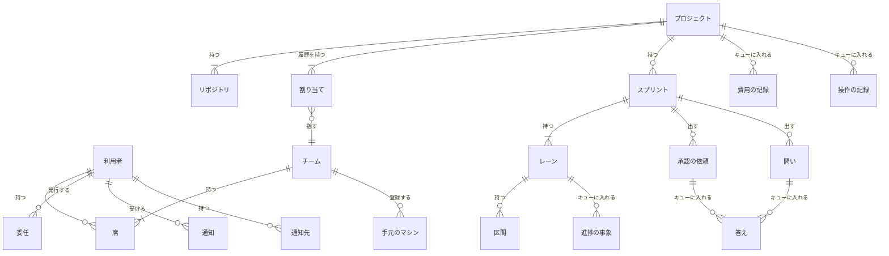
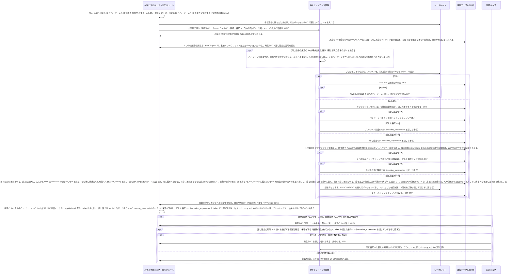

# データ: 状態を 3 つの保存先に分け、プロジェクトの割り当ての外へ見せず、承認と判断の跡を失わない

[全体の設計](overview.md)の集約と不変条件（I1〜I22）を、サービスのテーブル・状態用 S3 バケット・進行テーブルの DB の 3 つの保存先へ下ろす。
状態をどこに保存するかはこの文書が正本で、ほかの文書はここを指す。

| 扱うもの | 受ける節 |
| --- | --- |
| 集約の保存先とキー・共通のカラム・テーブル定義 | [保存先の分け方](#保存先の分け方)・[サービスのテーブル](#サービスのテーブル) |
| 承認資料と NDF のファイル | [状態用 S3 バケット](#状態用-s3-バケット)・[承認資料の保存期間](#承認資料の保存期間) |
| 進行テーブルの DB セットアップ・資格情報の差し替え・GitHub の token の失効 | [進行テーブルの DB](#進行テーブルの-db)（不変条件 I17〜I19・I22） |
| スキーマのバージョンと切り戻し | [スキーマのバージョンと移行方法](#スキーマのバージョンと移行方法) |
| 機能ごとの読み書き | [CRUD 図](#crud-図) |

保存先とインフラを選んだ理由（決定 80〜99・140）と外部の調査（LIB80〜LIB85・LIB91〜LIB93）は [プラットフォーム](platform.md) にあり、この文書は答えだけを持つ。割り当てを移す流れの順は [全体の設計の割り当てを変える流れ](overview.md#割り当てを変える流れ)、実行の振る舞いは [実行](execution.md) が持つ。
値はすべて作り物か設計の既定値である。

## 保存先の分け方

状態は 3 つの保存先に分ける。どの保存先も、区切りのプレフィックスにプロジェクトかチーム（利用者だけに属するものは利用者）の ID を置き、認可の判定（I2）が同じ ID で絞れる形にする。

| 保存先 | 何を置くか | 書き手 | 読み手 |
| --- | --- | --- | --- |
| サービスのテーブル（DynamoDB） | 全体設計にある集約すべて（利用者・チーム・委任・プロジェクト・割り当て・スプリント・手元のマシン・進捗の事象・承認の依頼・問い・通知・通知先・費用の記録・操作の記録）と冪等キー | API の各モジュール（集約の持ち主だけ）・定期ジョブ・通知の送信側（送達状態だけ）・テーブルの移行 | API |
| 状態用 S3 バケット | 承認資料の本文・NDF のファイルのうち進行テーブルの DB に乗らないもの | API（承認資料）・ランナー（署名つき URL で NDF のファイル） | API・ランナー（署名つき URL） |
| 進行テーブルの DB（Aurora PostgreSQL） | NDF の進行テーブルと永続化した実行の記録 | コンテナの中の NDF だけ | コンテナの中の NDF だけ。サービスは読まない |

サービスが NDF の状態を知る手段は、ランナーが送る進捗の事象だけにする。Lambda は VPC の外に置き、出口の無いサブネットの進行テーブルの DB へ届かないためである（決定 83）。

## サービスのテーブル

### ER 図

主な集約と関連だけを描く。属性は下のテーブル定義にある。

多重度の決まり: 割り当ては履歴の行を積み、今の割り当ては 1 つだけ（I3）。リポジトリのうち主はちょうど 1 つ（I1）。レーンを動かすコンテナは同時に 1 つ（I7）。

### テーブルとキー

表はコンテキスト（集約の持ち主のモジュール）ごとに分ける（決定 81）。テーブルの名前は `<prefix>-<environment>-db-<用途>` にする。

1 つの処理が状態を書き換える集約は原則 1 つで、別の集約への反映はドメインイベントで後から行う。ただし、途中で落ちると記録が欠けたり行どうしが食い違ったりする次の書き込みは、1 つのトランザクション（LIB81 の `TransactWriteItems`）で確定する。どれかの条件が外れれば、どの行も書かない。

| 一緒に確定する書き込み | 含める行 | 分けると起きること |
| --- | --- | --- |
| 状態を書くすべてのアイテム（I9・[API の文書の書き方と失敗](api.md#書き方と失敗)） | アイテムの状態の行・`db-audit` のアイテムの記録のレコード・`db-idempotency` の済みのレコード（テーブルをまたぐ） | 記録の無い状態の書き込みが残る。送り直しで同じアイテムを 2 回書く |
| プロジェクトの作成（`projects.create`。I1・I3） | `PROJECT` の行・主リポジトリの `REPO#` の行・初回の割り当ての `ASSIGN#` の行 | 割り当ての無いプロジェクトや、主リポジトリの無いプロジェクトが残る |
| 割り当て移行の受け入れ | `ASSIGN#` の行の追加と、`PROJECT` 行にある今の割り当て（`current_team_id`・`current_assign_id`）の差し替え・移行中のフラグと移す途中の状態を空にする更新 | 割り当ての履歴と今の割り当てが食い違う |
| GitHub の token の発行（I19） | `GHTOKEN#` の行の追加と、`PROJECT` の行の `gh_token_generation` を 1 上げて `gh_token_max_expiry` を更新する書き込み。確定してから token をランナーへ返す | 失効の手順が、記録だけ増えて世代番号が変わらない間を通り、渡した token を失効させないまま完了する |
| ログインの組の追加と外し（I16） | `LOGIN#` の 2 行と、`USER` 行の条件付き更新（[IdP の主体を一意にする行](#idp-の主体の一意の行)） | 1 つの IdP のアカウントが 2 人へ結ばれる。最後のログインが外れる |
| 費用の記録と月間利用量（I8） | `db-usage` の `COST#` の行と、`db-teams` の `USAGE#` の行の加算（テーブルをまたぐ） | 費用の記録と使った量が食い違う |
| I20 の照合 | スプリントの作成・レーン割り当ての確定・オーガナイザーを `active` にする書き込みと、`PROJECT` 行の `ConditionCheck`。ただし、同じトランザクションで `PROJECT` の行を書く書き込みでは、I20 の条件と `current_assign_id` の照合を、その行に対する `Update` の条件（`ConditionExpression`）に入れる。当たるのは、オーガナイザーを立てる・再開する・マシンの戻りで自動で戻す書き込み（枠の数の更新）と、手元のマシンがオーガナイザーのレーンを受け取る書き込み（`organizer_wipes_pending` の更新）である。DynamoDB は 1 つのトランザクションで同じレコードを 2 回指せないためである。`paused` から `active` へ戻す書き込みのように `PROJECT` の行を書かないものだけ `ConditionCheck` にする（[オーガナイザーの単位と状態](organizer.md#単位と状態)） | 移しや差し替えの間に新しいレーンかオーガナイザーが動き出す。同じレコードを 2 回指したトランザクションは常に失敗する |
| オーガナイザーを立てる・再開する・終える・止める・自動で戻す（[オーガナイザーの単位と状態](organizer.md#単位と状態)） | `db-organizers` のオーガナイザーのレコードと、`db-users` の専用の委任のレコード（立てる: 作る。再開する: 前の行の取り消しと新しい行。終える: 取り消し）と、`PROJECT` の行の枠の数（`organizer_slots_used`）の更新（枠を持つ状態へ移すときは上限より小さいことを条件に 1 足し、`active` か `paused` から離れるときだけ 1 引く。オーガナイザーのレコードは読んだ時の状態とバージョンを条件に書く。テーブルをまたぐ） | 終えたオーガナイザーの委任が使えるまま残る。委任の無いオーガナイザーができる。同時の作成や戻りが同じ残りの枠を取り、上限を超える。止まったものを止め直して枠を引き、数が実際より少なくなる |
| 会話の項目を渡す・受け取る | 渡す: オーガナイザーのレコードにある `inflight_message_id`（`active` で世代が token と同じで、空であることを条件に項目の ID を書く）と、項目の `delivered_at`・`delivered_generation`（`delivered_at` と `withdrawn_at` が空であることを条件にする）。渡し直す: 項目の `delivered_generation`（`received_at` が空であることを条件にする）と、オーガナイザーのレコードの `ConditionCheck`（`active` で世代が token と同じで、`inflight_message_id` がその項目）。答えを追記する: 答えの項目と、オーガナイザーのレコードの `ConditionCheck`（`active` で世代が token と同じ）。受け取る: 項目の `received_at` と、`inflight_message_id`（`active` で世代が token と同じで、その項目であることを条件に空にする） | 重なった取得のリクエストが別々の項目を受け取り、前の項目の処理中に次の項目が渡る。止めた後に前のランナーが会話へ答えを足し、指示を処理済みにする |
| 会話の項目の取り下げ | 取り下げの項目の追記と、対象項目の `withdrawn_at`（`delivered_at` と `withdrawn_at` が空であることを条件にする） | 取り下げた項目がオーガナイザーへ渡る |

テーブルごとのキーと持つ集約は次のとおりである。

| テーブル（用途） | パーティションキー / ソートキー | 持つ集約 | 時系列の扱い |
| --- | --- | --- | --- |
| `db-users` | `USER#<利用者>` / `USER`・`LOGIN#<IdP>#<主体>`・`DELEGATION#<委任>`。IdP の主体を一意にするレコードは `LOGIN#<IdP>#<主体>` / `LOGIN`（下の [IdP の主体を一意にする行](#idp-の主体の一意の行)） | 利用者・ログインの組・委任 | 上書き。変更の履歴は操作の記録が持つ |
| `db-teams` | `TEAM#<チーム>` / `TEAM`・`SEAT#<利用者>`・`MACHINE#<マシン>`・`USAGE#<UTC の年月>` | チーム・席・手元のマシン・月間利用量 | 上書き。席と役割の変更は操作の記録、使った量の元は費用の記録 |
| `db-projects` | `PROJECT#<プロジェクト>` / `PROJECT`・`REPO#<リポジトリ>`・`ASSIGN#<時刻>#<ID>`・`GHTOKEN#<期限>#<レーン>#<連番>` | プロジェクト・リポジトリ・割り当て・渡した GitHub token の記録 | 割り当ては履歴保持型（変更ごとに行を足し、プロジェクトのレコードが今の割り当てを指す）。token の記録は期限で TTL |
| `db-sprints` | `PROJECT#<プロジェクト>` / `SPRINT#<スプリント>`・`SPRINT#<スプリント>#LANE#<レーン>`・`…#SEG#<連番>` | スプリント・レーン・区間 | 状態は上書き。状態の移りは進捗の事象が持つ |
| `db-events` | `PROJECT#<プロジェクト>#LANE#<レーン>` / `SEQ#<連番>` | 進捗の事象 | 事象の記録（追記だけ、I13） |
| `db-decisions` | `PROJECT#<プロジェクト>` / `APPROVAL#<依頼>`・`QUESTION#<問い>`・`…#ANSWER#<答え>` | 承認の依頼・問い・答え | 答えは追記だけ。確定した答えの列を上書きしない。例外は `ndf_event_seqs` だけで、空のときに 1 回だけ書く（I5） |
| `db-notices` | `USER#<利用者>` / `NOTICE#<時刻>#<ID>`・`DEST#<通知先>`・`SLACKAUTH#<state の要約値>` | 通知・通知先・Slack の認可の取引（[実行の文書の Slack の登録](execution.md#slack-の登録)） | 通知は既読と送達の状態だけを上書き。取引は使用済みにする 1 回だけ上書きし、作ってから 10 分で TTL |
| `db-usage` | `PROJECT#<プロジェクト>` / `COST#<時刻>#<ID>` | 費用の記録 | 事象の記録（追記だけ） |
| `db-organizers` | `PROJECT#<プロジェクト>` / `ORGANIZER#<オーガナイザー>`・`ORGANIZER#<オーガナイザー>#MSG#<時刻>#<ID>` | オーガナイザー・会話の項目（[オーガナイザー](organizer.md)） | オーガナイザーのレコードは状態を上書き。会話の項目は追記だけ（例外は人の項目の `delivered_at`・`withdrawn_at`・`received_at` の 3 つで、どれも空のときに 1 回だけ書く。`delivered_at` と `withdrawn_at` は両方が空であることを条件にし、片方だけが書かれる。もう 1 つの例外の `delivered_generation` は、`received_at` が空の間、渡すたびに書き直す）。オーガナイザーの書き込みに使う冪等キーの済みのレコード（`ORGANIZER#<オーガナイザー>#OP#<項目>#<操作の名前>#<鍵>`）も置き、会話を消すまで残す |
| `db-audit` | `PROJECT#<プロジェクト>`・`TEAM#<チーム>`・`USER#<利用者>`・`ANON#<UTC の年月日>`（主体の決まらない 401） / `<時刻>#<ID>` | 操作の記録 | 事象の記録（追記だけ、I9） |
| `db-idempotency` | `<主体>#<操作の名前>#<鍵>` / なし | 冪等キー（主体・操作の名前・キーの組。[API の文書の冪等キー](api.md#冪等キー)） | 24 時間で TTL |

| 決まり | 中身 |
| --- | --- |
| 区切りの外の ID | プロジェクトに属する行は、パーティションキーの外でも `project_id` を持つ。利用者で区切る行（通知）も `project_id` を持ち、一覧は認可の判定で絞ってから返す・数える（I2） |
| インデックス | 利用者の席の一覧（`USER#<利用者>` からチームへ）・チームのプロジェクトの一覧（今の割り当てのチームから）・人を待つものの一覧（待っている依頼と問いだけを持つスパースインデックス）・NDF のファイルを消す期限の来たレーンの一覧（`files_delete_after` を持つレーンだけのスパースインデックス。[NDF のファイルの消し方](#ndf-のファイルの消し方)）の 4 つを置く。インデックスのキーと写す列は #2 が決める。オーガナイザーのレコードの `files_delete_after` も、同じスパースインデックスの考え方で定期ジョブが読む |
| 条件付き書き込み | 今の割り当ての差し替え（I3）・主リポジトリの数（I1）・レーンのコンテナの割り当て（I7）・同じ連番の事象（I13）・答えの確定（I4・I5）・使える量の加算（I8）は、条件式（LIB81）で 1 行を照合して書く。外れたら 409 か前の 1 件を返す |
| 日時と金額 | 日時は UTC の ISO 8601（末尾 `Z`）、金額は最小単位の整数と ISO 4217 の通貨の組で持つ（I15）。スキーマの正本の検証が外れた値を拒む |
| 共通のカラム | どの行も下の [共通のカラム](#共通のカラム) を持つ。上書きの行は `version` も持ち、追記だけの行は持たない |
| 課金と守り | 表はリクエストの数の課金（LIB81）。どのテーブルもポイントインタイムの戻し（PITR）を有効にし、スタックから消してもテーブルを残す（決定 93） |

### 共通のカラム

| カラム | 持つ行 | 意味 |
| --- | --- | --- |
| `pk` | すべて | パーティションキー（上のテーブルとキーのテーブル） |
| `sk` | ソートキーを持つテーブルのレコード（`db-idempotency` のほかのすべて） | ソートキー。`db-idempotency` はパーティションキーだけのテーブルで、レコードは `sk` を持たない |
| `schema_version` | すべて | スキーマのバージョン（整数。[スキーマのバージョンと移行方法](#スキーマのバージョンと移行方法)） |
| `version` | 上書きの行（利用者・チーム・席・委任・手元のマシン・プロジェクト・リポジトリ・スプリント・レーン・承認の依頼・問い・通知・通知先・月間利用量・オーガナイザー） | エンティティのバージョン。書くたびに 1 上げ、条件付き書き込み（`updateIfVersion`）で照合する。API のアイテムの `version`（[API の文書のバージョンと条件付き更新](api.md#バージョンと条件付き更新)）はこの列を返す |

追記だけの行（割り当て・答え・進捗の事象・費用の記録・操作の記録・冪等キー・渡した GitHub token の記録）は `version` を持たない。答えのレコードにある `ndf_event_seqs` は、バージョンで照合せず「列が無い」ことを条件にした書き込みで 1 回だけ足す（I5）。

### IdP の主体の一意の行

1 つの IdP のアカウントを 2 人の利用者へ結ばないための行である（I16）。

| テーブル | パーティションキー / ソートキー | 持つ列 | 書き方 |
| --- | --- | --- | --- |
| `db-users` | `LOGIN#<IdP>#<主体>` / `LOGIN` | `user_id`・`schema_version` | ログインの組の行（`USER#<利用者>` / `LOGIN#<IdP>#<主体>`）と同じトランザクションで、無いときだけ書く（`putIfAbsent`）。既にあれば 409。外すときは 2 行を同じトランザクションで消す |

サインインは IdP の主体からこのレコードを強整合で読み、利用者を引く（決定 99）。

ログインの組を足す・外す書き込みは、利用者ごとに 1 つずつ通す。`logins.delete` は最後の 1 つのログインを外さない契約で、2 行の削除だけを照合すると、ログインを 2 つ持つ利用者が別々の画面から 1 つずつ同時に外したとき、どちらの削除も通ってサインインできなくなるためである。

1. `USER#<利用者>` の区切りを強整合で読み、利用者のレコード（`USER`）の `version` とログインの組の数を得る
2. 外すときは、数が 2 以上でなければ 409 で拒否する
3. ログインの組の 2 行の削除（足すときは 2 行の追加）と、利用者のレコードの `version` が 1 で読んだ値のままであることを条件に 1 上げる更新を、同じトランザクションで書く
4. 条件が外れたら（同じ利用者への別の追加か外しが先に確定した）、1 から読み直す

### テーブル定義

主な集約の列を書く。ここに定義の無いテーブル（利用者・ログインの組・委任・チーム・席・招待・手元のマシン・月間利用量・リポジトリ・区間・スプリント・進捗の事象・問い・通知・通知先・費用の記録・冪等キー・渡した GitHub token の記録）の列と、上の 4 つのインデックスのカラムは #2 が決める。共通のカラムはどのテーブルでも上の [共通のカラム](#共通のカラム) に従う。

プロジェクト（`db-projects` の `PROJECT` の行）:

| カラム | 型 | NULL 可否 | 意味 |
| --- | --- | --- | --- |
| `project_id` | 文字列 | 不可 | プロジェクトの ID（無作為） |
| `name` | 文字列 | 不可 | 名前 |
| `current_team_id` | 文字列 | 可 | 今の割り当てのチーム。空は「閉じた」で、どのチームからも見えない |
| `current_assign_id` | 文字列 | 可 | 今の割り当てのレコードの ID。空の意味は上と同じ |
| `transfer_in_progress` | 文字列 | 可 | 移行中のフラグ。今の割り当てを移す移行の ID。移行の作成で書き（E18）、受け入れか取り下げで空にする。空でない間は I20 で止める |
| `transfer` | 画面マップ | 可 | 割り当てを移す途中の状態（移す先・移す元の割り当ての ID・止め終えたか・失効が終わったか・差し替えを始めたか・取り下げたか）。差し替えを始めたかは、進行テーブルの DB が無ければ始めずに真にする。移行の作成で、移行中のフラグと同じ書き込みで止め終えたかを偽にし、移す元の割り当ての ID に `current_assign_id` を写して書く。止め終えたかの偽が止める依頼として残る（E18）。移す元の割り当ての ID は、失効させてよい GitHub の token を絞るのに使う（[GitHub の token の失効](#github-の-token-の失効)）。空は「移していない」 |
| `progress_db_state` | 文字列 | 不可 | 進行テーブルの DB の状態（`無い`・`作成中`・`有る`） |
| `progress_db_name`・`progress_db_role` | 文字列 | 可 | 進行テーブルの DB のデータベースと役割の名前（無作為）。API が `作成中` にするときに作って置き、作り直しでも同じ名前を使う。空は「まだ作っていない」 |
| `progress_db_prep_id` | 文字列 | 可 | 今の用意の ID。DB セットアップ関数を呼ぶ前に置き、呼び出しに渡す。終わりの記録はこの ID が今の値と合うときだけ書く。空は「用意していない」 |
| `progress_db_rotation_seq` | 整数 | 不可 | 差し替えの番号。差し替えを始めるたびに 1 上げる（I17） |
| `progress_db_rotation_pending` | 真偽 | 不可 | 差し替えの完了を待っているか。真の間は I20 で止める |
| `progress_db_rotation_attempts` | 整数 | 不可 | 今の番号の差し替えで DB セットアップ関数を呼んだ回数。番号を上げるときに 1 にし、呼び直すたびに 1 上げる（I22） |
| `progress_db_secret` | 文字列 | 可 | そのプロジェクトの URL を入れたシークレットの名前。空は「まだ作っていない」 |
| `progress_db_secret_version` | 文字列 | 可 | 今の用意（作るか差し替え）が DB の役割へ書くパスワードの、シークレットのバージョンの ID。API が用意の ID と同じ書き込みで置き、差し替えの呼び直しでは変えない（[パスワードのバージョン](#パスワードのバージョン)）。空は「用意していない」 |
| `gh_token_max_expiry` | 日時 | 可 | 渡した GitHub の token の期限の最大値。空は「期限の前の token が無い」 |
| `gh_token_generation` | 整数 | 不可 | token の記録の世代番号。記録を足すのと同じトランザクションで 1 上げる |
| `state_url_max_expiry` | 日時 | 可 | 出した状態用 S3 バケット の署名つき URL の期限の最大値（[署名つき URL](#署名つき-url)）。空は「出していない」 |
| `organizer_wipes_pending` | 文字列の集合 | 可 | 手元のマシンへ渡し、まだ作業場所を消し終えたと通知していないオーガナイザーのレーン。アイテムは `<マシンの ID>#<オーガナイザーの ID>#<世代>`。受け取り（`/v1/machine/lane_claims/create`）で足し、`/v1/machine/organizer_wipes/create` で通知した組と一致するアイテムだけを外す。マシンの登録を外しても外さない。割り当て移行の受け入れは、これが空であることを条件にする。空は「消し終えていない記録が無い」（[手元のマシンにあるオーガナイザーの会話の記録](organizer.md#会話のキャッシュ)） |
| `ask_human_only` | 写像 | 可 | 区分ごとに `human_only` にするか（[実行の文書にある区分の表](execution.md#区分とだれが答えられるか)）。空と、書いていない区分は `human_only` |
| `organizer_slots_used` | 整数 | 不可 | 枠を持つ（`active` か `paused` の）オーガナイザーの数。オーガナイザーの状態を変える書き込みと同じトランザクションで足し引きする（[オーガナイザーの単位と状態](organizer.md#単位と状態)） |
| `created_at` | 日時 | 不可 | 作った時刻（UTC） |
| `schema_version`・`version` | 整数 | 不可 | スキーマのバージョンとエンティティのバージョン（[共通のカラム](#共通のカラム)） |

割り当て（`ASSIGN#…` の行。追記だけ）:

| カラム | 型 | NULL 可否 | 意味 |
| --- | --- | --- | --- |
| `assign_id` | 文字列 | 不可 | 割り当てのレコードの ID |
| `team_id` | 文字列 | 可 | 割り当てたチーム。空は「閉じた」行 |
| `confirmed_by` | 文字列 | 不可 | 確定した人の利用者の ID（`human_only`、I3） |
| `accepted_by` | 文字列 | 可 | 移す先の持ち主の受け入れ。空は「作成と同時の割り当て」か「閉じた」 |
| `confirmed_at` | 日時 | 不可 | 確定の時刻（UTC） |

手元のマシン（`db-teams` の `MACHINE#…` の行）。[オーガナイザー](organizer.md) が決めるカラムだけを書き、ほかのカラムは #7 が決める:

| カラム | 型 | NULL 可否 | 意味 |
| --- | --- | --- | --- |
| `deleted_at` | 日時 | 可 | 登録を外した時刻（`machines.delete`）。外した後も、登録 token の期限の後も、行と token 照合用の値を残す。その token は `/v1/machine/organizer_wipes/create` だけを受ける。空は「外していない」（[手元のマシンにあるオーガナイザーの会話の記録](organizer.md#会話のキャッシュ)） |

レーン（`db-sprints` の `…#LANE#…` の行）:

| カラム | 型 | NULL 可否 | 意味 |
| --- | --- | --- | --- |
| `lane_id` | 文字列 | 不可 | レーンの ID |
| `repo_id` | 文字列 | 不可 | 回すリポジトリ |
| `after` | 文字列の配列 | 不可 | 先に終わるべきレーン。空の配列は「待たない」 |
| `place` | 文字列 | 不可 | 実行の場所（`hosted`・`machine`） |
| `inference` | 文字列 | 不可 | 推論の手段（`managed`・`byok`） |
| `runner_id` | 文字列 | 可 | 今動かしているコンテナ（タスクかマシン）。空は「どこにも割り当てていない」（I7 は空か前の世代が終わっているときだけ書ける条件で守る） |
| `generation` | 整数 | 不可 | 割り当ての世代番号。割り当てのたびに 1 上げ、レーンの token はこの世代に結ぶ（[実行の文書: レーンの状態](execution.md#レーンの状態)） |
| `state` | 文字列 | 不可 | レーンの状態（値の集合は [実行](execution.md)） |
| `last_seq` | 整数 | 不可 | 受けた進捗の事象の最後の連番 |
| `files_delete_after` | 日時 | 可 | NDF のファイルを消す期限（レーンが終わった時刻から 14 日後）。スパースインデックスのキー。空は「終わっていない」か「消し終えた」（[NDF のファイルの消し方](#ndf-のファイルの消し方)） |
| `version` | 整数 | 不可 | エンティティのバージョン（[共通のカラム](#共通のカラム)） |

オーガナイザー（`db-organizers` の `ORGANIZER#…` の行）。全体の設計と [オーガナイザー](organizer.md) が決めるカラムだけを書き、ほかのカラムは #2 が決める:

| カラム | 型 | NULL 可否 | 意味 |
| --- | --- | --- | --- |
| `state`・`stop_reason` | 文字列 | `stop_reason` は許す | 状態（`active`・`paused`・`stopped`・`ended`）と、`stopped` の理由のコード。空は「止まっていない」 |
| `created_by` | 文字列 | 不可 | 立てた人の利用者の ID。送る・取り下げる・終える・再開するを呼べる主体の照合に使う |
| `delegation_id` | 文字列 | 不可 | 今の専用の委任の ID。再開で新しい ID に替える |
| `assign_id` | 文字列 | 不可 | 動かす割り当ての ID。立てた時の割り当てを書き、人の再開で今の割り当てに替える。起動前の照合で今の割り当てと比べる |
| `generation` | 整数 | 不可 | オーガナイザーのレーンの世代番号。起動するたびに 1 上げ、レーンの token をこの世代に結ぶ |
| `inflight_message_id` | 文字列 | 可 | 処理中の項目（渡して受け取りの無い人の項目）の ID。次の項目を渡す書き込みで空であることを条件に書き、受け取りの書き込みで空にする。空は「処理中の項目が無い」（[オーガナイザーの渡し方と取り下げ](organizer.md#渡し方と取り下げ)） |
| `transcript_generation` | 整数 | 可 | 復元に使う会話のキャッシュの世代。ランナーがキャッシュを書き終えた通知で進め、終えた時と移行で止めた時に空にする。空は「キャッシュが無い」 |
| `transcript_object_id` | 文字列 | 可 | 復元に使う会話のキャッシュの ID（`transcript_generation` の世代のプレフィックス配下にあるオブジェクト名）。`transcript_generation` と一緒に書き、同じ世代では新しい ID へだけ進める。`transcript_generation` を空にする時に一緒に空にする（[オーガナイザーの会話のキャッシュ](organizer.md#会話のキャッシュ)） |
| `files_delete_below_generation` | 整数 | 可 | 会話のキャッシュを消す世代の上限（この世代以下を消す） |
| `state_url_max_expiry` | 日時 | 可 | このオーガナイザーのレーンへ出した状態用 S3 バケット の署名つき URL の期限の最大値（[署名つき URL](#署名つき-url)）。空は「出していない」 |
| `files_delete_after` | 日時 | 可 | 会話のキャッシュを消す期限。消す世代の上限を書く時に、今の時刻と `state_url_max_expiry` の遅い方を書く。書く書き込みは、計算に使った `state_url_max_expiry` が読んだ値のままであることを条件にし、外れたら読み直して計算し直す。空は「消す期限が来ていない」か「消し終えた」（[オーガナイザーの会話のキャッシュ](organizer.md#会話のキャッシュ)） |

スプリント（`db-sprints` の `SPRINT#…` の行）は、オーガナイザー専用の委任が始めたときだけ `organizer_id` を持つ。API がリクエストの主体から決めて書き、アイテムからは受けない。オーガナイザーのモジュールは、この列で会話へ足す報告の送信先を決める（[オーガナイザーの形](organizer.md#ai-のオーガナイザーの形)）。

承認の依頼（`db-decisions` の `APPROVAL#…` の行）:

| カラム | 型 | NULL 可否 | 意味 |
| --- | --- | --- | --- |
| `approval_id` | 文字列 | 不可 | 依頼の ID |
| `sprint_id`・`lane_id` | 文字列 | 可 | 出したスプリントとレーン。オーガナイザーからの起票の依頼では空 |
| `organizer_id` | 文字列 | 可 | 出したオーガナイザー（[実行の文書のオーガナイザーからの起票の依頼](execution.md#オーガナイザーからの起票の依頼)）。`sprint_id` と `organizer_id` のどちらか 1 つだけが値を持つ |
| `gate` | 文字列 | 不可 | 承認ゲートの種類（設計・リリース・レッドライン） |
| `material_digest` | 文字列 | 不可 | 承認資料の要約値（sha256）。状態用 S3 バケット の本文の名前でもある |
| `state` | 文字列 | 不可 | 状態。値と遷移は [実行の文書: 承認の依頼と問いの状態](execution.md#承認の依頼と問いの状態) が正本 |
| `answer_id` | 文字列 | 可 | 確定した答え。空は「待っている」か「取り消した」 |
| `delivery` | 文字列 | 可 | NDF へ答えを送達する状態（値と遷移は [実行の文書: 答えの送達](execution.md#答えの送達)）。空は「答えていない」か送達の対象外 |
| `waiting_since` | 日時 | 可 | スパースインデックスのキー。空は「人を待っていない」 |
| `version` | 整数 | 不可 | エンティティのバージョン（[共通のカラム](#共通のカラム)） |

答え（`db-decisions` の `…#ANSWER#…` の行。追記だけ。確定したカラムは上書きせず、`ndf_event_seqs` だけ空のときに 1 回書く）。全体の設計が決めるカラムだけを書き、ほかのカラムは #2 が決める:

| カラム | 型 | NULL 可否 | 意味 |
| --- | --- | --- | --- |
| `ndf_event_seqs` | 整数の配列 | 可 | `ndf answer` が書いた NDF の答えの事象の番号（I5）。送達の事象（E14）で受け、送達の状態を「届いた」にする書き込みと同じ書き込みで、空のときだけ書く。空は「まだ届いていない」。送達の対象外の答えは持たない |

操作の記録（`db-audit` の行。追記だけ）:

| カラム | 型 | NULL 可否 | 意味 |
| --- | --- | --- | --- |
| `at` | 日時 | 不可 | 時刻（UTC） |
| `actor` | 画面マップ | 不可 | 主体（人・委任・ランナー・手元のマシン・GitHub・定期ジョブ・DB セットアップ関数）と、委任なら委任した人とクライアントの名前 |
| `channel` | 文字列 | 不可 | 入口（画面・API・MCP・ランナー・手元のマシン・GitHub・定期ジョブ・DB セットアップ） |
| `operation` | 文字列 | 不可 | 操作の表の名前 |
| `target_ids` | 文字列の配列 | 不可 | 対象の ID。空の配列は「対象を持たない操作」（サインインなど） |
| `result` | 画面マップ | 不可 | 結果（`ok`・`partial`・`rejected`）と、HTTP の状態・理由のコードの並び（[API の文書の操作の記録](api.md#何を書くか)） |

秘密と個人情報の値は記録に書かない（I9）。1 つのリクエストは 1 つの記録の ID で、リクエストの要約の行 1 件と、書いたアイテムごとの行（アイテムの確定と同じトランザクション）で残す。要約のレコードを書けなければリクエストを 503 で失敗させる（[API の文書の書き方と失敗](api.md#書き方と失敗)）。パーティションキーは次のとおりにする（[詳細設計](detail.md#内部のデータと定数)）。

| 場合 | パーティションキー | 読める人（`audit_records.list`） |
| --- | --- | --- |
| 見られたプロジェクトがある | `PROJECT#<プロジェクト>` | 割り当てたチームの持ち主。メンバーは自分と自分の委任が主体の行だけ |
| プロジェクトは無く、チームを対象にする（席・招待・チームの設定・手元のマシン・使える量と上限額・実行の場所など） | `TEAM#<チーム>` | そのチームの持ち主。メンバーは自分と自分の委任が主体の行だけ |
| プロジェクトもチームも対象にしない（サインイン・言語と時刻帯・委任・通知先など） | 主体の `USER#<利用者>` | 本人 |
| 主体の決まらない 401 | `ANON#<UTC の年月日>` | だれも読めない（API から読まない） |

R13 は、そのチームの `TEAM#` の行と、今そのチームに割り当てたプロジェクトの `PROJECT#` の行を合わせて出す。

## 状態用 S3 バケット

バケットは 1 つで、公開を止め、暗号化し、TLS だけを受ける。オブジェクトの名前のプレフィックスにスキーマのバージョンを置く。

| 中身 | 名前 | いつ書くか | 消し方 |
| --- | --- | --- | --- |
| 承認資料の本文 | `v1/projects/<プロジェクト>/materials/<要約値>.json` | 承認の依頼を受けたとき（API） | プロジェクトを閉じた後に、[承認資料の保存期間](#承認資料の保存期間)で消す。人の判断の材料のため、スプリントの終わりでは消さない |
| NDF のファイル | `v1/projects/<プロジェクト>/lanes/<レーン>/…` | 承認の待ちでタスクを止めるとき・区間の終わり・SIGTERM（ランナー） | レーンの終わりから 14 日で、定期ジョブが消す（下の [NDF のファイルの消し方](#ndf-のファイルの消し方)） |
| オーガナイザーの会話のキャッシュ（claude の会話の記録と、claude へ渡した項目の ID。資格情報は含めない） | `v1/projects/<プロジェクト>/organizers/<オーガナイザー>/<世代>/<控えの ID>` | 休止の前・SIGTERM・答えの追記の後（オーガナイザーのレーン。`active` の間だけ。今の世代のレーンの token で受けた署名つき URL だけで読み書きする） | 世代ごとのプレフィックス（`<オーガナイザー>/<世代>/`）の下に、API が決めたキャッシュの ID の名前で 1 回だけ書く（URL に `If-None-Match: *` を署名して含める）。復元に使う世代を進めた時は前の世代を、終えた時と割り当ての移行で止めた時はその時の世代以下を、そのオーガナイザーへ出した署名つき URL がすべて切れた後に定期ジョブが NDF のファイルと同じ手順で消す（[オーガナイザーの会話のキャッシュ](organizer.md#会話のキャッシュ)） |

### NDF のファイルの消し方

NDF のファイルは、レーンが終わってから 14 日後に定期ジョブが消す。S3 のライフサイクルの規則は日数をオブジェクトを作った時刻から数える（[S3 Lifecycle](https://docs.aws.amazon.com/AmazonS3/latest/userguide/intro-lifecycle-rules.html)）ため、使わない。使うと、承認の待ちが 14 日を超えたレーンのファイルが、承認して再起動する前に消え、ランナーが状態を戻せなくなる。

1. レーンを終わりの状態（済んだ・失敗・取り消した）にする書き込みと同じ書き込みで、レーンのレコードの `files_delete_after` に、終わった時刻から 14 日後を記す
2. 定期ジョブは、`files_delete_after` をキーにしたスパースインデックスから、期限を過ぎたレーンを読む
3. 定期ジョブは、そのレーンのプレフィックス（`v1/projects/<プロジェクト>/lanes/<レーン>/`）のオブジェクトをすべて消し、一覧が空と読んでから、`files_delete_after` を空にする。途中で落ちたら、次の定期ジョブが同じレーンを拾って消し直す

### 署名つき URL

ランナーは NDF のファイルを送る・受けるたびに、その直前に API から署名つき URL を受ける（`/v1/runner/state_urls/create`。[API の文書: ランナーの HTTP ルート](api.md#ランナー手元のマシンの-http-のルート)）。URL の有効期間は 15 分で、交換では URL を渡さない。交換だけで渡すと、起動から 15 分を超えたレーンが、区間の終わりや承認待ちに入るときにファイルを保存できないためである。

API は次の順で URL を出す。

1. レーンの token を照合し、レーンが終わっておらず、token がレーンの今の世代のものであることを確認する
2. リクエストされたオブジェクトの名前が、そのレーンのプレフィックス（`v1/projects/<プロジェクト>/lanes/<レーン>/`。オーガナイザーのレーンでは、PUT は API がこのリクエストで作るキャッシュ ID の名前で、今の世代のプレフィックス `v1/projects/<プロジェクト>/organizers/<オーガナイザー>/<世代>/` の下に置き、`If-None-Match: *` を署名に含める。GET は復元に使うキャッシュ（`transcript_generation` の世代にある `transcript_object_id`）だけ）の下にあることを確認する
3. URL の期限を記す。次の書き込みを 1 つのトランザクションで行い、条件が 1 つでも外れたら URL を出さない

    | 行 | 条件 | 書くもの | 外れたとき |
    | --- | --- | --- | --- |
    | プロジェクトの行 | 移行中のフラグ（`transfer_in_progress`）が空 | `state_url_max_expiry` を、今の値と「今 + 15 分」の遅い方へ | 409 |
    | スプリントのレーンの行 | レーンが終わっておらず、世代が token と同じ | なし（`ConditionCheck`） | 401 |
    | オーガナイザーの行 | 状態が `active` で、世代が token と同じ（休止の後は出さない。キャッシュは休止の前に固めて確定する） | `state_url_max_expiry` を、今の値と「今 + 15 分」の遅い方へ | 401 |

4. 3 が確定してから、対象のオブジェクトと GET か PUT のどちらかを指定し、3 で使った時刻から 15 分で切れる URL に署名して返す

1 の読み出しと 3 の書き込みの間にレーンやオーガナイザーが終わっても、3 の条件で URL を出さない。1 だけで照合すると、終わる前に照合を通ったリクエストが終わった後に期限を記して URL を返し、消す処理が待つ時刻より遅くまで PUT が使える。

発行済みの URL は、レーンを止めても期限まで使える（[S3 の署名付き URL](https://docs.aws.amazon.com/AmazonS3/latest/userguide/using-presigned-url.html)）。名前のプレフィックスが分かれていても、移し元のチームが持つ URL で、移した後もそのプロジェクトのファイルを読めると、割り当てたチームにだけ見せる決まり（Value 9・I2）に反する。そのため、移行の作成で移行中のフラグを書いた時点から新しい URL を出さず、移す先の受け入れは `state_url_max_expiry` が空か過去であることを照合する（[割り当てを移すときの差し替え](#割り当てを移すときの差し替え)）。

### 承認資料の保存期間

承認資料の本文は、プロジェクトを閉じてから、操作の記録と同じ保存期間（既定 1 年。[API の文書: 保存期間](api.md#保存期間と見られる人)）で消す。保存期間の値は操作の記録と 1 つで、設置する人が設定のファイルで延ばせる（[決定 7](decisions.md#決定の記録)）。設定キーの名前は #13 が決める。

## 進行テーブルの DB

**1 つの Aurora Serverless v2（PostgreSQL、最小 0 ACU）のクラスタの中に、プロジェクトごとに別のデータベースとログインの役割を作る（I10、決定 83・84）。** サービスは中身を読み書きしない。接続するのはホステッドのランナーだけである。DB セットアップ関数は RDS Data API で触れ、接続を持たない。手元のマシンのレーンへは URL を渡さない（出口の無いサブネットへ届かないため。手元のマシンの NDF は手元の保存先を使う。[実行](execution.md)）。

| 項目 | 決まり |
| --- | --- |
| 単位 | プロジェクトごとに 1 つのデータベースと、そのデータベースだけに権限を持つ役割。名前はプロジェクト・チーム・リポジトリの名前や ID から作らない無作為の値にし、対応はサービスのテーブルにだけ置く |
| 作る時 | そのプロジェクトで最初のホステッドのレーンを始めるとき。API がデータベースと役割の名前・用意の ID・新しいバージョンの ID を置いて `progress_db_state` を `作成中` にし、その書き込みに勝ったときだけ新しいパスワードの URL をシークレットの該当バージョンに入れて、DB セットアップ関数を非同期で呼ぶ（[パスワードのバージョン](#パスワードのバージョン)）。関数が用意の ID が合う終わりを記したら `有る` にする。失敗か作成のタイムアウト（15 分）なら `無い` へ戻し、次の開始で同じ名前で再作成する。作成のタイムアウトでは、定期ジョブが用意の ID が同じことを条件に `無い` へ戻し、用意の ID を外す。作成のタイムアウトは、前の呼び出しが DB へ働きうる最も遅い時刻（キューの 60 秒＋関数の 5 分＋Data API の開いたトランザクションが無通信で巻き戻るまでの 3 分 = 9 分）より長いため、この時点で前の用意の ID の呼び出しは終わり、その文もトランザクションも DB に残っていない。外した用意の ID の終わりは書かれない（I18・[決定 96](platform.md#決定の記録)）。下の [用意と差し替えの順](#用意と差し替えの順) |
| 認証 | 役割のパスワードを含む URL を、プロジェクトごとのシークレットに置く。IAM 認証は使わない（token が 15 分で、NDF の DB の URL は token を再取得するインタフェースを持たない。LIB80） |
| 渡し方 | API が交換のときに、そのプロジェクトの URL だけをランナーへ返す。URL は、プロジェクトのレコードを強整合で読んで `有る` で差し替えの保留が無いことを照合し、同じ読みで返る行に結んだバージョンの ID（`progress_db_secret_version`）を `GetSecretValue` の `VersionId` に渡して読む。ラベル（`AWSCURRENT`）では読まない（ラベルの読みは結果整合で、保留を下ろした直後の読みが差し替えの前のバージョンを返し、ランナーが差し替え済みの DB で認証に落ちうるため。[パスワードのバージョン](#パスワードのバージョン)）。ランナーはメモリだけに置き、ファイルとログに書かない |
| 一時停止 | 利用者の接続が 0 本になってから既定の 300 秒で一時停止する。再開は通常 約 15 秒、24 時間を超えた停止の後は 30 秒以上（LIB80）。ランナーのタスクの起動手順は最初の接続を、DB セットアップ関数は再開の間の `DatabaseResumingException` を、再試行で待つ |

### 用意の手順

DB セットアップ関数（Lambda。VPC の外）は、呼び出しで用意の ID・プロジェクトの ID・種類（作る・差し替え）・差し替えの番号だけを受け、次の順を RDS Data API で打つ。呼び出しにはパスワードも管理の値も載せない。管理の役割のシークレットを Data API に渡して打ち、プロジェクトの役割の新しいパスワードは、関数がそのプロジェクトのシークレットから、プロジェクトのレコードに結んだバージョンの ID で読む（下の [パスワードのバージョン](#パスワードのバージョン)）。シークレットを作り値を入れるのは API で、関数は読むことと、SQL を終えたバージョンへ `AWSCURRENT` を移すことだけを行う。`CREATE DATABASE` はトランザクションの外（自動の確定）で打つ。データベースは Data API の引数で `postgres` かプロジェクトのデータベースを選ぶ。

| 順 | 行うこと | 理由 |
| --- | --- | --- |
| 1 | すべてのデータベースで、接続してはならない役割の接続を断つ（下の [ほかのデータベースからの分離](#ほかのデータベースからの分離)） | 別のデータベースへ接続し直して、カタログと統計から他のプロジェクトの名前を読ませない |
| 2 | データベースを `ALLOW_CONNECTIONS false` で作る（作り直しで既にあれば作らない） | 権限を整えるまで誰も接続できない |
| 3 | そのデータベースの `CONNECT`・`TEMPORARY` を `PUBLIC` から外し、`ALLOW_CONNECTIONS true` にする | この時点で接続できるのは持ち主である管理の役割だけ |
| 4 | 管理の役割でそのデータベースを選んで打ち、カタログと統計のビューの読み取りを `PUBLIC` から外す。読み取りの既定の役割（`pg_read_all_stats` など）へ入れない | 他のプロジェクトのデータベースと役割の名前と数を読ませない（I2） |
| 5 | 管理の接続とプロジェクトの役割による接続のほかを切り、起動途中の接続（1 と同じ読み方で、そのデータベースの鎖を持つもの）が無く、切る相手も残っていないと読む | 作り直しのとき、権限を整える前から残る接続を断つ |
| 6 | 役割を作る。作り直しで既にあれば、パスワードを今回の用意のバージョンの値へ書き直す（書き方は下の [パスワードの書き方](#パスワードの書き方)）。その役割を持ち主とする専用のスキーマと `search_path` を置き、最後にその役割にだけ `CONNECT`・`TEMPORARY` を与える | NDF と DBOS のテーブルを作る場所。DBOS が一時テーブルを使うため `TEMPORARY` が要る。作り直しでも、最後に結んだバージョンと DB のパスワードが合う |

#### ほかのデータベースからの分離

用意の手順の 1 は、どのデータベースにも、接続を許されていない役割の接続が残っていないことを確認してから先へ進む。関数は次の順で打つ。

1. `postgres`・`template1` の `CONNECT`・`TEMPORARY` を `PUBLIC` から外す（何度打っても同じ結果）
2. そのほかの接続を許すデータベース（そのプロジェクトのものを除く）で `PUBLIC` が `CONNECT` を持てば、そのデータベースの `CONNECT`・`TEMPORARY` を `PUBLIC` から外して読み直す
3. 2 で見つけたかによらず毎回、`postgres`・`template1` を含むすべてのデータベースで、起動途中の接続が無いことを読む。起動途中の接続は、どれかのデータベースの鎖（`pg_database` の行への `RowExclusiveLock`）を持ち、まだ `pg_stat_activity` に載らない接続である
4. 3 で無いと読んだ後に、すべてのデータベースで、今の権限でそのデータベースへの `CONNECT` を持たない接続（管理の役割と superuser のものを除く）を切り、切る相手が残っていないと読む
5. 2 で `PUBLIC` の `CONNECT` を見つけたときは、断てても何も作らずに止める

それぞれの理由は次のとおりである。

- ほかのプロジェクトのデータベースに `PUBLIC` の `CONNECT` が戻っていれば、作る役割だけでなく、用意済みである他プロジェクトの役割もそこへ接続できる
- `CONNECT` は接続を始めるときだけ照合され、取り消しても繋いだままの接続は残る。そのため、外して新しい接続を断ち、切って繋いだままの接続を断つ。`postgres`・`template1` へ戻った間に繋いだ接続も同じで、外すだけでは繋いだままカタログを読み続ける
- 切りを毎回打つのは、前の用意が取り消しを確定した後・切り終える前に止まると、次の用意では `PUBLIC` の `CONNECT` がもう無く、今の ACL からは切る相手を見つけられないため
- 起動途中の接続をすべてのデータベースで読むのも同じ理由である。今回取り消したデータベースに限ると、前の用意が取り消しを確定した直後に止まったリトライでは、取り消しの前に照合を通ってまだ載らない接続を見落とす
- 起動途中の接続を先に読むのは、PostgreSQL が起動のときこの鎖を取ってから `CONNECT` を照合し、`pg_stat_activity` に載せてから鎖を放すためである。取り消しの確定の前に照合を通った接続は、鎖を持つ載らない接続が無いと読んだ後の読みには必ず載る
- 見つけたときに止めるのは、戻った原因を失敗として残すためで、次のリトライは照合を通る

#### パスワードの書き方

用意の手順の 6 は、パスワードの平文も検証子も SQL の文の本文に載せない。文と引数の値は、DB の側のログと監査のログに書かれうるためである。関数は次の順で書く。

1. パスワードを SCRAM-SHA-256 の検証子に変える
2. 下の表の設定を確認する。どれかが通らなければ、検証子を送らずに止める
3. 検証子を引数で渡してトランザクションの中だけの設定に置き、`DO` の中でその設定を読んで役割のパスワードへ書く

検証子をログ・計画・構文木・統計・監査に残さないための設定は、置く側と関数の扱いで次の 3 つに分かれる。

| 分担 | 設定と、満たす値 | 関数の扱い |
| --- | --- | --- |
| 関数がトランザクションの中だけで置く | `log_parameter_max_length_on_error` = 0・`debug_print_plan` = `off`・`debug_print_parse` = `off`・`debug_print_rewritten` = `off` | 書く前に置く |
| スタックがクラスタのパラメータで置き、関数が照合する | `log_parameter_max_length` = 0 | 実効値を読み、合わなければ止める |
| 関数では変えられず、読んで条件に当たれば止める | `auto_explain.log_min_duration` が -1 でない・`pg_stat_statements.track` が `all` で `pg_stat_statements.track_utility` が `on`・`pgaudit.log_parameter` が有効・`pgaudit.log` で `role` が効く | 読んでどれかに当たれば止める。その拡張を読み込んでいなければ当たらない |

それぞれの設定が要る理由は次のとおりである。

| 設定 | 守らないと残る所 |
| --- | --- |
| `log_parameter_max_length`・`log_parameter_max_length_on_error` | 通常の SQL 文のログと失敗時のログに、引数の値が載る |
| `debug_print_plan`・`auto_explain.log_min_duration` | PostgreSQL はカスタムプランで引数の値を定数に置き換えるため、実行計画のログに載る |
| `debug_print_parse`・`debug_print_rewritten` | `DO` の中で打つ役割の文も解析され、構文木のログに検証子が載る |
| `pg_stat_statements.track`・`pg_stat_statements.track_utility` | 入れ子の utility 文を追うと、役割の文の本文がクエリ統計に残る |
| `pgaudit.log_parameter`・`pgaudit.log` | 監査ログに引数の値か役割の文が載る |

`pgaudit.log` は pgAudit と同じ構文と評価順で読む。引用符の付いた名前を受け、`none` は先に効いた分類を消さない。pgAudit が受けない並びは読めないとして止める。

パスワードの変更を管理の役割に限る設定（`rds.restrict_password_commands`）の確認は、次の段落にある。

プロジェクトの役割は自分のパスワードを変えられない。PostgreSQL は役割が自分のパスワードを `ALTER ROLE` で変えることを許すため、スタックはクラスタのパラメータで `rds.restrict_password_commands` を 1 に置き、パスワードの変更を `rds_password` の役割（管理の役割は `rds_superuser` として持つ）に限る。限らないと、差し替えの確定から古い接続を切るまでの間に、移す元の接続が自分の役割のパスワードを既知の値へ変え、その資格情報で境の時刻の後に開いた接続は切る対象から外れ、関数は DB と合わないバージョンを `AWSCURRENT` にして保留を下ろしうる（I17）。関数は役割のパスワードを書く前（用意の手順 6 の確認）に実効値を読み、有効なら今の役割（管理の役割。DB セットアップ関数にはクラスタの master の利用者のシークレットを渡す）が `rds_password` を持つことを照合し、持たなければ検証子を送らずに止める。このパラメータは静的で、作るときのクラスタには初めから効くが、既にあるクラスタでは群を書き換えても書き込みのインスタンスを再起動するまで効かない。スタックは再起動しない。そのため差し替えは、差し替えの鎖を取った後、番号を読む前に実効値（`current_setting('rds.restrict_password_commands', true)`）を読み、`off` か読めない値なら何も書かずに止める（記した番号 = n の呼び直しも同じで、切りと移しへ進まない。Aurora の外の NULL は通す）。既にあるクラスタを再起動して実効値を確認る手順は [設置の手順](../operations/setup.md#進行表の-db-のパスワードの変更の禁止) にある。

4 で外せるかと、プロジェクト A の役割から B のデータベース・`postgres`・`template1` へ接続できないことは、反映した環境で実測する（[未確認のまま残ること](platform.md#未確認のまま残ること)）。外せないときは、2 つ目のチームのプロジェクトでホステッドのレーンを動かす前に、分け方を設計へ戻す。

### パスワードのバージョン

新しい役割のパスワードは、用意（作る・差し替え）ごとにシークレットの新しいバージョンへ置き、そのバージョンの ID（`progress_db_secret_version`）を用意の ID と同じ書き込みでプロジェクトのレコードに結ぶ。関数はバージョンの ID で読むため、バージョンのラベル（`AWSPENDING`・`AWSCURRENT`）の付き外しの順に依らない。ランナーへ渡す URL も、保留の下りた行に結んだバージョンの ID で読み、ラベルでは読まない（ラベルの読みは結果整合で、移した直後や保留を下ろした直後に前のバージョンを返しうる）。保留が下りた行に結んだバージョンは、DB にそのパスワードが書かれ古い接続が切られたバージョンで、交換はバージョンの ID を、保留が下りていることと同じ強整合読み込みで得る。`AWSCURRENT` は、DB に書かれたバージョンをシークレットの側でも示し、ラベルの無いバージョンとして片付けの対象にしないために移す。シークレットのバージョンとサービスのテーブルは 1 つの書き込みにまとめられないため、次の順で、どこで落ちても保留を下ろす前に `AWSCURRENT` が結んだバージョンにあるようにする。

先に行へバージョンの ID を結び、条件付き書き込みに勝ったリクエストだけがシークレットへ書く。シークレットへ先に書く順では、同じプロジェクトの 2 つの開始が並ぶと、負けたリクエストの `PutSecretValue` が勝ったバージョン V から `AWSPENDING` を外しうる。ラベルを失ったバージョンは片付けの対象になり（LIB93）、V の移行が落ちて保留が残ったときに、同じ V を使う呼び直しができなくなる。行にバージョンの ID を結んだ後は、`作成中` か保留が立つ間は同じプロジェクトの次の用意が始まらない（次の開始は `作成中` を待ち、移行の作成は保留の間 409。I20）ため、V から `AWSPENDING` を外すのは、V が `AWSCURRENT` に移った後か、V を捨てた後（作成のタイムアウトで `無い` へ戻った後の次の開始）の新しいバージョンだけになる。

| 順 | 誰が | 行うこと | ここで落ちたとき |
| --- | --- | --- | --- |
| 1 | API | 新しいバージョンの ID V（UUID）とパスワードを作り、用意の ID と V を、作るなら `作成中`、差し替えなら番号 n と保留と同じ 1 つの条件付き書き込みで置く | 書けなければ（負けたら）シークレットへ書かず、関数を呼ばない |
| 2 | API | パスワードの URL を V でシークレットへ入れる。シークレットが無ければ `CreateSecret`（最初のバージョンには `AWSCURRENT` が付く）、あれば `PutSecretValue` に `VersionStages: ["AWSPENDING"]` を渡す（渡さないと `AWSCURRENT` がすぐ V へ移る）。どちらも `ClientRequestToken` に V を渡す（[LIB93](platform.md#ライブラリとサービス)）。入れたら関数を呼ぶ | 関数を呼ばない。作るなら作成のタイムアウトで `無い` へ戻る。差し替えなら、定期ジョブが呼び直す前に `DescribeSecret` で V の有無を読み、無ければ新しいパスワードを `ClientRequestToken: V`・`AWSPENDING` で入れてから呼ぶ（V のバージョンが無い間は、そのパスワードで SQL を打った呼び出しが無い）。遅れて届いた API の書き込みと定期ジョブの書き込みは同じ V で値が違うため、後の方が失敗し、先の値だけが残る |
| 3 | 関数 | インタフェースの 1 つの強整合読み込み（`readTarget`）で V と用意の ID・差し替えの番号を読み、同じ読みの用意の ID が呼び出しと同じこと（差し替えなら番号も n と同じこと）を照合する。違えば V を読まず、`GetSecretValue` も SQL も打たずに、終わりを記さずに終える（行が次の用意へ進んだ後の古い呼び出しが、新しい用意のバージョンを古い用意として DB へ書き、`AWSCURRENT` へ移さないため）。合えば `GetSecretValue` に `VersionId: V` を渡してパスワードを読み、用意の手順か差し替えを打つ | 終わりを記さずに投げる。定期ジョブが期限の後に扱う |
| 4 | 関数 | SQL の結果が `applied` か、記した番号 = n の `rotation_superseded` のときだけ、`AWSCURRENT` を V へ移す（`DescribeSecret` で V に既に付いていれば移さない。付いていなければ `UpdateSecretVersionStage` に `MoveToVersionId: V` と今のバージョンの `RemoveFromVersionId` を渡す）。その後に `DescribeSecret` を読み直し、V に `AWSCURRENT` が付いていることを確認する（読みは結果整合のため、移行はリトライせずに期限まで読み直す）。差し替えでは、古い接続を切るトランザクションの中で、DB の側の排他の鎖を持ち記した番号 = n と読んだまま移す（鎖を放してから移すと、重なった古い番号の呼び出しが新しいバージョンから古いバージョンへ戻しうる） | 終わりを記さずに投げる。`作成中` か保留が残るため、I20 がランナーへ URL を渡さない。4 だけをリトライしない。差し替えの呼び直し（定期ジョブが用意の ID を替えた、同じ n と同じ V の呼び出し）は 3 から進み、`readTarget` で今の対象を読み直し、DB の側の排他の鎖の下で記した番号と古い接続の切りを確認直してから 4 を打つ（5 の「ここで落ちたとき」と同じ）。作成のやり直しは、作成のタイムアウトで `無い` へ戻った後の次の開始が、新しいバージョンを結ぶ 1 から進む |
| 5 | 関数（インタフェースの `record`） | 用意の ID・番号 n・V が今の値と合うことを条件に、結果を記す。作るなら `applied` で `有る`、`failed` で `無い` にする。差し替えなら、保留を下ろせる結果は `applied` か記した番号 = n の `rotation_superseded` だけで、記した番号 > n の `rotation_superseded` は 4 で V を `AWSCURRENT` へ移していないため、`failed` と同じく条件が合っても保留を残す | 書かれずに投げる。差し替えの呼び直し（同じ n と同じ V）も 3 からの通常の判定を打つ。前の呼び出しが SQL の確定の前に落ちていれば `applied`、確定の後に落ちていれば記した番号 = n の `rotation_superseded` を得る。どちらでも 4 で `DescribeSecret` を読み、V に `AWSCURRENT` が付いていなければ移してから付いたことを確認（確定の後・移行の前に落ちた場面）、付いていれば移さずに確認してから 5 を書く |

保留を下ろすのは、4 で V に `AWSCURRENT` が付いていると確認した後だけにする。逆の順（下ろしてから移す）は、その間に落ちると、保留の外れたプロジェクトで `AWSCURRENT` が DB と合わない前のバージョンに残り、呼び直しも起きないため採らない。`rotation_superseded` のほかの失敗（`failed`）では 4 を打たず、V は `AWSPENDING` のまま残る。差し替えなら呼び直しが同じ V を使い（I22）、作るなら次の開始が 1 から新しいバージョンを入れる。作り直しで役割が既にあれば、用意の手順の 6 が新しいバージョンのパスワードで書き直すため、何度作り直しても最後に結んだバージョンと DB のパスワードが合う。

### 用意と差し替えの順

API が DB セットアップ関数を非同期で呼んでから、用意か差し替え・終わりの記録・定期ジョブの扱いまでの順である。作成のタイムアウト（I18）と差し替えの呼び直し（I22）の分かれを持つ。関数は HTTP ルートを持たず、終わりはプロジェクトのモジュールの操作を関数内から呼んで記す（定期ジョブと同じく HTTP を通さない）。

| 失敗時 | 扱い |
| --- | --- |
| 番号 n のパスワードを書いた後、古い接続を切る前か終わりの記録の前に落ちた | 呼び直した関数は、記した番号 = n を読んでパスワードを書かず、役割の古い接続を切り、残りが無いと読んでから `rotation_superseded` を記す。DB のパスワードは結んだバージョンと同じで古い接続も残らないため、`AWSCURRENT` を結んだバージョンへ移して読み直した後に、API は保留を下ろす |
| 書く前に落ちた・呼び出しが動かなかった | 呼び直した関数が番号 n で書く |
| `AWSCURRENT` を移した後、終わりの記録の前に落ちた | 呼び直した関数は記した番号 = n を読み、古い接続を切ってから、バージョンが既に `AWSCURRENT` であることを読み直して終わりを記す。移す前に保留は下りないため、間にランナーが古い URL を受けることは無い（[パスワードのバージョン](#パスワードのバージョン)） |
| 関数がタイムアウト（5 分）で終わった・終わりを記せなかった | 作るなら、作成のタイムアウトを過ぎた後に、定期ジョブが用意の ID が同じことを条件に `無い` へ戻す。差し替えなら、期限を過ぎた後に、定期ジョブが用意の ID を替えて呼び直す。前の用意の ID の呼び出しは Lambda のタイムアウトの上限で終わる。そのとき Data API へ送っていた文は 45 秒の呼び出しのタイムアウトで取り消され、開いたままのトランザクションはその ID の呼び出しが 3 分無いと巻き戻り、排他の鎖も外れる（[LIB91](platform.md#ライブラリとサービス)）。期限（15 分）はこの上限（キューの 60 秒＋関数の 5 分＋Data API の開いたトランザクションが無通信で巻き戻るまでの 3 分 = 9 分）より長い。その終わりは用意の ID の条件が外れて書かれない |
| 用意の ID を受け取りのテーブルへ記せたかを確認できない（Data API の再開の待ちが尽きた・確定のレスポンスが届かない） | `failed` も記さずに関数のエラーで終える。同じ用意の ID のもう一方の配信が受け取っていれば、その配信が用意を続けて終わりを記す。どちらも受け取っていなければ、期限の後に定期ジョブが扱う。`failed` を記すと、もう一方の配信が DDL を打っている間に `無い` へ戻り、次の開始と重なるため |
| 呼び直しが上限を超えた | 保留を残し、スプリントの開始と割り当ての移行を止めたまま、運用の通知で人が直す（安全の側に倒す） |

### 割り当てを移すときの差し替え

割り当てを移す確定（[割り当てを変える流れ](overview.md#割り当てを変える流れ)）は、レーンを止めた後に、そのプロジェクト用の役割のパスワードを差し替える。渡し済みの URL を別のレーンから使わせないためである。

| `progress_db_state` | 扱い |
| --- | --- |
| `無い` | 渡し済みの URL が無いため差し替えない。割り当てのレコードに「差し替え不要」と書く |
| `作成中` | 作り終えるまで確定を 409 で拒む |
| `有る` | API がプロジェクトの差し替えの番号を n へ 1 上げて保留を立て（`progress_db_rotation_pending`）、新しいバージョンの ID を同じ書き込みで行に結ぶ。その書き込みに勝ったときだけ、新しいパスワードをシークレットのそのバージョン（`AWSPENDING`）で入れ（[パスワードのバージョン](#パスワードのバージョン)）、DB セットアップ関数を差し替えの種類で非同期に呼ぶ。関数の動きは下の [差し替えでの関数の動き](#差し替えでの関数の動き) と [用意と差し替えの順](#用意と差し替えの順) の図にある |

差し替えは取り下げた後も止めずに終える。保留が立つ間は、そのプロジェクトのスプリントの作成・レーン割り当ての確定・割り当て移行の作成を受けない（I20）。

移す先の受け入れは、次の 4 つを、割り当てのレコードの差し替えと同じ条件付き書き込みで照合する。4 つともプロジェクトの行か割り当てのレコードで照合するため、チームが登録したマシンの数によらず、1 つのトランザクションの件の上限（100 件）に収まる。移し元のチームへ渡した資格情報が、どれも移した後に使えないことを確認するためである。

| 照合すること | 断つもの |
| --- | --- |
| 差し替えが終わった | 進行テーブルの DB の URL |
| `gh_token_max_expiry` が空か過去 | GitHub の token（下の [GitHub の token の失効](#github-の-token-の失効)） |
| `state_url_max_expiry` が空か過去 | 状態用 S3 バケット の署名つき URL。移行中のフラグを書いた後は新しく出さないため、この期限を過ぎれば移し元のどの URL も切れている（[署名つき URL](#署名つき-url)） |
| プロジェクトのレコードにある `organizer_wipes_pending` が空 | 手元のマシンのメモリに置いたオーガナイザーの会話記録（[手元のマシンにあるオーガナイザーの会話の記録](organizer.md#会話のキャッシュ)） |

### 差し替えでの関数の動き

DB セットアップ関数は、差し替えを 2 つの Data API のトランザクションで行う。1 つ目でパスワードを書き、2 つ目で古い接続を切る。どちらのトランザクションも、最初に DB の側の排他の鎖（`pg_advisory_xact_lock`）を取り、下の [差し替えの番号](#差し替えの番号) に記した番号と n を照合する（I17）。

| トランザクション | 記した番号 < n | 記した番号 = n | 記した番号 > n |
| --- | --- | --- | --- |
| 1 つ目 | パスワードと番号 n を同じトランザクションで書き、確定して鎖を放す。2 つ目へ進む | パスワードを書かずに確定して鎖を放す。2 つ目へ進む | 何も変えずに確定し、`rotation_superseded` で終える。2 つ目へ進まない |
| 2 つ目（鎖を再取得して照合し直す） | —（1 つ目で n を書いたため起きない） | 古い接続を切り、`AWSCURRENT` を結んだバージョンへ移して読み直してから確定する | 1 つ目の後に新しい番号の差し替えが追い越した。何も切らずに確定し、`rotation_superseded` で終える |

関数は、適用か、記した番号 = n の `rotation_superseded` のときだけ、結んだバージョンへ `AWSCURRENT` を移して読み直してから終わりを記す。終わりの記録は、用意の ID と今の番号とバージョンの ID が合うときだけ書かれ、保留を下ろす。

**古い接続の選び方。** 切る相手は、認証に使ったパスワードのバージョンでなく、起動の時刻（`backend_start < old_conn_cutoff`）で選ぶ。

- 境の時刻（`old_conn_cutoff`）は、最初に切りの段へ来た呼び出しが記し、呼び直しは記した時刻をそのまま使う
- 1 つ目のトランザクションが確定してから境の時刻を記すまでに起動した接続は、新しいパスワードで認証していても切る（ランナーは繋ぎ直す）
- 境の時刻以降に起動した接続は切らず、完了の条件に数えない。数えると、新しい資格情報のランナーの接続が残るだけで保留が下りない

**起動途中の接続の追い方。** 起動途中の接続は、まだ `pg_stat_activity` に載らない接続である。SCRAM の認証は交換の始めに検証子を読むため、1 つ目の確定の前に古い検証子を読んだ接続は、確定の後にも古いパスワードで認証と起動を終えうる。PostgreSQL は起動の処理の間、自分の仮想トランザクション番号の鎖（`pg_locks` の `virtualxid`）を持ち、`pg_stat_activity` に載った後に放す。

- 2 つ目のトランザクションで最初に読んだとき、この鎖を持つ pid をすべて追う対象にする。役割が分からないため、ほかの役割の接続も含める
- その後に鎖を取った接続は新しい検証子を読むため、追う対象に加えない
- 追う対象は、`pg_stat_activity` に載るか終わるまで残りに数える。載った古い接続は境の時刻と比べて切る
- 載った古い接続と追う対象の両方が 0 と読むまで、完了にしない

**読みの順。** 読みのたびに、先に `pg_locks` の `virtualxid` の鎖を持つ pid を読み、その後に統計の写しを捨てて（`pg_stat_clear_snapshot()`）から `pg_stat_activity` を読む。鎖は載った後に放すため、この順なら、鎖の読みに無い追う対象は後の写しに載っているか終わっている。逆の順や、順を決めない 1 つの SQL では、統計を読んだ直後に古いパスワードで認証を終えて載り、鎖を放した接続がどちらの読みからも漏れ、0 と読んで保留を下ろしうる。

**期限。** 切りの期限は次のとおりにする。期限を過ぎても読み直しを 1 回打ってから決め、そこでも残れば、境の時刻を記したまま確定して鎖を放し、終わりを記さずに落ちる（呼び直しが続きを行う）。

| 場面 | 期限 |
| --- | --- |
| 既定 | 切り始めから 15 秒 |
| 追う対象が残る | 切り始めから、認証のタイムアウト（`authentication_timeout`）に余裕の 2 秒を足した所まで延ばす |
| 追う対象が減った（載った古い接続を切って読み直す間） | その時から余裕の 2 秒の間も延ばす |
| どの延長も | 切り始めから既定 120 秒を超えない |

**呼び直し。** 関数が動かない・落ちる・差し替えの期限（作成のタイムアウトと同じ値）を過ぎたときは、定期ジョブが用意の ID を新しい値へ替える条件付き書き込みの後に、同じ番号 n と同じバージョンの ID のパスワードで関数を呼び直す（I22）。上限の回数は既定 3 で、設定キーの名前は #13 が決める。上限を超えたら保留を残したまま運用の通知へ送る（[決定 95](platform.md#決定の記録)）。

### 差し替えの番号

進行テーブルの DB の中に置く、役割ごとの最後に書いた差し替えの番号と、同じ保存先の 2 つのテーブル（プロジェクトと名前の結び付き・用意の ID の受け取り）である。nd-factory のサービスは読まない。

3 つのテーブルはどれも管理のデータベース（`postgres`）の `nd_prep` スキーマに置く。スキーマとテーブルの持ち主は管理の役割で、`PUBLIC` から `USAGE` とすべての権限を外し、プロジェクトの役割には権限を与えない。読み書きするのは DB セットアップ関数（管理の役割で Data API から打つ）だけである。テーブルが無ければ、関数が排他の鎖（`pg_advisory_xact_lock(hashtext('nd-prep:schema'))`）の下で作る。

| テーブル | カラム | 書くとき | 消し方 |
| --- | --- | --- | --- |
| `nd_prep.rotation_seq` | 役割の名前（主キー）・差し替えの番号・書いた時刻・境の時刻 `old_conn_cutoff`（古い接続を切る境。空を許す） | 作るとき、用意の手順 6 で役割を作るのと同じトランザクションで、番号 0 の行を書く。差し替えでは、パスワードの変更と同じトランザクションで番号と書いた時刻を書き、境の時刻を空にする。差し替えで排他の鎖の下に役割の行が無ければ（番号 0 の行を書く前に作った役割）、記した番号を 0 として照合し、書くときは行を足す（`INSERT … ON CONFLICT DO UPDATE`）。境の時刻は、パスワードを書いたトランザクションの確定の後に、最初に切りの段へ来た呼び出しが排他の鎖の下で記す。その時刻より前に始まった役割の接続だけを切る | 消さない（役割ごとに 1 行） |
| `nd_prep.bindings` | プロジェクトの ID（主キー）・データベースの名前（一意）・役割の名前（一意）・記した時刻 | 作るときに、データベースと役割を作る前に、排他の鎖の下で今のプロジェクトと 2 つの名前の対応を記す（I10） | 消さない（名前を別のプロジェクトへ使い回させないため） |
| `nd_prep.prep_runs` | 用意の ID（主キー）・受け取った時刻 | 用意の ID を読み直した後、ほかの SQL の前に、1 つの Data API のトランザクション（`BeginTransaction`〜`CommitTransaction`）で `INSERT … ON CONFLICT (prep_id) DO NOTHING RETURNING prep_id` を打つ。行を返した配信だけが先へ進む（非同期の呼び出しが同じ用意の ID を 2 回以上届けても、用意と差し替えの SQL と終わりの記録を 1 つの配信だけにする。[LIB92](platform.md#ライブラリとサービス)）。受け取りを確認できなかった配信は、終わりを記さずに関数のエラーで終える | 同じトランザクションで、受け取った時刻が 7 日より古い行を消す |

### GitHub の token の失効

割り当てを移すとき、移し元のチームのレーンへ渡した GitHub の token を失効させる。失効の間にハートビートの再取得が新しい token を渡すと、記録のレコードと世代番号が増えるため、完了は世代番号で照合する（I19・[決定 97](platform.md#決定の記録)）。

token を渡す側は、`GHTOKEN#` の行の追加と、プロジェクトのレコードの `gh_token_generation` を 1 上げて `gh_token_max_expiry` を新しい期限との遅い方へ更新する書き込みを、1 つのトランザクションで確定してから、token をランナーへ返す（[テーブルとキー](#テーブルとキー)）。世代番号が変わらないまま記録だけが増える間をつくらないためである。`GHTOKEN#` の行には、渡したときのプロジェクトの今の割り当ての ID（`assign_id`）を記し、`current_assign_id` がその値のままであることを同じトランザクションの条件にする。失効させる token を割り当てで絞るためである。

失効は、移行の ID（`transfer_in_progress` の値）T と、移す途中の状態に記した移す元の割り当ての ID A に結んで行う。

| 順 | 行うこと | 外れたとき |
| --- | --- | --- |
| 1 | プロジェクトのレコードを強整合で読み、移行中のフラグが T であることを確認、`gh_token_generation` を g とする | フラグが T でなければ、何もせずに終える（遅れて再開した前の移行の処理） |
| 2 | `PROJECT#<プロジェクト>` の区切りの `GHTOKEN#` の行を、強整合読み込みで最後のページまで読む。そのうち `assign_id` が A で期限の前のものだけを失効させる | 失効に失敗したら完了を記録せず、定期ジョブがやり直す |
| 3 | 移行中のフラグが T のまま、`gh_token_generation` が g のままであることを条件に、`gh_token_max_expiry` を空にし、移す途中の状態の失効が終わったかを真にする（同じ条件付き書き込み） | 世代番号が変わっていれば完了を記録せず、記録を読み直して 1 からやり直す。フラグが T でなければ何もせずに終える |

2 で A の token だけに絞るのは、前の移行処理が遅れて再開したときに、移す先で新しく起動したレーンの token を失効させないためである。g を読んだ後に渡した token は、2 の読みに載るか、記録と同じトランザクションで世代番号を上げているため 3 の条件が外れてやり直しになる。どちらでも、読み落としたまま完了を記すことはない。

失効の API が失効させる token の値を要るか（値の保存先）は #33 で扱う。

## スキーマのバージョンと移行方法

移行の仕組みは、nd-factory 自身が書いた行のスキーマのバージョンを上げるためだけに置く。nd-factory の外で書かれたデータ（作り直し前のサービスにある利用者データを含む）は移行の対象にせず、取り込む機能を持たない。

| 保存先 | 形を変えるとき |
| --- | --- |
| サービスのテーブル | 2 段で出す（決定 82）。1 段目の反映で、読み手が今と次のバージョンの両方を読めるようにする。2 段目の反映で、書き手を次のバージョンへ上げる。残った古いバージョンの項目はテーブル移行の関数が書き換える（冪等。タイムアウトの前に続きの位置を残して自分を再起動する。書き換え方は下の表）。読み手が受けるバージョンは今と 1 つ前だけ |
| サービスのテーブルを切り戻す | 2 段目を戻すときは、書き手だけを前のバージョンへ戻す反映を出す。読み手は両方のバージョンを読むため、テーブルの移行が書き換えた項目は次のバージョンのまま残してよい。1 段目（読み手を上げる）を戻すのは、次のバージョンの項目が 0 件のときだけ。読み手とテーブルの移行は #2、切り戻し手順を設置の手順に書くのは #14 が受け持つ |
| 状態用 S3 バケット | 次のバージョンのプレフィックス（`v2/`）へ書き、読み手は両方を読む。古いバージョンは消し方の期限で消える |
| 進行テーブルの DB | NDF が持つ。nd-factory は形を変えない。NDF の固定の値（`ndf-pin.json`）を変える PR で、契約の照合と試験を通してから上げる |
| 端末のキャッシュ | 画面のキャッシュはスキーマのバージョンを持ち、合わないバージョンのキャッシュは捨ててサーバーから読み直す（[オフライン](screens.md#オフライン)） |

サービスのテーブルを移行するときは、利用者の書き込みと重なっても、確定した更新を消さず、読めないバージョンの行を残さないように、次の決まりで行う。

| 決まり | 中身 |
| --- | --- |
| 書き換えの条件 | 移行の関数は、読んだ行の `schema_version` が移す元のバージョンのままで、上書きする行なら `version` も読んだ値のままであることを条件に書く（`version` は 1 上げる）。追記だけの行は `schema_version` だけで照合し、答えのレコードは `ndf_event_seqs` の有無も読んだときのままであることを照合する。読んだ後に通常の API の更新が入っても、古い内容で書き戻さないためである |
| 条件が外れたとき | そのレコードを強整合で読み直す。`schema_version` が既に次のバージョンなら飛ばし、移す元のバージョンのままなら読み直した内容から書き換え直す |
| 次の形の変更へ進む前 | 読み手から最も古いバージョンの対応を外す反映（次の形の変更の 1 段目）は、テーブルの移行が最後まで走り終え、そのバージョンの項目が 0 件であることを、すべてのテーブルを強整合で全件読んで確認してから出す。0 件でなければ出さず、テーブルの移行を走らせ直す。移行が途中で止まった後や、2 段目を切り戻して書き手が古いバージョンで書いた後も同じ |

## CRUD 図

行は機能（F1〜F20・F24・F25）と、機能でない書き手（ランナー・定期ジョブ・通知の送信側）。C は作る、R は読む、U は更新、D は消す。操作の記録はどの機能でも C（読み取りを含む、I9）のため、列を置かずにここで述べる。F21〜F23 はサービスのデータを触らない。

| 機能 | 利用者・委任 | チーム・席・マシン | プロジェクト・リポジトリ | 割り当て | スプリント・レーン | 進捗の事象 | 承認の依頼・問い・答え | 承認資料（S3） | 通知・通知先 | 費用の記録・使った量 | 進行テーブルの DB | オーガナイザー・会話 |
| --- | --- | --- | --- | --- | --- | --- | --- | --- | --- | --- | --- | --- |
| F1 サインイン | CR | R | — | — | — | — | — | — | — | — | — | — |
| F2 言語と時刻帯 | RU | — | — | — | — | — | — | — | — | — | — | — |
| F3 チームと席 | R | CRUD | — | R | — | — | — | — | — | — | — | — |
| F4 プロジェクトを作る | R | R | C | C | — | — | — | — | — | — | — | — |
| F5 リポジトリの登録 | — | R | CRUD | R | — | — | — | — | — | — | — | — |
| F6 割り当てを移す | U | R | U | CRU | U | — | U | — | C | — | U | U |
| F7 承認待ちの一覧 | — | R | R | R | R | R | R | — | R | — | — | — |
| F8 スプリントを始める | — | R | R | R | C | — | — | — | — | R | C | — |
| F9 スプリントを読む | — | — | R | R | R | R | R | — | — | R | — | — |
| F10 取り消す | — | — | R | R | U | — | U | — | C | — | — | — |
| F11 承認の依頼を読む | — | — | R | R | R | — | R | R | — | — | — | — |
| F12 承認する | — | — | R | R | U | — | CU | R | U | — | — | — |
| F13 問いに答える | — | — | R | R | U | — | CU | — | U | — | — | — |
| F14 通知を読む | — | — | — | R | — | — | — | — | RU | — | — | — |
| F15 通知先 | — | — | — | — | — | — | — | — | CRUD | — | — | — |
| F16 委任 | CRUD | R | R | R | — | — | — | — | — | — | — | — |
| F17 実行の場所 | — | RU | — | — | — | — | — | — | — | — | — | — |
| F18 手元のマシン | — | CRUD | — | — | — | — | — | — | — | — | — | — |
| F19 使える量と上限額 | — | RU | — | — | — | — | — | — | — | R | — | — |
| F20 操作の記録 | — | R | R | R | — | — | — | — | — | — | — | — |
| F24 オーガナイザーを立てる・終える | CU | R | R | R | — | — | — | — | — | R | — | CRU |
| F25 会話を読む・送る | — | — | R | R | — | — | — | — | R | — | — | CRU |
| オーガナイザーのモジュール（進捗の事象から項目を足す） | — | — | R | R | R | R | R | — | C | — | — | CU |
| ランナー | — | — | R | — | U | C | C | C | — | C | RU | CU |
| 定期ジョブ | — | R | U | R | U | — | U | — | C | — | — | — |
| 通知の送信側 | — | — | — | — | — | — | — | — | U | — | — | — |

F6 は 8 つのデータを書く。割り当てを移す流れが、止める（スプリント・オーガナイザー）・断つ（token・オーガナイザー専用の委任・DB の資格情報）・差し替える（割り当て）を 1 つの確定に束ねるためである。各データの更新は、持ち主モジュールの操作を順に呼ぶ（ドメインイベント E17・E18）。どの機能も、集約をまたぐ反映はこの形で後から行い、上の [テーブルとキー](#テーブルとキー) の「一緒に確定する書き込み」の表に挙げた書き込みだけを 1 つのトランザクションで確定する。F6 では、受け入れで書く割り当てのレコードとプロジェクトのレコードがこれに当たる。F4 でのプロジェクト・リポジトリ・割り当ての C も 1 つのトランザクションで書く。どの機能でも、状態の書き込み、操作の記録のレコード、冪等キーの済みのレコードは同じトランザクションに入る。

NDF のファイルとオーガナイザーの会話のキャッシュ（状態用 S3 バケット）はテーブルにカラムを置かない。ランナーが書き読みし、定期ジョブが消す（NDF のファイルはレーンの終わりから 14 日、会話のキャッシュはオーガナイザーを終えた時か移行で止めた時。[状態用 S3 バケット](#状態用-s3-バケット)）。
