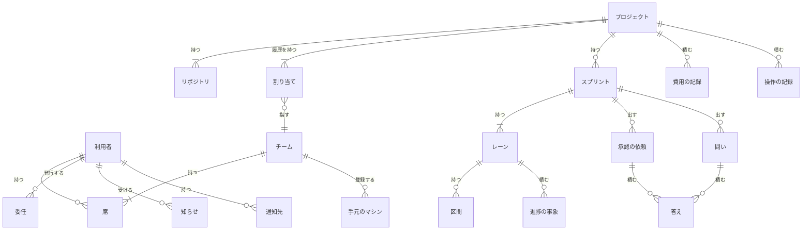

# データ: 状態を 3 つの置き場に分け、プロジェクトの割り当ての外へ見せず、承認と判断の跡を失わない

[全体の設計](overview.md)の集約と不変条件（I1〜I22）を、サービスの表・状態の S3・進行表の DB の 3 つの置き場へ下ろす。
状態の置き場の答えはこの文書が正本で、ほかの文書はここを指す。

| 扱うもの | 受ける節 |
| --- | --- |
| 集約の置き場と鍵・共通の列・テーブル定義 | [置き場の分け方](#置き場の分け方)・[サービスの表](#サービスの表) |
| 承認資料と NDF のファイル | [状態の S3](#状態の-s3)・[承認資料の保存期間](#承認資料の保存期間) |
| 進行表の DB の用意・資格情報の差し替え・GitHub の token の失効 | [進行表の DB](#進行表の-db)（不変条件 I17〜I19・I22） |
| 形の版と切り戻し | [形の版と移し方](#形の版と移し方) |
| 機能ごとの読み書き | [CRUD 図](#crud-図) |

置き場とインフラを選んだ理由（決定 80〜99・140）と外部の調査（LIB80〜LIB85）は [土台](platform.md) にあり、この文書は答えだけを持つ。割り当てを移す流れの順は [全体の設計の割り当てを変える流れ](overview.md#割り当てを変える流れ)、実行の振る舞いは [実行](execution.md) が持つ。
値はすべて作り物か設計の既定値である。

## 置き場の分け方

状態は 3 つの置き場に分ける。どの置き場も、区切りの頭にプロジェクトかチーム（利用者だけに属するものは利用者）の ID を置き、認可の判定（I2）が同じ ID で絞れる形にする。

| 置き場 | 何を置くか | 書き手 | 読み手 |
| --- | --- | --- | --- |
| サービスの表（DynamoDB） | 全体の設計の集約のすべて（利用者・チーム・委任・プロジェクト・割り当て・スプリント・手元のマシン・進捗の事象・承認の依頼・問い・知らせ・通知先・費用の記録・操作の記録）と冪等の鍵 | API の各モジュール（集約の持ち主だけ）・見回り・知らせの送り手（送達の状態だけ）・表の移し | API |
| 状態の S3 | 承認資料の本文・NDF のファイルのうち進行表の DB に乗らないもの | API（承認資料）・ランナー（署名つき URL で NDF のファイル） | API・ランナー（署名つき URL） |
| 進行表の DB（Aurora PostgreSQL） | NDF の進行表と耐久の記録 | コンテナの中の NDF だけ | コンテナの中の NDF だけ。サービスは読まない |

サービスが NDF の状態を知る手段は、ランナーが送る進捗の事象だけにする。Lambda は VPC の外に置き、出口の無いサブネットの進行表の DB へ届かないためである（決定 83）。

## サービスの表

### ER 図

主な集約と関連だけを描く。属性は下のテーブル定義にある。

多重度の決まり: 割り当ては履歴の行を積み、今の割り当ては 1 つだけ（I3）。リポジトリのうち主はちょうど 1 つ（I1）。レーンを動かすコンテナは同時に 1 つ（I7）。

### 表と鍵

表はコンテキスト（集約の持ち主のモジュール）ごとに分ける（決定 81）。1 つの処理が書き換える集約は 1 つで、表をまたぐ反映はドメインイベントで後から行う。表の名前は `<prefix>-<environment>-db-<用途>` にする。

| 表（用途） | 区切りの鍵 / 並びの鍵 | 持つ集約 | 時系列の扱い |
| --- | --- | --- | --- |
| `db-users` | `USER#<利用者>` / `USER`・`LOGIN#<IdP>#<主体>`・`DELEGATION#<委任>` | 利用者・ログインの組・委任 | 上書き。変更の履歴は操作の記録が持つ |
| `db-teams` | `TEAM#<チーム>` / `TEAM`・`SEAT#<利用者>`・`MACHINE#<マシン>`・`USAGE#<UTC の年月>` | チーム・席・手元のマシン・月の使った量 | 上書き。席と役割の変更は操作の記録、使った量の元は費用の記録 |
| `db-projects` | `PROJECT#<プロジェクト>` / `PROJECT`・`REPO#<リポジトリ>`・`ASSIGN#<時刻>#<ID>`・`GHTOKEN#<期限>#<レーン>#<連番>` | プロジェクト・リポジトリ・割り当て・渡した GitHub の token の記録 | 割り当ては履歴保持型（変更ごとに行を足し、プロジェクトの行が今の割り当てを指す）。token の記録は期限で TTL |
| `db-sprints` | `PROJECT#<プロジェクト>` / `SPRINT#<スプリント>`・`SPRINT#<スプリント>#LANE#<レーン>`・`…#SEG#<連番>` | スプリント・レーン・区間 | 状態は上書き。状態の移りは進捗の事象が持つ |
| `db-events` | `PROJECT#<プロジェクト>#LANE#<レーン>` / `SEQ#<連番>` | 進捗の事象 | 事象の記録（追記だけ、I13） |
| `db-decisions` | `PROJECT#<プロジェクト>` / `APPROVAL#<依頼>`・`QUESTION#<問い>`・`…#ANSWER#<答え>` | 承認の依頼・問い・答え | 答えは追記だけ。確定した答えを上書きしない |
| `db-notices` | `USER#<利用者>` / `NOTICE#<時刻>#<ID>`・`DEST#<通知先>` | 知らせ・通知先 | 知らせは既読と送達の状態だけを上書き |
| `db-usage` | `PROJECT#<プロジェクト>` / `COST#<時刻>#<ID>` | 費用の記録 | 事象の記録（追記だけ） |
| `db-audit` | `PROJECT#<プロジェクト>`・`TEAM#<チーム>`・`USER#<利用者>`・`ANON#<UTC の年月日>`（主体の決まらない 401） / `<時刻>#<ID>` | 操作の記録 | 事象の記録（追記だけ、I9） |
| `db-idempotency` | `<主体>#<操作の名前>#<鍵>` / なし | 冪等の鍵（主体・操作の名前・鍵の組。[API の文書の冪等の鍵](api.md#冪等の鍵)） | 24 時間で TTL |

| 決まり | 中身 |
| --- | --- |
| 区切りの外の ID | プロジェクトに属する行は、区切りの鍵の外でも `project_id` を持つ。利用者で区切る行（知らせ）も `project_id` を持ち、一覧は認可の判定で絞ってから返す・数える（I2） |
| 索引 | 利用者の席の一覧（`USER#<利用者>` からチームへ）・チームのプロジェクトの一覧（今の割り当てのチームから）・人を待つものの一覧（待っている依頼と問いだけを持つ疎な索引）の 3 つを置く。列の細部は [詳細設計](detail.md) が持つ |
| 条件つきの書き込み | 今の割り当ての差し替え（I3）・主リポジトリの数（I1）・レーンのコンテナの割り当て（I7）・同じ連番の事象（I13）・答えの確定（I4・I5）・使える量の加算（I8）は、条件式（LIB81）で 1 行を照らして書く。外れたら 409 か前の 1 件を返す |
| 日時と金額 | 日時は UTC の ISO 8601（末尾 `Z`）、金額は最小単位の整数と ISO 4217 の通貨の組で持つ（I15）。形の正本の検証が外れた値を拒む |
| 形の版 | どの項目も `schema_version`（整数）を持つ（[形の版と移し方](#形の版と移し方)） |
| 課金と守り | 表は要求の数の課金（LIB81）。どの表もポイントインタイムの戻し（PITR）を有効にし、スタックから消しても表を残す（決定 93） |

### テーブル定義

主な集約だけを書く。ほかの列は [詳細設計](detail.md) が持つ。

プロジェクト（`db-projects` の `PROJECT` の行）:

| 列 | 型 | 空を許すか | 意味 |
| --- | --- | --- | --- |
| `project_id` | 文字列 | 許さない | プロジェクトの ID（無作為） |
| `name` | 文字列 | 許さない | 名前 |
| `current_team_id` | 文字列 | 許す | 今の割り当てのチーム。空は「閉じた」で、どのチームからも見えない |
| `current_assign_id` | 文字列 | 許す | 今の割り当ての行の ID。空の意味は上と同じ |
| `transfer` | 地図 | 許す | 割り当てを移す途中の状態（移す先・止め終えたか・失効が終わったか）。空は「移していない」 |
| `progress_db_state` | 文字列 | 許さない | 進行表の DB の状態（`無い`・`作成中`・`有る`） |
| `progress_db_secret` | 文字列 | 許す | そのプロジェクトの URL を入れた秘密の器の名前。空は「まだ作っていない」 |
| `gh_token_max_expiry` | 日時 | 許す | 渡した GitHub の token の期限の最大値。空は「期限の前の token が無い」 |
| `gh_token_generation` | 整数 | 許さない | token の記録の世代番号。記録を足すたびに 1 上げる |
| `created_at` | 日時 | 許さない | 作った時刻（UTC） |
| `schema_version` | 整数 | 許さない | 形の版 |

割り当て（`ASSIGN#…` の行。追記だけ）:

| 列 | 型 | 空を許すか | 意味 |
| --- | --- | --- | --- |
| `assign_id` | 文字列 | 許さない | 割り当ての行の ID |
| `team_id` | 文字列 | 許す | 割り当てたチーム。空は「閉じた」行 |
| `confirmed_by` | 文字列 | 許さない | 確定した人の利用者の ID（人だけ、I3） |
| `accepted_by` | 文字列 | 許す | 移す先の持ち主の受け入れ。空は「作成と同時の割り当て」か「閉じた」 |
| `confirmed_at` | 日時 | 許さない | 確定の時刻（UTC） |

レーン（`db-sprints` の `…#LANE#…` の行）:

| 列 | 型 | 空を許すか | 意味 |
| --- | --- | --- | --- |
| `lane_id` | 文字列 | 許さない | レーンの ID |
| `repo_id` | 文字列 | 許さない | 回すリポジトリ |
| `after` | 文字列の配列 | 許さない | 先に終わるべきレーン。空の配列は「待たない」 |
| `place` | 文字列 | 許さない | 実行の場所（`hosted`・`machine`） |
| `inference` | 文字列 | 許さない | 推論の手段（`managed`・`byok`） |
| `runner_id` | 文字列 | 許す | 今動かしているコンテナ（タスクかマシン）。空は「どこにも割り当てていない」（I7 は空か前の世代が終わっているときだけ書ける条件で守る） |
| `generation` | 整数 | 許さない | 割り当ての世代の番号。割り当てのたびに 1 上げ、レーンの token はこの世代に結ぶ（[実行の文書のレーンの状態](execution.md#レーンの状態)） |
| `state` | 文字列 | 許さない | レーンの状態（値の集合は [実行](execution.md)） |
| `last_seq` | 整数 | 許さない | 受けた進捗の事象の最後の連番 |

承認の依頼（`db-decisions` の `APPROVAL#…` の行）:

| 列 | 型 | 空を許すか | 意味 |
| --- | --- | --- | --- |
| `approval_id` | 文字列 | 許さない | 依頼の ID |
| `sprint_id`・`lane_id` | 文字列 | 許さない | 出したスプリントとレーン |
| `gate` | 文字列 | 許さない | 承認ゲートの種類（設計・リリース・レッドライン） |
| `material_digest` | 文字列 | 許さない | 承認資料の要約値（sha256）。状態の S3 の本文の名前でもある |
| `state` | 文字列 | 許さない | 待っている・答えた・取り下げた |
| `answer_id` | 文字列 | 許す | 確定した答え。空は「待っている」か「取り下げた」 |
| `delivery` | 文字列 | 許す | 答えの NDF への送達の状態（I5）。空は「答えていない」 |
| `waiting_since` | 日時 | 許す | 疎な索引の鍵。空は「人を待っていない」 |

操作の記録（`db-audit` の行。追記だけ）:

| 列 | 型 | 空を許すか | 意味 |
| --- | --- | --- | --- |
| `at` | 日時 | 許さない | 時刻（UTC） |
| `actor` | 地図 | 許さない | 主体（人・委任・ランナー・手元のマシン・GitHub・見回り・DB の用意のタスク）と、委任なら委任した人とクライアントの名前 |
| `channel` | 文字列 | 許さない | 入口（画面・API・MCP・ランナー・手元のマシン・GitHub・見回り・DB の用意） |
| `operation` | 文字列 | 許さない | 操作の表の名前 |
| `target_ids` | 文字列の配列 | 許さない | 対象の ID。空の配列は「対象を持たない操作」（サインインなど） |
| `result` | 地図 | 許さない | 結果（`ok`・`partial`・`rejected`）と、HTTP の状態・理由のコードの並び（[API の文書の操作の記録](api.md#何を書くか)） |

秘密と個人情報の値は記録に書かない（I9）。1 つの要求は 1 つの記録の ID で、要求の要約の行 1 件と、書いた要素ごとの行（要素の確定と同じトランザクション）で残す。要約の行を書けなければ要求を 503 で失敗させる（[API の文書の書き方と失敗](api.md#書き方と失敗)）。区切りの鍵は次のとおりにする（[詳細設計](detail.md#内部のデータと定数)）。

| 場合 | 区切りの鍵 |
| --- | --- |
| 見られたプロジェクトがある | `PROJECT#` |
| 見られたプロジェクトが無い | 主体の `USER#` |
| 主体の決まらない 401 | `ANON#<UTC の年月日>` |

## 状態の S3

バケットは 1 つで、公開を止め、暗号化し、TLS だけを受ける。オブジェクトの名前の頭に形の版を置く。

| 中身 | 名前 | いつ書くか | 消し方 |
| --- | --- | --- | --- |
| 承認資料の本文 | `v1/projects/<プロジェクト>/materials/<要約値>.json` | 承認の依頼を受けたとき（API） | プロジェクトを閉じた後に、保存期間（[詳細設計](detail.md) が決める）で消す。人の判断の材料のため、スプリントの終わりでは消さない |
| NDF のファイル | `v1/projects/<プロジェクト>/lanes/<レーン>/…` | 承認の待ちでタスクを止めるとき・区間の終わり・SIGTERM（ランナー） | レーンの終わりから 14 日（ライフサイクルの規則） |

署名つき URL は、そのレーンの頭だけに、15 分の期限で出す。名前の頭がプロジェクトの ID のため、割り当てを移した後に古いレーンの URL が残っても、新しいレーンの頭とは重ならない。

## 進行表の DB

**1 つの Aurora Serverless v2（PostgreSQL、最小 0 ACU）のクラスタの中に、プロジェクトごとに別のデータベースとログインの役割を作る（I10、決定 83・84）。** サービスは中身を読み書きしない。接続するのはホステッドのランナーと DB の用意のタスクだけである。手元のマシンのレーンへは URL を渡さない（出口の無いサブネットへ届かないため。手元のマシンの NDF は手元の置き場を使う。[実行](execution.md)）。

| 項目 | 決まり |
| --- | --- |
| 単位 | プロジェクトごとに 1 つのデータベースと、そのデータベースだけに権限を持つ役割。名前はプロジェクト・チーム・リポジトリの名前や ID から作らない無作為の値にし、対応はサービスの表にだけ置く |
| 作る時 | そのプロジェクトの最初のホステッドのレーンを始めるとき。`progress_db_state` を `作成中` にし、DB の用意のタスクが終わりを知らせたら `有る` にする。失敗か時間切れなら `無い` へ戻し、次の開始で作り直す |
| 認証 | 役割のパスワードを含む URL を、プロジェクトごとの秘密の器に置く。IAM 認証は使わない（token が 15 分で、NDF の DB の URL は token を取り直す口を持たない。LIB80） |
| 渡し方 | API が引き換えのときに、そのプロジェクトの URL だけをランナーへ返す。ランナーはメモリだけに置き、ファイルとログに書かない |
| 一時停止 | 利用者の接続が 0 本になってから既定の 300 秒で一時停止する。再開は通常 約 15 秒、24 時間を超えた停止の後は 30 秒以上（LIB80）。タスクの起動の手順は、最初の接続を再試行で待つ |

### 用意の手順

DB の用意のタスクは、API から引き換えの token で管理の接続とプロジェクトの役割の値を受け、次の順で行う。秘密の器を作り値を入れるのは API で、タスクは秘密の器に触れない。

| 順 | 行うこと | 理由 |
| --- | --- | --- |
| 1 | `postgres`・`template1` の `CONNECT`・`TEMPORARY` を `PUBLIC` から外す（何度打っても同じ結果） | 別のデータベースへ接続し直して、カタログと統計から他のプロジェクトの名前を読ませない |
| 2 | データベースを `ALLOW_CONNECTIONS false` で作る（作り直しで既にあれば作らない） | 権限を整えるまで誰も接続できない |
| 3 | そのデータベースの `CONNECT`・`TEMPORARY` を `PUBLIC` から外し、`ALLOW_CONNECTIONS true` にする | この時点で接続できるのは持ち主の管理の役割だけ |
| 4 | 管理の役割でそのデータベースへ接続し、カタログと統計のビューの読み取りを `PUBLIC` から外す。読み取りの既定の役割（`pg_read_all_stats` など）へ入れない | 他のプロジェクトのデータベースと役割の名前と数を読ませない（I2） |
| 5 | 管理の接続とプロジェクトの役割の接続のほかを切る | 作り直しのとき、権限を整える前から残る接続を断つ |
| 6 | 役割を作り、その役割を持ち主とする専用のスキーマと `search_path` を置き、最後にその役割にだけ `CONNECT`・`TEMPORARY` を与える | NDF と DBOS の表を作る場所。DBOS が一時表を使うため `TEMPORARY` が要る |

4 で外せるかと、プロジェクト A の役割から B のデータベース・`postgres`・`template1` へ接続できないことは、反映した環境で実測する（[未確認のまま残ること](platform.md#未確認のまま残ること)）。外せないときは、2 つ目のチームのプロジェクトでホステッドのレーンを動かす前に、分け方を設計へ戻す。

### 割り当てを移すときの差し替え

割り当てを移す確定（[割り当てを変える流れ](overview.md#割り当てを変える流れ)）は、レーンを止めた後に、そのプロジェクトの役割のパスワードを差し替える。渡し済みの URL を別のレーンから使わせないためである。

| `progress_db_state` | 扱い |
| --- | --- |
| `無い` | 渡し済みの URL が無いため差し替えない。割り当ての行に「差し替え不要」と書く |
| `作成中` | 作り終えるまで確定を 409 で拒む |
| `有る` | API が新しいパスワードを秘密の器へ保留の版で入れ、DB の用意のタスクを差し替えの種類で起こす。タスクはパスワードを差し替えて役割の接続をすべて切り、差し替えの ID を添えて終わりを知らせる。API は ID が合う知らせだけを受け、保留の版を今の版へ移す |

移す先の受け入れは、差し替えの終わりと `gh_token_max_expiry` が空か過去であることを、割り当ての行の差し替えと同じ条件つきの書き込みで照らす。GitHub の token の失効の順は [実行](execution.md) と [詳細設計](detail.md) が持つ。

## 形の版と移し方

移しの仕組みは、nd-factory 自身が書いた行の形の版を上げるためだけに置く。nd-factory の外で書かれたデータ（作り直しの前のサービスの利用者のデータを含む）は移しの対象にせず、取り込む機能を持たない。

| 置き場 | 形を変えるとき |
| --- | --- |
| サービスの表 | 2 段で出す（決定 82）。1 段目の反映で、読み手が今と次の版の両方を読めるようにする。2 段目の反映で、書き手を次の版へ上げる。残った古い版の項目は表の移しの関数が書き換える（冪等。時間切れの前に続きの位置を残して自分を起こし直す）。読み手が受ける版は今と 1 つ前だけ |
| 状態の S3 | 次の版の頭（`v2/`）へ書き、読み手は両方を読む。古い版は消し方の期限で消える |
| 進行表の DB | NDF が持つ。nd-factory は形を変えない。NDF の固定の値（`ndf-pin.json`）を変える PR で、契約の照合と試験を通してから上げる |
| 端末の控え | 画面の控えは形の版を持ち、合わない版の控えは捨ててサーバーから読み直す（[オフライン](screens.md#オフライン)） |

## CRUD 図

行は機能（F1〜F20）と、機能でない書き手（ランナー・見回り・知らせの送り手）。C は作る、R は読む、U は更新、D は消す。操作の記録はどの機能でも C（読み取りを含む、I9）のため、列を置かずにここで述べる。F21〜F23 はサービスのデータを触らない。

| 機能 | 利用者・委任 | チーム・席・マシン | プロジェクト・リポジトリ | 割り当て | スプリント・レーン | 進捗の事象 | 承認の依頼・問い・答え | 承認資料（S3） | 知らせ・通知先 | 費用の記録・使った量 | 進行表の DB |
| --- | --- | --- | --- | --- | --- | --- | --- | --- | --- | --- | --- |
| F1 サインイン | CR | R | — | — | — | — | — | — | — | — | — |
| F2 言語と時刻帯 | RU | — | — | — | — | — | — | — | — | — | — |
| F3 チームと席 | R | CRUD | — | R | — | — | — | — | — | — | — |
| F4 プロジェクトを作る | R | R | C | C | — | — | — | — | — | — | — |
| F5 リポジトリの登録 | — | R | CRUD | R | — | — | — | — | — | — | — |
| F6 割り当てを移す | — | R | U | CRU | U | — | U | — | C | — | U |
| F7 ホーム | — | R | R | R | R | R | R | — | R | — | — |
| F8 スプリントを始める | — | R | R | R | C | — | — | — | — | R | C |
| F9 スプリントを読む | — | — | R | R | R | R | R | — | — | R | — |
| F10 取り消す | — | — | R | R | U | — | U | — | C | — | — |
| F11 承認の依頼を読む | — | — | R | R | R | — | R | R | — | — | — |
| F12 承認する | — | — | R | R | U | — | CU | R | U | — | — |
| F13 問いに答える | — | — | R | R | U | — | CU | — | U | — | — |
| F14 知らせを読む | — | — | — | R | — | — | — | — | RU | — | — |
| F15 通知先 | — | — | — | — | — | — | — | — | CRUD | — | — |
| F16 委任 | CRUD | R | R | R | — | — | — | — | — | — | — |
| F17 実行の場所 | — | RU | — | — | — | — | — | — | — | — | — |
| F18 手元のマシン | — | CRUD | — | — | — | — | — | — | — | — | — |
| F19 使える量と上限額 | — | RU | — | — | — | — | — | — | — | R | — |
| F20 操作の記録 | — | R | R | R | — | — | — | — | — | — | — |
| ランナー | — | — | R | — | U | C | C | C | — | C | RU |
| 見回り | — | R | U | R | U | — | U | — | C | — | — |
| 知らせの送り手 | — | — | — | — | — | — | — | — | U | — | — |

F6 は 6 つのデータを書く。割り当てを移す流れが、止める（スプリント）・断つ（token・DB の資格情報）・差し替える（割り当て）を 1 つの確定に束ねるためである。各データの更新は、持ち主のモジュールの操作を順に呼ぶ（ドメインイベント E17）。1 つの書き込みで複数の集約を書かない。
