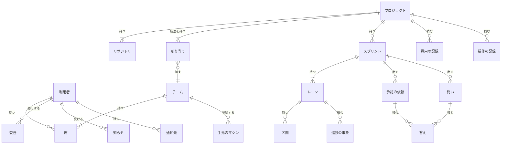
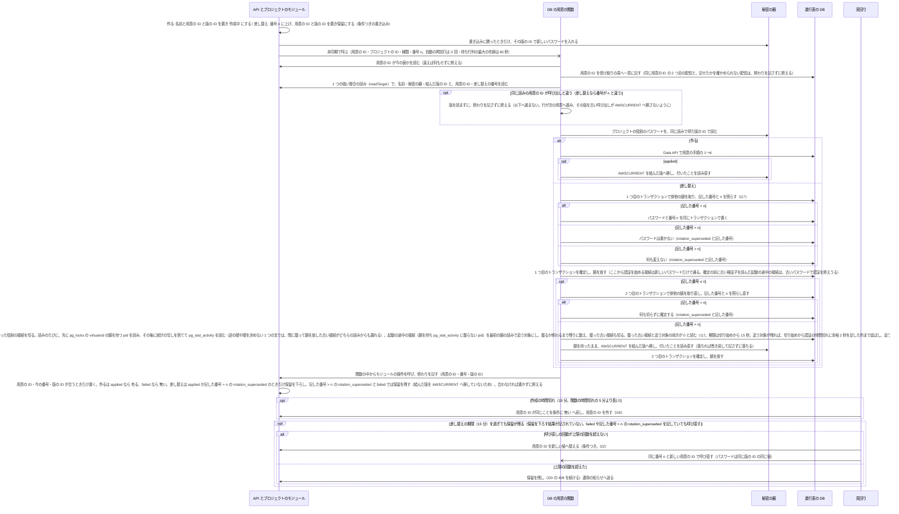

# データ: 状態を 3 つの置き場に分け、プロジェクトの割り当ての外へ見せず、承認と判断の跡を失わない

[全体の設計](overview.md)の集約と不変条件（I1〜I22）を、サービスの表・状態の S3・進行表の DB の 3 つの置き場へ下ろす。
状態の置き場の答えはこの文書が正本で、ほかの文書はここを指す。

| 扱うもの | 受ける節 |
| --- | --- |
| 集約の置き場と鍵・共通の列・テーブル定義 | [置き場の分け方](#置き場の分け方)・[サービスの表](#サービスの表) |
| 承認資料と NDF のファイル | [状態の S3](#状態の-s3)・[承認資料の保存期間](#承認資料の保存期間) |
| 進行表の DB の用意・資格情報の差し替え・GitHub の token の失効 | [進行表の DB](#進行表の-db)（不変条件 I17〜I19・I22） |
| 形の版と切り戻し | [形の版と移し方](#形の版と移し方) |
| 機能ごとの読み書き | [CRUD 図](#crud-図) |

置き場とインフラを選んだ理由（決定 80〜99・140）と外部の調査（LIB80〜LIB85・LIB91〜LIB93）は [プラットフォーム](platform.md) にあり、この文書は答えだけを持つ。割り当てを移す流れの順は [全体の設計の割り当てを変える流れ](overview.md#割り当てを変える流れ)、実行の振る舞いは [実行](execution.md) が持つ。
値はすべて作り物か設計の既定値である。

## 置き場の分け方

状態は 3 つの置き場に分ける。どの置き場も、区切りの頭にプロジェクトかチーム（利用者だけに属するものは利用者）の ID を置き、認可の判定（I2）が同じ ID で絞れる形にする。

| 置き場 | 何を置くか | 書き手 | 読み手 |
| --- | --- | --- | --- |
| サービスの表（DynamoDB） | 全体の設計の集約のすべて（利用者・チーム・委任・プロジェクト・割り当て・スプリント・手元のマシン・進捗の事象・承認の依頼・問い・知らせ・通知先・費用の記録・操作の記録）と冪等の鍵 | API の各モジュール（集約の持ち主だけ）・見回り・知らせの送り手（送達の状態だけ）・表の移し | API |
| 状態の S3 | 承認資料の本文・NDF のファイルのうち進行表の DB に乗らないもの | API（承認資料）・ランナー（署名つき URL で NDF のファイル） | API・ランナー（署名つき URL） |
| 進行表の DB（Aurora PostgreSQL） | NDF の進行表と耐久の記録 | コンテナの中の NDF だけ | コンテナの中の NDF だけ。サービスは読まない |

サービスが NDF の状態を知る手段は、ランナーが送る進捗の事象だけにする。Lambda は VPC の外に置き、出口の無いサブネットの進行表の DB へ届かないためである（決定 83）。

## サービスの表

### ER 図

主な集約と関連だけを描く。属性は下のテーブル定義にある。

多重度の決まり: 割り当ては履歴の行を積み、今の割り当ては 1 つだけ（I3）。リポジトリのうち主はちょうど 1 つ（I1）。レーンを動かすコンテナは同時に 1 つ（I7）。

### 表と鍵

表はコンテキスト（集約の持ち主のモジュール）ごとに分ける（決定 81）。表の名前は `<prefix>-<environment>-db-<用途>` にする。

1 つの処理が状態を書き換える集約は原則 1 つで、別の集約への反映はドメインイベントで後から行う。ただし、途中で落ちると記録が欠けたり行どうしが食い違ったりする次の書き込みは、1 つのトランザクション（LIB81 の `TransactWriteItems`）で確定する。どれかの条件が外れれば、どの行も書かない。

| 一緒に確定する書き込み | 含める行 | 分けると起きること |
| --- | --- | --- |
| 状態を書くすべての要素（I9・[API の文書の書き方と失敗](api.md#書き方と失敗)） | 要素の状態の行・`db-audit` の要素の記録の行・`db-idempotency` の済みの行（表をまたぐ） | 記録の無い状態の書き込みが残る。送り直しで同じ要素を 2 回書く |
| プロジェクトの作成（`projects.create`。I1・I3） | `PROJECT` の行・主リポジトリの `REPO#` の行・初回の割り当ての `ASSIGN#` の行 | 割り当ての無いプロジェクトや、主リポジトリの無いプロジェクトが残る |
| 割り当ての移しの受け入れ | `ASSIGN#` の行の追加と、`PROJECT` の行の今の割り当て（`current_team_id`・`current_assign_id`）の差し替え・移し中の印と移す途中の状態を空にする更新 | 割り当ての履歴と今の割り当てが食い違う |
| GitHub の token の発行（I19） | `GHTOKEN#` の行の追加と、`PROJECT` の行の `gh_token_generation` を 1 上げて `gh_token_max_expiry` を更新する書き込み。確定してから token をランナーへ返す | 失効の手順が、記録だけ増えて世代番号が変わらない間を通り、渡した token を失効させないまま完了する |
| ログインの組の追加と外し（I16） | `LOGIN#` の 2 行と、`USER` の行の条件つきの更新（[IdP の主体の一意の行](#idp-の主体の一意の行)） | 1 つの IdP のアカウントが 2 人へ結ばれる。最後のログインが外れる |
| 費用の記録と月の使った量（I8） | `db-usage` の `COST#` の行と、`db-teams` の `USAGE#` の行の加算（表をまたぐ） | 費用の記録と使った量が食い違う |
| I20 の照らし | スプリントの作成・レーンの割り当ての確定・オーガナイザーを `active` にする書き込みと、`PROJECT` の行の `ConditionCheck` | 移しや差し替えの間に新しいレーンかオーガナイザーが動き出す |
| オーガナイザーを立てる・再開する・終える・止める・自動で戻す（[オーガナイザーの単位と状態](organizer.md#単位と状態)） | `db-organizers` のオーガナイザーの行と、`db-users` の専用の委任の行（立てる: 作る。再開する: 前の行の取り消しと新しい行。終える: 取り消し）と、`PROJECT` の行の枠の数（`organizer_slots_used`）の更新（枠を持つ状態へ移すときは上限より小さいことを条件に 1 足し、`active` か `paused` から離れるときだけ 1 引く。オーガナイザーの行は読んだ時の状態と版を条件に書く。表をまたぐ） | 終えたオーガナイザーの委任が使えるまま残る。委任の無いオーガナイザーができる。同時の作成や戻りが同じ残りの枠を取り、上限を超える。止まったものを止め直して枠を引き、数が実際より少なくなる |
| 会話の項目を渡す・受け取る | 渡す: オーガナイザーの行の `inflight_message_id`（`active` で世代が token と同じで、空であることを条件に項目の ID を書く）と、項目の `delivered_at`・`delivered_generation`（`delivered_at` と `withdrawn_at` が空であることを条件にする）。渡し直す: 項目の `delivered_generation`（`received_at` が空であることを条件にする）と、オーガナイザーの行の `ConditionCheck`（`active` で世代が token と同じで、`inflight_message_id` がその項目）。答えを追記する: 答えの項目と、オーガナイザーの行の `ConditionCheck`（`active` で世代が token と同じ）。受け取る: 項目の `received_at` と、`inflight_message_id`（`active` で世代が token と同じで、その項目であることを条件に空にする） | 重なった取得の要求が別々の項目を受け取り、前の項目の処理中に次の項目が渡る。止めた後に前のランナーが会話へ答えを足し、指示を処理済みにする |
| 会話の項目の取り下げ | 取り下げの項目の追記と、対象の項目の `withdrawn_at`（`delivered_at` と `withdrawn_at` が空であることを条件にする） | 取り下げた項目がオーガナイザーへ渡る |

表ごとの鍵と持つ集約は次のとおりである。

| 表（用途） | 区切りの鍵 / 並びの鍵 | 持つ集約 | 時系列の扱い |
| --- | --- | --- | --- |
| `db-users` | `USER#<利用者>` / `USER`・`LOGIN#<IdP>#<主体>`・`DELEGATION#<委任>`。IdP の主体の一意の行は `LOGIN#<IdP>#<主体>` / `LOGIN`（下の [IdP の主体の一意の行](#idp-の主体の一意の行)） | 利用者・ログインの組・委任 | 上書き。変更の履歴は操作の記録が持つ |
| `db-teams` | `TEAM#<チーム>` / `TEAM`・`SEAT#<利用者>`・`MACHINE#<マシン>`・`USAGE#<UTC の年月>` | チーム・席・手元のマシン・月の使った量 | 上書き。席と役割の変更は操作の記録、使った量の元は費用の記録 |
| `db-projects` | `PROJECT#<プロジェクト>` / `PROJECT`・`REPO#<リポジトリ>`・`ASSIGN#<時刻>#<ID>`・`GHTOKEN#<期限>#<レーン>#<連番>` | プロジェクト・リポジトリ・割り当て・渡した GitHub の token の記録 | 割り当ては履歴保持型（変更ごとに行を足し、プロジェクトの行が今の割り当てを指す）。token の記録は期限で TTL |
| `db-sprints` | `PROJECT#<プロジェクト>` / `SPRINT#<スプリント>`・`SPRINT#<スプリント>#LANE#<レーン>`・`…#SEG#<連番>` | スプリント・レーン・区間 | 状態は上書き。状態の移りは進捗の事象が持つ |
| `db-events` | `PROJECT#<プロジェクト>#LANE#<レーン>` / `SEQ#<連番>` | 進捗の事象 | 事象の記録（追記だけ、I13） |
| `db-decisions` | `PROJECT#<プロジェクト>` / `APPROVAL#<依頼>`・`QUESTION#<問い>`・`…#ANSWER#<答え>` | 承認の依頼・問い・答え | 答えは追記だけ。確定した答えの列を上書きしない。例外は `ndf_event_seqs` だけで、空のときに 1 回だけ書く（I5） |
| `db-notices` | `USER#<利用者>` / `NOTICE#<時刻>#<ID>`・`DEST#<通知先>`・`SLACKAUTH#<state の要約値>` | 知らせ・通知先・Slack の認可の取引（[実行の文書の Slack の登録](execution.md#slack-の登録)） | 知らせは既読と送達の状態だけを上書き。取引は使用済みにする 1 回だけ上書きし、作ってから 10 分で TTL |
| `db-usage` | `PROJECT#<プロジェクト>` / `COST#<時刻>#<ID>` | 費用の記録 | 事象の記録（追記だけ） |
| `db-organizers` | `PROJECT#<プロジェクト>` / `ORGANIZER#<オーガナイザー>`・`ORGANIZER#<オーガナイザー>#MSG#<時刻>#<ID>` | オーガナイザー・会話の項目（[オーガナイザー](organizer.md)） | オーガナイザーの行は状態を上書き。会話の項目は追記だけ（例外は人の項目の `delivered_at`・`withdrawn_at`・`received_at` の 3 つで、どれも空のときに 1 回だけ書く。`delivered_at` と `withdrawn_at` は両方が空であることを条件にし、片方だけが書かれる。もう 1 つの例外の `delivered_generation` は、`received_at` が空の間、渡すたびに書き直す）。オーガナイザーの書き込みの冪等の鍵の済みの行（`ORGANIZER#<オーガナイザー>#OP#<項目>#<操作の名前>#<鍵>`）も置き、会話を消すまで残す |
| `db-audit` | `PROJECT#<プロジェクト>`・`TEAM#<チーム>`・`USER#<利用者>`・`ANON#<UTC の年月日>`（主体の決まらない 401） / `<時刻>#<ID>` | 操作の記録 | 事象の記録（追記だけ、I9） |
| `db-idempotency` | `<主体>#<操作の名前>#<鍵>` / なし | 冪等の鍵（主体・操作の名前・鍵の組。[API の文書の冪等の鍵](api.md#冪等の鍵)） | 24 時間で TTL |

| 決まり | 中身 |
| --- | --- |
| 区切りの外の ID | プロジェクトに属する行は、区切りの鍵の外でも `project_id` を持つ。利用者で区切る行（知らせ）も `project_id` を持ち、一覧は認可の判定で絞ってから返す・数える（I2） |
| 索引 | 利用者の席の一覧（`USER#<利用者>` からチームへ）・チームのプロジェクトの一覧（今の割り当てのチームから）・人を待つものの一覧（待っている依頼と問いだけを持つ疎な索引）・NDF のファイルを消す期限の来たレーンの一覧（`files_delete_after` を持つレーンだけの疎な索引。[NDF のファイルの消し方](#ndf-のファイルの消し方)）の 4 つを置く。索引の鍵と写す列は #2 が決める。オーガナイザーの行の `files_delete_after` も、同じ疎な索引の考え方で見回りが読む |
| 条件つきの書き込み | 今の割り当ての差し替え（I3）・主リポジトリの数（I1）・レーンのコンテナの割り当て（I7）・同じ連番の事象（I13）・答えの確定（I4・I5）・使える量の加算（I8）は、条件式（LIB81）で 1 行を照らして書く。外れたら 409 か前の 1 件を返す |
| 日時と金額 | 日時は UTC の ISO 8601（末尾 `Z`）、金額は最小単位の整数と ISO 4217 の通貨の組で持つ（I15）。形の正本の検証が外れた値を拒む |
| 共通の列 | どの行も下の [共通の列](#共通の列) を持つ。上書きの行は `version` も持ち、追記だけの行は持たない |
| 課金と守り | 表は要求の数の課金（LIB81）。どの表もポイントインタイムの戻し（PITR）を有効にし、スタックから消しても表を残す（決定 93） |

### 共通の列

| 列 | 持つ行 | 意味 |
| --- | --- | --- |
| `pk` | すべて | 区切りの鍵（上の表と鍵の表） |
| `sk` | 並びの鍵を持つ表の行（`db-idempotency` のほかのすべて） | 並びの鍵。`db-idempotency` は区切りの鍵だけの表で、行は `sk` を持たない |
| `schema_version` | すべて | 形の版（整数。[形の版と移し方](#形の版と移し方)） |
| `version` | 上書きの行（利用者・チーム・席・委任・手元のマシン・プロジェクト・リポジトリ・スプリント・レーン・承認の依頼・問い・知らせ・通知先・月の使った量・オーガナイザー） | エンティティの版。書くたびに 1 上げ、条件つきの書き込み（`updateIfVersion`）で照らす。API の要素の `version`（[API の文書の版と条件つきの更新](api.md#版と条件つきの更新)）はこの列を返す |

追記だけの行（割り当て・答え・進捗の事象・費用の記録・操作の記録・冪等の鍵・渡した GitHub の token の記録）は `version` を持たない。答えの行の `ndf_event_seqs` は、版で照らさず「列が無い」ことを条件にした書き込みで 1 回だけ足す（I5）。

### IdP の主体の一意の行

1 つの IdP のアカウントを 2 人の利用者へ結ばないための行である（I16）。

| 表 | 区切りの鍵 / 並びの鍵 | 持つ列 | 書き方 |
| --- | --- | --- | --- |
| `db-users` | `LOGIN#<IdP>#<主体>` / `LOGIN` | `user_id`・`schema_version` | ログインの組の行（`USER#<利用者>` / `LOGIN#<IdP>#<主体>`）と同じトランザクションで、無いときだけ書く（`putIfAbsent`）。既にあれば 409。外すときは 2 行を同じトランザクションで消す |

サインインは IdP の主体からこの行を強い整合で読み、利用者を引く（決定 99）。

ログインの組を足す・外す書き込みは、利用者ごとに 1 つずつ通す。`logins.delete` は最後の 1 つのログインを外さない契約で、2 行の削除だけを照らすと、ログインを 2 つ持つ利用者が別々の画面から 1 つずつ同時に外したとき、どちらの削除も通ってサインインできなくなるためである。

1. `USER#<利用者>` の区切りを強い整合で読み、利用者の行（`USER`）の `version` とログインの組の数を得る
2. 外すときは、数が 2 以上でなければ 409 で断る
3. ログインの組の 2 行の削除（足すときは 2 行の追加）と、利用者の行の `version` が 1 で読んだ値のままであることを条件に 1 上げる更新を、同じトランザクションで書く
4. 条件が外れたら（同じ利用者への別の追加か外しが先に確定した）、1 から読み直す

### テーブル定義

主な集約の列を書く。ここに定義の無い表（利用者・ログインの組・委任・チーム・席・招待・手元のマシン・月の使った量・リポジトリ・区間・スプリント・進捗の事象・問い・知らせ・通知先・費用の記録・冪等の鍵・渡した GitHub の token の記録）の列と、上の 4 つの索引の列は #2 が決める。共通の列はどの表でも上の [共通の列](#共通の列) に従う。

プロジェクト（`db-projects` の `PROJECT` の行）:

| 列 | 型 | 空を許すか | 意味 |
| --- | --- | --- | --- |
| `project_id` | 文字列 | 許さない | プロジェクトの ID（無作為） |
| `name` | 文字列 | 許さない | 名前 |
| `current_team_id` | 文字列 | 許す | 今の割り当てのチーム。空は「閉じた」で、どのチームからも見えない |
| `current_assign_id` | 文字列 | 許す | 今の割り当ての行の ID。空の意味は上と同じ |
| `transfer_in_progress` | 文字列 | 許す | 移し中の印。今の割り当ての移しの ID。移しの作成で書き（E18）、受け入れか取り下げで空にする。空でない間は I20 で止める |
| `transfer` | 地図 | 許す | 割り当てを移す途中の状態（移す先・移す元の割り当ての ID・止め終えたか・失効が終わったか・差し替えを始めたか・取り下げたか）。差し替えを始めたかは、進行表の DB が無ければ始めずに真にする。移しの作成で、移し中の印と同じ書き込みで止め終えたかを偽にし、移す元の割り当ての ID に `current_assign_id` を写して書く。止め終えたかの偽が止める依頼として残る（E18）。移す元の割り当ての ID は、失効させてよい GitHub の token を絞るのに使う（[GitHub の token の失効](#github-の-token-の失効)）。空は「移していない」 |
| `progress_db_state` | 文字列 | 許さない | 進行表の DB の状態（`無い`・`作成中`・`有る`） |
| `progress_db_name`・`progress_db_role` | 文字列 | 許す | 進行表の DB のデータベースと役割の名前（無作為）。API が `作成中` にするときに作って置き、作り直しでも同じ名前を使う。空は「まだ作っていない」 |
| `progress_db_prep_id` | 文字列 | 許す | 今の用意の ID。DB の用意の関数を呼ぶ前に置き、呼び出しに渡す。終わりの記録はこの ID が今の値と合うときだけ書く。空は「用意していない」 |
| `progress_db_rotation_seq` | 整数 | 許さない | 差し替えの番号。差し替えを始めるたびに 1 上げる（I17） |
| `progress_db_rotation_pending` | 真偽 | 許さない | 差し替えの完了を待っているか。真の間は I20 で止める |
| `progress_db_rotation_attempts` | 整数 | 許さない | 今の番号の差し替えで DB の用意の関数を呼んだ回数。番号を上げるときに 1 にし、呼び直すたびに 1 上げる（I22） |
| `progress_db_secret` | 文字列 | 許す | そのプロジェクトの URL を入れた秘密の器の名前。空は「まだ作っていない」 |
| `progress_db_secret_version` | 文字列 | 許す | 今の用意（作るか差し替え）が DB の役割へ書くパスワードの、秘密の器の版の ID。API が用意の ID と同じ書き込みで置き、差し替えの呼び直しでは変えない（[パスワードの版](#パスワードの版)）。空は「用意していない」 |
| `gh_token_max_expiry` | 日時 | 許す | 渡した GitHub の token の期限の最大値。空は「期限の前の token が無い」 |
| `gh_token_generation` | 整数 | 許さない | token の記録の世代番号。記録を足すのと同じトランザクションで 1 上げる |
| `state_url_max_expiry` | 日時 | 許す | 出した状態の S3 の署名つき URL の期限の最大値（[署名つき URL](#署名つき-url)）。空は「出していない」 |
| `organizer_wipes_pending` | 文字列の集合 | 許す | 手元のマシンへ渡し、まだ作業の場所を消し終えたと知らせていないオーガナイザーのレーン。要素は `<マシンの ID>#<オーガナイザーの ID>#<世代>`。受け取り（`/v1/machine/lane_claims/create`）で足し、`/v1/machine/organizer_wipes/create` で知らせた組と一致する要素だけを外す。マシンの登録を外しても外さない。割り当ての移しの受け入れは、これが空であることを条件にする。空は「消し終えていない記録が無い」（[オーガナイザーの手元のマシンの会話の記録](organizer.md#会話の控え)） |
| `organizer_slots_used` | 整数 | 許さない | 枠を持つ（`active` か `paused` の）オーガナイザーの数。オーガナイザーの状態を変える書き込みと同じトランザクションで足し引きする（[オーガナイザーの単位と状態](organizer.md#単位と状態)） |
| `created_at` | 日時 | 許さない | 作った時刻（UTC） |
| `schema_version`・`version` | 整数 | 許さない | 形の版とエンティティの版（[共通の列](#共通の列)） |

割り当て（`ASSIGN#…` の行。追記だけ）:

| 列 | 型 | 空を許すか | 意味 |
| --- | --- | --- | --- |
| `assign_id` | 文字列 | 許さない | 割り当ての行の ID |
| `team_id` | 文字列 | 許す | 割り当てたチーム。空は「閉じた」行 |
| `confirmed_by` | 文字列 | 許さない | 確定した人の利用者の ID（人だけ、I3） |
| `accepted_by` | 文字列 | 許す | 移す先の持ち主の受け入れ。空は「作成と同時の割り当て」か「閉じた」 |
| `confirmed_at` | 日時 | 許さない | 確定の時刻（UTC） |

手元のマシン（`db-teams` の `MACHINE#…` の行）。[オーガナイザー](organizer.md) が決める列だけを書き、ほかの列は #7 が決める:

| 列 | 型 | 空を許すか | 意味 |
| --- | --- | --- | --- |
| `deleted_at` | 日時 | 許す | 登録を外した時刻（`machines.delete`）。外した後も行を残し、登録の token は `/v1/machine/organizer_wipes/create` だけを受ける。登録の token の期限の後に行を消す。空は「外していない」（[オーガナイザーの手元のマシンの会話の記録](organizer.md#会話の控え)） |

レーン（`db-sprints` の `…#LANE#…` の行）:

| 列 | 型 | 空を許すか | 意味 |
| --- | --- | --- | --- |
| `lane_id` | 文字列 | 許さない | レーンの ID |
| `repo_id` | 文字列 | 許さない | 回すリポジトリ |
| `after` | 文字列の配列 | 許さない | 先に終わるべきレーン。空の配列は「待たない」 |
| `place` | 文字列 | 許さない | 実行の場所（`hosted`・`machine`） |
| `inference` | 文字列 | 許さない | 推論の手段（`managed`・`byok`） |
| `runner_id` | 文字列 | 許す | 今動かしているコンテナ（タスクかマシン）。空は「どこにも割り当てていない」（I7 は空か前の世代が終わっているときだけ書ける条件で守る） |
| `generation` | 整数 | 許さない | 割り当ての世代の番号。割り当てのたびに 1 上げ、レーンの token はこの世代に結ぶ（[実行の文書のレーンの状態](execution.md#レーンの状態)） |
| `state` | 文字列 | 許さない | レーンの状態（値の集合は [実行](execution.md)） |
| `last_seq` | 整数 | 許さない | 受けた進捗の事象の最後の連番 |
| `files_delete_after` | 日時 | 許す | NDF のファイルを消す期限（レーンが終わった時刻から 14 日後）。疎な索引の鍵。空は「終わっていない」か「消し終えた」（[NDF のファイルの消し方](#ndf-のファイルの消し方)） |
| `version` | 整数 | 許さない | エンティティの版（[共通の列](#共通の列)） |

オーガナイザー（`db-organizers` の `ORGANIZER#…` の行）。全体の設計と [オーガナイザー](organizer.md) が決める列だけを書き、ほかの列は #2 が決める:

| 列 | 型 | 空を許すか | 意味 |
| --- | --- | --- | --- |
| `state`・`stop_reason` | 文字列 | `stop_reason` は許す | 状態（`active`・`paused`・`stopped`・`ended`）と、`stopped` の理由のコード。空は「止まっていない」 |
| `created_by` | 文字列 | 許さない | 立てた人の利用者の ID。送る・取り下げる・終える・再開するを呼べる主体の照らしに使う |
| `delegation_id` | 文字列 | 許さない | 今の専用の委任の ID。再開で新しい ID に替える |
| `assign_id` | 文字列 | 許さない | 動かす割り当ての ID。立てた時の割り当てを書き、人の再開で今の割り当てに替える。起こす前の照らしで今の割り当てと比べる |
| `generation` | 整数 | 許さない | オーガナイザーのレーンの世代の番号。起こすたびに 1 上げ、レーンの token をこの世代に結ぶ |
| `inflight_message_id` | 文字列 | 許す | 処理中の項目（渡して受け取りの無い人の項目）の ID。次の項目を渡す書き込みで空であることを条件に書き、受け取りの書き込みで空にする。空は「処理中の項目が無い」（[オーガナイザーの渡し方と取り下げ](organizer.md#渡し方と取り下げ)） |
| `transcript_generation` | 整数 | 許す | 復元に使う会話の控えの世代。ランナーが控えを書き終えた知らせで進め、終えた時と移しで止めた時に空にする。空は「控えが無い」 |
| `files_delete_below_generation` | 整数 | 許す | 会話の控えを消す世代の上限（この世代以下を消す） |
| `state_url_max_expiry` | 日時 | 許す | このオーガナイザーのレーンへ出した状態の S3 の署名つき URL の期限の最大値（[署名つき URL](#署名つき-url)）。空は「出していない」 |
| `files_delete_after` | 日時 | 許す | 会話の控えを消す期限。消す世代の上限を書く時に、今の時刻と `state_url_max_expiry` の遅い方を書く。書く書き込みは、計算に使った `state_url_max_expiry` が読んだ値のままであることを条件にし、外れたら読み直して計算し直す。空は「消す期限が来ていない」か「消し終えた」（[オーガナイザーの会話の控え](organizer.md#会話の控え)） |

スプリント（`db-sprints` の `SPRINT#…` の行）は、オーガナイザーの専用の委任が始めたときだけ `organizer_id` を持つ。API が要求の主体から決めて書き、要素からは受けない。オーガナイザーのモジュールは、この列で会話へ足す報告の宛先を決める（[オーガナイザーの形](organizer.md#ai-のオーガナイザーの形)）。

承認の依頼（`db-decisions` の `APPROVAL#…` の行）:

| 列 | 型 | 空を許すか | 意味 |
| --- | --- | --- | --- |
| `approval_id` | 文字列 | 許さない | 依頼の ID |
| `sprint_id`・`lane_id` | 文字列 | 許さない | 出したスプリントとレーン |
| `gate` | 文字列 | 許さない | 承認ゲートの種類（設計・リリース・レッドライン） |
| `material_digest` | 文字列 | 許さない | 承認資料の要約値（sha256）。状態の S3 の本文の名前でもある |
| `state` | 文字列 | 許さない | 状態。値と遷移は [実行の文書の承認の依頼と問いの状態](execution.md#承認の依頼と問いの状態) が正本 |
| `answer_id` | 文字列 | 許す | 確定した答え。空は「待っている」か「取り消した」 |
| `delivery` | 文字列 | 許す | 答えの NDF への送達の状態（値と遷移は [実行の文書の答えの送達](execution.md#答えの送達)）。空は「答えていない」か送達の対象外 |
| `waiting_since` | 日時 | 許す | 疎な索引の鍵。空は「人を待っていない」 |
| `version` | 整数 | 許さない | エンティティの版（[共通の列](#共通の列)） |

答え（`db-decisions` の `…#ANSWER#…` の行。追記だけ。確定した列は上書きせず、`ndf_event_seqs` だけ空のときに 1 回書く）。全体の設計が決める列だけを書き、ほかの列は #2 が決める:

| 列 | 型 | 空を許すか | 意味 |
| --- | --- | --- | --- |
| `ndf_event_seqs` | 整数の配列 | 許す | `ndf answer` が書いた NDF の答えの事象の番号（I5）。送達の事象（E14）で受け、送達の状態を「届いた」にする書き込みと同じ書き込みで、空のときだけ書く。空は「まだ届いていない」。送達の対象外の答えは持たない |

操作の記録（`db-audit` の行。追記だけ）:

| 列 | 型 | 空を許すか | 意味 |
| --- | --- | --- | --- |
| `at` | 日時 | 許さない | 時刻（UTC） |
| `actor` | 地図 | 許さない | 主体（人・委任・ランナー・手元のマシン・GitHub・見回り・DB の用意の関数）と、委任なら委任した人とクライアントの名前 |
| `channel` | 文字列 | 許さない | 入口（画面・API・MCP・ランナー・手元のマシン・GitHub・見回り・DB の用意） |
| `operation` | 文字列 | 許さない | 操作の表の名前 |
| `target_ids` | 文字列の配列 | 許さない | 対象の ID。空の配列は「対象を持たない操作」（サインインなど） |
| `result` | 地図 | 許さない | 結果（`ok`・`partial`・`rejected`）と、HTTP の状態・理由のコードの並び（[API の文書の操作の記録](api.md#何を書くか)） |

秘密と個人情報の値は記録に書かない（I9）。1 つの要求は 1 つの記録の ID で、要求の要約の行 1 件と、書いた要素ごとの行（要素の確定と同じトランザクション）で残す。要約の行を書けなければ要求を 503 で失敗させる（[API の文書の書き方と失敗](api.md#書き方と失敗)）。区切りの鍵は次のとおりにする（[詳細設計](detail.md#内部のデータと定数)）。

| 場合 | 区切りの鍵 | 読める人（`audit_records.list`） |
| --- | --- | --- |
| 見られたプロジェクトがある | `PROJECT#<プロジェクト>` | 割り当てたチームの持ち主。メンバーは自分と自分の委任が主体の行だけ |
| プロジェクトは無く、チームを対象にする（席・招待・チームの設定・手元のマシン・使える量と上限額・実行の場所など） | `TEAM#<チーム>` | そのチームの持ち主。メンバーは自分と自分の委任が主体の行だけ |
| プロジェクトもチームも対象にしない（サインイン・言語と時刻帯・委任・通知先など） | 主体の `USER#<利用者>` | 本人 |
| 主体の決まらない 401 | `ANON#<UTC の年月日>` | だれも読めない（API から読まない） |

R13 は、そのチームの `TEAM#` の行と、今そのチームに割り当てたプロジェクトの `PROJECT#` の行を合わせて出す。

## 状態の S3

バケットは 1 つで、公開を止め、暗号化し、TLS だけを受ける。オブジェクトの名前の頭に形の版を置く。

| 中身 | 名前 | いつ書くか | 消し方 |
| --- | --- | --- | --- |
| 承認資料の本文 | `v1/projects/<プロジェクト>/materials/<要約値>.json` | 承認の依頼を受けたとき（API） | プロジェクトを閉じた後に、[承認資料の保存期間](#承認資料の保存期間)で消す。人の判断の材料のため、スプリントの終わりでは消さない |
| NDF のファイル | `v1/projects/<プロジェクト>/lanes/<レーン>/…` | 承認の待ちでタスクを止めるとき・区間の終わり・SIGTERM（ランナー） | レーンの終わりから 14 日で、見回りが消す（下の [NDF のファイルの消し方](#ndf-のファイルの消し方)） |
| オーガナイザーの会話の控え（claude の会話の記録と、claude へ渡した項目の ID。資格情報は含めない） | `v1/projects/<プロジェクト>/organizers/<オーガナイザー>/<世代>/…` | 休止・SIGTERM・答えの追記の後（オーガナイザーのレーン。今の世代のレーンの token で受けた署名つき URL だけで読み書きする） | 世代ごとの頭（`<オーガナイザー>/<世代>/`）に書く。復元に使う世代を進めた時は前の世代を、終えた時と割り当ての移しで止めた時はその時の世代以下を、そのオーガナイザーへ出した署名つき URL がすべて切れた後に見回りが NDF のファイルと同じ手順で消す（[オーガナイザーの会話の控え](organizer.md#会話の控え)） |

### NDF のファイルの消し方

NDF のファイルは、レーンが終わってから 14 日後に見回りが消す。S3 のライフサイクルの規則は日数をオブジェクトを作った時刻から数える（[S3 Lifecycle](https://docs.aws.amazon.com/AmazonS3/latest/userguide/intro-lifecycle-rules.html)）ため、使わない。使うと、承認の待ちが 14 日を超えたレーンのファイルが、承認して起こし直す前に消え、ランナーが状態を戻せなくなる。

1. レーンを終わりの状態（済んだ・失敗・取り消した）にする書き込みと同じ書き込みで、レーンの行の `files_delete_after` に、終わった時刻から 14 日後を記す
2. 見回りは、`files_delete_after` を鍵にした疎な索引から、期限を過ぎたレーンを読む
3. 見回りは、そのレーンの頭（`v1/projects/<プロジェクト>/lanes/<レーン>/`）のオブジェクトをすべて消し、一覧が空と読んでから、`files_delete_after` を空にする。途中で落ちたら、次の見回りが同じレーンを拾って消し直す

### 署名つき URL

ランナーは NDF のファイルを送る・受けるたびに、その直前に API から署名つき URL を受ける（`/v1/runner/state_urls/create`。[API の文書のランナーの HTTP の経路](api.md#ランナー手元のマシンの-http-の経路)）。URL の有効期間は 15 分で、引き換えでは URL を渡さない。引き換えだけで渡すと、起動から 15 分を超えたレーンが、区間の終わりや承認の待ちに入るときにファイルを保存できないためである。

API は次の順で URL を出す。

1. レーンの token を照らし、レーンが終わっておらず、token がレーンの今の世代のものであることを確かめる
2. 要求されたオブジェクトの名前が、そのレーンの頭（`v1/projects/<プロジェクト>/lanes/<レーン>/`。オーガナイザーのレーンでは、PUT は今の世代の頭 `v1/projects/<プロジェクト>/organizers/<オーガナイザー>/<世代>/`、GET は復元に使う世代（`transcript_generation`）の頭）の下にあることを確かめる
3. URL の期限を記す。次の書き込みを 1 つのトランザクションで行い、条件が 1 つでも外れたら URL を出さない

    | 行 | 条件 | 書くもの | 外れたとき |
    | --- | --- | --- | --- |
    | プロジェクトの行 | 移し中の印（`transfer_in_progress`）が空 | `state_url_max_expiry` を、今の値と「今 + 15 分」の遅い方へ | 409 |
    | スプリントのレーンの行 | レーンが終わっておらず、世代が token と同じ | なし（`ConditionCheck`） | 401 |
    | オーガナイザーの行 | 状態が `active` か `paused` で、世代が token と同じ | `state_url_max_expiry` を、今の値と「今 + 15 分」の遅い方へ | 401 |

4. 3 が確定してから、対象のオブジェクトと GET か PUT のどちらかを指定し、3 で使った時刻から 15 分で切れる URL に署名して返す

1 の読み出しと 3 の書き込みの間にレーンやオーガナイザーが終わっても、3 の条件で URL を出さない。1 だけで照らすと、終わる前に照らしを通った要求が終わった後に期限を記して URL を返し、消す処理が待つ時刻より遅くまで PUT が使える。

発行済みの URL は、レーンを止めても期限まで使える（[S3 の署名付き URL](https://docs.aws.amazon.com/AmazonS3/latest/userguide/using-presigned-url.html)）。名前の頭が分かれていても、移し元のチームが持つ URL で移した後もそのプロジェクトのファイルを読めると、割り当てたチームにだけ見せる決まり（Value 9・I2）に反する。そのため、移しの作成で移し中の印を書いた時点から新しい URL を出さず、移す先の受け入れは `state_url_max_expiry` が空か過去であることを照らす（[割り当てを移すときの差し替え](#割り当てを移すときの差し替え)）。

### 承認資料の保存期間

承認資料の本文は、プロジェクトを閉じてから、操作の記録と同じ保存期間（既定 1 年。[API の文書の保存期間](api.md#保存期間と見られる人)）で消す。保存期間の値は操作の記録と 1 つで、設置する人が設定のファイルで延ばせる（[決定 7](decisions.md#決定の記録)）。設定のキーの名前は #13 が決める。

## 進行表の DB

**1 つの Aurora Serverless v2（PostgreSQL、最小 0 ACU）のクラスタの中に、プロジェクトごとに別のデータベースとログインの役割を作る（I10、決定 83・84）。** サービスは中身を読み書きしない。接続するのはホステッドのランナーだけである。DB の用意の関数は RDS Data API で触れ、接続を持たない。手元のマシンのレーンへは URL を渡さない（出口の無いサブネットへ届かないため。手元のマシンの NDF は手元の置き場を使う。[実行](execution.md)）。

| 項目 | 決まり |
| --- | --- |
| 単位 | プロジェクトごとに 1 つのデータベースと、そのデータベースだけに権限を持つ役割。名前はプロジェクト・チーム・リポジトリの名前や ID から作らない無作為の値にし、対応はサービスの表にだけ置く |
| 作る時 | そのプロジェクトの最初のホステッドのレーンを始めるとき。API がデータベースと役割の名前・用意の ID・新しい版の ID を置いて `progress_db_state` を `作成中` にし、その書き込みに勝ったときだけ新しいパスワードの URL を秘密の器のその版に入れて、DB の用意の関数を非同期で呼ぶ（[パスワードの版](#パスワードの版)）。関数が用意の ID の合う終わりを記したら `有る` にする。失敗か作成の時間切れ（15 分）なら `無い` へ戻し、次の開始で同じ名前で作り直す。作成の時間切れでは、見回りが用意の ID が同じことを条件に `無い` へ戻し、用意の ID を外す。作成の時間切れは、前の呼び出しが DB へ働きうる最も遅い時刻（待ち行列の 60 秒＋関数の 5 分＋Data API の開いたトランザクションが無通信で巻き戻るまでの 3 分 = 9 分）より長いため、この時点で前の用意の ID の呼び出しは終わり、その文もトランザクションも DB に残っていない。外した用意の ID の終わりは書かれない（I18・[決定 96](platform.md#決定の記録)）。下の [用意と差し替えの順](#用意と差し替えの順) |
| 認証 | 役割のパスワードを含む URL を、プロジェクトごとの秘密の器に置く。IAM 認証は使わない（token が 15 分で、NDF の DB の URL は token を取り直す口を持たない。LIB80） |
| 渡し方 | API が引き換えのときに、そのプロジェクトの URL だけをランナーへ返す。URL は、プロジェクトの行を強い整合で読んで `有る` で差し替えの保留が無いことを照らし、同じ読みで返る行に結んだ版の ID（`progress_db_secret_version`）を `GetSecretValue` の `VersionId` に渡して読む。ラベル（`AWSCURRENT`）では読まない（ラベルの読みは結果整合で、保留を下ろした直後の読みが差し替えの前の版を返し、ランナーが差し替え済みの DB で認証に落ちうるため。[パスワードの版](#パスワードの版)）。ランナーはメモリだけに置き、ファイルとログに書かない |
| 一時停止 | 利用者の接続が 0 本になってから既定の 300 秒で一時停止する。再開は通常 約 15 秒、24 時間を超えた停止の後は 30 秒以上（LIB80）。ランナーのタスクの起動の手順は最初の接続を、DB の用意の関数は再開の間の `DatabaseResumingException` を、再試行で待つ |

### 用意の手順

DB の用意の関数（Lambda。VPC の外）は、呼び出しで用意の ID・プロジェクトの ID・種類（作る・差し替え）・差し替えの番号だけを受け、次の順を RDS Data API で打つ。呼び出しにはパスワードも管理の値も載せない。管理の役割の秘密の器を Data API に渡して打ち、プロジェクトの役割の新しいパスワードは、関数がそのプロジェクトの秘密の器から、プロジェクトの行に結んだ版の ID で読む（下の [パスワードの版](#パスワードの版)）。秘密の器を作り値を入れるのは API で、関数は読むことと、SQL を終えた版へ `AWSCURRENT` を移すことだけを行う。`CREATE DATABASE` はトランザクションの外（自動の確定）で打つ。データベースは Data API の引数で `postgres` かプロジェクトのデータベースを選ぶ。

| 順 | 行うこと | 理由 |
| --- | --- | --- |
| 1 | すべてのデータベースで、接続してはならない役割の接続を断つ（下の [ほかのデータベースからの切り離し](#ほかのデータベースからの切り離し)） | 別のデータベースへ接続し直して、カタログと統計から他のプロジェクトの名前を読ませない |
| 2 | データベースを `ALLOW_CONNECTIONS false` で作る（作り直しで既にあれば作らない） | 権限を整えるまで誰も接続できない |
| 3 | そのデータベースの `CONNECT`・`TEMPORARY` を `PUBLIC` から外し、`ALLOW_CONNECTIONS true` にする | この時点で接続できるのは持ち主の管理の役割だけ |
| 4 | 管理の役割でそのデータベースを選んで打ち、カタログと統計のビューの読み取りを `PUBLIC` から外す。読み取りの既定の役割（`pg_read_all_stats` など）へ入れない | 他のプロジェクトのデータベースと役割の名前と数を読ませない（I2） |
| 5 | 管理の接続とプロジェクトの役割の接続のほかを切り、起動の途中の接続（1 と同じ読み方で、そのデータベースの鎖を持つもの）が無く、切る相手も残っていないと読む | 作り直しのとき、権限を整える前から残る接続を断つ |
| 6 | 役割を作る。作り直しで既にあれば、パスワードをこの用意の版の値へ書き直す（書き方は下の [パスワードの書き方](#パスワードの書き方)）。その役割を持ち主とする専用のスキーマと `search_path` を置き、最後にその役割にだけ `CONNECT`・`TEMPORARY` を与える | NDF と DBOS の表を作る場所。DBOS が一時表を使うため `TEMPORARY` が要る。作り直しでも、最後に結んだ版と DB のパスワードが合う |

#### ほかのデータベースからの切り離し

用意の手順の 1 は、どのデータベースにも、接続を許されていない役割の接続が残っていないことを確かめてから先へ進む。関数は次の順で打つ。

1. `postgres`・`template1` の `CONNECT`・`TEMPORARY` を `PUBLIC` から外す（何度打っても同じ結果）
2. そのほかの接続を許すデータベース（そのプロジェクトのものを除く）で `PUBLIC` が `CONNECT` を持てば、そのデータベースの `CONNECT`・`TEMPORARY` を `PUBLIC` から外して読み直す
3. 2 で見つけたかによらず毎回、`postgres`・`template1` を含むすべてのデータベースで、起動の途中の接続が無いことを読む。起動の途中の接続は、どれかのデータベースの鎖（`pg_database` の行への `RowExclusiveLock`）を持ち、まだ `pg_stat_activity` に載らない接続である
4. 3 で無いと読んだ後に、すべてのデータベースで、今の権限でそのデータベースへの `CONNECT` を持たない接続（管理の役割と superuser のものを除く）を切り、切る相手が残っていないと読む
5. 2 で `PUBLIC` の `CONNECT` を見つけたときは、断てても何も作らずに止める

それぞれの理由は次のとおりである。

- ほかのプロジェクトのデータベースに `PUBLIC` の `CONNECT` が戻っていれば、作る役割だけでなく用意済みのほかのプロジェクトの役割もそこへ接続できる
- `CONNECT` は接続を始めるときだけ照らされ、取り消しても繋いだままの接続は残る。そのため、外して新しい接続を断ち、切って繋いだままの接続を断つ。`postgres`・`template1` へ戻った間に繋いだ接続も同じで、外すだけでは繋いだままカタログを読み続ける
- 切りを毎回打つのは、前の用意が取り消しを確定した後・切り終える前に止まると、次の用意では `PUBLIC` の `CONNECT` がもう無く、今の ACL からは切る相手を見つけられないため
- 起動の途中の接続をすべてのデータベースで読むのも同じ理由である。今回取り消したデータベースに限ると、前の用意が取り消しを確定した直後に止まった打ち直しでは、取り消しの前に照らしを通ってまだ載らない接続を見落とす
- 起動の途中の接続を先に読むのは、PostgreSQL が起動のときこの鎖を取ってから `CONNECT` を照らし、`pg_stat_activity` に載せてから鎖を放すためである。取り消しの確定の前に照らしを通った接続は、鎖を持つ載らない接続が無いと読んだ後の読みには必ず載る
- 見つけたときに止めるのは、戻った原因を失敗として残すためで、次の打ち直しは照らしを通る

#### パスワードの書き方

用意の手順の 6 は、パスワードの平文も検証子も SQL の文の本文に載せない。文と引数の値は、DB の側のログと監査のログに書かれうるためである。関数は次の順で書く。

1. パスワードを SCRAM-SHA-256 の検証子に変える
2. 下の表の設定を確かめる。どれかが通らなければ、検証子を送らずに止める
3. 検証子を引数で渡してトランザクションの中だけの設定に置き、`DO` の中でその設定を読んで役割のパスワードへ書く

検証子をログ・計画・構文木・統計・監査に残さないための設定は、置く側と関数の扱いで次の 3 つに分かれる。

| 分担 | 設定と、満たす値 | 関数の扱い |
| --- | --- | --- |
| 関数がトランザクションの中だけで置く | `log_parameter_max_length_on_error` = 0・`debug_print_plan` = `off`・`debug_print_parse` = `off`・`debug_print_rewritten` = `off` | 書く前に置く |
| スタックがクラスタのパラメータで置き、関数が照らす | `log_parameter_max_length` = 0 | 実効値を読み、合わなければ止める |
| 関数では変えられず、読んで条件に当たれば止める | `auto_explain.log_min_duration` が -1 でない・`pg_stat_statements.track` が `all` で `pg_stat_statements.track_utility` が `on`・`pgaudit.log_parameter` が有効・`pgaudit.log` で `role` が効く | 読んでどれかに当たれば止める。その拡張を読み込んでいなければ当たらない |

それぞれの設定が要る理由は次のとおりである。

| 設定 | 守らないと残る所 |
| --- | --- |
| `log_parameter_max_length`・`log_parameter_max_length_on_error` | 通常の文のログと失敗のログに、引数の値が載る |
| `debug_print_plan`・`auto_explain.log_min_duration` | PostgreSQL はカスタムプランで引数の値を定数に置き換えるため、実行計画のログに載る |
| `debug_print_parse`・`debug_print_rewritten` | `DO` の中で打つ役割の文も解析され、構文木のログに検証子が載る |
| `pg_stat_statements.track`・`pg_stat_statements.track_utility` | 入れ子の utility 文を追うと、役割の文の本文がクエリ統計に残る |
| `pgaudit.log_parameter`・`pgaudit.log` | 監査のログに引数の値か役割の文が載る |

`pgaudit.log` は pgAudit と同じ構文と評価順で読む。引用符の付いた名前を受け、`none` は先に効いた分類を消さない。pgAudit が受けない並びは読めないとして止める。

パスワードの変更を管理の役割に限る設定（`rds.restrict_password_commands`）の確かめは、次の段落にある。

プロジェクトの役割は自分のパスワードを変えられない。PostgreSQL は役割が自分のパスワードを `ALTER ROLE` で変えることを許すため、スタックはクラスタのパラメータで `rds.restrict_password_commands` を 1 に置き、パスワードの変更を `rds_password` の役割（管理の役割は `rds_superuser` として持つ）に限る。限らないと、差し替えの確定から古い接続を切るまでの間に、移す元の接続が自分の役割のパスワードを知っている値へ変え、その資格情報で境の時刻の後に開いた接続は切る対象から外れ、関数は DB と合わない版を `AWSCURRENT` にして保留を下ろしうる（I17）。関数は役割のパスワードを書く前（用意の手順の 6 の確かめ）に実効値を読み、有効なら今の役割（管理の役割。DB の用意の関数にはクラスタの master の利用者の秘密の器を渡す）が `rds_password` を持つことを照らし、持たなければ検証子を送らずに止める。このパラメータは静的で、作るときのクラスタには初めから効くが、既にあるクラスタでは群を書き換えても書き込みのインスタンスを再起動するまで効かない。スタックは再起動しない。そのため差し替えは、差し替えの鎖を取った後、番号を読む前に実効値（`current_setting('rds.restrict_password_commands', true)`）を読み、`off` か読めない値なら何も書かずに止める（記した番号 = n の呼び直しも同じで、切りと移しへ進まない。Aurora の外の NULL は通す）。既にあるクラスタの再起動と実効値の確かめの手順は [設置の手順](../operations/setup.md#進行表の-db-のパスワードの変更の禁止) にある。

4 で外せるかと、プロジェクト A の役割から B のデータベース・`postgres`・`template1` へ接続できないことは、反映した環境で実測する（[未確認のまま残ること](platform.md#未確認のまま残ること)）。外せないときは、2 つ目のチームのプロジェクトでホステッドのレーンを動かす前に、分け方を設計へ戻す。

### パスワードの版

新しい役割のパスワードは、用意（作る・差し替え）ごとに秘密の器の新しい版へ置き、その版の ID（`progress_db_secret_version`）を用意の ID と同じ書き込みでプロジェクトの行に結ぶ。関数は版の ID で読むため、版のラベル（`AWSPENDING`・`AWSCURRENT`）の付き外しの順に依らない。ランナーへ渡す URL も、保留の下りた行に結んだ版の ID で読み、ラベルでは読まない（ラベルの読みは結果整合で、移した直後や保留を下ろした直後に前の版を返しうる）。保留が下りた行に結んだ版は、DB にそのパスワードが書かれ古い接続が切られた版で、引き換えは版の ID を、保留が下りていることと同じ強い整合の読みで得る。`AWSCURRENT` は、DB に書かれた版を秘密の器の側でも示し、ラベルの無い版として片付けの対象にしないために移す。秘密の器の版とサービスの表は 1 つの書き込みにまとめられないため、次の順で、どこで落ちても保留を下ろす前に `AWSCURRENT` が結んだ版にあるようにする。

先に行へ版の ID を結び、条件つきの書き込みに勝った要求だけが秘密の器へ書く。秘密の器へ先に書く順では、同じプロジェクトの 2 つの開始が並ぶと、負けた要求の `PutSecretValue` が勝った版 V から `AWSPENDING` を外しうる。ラベルを失った版は片付けの対象になり（LIB93）、V の移しが落ちて保留が残ったときに、同じ V を使う呼び直しができなくなる。行に版の ID を結んだ後は、`作成中` か保留が立つ間は同じプロジェクトの次の用意が始まらない（次の開始は `作成中` を待ち、移しの作成は保留の間 409。I20）ため、V から `AWSPENDING` を外すのは、V が `AWSCURRENT` に移った後か、V を捨てた後（作成の時間切れで `無い` へ戻った後の次の開始）の新しい版だけになる。

| 順 | 誰が | 行うこと | ここで落ちたとき |
| --- | --- | --- | --- |
| 1 | API | 新しい版の ID V（UUID）とパスワードを作り、用意の ID と V を、作るなら `作成中`、差し替えなら番号 n と保留と同じ 1 つの条件つきの書き込みで置く | 書けなければ（負けたら）秘密の器へ書かず、関数を呼ばない |
| 2 | API | パスワードの URL を V で秘密の器へ入れる。器が無ければ `CreateSecret`（最初の版には `AWSCURRENT` が付く）、あれば `PutSecretValue` に `VersionStages: ["AWSPENDING"]` を渡す（渡さないと `AWSCURRENT` がすぐ V へ移る）。どちらも `ClientRequestToken` に V を渡す（[LIB93](platform.md#ライブラリとサービス)）。入れたら関数を呼ぶ | 関数を呼ばない。作るなら作成の時間切れで `無い` へ戻る。差し替えなら、見回りが呼び直す前に `DescribeSecret` で V の有無を読み、無ければ新しいパスワードを `ClientRequestToken: V`・`AWSPENDING` で入れてから呼ぶ（V の版が無い間は、そのパスワードで SQL を打った呼び出しが無い）。遅れて届いた API の書き込みと見回りの書き込みは同じ V で値が違うため、後の方が失敗し、先の値だけが残る |
| 3 | 関数 | 口の 1 つの強い整合の読み（`readTarget`）で V と用意の ID・差し替えの番号を読み、同じ読みの用意の ID が呼び出しと同じこと（差し替えなら番号も n と同じこと）を照らす。違えば V を読まず、`GetSecretValue` も SQL も打たずに、終わりを記さずに終える（行が次の用意へ進んだ後の古い呼び出しが、新しい用意の版を古い用意として DB へ書き、`AWSCURRENT` へ移さないため）。合えば `GetSecretValue` に `VersionId: V` を渡してパスワードを読み、用意の手順か差し替えを打つ | 終わりを記さずに投げる。見回りが期限の後に扱う |
| 4 | 関数 | SQL の結果が `applied` か、記した番号 = n の `rotation_superseded` のときだけ、`AWSCURRENT` を V へ移す（`DescribeSecret` で V に既に付いていれば移さない。付いていなければ `UpdateSecretVersionStage` に `MoveToVersionId: V` と今の版の `RemoveFromVersionId` を渡す）。その後に `DescribeSecret` を読み直し、V に `AWSCURRENT` が付いていることを確かめる（読みは結果整合のため、移しは打ち直さずに期限まで読み直す）。差し替えでは、古い接続を切るトランザクションの中で、DB の側の排他の鎖を持ち記した番号 = n と読んだまま移す（鎖を放してから移すと、重なった古い番号の呼び出しが新しい版から古い版へ戻しうる） | 終わりを記さずに投げる。`作成中` か保留が残るため、I20 がランナーへ URL を渡さない。4 だけを打ち直さない。差し替えの呼び直し（見回りが用意の ID を替えた、同じ n と同じ V の呼び出し）は 3 から進み、`readTarget` で今の対象を読み直し、DB の側の排他の鎖の下で記した番号と古い接続の切りを確かめ直してから 4 を打つ（5 の「ここで落ちたとき」と同じ）。作成のやり直しは、作成の時間切れで `無い` へ戻った後の次の開始が、新しい版を結ぶ 1 から進む |
| 5 | 関数（口の `record`） | 用意の ID・番号 n・V が今の値と合うことを条件に、結果を記す。作るなら `applied` で `有る`、`failed` で `無い` にする。差し替えなら、保留を下ろせる結果は `applied` か記した番号 = n の `rotation_superseded` だけで、記した番号 > n の `rotation_superseded` は 4 で V を `AWSCURRENT` へ移していないため、`failed` と同じく条件が合っても保留を残す | 書かれずに投げる。差し替えの呼び直し（同じ n と同じ V）も 3 からの通常の結果の判定を打つ。前の呼び出しが SQL の確定の前に落ちていれば `applied`、確定の後に落ちていれば記した番号 = n の `rotation_superseded` を得る。どちらでも 4 で `DescribeSecret` を読み、V に `AWSCURRENT` が付いていなければ移してから付いたことを確かめ（確定の後・移しの前に落ちた場面）、付いていれば移さずに確かめてから 5 を書く |

保留を下ろすのは、4 で V に `AWSCURRENT` が付いていると確かめた後だけにする。逆の順（下ろしてから移す）は、その間に落ちると、保留の外れたプロジェクトで `AWSCURRENT` が DB と合わない前の版に残り、呼び直しも起きないため採らない。`rotation_superseded` のほかの失敗（`failed`）では 4 を打たず、V は `AWSPENDING` のまま残る。差し替えなら呼び直しが同じ V を使い（I22）、作るなら次の開始が 1 から新しい版を入れる。作り直しで役割が既にあれば、用意の手順の 6 が新しい版のパスワードで書き直すため、何度作り直しても最後に結んだ版と DB のパスワードが合う。

### 用意と差し替えの順

API が DB の用意の関数を非同期で呼んでから、用意か差し替え・終わりの記録・見回りの扱いまでの順である。作成の時間切れ（I18）と差し替えの呼び直し（I22）の分かれを持つ。関数は HTTP の経路を持たず、終わりはプロジェクトのモジュールの操作を関数の中から呼んで記す（見回りと同じく HTTP を通さない）。

| 失敗の場面 | 扱い |
| --- | --- |
| 番号 n のパスワードを書いた後、古い接続を切る前か終わりの記録の前に落ちた | 呼び直した関数は、記した番号 = n を読んでパスワードを書かず、役割の古い接続を切り、残りが無いと読んでから `rotation_superseded` を記す。DB のパスワードは結んだ版と同じで古い接続も残らないため、`AWSCURRENT` を結んだ版へ移して読み直した後に、API は保留を下ろす |
| 書く前に落ちた・呼び出しが動かなかった | 呼び直した関数が番号 n で書く |
| `AWSCURRENT` を移した後、終わりの記録の前に落ちた | 呼び直した関数は記した番号 = n を読み、古い接続を切ってから、版が既に `AWSCURRENT` であることを読み直して終わりを記す。移す前に保留は下りないため、間にランナーが古い URL を受けることは無い（[パスワードの版](#パスワードの版)） |
| 関数が時間切れ（5 分）で終わった・終わりを記せなかった | 作るなら、作成の時間切れを過ぎた後に、見回りが用意の ID が同じことを条件に `無い` へ戻す。差し替えなら、期限を過ぎた後に、見回りが用意の ID を替えて呼び直す。前の用意の ID の呼び出しは Lambda の時間切れの上限で終わる。そのとき Data API へ送っていた文は 45 秒の呼び出しの時間切れで取り消され、開いたままのトランザクションはその ID の呼び出しが 3 分無いと巻き戻り、排他の鎖も外れる（[LIB91](platform.md#ライブラリとサービス)）。期限（15 分）はこの上限（待ち行列の 60 秒＋関数の 5 分＋Data API の開いたトランザクションが無通信で巻き戻るまでの 3 分 = 9 分）より長い。その終わりは用意の ID の条件が外れて書かれない |
| 用意の ID を受け取りの表へ記せたかを確かめられない（Data API の再開の待ちが尽きた・確定の応答が届かない） | `failed` も記さずに関数の誤りで終える。同じ用意の ID のもう一方の配信が受け取っていれば、その配信が用意を続けて終わりを記す。どちらも受け取っていなければ、期限の後に見回りが扱う。`failed` を記すと、もう一方の配信が DDL を打っている間に `無い` へ戻り、次の開始と重なるため |
| 呼び直しが上限を超えた | 保留を残し、スプリントの開始と割り当ての移しを止めたまま、運用の知らせで人が直す（安全の側に倒す） |

### 割り当てを移すときの差し替え

割り当てを移す確定（[割り当てを変える流れ](overview.md#割り当てを変える流れ)）は、レーンを止めた後に、そのプロジェクトの役割のパスワードを差し替える。渡し済みの URL を別のレーンから使わせないためである。

| `progress_db_state` | 扱い |
| --- | --- |
| `無い` | 渡し済みの URL が無いため差し替えない。割り当ての行に「差し替え不要」と書く |
| `作成中` | 作り終えるまで確定を 409 で拒む |
| `有る` | API がプロジェクトの差し替えの番号を n へ 1 上げて保留を立て（`progress_db_rotation_pending`）、新しい版の ID を同じ書き込みで行に結ぶ。その書き込みに勝ったときだけ、新しいパスワードを秘密の器のその版（`AWSPENDING`）で入れ（[パスワードの版](#パスワードの版)）、DB の用意の関数を差し替えの種類で非同期に呼ぶ。関数の動きは下の [差し替えでの関数の動き](#差し替えでの関数の動き) と [用意と差し替えの順](#用意と差し替えの順) の図にある |

差し替えは取り下げた後も止めずに終える。保留が立つ間は、そのプロジェクトのスプリントの作成・レーンの割り当ての確定・割り当ての移しの作成を受けない（I20）。

移す先の受け入れは、次の 4 つを、割り当ての行の差し替えと同じ条件つきの書き込みで照らす。4 つともプロジェクトの行か割り当ての行で照らすため、チームが登録したマシンの数によらず、1 つのトランザクションの件の上限（100 件）に収まる。移し元のチームへ渡した資格情報が、どれも移した後に使えないことを確かめるためである。

| 照らすこと | 断つもの |
| --- | --- |
| 差し替えが終わった | 進行表の DB の URL |
| `gh_token_max_expiry` が空か過去 | GitHub の token（下の [GitHub の token の失効](#github-の-token-の失効)） |
| `state_url_max_expiry` が空か過去 | 状態の S3 の署名つき URL。移し中の印を書いた後は新しく出さないため、この期限を過ぎれば移し元のどの URL も切れている（[署名つき URL](#署名つき-url)） |
| プロジェクトの行の `organizer_wipes_pending` が空 | 手元のマシンのメモリに置いたオーガナイザーの会話の記録（[オーガナイザーの手元のマシンの会話の記録](organizer.md#会話の控え)） |

### 差し替えでの関数の動き

DB の用意の関数は、差し替えを 2 つの Data API のトランザクションで行う。1 つ目でパスワードを書き、2 つ目で古い接続を切る。どちらのトランザクションも、最初に DB の側の排他の鎖（`pg_advisory_xact_lock`）を取り、下の [差し替えの番号](#差し替えの番号) に記した番号と n を照らす（I17）。

| トランザクション | 記した番号 < n | 記した番号 = n | 記した番号 > n |
| --- | --- | --- | --- |
| 1 つ目 | パスワードと番号 n を同じトランザクションで書き、確定して鎖を放す。2 つ目へ進む | パスワードを書かずに確定して鎖を放す。2 つ目へ進む | 何も変えずに確定し、`rotation_superseded` で終える。2 つ目へ進まない |
| 2 つ目（鎖を取り直して照らし直す） | —（1 つ目で n を書いたため起きない） | 古い接続を切り、`AWSCURRENT` を結んだ版へ移して読み直してから確定する | 1 つ目の後に新しい番号の差し替えが追い越した。何も切らずに確定し、`rotation_superseded` で終える |

関数は、適用か、記した番号 = n の `rotation_superseded` のときだけ、結んだ版へ `AWSCURRENT` を移して読み直してから終わりを記す。終わりの記録は、用意の ID と今の番号と版の ID が合うときだけ書かれ、保留を下ろす。

**古い接続の選び方。** 切る相手は、認証に使ったパスワードの版でなく、起動の時刻（`backend_start < old_conn_cutoff`）で選ぶ。

- 境の時刻（`old_conn_cutoff`）は、最初に切りの段へ来た呼び出しが記し、呼び直しは記した時刻をそのまま使う
- 1 つ目のトランザクションの確定から境の時刻を記すまでに起動した接続は、新しいパスワードで認証していても切る（ランナーは繋ぎ直す）
- 境の時刻以降に起動した接続は切らず、完了の条件に数えない。数えると、新しい資格情報のランナーの接続が残るだけで保留が下りない

**起動の途中の接続の追い方。** 起動の途中の接続は、まだ `pg_stat_activity` に載らない接続である。SCRAM の認証は交換の始めに検証子を読むため、1 つ目の確定の前に古い検証子を読んだ接続は、確定の後にも古いパスワードで認証と起動を終えうる。PostgreSQL は起動の処理の間、自分の仮想の取引番号の鎖（`pg_locks` の `virtualxid`）を持ち、`pg_stat_activity` に載った後に放す。

- 2 つ目のトランザクションで最初に読んだとき、この鎖を持つ pid をすべて追う対象にする。役割が分からないため、ほかの役割の接続も含める
- その後に鎖を取った接続は新しい検証子を読むため、追う対象に加えない
- 追う対象は、`pg_stat_activity` に載るか終わるまで残りに数える。載った古い接続は境の時刻と比べて切る
- 載った古い接続と追う対象の両方が 0 と読むまで、完了にしない

**読みの順。** 読みのたびに、先に `pg_locks` の `virtualxid` の鎖を持つ pid を読み、その後に統計の写しを捨てて（`pg_stat_clear_snapshot()`）から `pg_stat_activity` を読む。鎖は載った後に放すため、この順なら、鎖の読みに無い追う対象は後の写しに載っているか終わっている。逆の順や、順を決めない 1 つの SQL では、統計を読んだ直後に古いパスワードで認証を終えて載り、鎖を放した接続がどちらの読みからも漏れ、0 と読んで保留を下ろしうる。

**期限。** 切りの期限は次のとおりにする。期限を過ぎても読み直しを 1 回打ってから決め、そこでも残れば、境の時刻を記したまま確定して鎖を放し、終わりを記さずに落ちる（呼び直しが続きを行う）。

| 場面 | 期限 |
| --- | --- |
| 既定 | 切り始めから 15 秒 |
| 追う対象が残る | 切り始めから、認証の時間切れ（`authentication_timeout`）に余裕の 2 秒を足した所まで延ばす |
| 追う対象が減った（載った古い接続を切って読み直す間） | その時から余裕の 2 秒の間も延ばす |
| どの延長も | 切り始めから既定 120 秒を超えない |

**呼び直し。** 関数が動かない・落ちる・差し替えの期限（作成の時間切れと同じ値）を過ぎたときは、見回りが用意の ID を新しい値へ替える条件つきの書き込みの後に、同じ番号 n と同じ版の ID のパスワードで関数を呼び直す（I22）。上限の回数は既定 3 で、設定のキーの名前は #13 が決める。上限を超えたら保留を残したまま運用の知らせへ送る（[決定 95](platform.md#決定の記録)）。

### 差し替えの番号

進行表の DB の中に置く、役割ごとの最後に書いた差し替えの番号と、同じ置き場の 2 つの表（プロジェクトと名前の結び付き・用意の ID の受け取り）である。nd-factory のサービスは読まない。

3 つの表はどれも管理のデータベース（`postgres`）の `nd_prep` スキーマに置く。スキーマと表の持ち主は管理の役割で、`PUBLIC` から `USAGE` とすべての権限を外し、プロジェクトの役割には権限を与えない。読み書きするのは DB の用意の関数（管理の役割で Data API から打つ）だけである。表が無ければ、関数が排他の鎖（`pg_advisory_xact_lock(hashtext('nd-prep:schema'))`）の下で作る。

| 表 | 列 | 書くとき | 消し方 |
| --- | --- | --- | --- |
| `nd_prep.rotation_seq` | 役割の名前（主キー）・差し替えの番号・書いた時刻・境の時刻 `old_conn_cutoff`（古い接続を切る境。空を許す） | 作るとき、用意の手順の 6 で役割を作るのと同じトランザクションで、番号 0 の行を書く。差し替えでは、パスワードの変更と同じトランザクションで番号と書いた時刻を書き、境の時刻を空にする。差し替えで排他の鎖の下に役割の行が無ければ（番号 0 の行を書く前に作った役割）、記した番号を 0 として照らし、書くときは行を足す（`INSERT … ON CONFLICT DO UPDATE`）。境の時刻は、パスワードを書いたトランザクションの確定の後に、最初に切りの段へ来た呼び出しが排他の鎖の下で記す。その時刻より前に始まった役割の接続だけを切る | 消さない（役割ごとに 1 行） |
| `nd_prep.bindings` | プロジェクトの ID（主キー）・データベースの名前（一意）・役割の名前（一意）・記した時刻 | 作るときに、データベースと役割を作る前に、排他の鎖の下で今のプロジェクトと 2 つの名前の対応を記す（I10） | 消さない（名前を別のプロジェクトへ使い回させないため） |
| `nd_prep.prep_runs` | 用意の ID（主キー）・受け取った時刻 | 用意の ID を読み直した後、ほかの SQL の前に、1 つの Data API のトランザクション（`BeginTransaction`〜`CommitTransaction`）で `INSERT … ON CONFLICT (prep_id) DO NOTHING RETURNING prep_id` を打つ。行を返した配信だけが先へ進む（非同期の呼び出しが同じ用意の ID を 2 回以上届けても、用意と差し替えの SQL と終わりの記録を 1 つの配信だけにする。[LIB92](platform.md#ライブラリとサービス)）。受け取りを確かめられなかった配信は、終わりを記さずに関数の誤りで終える | 同じトランザクションで、受け取った時刻が 7 日より古い行を消す |

### GitHub の token の失効

割り当てを移すとき、移し元のチームのレーンへ渡した GitHub の token を失効させる。失効の間に心拍の取り直しが新しい token を渡すと、記録の行と世代番号が増えるため、完了は世代番号で照らす（I19・[決定 97](platform.md#決定の記録)）。

token を渡す側は、`GHTOKEN#` の行の追加と、プロジェクトの行の `gh_token_generation` を 1 上げて `gh_token_max_expiry` を新しい期限との遅い方へ更新する書き込みを、1 つのトランザクションで確定してから、token をランナーへ返す（[表と鍵](#表と鍵)）。世代番号が変わらないまま記録だけが増える間をつくらないためである。`GHTOKEN#` の行には、渡したときのプロジェクトの今の割り当ての ID（`assign_id`）を記し、`current_assign_id` がその値のままであることを同じトランザクションの条件にする。失効させる token を割り当てで絞るためである。

失効は、移しの ID（`transfer_in_progress` の値）T と、移す途中の状態に記した移す元の割り当ての ID A に結んで行う。

| 順 | 行うこと | 外れたとき |
| --- | --- | --- |
| 1 | プロジェクトの行を強い整合で読み、移し中の印が T であることを確かめ、`gh_token_generation` を g とする | 印が T でなければ、何もせずに終える（遅れて再開した前の移しの処理） |
| 2 | `PROJECT#<プロジェクト>` の区切りの `GHTOKEN#` の行を、強い整合の読みで最後のページまで読む。そのうち `assign_id` が A で期限の前のものだけを失効させる | 失効に失敗したら完了を記録せず、見回りがやり直す |
| 3 | 移し中の印が T のまま、`gh_token_generation` が g のままであることを条件に、`gh_token_max_expiry` を空にし、移す途中の状態の失効が終わったかを真にする（同じ条件つきの書き込み） | 世代番号が変わっていれば完了を記録せず、記録を読み直して 1 からやり直す。印が T でなければ何もせずに終える |

2 で A の token だけに絞るのは、前の移しの処理が遅れて再開したときに、移す先で新しく起動したレーンの token を失効させないためである。g を読んだ後に渡した token は、2 の読みに載るか、記録と同じトランザクションで世代番号を上げているため 3 の条件が外れてやり直しになる。どちらでも、読み落としたまま完了を記すことはない。

失効の API が失効させる token の値を要るか（値の置き場）は #33 で扱う。

## 形の版と移し方

移しの仕組みは、nd-factory 自身が書いた行の形の版を上げるためだけに置く。nd-factory の外で書かれたデータ（作り直しの前のサービスの利用者のデータを含む）は移しの対象にせず、取り込む機能を持たない。

| 置き場 | 形を変えるとき |
| --- | --- |
| サービスの表 | 2 段で出す（決定 82）。1 段目の反映で、読み手が今と次の版の両方を読めるようにする。2 段目の反映で、書き手を次の版へ上げる。残った古い版の項目は表の移しの関数が書き換える（冪等。時間切れの前に続きの位置を残して自分を起こし直す。書き換え方は下の表）。読み手が受ける版は今と 1 つ前だけ |
| サービスの表の切り戻し | 2 段目を戻すときは、書き手だけを前の版へ戻す反映を出す。読み手は両方の版を読むため、表の移しが書き換えた項目は次の版のまま残してよい。1 段目（読み手を上げる）を戻すのは、次の版の項目が 0 件のときだけ。読み手と表の移しは #2、切り戻しの手順を設置の手順に書くのは #14 が受け持つ |
| 状態の S3 | 次の版の頭（`v2/`）へ書き、読み手は両方を読む。古い版は消し方の期限で消える |
| 進行表の DB | NDF が持つ。nd-factory は形を変えない。NDF の固定の値（`ndf-pin.json`）を変える PR で、契約の照合と試験を通してから上げる |
| 端末の控え | 画面の控えは形の版を持ち、合わない版の控えは捨ててサーバーから読み直す（[オフライン](screens.md#オフライン)） |

サービスの表の移しは、利用者の書き込みと重なっても、確定した更新を消さず、読めない版の行を残さないように、次の決まりで行う。

| 決まり | 中身 |
| --- | --- |
| 書き換えの条件 | 移しの関数は、読んだ行の `schema_version` が移す元の版のままで、上書きの行なら `version` も読んだ値のままであることを条件に書く（`version` は 1 上げる）。追記だけの行は `schema_version` だけで照らし、答えの行は `ndf_event_seqs` の有無も読んだときのままであることを照らす。読んだ後に通常の API の更新が入っても、古い内容で書き戻さないためである |
| 条件が外れたとき | その行を強い整合で読み直す。`schema_version` が既に次の版なら飛ばし、移す元の版のままなら読み直した内容から書き換え直す |
| 次の形の変更へ進む前 | 読み手から最も古い版の対応を外す反映（次の形の変更の 1 段目）は、表の移しが最後まで走り終え、その版の項目が 0 件であることを、すべての表を強い整合で全件読んで確かめてから出す。0 件でなければ出さず、表の移しを走らせ直す。移しが途中で止まった後や、2 段目を切り戻して書き手が古い版で書いた後も同じ |

## CRUD 図

行は機能（F1〜F20・F24・F25）と、機能でない書き手（ランナー・見回り・知らせの送り手）。C は作る、R は読む、U は更新、D は消す。操作の記録はどの機能でも C（読み取りを含む、I9）のため、列を置かずにここで述べる。F21〜F23 はサービスのデータを触らない。

| 機能 | 利用者・委任 | チーム・席・マシン | プロジェクト・リポジトリ | 割り当て | スプリント・レーン | 進捗の事象 | 承認の依頼・問い・答え | 承認資料（S3） | 知らせ・通知先 | 費用の記録・使った量 | 進行表の DB | オーガナイザー・会話 |
| --- | --- | --- | --- | --- | --- | --- | --- | --- | --- | --- | --- | --- |
| F1 サインイン | CR | R | — | — | — | — | — | — | — | — | — | — |
| F2 言語と時刻帯 | RU | — | — | — | — | — | — | — | — | — | — | — |
| F3 チームと席 | R | CRUD | — | R | — | — | — | — | — | — | — | — |
| F4 プロジェクトを作る | R | R | C | C | — | — | — | — | — | — | — | — |
| F5 リポジトリの登録 | — | R | CRUD | R | — | — | — | — | — | — | — | — |
| F6 割り当てを移す | U | R | U | CRU | U | — | U | — | C | — | U | U |
| F7 承認待ちの一覧 | — | R | R | R | R | R | R | — | R | — | — | — |
| F8 スプリントを始める | — | R | R | R | C | — | — | — | — | R | C | — |
| F9 スプリントを読む | — | — | R | R | R | R | R | — | — | R | — | — |
| F10 取り消す | — | — | R | R | U | — | U | — | C | — | — | — |
| F11 承認の依頼を読む | — | — | R | R | R | — | R | R | — | — | — | — |
| F12 承認する | — | — | R | R | U | — | CU | R | U | — | — | — |
| F13 問いに答える | — | — | R | R | U | — | CU | — | U | — | — | — |
| F14 知らせを読む | — | — | — | R | — | — | — | — | RU | — | — | — |
| F15 通知先 | — | — | — | — | — | — | — | — | CRUD | — | — | — |
| F16 委任 | CRUD | R | R | R | — | — | — | — | — | — | — | — |
| F17 実行の場所 | — | RU | — | — | — | — | — | — | — | — | — | — |
| F18 手元のマシン | — | CRUD | — | — | — | — | — | — | — | — | — | — |
| F19 使える量と上限額 | — | RU | — | — | — | — | — | — | — | R | — | — |
| F20 操作の記録 | — | R | R | R | — | — | — | — | — | — | — | — |
| F24 オーガナイザーを立てる・終える | CU | R | R | R | — | — | — | — | — | R | — | CRU |
| F25 会話を読む・送る | — | — | R | R | — | — | — | — | R | — | — | CRU |
| オーガナイザーのモジュール（進捗の事象から項目を足す） | — | — | R | R | R | R | R | — | C | — | — | CU |
| ランナー | — | — | R | — | U | C | C | C | — | C | RU | CU |
| 見回り | — | R | U | R | U | — | U | — | C | — | — | — |
| 知らせの送り手 | — | — | — | — | — | — | — | — | U | — | — | — |

F6 は 8 つのデータを書く。割り当てを移す流れが、止める（スプリント・オーガナイザー）・断つ（token・オーガナイザーの専用の委任・DB の資格情報）・差し替える（割り当て）を 1 つの確定に束ねるためである。各データの更新は、持ち主のモジュールの操作を順に呼ぶ（ドメインイベント E17・E18）。どの機能も、集約をまたぐ反映はこの形で後から行い、上の [表と鍵](#表と鍵) の「一緒に確定する書き込み」の表に挙げた書き込みだけを 1 つのトランザクションで確定する。F6 では、受け入れで書く割り当ての行とプロジェクトの行がこれに当たる。F4 のプロジェクト・リポジトリ・割り当ての C も 1 つのトランザクションで書く。どの機能でも、状態の書き込みと操作の記録の行と冪等の鍵の済みの行は同じトランザクションに入る。

NDF のファイルとオーガナイザーの会話の控え（状態の S3）は表に列を置かない。ランナーが書き読みし、見回りが消す（NDF のファイルはレーンの終わりから 14 日、会話の控えはオーガナイザーを終えた時か移しで止めた時。[状態の S3](#状態の-s3)）。
