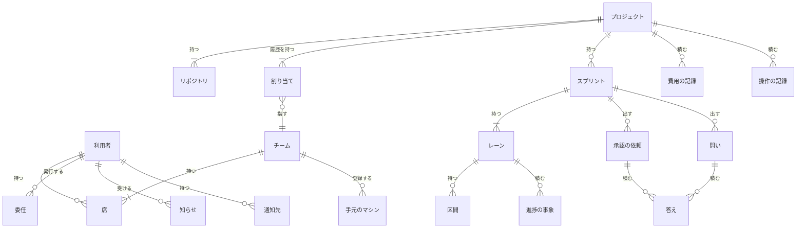
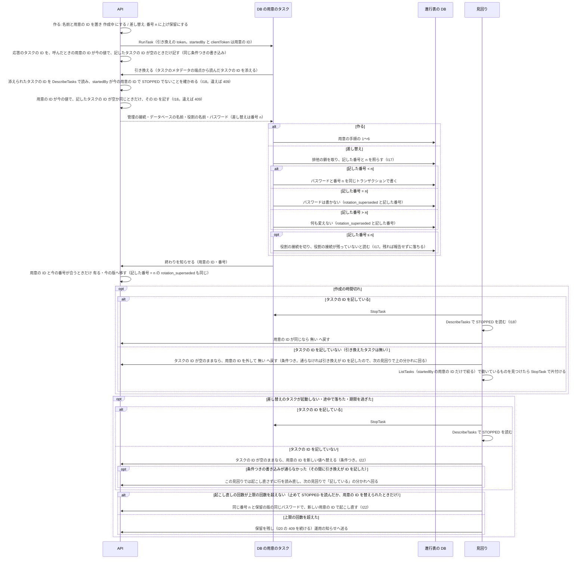

# データ: 状態を 3 つの置き場に分け、プロジェクトの割り当ての外へ見せず、承認と判断の跡を失わない

[全体の設計](overview.md)の集約と不変条件（I1〜I22）を、サービスの表・状態の S3・進行表の DB の 3 つの置き場へ下ろす。
状態の置き場の答えはこの文書が正本で、ほかの文書はここを指す。

| 扱うもの | 受ける節 |
| --- | --- |
| 集約の置き場と鍵・共通の列・テーブル定義 | [置き場の分け方](#置き場の分け方)・[サービスの表](#サービスの表) |
| 承認資料と NDF のファイル | [状態の S3](#状態の-s3)・[承認資料の保存期間](#承認資料の保存期間) |
| 進行表の DB の用意・資格情報の差し替え・GitHub の token の失効 | [進行表の DB](#進行表の-db)（不変条件 I17〜I19・I22） |
| 形の版と切り戻し | [形の版と移し方](#形の版と移し方) |
| 機能ごとの読み書き | [CRUD 図](#crud-図) |

置き場とインフラを選んだ理由（決定 80〜99・140）と外部の調査（LIB80〜LIB85）は [プラットフォーム](platform.md) にあり、この文書は答えだけを持つ。割り当てを移す流れの順は [全体の設計の割り当てを変える流れ](overview.md#割り当てを変える流れ)、実行の振る舞いは [実行](execution.md) が持つ。
値はすべて作り物か設計の既定値である。

## 置き場の分け方

状態は 3 つの置き場に分ける。どの置き場も、区切りの頭にプロジェクトかチーム（利用者だけに属するものは利用者）の ID を置き、認可の判定（I2）が同じ ID で絞れる形にする。

| 置き場 | 何を置くか | 書き手 | 読み手 |
| --- | --- | --- | --- |
| サービスの表（DynamoDB） | 全体の設計の集約のすべて（利用者・チーム・委任・プロジェクト・割り当て・スプリント・手元のマシン・進捗の事象・承認の依頼・問い・知らせ・通知先・費用の記録・操作の記録）と冪等の鍵 | API の各モジュール（集約の持ち主だけ）・見回り・知らせの送り手（送達の状態だけ）・表の移し | API |
| 状態の S3 | 承認資料の本文・NDF のファイルのうち進行表の DB に乗らないもの | API（承認資料）・ランナー（署名つき URL で NDF のファイル） | API・ランナー（署名つき URL） |
| 進行表の DB（Aurora PostgreSQL） | NDF の進行表と耐久の記録 | コンテナの中の NDF だけ | コンテナの中の NDF だけ。サービスは読まない |

サービスが NDF の状態を知る手段は、ランナーが送る進捗の事象だけにする。Lambda は VPC の外に置き、出口の無いサブネットの進行表の DB へ届かないためである（決定 83）。

## サービスの表

### ER 図

主な集約と関連だけを描く。属性は下のテーブル定義にある。

多重度の決まり: 割り当ては履歴の行を積み、今の割り当ては 1 つだけ（I3）。リポジトリのうち主はちょうど 1 つ（I1）。レーンを動かすコンテナは同時に 1 つ（I7）。

### 表と鍵

表はコンテキスト（集約の持ち主のモジュール）ごとに分ける（決定 81）。1 つの処理が書き換える集約は 1 つで、表をまたぐ反映はドメインイベントで後から行う。例外は割り当ての移しの受け入れだけで、同じ持ち主のモジュールの同じ表・同じ区切りの鍵にある割り当ての行の追加と、プロジェクトの行の今の割り当て（`current_team_id`・`current_assign_id`）の差し替え・移し中の印と移す途中の状態を空にする更新を、1 つのトランザクション（LIB81 の `TransactWriteItems`）で書く。分けると、途中で落ちたときに割り当ての履歴と今の割り当てが食い違うためである。表の名前は `<prefix>-<environment>-db-<用途>` にする。

| 表（用途） | 区切りの鍵 / 並びの鍵 | 持つ集約 | 時系列の扱い |
| --- | --- | --- | --- |
| `db-users` | `USER#<利用者>` / `USER`・`LOGIN#<IdP>#<主体>`・`LINK#<流れの ID>`・`DELEGATION#<委任>`。IdP の主体の一意の行は `LOGIN#<IdP>#<主体>` / `LOGIN`（下の [IdP の主体の一意の行](#idp-の主体の一意の行)）、Cognito の主体の対応の行は `COGNITO#<Cognito の sub>` / `COGNITO`（下の [Cognito の主体の対応の行](#cognito-の主体の対応の行)）、セッションの取り消しの行は `COGNITO#<Cognito の sub>` / `REVOKED#<origin_jti>`（下の [セッションの取り消しの行](#セッションの取り消しの行)）、外した主体の行は `COGNITO#<Cognito の sub>` / `UNBOUND` と `LOGIN#<IdP>#<主体>` / `UNBOUND`（下の [外した主体の行](#外した主体の行)） | 利用者・ログインの組・委任 | 上書き。変更の履歴は操作の記録が持つ。ログインをつなぐ流れの行・セッションの取り消しの行・外した主体の行は期限で TTL |
| `db-teams` | `TEAM#<チーム>` / `TEAM`・`SEAT#<利用者>`・`MACHINE#<マシン>`・`USAGE#<UTC の年月>` | チーム・席・手元のマシン・月の使った量 | 上書き。席と役割の変更は操作の記録、使った量の元は費用の記録 |
| `db-projects` | `PROJECT#<プロジェクト>` / `PROJECT`・`REPO#<リポジトリ>`・`ASSIGN#<時刻>#<ID>`・`GHTOKEN#<期限>#<レーン>#<連番>` | プロジェクト・リポジトリ・割り当て・渡した GitHub の token の記録 | 割り当ては履歴保持型（変更ごとに行を足し、プロジェクトの行が今の割り当てを指す）。token の記録は期限で TTL |
| `db-sprints` | `PROJECT#<プロジェクト>` / `SPRINT#<スプリント>`・`SPRINT#<スプリント>#LANE#<レーン>`・`…#SEG#<連番>` | スプリント・レーン・区間 | 状態は上書き。状態の移りは進捗の事象が持つ |
| `db-events` | `PROJECT#<プロジェクト>#LANE#<レーン>` / `SEQ#<連番>` | 進捗の事象 | 事象の記録（追記だけ、I13） |
| `db-decisions` | `PROJECT#<プロジェクト>` / `APPROVAL#<依頼>`・`QUESTION#<問い>`・`…#ANSWER#<答え>` | 承認の依頼・問い・答え | 答えは追記だけ。確定した答えの列を上書きしない。例外は `ndf_event_seqs` だけで、空のときに 1 回だけ書く（I5） |
| `db-notices` | `USER#<利用者>` / `NOTICE#<時刻>#<ID>`・`DEST#<通知先>` | 知らせ・通知先 | 知らせは既読と送達の状態だけを上書き |
| `db-usage` | `PROJECT#<プロジェクト>` / `COST#<時刻>#<ID>` | 費用の記録 | 事象の記録（追記だけ） |
| `db-audit` | `PROJECT#<プロジェクト>`・`TEAM#<チーム>`・`USER#<利用者>`・`ANON#<UTC の年月日>`（主体の決まらない 401） / `<時刻>#<ID>` | 操作の記録 | 事象の記録（追記だけ、I9） |
| `db-idempotency` | `<主体>#<操作の名前>#<鍵>` / なし | 冪等の鍵（主体・操作の名前・鍵の組。[API の文書の冪等の鍵](api.md#冪等の鍵)） | 24 時間で TTL |

| 決まり | 中身 |
| --- | --- |
| 区切りの外の ID | プロジェクトに属する行は、区切りの鍵の外でも `project_id` を持つ。利用者で区切る行（知らせ）も `project_id` を持ち、一覧は認可の判定で絞ってから返す・数える（I2） |
| 索引 | 利用者の席の一覧（`USER#<利用者>` からチームへ）・チームのプロジェクトの一覧（今の割り当てのチームから）・人を待つものの一覧（待っている依頼と問いだけを持つ疎な索引）の 3 つを置く。索引の鍵と写す列は #2 が決める |
| 条件つきの書き込み | 今の割り当ての差し替え（I3）・主リポジトリの数（I1）・レーンのコンテナの割り当て（I7）・同じ連番の事象（I13）・答えの確定（I4・I5）・使える量の加算（I8）は、条件式（LIB81）で 1 行を照らして書く。外れたら 409 か前の 1 件を返す |
| 日時と金額 | 日時は UTC の ISO 8601（末尾 `Z`）、金額は最小単位の整数と ISO 4217 の通貨の組で持つ（I15）。形の正本の検証が外れた値を拒む |
| 共通の列 | どの行も下の [共通の列](#共通の列) を持つ。上書きの行は `version` も持ち、追記だけの行は持たない |
| 課金と守り | 表は要求の数の課金（LIB81）。どの表もポイントインタイムの戻し（PITR）を有効にし、スタックから消しても表を残す（決定 93） |

### 共通の列

| 列 | 持つ行 | 意味 |
| --- | --- | --- |
| `pk`・`sk` | すべて | 区切りの鍵と並びの鍵（上の表と鍵の表） |
| `schema_version` | すべて | 形の版（整数。[形の版と移し方](#形の版と移し方)） |
| `version` | 上書きの行（利用者・チーム・席・委任・手元のマシン・プロジェクト・リポジトリ・スプリント・レーン・承認の依頼・問い・知らせ・通知先・月の使った量） | エンティティの版。書くたびに 1 上げ、条件つきの書き込み（`updateIfVersion`）で照らす。API の要素の `version`（[API の文書の版と条件つきの更新](api.md#版と条件つきの更新)）はこの列を返す |

追記だけの行（割り当て・答え・進捗の事象・費用の記録・操作の記録・冪等の鍵・渡した GitHub の token の記録）は `version` を持たない。答えの行の `ndf_event_seqs` は、版で照らさず「列が無い」ことを条件にした書き込みで 1 回だけ足す（I5）。

### IdP の主体の一意の行

1 つの IdP のアカウントを 2 人の利用者へ結ばないための行である（I16）。

| 表 | 区切りの鍵 / 並びの鍵 | 持つ列 | 書き方 |
| --- | --- | --- | --- |
| `db-users` | `LOGIN#<IdP>#<主体>` / `LOGIN` | `user_id`・`cognito_sub`・`bound_auth_time`・`schema_version` | ログインの組の行（`USER#<利用者>` / `LOGIN#<IdP>#<主体>`）と同じトランザクションで、無いときだけ書く（`putIfAbsent`）。既にあれば 409。`cognito_sub` と `bound_auth_time` は、下の Cognito の主体の対応の行の鍵と結んだ時のサインインの時刻を写した値で、ログインの付け替えのときだけ書き換える。外すときは下の Cognito の主体の対応の行の削除と合わせて同じトランザクションで消す |

サインインは IdP の主体からこの行を強い整合で読み、利用者を引く（決定 99）。

### Cognito の主体の対応の行

人の要求が持つ Cognito の access token は、IdP の主体でなく Cognito の利用者の `sub` を持つ。上の行の区切りの鍵（`LOGIN#<IdP>#<主体>`。IdP は `google` か `github`、主体は各 IdP の識別子）は `sub` から組めないため、`sub` から利用者を引く行を別に置く。Cognito は IdP のアカウントごとに別の Cognito の利用者（別の `sub`）を作るため、この行はログインの組と 1 対 1 に当たる。行は状態を持たず、行があることがその `sub` を利用者へ結んでいることである。ログインを外すときは、その Cognito の利用者をサインアウトさせて消してから、この行も消す（`sub` を使い捨てにする）。

| 表 | 区切りの鍵 / 並びの鍵 | 持つ列 | 書き方 |
| --- | --- | --- | --- |
| `db-users` | `COGNITO#<Cognito の sub>` / `COGNITO` | `cognito_sub`・`cognito_username`（結ぶのに使った token の `username`。外すときの Cognito の呼び出しに渡す）・`idp`・`subject`・`user_id`・`bound_auth_time`（結ぶのに使った token の `auth_time`）・`version`・`schema_version` | 結ぶとき（`sessions.create` の初めてのサインインとログインの付け替え・`logins.create` の確定）に無いときだけ書く（`attribute_not_exists`）。外すとき（`logins.delete` の確定）に消す。書き換えない |

行の書き方と値の引き元は次のとおりである。どの値も要求の本文から採らない。「利用者の行」は `USER#<利用者>` / `USER` で、`login_count`（結んだログインの数）を持つ。

| 場面 | Cognito の `sub` と IdP の主体の引き元 | 同じトランザクションに入れる書き込み |
| --- | --- | --- |
| 初めてのサインイン（`sessions.create`。IdP の主体の一意の行が無い） | 要求の access token の `sub`（認証が検証した値）。IdP の主体は、認証が検証した token の `username` で利用者プールを読み（`AdminGetUser`）、属性 `sub` が token と同じことと、属性 `identities` の IdP の名前と IdP の利用者の ID を得る。IdP の名前は設定で `google` か `github` に当てる | 利用者の行を無いときだけ書く（`login_count` は 1）。ログインの組と IdP の主体の一意の行を無いときだけ書き、どちらにも `cognito_sub` と `bound_auth_time`（token の `auth_time`）を写す。対応の行を無いときだけ書く。利用者プールから得た IdP の主体の外した主体の行（`LOGIN#<IdP>#<主体>` / `UNBOUND`）を「無いか、`unbound_at` が token の `auth_time` より前」で照らす（外した後に同じ `sub` が返っても、別の `sub` が作られても、境までのサインインの token で結ばない）。外した主体の行の件の外れは、ほかの件が同時に外れていても要素の 409 `recently_unbound`（`sessions.create` の操作ごとの理由のコード。操作の表の `sessions.create` の `reasons` に置く。下の [外した主体の行](#外した主体の行) の「境の内のサインイン」と「外しと結ぶ要求の競合」）、ほかの件だけの外れは 409 |
| ログインの付け替え（`sessions.create`。IdP の主体の一意の行があり、その `cognito_sub` が token の `sub` と違う） | 初めてのサインインと同じ。利用者プールで同じ `username` を読んで token の `sub` が返ったため、一意の行の `cognito_sub` の Cognito の利用者は作り直されてもう無い（下の「ログインを外す」で Cognito の利用者を消した後に確定のトランザクションが外れたログインと、運用で Cognito の利用者を消したログインがこれに当たる） | そのログインを一意の行の利用者のまま今の `sub` へ結び直す。前の対応の行（`COGNITO#<一意の行の cognito_sub>` / `COGNITO`）を消し（無ければ照らさない）、新しい対応の行を無いときだけ書き、ログインの組の行と一意の行の `cognito_sub` と `bound_auth_time` を「`cognito_sub` が前の値、`user_id` が一意の行の利用者」を条件に今の `sub` と token の `auth_time` へ書き換える。IdP の主体の外した主体の行を初めてのサインインと同じに照らす（外れは、一意の行の件などほかの件が同時に外れていても要素の 409 `recently_unbound`。付け替えが一意の行を読んだ後、確定の前に外しが確定すると、一意の行の件と外した主体の行の件が両方外れる。下の「外しと結ぶ要求の競合」の (2)）。利用者の行と `login_count` は変えない。ほかの件の外れは 409。結ぶ先は一意の行の利用者に限り、本文や token から利用者を採らない。一意の行の `cognito_sub` が token の `sub` と同じで対応の行が無いことは、一意の行と対応の行を同じトランザクションで書くため起きず、起きたら 409 にする。応答は既にある利用者のサインインの成功と同じ |
| ログインをつなぐ（`logins.create`） | 下の [ログインをつなぐ流れの行](#ログインをつなぐ流れの行) の認可コードを、`logins.create` の交換の要素でサーバーがその行の `code_verifier` で交換して得た access token を、人の token と同じに検証した `sub`。`auth_time` は流れの行の `created_at` 以後（流れを始める前のサインインを結ばない）。IdP の主体は初めてのサインインと同じに利用者プールから得て、IdP が流れの行の `idp` と同じことを照らす。照らした値は流れの行（`verified`）に残し、利用者が画面でつなぐアカウントを確かめて送る確定の要素だけが結ぶ。要求の Authorization は今の利用者とセッション（`sub`・`origin_jti`・開始元の対応の行の `bound_auth_time`）を決めるだけ | 利用者の行を読んだ版を条件に `login_count` を 1 足す。ログインの組・IdP の主体の一意の行・つなぐ主体の対応の行は初めてのサインインと同じに無いときだけ書く（つなぐ主体の対応の行があれば、既に結んだ主体である）。つなぐ IdP の主体の外した主体の行（`LOGIN#<candidate_idp>#<candidate_subject>` / `UNBOUND`）を「無いか、`unbound_at` が `candidate_auth_time` より前」で照らす（交換の後に候補が別の経路で結ばれてから外されると、対応の行と一意の行は再び無くなるが、境が候補を検証したサインインより後になるため、古い `verified` から外した `sub` を結ばない。境を `sub` でなく IdP の主体に置くため、外しで候補の `sub` の Cognito の利用者を消した後に確定が外れ、サインインし直しの付け替えで別の `sub` へ移ってから外し直されたときも、境は候補のサインインより後になり、消えた `sub` の候補を結ばない。外れは要素の 409 `link_invalid`）。ログインをつなぐ流れの行を「`state` が `verified`、`user_id` が今の利用者、`session_sub`・`session_id`・`session_bound_auth_time` が要求の主体の `sub`・`origin_jti`・`bound_auth_time`、`expires_at` が今より後」を条件に `used` へ書き換える（1 回だけ使う。`code_verifier` を消し、確定した要素の `idempotency_key` と結んだログインを残して、結果の分からない送り直しにこの流れの確定した結果を返す）。開始元の対応の行（`COGNITO#<session_sub>` / `COGNITO`）と開始元のセッションの取り消しの行（`COGNITO#<session_sub>` / `REVOKED#<session_id>`）は、流れの行の条件で開始元が要求元と同じセッションに限られるため、ハンドラーは照らさず、`dispatch` が足す下の [人の書き込みの要求元の照らし](#人の書き込みの要求元の照らし) の 2 件がそのまま照らす（交換と確定の間に開始元のログインが外されたか、開始元のセッションがサインアウトしたら結ばない）。IdP の主体の一意の行が既にあれば（`cognito_sub` が違っても。付け替えは `sessions.create` だけが行う）要素の 409 `already_linked`、要求元の照らしの 2 件の外れは要素の 409 `state_mismatch`、ほかの条件（流れの行・つなぐ主体の対応の行・利用者の行）の外れは要素の 409 `link_invalid`。手順は [詳細設計の `verifyLoginToLink`](detail.md#関数の仕様) |
| ログインを外す（`logins.delete`） | 外すログインの組の行（`USER#<利用者>` / `LOGIN#<IdP>#<主体>`）を強い整合で読んだ `cognito_sub`。要求の token の `sub` は使わない（別のログインのものであり得る）。IdP と主体は要素の `idp`・`subject`。要素は `idempotency_key` を持ち（応答を失った送り直しに 1 回目の確定を返す。[API の文書の冪等の鍵](api.md#冪等の鍵)。要求元のログインそのものを外した確定の後は、同じセッションの送り直しは認証で 401 `session_ended` になる。認可の対象は主体の利用者自身で、外すログインの組の行の有無は冪等の鍵の照合の後にハンドラーが照らす。[詳細設計の `dispatch` の処理の手順](detail.md#処理の手順)）、画面が読んだ `bound_auth_time`（`users.get` がログインごとに返す、ログインの組の行の `bound_auth_time`。そのログインを結んだ時のサインインの時刻で、外して結び直すか付け替えると変わる）も持つ（[API の文書の版と条件つきの更新](api.md#版と条件つきの更新) の「読んだときの値を持つ」に当たる）。Cognito の呼び出しには対応の行の `cognito_username` を渡す | 次の順で行う。(1) 書く前の照らし: ハンドラーは冪等の鍵の照合の後、ログインの組の行と対応の行（`COGNITO#<読んだ cognito_sub>` / `COGNITO`）を強い整合で読む。要素の `bound_auth_time` がログインの組の行と違えば（画面が読んだ後に別のタブや端末で外して結び直した）書き込みを返さずに要素の 409 `version_mismatch`、対応の行が無いか `user_id` が今の利用者でなければ 409 `state_mismatch`、利用者の行の `login_count` が 2 未満なら最後のログインの 409 にする。(2) `dispatch` が要求元の照らし（下の [人の書き込みの要求元の照らし](#人の書き込みの要求元の照らし) の「要求の中で同期に外へ働きかける操作」）を打ち、外れたら Cognito を呼ばずに要素の 409 `state_mismatch` にする。(3) 要求の中で Cognito を次の順に呼ぶ。`AdminGetUser` を打ち、利用者が無いか、返った `sub` が対応の行の `cognito_sub` と違えば（その Cognito の利用者はもう無い）、次の 2 つを飛ばす。`AdminUserGlobalSignOut` でその利用者のすべての refresh token を取り消し、`AdminDeleteUser` でその利用者を消す。この 2 つの `UserNotFoundException` は済んだとして進む。ほかの失敗では行を変えず要素を確定せず、要求全体の 503 `unavailable` にする（冪等の鍵の済みの行を書かない。同じ冪等の鍵の送り直しは、借りの期限の後に (1) からやり直す）。(4) 3 つが済んだら 1 つのトランザクションで確定する。ログインの組と IdP の主体の一意の行を「`user_id` が今の利用者、`cognito_sub` が読んだ値」を条件に消し、ログインの組の行には「`bound_auth_time` が要素の値」も条件に入れる。対応の行を「`user_id` が今の利用者、`bound_auth_time` が読んだ値」を条件に消す。利用者の行を「`login_count` が 2 以上」だけを条件に `login_count` を 1 引き、`version` を 1 上げる（版は条件にしない。同じ時に別々のログインを外す 2 つの要求は、先に確定した方が `login_count` を 1 にするため後の方の条件が外れ、最後のログインは外れない。版を条件にすると、別のタブで呼び名を変えただけでも外れ、2 つ以上のログインが残るのに最後のログインと取り違える）。同じトランザクションで、外した主体の行（下の [外した主体の行](#外した主体の行)）を、読んだ `cognito_sub` の行と要素の IdP の主体の行の 2 つ、同じ境の時刻 `unbound_at`（下の「境の決め方」。確定に期限を付ける）で書く（既にあれば上書きする。後の外しほど境は新しい）。要求元の照らしは、要求元のログインそのものを外すとき（要求の `sub` が読んだ `cognito_sub` と同じ）は同じ対応の行を消すため別の件にせず、`dispatch` がこの削除の条件に要求元の条件を足して 1 つにする。(5) 確定のトランザクションの条件の外れの理由は次のとおり決め、どれでも書かない。書くときの条件の外れ（読んだ後に変わった）は件ごとに理由を 1 つ付ける: ログインの組の行と IdP の主体の一意の行の件は `version_mismatch`、対応の行の件は `state_mismatch`、利用者の行の件は最後のログインの 409（上の `login_count` の条件。版を条件にしないため、この件が外れるのは確定の時に結んだログインが本当に 1 つのときだけである）。外れた件が複数あれば、`dispatch` の要求元の照らし（足した 2 件と、要求元の条件を足した対応の行の件）を先に当てて `state_mismatch` にし（[人の書き込みの要求元の照らし](#人の書き込みの要求元の照らし)。要求元のログインそのものを外すときは、足した件の外れが要求元の条件か外しの条件かを区別できないため、この件の外れは `state_mismatch`。次の要求は認証で 401 `session_ended` になる）、次にログインの組の行と一意の行の `version_mismatch`、次に対応の行の `state_mismatch`、最後に利用者の行の理由を当てる。別のタブで外して結び直した後の古い画面の要求は、(1) で `version_mismatch` になり、書く時までに結び直された競合でもログインの組の行の件が外れるため `version_mismatch` になる（画面は一覧を読み直し、利用者が今の結び付きを見て外し直す）。外しと `sessions.create` の付け替えが同じログインで競うときの結果は、要求の届いた順でなく、2 つの確定のトランザクションの順で決まる（下の「外しと結ぶ要求の競合」）。(4) が外れたとき、Cognito の利用者は消えたまま、ログインは結んだまま残る。その間、そのログインの access token は期限まで通り（refresh token は取り消し済みのため、長くて access token の有効期間）、そのログインでサインインし直すと `sessions.create` が上の「ログインの付け替え」で今の `sub` へ結び直して戻る。最後のログインの 409 を受けた画面は一覧を読み直して出す（残るのが 1 つになっている。外せなかったログインは結んだまま、そのログインでサインインし直せば付け替えで戻る） |

結ぶ（初めてのサインイン・ログインの付け替え・ログインをつなぐ）token は、IdP でサインインした時刻（`auth_time`）が 5 分の内のものだけを受ける。`bound_auth_time` には結ぶのに使った token の `auth_time` を、`cognito_username` には検証した token の `username` を書く。

この対応の行と `login_count` は、IdP の主体の一意の行・ログインの組の行と同じトランザクションでだけ作る。そのため、この仕組みを入れるのは `db-users` に IdP の主体の一意の行とログインの組の行がまだ無い環境に限り、既にある行から対応の行と `login_count` を作り直す移しの手順を持たない。今ある環境で利用者を書くのは骨組みの `PUT /v1/users`（`accounts` の表の `USER#<Cognito の sub>` / `PROFILE` の行。`db-users` と別の表で、IdP の主体の一意の行を書かない）だけで、[形の版と移し方](#形の版と移し方) のとおり nd-factory の外や骨組みで書かれた行は取り込まない。対応の行の無い一意の行があると、その IdP のアカウントは `sessions.create` が一意の行の条件で 409 になり続けるため、`sessions.create` を出す反映（#4）は、反映の前に `db-users` を走査して IdP の主体の一意の行が 1 行も無いことを確かめ、あれば反映を止める。

認証（`authenticate` の読み手 `userOfSubject`）は、検証した access token の `sub` で `COGNITO#` / `COGNITO` を、下の外した主体の行と取り消しの行と合わせて同じ時点の値で読む（この段落の終わり）。行があり、token の `auth_time` が `bound_auth_time` 以後なら `user_id` を利用者にし、前なら 401 `session_ended` にする（refresh token で取り直した token も `auth_time` を変えないため、結ぶ前のサインインのセッションは取り直しても通らない）。対応の行が無いときは、同じ読みで下の [外した主体の行](#外した主体の行) を見る。外した主体の行があり、token の `auth_time` が `unbound_at` 以前なら、外したログインのセッションの token として、どの操作でも 401 `session_ended` にする（`sessions.create` も結ばない。外した主体の行が境を持つため、そのセッションの token は以後どの経路でも結ばれず通らない）。そうでなければ（まだ結んでいない・外した後の新しいサインイン）、`sessions.create` にだけ「まだ結んでいない人」として渡り、ほかの操作では 401 `unauthorized` にする（後で同じ token の `sessions.create` が結びうるため、セッションが断たれた証にならず `session_ended` を返さない）。「まだ結んでいない人」は、`sessions.create` の中で `auth_time` が 5 分（`LOGIN_BIND_FRESH_MS`）の内で、利用者プールを token の `username` で読んだ利用者があり、その `sub` が token の `sub` と同じときだけ結ぶ。外れは 401 `unauthorized` にする（利用者が無いか別の `sub` が返るのは、外したログインの古い token に当たる）。結ぶトランザクションも対応の行を「無いこと」を条件に書くため、認証の読みの後に別の要求が結んだ行へ重ねて結ばない。認証は同じ読みで、下の [セッションの取り消しの行](#セッションの取り消しの行)（`COGNITO#` / `REVOKED#<token の origin_jti>`）も読み、あれば対応の行によらず 401 にする。対応の行・外した主体の行（`COGNITO#` / `UNBOUND`）・取り消しの行の 3 行は、1 回の `TransactGetItems`（LIB81。`TransactWriteItems` と互いに直列の順に並び、3 行を同じ時点の値で返す）で読む。行ごとの強い整合の読みを並べると、外しの確定をまたいで、消す前の対応の行と確定の後の外した主体の行を同時に得て、外しが確定したセッションを対応の行で通しうるためである。読みが進行中のトランザクションとぶつかって取り消されたら（`TransactionConflict`）間を空けて読み直し、使い切れば `unavailable` にする。ただし `sessions.delete` だけは取り消しの行があっても 401 にせず、ハンドラーが「取り消し済み」を返す（下の「`sessions.delete` の再送と期限切れ」。`sessions.delete` だけは期限を過ぎた access token も一定の長さ受ける）。

### 外した主体の行

ログインを外すと対応の行を消すため、行が無いだけでは「まだ結んでいない」と「外した」を見分けられない。外した主体と外した時の境だけを残し、外す前のサインインの token を、同じ `sub` が作り直された後（[#2 の認証の設計の未確認のこと](../../issues/issue-2-design-auth.md#未確認のこと) の (a)）も、同じ IdP のアカウントが別の `sub` で作り直された後も、古い連携の候補からも結ばせない。行は世代や待ちを持たず、境の時刻だけを持つ。Cognito の `sub` の行は認証が `sub` から引くため、IdP の主体の行は結ぶトランザクションが `sub` によらず IdP のアカウントで照らすために置き、どちらも 1 つの外しの確定で同じ境を書く。

| 表 | 区切りの鍵 / 並びの鍵 | 持つ列 | 書き方 |
| --- | --- | --- | --- |
| `db-users` | `COGNITO#<Cognito の sub>` / `UNBOUND` | `cognito_sub`・`unbound_at`（境）・`expire_at`（TTL。`unbound_at` に `SESSION_REVOKED_KEEP_MS` を足した時刻）・`schema_version` | `logins.delete` の確定のトランザクションで、読んだ `cognito_sub` について、条件を付けずに書く（上書き） |
| `db-users` | `LOGIN#<IdP>#<主体>` / `UNBOUND` | `idp`・`subject`・`unbound_at`（境）・`expire_at`（同じ）・`schema_version` | 同じトランザクションで、要素の IdP の主体について、同じ `unbound_at` で条件を付けずに書く（上書き） |

| 決まり | 中身 |
| --- | --- |
| 単位 | `unbound_at`・`auth_time`・`bound_auth_time`・`candidate_auth_time` は、どれも UNIX の秒の整数で持ち、整数のまま比べる（`auth_time` は JWT の秒の値で、Cognito の時計で決まる） |
| 境の決め方 | 境は、外しの確定までに発行されたどの token も境の内に入れるよう決める。ハンドラーは確定のトランザクションを初めて送る直前に時計（注入した時計のミリ秒）を読み、その値を `T` とする。`unbound_at` は `T` に `UNBIND_CLOCK_SKEW_MS`（60 秒）と `UNBIND_COMMIT_WINDOW_MS`（30 秒）を足し、秒へ切り上げた値にする。2 つの幅は役目が別である。`UNBIND_CLOCK_SKEW_MS` は Cognito の時計とハンドラーの時計がそれぞれ正しい時刻からずれる幅の和の許容（どちらも AWS の時刻の同期に合わせる）で、`UNBIND_COMMIT_WINDOW_MS` は `T` から確定までの長さの上限である。確定までに発行された token の `auth_time` は、正しい時刻で確定より前のサインインに Cognito の時計の進みを足した値で、確定は `T` から `UNBIND_COMMIT_WINDOW_MS` の内に起きるため、ずれが許容の上限でも `unbound_at` 以前になる（時計のずれの許容を確定までの遅れに食わせない）。確定をこの窓の内に収めるため、ハンドラーは確定の `writeAtomically` に期限 `T + UNBIND_COMMIT_WINDOW_MS` を渡す。`writeAtomically` は再試行も含めて、試行を始める時刻に方針 `dynamodb` の要求の時間切れを足した時刻が期限を越える試行を始めない。境は再試行で変えない。期限までに確定できなければ要素を確定せず、要求全体の 503 `unavailable` にする（冪等の鍵の済みの行は確定と同じトランザクションのため書かれず、同じ鍵の送り直しは (1) からやり直して新しい `T` で境を決め直す）。時間切れで結果の分からない試行は、その試行の要求の時間切れの内に表が確定するか捨てるかを決めるものとし、試行を始める時刻の制限でその分を窓の内に残す |
| 境の内のサインイン | 確定の後は、`auth_time` が `unbound_at` 以前のサインインの token を、どの `sub` でも結ばない（IdP の主体の行で照らす）。上の境の決め方により、確定までに発行された token（`AdminDeleteUser` の前・`AdminDeleteUser` の後から `T` まで・`T` から確定まで）はどれも境の内に入り、確定から境までに発行された token も境の内に入る。境の内の token の `sessions.create` の結果は、要求の届いた順でなく、下の「外しと結ぶ要求の競合」のとおり読みと確定のトランザクションの順で決まる。外しの確定の後に読む要求は結ばない。同じ `sub` なら、対応の行が無く Cognito の `sub` の行の境の内のため、認証が結び付けの前に 401 `session_ended` を返す。別の `sub` なら、その `sub` の行は無いため「まだ結んでいない人」として渡り、結ぶトランザクションが IdP の主体の行の件で外れて要素の 409 `recently_unbound` を返す。サインインの画面は、サインインのコールバックの `sessions.create` が受けたこの 2 つの応答と、下の競合の (5) の要素の 409 `state_mismatch` をどれも「外したばかりのアカウントかもしれない」として扱い、得た token を捨てて、時間を置いてから新しい認可の流れ（新しい `state` と PKCE。IdP で認証し直す）を始めるよう案内する（[画面の文書の 401](screens.md#画面ごとの項目)）。境の後のサインインは `auth_time` が `unbound_at` より後になり、同じ `sub` なら Cognito の `sub` の行の境にも入らず「まだ結んでいない人」として渡るため、どちらの `sub` でも結ぶ（`sessions.create` の冪等の鍵も `auth_time` が変わるため別の鍵になる） |
| 外しと結ぶ要求の競合 | 外しの確定のトランザクション（以下 U）と、同じ IdP のアカウントの境の内の token の `sessions.create` は、DynamoDB のトランザクションが互いに直列の順に並ぶ（LIB81）ため、`sessions.create` の読み（認証の 3 行と一意の行）と 2 つの確定の順で、返す理由と残る行が次のどれかに決まる。どの場合も、IdP のアカウントが結んだまま外した主体の行もある、という食い違いは残らない。(1) 別の `sub` の付け替えが U の前に一意の行を読み、付け替えの確定（以下 R）が U より先: R が成功し、ログインの組の行と一意の行の `cognito_sub` と `bound_auth_time` を新しい `sub` と token の `auth_time` へ書き換え、前の対応の行を消して新しい対応の行を書く。U はログインの組の行と一意の行の件（`cognito_sub` が読んだ値）が外れ、何も書かずに要素の 409 `version_mismatch` になる（外した主体の行も書かない。要求元のログインそのものを外す要求なら、要求元の条件を足した対応の行の件が先に当たり `state_mismatch`）。残る行は新しい `sub` に結んだログインの組・一意の行・対応の行で、Cognito では前の `sub` の利用者が消え新しい `sub` の利用者が残る。画面は一覧を読み直し、利用者は今の結び付きを見て外し直せる。(2) 別の `sub` の付け替えが U の前に一意の行を読み、U が R より先: U が成功し、ログインの組の行・一意の行・前の対応の行を消し、外した主体の行の 2 行を書く。R は一意の行の件（`cognito_sub` が前の値）と IdP の主体の外した主体の行の件（token は U までに発行されたため境の内）が両方外れ、何も書かない。理由は外した主体の行の件を先に当てて要素の 409 `recently_unbound`。残る行は外した主体の行の 2 行で、新しい `sub` の対応の行は無い。(3) 別の `sub` の要求が U の後に読む: 一意の行が無いため初めてのサインインの経路を取り、外した主体の行の件で外れて要素の 409 `recently_unbound`。行は (2) と同じ。(4) 同じ `sub`（[未確認のこと](../../issues/issue-2-design-auth.md#未確認のこと) の (a)）の要求の認証の読みが U の前で、その確定（操作の記録の要素の行と冪等の鍵の済みの行に、`dispatch` の要求元の照らしの 2 件を入れる）が U より先: `sessions.create` は既にある利用者のサインインとして成功し、U も成功する（`sessions.create` の確定は対応の行を書き換えないため、U の件は外れない）。その token の次の要求は認証で 401 `session_ended` になる。(5) 同じ `sub` の認証の読みが U の前で、U がその確定より先: 要求元の照らしの対応の行の件が外れ、要素の 409 `state_mismatch`。何も書かない。(6) 同じ `sub` の認証の読みが U の後: 認証が 401 `session_ended`。U の理由の決め方のほかは上の「ログインを外す」の (5) のとおりである |

| 照らす所 | 中身 |
| --- | --- |
| 認証 | 対応の行が無く、Cognito の `sub` の行があり token の `auth_time` が `unbound_at` 以前なら 401 `session_ended`（上の認証の段落。3 行を同じ時点の値で読む） |
| 結ぶトランザクション | `sessions.create` の初めてのサインインと付け替え（利用者プールから得た IdP の主体と token の `auth_time`）・`logins.create` の確定（`candidate_idp`・`candidate_subject` と `candidate_auth_time`）が、IdP の主体の行を「無いか、`unbound_at` が結ぶサインインの `auth_time` より前」を条件に照らす。認証の読みや交換の後に外しが確定しても、結ぶ時に照らし直す。`sub` でなく IdP の主体で照らすため、外しの間に `sub` が変わっても、外しの確定が外れて付け替えの後に外し直しても、境の内のサインインと古い候補を結ばない |
| 残す長さ | セッションの取り消しの行と同じ `SESSION_REVOKED_KEEP_MS`。外す時に refresh token を取り消すため、外す前のセッションの token は境から access token の寿命の内に期限を過ぎ、`sessions.delete` の猶予を足しても行が消える前に受けなくなる。結ぶ照らしが要るのは、サインインから `LOGIN_BIND_FRESH_MS` の内と、つなぐ流れの `expires_at` までで、どちらもこの長さより短い。TTL の削除は遅れるが、行があれば `expire_at` によらず照らす（境の比べのため、残っても境の後のサインインの結び直しを妨げない） |

### 人の書き込みの要求元の照らし

認証は要求の始めに対応の行を読むだけのため、その後に要求元のログインが外される（別のセッションからの `logins.delete`）か、要求元のセッションがサインアウトしても、読んだ結果のまま確定できてしまう。そこで主体が人のすべての書く操作は、`dispatch` が要素の書き込みと同じ `writeAtomically` に、要求元の対応の行（`COGNITO#<主体の sub>` / `COGNITO`）を「行があり、`user_id` が主体の利用者、`bound_auth_time` が主体の `boundAuthTime`」で照らす件と、要求元のセッションの取り消しの行（`COGNITO#<主体の sub>` / `REVOKED#<主体の sessionId>`）が無いことを照らす件を入れる（書かない条件の照らし）。人だけの操作（[API の文書の人だけにした理由](api.md#人だけにした理由)）に限らず、委任からも呼べる操作を人が呼んだとき（`sprints.create`・`sprints.cancel`・`questions.answer`・`users.update` など）も入れる。除くのは、主体がまだ結んでいない人（`newcomer`）の `sessions.create` と、取り消しの行を書く側の `sessions.delete` だけである。主体が人の `sessions.create`（対応の行が既にある利用者がサインインし直した要求。初回の確定の後の送り直しは、`dispatch` が保存した結果をハンドラーより先に返し、書かない）は、利用者・ログイン・対応の行を書かず、操作の記録の要素の行と冪等の鍵の済みの行だけを書くが、この 2 件も入れる（認証の後に要求元のログインが外されたかセッションが取り消されたら、成功を確定せずに要素の 409 `state_mismatch` にする。画面は `sessions.create` の 401 と同じにサインインの画面で案内する）。件を足すのはハンドラーでなく `dispatch` で、手順は [詳細設計の処理の手順の `dispatch`](detail.md#処理の手順) のとおりである。ハンドラーの書き込みが同じ行を指すとき（`logins.delete` が要求元のログインそのものを外し、要求元の対応の行を消す）は、1 つのトランザクションで同じ行を 2 回指せないため件を分けず、`dispatch` がその書き込みの条件に要求元の条件を足して 1 件にする。ハンドラーは要求元の行を自分で照らさない（`logins.create` の開始元は要求元と同じセッションのため、足した 2 件がそのまま照らす）。要求元の照らしの件か、要求元の条件を足した件が外れた要素は書かず、操作によらず要素の 409 `state_mismatch` にする（操作ごとの理由より先に当てる。次の要求は認証で 401 になる）。

| 決まり | 中身 |
| --- | --- |
| 要素ごとの操作 | 要素ごとに確定する操作は、要素ごとのトランザクションのそれぞれに 2 件を入れる。要素ごとに扱いの変わる操作でも、主体が人ならどの要素にも入れる（`questions.answer` は「人だけか」が真の要素にも偽の要素にも入れる。偽の要素だけを照らさずに通すと、サインアウトの後に委任と同じ範囲の答えを人として確定できる）。同じ要求の中で、照らしの前に確定した要素は確定のまま残り、照らしが外れた要素から後は 409 `state_mismatch` になる |
| 全部か無かの操作 | 1 つのトランザクションに 1 回だけ入れる。全部か無かの操作の要素の上限は、主体が人のときに入る 2 件を残して決める（委任からも呼べる `repositories.add` も含む） |
| 外への処理の確定点 | タスクの起動・止める指示・GitHub への書き込みなど外への処理は、この照らしを含むトランザクションで書いた「行う予定」の行（[API の文書の操作の記録](api.md#操作の記録) の「書くとき」）か状態の書き込みを受けてだけ起こす。照らしが外れれば予定の行も状態も書かれず、外への処理は起きない。確定点はそのトランザクションの確定で、確定の後に要求元がサインアウトするかログインを外されても、確定した操作の外への処理は止めない（`sprints.create` の起動・`sprints.cancel` の停止は確定した判断として続ける） |
| 要求の中で同期に外へ働きかける操作 | 確定の前に外へ働きかける操作（`notification_targets.test` の送信・`logins.delete` の Cognito の呼び出しなど、応答の前に外の結果を要るもの）は、働きかける直前に、同じ 2 件だけを条件にしたトランザクション（条件の照らしだけ）を打ち、外れたら働きかけずに要素の 409 `state_mismatch` にする。その照らしの確定を確定点とする。`logins.create` が認可コードを交換するのは外への書き込みでなく、結ぶトランザクションが照らすため、この扱いに入れない |

読むだけの操作には入れない（認証の時点の判定で返す）。

### セッションの取り消しの行

サインアウトは、API の側でそのセッションを断つ `sessions.delete` と、画面が Cognito で refresh token を取り消す呼び出し（[Cognito の RevokeToken](https://docs.aws.amazon.com/cognito-user-identity-pools/latest/APIReference/API_RevokeToken.html)）の 2 つからなる。取り消した refresh token から出した access token も、API が行う署名と期限の検証を通る（[Cognito の token の取り消し](https://docs.aws.amazon.com/cognito/latest/developerguide/token-revocation.html) を照らすのは Cognito の端点だけ）。逆に Cognito の取り消しは失敗しうる。そこで、取り消したセッションを API の側で見分ける行を置き、その行だけで、そのセッションの refresh token が新しい access token を出せる間ずっと断つ。Cognito の取り消しは、端末の外へ漏れた refresh token を Cognito の端点でも使えなくするための重ねであり、API の拒否はその成否に頼らない。

| 表 | 区切りの鍵 / 並びの鍵 | 持つ列 | 書き方 |
| --- | --- | --- | --- |
| `db-users` | `COGNITO#<Cognito の sub>` / `REVOKED#<origin_jti>` | `cognito_sub`・`session_id`（取り消したセッションの `origin_jti`）・`revoked_at`・`expire_at`（TTL。`revoked_at` に `SESSION_REVOKED_KEEP_MS` を足した時刻）・`schema_version` | `sessions.delete` が、要求の主体の `sub` と `sessionId` で無いときだけ書く（既にあれば済んだとして成功。行はどちらでも同じ長さ残るため、成功で省く処理は無い）。成功の要素は、書いたときも既にあったときも、その行の `revoked_at` を返す（「このセッションの取り消しが確定済み」を表す。画面はこの応答だけで取り消しの確定を知る）。`sessions.delete` は Cognito を呼ばず、refresh token を受けない |

| 決まり | 中身 |
| --- | --- |
| 残す長さ | `SESSION_REVOKED_KEEP_MS` は、refresh token の寿命（30 日）と access token の寿命（15 分）の和より長くする。アプリのクライアントは refresh token の回し（rotation）を使わず、refresh token の寿命はサインインから数えて延びないため、行が消える時点ではそのセッションから出た token はどれも期限を過ぎている。Cognito の取り消しが一度も成功しなくても、API はそのセッションを最後まで断つ |
| Cognito の取り消しの主体と照合 | 画面が、`sessions.delete` の成功（取り消しの確定。下）を受けた後に、端末のログインの控えに持つ refresh token とアプリのクライアントの ID で Cognito の取り消しを呼ぶ。画面が持つ refresh token は 1 つで、`sessions.delete` に使った access token はその refresh token から出したものなので、取り消す token と API で断ったセッションは同じものに当たる。サーバーは refresh token を受けず、持たない |
| 取り消しの再試行 | 取り消しは API の認証を通らないため、`sessions.delete` の後に 401 になる心配が無い。画面は一時の失敗（通信の失敗・5xx・呼びすぎ）を間を空けて 3 回まで試し直し、それでも成功しなければ、取り消しを済ませずにサインアウトの残りへ進む（API の拒否は上の行が受け持つ。端末の refresh token はサインアウトで消す）。`unsupported_token_type` などの恒久の応答では試し直さない |
| `sessions.delete` の再送と期限切れ | `sessions.delete` の確定の後に応答を失って送り直すと、認証は取り消しの行があっても `sessions.delete` だけは通し（署名・対応の行の照らしはほかの操作と同じ）、ハンドラーが既にある行の `revoked_at` を成功で返す。認証は `sessions.delete` だけ、`exp` を過ぎた access token も `exp` から `SESSION_DELETE_EXPIRED_GRACE_MS`（refresh token の寿命と同じ 30 日）の内なら期限で断たない（[詳細設計の `authenticate`](detail.md#処理の手順)）。期限切れの 401 を済んだ扱いにすると、取り消しの行が無いまま、同じ `origin_jti` で直前に出した別の access token（別のタブが取り直したものなど）が期限まで API を通り、refresh token を取り直せない（`invalid_grant`）端末は取り消しの行を書く手段を失うためである。認証は 401 の本文の理由で、検証を通した token のセッションが既に断たれていること（`session_ended`。取り消しの行がある（`sessions.delete` を除く）・対応の行が無く外した主体の行の境が `auth_time` 以後・`auth_time` が `bound_auth_time` より前。どれも同じセッションのどの token も、結び直しを含めて以後通さない。対応の行が無いだけで外した主体の行の境に入らない token は、後で `sessions.create` が結びうるため `unauthorized`）と、それ以外の認証の失敗（`unauthorized`。署名・claim の外れ・猶予を越えた期限）を分ける（[API の文書の 401 の本文](api.md#誤りの形)）。`unauthorized` はセッションの取り消しを確かめていないため、取り消しの確定と同じに扱わない。画面の分かれは次の 3 つである。(1) 成功すれば取り消しの確定として上の取り消しへ進む。(2) 401 `session_ended` なら、同じセッションの token はどれも API を通らないとして、取り消しの確定と同じに上の取り消しへ進む。(3) 401 `unauthorized` なら進まず、同じセッションの別の token で送り直す（画面の文書の「サインアウトの証」）。一時の失敗（通信の失敗・5xx・呼びすぎ）では進まず、サインアウトを途中のまま残して同じ access token で試し直す（[画面の文書のサインアウトで消す](screens.md#サインアウトで消す)） |

認証（上）と連携の確定（`logins.create` の開始元の照らし）と人の書き込みの要求元の照らしは、この行があれば断つ。TTL の削除は遅れるため、行があれば `expire_at` によらず断つ。

### ログインをつなぐ流れの行

`logins.create` が結ぶログインを、今の利用者がそのセッションで始めた流れで得たものに限るための行である。画面の `state` と PKCE だけに頼ると、別の流れで得た直近の token を API へ直に渡して、別の利用者へ結べてしまうため、流れの始まりをサーバーが今の利用者とセッション（Cognito の `sub` は同じログインの別のサインインでも同じため、セッションの識別子 `origin_jti` と開始元の対応の行を結んだ時のサインインの時刻まで）に結び、認可コードの交換をサーバーがその流れの `code_verifier` で行い、流れを 1 回だけ使う。

| 表 | 区切りの鍵 / 並びの鍵 | 持つ列 | 書き方 |
| --- | --- | --- | --- |
| `db-users` | `USER#<利用者>` / `LINK#<流れの ID>` | `link_id`（UUID。認可の要求の `state`）・`state`（`open`: 交換の前・`verified`: 交換して照らし、利用者の確かめを待つ・`used`: 結んだ）・`created_at`（流れを始めた時刻。交換で得た token の `auth_time` はこれ以後に限る）・`user_id`・`session_sub`（流れを始めた要求の token の Cognito の `sub`）・`session_id`（その token の `origin_jti`。そのサインインのセッションの識別子で、同じ `sub` の別のサインインでは違う）・`session_bound_auth_time`（開始元の対応の行の `bound_auth_time`）・`idp`（選んだ IdP）・`code_verifier`（PKCE。サーバーだけが持ち、画面へ返さずログに出さない。`open` の間だけ）・`exchange_idempotency_key?`・`exchange_fingerprint?`（`verified` と `used` の間。交換の要素の冪等の鍵と、要素の正規化した JSON の SHA-256。冪等の行が先に消えた後の同じ鍵の送り直しも、指紋が違えば 422 `idempotency_key_reused` にし、保存した結果を返さない）・`candidate_sub?`・`candidate_username?`・`candidate_idp?`・`candidate_subject?`・`candidate_auth_time?`（`verified` の間。交換で照らしたつなぐ主体）・`account_label?`（`verified` と `used` の間。確かめに出す表示の名前で、利用者プールの属性 `email`。空にしない。得られなければ `verified` へ進めない。`used` でも消さず、交換の送り直しへ初回と同じ確かめ待ちの結果を返す）・`used_idempotency_key?`・`linked_idp?`・`linked_subject?`（`used` の間。確定の要素の冪等の鍵と結んだログイン）・`expires_at`（作ってから 10 分。確定はこれより前に限る）・`expire_at`（TTL。`open` は `expires_at`、`verified` は交換から 24 時間、`used` は確定から 24 時間。どれも残る間は、同じ流れの ID と同じ冪等の鍵の送り直しへ保存した結果を返す）・`schema_version` | `login_links.create` が `open` で無いときだけ書く。`logins.create` の交換の要素が `open` を条件に `verified` へ、確定の要素がログインを結ぶのと同じトランザクションで上の条件で `used` へ書き換える。`verified` と `used` の行は、同じ流れの ID と同じ冪等の鍵の送り直しに初回の結果を返すためにも残し、TTL で消える |

### テーブル定義

主な集約の列を書く。ここに定義の無い表（利用者・ログインの組・委任・チーム・席・招待・手元のマシン・月の使った量・リポジトリ・区間・スプリント・進捗の事象・問い・知らせ・通知先・費用の記録・冪等の鍵・渡した GitHub の token の記録）の列と、上の 3 つの索引の列は #2 が決める。共通の列はどの表でも上の [共通の列](#共通の列) に従う。

プロジェクト（`db-projects` の `PROJECT` の行）:

| 列 | 型 | 空を許すか | 意味 |
| --- | --- | --- | --- |
| `project_id` | 文字列 | 許さない | プロジェクトの ID（無作為） |
| `name` | 文字列 | 許さない | 名前 |
| `current_team_id` | 文字列 | 許す | 今の割り当てのチーム。空は「閉じた」で、どのチームからも見えない |
| `current_assign_id` | 文字列 | 許す | 今の割り当ての行の ID。空の意味は上と同じ |
| `transfer_in_progress` | 文字列 | 許す | 移し中の印。今の割り当ての移しの ID。移しの作成で書き（E18）、受け入れか取り下げで空にする。空でない間は I20 で止める |
| `transfer` | 地図 | 許す | 割り当てを移す途中の状態（移す先・止め終えたか・失効が終わったか・差し替えを始めたか・取り下げたか）。差し替えを始めたかは、進行表の DB が無ければ始めずに真にする。移しの作成で、移し中の印と同じ書き込みで止め終えたかを偽にして書き、これが止める依頼として残る（E18）。空は「移していない」 |
| `progress_db_state` | 文字列 | 許さない | 進行表の DB の状態（`無い`・`作成中`・`有る`） |
| `progress_db_name`・`progress_db_role` | 文字列 | 許す | 進行表の DB のデータベースと役割の名前（無作為）。API が `作成中` にするときに作って置き、作り直しでも同じ名前を使う。空は「まだ作っていない」 |
| `progress_db_prep_id` | 文字列 | 許す | 今の用意の ID。引き換えの token と完了の報告の token はこの ID に結ぶ。空は「用意していない」 |
| `progress_db_prep_task` | 文字列 | 許す | 今の用意のタスクの ID。`RunTask` の応答か引き換え（タスクが添えた ID）のどちらか早い方で、空のときだけ書く。`RunTask` の応答で書くときも、呼んだときの用意の ID が今の `progress_db_prep_id` と同じことを同じ書き込みの条件に入れ、違えば書かない（古い応答が起こし直した後の空欄を埋めない）。時間切れで止める先（I18） |
| `progress_db_rotation_seq` | 整数 | 許さない | 差し替えの番号。差し替えを始めるたびに 1 上げる（I17） |
| `progress_db_rotation_pending` | 真偽 | 許さない | 差し替えの完了を待っているか。真の間は I20 で止める |
| `progress_db_rotation_attempts` | 整数 | 許さない | 今の番号の差し替えでタスクを起こした回数。番号を上げるときに 1 にし、起こし直すたびに 1 上げる（I22） |
| `progress_db_secret` | 文字列 | 許す | そのプロジェクトの URL を入れた秘密の器の名前。空は「まだ作っていない」 |
| `gh_token_max_expiry` | 日時 | 許す | 渡した GitHub の token の期限の最大値。空は「期限の前の token が無い」 |
| `gh_token_generation` | 整数 | 許さない | token の記録の世代番号。記録を足すたびに 1 上げる |
| `created_at` | 日時 | 許さない | 作った時刻（UTC） |
| `schema_version`・`version` | 整数 | 許さない | 形の版とエンティティの版（[共通の列](#共通の列)） |

割り当て（`ASSIGN#…` の行。追記だけ）:

| 列 | 型 | 空を許すか | 意味 |
| --- | --- | --- | --- |
| `assign_id` | 文字列 | 許さない | 割り当ての行の ID |
| `team_id` | 文字列 | 許す | 割り当てたチーム。空は「閉じた」行 |
| `confirmed_by` | 文字列 | 許さない | 確定した人の利用者の ID（人だけ、I3） |
| `accepted_by` | 文字列 | 許す | 移す先の持ち主の受け入れ。空は「作成と同時の割り当て」か「閉じた」 |
| `confirmed_at` | 日時 | 許さない | 確定の時刻（UTC） |

レーン（`db-sprints` の `…#LANE#…` の行）:

| 列 | 型 | 空を許すか | 意味 |
| --- | --- | --- | --- |
| `lane_id` | 文字列 | 許さない | レーンの ID |
| `repo_id` | 文字列 | 許さない | 回すリポジトリ |
| `after` | 文字列の配列 | 許さない | 先に終わるべきレーン。空の配列は「待たない」 |
| `place` | 文字列 | 許さない | 実行の場所（`hosted`・`machine`） |
| `inference` | 文字列 | 許さない | 推論の手段（`managed`・`byok`） |
| `runner_id` | 文字列 | 許す | 今動かしているコンテナ（タスクかマシン）。空は「どこにも割り当てていない」（I7 は空か前の世代が終わっているときだけ書ける条件で守る） |
| `generation` | 整数 | 許さない | 割り当ての世代の番号。割り当てのたびに 1 上げ、レーンの token はこの世代に結ぶ（[実行の文書のレーンの状態](execution.md#レーンの状態)） |
| `state` | 文字列 | 許さない | レーンの状態（値の集合は [実行](execution.md)） |
| `last_seq` | 整数 | 許さない | 受けた進捗の事象の最後の連番 |
| `version` | 整数 | 許さない | エンティティの版（[共通の列](#共通の列)） |

承認の依頼（`db-decisions` の `APPROVAL#…` の行）:

| 列 | 型 | 空を許すか | 意味 |
| --- | --- | --- | --- |
| `approval_id` | 文字列 | 許さない | 依頼の ID |
| `sprint_id`・`lane_id` | 文字列 | 許さない | 出したスプリントとレーン |
| `gate` | 文字列 | 許さない | 承認ゲートの種類（設計・リリース・レッドライン） |
| `material_digest` | 文字列 | 許さない | 承認資料の要約値（sha256）。状態の S3 の本文の名前でもある |
| `state` | 文字列 | 許さない | 状態。値と遷移は [実行の文書の承認の依頼と問いの状態](execution.md#承認の依頼と問いの状態) が正本 |
| `answer_id` | 文字列 | 許す | 確定した答え。空は「待っている」か「取り消した」 |
| `delivery` | 文字列 | 許す | 答えの NDF への送達の状態（値と遷移は [実行の文書の答えの送達](execution.md#答えの送達)）。空は「答えていない」か送達の対象外 |
| `waiting_since` | 日時 | 許す | 疎な索引の鍵。空は「人を待っていない」 |
| `version` | 整数 | 許さない | エンティティの版（[共通の列](#共通の列)） |

答え（`db-decisions` の `…#ANSWER#…` の行。追記だけ。確定した列は上書きせず、`ndf_event_seqs` だけ空のときに 1 回書く）。全体の設計が決める列だけを書き、ほかの列は #2 が決める:

| 列 | 型 | 空を許すか | 意味 |
| --- | --- | --- | --- |
| `ndf_event_seqs` | 整数の配列 | 許す | `ndf answer` が書いた NDF の答えの事象の番号（I5）。送達の事象（E14）で受け、送達の状態を「届いた」にする書き込みと同じ書き込みで、空のときだけ書く。空は「まだ届いていない」。送達の対象外の答えは持たない |

操作の記録（`db-audit` の行。追記だけ）:

| 列 | 型 | 空を許すか | 意味 |
| --- | --- | --- | --- |
| `at` | 日時 | 許さない | 時刻（UTC） |
| `actor` | 地図 | 許さない | 主体（人・委任・ランナー・手元のマシン・GitHub・見回り・DB の用意のタスク）と、委任なら委任した人とクライアントの名前 |
| `channel` | 文字列 | 許さない | 入口（画面・API・MCP・ランナー・手元のマシン・GitHub・見回り・DB の用意） |
| `operation` | 文字列 | 許さない | 操作の表の名前 |
| `target_ids` | 文字列の配列 | 許さない | 対象の ID。空の配列は「対象を持たない操作」（サインインなど） |
| `result` | 地図 | 許さない | 結果（`ok`・`partial`・`rejected`）と、HTTP の状態・理由のコードの並び（[API の文書の操作の記録](api.md#何を書くか)） |

秘密と個人情報の値は記録に書かない（I9）。1 つの要求は 1 つの記録の ID で、要求の要約の行 1 件と、書いた要素ごとの行（要素の確定と同じトランザクション）で残す。要約の行を書けなければ要求を 503 で失敗させる（[API の文書の書き方と失敗](api.md#書き方と失敗)）。区切りの鍵は次のとおりにする（[詳細設計](detail.md#内部のデータと定数)）。

| 場合 | 区切りの鍵 |
| --- | --- |
| 見られたプロジェクトがある | `PROJECT#` |
| 見られたプロジェクトが無い | 主体の `USER#` |
| 主体の決まらない 401 | `ANON#<UTC の年月日>` |

## 状態の S3

バケットは 1 つで、公開を止め、暗号化し、TLS だけを受ける。オブジェクトの名前の頭に形の版を置く。

| 中身 | 名前 | いつ書くか | 消し方 |
| --- | --- | --- | --- |
| 承認資料の本文 | `v1/projects/<プロジェクト>/materials/<要約値>.json` | 承認の依頼を受けたとき（API） | プロジェクトを閉じた後に、[承認資料の保存期間](#承認資料の保存期間)で消す。人の判断の材料のため、スプリントの終わりでは消さない |
| NDF のファイル | `v1/projects/<プロジェクト>/lanes/<レーン>/…` | 承認の待ちでタスクを止めるとき・区間の終わり・SIGTERM（ランナー） | レーンの終わりから 14 日（ライフサイクルの規則） |

署名つき URL は、そのレーンの頭だけに、15 分の期限で出す。名前の頭がプロジェクトの ID のため、割り当てを移した後に古いレーンの URL が残っても、新しいレーンの頭とは重ならない。

### 承認資料の保存期間

承認資料の本文は、プロジェクトを閉じてから、操作の記録と同じ保存期間（既定 1 年。[API の文書の保存期間](api.md#保存期間と見られる人)）で消す。保存期間の値は操作の記録と 1 つで、設置する人が設定のファイルで延ばせる（[決定 7](decisions.md#決定の記録)）。設定のキーの名前は #13 が決める。

## 進行表の DB

**1 つの Aurora Serverless v2（PostgreSQL、最小 0 ACU）のクラスタの中に、プロジェクトごとに別のデータベースとログインの役割を作る（I10、決定 83・84）。** サービスは中身を読み書きしない。接続するのはホステッドのランナーと DB の用意のタスクだけである。手元のマシンのレーンへは URL を渡さない（出口の無いサブネットへ届かないため。手元のマシンの NDF は手元の置き場を使う。[実行](execution.md)）。

| 項目 | 決まり |
| --- | --- |
| 単位 | プロジェクトごとに 1 つのデータベースと、そのデータベースだけに権限を持つ役割。名前はプロジェクト・チーム・リポジトリの名前や ID から作らない無作為の値にし、対応はサービスの表にだけ置く |
| 作る時 | そのプロジェクトの最初のホステッドのレーンを始めるとき。API がデータベースと役割の名前と用意の ID を置いて `progress_db_state` を `作成中` にし、DB の用意のタスクが用意の ID の合う終わりを知らせたら `有る` にする。失敗か作成の時間切れなら `無い` へ戻し、次の開始で同じ名前で作り直す。`無い` へ戻すのは、用意のタスクの ID を記しているなら、見回りがそのタスクを `StopTask` で止めて `DescribeTasks` で `STOPPED` を読んだ後に、用意の ID が同じことを条件に書くときだけ。記していないなら、作成の時間切れを過ぎた後に、タスクの ID が空のままであることを条件に用意の ID を外して戻す（I18・[決定 96](platform.md#決定の記録)）。下の [用意と差し替えの順](#用意と差し替えの順) |
| 認証 | 役割のパスワードを含む URL を、プロジェクトごとの秘密の器に置く。IAM 認証は使わない（token が 15 分で、NDF の DB の URL は token を取り直す口を持たない。LIB80） |
| 渡し方 | API が引き換えのときに、そのプロジェクトの URL だけをランナーへ返す。ランナーはメモリだけに置き、ファイルとログに書かない |
| 一時停止 | 利用者の接続が 0 本になってから既定の 300 秒で一時停止する。再開は通常 約 15 秒、24 時間を超えた停止の後は 30 秒以上（LIB80）。タスクの起動の手順は、最初の接続を再試行で待つ |

### 用意の手順

DB の用意のタスクは、API から引き換えの token で管理の接続とプロジェクトの役割の値を受け、次の順で行う。秘密の器を作り値を入れるのは API で、タスクは秘密の器に触れない。

| 順 | 行うこと | 理由 |
| --- | --- | --- |
| 1 | `postgres`・`template1` の `CONNECT`・`TEMPORARY` を `PUBLIC` から外す（何度打っても同じ結果） | 別のデータベースへ接続し直して、カタログと統計から他のプロジェクトの名前を読ませない |
| 2 | データベースを `ALLOW_CONNECTIONS false` で作る（作り直しで既にあれば作らない） | 権限を整えるまで誰も接続できない |
| 3 | そのデータベースの `CONNECT`・`TEMPORARY` を `PUBLIC` から外し、`ALLOW_CONNECTIONS true` にする | この時点で接続できるのは持ち主の管理の役割だけ |
| 4 | 管理の役割でそのデータベースへ接続し、カタログと統計のビューの読み取りを `PUBLIC` から外す。読み取りの既定の役割（`pg_read_all_stats` など）へ入れない | 他のプロジェクトのデータベースと役割の名前と数を読ませない（I2） |
| 5 | 管理の接続とプロジェクトの役割の接続のほかを切る | 作り直しのとき、権限を整える前から残る接続を断つ |
| 6 | 役割を作り、その役割を持ち主とする専用のスキーマと `search_path` を置き、最後にその役割にだけ `CONNECT`・`TEMPORARY` を与える | NDF と DBOS の表を作る場所。DBOS が一時表を使うため `TEMPORARY` が要る |

4 で外せるかと、プロジェクト A の役割から B のデータベース・`postgres`・`template1` へ接続できないことは、反映した環境で実測する（[未確認のまま残ること](platform.md#未確認のまま残ること)）。外せないときは、2 つ目のチームのプロジェクトでホステッドのレーンを動かす前に、分け方を設計へ戻す。

### 用意と差し替えの順

API が `RunTask` で用意のタスクを起こしてから、引き換え・用意か差し替え・終わりの報告・見回りの片付けまでの順である。作成の時間切れ（I18）と差し替えの起こし直し（I22）の分かれを持つ。用意のタスク向けの HTTP の経路は [API の文書の DB の用意のタスクの HTTP の経路](api.md#ランナー手元のマシンdb-の用意のタスクの-http-の経路) にある。

| 失敗の場面 | 扱い |
| --- | --- |
| 番号 n のパスワードを書いた後、古い接続を切る前か完了の報告の前に落ちた | 起こし直したタスクは、記した番号 = n を読んでパスワードを書かず、役割の古い接続を切り、残りが無いと読んでから `rotation_superseded` を返す。DB のパスワードは保留の版と同じで古い接続も残らないため、API は保留を下ろす |
| 書く前に落ちた・起動しなかった | 起こし直したタスクが番号 n で書く |
| RunTask がタスクの ID を返さなかった・API がタスクの ID を記す前に落ちた | タスクが引き換えたなら、引き換えがタスクの ID を記しているため、見回りはそのタスクを止めて `STOPPED` を読む。管理の接続を引き換え済みのタスクは、`ListTasks` に出なくても必ず止めてから進む。ID が空のままなら、引き換えたタスクは無い。見回りは期限を過ぎた後に、ID が空であることを条件に用意の ID を替え（作成なら `無い` へ戻す）、新しい用意の ID で起こし直す。前の用意の ID のタスクが後から動いても、引き換えを受けないため DB へ着けない。`ListTasks` は動いているタスクを片付けるためだけに使う（`startedBy` はほかの絞りと併せられず、既定は `desiredStatus` = `RUNNING` で止まりかけのタスクを返さないため、判断には使わない） |
| 起こし直しが上限を超えた | 保留を残し、スプリントの開始と割り当ての移しを止めたまま、運用の知らせで人が直す（安全の側に倒す） |

### 割り当てを移すときの差し替え

割り当てを移す確定（[割り当てを変える流れ](overview.md#割り当てを変える流れ)）は、レーンを止めた後に、そのプロジェクトの役割のパスワードを差し替える。渡し済みの URL を別のレーンから使わせないためである。

| `progress_db_state` | 扱い |
| --- | --- |
| `無い` | 渡し済みの URL が無いため差し替えない。割り当ての行に「差し替え不要」と書く |
| `作成中` | 作り終えるまで確定を 409 で拒む |
| `有る` | API がプロジェクトの差し替えの番号を n へ 1 上げて保留を立て（`progress_db_rotation_pending`）、新しいパスワードを秘密の器へ保留の版で入れ、DB の用意のタスクを差し替えの種類で起こす。タスクは DB の側の排他の鎖（`pg_advisory_xact_lock`）を取って、下の [差し替えの番号](#差し替えの番号) に記した番号と n を照らし、記した番号が n より小さいときだけパスワードと番号 n を同じトランザクションで書く。記した番号が n 以下なら、役割の古い接続を切り、役割の接続が残っていないと読んでから、用意の ID と番号を添えて終わりを知らせる（I17）。記した番号が n より大きければ何も変えずに `rotation_superseded` で終える。API は用意の ID と今の番号が合う知らせ（適用か、記した番号 = n の `rotation_superseded`）だけを受け、保留の版を今の版へ移して保留を下ろす。タスクが起動しない・落ちる・差し替えの期限（作成の時間切れと同じ値）を過ぎたときは、見回りが同じ番号 n と保留の版の同じパスワードで、新しい用意の ID のタスクを起こし直す（I22。上限の回数は既定 3、設定のキーの名前は #13）。上限を超えたら保留を残したまま運用の知らせへ送る（[決定 95](platform.md#決定の記録)） |

差し替えは取り下げた後も止めずに終える。保留が立つ間は、そのプロジェクトのスプリントの作成・レーンの割り当ての確定・割り当ての移しの作成を受けない（I20）。移す先の受け入れは、差し替えの終わりと `gh_token_max_expiry` が空か過去であることを、割り当ての行の差し替えと同じ条件つきの書き込みで照らす。GitHub の token の失効は下の [GitHub の token の失効](#github-の-token-の失効) にある。

### 差し替えの番号

進行表の DB の中に置く、役割ごとの最後に書いた差し替えの番号である。nd-factory のサービスは読まない。

| 置き場 | 列 | 書き手 | 読み手 |
| --- | --- | --- | --- |
| 管理のデータベース（`postgres`）の、管理の役割だけが持つスキーマの表 | 役割の名前・差し替えの番号・書いた時刻 | DB の用意のタスク（管理の役割）。パスワードの変更と同じトランザクションで書く | DB の用意のタスクだけ。プロジェクトの役割には権限を与えない |

### GitHub の token の失効

割り当てを移すとき、前のチームのレーンへ渡した GitHub の token を失効させる。失効の間に心拍の取り直しが新しい token を渡すと、記録の行と世代番号が増えるため、完了は世代番号で照らす（I19・[決定 97](platform.md#決定の記録)）。

| 順 | 行うこと | 外れたとき |
| --- | --- | --- |
| 1 | プロジェクトの行の `gh_token_generation` を読み、g とする | — |
| 2 | 渡した GitHub の token の記録の行（`GHTOKEN#…`）のうち期限の前のものを失効させる | 失効に失敗したら完了を記録せず、見回りがやり直す |
| 3 | `gh_token_generation` が g のままであることを条件に、`gh_token_max_expiry` を空にし、移す途中の状態の失効が終わったかを真にする（同じ条件つきの書き込み） | 世代番号が変わっていれば完了を記録せず、記録を読み直して 1 からやり直す |

失効の API が失効させる token の値を要るか（値の置き場）は #33 で扱う。

## 形の版と移し方

移しの仕組みは、nd-factory 自身が書いた行の形の版を上げるためだけに置く。nd-factory の外で書かれたデータ（作り直しの前のサービスの利用者のデータを含む）は移しの対象にせず、取り込む機能を持たない。

| 置き場 | 形を変えるとき |
| --- | --- |
| サービスの表 | 2 段で出す（決定 82）。1 段目の反映で、読み手が今と次の版の両方を読めるようにする。2 段目の反映で、書き手を次の版へ上げる。残った古い版の項目は表の移しの関数が書き換える（冪等。時間切れの前に続きの位置を残して自分を起こし直す）。読み手が受ける版は今と 1 つ前だけ |
| サービスの表の切り戻し | 2 段目を戻すときは、書き手だけを前の版へ戻す反映を出す。読み手は両方の版を読むため、表の移しが書き換えた項目は次の版のまま残してよい。1 段目（読み手を上げる）を戻すのは、次の版の項目が 0 件のときだけ。読み手と表の移しは #2、切り戻しの手順を設置の手順に書くのは #14 が受け持つ |
| 状態の S3 | 次の版の頭（`v2/`）へ書き、読み手は両方を読む。古い版は消し方の期限で消える |
| 進行表の DB | NDF が持つ。nd-factory は形を変えない。NDF の固定の値（`ndf-pin.json`）を変える PR で、契約の照合と試験を通してから上げる |
| 端末の控え | 画面の控えは形の版を持ち、合わない版の控えは捨ててサーバーから読み直す（[オフライン](screens.md#オフライン)） |

## CRUD 図

行は機能（F1〜F20）と、機能でない書き手（ランナー・見回り・知らせの送り手）。C は作る、R は読む、U は更新、D は消す。操作の記録はどの機能でも C（読み取りを含む、I9）のため、列を置かずにここで述べる。F21〜F23 はサービスのデータを触らない。

| 機能 | 利用者・委任 | チーム・席・マシン | プロジェクト・リポジトリ | 割り当て | スプリント・レーン | 進捗の事象 | 承認の依頼・問い・答え | 承認資料（S3） | 知らせ・通知先 | 費用の記録・使った量 | 進行表の DB |
| --- | --- | --- | --- | --- | --- | --- | --- | --- | --- | --- | --- |
| F1 サインイン | CR | R | — | — | — | — | — | — | — | — | — |
| F2 言語と時刻帯 | RU | — | — | — | — | — | — | — | — | — | — |
| F3 チームと席 | R | CRUD | — | R | — | — | — | — | — | — | — |
| F4 プロジェクトを作る | R | R | C | C | — | — | — | — | — | — | — |
| F5 リポジトリの登録 | — | R | CRUD | R | — | — | — | — | — | — | — |
| F6 割り当てを移す | — | R | U | CRU | U | — | U | — | C | — | U |
| F7 ホーム | — | R | R | R | R | R | R | — | R | — | — |
| F8 スプリントを始める | — | R | R | R | C | — | — | — | — | R | C |
| F9 スプリントを読む | — | — | R | R | R | R | R | — | — | R | — |
| F10 取り消す | — | — | R | R | U | — | U | — | C | — | — |
| F11 承認の依頼を読む | — | — | R | R | R | — | R | R | — | — | — |
| F12 承認する | — | — | R | R | U | — | CU | R | U | — | — |
| F13 問いに答える | — | — | R | R | U | — | CU | — | U | — | — |
| F14 知らせを読む | — | — | — | R | — | — | — | — | RU | — | — |
| F15 通知先 | — | — | — | — | — | — | — | — | CRUD | — | — |
| F16 委任 | CRUD | R | R | R | — | — | — | — | — | — | — |
| F17 実行の場所 | — | RU | — | — | — | — | — | — | — | — | — |
| F18 手元のマシン | — | CRUD | — | — | — | — | — | — | — | — | — |
| F19 使える量と上限額 | — | RU | — | — | — | — | — | — | — | R | — |
| F20 操作の記録 | — | R | R | R | — | — | — | — | — | — | — |
| ランナー | — | — | R | — | U | C | C | C | — | C | RU |
| 見回り | — | R | U | R | U | — | U | — | C | — | — |
| 知らせの送り手 | — | — | — | — | — | — | — | — | U | — | — |

F6 は 6 つのデータを書く。割り当てを移す流れが、止める（スプリント）・断つ（token・DB の資格情報）・差し替える（割り当て）を 1 つの確定に束ねるためである。各データの更新は、持ち主のモジュールの操作を順に呼ぶ（ドメインイベント E17・E18）。1 つの書き込みで複数の集約を書かない。ただし受け入れで書く割り当ての行とプロジェクトの行は、上の [表と鍵](#表と鍵) の例外のとおり 1 つのトランザクションで書く。
