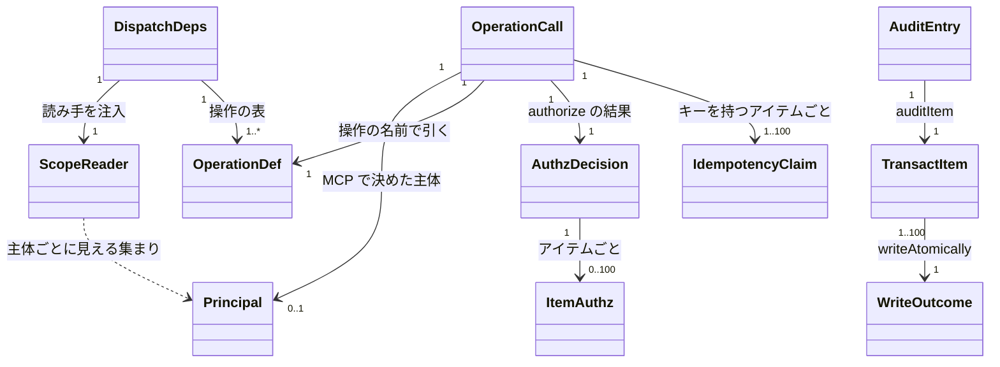

# 詳細設計: 横断の部品が 1 か所にあり、画面・API・MCP のリクエストが同じ振り分けで同じ判定と記録を通る

次の項目を、モジュールと関数の粒度へ下ろす。

| 設計 | 受ける項目 |
| --- | --- |
| [全体の設計](overview.md) | 不変条件 I2・I4・I5・I8・I9・I12〜I15 |
| [プラットフォーム](platform.md) | 「横断の部品と定数の保存先」「アーキテクチャ」 |
| [API と MCP](api.md) | 「呼び出しの規約」「認証と主体」「認可」「操作の記録」「スキーマの正本」 |

扱うのは、リポジトリのモジュールの保存先と依存の向き、横断の部品の最上位の関数の仕様・異常系・並行と排他・記録の出し方・テストの観点である。
各コンテキストのモジュール（利用者とチーム・プロジェクト・実行の制御ほか）の関数と、横断の部品の形の細部（ファイルの単位・型の項目の並び）は、ここでは決めず、下の受け持つ子の課題が詳細設計を書く。

## 受け持つ子の課題

この文書が持つのは横断の部品（`packages/core/`）だけで、ほかの保存先の詳細設計は次の子の課題が書く。全体の設計が「詳細設計が持つ」と回した中身は、この表の子の課題か、この文書の節が受ける。

| 保存先 | 中身 | 受け持つ子の課題 |
| --- | --- | --- |
| `packages/core/`・`packages/contracts/` | 横断の部品・操作の表の枠・サービスのテーブルの列とインデックス・テーブルの移行 | detail.md（この文書）と #2 |
| `apps/runner/` | ランナー | #6 |
| `apps/nd-runtime/` | nd ランタイム | #7 |
| `apps/api/src/entries/db-prep.ts`（DB セットアップ関数のエントリポイント）・`apps/api/src/db-prep/`（その処理の本体） | DB セットアップ。用意と差し替えの SQL は `SqlExecutor` のインタフェースの裏に置き、本番は Data API の実装、CI は `pg` の実装（PostgreSQL のサービスコンテナ）で同じ手順を照合する。エントリポイントへつなぐ終わりの記録のインタフェースの本番の実装は #6 | #13 |
| `apps/api/src/entries/` の定期ジョブ | 定期ジョブのエントリポイントと予定。処理ごとの中身は持ち主の子（失効のやり直し #5・マシンの途切れ #7・送達のやり直し #8） | #6 |
| `apps/api/src/entries/` の通知の送信側・`apps/api/src/modules/` の通知 | 通知 | #8 |
| アイテムの項目・型・理由のコード | 操作ごとのスキーマの正本 | [API の文書の操作の一覧](api.md#操作の一覧) の受け持つ子の表 |
| 設定のファイルのキー | 読む構成要素ごとのキー | [プラットフォームの文書の環境の値の受け方](platform.md#環境の値の受け方) の表 |

## ファイル配置

省く: ファイルの単位の配置は決めず、保存先をディレクトリの単位で決める。モジュールの保存先と依存の向きは「クラスと関数の構造」にある

## クラスと関数の構造

横断の部品の型の関係と多重度は次のとおりである。型だけを描き、項目の並びは描かない（項目は [内部のデータと定数](#内部のデータと定数)）。型の名前はコードの型の名前と照合するため識別子のまま載せる。操作の表の型は [スキーマの正本](api.md#スキーマの正本) のクラス図、配置は [コンテナの図](platform.md#コンテナの図) にある。



モジュールの保存先はディレクトリの単位で決める（`*` は新設）。

```text
nd-factory/
├── packages/
│   ├── contracts/          スキーマの正本。操作の表・値の形・設定の形・終了コード・生成
│   │   ├── src/
│   │   ├── data/           事実と方針のデータ（料金プラン・再試行の方針・秘密の形・終了コード）
│   │   ├── schema/         生成した JSON Schema と OpenAPI
│   │   └── scripts/        生成のスクリプト
│   └── core/             * 横断の部品（時計・ID と冪等キー・ログと伏せ字・外部の呼び出しと再試行・
│       └── src/              条件付き書き込み・認証・認可の判定・使える量の判定・操作の記録の書き手・操作の振り分け）
├── apps/
│   ├── api/                API と MCP の 1 つの関数・定期ジョブ・通知の送信側・テーブルの移行・DB セットアップ
│   │   └── src/
│   │       ├── entries/  * Lambda ごとのエントリポイント（api-fn・patrol・notifier・migrate・db-prep）
│   │       ├── modules/  * コンテキストごとのモジュール（操作のハンドラーと、認可の判定へ渡す読み手）
│   │       └── db-prep/  * DB セットアップ関数の処理の本体（SQL の手順・シークレットのバージョン・終わりの記録のインタフェースの型）
│   ├── web/                画面
│   ├── runner/           * ランナー（ECS のタスクと手元のコンテナで同じものが動く）
│   └── nd-runtime/       * nd ランタイム（手元のマシンで動く）
├── infra/                  CDK のスタックと設置のコマンド
│   ├── bin/
│   ├── lib/
│   ├── setup/
│   └── test/
└── tools/                  検査
    ├── ref-check/          参照の検査
    ├── checks/           * 漏れ・境界・使える量の判定の外の比べ・I14 の対応・NDF の契約の照合
    └── test/               CI の定義のテスト
```

依存は一方向で、循環を持たない。

| 保存先 | 依る先 | 決まり |
| --- | --- | --- |
| `packages/contracts` | zod だけ | ほかに何にも依らない |
| `packages/core` | `packages/contracts` だけ | 各コンテキストのテーブルの行を読む所（席・割り当て・委任・マシン・レーン）は、`core` が読み手の型（ポート）だけを持ち、`apps/api/src/modules/` が中身を渡す。これで `core` から `apps` への向きの依存を作らない |
| `apps/api`・`apps/runner`・`apps/nd-runtime` | `packages/core` と `packages/contracts` | `apps/*` どうしは互いに import しない（ランナーと API は HTTP のルートだけでつながる） |
| `apps/web` | `packages/contracts` と、`packages/core` のうちブラウザーで動くモジュール（`clock`・`ids`・`redact`・`log`）だけ | — |
| `infra` | `packages/contracts` | `apps/*` を import せず、エントリポイントのファイルのパスをアセットとして束ねるだけにする |
| `tools` | `packages/contracts` | ほかの保存先のコードを文字として読む |

| 保存先 | モジュール | 最上位の関数 |
| --- | --- | --- |
| `packages/contracts/` | 操作の表・値の形・ID のプレフィックス・理由のコード・設定の形 | 生成のスクリプトの関数。操作の定義の型 `OperationDef` を `core` へ出す |
| `packages/core/` | `clock` | `createClock`（新設） |
| `packages/core/` | `ids` | `newId`・`parseId`（新設） |
| `packages/core/` | `idempotency` | `claimIdempotency`・`settleIdempotency`（新設） |
| `packages/core/` | `redact` | `redact`（新設） |
| `packages/core/` | `log` | `createLogger`（新設） |
| `packages/core/` | `retry` | `withRetry`・`classifyFailure`（新設） |
| `packages/core/` | `outbound` | `callHttp`・`awsClient`（新設） |
| `packages/core/` | `conditional-write` | `putIfAbsent`・`updateIfVersion`・`writeAtomically`（新設） |
| `packages/core/` | `auth` | `authenticate`・`createJwksCache`（新設） |
| `packages/core/` | `authorize` | `visibleProjectIds`・`authorize`（新設） |
| `packages/core/` | `usage-limit` | `judgeUsage`・`usageAddItem`（新設） |
| `packages/core/` | `audit` | `auditItem`・`appendAudit`（新設） |
| `packages/core/` | `dispatch` | `readHttpCall`・`readMcpCall`・`createMcpHandler`・`createMcpServer`・`serveMcp`・`dispatch`・`writeHttpResponse`・`writeMcpResponse`（新設） |
| `apps/api/src/entries/` | API と MCP の 1 つの関数のエントリポイント・定期ジョブ・通知の送信側・テーブルの移行・DB セットアップ | エントリポイントの関数（HTTP は `readHttpCall` → `dispatch` → `writeHttpResponse`、MCP は `readMcpCall` → `serveMcp` を呼ぶだけ。`serveMcp` は SDK へ渡す前に `authenticate` で主体を決め、実行環境ごとに 1 回作った `createMcpHandler` のハンドラーへ渡す。ハンドラーはリクエストごとに `createMcpServer` でサーバーを作り、`tools/call` のツールの処理の中で決めた主体のまま `dispatch` → `writeMcpResponse` を呼ぶ。`dispatch` を通らなかったレスポンスは、返す前に `serveMcp` が `appendAudit` で要約のレコードを書く） |
| `apps/api/src/modules/` | コンテキストごとのモジュール | 操作ごとのハンドラーと、`authorize` へ渡す読み手 |
| `apps/api/src/db-prep/` | DB セットアップ関数の処理の本体 | `createDbPrepHandler` ほか（関数の粒度は #13 の詳細設計）。`packages/contracts`（と、できた後の `packages/core`）だけに依り、`modules/` を import しない。終わりの記録のインタフェースは型（ポート）だけを持ち、中身は `entries/db-prep.ts` が `modules/` のプロジェクトのモジュールから渡す（#6）。`entries/db-prep.ts` のほかは `db-prep/` を import しない |
| `apps/web/` | 画面 | 画面ごとの関数（[画面](screens.md)） |
| `apps/runner/` | ランナー | ランナーの関数。API への送信は `callHttp` を通す |
| `apps/nd-runtime/` | nd ランタイム | nd ランタイムの関数。API への送信は `callHttp` を通す |
| `infra/` | スタックと設置のコマンド | スタックの構築子と設置のコマンドの関数。`packages/core` の関数を使わない |
| `tools/checks/` | 足す検査 | 検査の関数。境界の検査は [プラットフォームの横断の部品の保存先の基準](platform.md#横断の部品の保存先の基準) の「保存先の外で直に使わないもの」を、`apps/` の 4 つの保存先の実行時のコード（`apps/api/src/` の `entries/`・`modules/`・`db-prep/` を含む）でだけ探す。`packages/core` は部品の保存先そのもので、`infra/`・`tools/` は組み立てと反映の時だけ動くため対象から外す（プラットフォームの決定 91） |

境界の検査の対象は、実行の時に動くコード（`apps/` の 4 つの保存先。`apps/api/src/db-prep/` を含む）である。`packages/core` より先にできる `db-prep/` は、AWS SDK のクライアント・`pino`・`p-retry` を直に使う。境界の検査を CI に載せる変更より前に、#56 がこれらを横断の部品へ寄せる。`infra/` と `tools/` は組み立てと反映の時だけ動くため、対象から外す。`infra/setup/` は AWS SDK のクライアントを直に作ってよい。

## 関数の仕様

型の名前（`Clock`・`Principal`・`TransactItem` など）の中身は「内部のデータと定数」にある。

| 関数 | 保存先 | 種類 | シグネチャ | 責務 1 文 | 事前条件 | 事後条件 | 副作用 |
| --- | --- | --- | --- | --- | --- | --- | --- |
| `createClock` | `packages/core`（`clock`） | 新設 | `(source?: () => number) => Clock` | 今の時刻を UTC で返す時計を作り、テストで時刻の元を差し替えられるようにする | `source` は UNIX のミリ秒を返す | `now()` は `Date`、`iso()` は末尾 `Z`・ミリ秒 3 桁の RFC 3339 を返す。同じ時計から得た値は減らない | 無し |
| `newId` | `packages/core`（`ids`） | 新設 | `(kind: IdKind, clock: Clock) => Id` | 種類のプレフィックスと UUIDv7 から ID を作る | `kind` はスキーマの正本の ID のプレフィックスの集まりの 1 つ | 戻り値は `<プレフィックス>_<UUIDv7>` の小文字で、時刻の順に並ぶ。バイト列は `uuid` の `v7` に `msecs`（`clock` のミリ秒）と `seq`（下の単調性の状態）を渡して組む。単調性の状態（前のミリ秒と連番）は `newId` が実行環境ごとに持ち、時計が進めば連番を乱数から再取得し、進まないか戻れば前のミリ秒のまま連番を 1 足し、連番があふれたらミリ秒を 1 進める。乱数は `uuid` の乱数（`node:crypto`）だけから取る | 無し |
| `parseId` | `packages/core`（`ids`） | 新設 | `(kind: IdKind, value: string) => Id \| null` | 受けた ID が指定の種類の形かを照合する | 無し | プレフィックスと UUIDv7 の形が合えば値を、合わなければ `null` を返す（呼び出し元は 404 と同じに扱う） | 無し |
| `claimIdempotency` | `packages/core`（`idempotency`） | 新設 | `(db: Db, claim: IdempotencyClaimInput, clock: Clock) => Promise<IdempotencyClaim>` | 主体・操作・キーの組の 1 回目を押さえ、2 回目以降に前の結果か状態を返す | `claim.fingerprint` はアイテムの正規化した JSON の SHA-256 | 戻り値は `fresh`（押さえた）・`replay`（前のアイテムの結果）・`in_progress`（他が処理中）・`reused`（中身が違う）のどれか。`fresh` のとき冪等のテーブルに借りのレコードがある | DynamoDB の `db-idempotency` への条件付き書き込みと強整合読み込み |
| `settleIdempotency` | `packages/core`（`idempotency`） | 新設 | `(claim: IdempotencyClaimInput, result: ItemResult, clock: Clock) => TransactItem` | 借りのレコードを「済み」とアイテムの結果へ書き換える書き込みを組む | `claimIdempotency` が `fresh` を返した組 | 戻り値は借りのレコードの持ち主を条件にした更新の 1 件。1 回だけ返す値（token など）は結果から `null` に替えて保存する | 無し |
| `redact` | `packages/core`（`redact`） | 新設 | `(value: unknown) => unknown` | 値の木を写し、秘密のキーの名前と秘密の形の値を伏せる | 無し | 戻り値に、秘密の形のデータに当たるキーの値と、秘密の形に当たる文字列が残らない。元の値は変えない。循環は `"[cycle]"` に替える | 無し |
| `createLogger` | `packages/core`（`log`） | 新設 | `(context: LogContext, sink?: (line: string) => void) => Logger` | リクエストの ID などの文脈を持った、JSON の 1 行を出すログの書き手を作る | `context.request_id` がある | `Logger.info`・`warn`・`error` は、文脈と項目を `redact` に通して 1 行の JSON にし、`sink` へ渡す | 標準出力へ 1 行を書く（Lambda では CloudWatch Logs へ届く） |
| `withRetry` | `packages/core`（`retry`） | 新設 | `<T>(op: (attempt: number) => Promise<T>, policy: RetryPolicy, opts: { classify: (e: unknown) => FailureClass; deadline?: number; sleep?: (ms: number) => Promise<void> }) => Promise<T>` | 方針のデータに従って、再試行してよい失敗だけを待って繰り返す | `op` は同じ引数で繰り返してよい処理（冪等か、届かなかったと分かる失敗だけを繰り返す方針） | 成功の値を返すか、最後の失敗を `RetryExhausted`（回数と分類を持つ）で投げる。`deadline` を越えて待たない | 渡した処理の副作用を最大 `policy.max_attempts` 回起こし、間で待つ |
| `classifyFailure` | `packages/core`（`retry`） | 新設 | `(e: unknown) => FailureClass` | HTTP の状態・AWS SDK の例外の名前・ネットワークのエラーを 5 つの分類に分ける | 無し | 戻り値は `retryable`・`conflict`・`not_found`・`rejected`・`unknown` のどれか | 無し |
| `callHttp` | `packages/core`（`outbound`） | 新設 | `(req: OutboundRequest, policyName: RetryPolicyName, deps: OutboundDeps) => Promise<OutboundResult>` | 外への HTTP の呼び出しをタイムアウト・再試行・分類つきで行う | `req.url` は `https:`。`req.idempotent` を呼び出し元が決めている | 戻り値は状態・ヘッダの一部・本文と分類。冪等でないリクエストは、届かなかったと分かる失敗（接続の拒否・429）だけを繰り返す | 外部への HTTPS のリクエスト（GitHub・IdP のキー・Web Push・Slack・ランナーから API） |
| `awsClient` | `packages/core`（`outbound`） | 新設 | `<C>(make: (config: AwsClientConfig) => C, policyName: RetryPolicyName) => C` | AWS SDK のクライアントを、方針のデータの回数とタイムアウトで作る | `make` は SDK のクライアントの構築子をラップする関数 | 戻り値のクライアントは `maxAttempts` とリクエストごとのタイムアウトが方針のデータの値。同じ方針の名前の 2 回目は同じクライアントを返す | 無し |
| `putIfAbsent` | `packages/core`（`conditional-write`） | 新設 | `(spec: { table: TableName; item: Row; onConflict: ConflictRule }) => TransactItem` | 行が無いときだけ足す書き込みを組む | `item` は `pk`・`sk`・`schema_version` を持つ | 戻り値は `attribute_not_exists(pk)` を条件にした 1 件で、外れたときの扱い（`state_mismatch`・`return_existing` など）を持つ | 無し |
| `updateIfVersion` | `packages/core`（`conditional-write`） | 新設 | `(spec: { table: TableName; key: RowKey; version: number; set: Record<string, unknown>; extra?: Condition; onConflict: ConflictRule }) => TransactItem` | 読んだときのバージョンと同じときだけ書き、バージョンを 1 つ上げる書き込みを組む | `version` は 1 以上の整数。`set` に `pk`・`sk`・`version` を含まない | 戻り値は `version = :expected`（と `extra`）を条件にし、`version` を 1 上げる 1 件 | 無し |
| `writeAtomically` | `packages/core`（`conditional-write`） | 新設 | `(db: Db, items: readonly TransactItem[]) => Promise<WriteOutcome>` | 組んだ書き込みを 1 つのトランザクションで確定し、外れた条件を件ごとの扱いへ訳す | `items` は 1〜100 件で、同じレコードを 2 回指さない | `ok` のとき全件が書かれている。`conflict` のときどれも書かれておらず、外れた件の番号と扱いを返す | DynamoDB の `TransactWriteItems`（テーブルをまたいでよい） |
| `authenticate` | `packages/core`（`auth`） | 新設 | `(req: InboundRequest, deps: AuthDeps) => Promise<AuthResult>` | エンドポイントの種類と token の種類から、リクエストの主体を 1 つに決める | `req.endpoint` はエンドポイント（`user`・`mcp`・`runner`・`machine`・`github`。受けた HTTP のルートのプレフィックスで決まる）。`deps` はキーと読み手を持つ | 戻り値は主体（人・委任・ランナー・手元のマシン・GitHub）か、`unauthorized`・`unavailable`。エンドポイントに合わない token は `unauthorized` | IdP の公開鍵の取得（`aws-jwt-verify` の JWKS のキャッシュが HTTPS で取り、関数の中で保存する）・DynamoDB の強整合読み込み・委任の最後に使った時刻の条件付き更新 |
| `createJwksCache` | `packages/core`（`auth`） | 新設 | `(fetchJwks: (uri: string) => Promise<Jwks>, clock: Clock) => JwksCache` | `aws-jwt-verify` の Cognito の検証へ渡す公開鍵のキャッシュを作り、キャッシュの保持期限と `kid` が無いときの再取得の間隔を持たせる | `fetchJwks` は `callHttp`（方針 `http-idp-keys`）で JWKS を取る関数 | 戻り値は採用版（5.2.1）の `JwksCache` のインタフェース（`getJwk`・`getCachedJwk`・`addJwks`・`getJwks`）を満たす。キーの集まりは取得の時刻とともに保存し、`JWKS_MAX_AGE_MS` を過ぎたキャッシュは次のリクエストで再取得してから使う。`kid` がキャッシュに無いときは、前の取得から `JWKS_REFETCH_MS` 以上たっていれば 1 回だけ再取得し、たっていなければ再取得せずにキーが無いと答える。同じ時に要る再取得は 1 つの約束を共有する。`SimpleJwksCache` と `SimplePenaltyBox` は使わない（キャッシュに期限が無く、待ちを登録するのは再取得した JWKS にも `kid` が無いときだけのため、この 2 つの値を守れない） | IdP の公開鍵の取得（HTTPS）。キャッシュは実行環境のメモリだけ |
| `visibleProjectIds` | `packages/core`（`authorize`） | 新設 | `(principal: Principal, scope: ScopeReader) => Promise<readonly ProjectId[]>` | 主体が今見られるプロジェクトの ID の集まりを求める | `principal` は `authenticate` が返したもの | 人は席を持つチームに今割り当てたプロジェクト、委任は委任した人の範囲と委任の範囲の重なり、ランナーと手元のマシンは自分のレーンのプロジェクトだけ、DB セットアップ関数は呼び出しで渡されたプロジェクトだけを返す | 読み手を通した DynamoDB の読み（席・割り当て・レーン） |
| `authorize` | `packages/core`（`authorize`） | 新設 | `(principal: Principal, op: OperationDef, items: readonly unknown[], scope: ScopeReader) => Promise<AuthzDecision>` | 操作の表のフラグと主体から、リクエスト全体とアイテムごとに通すかを 1 か所で決める | `items` はスキーマの正本の検証を通ったアイテムの配列 | 戻り値はリクエスト全体の拒み（`human_only`・`scope_insufficient`）か、アイテムごとの `allow`（対象のプロジェクトの ID と席の役割つき）・`404 not_found`・`403 role_insufficient`・`403 human_only` | 読み手を通した DynamoDB の読み |
| `judgeUsage` | `packages/core`（`usage-limit`） | 新設 | `(input: UsageInput, plan: PlanRow) => UsageVerdict` | 料金プランの値と使った量から、始めてよいか・割り当ててよいか・次の区間を起こしてよいかと理由を返す | `input.used` と `input.cap` は同じ形の金額（I15） | 戻り値は `allowed: true` か、`allowed: false` と理由のコード（`monthly_cap_reached`・`place_not_allowed`・`inference_not_allowed`・`concurrency_full`・`currency_mismatch`）と待てば解けるか。プランの名前で分けない | 無し |
| `usageAddItem` | `packages/core`（`usage-limit`） | 新設 | `(team: TeamId, cost: Money, clock: Clock) => TransactItem` | チームの月間利用量の行へ費用を足す書き込みを組む | `cost.amount_minor` は 0 以上の整数 | 戻り値は `USAGE#<UTC の年月>` の行の通貨が同じことを条件にした加算の 1 件。行が無ければ作る | 無し |
| `auditItem` | `packages/core`（`audit`） | 新設 | `(entry: AuditEntry, op: OperationDef \| null, clock: Clock) => TransactItem` | 操作の記録の 1 行を、許したキーだけを写して組む | `entry` は主体・入口・結果を持つ | 戻り値は記録のテーブルへの `putIfAbsent` の 1 件。対象の ID は `op.auditKeys` のキーだけ。本文・秘密・個人情報の値を持たない。パーティションキーは見られたプロジェクトがあればそのプロジェクト、無ければ主体 | 無し |
| `appendAudit` | `packages/core`（`audit`） | 新設 | `(db: Db, entry: AuditEntry, op: OperationDef \| null, clock: Clock) => Promise<void>` | 状態を書かないリクエスト（読む操作・拒否したリクエスト・リクエスト全体の要約）の記録を 1 行追記する | 状態の書き込みを伴うアイテムの記録には使わない（それは `auditItem` をトランザクションへ入れる） | 戻ったとき記録のテーブルに 1 行がある。書けなければ `AuditUnavailable` を投げる | DynamoDB の `db-audit` への書き込み |
| `readHttpCall` | `packages/core`（`dispatch`） | 新設 | `(event: HttpEvent) => OperationCall \| Problem` | HTTP のリクエストを、エンドポイントの種類・入口・操作の名前・token・アイテムの配列を持つ共通の呼び出しへ読む | `event` は HTTP API のリクエストの形 | 戻り値は呼び出しか、リクエスト全体のエラー（`body_not_json`・`body_not_array`・`body_empty`・`too_many_items`・`duplicate_item`・405）。HTTP のルートはスキーマの正本の HTTP のルートの表だけで引く | 無し |
| `readMcpCall` | `packages/core`（`dispatch`） | 新設 | `(event: HttpEvent, webOrigin: string) => McpCall \| McpReply` | `/mcp` のリクエストを、SDK へ渡す前に HTTP の段で照合し、通るものを `serveMcp` が受ける形へ替える | `webOrigin` は画面のオリジン | `POST` で `Origin` が合えば、Web 標準の `Request` と token を持つ `McpCall`。`Origin` の違いは 403、`GET` と `DELETE` は 405 の `McpReply`。JSON-RPC の本文は読まない（SDK が読む） | 無し |
| `createMcpHandler` | `packages/core`（`dispatch`） | 新設 | `(ops: readonly OperationDef[]) => McpHandler` | ツールの定義と `@modelcontextprotocol/server`（決定 51・LIB40）の HTTP のハンドラーを、セッションを持たず JSON の 1 レスポンスを返す設定で 1 回だけ作る | `ops` はスキーマの正本の操作の表 | ツールの定義は `human_only` でない操作を操作の表の順に持ち、名前・出力の形・注記はスキーマの正本から生成する。SDK に登録する入力の形は `{"items": unknown[]}` で、アイテムの数の上限 `MAX_ITEMS` だけを持ち、アイテムの形を持たない（アイテムの形の照合は `dispatch` がアイテムごとに行い、アイテムの 400 `item_invalid` を HTTP と同じに返すため。アイテムの形を SDK に渡すと、1 つのアイテムのエラーでリクエスト全体が `-32602` になる）。ハンドラーはリクエストごとに、そのリクエストの `McpContext` を `createMcpServer` へ渡してサーバーを作り、レスポンスの後にそのサーバーを閉じる。ハンドラーとツールの定義は実行環境ごとに 1 回作って使い回し、サーバーはリクエストをまたいで共有しない | 無し |
| `createMcpServer` | `packages/core`（`dispatch`） | 新設 | `(tools: readonly McpTool[], ctx: McpContext) => McpServer` | 1 つのリクエストのための SDK のサーバーを作り、ツールの処理をそのリクエストの主体のまま `dispatch` へつなぐ | `ctx` は `serveMcp` が決めた主体・リクエストの ID・`dispatch` を呼ぶ関数を持つ | `initialize`・`tools/list`・通知・知らない方法とツール・JSON-RPC の形のエラー・入力の外側の形のエラー（`items` が配列でない・`MAX_ITEMS` を越える）は SDK が答える。`tools/call` は `ctx` の主体と入口「MCP」のフラグと `arguments.items` をアイテムにして `dispatch` を呼び、`ctx.dispatched` を立てる | 無し |
| `serveMcp` | `packages/core`（`dispatch`） | 新設 | `(call: McpCall, deps: McpDeps) => Promise<Response>` | `/mcp` の 1 つのリクエストを、認証 → SDK → `dispatch` を通らなかったレスポンスの記録の順で通す | `call` は `readMcpCall` が通したリクエスト。`deps` は `createMcpHandler` のハンドラー・`AuthDeps`・`Db`・時計・ログを持つ | 認証は SDK へ渡す前に `authenticate`（エンドポイント `mcp`）で行い、`unauthorized` は 401、`unavailable` は 503 `unavailable` を SDK へ渡さずに返す。通れば主体を `McpContext` に入れてハンドラーへ渡す。`ctx.dispatched` が立たなかったレスポンス（`initialize`・`tools/list`・通知・知らないツール・SDK が先に拒否したリクエスト）は、SDK のレスポンスを返す前に要約のレコードを 1 件 `appendAudit` で書き、書けなければ SDK のレスポンスを捨てて 503 `audit_unavailable` を返す。`dispatch` を通ったレスポンスは `dispatch` が記録を書いたため足さない | 認証の読み・`db-audit` への追記 |
| `dispatch` | `packages/core`（`dispatch`） | 新設 | `(call: OperationCall, deps: DispatchDeps) => Promise<DispatchResult>` | 認証・形の検証・認可・冪等キー・ハンドラー・書き込みの確定・操作の記録を、どのエンドポイントでも同じ順で通す | `deps` は操作の表・ハンドラーの表・読み手・`Db`・時計・ログを持つ。`call.principal` があれば（MCP で `serveMcp` が決めた主体）認証を繰り返さずにその主体を使う | 戻り値はリクエスト全体のエラーか、リクエストと同じ数・同じ順のアイテムの結果。状態を書いたアイテムには同じトランザクションに記録のレコードがある。リクエストごとに記録の要約のレコードがある | 認証と認可の読み・ハンドラーが組んだ書き込みの確定（DynamoDB）・記録の追記 |
| `writeHttpResponse` | `packages/core`（`dispatch`） | 新設 | `(result: DispatchResult) => HttpResponse` | 振り分けの結果を HTTP のレスポンスへ書く | 無し | アイテムの結果は 200 と配列、リクエスト全体のエラーは `application/problem+json`。どのレスポンスも `Cache-Control: no-store`。500 を返さない | 無し |
| `writeMcpResponse` | `packages/core`（`dispatch`） | 新設 | `(result: DispatchResult) => CallToolResult` | 振り分けの結果を、SDK が JSON-RPC のレスポンスへ書くツールの結果へ替える | 無し | アイテムの結果は `structuredContent` と同じ値の JSON の文字列の `content`。リクエスト全体のエラーは `isError: true` と problem の JSON。JSON-RPC の封筒と HTTP のレスポンスは SDK が組み、`McpReply` はエントリポイントが HTTP のレスポンスへそのまま書く | 無し |

ハンドラーは状態を自分で書かない。`dispatch` からアイテムを 1 つ受け、アイテムの結果と組んだ書き込みを返す。組んだ書き込みは `putIfAbsent`・`updateIfVersion`・`usageAddItem` の戻り値である。確定は `dispatch` が記録のレコードと冪等キーの済みのレコードと一緒に `writeAtomically` で行う。これで記録の無い状態の書き込み（I9）と、済みにならない冪等キーが起こらない。

## 異常系の処理

| 関数 | 失敗 | 原因 | 検出する場所 | 扱い | 利用者に見える出力と終了コード | 後始末と再実行の可否 |
| --- | --- | --- | --- | --- | --- | --- |
| `claimIdempotency` | 同じ組が処理中 | 並んだ 2 つのリクエストか、前のリクエストの途中 | 借りのレコードの条件の外れと、借りの期限の前 | 呼び出し元へ返す | アイテムの 409 `in_progress` | 後始末なし。呼び出し元は待って同じアイテムを送り直せる |
| `claimIdempotency` | 中身が違う | 同じキーを別のアイテムに使い回した | 借りのレコードの `fingerprint` と比べた所 | 呼び出し元へ返す | アイテムの 422 `idempotency_key_reused` | 再実行しても同じ。呼び出し元が新しいキーを作る |
| `claimIdempotency` | テーブルに届かない | DynamoDB の失敗・タイムアウト | `writeAtomically` と読みの例外 | 再試行（方針 `dynamodb`）の後に呼び出し元へ返す | リクエスト全体の 503 `unavailable` | 借りのレコードは書けていないか、書けても期限で再取得できる。再実行できる |
| `createLogger` | 書けない | 標準出力のエラー・値を JSON にできない | `sink` の呼び出しと `JSON.stringify` | 既定値で続ける（JSON にできない値は `"[unserializable]"` に替える。`sink` の例外は捨てる） | 無し（ログの欠けは操作の結果を変えない） | 後始末なし |
| `withRetry` | 回数を使い切った | 再試行してよい失敗が続いた | 回数の数え | 呼び出し元へ返す（`RetryExhausted`） | 呼び出し元が決める。API では 503 `unavailable` | 後始末なし。後から再実行できる |
| `withRetry` | 再試行してはいけない失敗 | 分類が `conflict`・`not_found`・`rejected` | `classify` の戻り値 | 呼び出し元へ返す（最初の失敗のまま） | 呼び出し元が決める | 繰り返さない |
| `withRetry` | 期限に届く | 次の待ちが `deadline` を越える | 待つ前の残り時間の照合し | 呼び出し元へ返す（`RetryExhausted`、理由は期限） | 呼び出し元が決める。API では 503 `unavailable` | 後から再実行できる |
| `callHttp` | タイムアウト | 相手が遅い・ネットワークの不調 | `AbortSignal` のタイムアウト | 冪等なリクエストは再試行、冪等でないリクエストは呼び出し元へ返す（届いたか分からない） | 呼び出し元が決める。届いたか分からない外への作成は「行う予定」の行にフラグを残し、作り直さない（[起票の依頼](execution.md#起票の依頼)） | 冪等なら再実行できる |
| `createJwksCache` | 公開鍵を取れない | IdP の遅れ・ネットワークの不調・JWKS の形のエラー | `fetchJwks`（`callHttp` のタイムアウトと失敗） | キャッシュを変えずに取得の失敗を投げる。同じ時に待っていた再取得も同じ失敗で終わる | `authenticate` が `unavailable` にし、API は 503 `unavailable` | キャッシュは前のまま残る。次のリクエストで再取得できる |
| `createJwksCache` | 再取得した JWKS にも `kid` が無い | 知らないキーか偽の token | 再取得した後のキャッシュの引き当て | キャッシュを新しい集まりに置き換え、キーが無いと答える。次の再取得は `JWKS_REFETCH_MS` の後まで起こさない | `authenticate` が `unauthorized` にし、API は 401 | 再実行しても同じ。キーが回った後なら次の再取得で通る |
| `callHttp` | 相手の 429・5xx | 呼びすぎ・相手の障害 | レスポンスの状態 | 再試行（`Retry-After` を方針の上限まで守る） | 使い切れば呼び出し元へ `retryable` の結果 | 再実行できる |
| `callHttp` | 相手の 4xx（429 を除く） | リクエストのエラー・権限の無さ | レスポンスの状態 | 呼び出し元へ返す（`rejected`・`not_found`・`conflict`） | 呼び出し元が決める | 同じリクエストの再実行は同じ結果 |
| `callHttp` | `https:` でない URL | 呼び出し元のエラー | 送る前の照合し | 止める（例外） | API では 503 `unavailable` とログの error | 直すまで再実行しない |
| `writeAtomically` | 条件の外れ | バージョンの違い・状態の違い・既にある行 | `TransactionCanceledException` の件ごとの理由が `ConditionalCheckFailed` | 呼び出し元へ返す（件の番号と `onConflict` の扱い） | 呼び出し元がアイテムの 409 `version_mismatch`・`state_mismatch` か、`return_existing` なら前の 1 件の結果にする | 何も書かれていない。読み直して送り直せる |
| `writeAtomically` | トランザクションどうしの衝突 | 同じレコードを同時に書く別のリクエスト | 件ごとの理由が `TransactionConflict` | 再試行（方針 `dynamodb`） | 使い切ればリクエスト全体の 503 `unavailable` | 何も書かれていない。再実行できる |
| `writeAtomically` | テーブルに届かない | 呼びすぎ・障害・タイムアウト | SDK の例外 | 再試行の後に呼び出し元へ返す | リクエスト全体の 503（記録のレコードを含むなら `audit_unavailable`、含まなければ `unavailable`） | 何も書かれていない。冪等キーで再実行できる |
| `writeAtomically` | 件の数が上限を越える | ハンドラーが組んだ書き込みが多すぎる | 送る前の数え | 止める（例外） | リクエスト全体の 503 `unavailable` とログの error | 設計の誤りで、テストが先に落とす |
| `authenticate` | token が無い・形が違う・署名が違う・期限切れ・取り消し済み・エンドポイントに合わない | 呼び出し元のエラーか古い token | 種類ごとの照合し | 呼び出し元へ返す（`unauthorized`） | リクエスト全体の 401 `unauthorized`（理由によらず同じ本文） | 後始末なし。新しい token で再実行できる |
| `authenticate` | IdP の公開鍵を取れない・テーブルに届かない | ネットワーク・依存先の障害 | `aws-jwt-verify` のキーの取得の失敗（取得は `callHttp` を渡した取り手で行う）と読みの失敗 | 再試行の後に呼び出し元へ返す（`unavailable`） | リクエスト全体の 503 `unavailable`（401 にしない） | 再実行できる |
| `authenticate` | 委任の最後に使った時刻を書けない | テーブルの失敗・条件の外れ | 条件付き更新の失敗 | 既定値で続ける（主体は決めたまま） | 無し。ログの warn | 次のリクエストで書き直す |
| `visibleProjectIds` | 読み手が失敗する | テーブルに届かない | 読み手の例外 | 呼び出し元へ返す | リクエスト全体の 503 `unavailable` | 再実行できる |
| `authorize` | 対象が見えない・無い | 割り当ての外・ID の種類の違い・消えた対象 | 対象のプロジェクトの引きと見える集まりの照合し | 呼び出し元へ返す（アイテムの拒み） | アイテムの 404 `not_found`（無い対象と同じ本文） | 後始末なし |
| `authorize` | 委任で `human_only` の操作・委任の種類が足りない | 呼び出し元の範囲の外 | 操作のフラグと委任の範囲の照合し | 呼び出し元へ返す（リクエスト全体の拒み） | リクエスト全体の 403 `human_only`・`scope_insufficient` | 何も保存しない |
| `authorize` | 役割が足りない・アイテムだけ `human_only` | 席がメンバー・レッドラインに当たる問い | 席の役割とアイテムの区分の照合し | 呼び出し元へ返す（アイテムの拒み） | アイテムの 403 `role_insufficient`・`human_only` | 後始末なし |
| `authorize` | 読み手が失敗する | テーブルに届かない | 読み手の例外 | 呼び出し元へ返す | リクエスト全体の 503 `unavailable`（迷うときは見せない） | 再実行できる |
| `appendAudit` | 書けない | テーブルに届かない・再試行の使い切り | `writeAtomically` の失敗 | 呼び出し元へ返す（`AuditUnavailable`） | 読む操作は値を返さずリクエスト全体の 503 `audit_unavailable` | 再実行できる。値は渡していない |
| `createMcpServer` | JSON-RPC の形のエラー・知らない方法・知らないツール・ツールの入力の外側の形のエラー（`items` が配列でない・`MAX_ITEMS` を越える） | 呼び出し元のエラー | SDK のリクエストの読みと、SDK に登録した入力の形の照合し | SDK が JSON-RPC のエラーを返す（形のエラーは `-32700`・`-32600`、知らない方法は `-32601`、知らないツールと入力のエラーは `-32602`）。アイテムの形はここで照合しない | JSON-RPC のエラーレスポンス。HTTP の状態は SDK の決まりに従う。`serveMcp` が要約のレコードを 1 件書く | 後始末なし。呼び出し元が直して送り直せる |
| `serveMcp` | token が無い・委任の token でない・照合に外れる | 呼び出し元のエラーか古い token（Cognito の token を `/mcp` へ送るなど） | SDK へ渡す前の `authenticate` | 呼び出し元へ返す（SDK へ渡さない） | リクエスト全体の 401 `unauthorized`。主体の無い記録のレコードを 1 件 | 後始末なし。委任の token で再実行できる |
| `serveMcp` | 認証の依存先に届かない | ネットワーク・依存先の障害 | `authenticate` の `unavailable` | 呼び出し元へ返す（SDK へ渡さない） | リクエスト全体の 503 `unavailable`。記録のレコードを試み、書けなくても 503 のまま | 再実行できる |
| `serveMcp` | `dispatch` を通らなかったレスポンスの要約のレコードを書けない | テーブルに届かない | `appendAudit` の失敗 | SDK のレスポンスを捨てて呼び出し元へ返す | リクエスト全体の 503 `audit_unavailable`（ツールの一覧などの値を返さない） | 何も書いていない。再実行できる |
| `dispatch` | リクエスト全体の形のエラー | 本文のエラー | `readHttpCall` の戻り値。MCP の入口では `arguments.items` の空と同じ対象の重なりを `dispatch` が `readHttpCall` と同じ順で照合する | 呼び出し元へ返す | リクエスト全体の 400 と理由のコード（MCP では `writeMcpResponse` が `isError: true` にする）。記録のレコードを 1 件書く | 後始末なし |
| `dispatch` | アイテムの形のエラー | アイテムが操作の形に合わない | スキーマの正本の zod の検証 | 呼び出し元へ返す（アイテムごと） | アイテムの 400 `item_invalid` と `fields` | 後始末なし |
| `dispatch` | 全部か無かの操作で 1 つのアイテムが失敗 | どれかのアイテムの拒みか条件の外れ | アイテムの結果の集め | 呼び出し元へ返す | 失敗したアイテムはそのエラー、ほかのアイテムは 409 `not_applied` | 何も書かない。直して全体を送り直す |
| `dispatch` | ハンドラーの想定しない例外 | 実装の誤り・依存先の障害 | ハンドラーの呼び出しの外側 | 呼び出し元へ返す | リクエスト全体の 503 `unavailable`。リクエストの ID とともにログの error | そのアイテムの書き込みは確定していない。前のアイテムは確定済みで、冪等キーの送り直しで同じ結果が返る |
| `dispatch` | アイテムの確定の途中で記録を書けない | テーブルに届かない | `writeAtomically` の失敗 | 呼び出し元へ返す（残りのアイテムを処理しない） | リクエスト全体の 503 `audit_unavailable` | そのアイテムは書かれていない。前のアイテムは確定済みで、冪等キーで再実行できる |
| `dispatch` | 要約の記録のレコードを書けない | テーブルに届かない | `appendAudit` の失敗 | 呼び出し元へ返す | リクエスト全体の 503 `audit_unavailable`。読む操作は値を返さない | 書くアイテムはアイテムの記録のレコードとともに確定済み。冪等キーで再実行すると同じ結果が返る |
| `dispatch` | 関数の残り時間が足りない | アイテムが多い・依存先が遅い | アイテムごとの前の残り時間の照合し | 呼び出し元へ返す（残りのアイテムを処理しない） | リクエスト全体の 503 `unavailable` | 処理したアイテムは確定済み。冪等キーで再実行できる |

## 処理の手順

| 関数 | 条件の組み合わせ | 結果 |
| --- | --- | --- |
| `dispatch` | 受けた方法が `POST` でない | 405。記録のレコードを 1 件 |
| `dispatch` | `call.principal` が無く、`authenticate` が `unauthorized` | リクエスト全体の 401。主体の無い記録のレコードを 1 件 |
| `dispatch` | `call.principal` が無く、`authenticate` が `unavailable` | リクエスト全体の 503 `unavailable`。記録のレコードを試み、書けなくても 503 のまま |
| `dispatch` | `call.principal` がある（MCP の `tools/call`） | `authenticate` を呼ばず、その主体で続ける。主体は同じリクエストの中で `serveMcp` が決めたもので、リクエストをまたいで保存しない |
| `dispatch` | 主体の種類がエンドポイントに合わない（例: 人の token で `/mcp`、委任の token で `/v1/runner/…`） | リクエスト全体の 401（`authenticate` が返す） |
| `dispatch` | 本文のエラー（`readHttpCall` の順: JSON でない → 配列でない → 空 → 101 個以上 → 同じ対象の重なり） | 最初に当たった理由でリクエスト全体の 400 |
| `dispatch` | 操作が `human_only`（`always`）で主体が委任 | リクエスト全体の 403 `human_only`。ハンドラーを呼ばない |
| `dispatch` | 委任の種類（`read`・`run`・`manage`）が操作のフラグより弱い | リクエスト全体の 403 `scope_insufficient` |
| `dispatch` | 上を通ったアイテムごと: 形のエラー → 見えない → `human_only` のアイテム → 役割 → 冪等キー → ハンドラー | 先に当たったものをアイテムの結果にする。見えない要素は役割を照合しない（403 で存在を明かさない） |
| `dispatch` | 書く操作のアイテムで、ハンドラーが書き込みを返した | 書き込み・`auditItem` のアイテムの行・`settleIdempotency` を 1 つの `writeAtomically` で確定する |
| `dispatch` | 読む操作 | ハンドラーの値を集め、`appendAudit` が成功してから返す |
| `dispatch` | 全部か無かのフラグのある操作 | すべてのアイテムの書き込みを 1 つの `writeAtomically` に集め、アイテムの失敗が 1 つでもあれば確定しない |
| `authenticate` | エンドポイント `user` で、token が 3 つの部分の JWT | Cognito の access token として、`aws-jwt-verify` の Cognito の検証（決定 48・LIB41）で署名（`kid` の公開鍵、RS256）・発行元・`client_id`・`token_use` が `access`・期限を照合する。キーの取得は `callHttp`（方針 `http-idp-keys`）を取り手として渡す。通れば人 |
| `authenticate` | エンドポイント `user` か `mcp` で、token が `ndfd_` で始まる | 委任として、中の利用者と委任の ID で行を強整合で読み、秘密の部分の SHA-256 を一定時間で比べ、期限と取り消しを照合する。入口はエンドポイントで `API` か `MCP` |
| `authenticate` | エンドポイント `mcp` で、token が JWT | `unauthorized` |
| `authenticate` | エンドポイント `runner` | Ed25519 の JWT で送信先「レーン」。交換の HTTP のルートだけ交換用トークン、ほかはレーンの token。レーンのレコードが終わっていないことと世代の番号を照合する |
| `authenticate` | エンドポイント `machine` で、token が `ndfm_` で始まる | 中のチームとマシンの ID で行を強整合で読み、要約を一定時間で比べ、取り消しと期限を照合する |
| `authenticate` | エンドポイント `github` | `Authorization` を読まず、本文の HMAC-SHA256 をシークレットの値と一定時間で比べる |
| `authenticate` | Cognito の JWT の `kid` がキャッシュに無い | `createJwksCache` のキャッシュが、前の取得から `JWKS_REFETCH_MS` 以上たっていれば公開鍵を 1 回だけ再取得する。たっていないか、再取得しても無ければ `unauthorized` |
| `authenticate` | Cognito の公開鍵のキャッシュが `JWKS_MAX_AGE_MS` を過ぎた | キャッシュを使わずに再取得してから照合する。取り直せなければ `unavailable` |
| `authenticate` | ランナーの JWT（Ed25519） | `aws-jwt-verify` を通さない。`node:crypto` の `verify` で、シークレットから起動のときに 1 回読んだ nd-factory 自身の検証のキーと照合する。IdP のキーの取得は起きない |
| `authorize` | 主体が人 | 見える集まり = 席を持つチームの今の割り当て。役割は席の役割 |
| `authorize` | 主体が委任 | 見える集まり = 委任した人の今の集まり ∩ 委任の範囲のプロジェクト。役割は委任した人の席の役割 |
| `authorize` | 主体がランナーか手元のマシン | 自分向けの HTTP のルートの操作だけ。見える集まりは自分のレーンのプロジェクトだけ |
| `authorize` | 主体が DB セットアップ関数 | 関数の中から呼ぶ 3 つの処理（`db_prep.is_current`・`db_prep.read_target`・`db_prep.record`。[API の文書](api.md#ランナー手元のマシンの-http-のルート)）だけ。見える集まりは呼び出しで渡されたプロジェクトだけ。利用者向けの操作はリクエスト全体で拒む |
| `authorize` | 主体が定期ジョブ | 保守の操作だけ。利用者向けの操作はリクエスト全体で拒む |
| `authorize` | アイテムの対象が割り当てを移す途中のプロジェクトで、主体が移す先のチームの持ち主 | 名前だけを読む操作のアイテムだけ通す（I2 の例外）。ほかは 404 |
| `authorize` | 対象の ID の種類のプレフィックスが操作と合わない | 404 `not_found`（`parseId` が `null`） |
| `claimIdempotency` | 行が無い | 借りのレコード（持ち主のリクエストの ID・`fingerprint`・借りの期限）を条件付きで書き、`fresh` |
| `claimIdempotency` | 済みのレコードで `fingerprint` が同じ | `replay`（保存したアイテムの結果） |
| `claimIdempotency` | 行があり `fingerprint` が違う | `reused` |
| `claimIdempotency` | 借りのレコードで期限の前 | `in_progress` |
| `claimIdempotency` | 借りのレコードで期限を過ぎた | 持ち主を自分へ替える条件付き更新に勝てば `fresh`、負ければ `in_progress` |
| `judgeUsage` | 時点が「始める」 | 実行の場所と推論の手段がプランに無ければ `place_not_allowed`・`inference_not_allowed`。上限額があり使った額が上限額以上なら `monthly_cap_reached`（待っても解けない） |
| `judgeUsage` | 時点が「割り当てる」 | 同時に動くレーンの数がプランの数以上なら `concurrency_full`（待てば解ける）。上限なしの行は照合しない |
| `judgeUsage` | 時点が「区間の境」 | 使った額が上限額以上なら `monthly_cap_reached`（待てば解ける: 上限額を変えるか月が替わる） |
| `judgeUsage` | 使った額と上限額の通貨が違う | `currency_mismatch`（通さない。換算しない） |
| `classifyFailure` | 429・500・502・503・504・ネットワークのエラー・タイムアウト・`ThrottlingException`・`ProvisionedThroughputExceededException`・`TransactionConflict` | `retryable` |
| `classifyFailure` | 409・`ConditionalCheckFailedException` | `conflict` |
| `classifyFailure` | 404・`ResourceNotFoundException` | `not_found` |
| `classifyFailure` | ほかの 4xx・`ValidationException`・`AccessDeniedException` | `rejected` |
| `classifyFailure` | 上のどれでもない | `unknown`（再試行しない） |
| `readMcpCall` | `Origin` のヘッダがあり画面のオリジンでない | 403 |
| `readMcpCall` | 方法が `GET` か `DELETE` | 405（SDK へ渡さない） |
| `serveMcp` | どの方法でも、`authenticate` が主体を決める前 | SDK へ渡さない。401・503 は上の異常系のとおり |
| `createMcpServer` | 方法が `initialize` | SDK がサーバーの名前と能力（ツールだけ）を返す。`serveMcp` が要約のレコードを 1 件 |
| `createMcpServer` | 方法が `tools/list` | SDK が登録したツールの一覧（`human_only` でない操作、操作の表の順）を返す。`serveMcp` が要約のレコードを 1 件書いてから返す |
| `createMcpServer` | 方法が `tools/call` で、名前がツールの一覧に無い | SDK が JSON-RPC のエラー `-32602` を返す。`serveMcp` が要約のレコードを 1 件（操作は空） |
| `createMcpServer` | 方法が通知（`notifications/` で始まる） | SDK が 202 で本文なしを返す。`serveMcp` が要約のレコードを 1 件 |
| `createMcpServer` | 方法が `tools/call` で、名前がツールの一覧にある | `dispatch` がアイテムごとに形を照合し、HTTP と同じアイテムの結果と記録を返す。`serveMcp` は行を足さない |

- 繰り返しの終わる条件: `withRetry` は `policy.max_attempts` 回か `deadline` で終わる。`dispatch` のアイテムの繰り返しはアイテムの数（1〜100）で終わる。各アイテムの前に関数の残り時間が `DISPATCH_RESERVE_MS` を下回れば打ち切る。`claimIdempotency` の再取得は 1 回だけ。
- 計算量の注意: `dispatch` は書くアイテムごとに 1 つのトランザクションを順に確定する（100 アイテムで 100 回）。`visibleProjectIds` はリクエストごとに 1 回だけ求め、アイテムごとに求め直さない。委任の照合と見える集まりはリクエストをまたいで保存しない（取り消しと席の変化を次のリクエストから効かせるため）。

## 内部のデータと定数

| 名前 | 種類 | 保存先 | 既定値 |
| --- | --- | --- | --- |
| `Clock` | 型 | `packages/core`（`clock`） | `{ now(): Date; iso(): string }` |
| `IdKind` | 型（値の集合はスキーマの正本） | `packages/contracts`（ID のプレフィックスの集まり） | `usr`・`team`・`inv`・`prj`・`repo`・`trf`・`spr`・`lane`・`apr`・`qst`・`ntc`・`dst`・`dlg`・`mch`・`key`・`aud`（[値の形](api.md#値の形)） |
| `IdempotencyClaimInput` | 型 | `packages/core`（`idempotency`） | `{ principalKey, operation, key, fingerprint, requestId }` |
| `IdempotencyClaim` | 型 | `packages/core`（`idempotency`） | `fresh`・`replay`・`in_progress`・`reused` の 4 つの形 |
| `IDEMPOTENCY_TTL_SECONDS` | 定数 | `packages/contracts`（操作の規約の値） | 86400（24 時間） |
| `IDEMPOTENCY_LEASE_MS` | 定数 | `packages/core`（`idempotency`） | API の関数のタイムアウトの 2 倍。タイムアウトの値はスキーマの正本の設定から読み、ここで数を重ねて持たない |
| `LogContext`・`Logger` | 型 | `packages/core`（`log`） | 文脈は `request_id`・`fn`・`endpoint`（エンドポイント）。項目は `level`・`msg`・`time` と任意の ID と数 |
| 秘密の形のデータ | 設定値（データ） | `packages/contracts/data/`（秘密の形） | キーの名前（`authorization`・`token`・`secret`・`password`・`credentials`・`private_key`・`dsn` を含む名前）と値の形（`ndfd_`・`ndfm_`・JWT の形・`ghs_` などの GitHub の token・秘密鍵のプレフィックス・利用者と合言葉を含む接続の URL・AWS の一時のキーの形）。読むのは実行の時の `redact` だけ。CI の漏れの検査（gitleaks）はこのデータを読まず、`.gitleaks.toml`（nd-factory の規則と作り物の値の許可）・`tools/checks/gitleaks-default.toml`（gitleaks の既定の規則）・CI の秘密 `LEAK_CHECK_PATTERN`（実際の値）を読む。このデータから gitleaks の設定を生成しない（#1 の設計の決定 3） |
| `RetryPolicy` | 型 | `packages/contracts`（形） | `{ max_attempts, base_ms, cap_ms, timeout_ms, honor_retry_after }`。待ちは上限つきの指数と全幅のゆらぎ |
| 再試行の方針の表 | 設定値（データ） | `packages/contracts/data/`（再試行の方針） | `dynamodb` 3 回・50〜1000 ミリ秒・2 秒、`aws-control`（ECS・Secrets Manager・STS）3 回・200〜2000 ミリ秒・5 秒、`http-github` 3 回・500〜5000 ミリ秒・10 秒、`http-idp-keys` 2 回・200〜1000 ミリ秒・3 秒、`http-notify`（Web Push・Slack）3 回・500〜5000 ミリ秒・5 秒、`runner-to-api` 5 回・1000〜30000 ミリ秒・10 秒 |
| `FailureClass` | 型 | `packages/core`（`retry`） | `retryable`・`conflict`・`not_found`・`rejected`・`unknown` |
| `OutboundRequest`・`OutboundResult` | 型 | `packages/core`（`outbound`） | リクエストは `{ method, url, headers, body, idempotent }`、結果は `{ status, headers, body, class }` |
| `TransactItem` | 型 | `packages/core`（`conditional-write`） | SDK の 1 件と、外れたときの扱い `onConflict`（`version_mismatch`・`state_mismatch`・`return_existing`・`fail`） |
| `TRANSACT_MAX_ITEMS` | 定数（外部の仕様の値） | `packages/core`（`conditional-write`） | 100（DynamoDB の 1 つのトランザクションの件の上限。出所を添える） |
| `WriteOutcome` | 型 | `packages/core`（`conditional-write`） | `{ ok: true }` か `{ ok: false; failed: { index, onConflict }[] }` |
| `Principal` | 型 | `packages/core`（`auth`） | `human`（利用者の ID）・`delegation`（利用者の ID・委任の ID・範囲・クライアントの名前）・`runner`（レーンの ID・世代）・`machine`（チームの ID・マシンの ID）・`github`・`db_prep`（プロジェクトの ID・用意の ID）・`patrol` |
| `AuthDeps` | 型 | `packages/core`（`auth`） | IdP の発行元とクライアント ID（設定）・レーンの検証のキー（シークレットから起動のときに 1 回読む）・Webhook の秘密・委任とマシンとレーンのレコードの読み手・時計 |
| 委任の token の形 | 定数（形） | `packages/contracts`（token の形） | `ndfd_<利用者の ID>.<委任の ID>.<秘密の部分 32 バイトの base64url>`（行をパーティションキーで強整合で読むため） |
| 登録の token の形 | 定数（形） | `packages/contracts`（token の形） | `ndfm_<チームの ID>.<マシンの ID>.<秘密の部分 32 バイトの base64url>`（委任の token と同じ理由） |
| `JWKS_REFETCH_MS` | 定数 | `packages/core`（`auth`） | 60000。Cognito の `kid` がキャッシュに無いときの再取得の間隔の下限。`createJwksCache` が前の取得の時刻と比べて守る |
| `JWKS_MAX_AGE_MS` | 定数 | `packages/core`（`auth`） | 3600000。Cognito の公開鍵のキャッシュを使う期限。過ぎたら次のリクエストで再取得する（IdP が外したキーを 1 時間より長く受けない） |
| `DELEGATION_TOUCH_MS` | 定数 | `packages/core`（`auth`） | 3600000（最後に使った時刻を、前の値から 1 時間以上たったときだけ書く） |
| `ScopeReader` | 型（ポート） | `packages/core`（`authorize`） | `seatsOf`・`projectsOfTeams`・`projectOfTarget`・`laneOf`・`transferTargetOf`・`isHumanOnlyItem`。中身は `apps/api/src/modules/` |
| `AuthzDecision` | 型 | `packages/core`（`authorize`） | `{ reject: "human_only" \| "scope_insufficient" }` か `{ items: ItemAuthz[] }` |
| 料金プランの表 | 設定値（データ） | `packages/contracts/data/`（料金プラン） | 自分で設置した環境の既定は「上限なし」の行（[料金プランと月間上限額](execution.md#料金プランと月間上限額)） |
| `UsageInput`・`UsageVerdict` | 型 | `packages/core`（`usage-limit`） | 入力は時点・実行の場所・推論の手段・使った額・上限額・同時に動くレーンの数。結果は `allowed` と理由のコードと `waitable` |
| `AuditEntry` | 型 | `packages/core`（`audit`） | 記録の ID・リクエストの ID・時刻・主体・委任・クライアント（委任の名前と MCP の名乗り）・入口・操作・対象の ID・プロジェクト・結果・アイテムの番号（要約のレコードは空） |
| 記録のパーティションキー | 定数（形） | `packages/core`（`audit`） | 見られたプロジェクトがあれば `PROJECT#<ID>`、プロジェクトが無くチームを対象にする操作（席・招待・チームの設定など）は `TEAM#<ID>`、どちらも無ければ主体の `USER#<ID>`、主体の無い 401 は `ANON#<UTC の年月日>`（[データの操作の記録](data.md#テーブル定義) と同じ） |
| `AUDIT_RETENTION_DAYS` | 設定値 | 設置の設定のファイル（形は `packages/contracts`） | 365 |
| `OperationCall` | 型 | `packages/core`（`dispatch`） | `{ endpoint, channel: "screen" \| "api" \| "mcp" \| "runner" \| "machine" \| "github" \| "patrol" \| "db_prep", operation, token, principal?, items, requestId, mcpClientName? }`。`endpoint` はエンドポイント、`channel` は入口。人の token の入口は「画面」。`principal` は MCP で `serveMcp` が決めた主体だけが入れる |
| `McpCall`・`McpReply`・`McpHandler`・`McpTool`・`McpContext`・`McpDeps` | 型 | `packages/core`（`dispatch`） | `McpCall` は `{ request: Request, token, requestId }`（SDK へ渡す Web 標準のリクエスト）。`McpReply` は SDK へ渡さずに返す `{ status: 403 \| 405 }`。`McpHandler` は `(request: Request, ctx: McpContext) => Promise<Response>`。`McpTool` はツールの名前・入力の形・出力の形・注記と操作の定義。`McpContext` は `{ principal, requestId, mcpClientName?, call, dispatched }`（`call` は `dispatch` を呼ぶ関数）。`McpDeps` は `McpHandler`・`AuthDeps`・`Db`・時計・ログ・`DispatchDeps`。`CallToolResult` と `McpServer` は SDK の型を使う |
| `DispatchDeps` | 型 | `packages/core`（`dispatch`） | 操作の表・ハンドラーの表・`ScopeReader`・`AuthDeps`・`Db`・時計・ログ・残り時間の読み手 |
| `DISPATCH_RESERVE_MS` | 定数 | `packages/core`（`dispatch`） | 1500（要約の記録とレスポンスに残す時間） |
| `MAX_ITEMS` | 定数 | `packages/contracts`（操作の規約の値） | 100。全部か無かの操作は、アイテム 1 つの書き込みの件の数から `TRANSACT_MAX_ITEMS` に収まる値を操作の定義に持つ |

## 並行と排他

| 同時に走りうる処理 | 共有する資源 | 排他の取り方 | 冪等性と中断からの再開 |
| --- | --- | --- | --- |
| 同じ主体・操作・冪等キーの 2 つのリクエスト（Lambda の別の実行環境） | `db-idempotency` の 1 行 | `claimIdempotency` の条件付き書き込みで 1 つだけが借りる | 負けた側は 409 `in_progress`。借りた側が落ちても、借りの期限の後に再取得できる。状態と済みのレコードは同じトランザクションのため、半端に書いた状態は残らない |
| 同じエンティティを書く 2 つのリクエスト（画面と委任など） | エンティティの行と `version` | `updateIfVersion` のバージョンの条件 | 後の側は 409 `version_mismatch`。読み直して送り直す |
| 同じ行に触る 2 つのトランザクション | 複数のテーブルの行 | DynamoDB のトランザクションの衝突の検出 | `TransactionConflict` は `withRetry` の方針 `dynamodb` で繰り返す。どちらも書かれないか片方だけが書かれる |
| 同じレーンの同じ連番の事象の再送（ランナーの再試行） | `db-events` の 1 行 | `putIfAbsent` と `onConflict: return_existing` | 2 回目は前の 1 件を返して足さない（I13） |
| 承認の確定の 2 つのリクエスト（2 つの端末） | 承認の依頼の行 | `updateIfVersion` に `extra`（状態が待っている・要約値が同じ）を足す | 1 つだけが確定し、他は 409（I4）。答えの ID が冪等キーのため、同じ端末の送り直しは同じ結果（I5） |
| 1 つのレーンへの 2 つ目のコンテナの割り当て | レーンのレコードの割り当て | `updateIfVersion` の `extra`（割り当てが空か同じ世代） | 2 つ目を拒む（I7） |
| 月間利用量の加算と区間の境の判定 | `db-teams` の `USAGE#<年月>` の行 | `usageAddItem` を費用の記録の追記と同じトランザクションにする。判定は加算の後の値を強整合で読んで行う | 費用の記録が冪等（区間の ID をキーにした `putIfAbsent`）のため、同じ区間の 2 回目は加算もしない |
| アイテムの書き込みと操作の記録 | 状態のテーブルと `db-audit` | 同じ `writeAtomically` に入れる | 片方だけが書かれることは無い（I9） |
| 公開鍵・秘密・AWS SDK のクライアントのキャッシュ | 1 つの実行環境のメモリ | 実行環境ごとに 1 つの約束（取りに行く途中の約束を共有）で、同じ値を 2 回取りに行かない | 実行環境をまたいで共有しない。取れなければ次のリクエストで再取得する |
| 委任の最後に使った時刻の更新 | 委任のレコードの 1 項目 | 「今の値が 1 時間より前」を条件にした更新 | 負けても操作は続く。どの値が勝っても 1 時間の粒度で同じ |

## ログと記録の出力

| 関数 | 出すもの | レベルまたは書き先 | 出さないもの |
| --- | --- | --- | --- |
| `createLogger` | 1 行の JSON（`time`・`level`・`msg`・`request_id`・`fn`・`endpoint` と呼び出し元の項目）。すべて `redact` を通す | 標準出力（CloudWatch Logs、30 日） | 秘密の形の値・秘密のキーの名前の下の値（どの深さでも） |
| `redact` | 伏せた所を `"[redacted]"` に替えた写し | 戻り値だけ | 伏せる前の値の一部（プレフィックスや長さも残さない） |
| `withRetry` | 繰り返すたびに方針の名前・何回目・分類・待つミリ秒 | warn | 失敗の文言の中の値（例外の名前と分類だけ） |
| `callHttp` | 相手の種類（`github`・`idp`・`push`・`slack`・`api`）・方法・状態・時間・分類 | info（成功）・warn（再試行）・error（使い切り） | URL の問い合わせの部分・ヘッダ・本文・token |
| `writeAtomically` | テーブルの名前・件の数・結果（`ok`・`conflict`・`unavailable`）・外れた件の扱い | info・warn（衝突の再試行）・error（届かない） | 行の値 |
| `authenticate` | 主体の種類・結果（`ok`・`unauthorized`・`unavailable`）。`unauthorized` の内訳（形・署名・期限・取り消し・エンドポイント）はログにだけ出す | info・warn（依存先の失敗） | token とその要約値・秘密の部分・JWT の中の項目（`sub` 以外の利用者の値） |
| `authorize` | 操作の名前・アイテムの数・拒んだアイテムの数と理由のコード | info | 見えないプロジェクトの ID・絞る前の数（I2 の件数の出口） |
| `judgeUsage` | 無し（呼び出し元のハンドラーが理由のコードをアイテムの結果と記録に出す） | — | 料金プランの名前で分けた文 |
| `appendAudit`・`auditItem` | 操作の記録のレコード（主体・入口・操作・許したキーの ID・結果） | `db-audit`（追記だけ、既定 1 年） | 本文・秘密・個人情報（呼び名・メール・IP アドレス・ブラウザーの名乗り） |
| `dispatch` | リクエストの終わりに 1 行（エンドポイント・入口・操作・アイテムの数・結果・状態・時間）。想定しない例外は例外の名前とリクエストの ID | info・error | アイテムの中身・token・レスポンスの値 |
| `serveMcp` | `dispatch` を通らなかったリクエストの終わりに 1 行（JSON-RPC の方法・主体の種類・状態・時間）。`dispatch` を通ったリクエストは `dispatch` の行だけ | info・error | JSON-RPC の本文・token・ツールの一覧の値 |
| `claimIdempotency` | 結果の種類（`fresh`・`replay`・`in_progress`・`reused`）と操作の名前 | info | 冪等キーの値と `fingerprint` |

## 既存の部品の再利用

再利用の候補は、依存のライブラリ（各 `package.json` と `package-lock.json`）・足すと決めたライブラリ・Node 24 の組み込みである。リポジトリにある今のコードからの引き継ぎは、この表の範囲に入れない。表の「使えない（無い）」は、この範囲に使える部品が無いことを指し、今のコードの形を引き継がないことを指さない。

| 新設する関数 | 確認した既存の部品 | 確認した手段 | 結果 |
| --- | --- | --- | --- |
| `createClock` | 時計のライブラリ | 依存のライブラリの一覧 | 使えない（無い）。依存の注入で時刻の元を差し替える形で作る |
| `newId` | `node:crypto` の `randomUUID`・`uuid` の `v7`（LIB46） | Node 24 の組み込みと `uuid` 14.0.3 の `v7` の実装 | `randomUUID` は UUIDv4 で時刻の順に並ばないため使えない。`uuid` の `v7` を足してバイト列を組む。`v7` は `msecs` と `seq` を渡すと内側の単調性の状態を使わず、渡した値でバイト列だけを組む。そのため、注入した時計と単調性の状態は `newId` が持つ（ビットの並びを自前で書かず、時刻の差し替えはテストで効かせる） |
| `parseId` | `zod` の正規表現の検証 | スキーマの正本の依存 | 使う（形は zod の正規表現で持ち、`parseId` はその検証を呼ぶ） |
| `claimIdempotency` | `@aws-sdk/lib-dynamodb` の条件付き書き込みと強整合読み込み | `apps/api/package.json` の依存 | 使う（`attribute_not_exists` の条件と強整合読み込みで組む）。冪等キーのテーブルと期限は作る |
| `settleIdempotency` | 同上 | 同上 | 使う（`updateIfVersion` と同じ組み方で、持ち主を条件にした更新の 1 件を組む） |
| `redact` | 伏せ字のライブラリ | 依存のライブラリの一覧 | 使えない（無い）。秘密の形は `packages/contracts/data/` の秘密の形のデータ（キーの名前と値の形）から読む。CI の漏れの検査の設定（`.gitleaks.toml`・`tools/checks/gitleaks-default.toml`）は別に持ち、`redact` はそれを読まず、このデータから gitleaks の設定を生成もしない（#1 の設計の決定 3） |
| `createLogger` | ログのライブラリ（`pino`・Powertools） | 依存のライブラリの一覧 | 使えない（依存に無く、1 行の JSON は `JSON.stringify` で足りるため足さない）。作る |
| `withRetry` | AWS SDK の既定の再試行（`@smithy/core`）・`@humanwhocodes/retry` | 依存のライブラリの一覧 | SDK の呼び出しは SDK の再試行を使う（`awsClient` が回数を方針から渡す）。`@humanwhocodes/retry` は ESLint の開発の依存で実行の時に入らないため使えない。HTTP の呼び出しの繰り返しは作る |
| `classifyFailure` | AWS SDK の例外の型と名前 | `@aws-sdk/client-dynamodb` の例外の型 | 使う（例外の型と名前の両方で見る）。分類は作る |
| `callHttp` | Node 24 の組み込みの `fetch` と `AbortSignal.timeout`・HTTP のライブラリ | Node 24 の組み込みと依存のライブラリの一覧 | 使う（組み込みの `fetch` と `AbortSignal.timeout` をラップする）。HTTP のライブラリは足さない。ラップする部品は作る |
| `awsClient` | AWS SDK のクライアントの構築子 | `apps/api/package.json` の依存 | 使う（実行環境ごとに 1 回作って使い回す）。方針の回数とタイムアウトを渡すラッパーは作る |
| `putIfAbsent` | `@aws-sdk/lib-dynamodb` の条件式 `attribute_not_exists(pk)` | `apps/api/package.json` の依存 | 使う（条件式で `TransactItem` を組む） |
| `updateIfVersion` | エンティティのバージョンの条件の部品 | 依存のライブラリの一覧 | 使えない（無い）。作る |
| `writeAtomically` | `@aws-sdk/lib-dynamodb` の `TransactWriteCommand` | `apps/api/package.json` の依存（`@aws-sdk/lib-dynamodb` 3.1170.0） | 使う（ライブラリのコマンドで送る）。外れた件の訳しは作る |
| `authenticate` | API Gateway の JWT の前段（`HttpJwtAuthorizer`）・`jwt-decode`・`aws-jwt-verify`（LIB41）・`jose`・`node:crypto` | 依存のライブラリの一覧・決定 48・Node 24 の組み込み | JWT の前段は使えない（委任の token を読めない。[認証と主体](api.md#認証と主体)）。`jwt-decode` は署名を確認しないため使えない（画面の依存だけにある）。Cognito の access token は `aws-jwt-verify` を足して確認する（決定 48）。公開鍵のキャッシュは `createJwksCache` を渡す。`jose` は足さない。ランナーの Ed25519 の JWT は `node:crypto` の `verify` で確認する。委任とマシンの token の比べは `node:crypto` の `timingSafeEqual`・`createHash` を使う |
| `createJwksCache` | `aws-jwt-verify` 5.2.1 の `SimpleJwksCache`・`SimplePenaltyBox` | 採用版の `jwk.ts` の実装 | 使えない。保存したキーに期限が無く、待ちを登録するのは再取得した JWKS にも `kid` が無いときだけで、`JWKS_MAX_AGE_MS` と `JWKS_REFETCH_MS` を守れない。同じライブラリの `JwksCache` のインタフェースを満たすキャッシュを作る |
| `visibleProjectIds` | 席・割り当ての判定の部品 | 依存のライブラリの一覧 | 使えない（無い）。作る |
| `authorize` | 認可のライブラリ | 依存のライブラリの一覧 | 使えない（無い）。見えないものを無いものと同じに返す判定を作る |
| `judgeUsage` | 料金プラン・上限の比べの部品 | 依存のライブラリの一覧 | 使えない（無い）。作る |
| `usageAddItem` | 同上 | 同上 | 使えない（無い）。`updateIfVersion` と同じ組み方で作る |
| `auditItem` | 操作の記録の部品 | 依存のライブラリの一覧 | 使えない（無い）。作る |
| `appendAudit` | 同上 | 同上 | 使えない（無い）。`writeAtomically` を通して作る |
| `readHttpCall` | `zod` の検証 | スキーマの正本の依存 | 使う（アイテムの形は zod で照合する）。本文の検査の順（JSON でない・配列でない・空・数の上限・重なり）と base64 の本文の読みは作る |
| `readMcpCall` | MCP の SDK（`@modelcontextprotocol/server`・LIB40） | 決定 51 | JSON-RPC の読みは SDK に任せる。`Origin` と方法の照合だけを SDK の前に作る |
| `createMcpHandler` | MCP の SDK（`@modelcontextprotocol/server`・LIB40。v1 の `@modelcontextprotocol/sdk` は採らない。LIB40 の行）の HTTP のハンドラーとリクエストごとのファクトリー | 決定 51・SDK の HTTP の案内（リクエストごとのファクトリー） | 使う（`@modelcontextprotocol/server` を足し、セッションを持たない JSON の 1 レスポンスの設定で受ける。JSON-RPC と streamable HTTP を自前で書かない）。ハンドラーとツールの定義は実行環境で使い回し、サーバーはリクエストごとにファクトリーで作る。ツールの定義を操作の表から作る部分を作る |
| `createMcpServer` | MCP の SDK の `McpServer` とツールの登録 | 決定 51 | 使う。ツールの処理を共通の `dispatch` へつなぐ部分を作る |
| `serveMcp` | MCP の SDK の認証の渡し方（ハンドラーの前で主体を決めてリクエストの文脈へ入れる） | SDK の HTTP の案内（認証の渡し方） | 使う（SDK の外で `authenticate` を呼び、決めた主体を `McpContext` で渡す）。`dispatch` を通らなかったレスポンスの記録は SDK に無いため作る |
| `dispatch` | 振り分けのライブラリ | 依存のライブラリの一覧 | 使えない（無い）。依存を注入してエントリポイントを作り、想定しない失敗を 503 にする振り分けを作る |
| `writeHttpResponse` | problem の形の部品 | 依存のライブラリの一覧 | 使えない（無い）。`content-type`・problem の形・`no-store` を組んで作る |
| `writeMcpResponse` | MCP の SDK のツールの結果の型（`CallToolResult`） | 決定 51 | 使う（JSON-RPC の封筒と HTTP のレスポンスは SDK が組む）。振り分けの結果をツールの結果へ替える部分を作る |

## 単体テストの観点

| 関数 | 正常 | 境界値 | 異常 |
| --- | --- | --- | --- |
| `createClock` | 差し替えた元の時刻を `Date` と `iso()` で返す | ミリ秒が 0 のときも 3 桁・末尾 `Z` | 無し |
| `newId` | プレフィックスと UUIDv7 の形。2 つ作ると後の方が大きい | 同じミリ秒の中で 1,000 個作っても重ならない | 集合に無い種類は型で弾く |
| `parseId` | 合う ID を返す | 大文字・プレフィックスの違い・バージョンの数字が 7 でない値は `null` | 空・長すぎる値は `null` |
| `claimIdempotency` | 1 回目は `fresh` で借りのレコードがある | 借りの期限ちょうどの前後で `in_progress` と `fresh` が分かれる | 処理中は `in_progress`、中身の違いは `reused`、テーブルの失敗は再試行の後に 503 |
| `settleIdempotency` | 済みのレコードとアイテムの結果を書く 1 件を返す | 1 回だけ返す値は `null` に替わる | 持ち主が違うと条件で外れる |
| `redact` | `authorization`・`token` の下の値が伏せられる | 入れ子の深い所・配列の中・キーの名前の大文字と小文字・文字列の中に埋まった `ndfd_` | 循環する値で止まらない。元の値を変えない |
| `createLogger` | 1 行の JSON に文脈が付く | 項目が空・数だけ | JSON にできない値は替えて出す。`sink` の例外で呼び出し元が落ちない（「書けない」の行） |
| `withRetry` | 2 回目で成功した値を返す | `max_attempts` 回ちょうどで止まる。`Retry-After` が上限を越えると上限で待つ | 使い切りで `RetryExhausted`、`conflict` は 1 回で返す、`deadline` を越える待ちをしない |
| `classifyFailure` | 表の各行の入力が決まった分類になる | 501 は `rejected`、504 は `retryable` | 形の分からない値は `unknown` |
| `callHttp` | 200 の本文と分類 `ok` を返す | タイムアウトの直前に届いたレスポンスを受ける | タイムアウト（冪等なら繰り返す・冪等でなければ繰り返さない）、429・5xx の再試行、4xx をそのまま返す、`http:` の URL で止まる |
| `awsClient` | 方針の回数とタイムアウトを持つクライアント | 同じ方針の 2 回目は同じインスタンス | 知らない方針の名前は型で弾く |
| `putIfAbsent` | 条件 `attribute_not_exists(pk)` と扱いを持つ 1 件 | `schema_version` の無い行を型で弾く | 無し |
| `updateIfVersion` | バージョンの条件と `version + 1` を持つ 1 件 | `version` が 1・`extra` あり | `set` に `version` を含むと型で弾く |
| `writeAtomically` | 全件が書かれ `ok` | 1 件と 100 件 | 条件の外れの件の番号と扱いを返す、衝突は再試行、届かないは再試行の後に投げる、101 件で止まる |
| `authenticate` | 人・委任・ランナー・手元のマシン・GitHub の 5 つが決まる（定期ジョブと DB セットアップ関数は HTTP のルートを持たず、認証を通らない） | 期限の 1 秒前と 1 秒後 | 形・署名・期限・取り消し・エンドポイントの違いはすべて同じ `unauthorized`、キーとテーブルに届かないは `unavailable`、最後に使った時刻を書けなくても続く |
| `createJwksCache` | 保存したキーで 2 回目は取りに行かない | 知らない `kid` の再取得が前の取得から 59 秒では起きず 60 秒で起きる・キャッシュが 1 時間ちょうどの前後で使う側と再取得する側に分かれる・同じ時の再取得が 1 回 | 再取得しても `kid` が無い、取得の失敗を投げる |
| `visibleProjectIds` | 人・委任・ランナーの集まり | 委任した人がチームを外れた次のリクエストで集まりから消える | 読み手の失敗を投げる |
| `authorize` | 見える要素を `allow` | 見えるアイテムと見えないアイテムの混ざり・移す途中の名前だけの読み | 見えないは 404、委任の `human_only` はリクエスト全体の 403、種類の不足は 403、メンバーの持ち主だけの操作はアイテムの 403、読み手の失敗は投げる |
| `judgeUsage` | 上限の内で `allowed` | 使った額が上限額ちょうど・同時の数がちょうど・上限なしの行 | 上限額に当たる、場所と推論の手段が許されない、同時の数が満ちる、通貨の違い |
| `usageAddItem` | 通貨の条件と加算を持つ 1 件 | 金額 0 | 通貨の違いで条件が外れる |
| `auditItem` | 許したキーだけを写した 1 行 | 見られたプロジェクトがない・主体の無い 401 のパーティションキー | 本文・秘密・メールを渡しても行に残らない |
| `appendAudit` | 1 行を追記する | 拒否したリクエストの行 | 書けなければ `AuditUnavailable` |
| `readHttpCall` | HTTP のルートから操作の名前とアイテムを読む | アイテム 1 個と 100 個・base64 の本文 | JSON でない・配列でない・空・101 個・重なり・`POST` でない |
| `readMcpCall` | `POST` で `Origin` が合うリクエストを `McpCall` へ替える | `Origin` のヘッダが無い | `Origin` の違いは 403、`GET` と `DELETE` は 405 |
| `createMcpHandler` | ツールの一覧が操作の表の順で、`human_only` の操作が無い。2 つのリクエストが別のサーバーで処理される | 入力の形が `items` の配列と上限だけを持つ | 101 個は `-32602` |
| `createMcpServer` | `tools/call` で `dispatch` に `ctx` の主体・入口「MCP」・`arguments.items` が渡る | `arguments.items` が 1 個 | 知らないツールは `-32602`、通知は 202、形の合わないアイテムと合うアイテムの混ざりは `-32602` にならずアイテムの結果になる |
| `serveMcp` | 委任の token で `tools/list` が返り、要約のレコードが 1 件ある | `tools/call` のリクエストで要約のレコードが `dispatch` の分だけ（重ならない） | Cognito の token・token 無しは 401 で SDK を呼ばない、`authenticate` の `unavailable` は 503、要約のレコードを書けないと 503 `audit_unavailable` で一覧を返さない |
| `dispatch` | 書くアイテムごとに状態と記録が同じトランザクションで書かれる。画面と MCP から同じ操作を呼ぶと同じアイテムの結果になる | 全部か無かで 1 つだけ失敗・残り時間がちょうど予備の時間 | 401・400・403・アイテムの 404 と 409・ハンドラーの例外は 503・アイテムの記録を書けないと 503 で残りを処理しない・要約のレコードを書けないと読む値を返さない |
| `writeHttpResponse` | 200 と配列・`no-store` | リクエスト全体のエラーの problem の形 | 想定しない結果の形でも 500 にしない |
| `writeMcpResponse` | `structuredContent` と `content` が同じ値 | アイテムの結果が 1 個 | リクエスト全体のエラーは `isError: true` |
