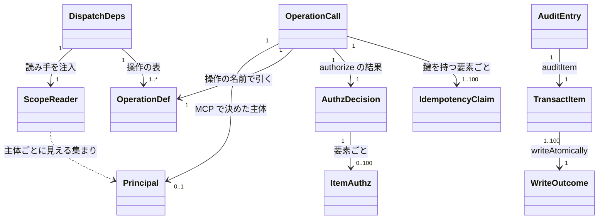

# 詳細設計: 横断の部品が 1 か所にあり、画面・API・MCP の要求が同じ振り分けで同じ判定と記録を通る

次の項目を、モジュールと関数の粒度へ下ろす。

| 設計 | 受ける項目 |
| --- | --- |
| [全体の設計](overview.md) | 不変条件 I2・I4・I5・I8・I9・I12〜I15 |
| [プラットフォーム](platform.md) | 「横断の部品と定数の置き場」「アーキテクチャ」 |
| [API と MCP](api.md) | 「呼び出しの規約」「認証と主体」「認可」「操作の記録」「形の正本」 |

扱うのは、リポジトリのモジュールの置き場と依存の向き、横断の部品の最上位の関数の仕様・異常系・並行と排他・記録の出し方・テストの観点である。
各コンテキストのモジュール（利用者とチーム・プロジェクト・実行の制御ほか）の関数と、横断の部品の形の細部（ファイルの単位・型の項目の並び）は、ここでは決めず、下の受け持つ子の課題が詳細設計を書く。

## 受け持つ子の課題

この文書が持つのは横断の部品（`packages/core/`）だけで、ほかの置き場の詳細設計は次の子の課題が書く。全体の設計が「詳細設計が持つ」と回した中身は、この表の子の課題か、この文書の節が受ける。

| 置き場 | 中身 | 受け持つ子の課題 |
| --- | --- | --- |
| `packages/core/`・`packages/contracts/` | 横断の部品・操作の表の枠・サービスの表の列と索引・表の移し | detail.md（この文書）と #2 |
| `apps/runner/` | ランナー | #6 |
| `apps/nd-runtime/` | nd ランタイム | #7 |
| `apps/db-prep/` | DB の用意 | #13 |
| `apps/api/src/entries/` の見回り | 見回りの起点と予定。処理ごとの中身は持ち主の子（失効のやり直し #5・マシンの途切れ #7・送達のやり直し #8） | #6 |
| `apps/api/src/entries/` の知らせの送り手・`apps/api/src/modules/` の知らせ | 知らせ | #8 |
| 要素の項目・型・理由のコード | 操作ごとの形の正本 | [API の文書の操作の一覧](api.md#操作の一覧) の受け持つ子の表 |
| 設定のファイルのキー | 読む構成要素ごとのキー | [プラットフォームの文書の環境の値の受け方](platform.md#環境の値の受け方) の表 |

## ファイル配置

省く: ファイルの単位の配置は決めず、置き場をディレクトリの単位で決める。モジュールの置き場と依存の向きは「クラスと関数の構造」にある

## クラスと関数の構造

横断の部品の型の関係と多重度は次のとおりである。型だけを描き、項目の並びは描かない（項目は [内部のデータと定数](#内部のデータと定数)）。型の名前はコードの型の名前と照らすため識別子のまま載せる。操作の表の型は [形の正本](api.md#形の正本) のクラス図、配置は [コンテナの図](platform.md#コンテナの図) にある。



モジュールの置き場はディレクトリの単位で決める（`*` は新設）。

```text
nd-factory/
├── packages/
│   ├── contracts/          形の正本。操作の表・値の形・設定の形・終了コード・生成
│   │   ├── src/
│   │   ├── data/           事実と方針のデータ（料金プラン・再試行の方針・秘密の形・終了コード）
│   │   ├── schema/         生成した JSON Schema と OpenAPI
│   │   └── scripts/        生成のスクリプト
│   └── core/             * 横断の部品（時計・ID と冪等の鍵・ログと伏せ字・外部の呼び出しと再試行・
│       └── src/              条件つきの書き込み・認証・認可の判定・使える量の判定・操作の記録の書き手・操作の振り分け）
├── apps/
│   ├── api/                API と MCP の 1 つの関数・見回り・知らせの送り手・表の移し
│   │   └── src/
│   │       ├── entries/  * Lambda ごとの起点（api-fn・patrol・notifier・migrate）
│   │       └── modules/  * コンテキストごとのモジュール（操作のハンドラーと、認可の判定へ渡す読み手）
│   ├── web/                画面
│   ├── runner/           * ランナー（ECS のタスクと手元のコンテナで同じものが動く）
│   ├── nd-runtime/       * nd ランタイム（手元のマシンで動く）
│   └── db-prep/          * DB の用意（ECS のタスク。claude と NDF を含まない）
├── infra/                  CDK のスタックと設置のコマンド
│   ├── bin/
│   ├── lib/
│   ├── setup/
│   └── test/
└── tools/                  検査
    ├── ref-check/          参照の検査
    ├── checks/           * 漏れ・境界・使える量の判定の外の比べ・I14 の対応・NDF の契約の照合
    └── test/               CI の定義のテスト
```

依存は一方向で、循環を持たない。

| 置き場 | 依る先 | 決まり |
| --- | --- | --- |
| `packages/contracts` | zod だけ | ほかに何にも依らない |
| `packages/core` | `packages/contracts` だけ | 各コンテキストの表の行を読む所（席・割り当て・委任・マシン・レーン）は、`core` が読み手の型（ポート）だけを持ち、`apps/api/src/modules/` が中身を渡す。これで `core` から `apps` への向きの依存を作らない |
| `apps/api`・`apps/runner`・`apps/nd-runtime`・`apps/db-prep` | `packages/core` と `packages/contracts` | `apps/*` どうしは互いに import しない（ランナーと API は HTTP の経路だけでつながる） |
| `apps/web` | `packages/contracts` と、`packages/core` のうちブラウザーで動くモジュール（`clock`・`ids`・`redact`・`log`）だけ | — |
| `infra` | `packages/contracts` | `apps/*` を import せず、起点のファイルのパスをアセットとして束ねるだけにする |
| `tools` | `packages/contracts` | ほかの置き場のコードを文字として読む |

| 置き場 | モジュール | 最上位の関数 |
| --- | --- | --- |
| `packages/contracts/` | 操作の表・値の形・ID の頭・理由のコード・設定の形 | 生成のスクリプトの関数。操作の定義の型 `OperationDef` を `core` へ出す |
| `packages/core/` | `clock` | `createClock`（新設） |
| `packages/core/` | `ids` | `newId`・`parseId`（新設） |
| `packages/core/` | `idempotency` | `claimIdempotency`・`settleIdempotency`（新設） |
| `packages/core/` | `redact` | `redact`（新設） |
| `packages/core/` | `log` | `createLogger`（新設） |
| `packages/core/` | `retry` | `classifyFailure`（新設） |
| `packages/core/` | `outbound` | `callHttp`・`awsClient`（新設） |
| `packages/core/` | `conditional-write` | `putIfAbsent`・`replaceIfVersion`・`deleteIfVersion`・`writeAtomically`（新設） |
| `packages/core/` | `auth` | `authenticate`・`verifyLoginToLink`・`idempotencyPrincipalKey`（新設） |
| `packages/core/` | `authorize` | `visibleProjectIds`・`authorize`（新設） |
| `packages/core/` | `usage-limit` | `judgeUsage`・`usageAddItem`（新設） |
| `packages/core/` | `audit` | `auditItem`・`appendAudit`（新設） |
| `packages/core/` | `dispatch` | `readHttpCall`・`readMcpCall`・`createMcpHandler`・`createMcpServer`・`serveMcp`・`dispatch`・`writeHttpResponse`・`writeMcpResponse`（新設） |
| `apps/api/src/entries/` | API と MCP の 1 つの関数の起点・見回り・知らせの送り手・表の移し | 起点の関数（HTTP は `readHttpCall` → `dispatch` → `writeHttpResponse`、MCP は `readMcpCall` → `serveMcp` を呼ぶだけ。`serveMcp` は SDK へ渡す前に `authenticate` で主体を決め、実行環境ごとに 1 回作った `createMcpHandler` のハンドラーへ渡す。ハンドラーは要求ごとに `createMcpServer` でサーバーを作り、`tools/call` の道具の処理の中で決めた主体のまま `dispatch` → `writeMcpResponse` を呼ぶ。`dispatch` を通らなかった応答は、返す前に `serveMcp` が `appendAudit` で要約の行を書く） |
| `apps/api/src/modules/` | コンテキストごとのモジュール | 操作ごとのハンドラーと、`authorize` へ渡す読み手 |
| `apps/web/` | 画面 | 画面ごとの関数（[画面](screens.md)） |
| `apps/runner/` | ランナー | ランナーの関数。API への送信は `callHttp` を通す |
| `apps/nd-runtime/` | nd ランタイム | nd ランタイムの関数。API への送信は `callHttp` を通す |
| `apps/db-prep/` | DB の用意 | DB の用意の関数。API への送信は `callHttp` を通す |
| `infra/` | スタックと設置のコマンド | スタックの構築子と設置のコマンドの関数。`packages/core` の関数を使わない |
| `tools/checks/` | 足す検査 | 検査の関数。境界の検査は [プラットフォームの横断の部品の置き場の基準](platform.md#横断の部品の置き場の基準) の「置き場の外で直に使わないもの」を、`apps/` の 5 つの置き場の実行時のコードでだけ探す。`packages/core` は部品の置き場そのもので、`infra/`・`tools/` は組み立てと反映の時だけ動くため対象から外す（プラットフォームの決定 91） |

境界の検査の対象は、実行の時に動くコード（`apps/` の 5 つの置き場）である。`infra/` と `tools/` は組み立てと反映の時だけ動くため、対象から外す。`infra/setup/` は AWS SDK のクライアントを直に作ってよい。

## 関数の仕様

型の名前（`Clock`・`Principal`・`TransactItem` など）の中身は「内部のデータと定数」にある。

| 関数 | 置き場 | 種類 | シグネチャ | 責務 1 文 | 事前条件 | 事後条件 | 副作用 |
| --- | --- | --- | --- | --- | --- | --- | --- |
| `createClock` | `packages/core`（`clock`） | 新設 | `(source?: () => number) => Clock` | 今の時刻を UTC で返す時計を作り、テストで時刻の元を差し替えられるようにする | `source` は UNIX のミリ秒を返す | `now()` は `Date`、`iso()` は末尾 `Z`・ミリ秒 3 桁の RFC 3339、`epochMs()` は UNIX のミリ秒の数（`newId` の時刻・TTL・経過の時間の計算に使う）を返す。同じ時計から得た値は、3 つの読み口をどう混ぜて呼んでも減らない（元が戻っても前に返した値を下回らない） | 無し |
| `newId` | `packages/core`（`ids`） | 新設 | `(kind: IdKind, clock: Clock) => Id` | 種類の頭と UUIDv7 から ID を作る | `kind` は形の正本の ID の頭の集まりの 1 つ（型で弾き、実行の時も照らして外れは例外にする） | 戻り値は `<頭>_<UUIDv7>` の小文字で、時刻の順に並ぶ。バイト列は `uuid` の `v7` に `msecs`（`clock` のミリ秒）と `seq`（下の単調性の状態）を渡して組む。単調性の状態（前のミリ秒と連番）は `newId` が実行環境ごとに持ち、時計が進めば連番を乱数から取り直し、進まないか戻れば前のミリ秒のまま連番を 1 足し、連番があふれたらミリ秒を 1 進める。乱数は `uuid` の乱数（`node:crypto`）だけから取る | 無し |
| `parseId` | `packages/core`（`ids`） | 新設 | `(kind: IdKind, value: string) => Id \| null` | 受けた ID が指定の種類の形かを照らす | 無し | 頭と UUIDv7 の形が合えば値を、合わなければ `null` を返す（呼び手は 404 と同じに扱う） | 無し |
| `claimIdempotency` | `packages/core`（`idempotency`） | 新設 | `(db: Db, claim: IdempotencyClaimInput, clock: Clock, log?: Logger) => Promise<IdempotencyClaim>` | 主体・操作・鍵の組の 1 回目を押さえ、2 回目以降に前の結果か状態を返す | `claim.fingerprint` は要素の正規化した JSON の SHA-256 | 戻り値は `fresh`（押さえた。書いた借りの行を持つ）・`replay`（前の要素の結果）・`in_progress`（他が処理中）・`reused`（中身が違う）のどれか。`fresh` のとき冪等の表に借りの行がある。行の照らしは指紋を借りの期限より先に行い、中身が違えば借りの状態と期限によらず `reused`（24 時間を過ぎて表の期限の消しを待つ行だけは、無い行と同じに取り直す）。取り直しは読んだ `version` を条件にした借りの行全体の置き換え（[行の書き手の設計](../../issues/issue-2-design-row-writers.md) の決定 7） | DynamoDB の `db-idempotency` への条件つきの書き込みと強い整合の読み |
| `settleIdempotency` | `packages/core`（`idempotency`） | 新設 | `(leased: IdempotencyRow, result: ItemResult, op: Pick<OperationDef, "onceOnly">, clock: Clock) => TransactItem` | 借りの行を「済み」と要素の結果へ書き換える書き込みを組む | `leased` は `claimIdempotency` が `fresh` で返した借りの行 | 戻り値は済みの行全体を、借りの行の `version` と `incarnation` を条件に置き換える `replaceIfVersion` の 1 件（取り直されれば `version` が、手放しや表の期限の後に同じ鍵で借り直されれば `incarnation` が変わるため、持ち主の条件を含む）。1 回だけ返す値は、操作の定義の `onceOnly` が指す場所（`item.token` など）だけを結果から `null` に替えて控え、ほかの値は名前によらず値のまま控える | 無し |
| `redact` | `packages/core`（`redact`） | 新設 | `(value: unknown) => unknown` | 値の木を写し、秘密の鍵の名前と秘密の形の値を伏せる | 無し | 戻り値に、秘密の形のデータに当たる鍵の値と、秘密の形に当たる文字列が残らない。元の値は変えない。循環は `"[cycle]"` に替える | 無し |
| `createLogger` | `packages/core`（`log`） | 新設 | `(context: LogContext, sink?: (line: string) => void) => Logger` | 要求の ID などの文脈を持った、JSON の 1 行を出すログの書き手を `pino`（LIB93）で作る | `context` は `request_id`・`fn`・`endpoint` をすべて持つ（型で弾く。画面は自分が呼ぶ受け口の名前を渡す） | `Logger.info`・`warn`・`error` は、`pino` の `formatters.log` と `hooks.logMethod` で文脈と項目と文を `redact` に通して 1 行の JSON にし、`sink` へ渡す。`Error` の値は `redact` が `name` と文だけの素の物に替え、Node の `pino` が `err` の鍵に掛ける標準のエラーの直列化（`type`・`stack` を足す）は `serializers` で止める。ブラウザー版は直列化を掛けないため、どちらの出力も `redact` の写しのままでそろう。`child` は渡した項目を伏せた写しにして持ち、項目を読めない（読むと投げる getter など）ときは投げずに親のロガーのまま続ける。どの呼び出しも呼び手へ例外を投げない | 標準出力へ 1 行を書く（Lambda では CloudWatch Logs へ届く） |
| `classifyFailure` | `packages/core`（`retry`） | 新設 | `(e: unknown) => FailureClass` | HTTP の状態・`ky` の誤り・AWS SDK の例外の名前・ネットワークの誤りを 5 つの分類に分け、呼び手が結果の扱い（409・404・503 など）を決められるようにする。再試行の判断には使わない（再試行は `ky`・AWS SDK・`p-retry` の設定が持つ） | 無し | 戻り値は `retryable`（一時の失敗。時を置けば通り得る。ライブラリが繰り返せる要求では再試行を使い切った後。冪等でない要求の 408・500・502・503・504・時間切れのように、届いたか分からず繰り返さない失敗もこれに入り、繰り返すかは呼び手が決める）・`conflict`・`not_found`・`rejected`・`unknown` のどれか | 無し |
| `isRetryableCancellation` | `packages/core`（`retry`） | 新設 | `(e: unknown) => boolean` | `TransactionCanceledException` の取り消しの理由に一時の失敗（`TransactionConflict`・`ThrottlingError`・`ProvisionedThroughputExceeded`・`RequestLimitExceeded`）があり、断った理由（`ValidationError`・`ItemCollectionSizeLimitExceeded`）が無いかを返す（断った理由が並ぶ取り消しは送り直しても同じ件で断られるため偽）。AWS SDK はトランザクションの取り消しを繰り返さないため、`writeAtomically` の `p-retry` が繰り返す対象をこれで決める（`classifyFailure` と同じ理由の集まりを使う） | 無し | 真か偽 | 無し |
| `callHttp` | `packages/core`（`outbound`） | 新設 | `(req: OutboundRequest, policyName: HttpPolicyName, deps: OutboundDeps) => Promise<OutboundResult>`（`HttpPolicyName` は方針のデータのうち種類が `http` の方針の名前だけの型） | 外への HTTP の呼び出しを `ky`（LIB91）で、時間切れ・再試行・分類つきで行う | `req.url` は `https:`。`req.idempotent` を呼び手が決めている | 戻り値は状態・頭書きの一部・本文と分類。再試行の回数・`Retry-After` の上限・待ちの上限・要求ごとの時間切れ・全体の期限は、方針のデータの値を `ky` の設定（`retry`・`timeout`・`totalTimeout`）へ渡す。`throwHttpErrors` は既定の真のままにする（偽にすると `ky` は 2xx でない応答を成功と見て再試行しない）。手順は次の 4 つである。(1) `retry` は `limit`・`backoffLimit`・`maxRetryAfter` を方針から、`methods` を全ての方法（冪等かは方法でなく `req.idempotent` で決める）、`statusCodes` を 408・429・500・502・503・504、`afterStatusCodes` を 429・503、`retryOnTimeout` を `req.idempotent` にする。(2) 冪等でない要求は `shouldRetry` で、届かなかったと分かる失敗（接続の拒否の `NetworkError`・429 の `HTTPError`）だけに真、ほかに偽を返す。冪等な要求は `shouldRetry` を置かず、`ky` の既定の判断に任せる。(3) 2xx の応答は本文を `ky` の再試行の中（`afterResponse` の hook）で読み切り、`OutboundResult`（分類 `ok`）にする。本文の読み取りには、その試行の残りの期限（方針の `timeout_ms` を試行の `fetch` を呼んだ時点から数え、頭書きまでに使った時間を引いた残り）を掛ける。頭書きと本文の合計が `timeout_ms` を超えた試行は時間切れとする。試行の期限は実時間のタイマーで測り、注入の時計（`deps.clock`）には頼らない。本文を終わりまで読み切ったときだけ `ok` にし、期限切れでは hook が持つ読み手を取り消して本文の流れを閉じる。全体の期限（`totalTimeout`）は `ky` が hook にも掛ける。全体の期限で本文の読み途中に抜けた場合も、`callHttp` は本文を読む読み手を取り消す（`fetch` が中断を本文の流れへ伝えないと、`ky` による写しの取り消しは読み手の錠で失敗し、読み取りと元の流れが残るため）。本文の時間切れと読み取りの誤り（接続の切断）は、冪等な要求なら `ky.retry` で残りの回数を使って繰り返し（`beforeRetry` のログは包みの中の失敗の名前と分類で書く）、冪等でない要求なら 2xx を受けて届いているため繰り返さずに `TimeoutError`・`NetworkError` として状態 0 の `retryable` で返す。`ky` の読み口（`.text()`）は再試行が終わった後に読むため、そこで時間切れになると冪等な要求でも残りの回数を使えない。転送には自動で従わず（`redirect: "manual"`。`https:` の相手が `http:` へ 307・308 を返すと本文が平文で送り直され得る）、3xx は `location` を付けた結果（分類 `rejected`。繰り返さない）で返す。転送先へ送り直すか（`location` の `https:` を照らし、呼び手が `callHttp` を呼び直す）・304 を済みとみなすかは呼び手が状態と頭書きを読んで決め、`callHttp` は転送に従わない。(4) 再試行を使い切った 429・5xx と、再試行しない 4xx は `HTTPError` として届くため、`callHttp` が捕まえて `error.response` の状態と頭書きの一部、`error.data`（`ky` が読んだ本文）から `OutboundResult` に組み、分類は `classifyFailure` で付ける（例外にしない）。時間切れ（`TimeoutError`）とネットワークの誤り（`NetworkError`）も同じく `OutboundResult`（状態 0）にする | 外部への HTTPS の要求（GitHub・IdP の鍵・Web Push・Slack・ランナーから API） |
| `awsClient` | `packages/core`（`outbound`） | 新設 | `<C>(Client: new (config: AwsClientConfig) => C, policyName: AwsPolicyName) => C`（`AwsPolicyName` は種類が `aws` の方針の名前だけの型） | AWS SDK のクライアントを、方針のデータの再試行の設定と時間切れで作る | `Client` は SDK のクライアントの class（`DynamoDBClient` など）。地域・資格情報・端点は渡さず、SDK が実行環境（`AWS_REGION`・`AWS_ENDPOINT_URL_*` など）から読む | 戻り値のクライアントは `retryMode`（`standard`）・`maxAttempts`・要求ごとの期限が方針のデータの値。期限は要求 1 回の全体（接続から本文の読み終わりまで）に掛け、過ぎた要求を `TimeoutError` で切る（SDK は一時の失敗として繰り返す）。Smithy の `requestTimeout` は `throwOnRequestTimeout` を真にしても応答の頭書きを受け取ると解かれ、頭書きの後に本文が止まる相手を待ち続けるため、`requestHandler` には Node の扱い手（`NodeHttpHandler`）を包み、本文の流れが閉じるまで期限を掛ける扱い手（`DeadlineHttpHandler`）を渡す。期限のタイマーはイベントループを保たない（`unref`）。呼び手が本文を読まずに捨てると流れが閉じず期限まで残るため、短く生きる Node のプロセス（設置のコマンドなど）の終わりを引き止めない。読み途中の要求はソケットがイベントループを保つため、期限は変わらず効く。本文を読み終えずに返す呼び出し（S3 の `GetObject` などの流れの本文）には使わない（期限で流れの本文が `TimeoutError` で切れる。この挙動はテストで固め、流れの本文を返すクライアントを包む変更が気づかれるようにする）。包むのは DynamoDB・ECS・Secrets Manager・STS で、どれも本文を読み終えて返す。再試行は SDK の組み込み（待ちの上限と全幅のゆらぎ・呼びすぎの扱いを含む）に任せる。同じ class と同じ方針の名前の 2 回目は同じクライアント（同じ `DeadlineHttpHandler` とソケットの束）を返す。控えは class と方針の名前の組で引く。class はモジュールの読み込みで 1 つに決まるため、呼び手が呼び出しの場で書いても控えが効く（構築子を包む関数を鍵にすると、呼び出しの場で書いた関数は呼ぶたびに別の鍵になり、クライアントと扱い手を作り直す） | 無し |
| `putIfAbsent` | `packages/core`（`conditional-write`） | 新設 | `(spec: { table: TableName; item: Row; onConflict: ConflictRule }) => TransactItem` | 行が無いときだけ足す書き込みを組む | `item` は `pk`・`sk`・`schema_version` を持つ | 戻り値は `attribute_not_exists(pk)` を条件にした 1 件で、外れたときの扱い（`state_mismatch`・`return_existing` など）を持つ。記録の表を除くどの表でも、`version` の有無によらず新しい `incarnation`（UUID v4）を足した行を置き、戻り値の `item` に載せる（[行の書き手の設計](../../issues/issue-2-design-row-writers.md) の決定 8） | 無し |
| `replaceIfVersion` | `packages/core`（`conditional-write`） | 新設 | `(spec: { table: TableName; item: Row; version: number; incarnation: string; expect: { version: Stored; incarnation: Stored }; extra?: Condition; onConflict: ConflictRule }) => TransactItem` | 読んだときに保存してあった版と行の世代（`incarnation`）と同じときだけ、行を読んだ行から作った行全体で置き換え、版を 1 つ上げる書き込みを組む（[行の書き手の設計](../../issues/issue-2-design-row-writers.md) の決定 1・8） | `version` と `incarnation` は読み手の見る形の値（`version` は 1 以上の整数）、`expect` は行の版の読み手（`readRow`）の `stored` の値（保存してあった値そのもの。列が無ければ `absent`）。`item` は行の版の書き手（`rowReplaceOf`）の戻り値で、`version` と `incarnation` を持たない | 戻り値は `attribute_exists(pk)` と `expect` の列ごとの一致（`absent` なら `attribute_not_exists`）を条件にし（と `extra`）、`version + 1` と `incarnation` を足した `item` を置く `Put` の 1 件。`attribute_exists(pk)` は `expect` によらず必ず入れ、読んだ後に消えた行を古い中身で作り直さない。`repair` が `incarnation` を補った行は移しの前でも書け、同じ鍵で作り直した行は外れる。行の列の一部だけを書き換える書き込みは作らない | 無し |
| `deleteIfVersion` | `packages/core`（`conditional-write`） | 新設 | `(spec: { table: TableName; key: RowKey; expect: { version: Stored; incarnation: Stored }; extra?: Condition; onConflict: ConflictRule }) => TransactItem` | 読んだときに保存してあった版と行の世代と同じときだけ行を消す書き込みを組む | `expect` は `readRow` の `stored` の値 | 戻り値は `replaceIfVersion` と同じ `attribute_exists(pk)` と `expect` の条件（と `extra`）の `Delete` の 1 件 | 無し |
| `writeAtomically` | `packages/core`（`conditional-write`） | 新設 | `(db: Db, items: readonly TransactItem[], log?: Logger) => Promise<WriteOutcome>` | 組んだ書き込みを 1 つのトランザクションで確定し、外れた条件を件ごとの扱いへ訳す | `items` は 1〜100 件で、同じ行を 2 回指さない | `ok` のとき全件が書かれている。`conflict` のときどれも書かれておらず、外れた件の番号と扱いを返す | DynamoDB の `TransactWriteItems`（表をまたいでよい） |
| `authenticate` | `packages/core`（`auth`） | 新設 | `(req: InboundRequest, deps: AuthDeps) => Promise<AuthResult>` | 受け口の種類と token の種類から、要求の主体を 1 つに決める | `req.endpoint` は受け口（`user`・`mcp`・`runner`・`machine`・`github`・`db_prep`。受けた HTTP の経路の頭で決まる）。`req.operation` は `dispatch` が受けた経路を操作の表で引いて検証した操作の名前（表に無い経路は呼ぶ前に 404。本文と頭書きから採らない）。`deps` は鍵と読み手を持つ | 戻り値は `{ ok: true; principal; sessionRevokedAt }`（主体は人・まだ結んでいない人（`newcomer`。`req.operation` が `sessions.create` のときだけ）・委任・ランナー・手元のマシン・GitHub・DB の用意のタスク。`sessionRevokedAt` は `req.operation` が `sessions.delete` で取り消しの行があったときだけその `revoked_at`、ほかは `null`）か、`unauthorized`・`session_ended`（検証を通した token のセッションが既に断たれている。[API の文書の 401 の本文](api.md#誤りの形)）・`unavailable`。受け口に合わない token は `unauthorized`。型は [#2 の詳細設計の `InboundRequest`・`AuthResult`](../../issues/issue-2-design-detail.md) | IdP の公開鍵の取得（`aws-jwt-verify` の組み込みの控え `SimpleJwksCache` が HTTPS で取り、実行環境の中で控える）・DynamoDB の強い整合の読み・委任の最後に使った時刻の条件つきの更新 |
| `verifyLoginToLink` | `packages/core`（`auth`） | 新設 | `(loginToken: string, expected: { idp: "google" \| "github"; startedAt: number }, deps: AuthDeps) => Promise<{ ok: true; login: CognitoLogin; accountLabel: string } \| { ok: false; reason: "link_invalid" \| "already_linked" \| "account_unidentifiable" \| "unavailable" }>` | `logins.create` で、つなぐログインの access token を照らし、つなぐ主体を得る | 要求の Authorization は今の利用者として `authenticate` が別に決める（人だけ）。`loginToken` は要求の本文から受けない。連携は次の手順で今の利用者とセッションに結ぶ。(1) 画面が選んだ IdP で `login_links.create` を呼ぶ。ハンドラーは `code_verifier`（32 バイトの乱数の base64url）と流れの ID（UUID）を作り、[ログインをつなぐ流れの行](data.md#ログインをつなぐ流れの行)（今の利用者・要求の主体の Cognito の `sub`・セッションの識別子 `sessionId`（検証した token の `origin_jti`）・開始元の対応の行の `bound_auth_time`・IdP・`code_verifier`・作った時刻 `created_at`・作ってから `LOGIN_LINK_TTL_MS` の期限）を `open` で書き、Cognito の認可の端点の URL を返す。URL は `response_type=code`・`client_id`（画面のアプリのクライアント。シークレットを持たない公開クライアント）・`redirect_uri`（連携専用の戻り先 `<画面のオリジン>/me/logins/return`。通常のサインインの戻り先 `/` と分ける）・`scope=openid`・`state`（流れの ID）・`code_challenge`（`code_verifier` の S256）・`code_challenge_method=S256`・`identity_provider`（選んだ IdP の Cognito での名前。設定で `google`・`github` から当てる。Cognito の選びの画面を通さない）・`prompt` を持つ。`prompt` は IdP ごとに設定で決める値で、Google は `prompt=select_account`（Cognito は `prompt` を IdP へ渡し、Google が文書にする値は `none`・`consent`・`select_account` で `login` を含まないため、アカウントの選びの画面を出させる値にする。[Google の OIDC の認可の要求の値](https://developers.google.com/identity/openid-connect/openid-connect#authenticationuriparameters)）、GitHub は `prompt=login`（Cognito の既存のブラウザーセッションを使わず、選んだ IdP で認証し直させる）にする。どちらの値でも、Cognito か IdP が流れを始める前のサインインを返したときは、下の `expected.startedAt` の照らしが `link_invalid` で断つ。(2) 画面は返った流れの ID と、この流れの `logins.create` の交換と確定の 2 つの要素の `idempotency_key`（ここで作る 2 つの UUID）を、開始元の利用者の ID・開始元のセッションの指紋（`sub` と `origin_jti` をつないだ SHA-256。[画面の文書のサインアウトの途中の印](screens.md#サインアウトで消す) と同じ作り方）・控えの期限（始めてから `IDEMPOTENCY_TTL_SECONDS`。冪等の鍵と `used` の流れの行の残る長さ）とともに `sessionStorage` に控え、今の利用者のセッションを持ったまま、同じブラウザーでその URL へ移る。(3) 画面は起動のとき、通常のサインインの戻り（`/` の `code` と `state`。`signinRedirectCallback`）より先に連携の戻り先 `/me/logins/return` を見て、そこで受けた `code` と `state` は `signinRedirectCallback` へ渡さない（連携の `state` はサーバーが作り、通常のサインインの状態の控えに無いため）。控えを使う前に（戻りを受けたとき・読み直しの後に送り直すとき）、控えの利用者の ID とセッションの指紋が端末の今のログインの控えと同じで、控えの期限の前であることを照らし、外れた控えは送らずに消す（サインアウトした後・別の利用者がサインインした後・期限を過ぎた控えから送らない）。戻りの検索の値が `error` を持つか `code` を欠くとき（利用者が IdP で同意を断った・IdP か Cognito が認可の誤りを返した。[Cognito の認可の端点の誤りの応答](https://docs.aws.amazon.com/cognito/latest/developerguide/authorization-endpoint.html)）は、`state` の合否によらず交換の要素を送らず、履歴を `/me` へ置き換えて検索の値を消し、このタブの連携の控えを消して、元のセッションのまま R14 を出す（`error=access_denied` なら「つなぐのをやめました」、ほかは「つなげませんでした。もう一度つなぐ操作を始めてください」。`error_description` は画面に出さずログにも残さない）。流れの行は `open` のまま期限で使えなくなる。これは控えを消す終端の 1 つである。`error` が無く `code` があり、`state` が控えた流れの ID と同じときだけ、`code` を控えに足し、履歴を `/me` へ置き換えて検索の値を消してから、交換の要素（`state`・`code`・控えた交換の `idempotency_key`）を `logins.create` で今の利用者の token で送る（違えば送らず、控えを消して流れを始め直す案内を出す）。交換の成功は結び付けでなく確かめ待ちで、つなぐ IdP と、そのアカウントを利用者が見分ける表示の名前（利用者プールの属性 `email`。IdP の属性の対応づけで受ける。空にしない）を返す。表示の名前を得られないアカウントは、同じ IdP の複数のアカウントを使う利用者がどれに手段を付けるか確かめられないため、交換の要素で `verified` へ進めずに要素の 409 `account_unidentifiable` にする（確定へ進めない。画面は「このアカウントはメールアドレスを返さないため、つなげません。IdP の側でメールアドレスを共有するか、別のアカウントを選んでください」と出し、控えを消す）。画面はそれを「<IdP> のアカウント <表示の名前> をこの利用者につなぎます」と出し、利用者が「つなぐ」を押したときだけ確定の要素（`state`・`confirm: true`・控えた確定の `idempotency_key`）を送る。表示の名前が空の応答を受けたら、画面は確定の操作を出さない。控えは段（`exchanging`: `code` を足して交換を送る・`confirming`: 「つなぐ」を押して確定を送る）を持ち、画面は「つなぐ」を押したら、確定の要素を送る前に控えの段を `confirming` へ進めて保存し、保存してから送る。読み直しの後は控えの段で分ける。`exchanging` なら交換の要素を同じ `idempotency_key` で送り直し、返った確かめ待ちの結果で確かめを出し直す（利用者がまた「つなぐ」を押すまで確定を送らない）。`confirming` なら確かめを出さずに確定の要素を同じ `idempotency_key` で送り直す。確定を送るのは `confirming` の控えからだけである。「やめる」は控えを消すだけで、流れの行は期限で使えなくなる（意図しないアカウントが返っても、利用者が確かめるまで結ばない）。控えは結果が決まるまで消さない。消すのは、この流れの終わりを表す次の結果を受けたときだけである: 上の認可の誤りかコードの欠けた戻りと、確定の要素の成功と、どちらかの要素の 409 のうち終端の理由 `link_invalid`・`already_linked`・`account_unidentifiable`・`state_mismatch`（どれもこの流れでは結んでおらず、続けられない）。要素の 409 `in_progress` は終端でなく（先の要求がまだ処理中で、確定したかはその要求の結果で決まる）、控え（`code`・冪等の鍵・段）を保持する。どちらの要素も、応答を受けられなかったか、503 か要素の 409 `in_progress` を受けたら、控えたまま同じ要素と同じ `idempotency_key` で送り直す（ページを読み直しても控えから送り直す。確定していれば冪等の鍵が初回の結果を返す）。送り直しの成否は、この流れの確定した結果をハンドラーが流れの行から返す（(4)・(5)。交換は流れの行を `verified` へ、確定は `used` へ書き換え、どちらも行を消さずに、確定した要素の `idempotency_key` と結果を残す。交換の結果（IdP と表示の名前）は `verified` と `used` のどちらの行にも残す）。冪等の鍵の期限の後でも、行が残る間（`verified` は交換から、`used` は確定から `IDEMPOTENCY_TTL_SECONDS`。画面の控えの期限より後まで残る）、同じ流れの ID と同じ `idempotency_key` の送り直しは初回と同じ結果を受ける。交換の送り直しで流れを続けられるのは、交換の結果を流れの行へ保存した後（`verified`・`used` の行から返す）と、交換が Cognito に届かなかったときだけである。Cognito が認可コードを受けて消費した後に、交換の結果を流れの行へ保存する前に失敗するか応答を失ったとき（トークンの端点の応答を失った・`verifyLoginToLink` が `unavailable`・`verified` への書き換えが確定しなかった）は、流れの行は `open` のまま交換の結果を持たず、認可コードは 1 回だけ使えるため、同じ要素の送り直しは Cognito に断られて要素の 409 `link_invalid` になる。この 409 は保存した交換の結果の再送と違い、その流れを続けられないことを表すため、画面は控えを消して「もう一度つなぐ操作を始めてください」と出し、利用者が `login_links.create` から始め直す（新しい流れの ID と認可コードで交換し直す）。画面はこの応答だけで成否を決め、ログインの一覧の増減からは判定しない（別のタブや端末が同じ時に同じ IdP の別のアカウントをつないでも、この流れの成否と取り違えない）。送り直しが返す `link_invalid`・`already_linked`・`account_unidentifiable` は、この流れでは結んでいないことを表すため、理由のとおりの案内を出して控えを消す。控えの `code` は、`code_verifier` をサーバーだけが持つため画面に残っても交換に使えず、流れの行の期限で使えなくなる。(4) 交換の要素: ハンドラーは今の利用者の流れの行を `state` で強い整合で読み、`user_id` が今の利用者・`session_sub` と `session_id` が要求の主体の `cognitoSub` と `sessionId`・`session_bound_auth_time` が要求の主体の `boundAuthTime` であることを照らす（外れは要素の 409 `link_invalid`）。行が `verified` か `used` なら、行の `exchange_idempotency_key` が要素の `idempotency_key` と同じときだけ、行の `exchange_fingerprint` を要素の指紋（`claimIdempotency` の `claim.fingerprint` と同じ、要素の正規化した JSON の SHA-256）と比べ、同じなら行に残した確かめ待ちの結果を返し（書き込みは無い。交換もしない）、違えば要素の 422 `idempotency_key_reused` にする（冪等の行が先に期限で消えた後に、同じ鍵で別の `code` を送った要求へ、元のアカウントの確かめ待ちの結果を返さない。[API の文書の冪等の鍵](api.md#冪等の鍵) の「中身が違う」と同じ答え）。鍵が違えば要素の 409 `link_invalid` にする。`open` なら期限の前であることを照らし（外れは要素の 409 `link_invalid`）、Cognito のトークンの端点へ本文（`application/x-www-form-urlencoded`）で `grant_type=authorization_code`・`client_id`（認可の要求と同じ値）・`code`・`redirect_uri`（認可の要求と同じ値）・その行の `code_verifier` を送って交換する（公開クライアントのため `Authorization` の頭書きは付けない。交換の失敗は要素の 409 `link_invalid`、届かなければ 503）。得た access token と、その行の `idp` と `created_at` をこの関数へ渡す（ID token と refresh token は捨て、画面へ返さない）。この関数が通したら、流れの行を「`state` が `open`、期限の前」を条件に `verified` へ書き換え、`code_verifier` を消し、`exchange_idempotency_key` に要素の `idempotency_key`、`exchange_fingerprint` に要素の指紋、つなぐ主体（`candidate_sub`・`candidate_username`・`candidate_idp`・`candidate_subject`・`candidate_auth_time`）と表示の名前（`account_label`）を書き、`expire_at` を交換から `IDEMPOTENCY_TTL_SECONDS` 後へ延ばす（確定の期限は `expires_at` のまま変えない）。この関数が `account_unidentifiable` を返したら、書き換えずに要素の 409 `account_unidentifiable` にする。ここではまだ結ばない。(5) 確定の要素: 流れの行を (4) と同じく照らす。行が `used` なら、行の `used_idempotency_key` が要素の `idempotency_key` と同じときだけ、行に残した結んだログインで初回と同じ成功を返し（書き込みは無い）、違えば要素の 409 `link_invalid` にする。`open`（交換の前）と期限を過ぎた `verified` は要素の 409 `link_invalid`。開始元の対応の行と取り消しの行は、開始元が要求元と同じセッションのため、`dispatch` が足す要求元の照らしの 2 件が照らす（外れは要素の 409 `state_mismatch`）。期限の前の `verified` なら、ハンドラーはトランザクションの前に行の `candidate_username` で `AdminGetUser` を打ち、利用者があり、返った `sub` が行の `candidate_sub` と同じときだけ進める（利用者が無いか別の `sub` が返れば、交換の後にその候補の Cognito の利用者が消されたため、書き込みを返さずに要素の 409 `link_invalid`。利用者プールに届かなければ 503 `unavailable`。`sessions.create` が利用者プールの読みで `sub` を照らすのと同じに、Cognito の利用者を消した `sub` は結べない）。通れば、行に残したつなぐ主体と今の利用者で、流れの行を「`state` が `verified`、期限の前」を条件に `used` へ書き換えるのと同じトランザクションで結ぶ（`candidate_*` を消し、表示の名前 `account_label` と `exchange_idempotency_key` と `exchange_fingerprint` は交換の送り直しへ初回と同じ確かめ待ちの結果を返すために残し、`used_idempotency_key` に要素の `idempotency_key`、`linked_idp`・`linked_subject` に結んだログインを書き、`expire_at` を確定から `IDEMPOTENCY_TTL_SECONDS` 後へ延ばす。[Cognito の主体の対応の行](data.md#cognito-の主体の対応の行)）。つなぐ主体の対応の行は「無いこと」を条件に書き、このトランザクションで照らし直す（あれば既に結んだ主体）。確定のトランザクションの外れは、IdP の主体の一意の行が既にある（同じ時に別の要求が結んだ）ときは `already_linked`、流れの行・つなぐ主体の対応の行・利用者の行の条件の外れは `link_invalid` にする（どれも始め直せば今の状態で照らし直せる）。Cognito の設定: 利用者プールのドメインに managed login の見た目を割り当てる（`prompt` は managed login でだけ効く。`prompt` はブラウザーが持つ認可の URL の指定で書き換えられるため、サーバーは頼らず、下の開始の時刻と利用者の確かめで照らす）。アプリのクライアントは認可コードの付与と PKCE と token の取り消し（access token が `origin_jti` を持つ）を使い、Google と GitHub の IdPと、許可済みのコールバックの `/`・`/me/logins/return`・`/signed-out`（サインアウトの確かめだけ）を許し、IdP の `email` を利用者プールの属性 `email` へ写す（[プラットフォームの文書の Cognito](platform.md#資源ごとの形) の構成の行が正本）。この設定を反映するまで、画面は連携の IdP を出さず、`login_links.create` は要素の 409 `link_invalid` にする（設定で連携を有効にするのは反映の後）。IdP ごとの連携を有効にする条件には、設置した環境での次の確かめを入れる: Cognito のブラウザーセッションがあり、その IdP で 2 つのアカウントにサインインしたブラウザーで、`login_links.create` が返した URL へ移ると IdP のアカウントの選びの画面（GitHub は認証し直しの画面）が出て、今の結び付きと別のアカウントを選ぶと、交換がそのアカウントを `verified` にして確定でつなげること（`already_linked` の後に案内する「別のアカウントを選び直す」が成り立つこと）。満たさない IdP は連携を有効にしない | 人の token と同じ Cognito の検証を通り、`auth_time` が `LOGIN_BIND_FRESH_MS` の内で、かつ `expected.startedAt`（流れの行の `created_at` を秒に切り捨てた値）以後で（流れを始める前のサインインを、Cognito の既存のブラウザーセッションが返しても通さない）、対応の行が無く、利用者プールから得た IdP が `expected.idp`（流れの行の `idp`。認可の URL の `identity_provider` はブラウザーの側で変えられ、PKCE だけでは開始のときに選んだ IdP を保証しないため照らす）と同じ主体だけを、`username`（検証した token の値）と利用者プールを読んだ IdP の主体と表示の名前（`accountLabel`。属性 `email`。空白を除いて空でない値）とともに返す。ほかの照らしを通っても属性 `email` が無いか空なら `account_unidentifiable`（要素の 409。利用者がどのアカウントかを確かめられないため確定へ進めない）を返す。理由は形の正本の `logins.create` の要素の理由に置く。既に結んだ主体（対応の行がある）は、利用者プールから得た IdP が `expected.idp` と同じときだけ `already_linked`（要素の 409。IdP が自分のセッションで既につないだアカウントを返したときで、画面は IdP で別のアカウントを選び直す案内を出す）。選んだ IdP と違うことは既に結んだことより先に照らし、両方に当たれば `link_invalid` にする（流れを外れた戻りに、選び直しの案内を出さない）。ほかの外れ（検証の外れ・古いサインイン・流れを始める前のサインイン・IdP の主体を引けない・選んだ IdP と違う）は理由によらず `link_invalid`（要素の 409。画面は流れを始め直す）、利用者プールか表に届かなければ `unavailable`（503）。結ぶのは (5) の確定の要素だけである | IdP の公開鍵の取得・DynamoDB の強い整合の読み・利用者プールの `AdminGetUser` |
| `idempotencyPrincipalKey` | `packages/core`（`auth`） | 新設 | `(principal: Principal, operation: string) => string` | 冪等の鍵の主体の部分（`IdempotencyClaimInput.principalKey`）を主体から決める | `dispatch` が冪等の鍵を持つ操作のどの受け口でも `claimIdempotency` の前に呼ぶ | 主体の種類ごとに次の値にし、種類の違う主体の鍵が重ならないようにする（利用者の ID は `usr_` の頭を持ち、ほかは種類の頭を持つ）。人と委任は主体の利用者の ID（[API の文書の冪等の鍵](api.md#冪等の鍵) の「主体の利用者」のまま。委任は委任した人）。ランナーは `LANE#<レーンの ID>#<世代>`（起こし直した後の世代へ前の世代の結果を返さない）。手元のマシンは `MACHINE#<チームの ID>#<マシンの ID>`。DB の用意のタスクは `DBPREP#<プロジェクトの ID>#<用意の ID>`。GitHub は `GITHUB`、見回りは `PATROL`。まだ結んでいない人（`newcomer`）は `sessions.create` の外で呼ばれたら投げる（認可が先に拒むため、届くのは実装の誤り）。この上に `sessions.create` だけの次の決まりを重ねる。`sessions.create` だけは、主体が `newcomer` でも `human` でも検証した Cognito の `sub` と要求の token の `auth_time` の組（`COGNITO#<sub>#<auth_time>`。`newcomer` は `login.cognitoSub` と `login.authTime`、`human` は `cognitoSub` と `authTime`。`human` の `boundAuthTime` は対応の行を結んだサインインの時刻で、既にある利用者がサインインし直した要求とその再送では要求の token の `auth_time` と違うため使わない）にし、初回の書き込みの後に応答を失って送り直した要求（主体は対応の行ができて `human` に変わる。refresh token で取り直しても `auth_time` は変わらない）が初回の確定した結果を引く。外した後にサインインし直すと `auth_time` が変わるため、外す前の結果は外した後の要求へ返らない（作り直した Cognito の利用者が同じ `sub` でも）。`logins.create` だけは、人の主体の利用者の ID に要求のセッションを足した `<利用者の ID>#LINK#<cognitoSub>#<sessionId>#<boundAuthTime>` にする。`dispatch` は保存した結果をハンドラーより先に返すため、利用者の ID だけで区切ると、同じ利用者の別のセッションから同じ要素を送った再送がハンドラーの開始元のセッションの照らしを通らずに、開始元のセッションに限った連携の候補（表示の名前の `email`）を受ける。セッションと結んだ時のサインインの時刻で区切れば、別のセッションの要求は保存した結果を引かずにハンドラーへ届き、流れの行の照らしで要素の 409 `link_invalid` になる | 無し |
| `visibleProjectIds` | `packages/core`（`authorize`） | 新設 | `(principal: Principal, scope: ScopeReader) => Promise<readonly ProjectId[]>` | 主体が今見られるプロジェクトの ID の集まりを求める | `principal` は `authenticate` が返したもの | 人は席を持つチームに今割り当てたプロジェクト、委任は委任した人の範囲と委任の範囲の重なり、ランナーと手元のマシンは自分のレーンのプロジェクトだけ、DB の用意のタスクは token に結んだ用意するプロジェクトだけを返す | 読み手を通した DynamoDB の読み（席・割り当て・レーン） |
| `authorize` | `packages/core`（`authorize`） | 新設 | `(principal: Principal, op: OperationDef, items: readonly unknown[], scope: ScopeReader) => Promise<AuthzDecision>` | 操作の表の印と主体から、要求全体と要素ごとに通すかを 1 か所で決める | `items` は形の正本の検証を通った要素の配列 | 戻り値は要求全体の拒み（`human_only`・`scope_insufficient`）か、要素ごとの `allow`（対象のプロジェクトの ID と席の役割つき）・`404 not_found`・`403 role_insufficient`・`403 human_only` | 読み手を通した DynamoDB の読み |
| `judgeUsage` | `packages/core`（`usage-limit`） | 新設 | `(input: UsageInput, plan: PlanRow) => UsageVerdict` | 料金プランの値と使った量から、始めてよいか・割り当ててよいか・次の区間を起こしてよいかと理由を返す | `input.used` と `input.cap` は同じ形の金額（I15） | 戻り値は `allowed: true` か、`allowed: false` と理由のコード（`monthly_cap_reached`・`place_not_allowed`・`inference_not_allowed`・`concurrency_full`・`currency_mismatch`）と待てば解けるか。プランの名前で分けない | 無し |
| `usageAddItem` | `packages/core`（`usage-limit`） | 新設 | `(current: { raw: Row; row: UsageMonthRow } \| null, team: TeamId, cost: Money, clock: Clock) => { ok: true; item: TransactItem; row: UsageMonthRow } \| { ok: false; onConflict: "state_mismatch" }` | チームの月の使った量の行へ費用を足した行全体を組む（[行の書き手の設計](../../issues/issue-2-design-row-writers.md) の決定 5） | `current` はその月の行を強い整合で読み、行の版の読み手で今の形にした値（無ければ `null`）。`cost.amount_minor` は 0 以上の整数 | 行が無ければ足した行の `putIfAbsent`、あれば読んだ `version` を条件にした `replaceIfVersion` で、どちらも `onConflict: "rebuild"`。通貨が違えば書き込みを組まずに `state_mismatch`。`row` は足した後の行で、使える量の判定に使う | 無し |
| `auditItem` | `packages/core`（`audit`） | 新設 | `(entry: AuditEntry, op: OperationDef \| null, clock: Clock) => TransactItem` | 操作の記録の 1 行を、許した鍵だけを写して組む | `entry` は主体・入口・結果を持つ | 戻り値は記録の表への `putIfAbsent` の 1 件。対象の ID は `op.auditKeys` の鍵の値のうち ID の形のものだけ。本文・秘密・個人情報の値を持たない。区切りの鍵は見られたプロジェクトがあればそのプロジェクト、無ければ主体。主体が `newcomer` のとき: 利用者を作る要素（`sessions.create` の初回）は、ハンドラーが新しく作る利用者の ID を `entry.actor` に人の主体として渡し（`dispatch` がハンドラーの結果から入れ替える）、区切りの鍵もその利用者にして、利用者の行と同じトランザクションに入れる。その要求の要約の行も同じ利用者の ID で書く。利用者を作らなかった要素と要求（未確定・拒否）は、主体の種類 `newcomer` と空の ID で書き、区切りの鍵は主体の無い 401 と同じにする。どちらも `CognitoLogin` の値（Cognito の `sub`・`username`・IdP の主体）を写さない（[API の文書の何を書くか](api.md#何を書くか) の主体） | 無し |
| `appendAudit` | `packages/core`（`audit`） | 新設 | `(db: Db, entry: AuditEntry, op: OperationDef \| null, clock: Clock) => Promise<void>` | 状態を書かない要求（読む操作・断った要求・要求全体の要約）の記録を 1 行追記する | 状態の書き込みを伴う要素の記録には使わない（それは `auditItem` をトランザクションへ入れる） | 戻ったとき記録の表に 1 行がある。書けなければ `AuditUnavailable` を投げる | DynamoDB の `db-audit` への書き込み |
| `readHttpCall` | `packages/core`（`dispatch`） | 新設 | `(event: HttpEvent) => OperationCall \| Problem` | HTTP の要求を、受け口の種類・入口・操作の名前・token・要素の配列を持つ共通の呼び出しへ読む | `event` は HTTP API の要求の形 | 戻り値は呼び出しか、要求全体の誤り（`body_not_json`・`body_not_array`・`body_empty`・`too_many_items`・`duplicate_item`・405）。HTTP の経路は形の正本の HTTP の経路の表だけで引く | 無し |
| `readMcpCall` | `packages/core`（`dispatch`） | 新設 | `(event: HttpEvent, webOrigin: string) => McpCall \| McpReply` | `/mcp` の要求を、SDK へ渡す前に HTTP の段で照らし、通るものを `serveMcp` が受ける形へ替える | `webOrigin` は画面のオリジン | `POST` で `Origin` が合えば、Web 標準の `Request` と token を持つ `McpCall`。`Origin` の違いは 403、`GET` と `DELETE` は 405 の `McpReply`。JSON-RPC の本文は読まない（SDK が読む） | 無し |
| `createMcpHandler` | `packages/core`（`dispatch`） | 新設 | `(ops: readonly OperationDef[]) => McpHandler` | 道具の定義と `@modelcontextprotocol/server`（決定 51・LIB40）の HTTP のハンドラーを、セッションを持たず JSON の 1 応答を返す設定で 1 回だけ作る | `ops` は形の正本の操作の表 | 道具の定義は人だけでない操作を操作の表の順に持ち、名前・出力の形・注記は形の正本から生成する。SDK に登録する入力の形は `{"items": unknown[]}` で、要素の数の上限 `MAX_ITEMS` だけを持ち、要素の形を持たない（要素の形の照らしは `dispatch` が要素ごとに行い、要素の 400 `item_invalid` を HTTP と同じに返すため。要素の形を SDK に渡すと、1 つの要素の誤りで要求全体が `-32602` になる）。ハンドラーは要求ごとに、その要求の `McpContext` を `createMcpServer` へ渡してサーバーを作り、応答の後にそのサーバーを閉じる。ハンドラーと道具の定義は実行環境ごとに 1 回作って使い回し、サーバーは要求をまたいで共有しない | 無し |
| `createMcpServer` | `packages/core`（`dispatch`） | 新設 | `(tools: readonly McpTool[], ctx: McpContext) => McpServer` | 1 つの要求のための SDK のサーバーを作り、道具の処理をその要求の主体のまま `dispatch` へつなぐ | `ctx` は `serveMcp` が決めた主体・要求の ID・`dispatch` を呼ぶ関数を持つ | `initialize`・`tools/list`・知らせ・知らない方法と道具・JSON-RPC の形の誤り・入力の外側の形の誤り（`items` が配列でない・`MAX_ITEMS` を越える）は SDK が答える。`tools/call` は `ctx` の主体と入口「MCP」の印と `arguments.items` を要素にして `dispatch` を呼び、`ctx.dispatched` を立てる | 無し |
| `serveMcp` | `packages/core`（`dispatch`） | 新設 | `(call: McpCall, deps: McpDeps) => Promise<Response>` | `/mcp` の 1 つの要求を、認証 → SDK → `dispatch` を通らなかった応答の記録の順で通す | `call` は `readMcpCall` が通した要求。`deps` は `createMcpHandler` のハンドラー・`AuthDeps`・`Db`・時計・ログを持つ | 認証は SDK へ渡す前に `authenticate`（受け口 `mcp`）で行い、`unauthorized` は 401、`unavailable` は 503 `unavailable` を SDK へ渡さずに返す。通れば主体を `McpContext` に入れてハンドラーへ渡す。`ctx.dispatched` が立たなかった応答（`initialize`・`tools/list`・知らせ・知らない道具・SDK が先に断った要求）は、SDK の応答を返す前に要約の行を 1 件 `appendAudit` で書き、書けなければ SDK の応答を捨てて 503 `audit_unavailable` を返す。`dispatch` を通った応答は `dispatch` が記録を書いたため足さない | 認証の読み・`db-audit` への追記 |
| `dispatch` | `packages/core`（`dispatch`） | 新設 | `(call: OperationCall, deps: DispatchDeps) => Promise<DispatchResult>` | 認証・形の検証・認可・冪等の鍵・ハンドラー・書き込みの確定・操作の記録を、どの受け口でも同じ順で通す | `deps` は操作の表・ハンドラーの表・読み手・`Db`・時計・ログを持つ。`call.principal` があれば（MCP で `serveMcp` が決めた主体）認証を繰り返さずにその主体を使う | 戻り値は要求全体の誤りか、要求と同じ数・同じ順の要素の結果。状態を書いた要素には同じトランザクションに記録の行がある。要求ごとに記録の要約の行がある | 認証と認可の読み・ハンドラーが組んだ書き込みの確定（DynamoDB）・記録の追記 |
| `writeHttpResponse` | `packages/core`（`dispatch`） | 新設 | `(result: DispatchResult) => HttpResponse` | 振り分けの結果を HTTP の応答へ書く | 無し | 要素の結果は 200 と配列、要求全体の誤りは `application/problem+json`。どの応答も `Cache-Control: no-store`。500 を返さない | 無し |
| `writeMcpResponse` | `packages/core`（`dispatch`） | 新設 | `(result: DispatchResult) => CallToolResult` | 振り分けの結果を、SDK が JSON-RPC の応答へ書く道具の結果へ替える | 無し | 要素の結果は `structuredContent` と同じ値の JSON の文字列の `content`。要求全体の誤りは `isError: true` と problem の JSON。JSON-RPC の封筒と HTTP の応答は SDK が組み、`McpReply` は起点が HTTP の応答へそのまま書く | 無し |

ハンドラーは状態を自分で書かない。`dispatch` から要素を 1 つ受け、要素の結果と組んだ書き込みを返す。組んだ書き込みは `putIfAbsent`・`replaceIfVersion`・`deleteIfVersion`・`usageAddItem` の戻り値である。書き換えと消しは、読んだ行の `version` を条件にする（[行の書き手の設計](../../issues/issue-2-design-row-writers.md)）。`onConflict: "rebuild"` の件だけが外れたときは、`dispatch` がハンドラーを呼び直して組み直す（1 つのトランザクションで `DISPATCH_REBUILD_LIMIT` 回まで。使い切れば要求全体の 503 `unavailable`）。確定は `dispatch` が記録の行と冪等の鍵の済みの行と一緒に `writeAtomically` で行う。これで記録の無い状態の書き込み（I9）と、済みにならない冪等の鍵が起こらない。

## 異常系の処理

| 関数 | 失敗 | 原因 | 検出する場所 | 扱い | 利用者に見える出力と終了コード | 後始末と再実行の可否 |
| --- | --- | --- | --- | --- | --- | --- |
| `claimIdempotency` | 同じ組が処理中 | 並んだ 2 つの要求か、前の要求の途中 | 借りの行の条件の外れと、借りの期限の前 | 呼び出し元へ返す | 要素の 409 `in_progress` | 後始末なし。呼び手は待って同じ要素を送り直せる |
| `claimIdempotency` | 中身が違う | 同じ鍵を別の要素に使い回した | 借りの行の `fingerprint` と比べた所 | 呼び出し元へ返す | 要素の 422 `idempotency_key_reused` | 再実行しても同じ。呼び手が新しい鍵を作る |
| `claimIdempotency` | 表に届かない | DynamoDB の失敗・時間切れ | `writeAtomically` と読みの例外 | AWS SDK の再試行（方針 `dynamodb`）の後に呼び出し元へ返す | 要求全体の 503 `unavailable` | 借りの行は書けていないか、書けても期限で取り直せる。再実行できる |
| `createLogger` | 書けない | 標準出力の誤り・値を JSON にできない | `sink` の呼び出しと `JSON.stringify` | 既定値で続ける（JSON にできない値は `"[unserializable]"` に替える。`sink` の例外は捨てる） | 無し（ログの欠けは操作の結果を変えない） | 後始末なし |
| `createLogger` | `child` の項目を読めない | 読むと投げる getter・壊れた物 | `child` の中で項目を伏せた写しにする所 | 投げずに親のロガーを返し、その項目を付けずに続ける | 無し（ログの欠けは操作の結果を変えない） | 後始末なし |
| `callHttp` | 時間切れ（頭書きまでと、2xx の頭書きの後の本文の読み取りの両方） | 相手が遅い・ネットワークの不調（2xx の頭書きの後に本文が止まる・本文の途中で切れるのを含む） | `AbortSignal` の時間切れと、本文の読み取りの期限 | 冪等な要求は `ky` が再試行し（本文の時間切れと途中の切断も `ky.retry` で残りの回数を使う）、冪等でない要求は呼び出し元へ返す（頭書きまでの時間切れは届いたか分からない。本文の時間切れは届いている） | 呼び手が決める。届いたか分からない外への作成は「行う予定」の行に印を残し、作り直さない（[起票の依頼](execution.md#起票の依頼)） | 冪等なら再実行できる |
| `callHttp` | 相手の 408・429・500・502・503・504 | 呼びすぎ・相手の障害・相手の側の時間切れ | 応答の状態 | `ky` が再試行する（`Retry-After` を方針の上限まで守る）。冪等でない要求は 429 だけを繰り返し、408・500・502・503・504 は届いたか分からないため繰り返さない | 使い切るか繰り返さなければ呼び手へ `retryable` の結果 | 冪等なら再実行できる。冪等でない要求は時間切れと同じく呼び手が決める |
| `callHttp` | 相手の 4xx（408・429 を除く）と 501 | 要求の誤り・権限の無さ・相手に無い機能 | 応答の状態 | 繰り返さずに呼び出し元へ返す（`rejected`・`not_found`・`conflict`） | 呼び手が決める | 同じ要求の再実行は同じ結果 |
| `callHttp` | 相手の 3xx（301・302・303・307・308・304 など） | 相手が転送を返した・条件つきの要求で変わっていない | 応答の状態（`redirect: "manual"` のため `ky` が `HTTPError` で返す） | 転送に従わず、繰り返さずに呼び出し元へ返す（`rejected`。頭書きに `location` を付ける）。ログは warn の「3xx を返し、転送に従わずに返した」（「相手が断った」と書かない） | 呼び手が決める。転送先へ送るなら `location` が `https:` であることを照らして呼び直す。304 は条件つきの要求を送った呼び手が済みとみなす。決めていない呼び手は失敗として扱う | 同じ要求の再実行は同じ結果 |
| `callHttp` | 相手のほかの 5xx（505 など） | 相手の想定外の応答 | 応答の状態 | 繰り返さずに呼び出し元へ返す（`unknown`） | 呼び手が決める | 呼び手が決める |
| `callHttp` | `https:` でない URL | 呼び手の誤り | 送る前の照らし | 止める（例外） | API では 503 `unavailable` とログの error | 直すまで再実行しない |
| `writeAtomically` | 条件の外れ | 版の違い・状態の違い・既にある行 | `TransactionCanceledException` の件ごとの理由が `ConditionalCheckFailed` で、別の件に断った理由（`ValidationError`・`ItemCollectionSizeLimitExceeded`）が無い（並ぶときは条件の外れとせず、下の「表が断った」の行で元の例外のまま投げる） | 呼び出し元へ返す（件の番号と `onConflict` の扱い） | 呼び手が要素の 409 `version_mismatch`・`state_mismatch` か、`return_existing` なら前の 1 件の結果にする | 何も書かれていない。読み直して送り直せる |
| `writeAtomically` | 一時の失敗によるトランザクションの取り消し | 同じ行を同時に書く別の要求・書き込みの呼びすぎ | 件ごとの理由が `TransactionConflict`・`ThrottlingError`・`ProvisionedThroughputExceeded`・`RequestLimitExceeded` のどれかで、`ValidationError`・`ItemCollectionSizeLimitExceeded` が無い（`isRetryableCancellation`。AWS SDK はトランザクションの取り消しを繰り返さない） | `p-retry` で再試行（方針 `dynamodb-transaction`） | 使い切れば要求全体の 503 `unavailable` | 何も書かれていない。再実行できる |
| `writeAtomically` | 表に届かない | 呼びすぎ・障害・時間切れ・分からない失敗 | SDK の例外で、`classifyFailure` が `rejected` でない（SDK の再試行を使い切った例外・前の行の再試行を使い切った取り消しと、`unknown` を含む） | 再試行の後に呼び出し元へ返す（`WriteUnavailableError`） | 要求全体の 503（記録の行を含むなら `audit_unavailable`、含まなければ `unavailable`） | 何も書かれていない。`retryable` は冪等の鍵で再実行できる。`unknown`（名前で分けられない 400 など）は届かないのか断ったのか分からず、再実行しても通らないことがある。断ったと分かる名前と取り消しの理由は `rejected` に分けて次の行へ回し、`unknown` を包むのは記録の行を含む書き込みの `audit_unavailable` の判別を残すための代償とする |
| `writeAtomically` | 表が断った | 要求の形の誤り・権限の無さ・資格の誤り・行の形の誤り・項目の集まりの大きさの上限（`ValidationException`・`AccessDeniedException`・`SerializationException`・`ItemCollectionSizeLimitExceededException`・`UnrecognizedClientException`・トランザクションの取り消しの理由の `ValidationError`・`ItemCollectionSizeLimitExceeded`） | SDK の例外で、`classifyFailure` が `rejected` | 繰り返さず、`WriteUnavailableError` に包まずに元の例外のまま投げる（「届かない」と言わない） | 想定しない失敗として、ハンドラーの外側で要求全体の 503 `unavailable` とログの error（[決定 46](api.md#決定-46-呼び手が送り直すかを決められるよう500-を返さず想定しない失敗を-503-にそろえる)） | 何も書かれていない。直すまで同じ結果で、設計の誤りとしてテストが先に落とす |
| `writeAtomically` | 件の数が上限を越える | ハンドラーが組んだ書き込みが多すぎる | 送る前の数え | 止める（例外） | 要求全体の 503 `unavailable` とログの error | 設計の誤りで、テストが先に落とす |
| `writeAtomically`・`Db.transactWrite`・`Db.update` | 記録の表の書き換え・削除・上書きを組んだ | 書き手の誤り | 送る前の照らし（記録の表の件が `attribute_not_exists(pk)` の Put でない）。`writeAtomically` を通らない `Db.transactWrite` の呼び出しも、送る境の `createDb` が同じ照らしで止める。`Db.update` は記録の表（`table === "audit"`）を指せば、条件によらず送る前に止める（既にある鍵への Put は更新と削除の権限を外しても Put の権限で上書きできるため、権限だけに頼らない） | 止める（`AuditAppendOnlyError`。どの件も送らない） | 要求全体の 503 `unavailable` とログの error | 設計の誤りで、テストが先に落とす（I9） |
| `authenticate` | token が無い・形が違う・署名が違う・claim が欠ける・期限切れ（`sessions.delete` は猶予を越えた）・受け口に合わない・`newcomer` の照らしに外れる（`sessions.create` で、サインインから `LOGIN_BIND_FRESH_MS` を過ぎた・利用者プールに利用者が無い・別の `sub` が返る）。署名・claim・期限を通した後にセッションが断たれているときはここに当たらず、下の行（`session_ended`）に当たる | 呼び手の誤りか古い token | 種類ごとの照らし | 呼び出し元へ返す（`unauthorized`） | 要求全体の 401 `unauthorized`（理由によらず同じ本文） | 後始末なし。新しい token で再実行できる |
| `authenticate` | 人の Cognito の access token が署名・claim・期限・受け口の照らしを通し、強い整合で読んだ行でそのセッションが断たれている（取り消しの行がある（`sessions.delete` を除く）・対応の行が無い（`sessions.create` を除く）・対応の行があり `auth_time` が `bound_auth_time` より前） | サインアウト・ログインの外し・結び直しの後の token | 対応の行と取り消しの行の読み | 呼び出し元へ返す（`session_ended`） | 要求全体の 401 `session_ended` | 後始末なし。同じセッションの token では通らない（画面は取り直さずにサインアウトの手順へ移る。`sessions.create` の 401 だけはサインアウトへ移らず、サインインの画面で案内する。[画面の文書の画面ごとの項目の 401](screens.md#画面ごとの項目)） |
| `authenticate` | IdP の公開鍵を取れない・表に届かない | ネットワーク・依存先の障害 | `aws-jwt-verify` の鍵の取得の失敗（組み込みの取り手 `SimpleFetcher` が `responseTimeout` で時間を切り、失敗を 1 回すぐに打ち直す）と読みの失敗 | 呼び出し元へ返す（`unavailable`） | 要求全体の 503 `unavailable`（401 にしない） | 再実行できる |
| `authenticate` | 委任の最後に使った時刻を書けない | 表の失敗・条件の外れ | 委任の使った時刻の行の `putIfAbsent`・`replaceIfVersion` の失敗 | 既定値で続ける（主体は決めたまま） | 無し。ログの warn | 次の要求で書き直す |
| `visibleProjectIds` | 読み手が失敗する | 表に届かない | 読み手の例外 | 呼び出し元へ返す | 要求全体の 503 `unavailable` | 再実行できる |
| `authorize` | 対象が見えない・無い | 割り当ての外・ID の種類の違い・消えた対象 | 対象のプロジェクトの引きと見える集まりの照らし | 呼び出し元へ返す（要素の拒み） | 要素の 404 `not_found`（無い対象と同じ本文） | 後始末なし |
| `authorize` | 委任で人だけの操作・委任の種類が足りない | 呼び手の範囲の外 | 操作の印と委任の範囲の照らし | 呼び出し元へ返す（要求全体の拒み） | 要求全体の 403 `human_only`・`scope_insufficient` | 何も保存しない |
| `authorize` | 役割が足りない・要素だけ人だけ | 席がメンバー・レッドラインに当たる問い | 席の役割と要素の区分の照らし | 呼び出し元へ返す（要素の拒み） | 要素の 403 `role_insufficient`・`human_only` | 後始末なし |
| `authorize` | 読み手が失敗する | 表に届かない | 読み手の例外 | 呼び出し元へ返す | 要求全体の 503 `unavailable`（迷うときは見せない） | 再実行できる |
| `appendAudit` | 書けない | 表に届かない・再試行の使い切り・表が断った（`SerializationException`・取り消しの理由の `ValidationError`（一時の失敗の理由が並ぶときも）など、`writeAtomically` が元の例外のまま投げる失敗も包む） | `writeAtomically` の失敗 | 呼び出し元へ返す（`AuditUnavailable`） | 読む操作は値を返さず要求全体の 503 `audit_unavailable` | 再実行できる。値は渡していない |
| `createMcpServer` | JSON-RPC の形の誤り・知らない方法・知らない道具・道具の入力の外側の形の誤り（`items` が配列でない・`MAX_ITEMS` を越える） | 呼び手の誤り | SDK の要求の読みと、SDK に登録した入力の形の照らし | SDK が JSON-RPC の誤りを返す（形の誤りは `-32700`・`-32600`、知らない方法は `-32601`、知らない道具と入力の誤りは `-32602`）。要素の形はここで照らさない | JSON-RPC の誤りの応答。HTTP の状態は SDK の決まりに従う。`serveMcp` が要約の行を 1 件書く | 後始末なし。呼び手が直して送り直せる |
| `serveMcp` | token が無い・委任の token でない・照らしに外れる | 呼び手の誤りか古い token（Cognito の token を `/mcp` へ送るなど） | SDK へ渡す前の `authenticate` | 呼び出し元へ返す（SDK へ渡さない） | 要求全体の 401 `unauthorized`。主体の無い記録の行を 1 件 | 後始末なし。委任の token で再実行できる |
| `serveMcp` | 認証の依存先に届かない | ネットワーク・依存先の障害 | `authenticate` の `unavailable` | 呼び出し元へ返す（SDK へ渡さない） | 要求全体の 503 `unavailable`。記録の行を試み、書けなくても 503 のまま | 再実行できる |
| `serveMcp` | `dispatch` を通らなかった応答の要約の行を書けない | 表に届かない | `appendAudit` の失敗 | SDK の応答を捨てて呼び出し元へ返す | 要求全体の 503 `audit_unavailable`（道具の一覧などの値を返さない） | 何も書いていない。再実行できる |
| `dispatch` | 要求全体の形の誤り | 本文の誤り | `readHttpCall` の戻り値。MCP の入口では `arguments.items` の空と同じ対象の重なりを `dispatch` が `readHttpCall` と同じ順で照らす | 呼び出し元へ返す | 要求全体の 400 と理由のコード（MCP では `writeMcpResponse` が `isError: true` にする）。記録の行を 1 件書く | 後始末なし |
| `dispatch` | 要素の形の誤り | 要素が操作の形に合わない | 形の正本の zod の検証 | 呼び出し元へ返す（要素ごと） | 要素の 400 `item_invalid` と `fields` | 後始末なし |
| `dispatch` | 全部か無かの操作で 1 つの要素が失敗 | どれかの要素の拒みか条件の外れ | 要素の結果の集め | 呼び出し元へ返す | 失敗した要素はその誤り、ほかの要素は 409 `not_applied` | 何も書かない。直して全体を送り直す |
| `dispatch` | ハンドラーの想定しない例外 | 実装の誤り・依存先の障害 | ハンドラーの呼び出しの外側 | 呼び出し元へ返す | 要求全体の 503 `unavailable`。要求の ID とともにログの error | その要素の書き込みは確定していない。前の要素は確定済みで、冪等の鍵の送り直しで同じ結果が返る |
| `dispatch` | 要素の確定の途中で記録を書けない | 表に届かない | `writeAtomically` の失敗 | 呼び出し元へ返す（残りの要素を処理しない） | 要求全体の 503 `audit_unavailable` | その要素は書かれていない。前の要素は確定済みで、冪等の鍵で再実行できる |
| `dispatch` | 要約の記録の行を書けない | 表に届かない | `appendAudit` の失敗 | 呼び出し元へ返す | 要求全体の 503 `audit_unavailable`。読む操作は値を返さない | 書く要素は要素の記録の行とともに確定済み。冪等の鍵で再実行すると同じ結果が返る |
| `dispatch` | 関数の残り時間が足りない | 要素が多い・依存先が遅い | 要素ごとの前の残り時間の照らし | 呼び出し元へ返す（残りの要素を処理しない） | 要求全体の 503 `unavailable` | 処理した要素は確定済み。冪等の鍵で再実行できる |

## 処理の手順

| 関数 | 条件の組み合わせ | 結果 |
| --- | --- | --- |
| `dispatch` | 受けた方法が `POST` でない | 405。記録の行を 1 件 |
| `dispatch` | `call.principal` が無く、`authenticate` が `unauthorized` か `session_ended` | 要求全体の 401（本文の `reason` は `authenticate` の値）。主体の無い記録の行を 1 件 |
| `dispatch` | `call.principal` が無く、`authenticate` が `unavailable` | 要求全体の 503 `unavailable`。記録の行を試み、書けなくても 503 のまま |
| `dispatch` | `call.principal` がある（MCP の `tools/call`） | `authenticate` を呼ばず、その主体で続ける。主体は同じ要求の中で `serveMcp` が決めたもので、要求をまたいで控えない |
| `dispatch` | 主体の種類が受け口に合わない（例: 人の token で `/mcp`、委任の token で `/v1/runner/…`） | 要求全体の 401（`authenticate` が返す） |
| `dispatch` | 本文の誤り（`readHttpCall` の順: JSON でない → 配列でない → 空 → 101 個以上 → 同じ対象の重なり） | 最初に当たった理由で要求全体の 400 |
| `dispatch` | 操作が人だけ（`always`）で主体が委任 | 要求全体の 403 `human_only`。ハンドラーを呼ばない |
| `dispatch` | 委任の種類（`read`・`run`・`manage`）が操作の印より弱い | 要求全体の 403 `scope_insufficient` |
| `dispatch` | 上を通った要素ごと: 形の誤り → 見えない → 人だけの要素 → 役割 → 冪等の鍵 → ハンドラー | 先に当たったものを要素の結果にする。見えない要素は役割を照らさない（403 で存在を明かさない） |
| `dispatch` | `logins.delete` の要素の「見えない」と役割 | 認可の対象は要素が指すログインの組の行でなく、認証した主体の利用者自身とする（利用者は自分の利用者の行を常に見られ、役割の照らしは無い。`authorize` に渡す読み手は外すログインの行を引かない）。外すログインの組の行の有無は、冪等の鍵の照合（`claimIdempotency`）の後にハンドラーが強い整合で読んで照らし、無ければ要素の 404 `not_found`。外した確定の後は行が消えるため、行の有無を冪等の鍵より前に照らすと、別のログインから外して応答を失った送り直しに、保存した 1 回目の成功でなく 404 を返す |
| `dispatch` | 書く操作の要素で、ハンドラーが書き込みを返した | 書き込み・`auditItem` の要素の行・`settleIdempotency` を 1 つの `writeAtomically` で確定する。主体が人（`human`）で、操作が `sessions.delete` でなければ、同じ `writeAtomically` に要求元の照らしの 2 件（要求元の対応の行を「行があり、`user_id` が主体の利用者・`bound_auth_time` が主体の `boundAuthTime`」で照らす件と、要求元のセッションの取り消しの行が無いことを照らす件。[データの文書の人の書き込みの要求元の照らし](data.md#人の書き込みの要求元の照らし)）を足す。全部か無かの操作は 1 回、要素ごとの操作は要素ごとのトランザクションのそれぞれに足す。`sessions.create` は主体がまだ結んでいない人（`newcomer`）のときは主体が人でないため足さず、既にある利用者（`human`）のときは、ハンドラーが返すのが操作の記録と冪等の鍵の済みの行だけの書き込みでも足す（[データの文書の人の書き込みの要求元の照らし](data.md#人の書き込みの要求元の照らし)） |
| `dispatch` | 要求元の照らしの件と同じ行をハンドラーの書き込みが指す（`logins.delete` が要求元のログインそのものを外す） | 照らしの件を足さず、その書き込みの条件に要求元の条件を AND で足して 1 件にする（ハンドラーは自分の条件だけを書く）。取り消しの行を書くのは除いた `sessions.delete` だけのため、足すのは対応の行の条件だけ |
| `dispatch` | 要求元の照らしの件か、要求元の条件を足した件が外れた | その要素を書かず、操作によらず要素の 409 `state_mismatch`（ハンドラーの `onConflict` の理由より先に当てる）。ほかの件の外れはその件の `onConflict` の理由。外れた件が複数あれば、要求元の照らしの件（要求元の条件を足した件を含む）を先に当て、残りはハンドラーが書き込みに並べた件の順の最初の理由にする（`logins.delete` はログインの組の行・IdP の主体の一意の行・対応の行・利用者の行の順に並べる。[データの文書の Cognito の主体の対応の行](data.md#cognito-の主体の対応の行) の「ログインを外す」） |
| `dispatch` | 読む操作 | ハンドラーの値を集め、`appendAudit` が成功してから返す |
| `dispatch` | 全部か無かの印のある操作 | すべての要素の書き込みを 1 つの `writeAtomically` に集め、要素の失敗が 1 つでもあれば確定しない |
| `authenticate` | 受け口 `user` で、token が 3 つの部分の JWT | Cognito の access token として、`aws-jwt-verify` の Cognito の検証（決定 48・LIB41）で署名（`kid` の公開鍵、RS256）・発行元・`client_id`・`token_use` が `access` を照らし、期限（`exp` は必須）と `nbf` はほかの token と同じく注入した時計だけで照らす（`aws-jwt-verify` は時計を受けず実時刻で照らすため、その照らしを `graceSeconds` を無限にして止める）。ただし `req.operation` が `sessions.delete` のときだけは、`exp` を過ぎた token も、注入した時計で `exp` から `SESSION_DELETE_EXPIRED_GRACE_MS` の内なら期限で断たず、下の照らし（取り消しの行・対応の行）へ進める（期限切れの access token しか持たず、refresh token でも取り直せない端末が、そのセッションの取り消しの行を API の側で確定できるようにするため。この操作が書くのは要求のセッション自身の取り消しの行だけで、ほかの書き込みと読み出しは渡らない）。公開鍵の控えは組み込みの `SimpleJwksCache` と `SimplePenaltyBox` を既定のまま使い、取り手 `SimpleFetcher` に方針 `http-idp-keys` の `responseTimeout` だけを渡す。`username` と `auth_time`（有限の数）と `origin_jti`（空でない文字列）も必須にし、どれかが無いか形が違えば `unauthorized`。これらはどれも署名を検証した後の claim から採り、ヘッダーや本文から採らない。通れば `sub` で [Cognito の主体の対応の行](data.md#cognito-の主体の対応の行)（`COGNITO#<sub>` / `COGNITO`）と [セッションの取り消しの行](data.md#セッションの取り消しの行)（`COGNITO#<sub>` / `REVOKED#<origin_jti>`）を強い整合で並べて読み、取り消しの行があれば `session_ended`（サインアウトしたセッション）。ただし `req.operation` が `sessions.delete` のときは取り消しの行で断たず、戻り値の `sessionRevokedAt` にその `revoked_at` を入れて下の照らしへ進む（ハンドラーは行を書かずにその `revoked_at` を成功で返す）。対応の行があり token の `auth_time` が行の `bound_auth_time` 以後なら人（利用者の ID・Cognito の `sub`・`sessionId` に `origin_jti`・`boundAuthTime` に行の `bound_auth_time`・`authTime` に token の `auth_time`）。`bound_auth_time` より前なら、結ぶ前のサインインのセッションの token として `session_ended`。行が無ければ、操作が `sessions.create` のときだけ、`auth_time` が `LOGIN_BIND_FRESH_MS` の内であることを照らし、検証した `username` で利用者プールを読んで（`AdminGetUser`）利用者があり属性 `sub` が token と同じことと、属性 `identities` の IdP と主体を得て、「まだ結んでいない人」（`newcomer`。その値を持つ）にする。そのハンドラーは要求の本文でなくこの値で利用者とログインの行を作り（IdP の主体の一意の行が別の `cognito_sub` を持てば、ログインの付け替え。[データの文書の Cognito の主体の対応の行](data.md#cognito-の主体の対応の行)）、対応の行を「無いこと」を条件に書く。`sessions.create` の照らしに外れた（新しさの境を越えた・利用者プールに利用者が無い・別の `sub` が返る・IdP の主体を引けない）主体は `unauthorized`（利用者が無いか別の `sub` が返るのは、外したログインの古い token に当たる）。行が無くほかの操作を呼んだ主体は `session_ended`（外したログインのセッションの token は、取り直しても通らない）。署名と claim と期限（`sessions.delete` は猶予の内）を通した後に、取り消しの行がある（`sessions.delete` を除く）・対応の行が無い（`sessions.create` を除く）・`auth_time` が `bound_auth_time` より前、のどれかで断つときは、`unauthorized` でなく `session_ended` を返す（[API の文書の 401 の本文](api.md#誤りの形)）。`sessions.create` の照らしの外れは `unauthorized` のまま（セッションが断たれた証にならない） |
| `authenticate` | 受け口 `user` か `mcp` で、token が `ndfd_` で始まる | 委任として、中の利用者と委任の ID で行を強い整合で読み、秘密の部分の SHA-256 を一定時間で比べ、期限と取り消しを照らす。入口は受け口で `API` か `MCP` |
| `authenticate` | 受け口 `mcp` で、token が JWT | `unauthorized` |
| `authenticate` | 受け口 `runner` | Ed25519 の JWT で宛先「レーン」。引き換えの HTTP の経路だけ引き換えの token、ほかはレーンの token。レーンの行が終わっていないことと世代の番号とプロジェクトを照らし、引き換えの token はレーンの行がその世代を引き換え済みと記していれば `unauthorized`。`authenticate` は読んで断るだけで、1 回だけを守るのは引き換えのハンドラーが返す値と同じ `writeAtomically` に入れる条件つきの書き込みで、条件は、レーンが終わっておらず（終了・取り消し済みでない）、今の世代が token の世代と同じで、その世代を引き換え済みと記していないこと（認証の読みの後の取り消しと世代の進みも断つ）。満たすときだけ引き換え済みと記す（記した時刻も持つ）。条件に外れれば値を返さずに `unauthorized`。引き換え済みと記した後に応答を失ったタスクは、送り直しても `unauthorized` で接続の情報を受けられない。接続の情報は再開のために保存しない（平文で残さない）。応答を失ったレーンを起こし直す手順は実行の課題（#6）が決める |
| `authenticate` | 受け口 `machine` で、token が `ndfm_` で始まる | 中のチームとマシンの ID で行を強い整合で読み、要約を一定時間で比べ、取り消しと期限を照らす |
| `authenticate` | 受け口 `github` | `Authorization` を読まず、本文の HMAC-SHA256 を秘密の器の値と一定時間で比べる。本文は受けたままのバイト列で受け、受け口が文字列に直さない（API Gateway の base64 の本文は base64 から戻す） |
| `authenticate` | 受け口 `db_prep` | Ed25519 の JWT で宛先「DB の用意」。引き換えの HTTP の経路だけ引き換えの token、終わりの報告の HTTP の経路だけ終わりの報告の token。どちらも 1 回だけで、そのプロジェクトの進行表の DB が作成中か差し替えの途中で、token の用意の ID が今の用意と合い、その用途を使い終えていないことを照らす。`authenticate` は読んで断るだけで、1 回だけを守るのは各経路のハンドラーが返す値と同じ `writeAtomically` に入れる条件つきの書き込みで、条件は、進行表の DB が作成中か差し替えの途中で、用意の ID が token の用意と同じで、その用途を使い終えたと記していないこと（認証の読みの後に終えた用意への確定と更新も断つ）。満たすときだけ使い終えたと記す。条件に外れれば値を返さずに `unauthorized` |
| `authenticate` | Cognito の JWT の `kid` が控えに無い | 組み込みの控えが公開鍵を取り直す（同じ時の取り直しは 1 つにまとまる）。取り直しても無ければ `unauthorized` で、その後は `SimplePenaltyBox` の待ち（既定 10 秒）が過ぎるまで同じ IdP の取り直しを待たせる |
| `authenticate` | ランナーと DB の用意のタスクの JWT（Ed25519） | `aws-jwt-verify` を通さない。`node:crypto` の `verify` で、秘密の器から起動のときに 1 回読んだ nd-factory 自身の検証の鍵と照らす。`verify` は鍵の種別で方式を選ぶため、鍵が Ed25519 の公開鍵（`asymmetricKeyType` が `ed25519`）でなければ照らさずに `unavailable`（設定の誤り）にし、ヘッダーの `alg` は `EdDSA` だけを受ける。IdP の鍵の取得は起きない |
| `authorize` | 主体が人 | 見える集まり = 席を持つチームの今の割り当て。役割は席の役割 |
| `authorize` | 主体が委任 | 見える集まり = 委任した人の今の集まり ∩ 委任の範囲のプロジェクト。役割は委任した人の席の役割 |
| `authorize` | 主体がランナーか手元のマシン | 自分向けの HTTP の経路の操作だけ。見える集まりは自分のレーンのプロジェクトだけ |
| `authorize` | 主体が DB の用意のタスク | 自分向けの HTTP の経路の操作だけ。見える集まりは token に結んだ用意するプロジェクトだけ |
| `authorize` | 主体が見回り | 保守の操作だけ。利用者向けの操作は要求全体で拒む |
| `authorize` | 主体がまだ結んでいない人（`newcomer`） | `sessions.create` だけ。見える集まりは空で、ほかの操作は要求全体で拒む |
| `authorize` | 要素の対象が割り当てを移す途中のプロジェクトで、主体が移す先のチームの持ち主 | 名前だけを読む操作の要素だけ通す（I2 の例外）。ほかは 404 |
| `authorize` | 対象の ID の種類の頭が操作と合わない | 404 `not_found`（`parseId` が `null`） |
| `claimIdempotency` | 行が無い | 借りの行（持ち主の要求の ID・`fingerprint`・借りの期限）を条件つきで書き、`fresh` |
| `claimIdempotency` | 済みの行で `fingerprint` が同じ | `replay`（控えた要素の結果） |
| `claimIdempotency` | 行があり `fingerprint` が違う | `reused` |
| `claimIdempotency` | 借りの行で期限の前 | `in_progress` |
| `claimIdempotency` | 借りの行で期限を過ぎた（`fingerprint` が同じ） | 読んだ `version` を条件に新しい借りの行全体を置き換える書き込みに勝てば `fresh`、負ければ `in_progress` |
| `judgeUsage` | 時点が「始める」 | 実行の場所と推論の手段がプランに無ければ `place_not_allowed`・`inference_not_allowed`。上限額があり使った額が上限額以上なら `monthly_cap_reached`（待っても解けない） |
| `judgeUsage` | 時点が「割り当てる」 | 同時に動くレーンの数がプランの数以上なら `concurrency_full`（待てば解ける）。上限なしの行は照らさない |
| `judgeUsage` | 時点が「区間の境」 | 使った額が上限額以上なら `monthly_cap_reached`（待てば解ける: 上限額を変えるか月が替わる） |
| `judgeUsage` | 使った額と上限額の通貨が違う | `currency_mismatch`（通さない。換算しない） |
| `classifyFailure` | 408・429・500・502・503・504・ネットワークの誤り・時間切れ・`ThrottlingException`・`ThrottledException`・`ProvisionedThroughputExceededException`・`RequestLimitExceeded`・`TooManyRequestsException`・`InternalServerError`・`ServiceUnavailable`・`ServiceUnavailableException`・`InternalServerErrorException`・`RequestTimeout`・`RequestTimeoutException`・`TransactionInProgressException`・`TransactionConflict`（以上は例外の名前。呼びすぎは状態が 400 のものがあるため、状態へ落とす前に名前で見る） | `retryable` |
| `classifyFailure` | `TransactionCanceledException` で、取り消しの理由（`CancellationReasons` の `Code`）に `TransactionConflict`・`ThrottlingError`・`ProvisionedThroughputExceeded`・`RequestLimitExceeded` のどれかがある（取り消しは状態が 400 のため、状態へ落とす前に理由で見る） | `retryable`（下の `conflict` の取り消しの理由より先に見る。ただし下の `rejected` の取り消しの理由が並ぶときは `rejected`） |
| `classifyFailure` | 409・`ConditionalCheckFailedException`・理由に `ConditionalCheckFailed` を持つ `TransactionCanceledException` | `conflict`（下の `rejected` の取り消しの理由が並ぶときは `rejected`） |
| `classifyFailure` | 404・`ResourceNotFoundException` | `not_found` |
| `classifyFailure` | 3xx（`callHttp` が転送に従わずに返した応答。304 を含む）・ほかの 4xx・501・`ValidationException`・`AccessDeniedException`・`SerializationException`・`ItemCollectionSizeLimitExceededException`・`UnrecognizedClientException`（以上は例外の名前） | `rejected` |
| `classifyFailure` | `TransactionCanceledException` で、取り消しの理由に `ValidationError`・`ItemCollectionSizeLimitExceeded` のどれかがある | `rejected`（一時の失敗の理由が別の件に並んでも `rejected`。断った件は送り直しても通らず、トランザクションは全件が通るか全件が通らないため、上の `retryable`・`conflict` の取り消しの理由より先に見る） |
| `classifyFailure` | 名前が上に無い AWS SDK の例外で `$metadata.httpStatusCode` が 400 でない | 状態の分類で、HTTP の状態と同じ表を当てる（429・500・502・503・504 は `retryable` で、再試行を使い切った名前の分からない 5xx も呼び手が 503 に写せる。409 は `conflict`、404 は `not_found`、3xx・ほかの 4xx・501 は `rejected`、ほかの 5xx（505 など）は `unknown`。400 は一時の失敗にも返るため状態で分けず `unknown`）。名前の集合を先に見るため、状態が 400 の呼びすぎは `retryable` のまま |
| `classifyFailure` | 上のどれでもない | `unknown`（再試行しない） |
| `readMcpCall` | `Origin` の頭書きがあり画面のオリジンでない | 403 |
| `readMcpCall` | 方法が `GET` か `DELETE` | 405（SDK へ渡さない） |
| `serveMcp` | どの方法でも、`authenticate` が主体を決める前 | SDK へ渡さない。401・503 は上の異常系のとおり |
| `createMcpServer` | 方法が `initialize` | SDK がサーバーの名前と能力（道具だけ）を返す。`serveMcp` が要約の行を 1 件 |
| `createMcpServer` | 方法が `tools/list` | SDK が登録した道具の一覧（人だけでない操作、操作の表の順）を返す。`serveMcp` が要約の行を 1 件書いてから返す |
| `createMcpServer` | 方法が `tools/call` で、名前が道具の一覧に無い | SDK が JSON-RPC の誤り `-32602` を返す。`serveMcp` が要約の行を 1 件（操作は空） |
| `createMcpServer` | 方法が知らせ（`notifications/` で始まる） | SDK が 202 で本文なしを返す。`serveMcp` が要約の行を 1 件 |
| `createMcpServer` | 方法が `tools/call` で、名前が道具の一覧にある | `dispatch` が要素ごとに形を照らし、HTTP と同じ要素の結果と記録を返す。`serveMcp` は行を足さない |

- 繰り返しの終わる条件: 外への呼び出しの再試行は `ky`・AWS SDK・`p-retry` が方針のデータの回数と全体の期限で終える。`dispatch` の要素の繰り返しは要素の数（1〜100）で終わる。各要素の前に関数の残り時間が `DISPATCH_RESERVE_MS` を下回れば打ち切る。`claimIdempotency` の取り直しは 1 回だけ。`dispatch` の組み直しは 1 つのトランザクションで `DISPATCH_REBUILD_LIMIT` 回まで。
- 計算量の注意: `dispatch` は書く要素ごとに 1 つのトランザクションを順に確定する（100 要素で 100 回）。`visibleProjectIds` は要求ごとに 1 回だけ求め、要素ごとに求め直さない。委任の照らしと見える集まりは要求をまたいで控えない（取り消しと席の変化を次の要求から効かせるため）。

## 内部のデータと定数

| 名前 | 種類 | 置き場 | 既定値 |
| --- | --- | --- | --- |
| `Clock` | 型 | `packages/core`（`clock`） | `{ now(): Date; iso(): string; epochMs(): number }` |
| `IdKind` | 型（値の集合は形の正本） | `packages/contracts`（ID の頭の集まり） | `usr`・`team`・`inv`・`prj`・`repo`・`trf`・`spr`・`lane`・`apr`・`qst`・`ntc`・`dst`・`dlg`・`mch`・`key`・`aud`（[値の形](api.md#値の形)） |
| `IdempotencyClaimInput` | 型 | `packages/core`（`idempotency`） | `{ principalKey, operation, key, fingerprint, requestId }` |
| `IdempotencyClaim` | 型 | `packages/core`（`idempotency`） | `fresh`・`replay`・`in_progress`・`reused` の 4 つの形 |
| `IDEMPOTENCY_TTL_SECONDS` | 定数 | `packages/contracts`（操作の規約の値） | 86400（24 時間） |
| `IDEMPOTENCY_LEASE_MS` | 定数 | `packages/core`（`idempotency`） | API の関数の時間切れの 2 倍。時間切れの値は形の正本の設定から読み、ここで数を重ねて持たない |
| `LogContext`・`Logger` | 型 | `packages/core`（`log`） | 文脈は `request_id`・`fn`・`endpoint`（受け口）。項目は `level`・`msg`・`time` と任意の ID と数 |
| 秘密の形のデータ | 設定値（データ） | `packages/contracts/data/`（秘密の形） | 鍵の名前（`authorization`・`token`・`secret`・`password`・`credentials`・`private_key`・`dsn` を含む名前）と値の形（`ndfd_`・`ndfm_`・JWT の形・`ghs_` などの GitHub の token・私有鍵の頭・利用者と合言葉を含む接続の URL・AWS の一時の鍵の形）。漏れの検査も同じデータを読み、2 か所に持たない |
| `RetryPolicy` | 型 | `packages/contracts`（形） | 呼び出しの種類ごとの判別の和。`{ kind: "aws", retry_mode, max_attempts, request_timeout_ms }`（AWS SDK へ）・`{ kind: "http", limit, timeout_ms, total_timeout_ms, backoff_limit_ms, max_retry_after_ms }`（`ky` へ）・`{ kind: "jwks", response_timeout_ms }`（`aws-jwt-verify` の取り手へ）・`{ kind: "transaction", retries, min_ms, max_ms }`（`p-retry` へ）。待ちの計算はどれもライブラリの組み込みに任せる |
| 再試行の方針の表 | 設定値（データ） | `packages/contracts/data/`（再試行の方針） | `dynamodb`（aws・`standard`・3 回・要求 2 秒）、`aws-control`（aws・ECS・Secrets Manager・STS・`standard`・3 回・要求 5 秒）、`dynamodb-transaction`（transaction・一時の失敗によるトランザクションの取り消し（衝突と書き込みの呼びすぎ）を 2 回まで・50〜1000 ミリ秒）、`http-github`（http・3 回・要求 10 秒・全体 30 秒・待ち 5 秒まで・`Retry-After` 5 秒まで）、`http-notify`（http・Web Push・Slack・3 回・要求 5 秒・全体 15 秒・待ち 5 秒まで・`Retry-After` 5 秒まで）、`runner-to-api`（http・5 回・要求 10 秒・全体 60 秒・待ち 30 秒まで・`Retry-After` 30 秒まで）、`http-idp-keys`（jwks・応答 3 秒） |
| `FailureClass` | 型 | `packages/core`（`retry`） | `retryable`・`conflict`・`not_found`・`rejected`・`unknown` |
| `OutboundRequest`・`OutboundResult` | 型 | `packages/core`（`outbound`） | 要求は `{ method, url, headers, body, idempotent }`、結果は `{ status, headers, body, class }` |
| `TransactItem` | 型 | `packages/core`（`conditional-write`） | SDK の 1 件と、外れたときの扱い `onConflict`（`version_mismatch`・`state_mismatch`・`return_existing`・`fail`） |
| `TRANSACT_MAX_ITEMS` | 定数（外部の仕様の値） | `packages/core`（`conditional-write`） | 100（DynamoDB の 1 つのトランザクションの件の上限。出所を添える） |
| `WriteOutcome` | 型 | `packages/core`（`conditional-write`） | `{ ok: true }` か `{ ok: false; failed: { index, onConflict }[] }` |
| `Principal` | 型 | `packages/core`（`auth`） | `human`（利用者の ID・Cognito の `sub`・セッションの識別子 `sessionId`（検証した token の `origin_jti`）・結んだ時のサインインの時刻 `boundAuthTime`（対応の行の `bound_auth_time`）・要求の token のサインインの時刻 `authTime`（検証した要求の token の `auth_time`。既にある利用者がサインインし直した token では `boundAuthTime` より後になる））・`newcomer`（`CognitoLogin`。まだ利用者へ結んでいない人で、`sessions.create` だけに渡る）・`delegation`（利用者の ID・委任の ID・範囲・クライアントの名前）・`runner`（レーンの ID・世代）・`machine`（チームの ID・マシンの ID）・`github`・`db_prep`（プロジェクトの ID・用意の ID）・`patrol` |
| `CognitoLogin` | 型 | `packages/core`（`auth`） | `{ cognitoSub, username, idp, subject, authTime }`。検証した Cognito の主体と、その token の `username`（結ぶハンドラーが対応の行の `cognito_username` に書く。ログインを外すときの `AdminGetUser`・`AdminUserGlobalSignOut`・`AdminDeleteUser` の対象）と、利用者プールから得た IdP の主体と、token の `auth_time`（結ぶハンドラーが `bound_auth_time` に書く）。結ぶハンドラーは対応の行を無いときだけ書く |
| `LOGIN_BIND_FRESH_MS` | 定数 | `packages/core`（`auth`） | 300,000（5 分）。ログインを結ぶ token の `auth_time` の新しさ |
| `LOGIN_LINK_TTL_MS` | 定数 | `packages/core`（`auth`） | 600,000（10 分）。ログインをつなぐ流れの行の期限 |
| `SESSION_DELETE_EXPIRED_GRACE_MS` | 定数 | `packages/core`（`auth`） | 2,592,000,000（30 日）。`sessions.delete` だけが、`exp` を過ぎた Cognito の access token を受ける長さ（`exp` から数える）。refresh token の寿命（30 日。サインインから数える）と同じにし、そのセッションから出た token を、どれも期限を過ぎた後でも 1 つ持っていれば取り消しの行を確定できる。`SESSION_REVOKED_KEEP_MS` は取り消しの時刻から数えるため、この長さで受けた取り消しの行も、そのセッションの token がすべて期限を過ぎるまで残る |
| `SESSION_REVOKED_KEEP_MS` | 定数 | `packages/core`（`auth`） | 2,678,400,000（31 日）。[セッションの取り消しの行](data.md#セッションの取り消しの行) を残す長さ。Cognito の refresh token の寿命（30 日。回しを使わず、サインインから数える）と access token の寿命（15 分）の和より長く、Cognito の取り消しが成功しなくても、そのセッションから出る token がすべて期限を過ぎるまで API が断つ |
| `AuthDeps` | 型 | `packages/core`（`auth`） | IdP の発行元とクライアント ID（設定）・レーンの検証の鍵（秘密の器から起動のときに 1 回読む）・Webhook の秘密・委任とマシンとレーンと Cognito の主体の対応の行とセッションの取り消しの行の読み手（対応の行は、あれば利用者の ID と `bound_auth_time` を返す）・利用者プールの利用者の読み手（`AdminGetUser`。IdP の名前を `google`・`github` に当てる設定を持つ）・時計 |
| 委任の token の形 | 定数（形） | `packages/contracts`（token の形） | `ndfd_<利用者の ID>.<委任の ID>.<秘密の部分 32 バイトの base64url>`（行を区切りの鍵で強い整合で読むため） |
| 登録の token の形 | 定数（形） | `packages/contracts`（token の形） | `ndfm_<チームの ID>.<マシンの ID>.<秘密の部分 32 バイトの base64url>`（委任の token と同じ理由） |
| `DELEGATION_TOUCH_MS` | 定数 | `packages/core`（`auth`） | 3600000（最後に使った時刻を、前の値から 1 時間以上たったときだけ書く） |
| `ScopeReader` | 型（ポート） | `packages/core`（`authorize`） | `seatsOf`・`projectsOfTeams`・`projectOfTarget`・`laneOf`・`transferTargetOf`・`isHumanOnlyItem`。中身は `apps/api/src/modules/` |
| `AuthzDecision` | 型 | `packages/core`（`authorize`） | `{ reject: "human_only" \| "scope_insufficient" }` か `{ items: ItemAuthz[] }` |
| 料金プランの表 | 設定値（データ） | `packages/contracts/data/`（料金プラン） | 自分で設置した環境の既定は「上限なし」の行（[料金プランと月の上限額](execution.md#料金プランと月の上限額)） |
| `UsageInput`・`UsageVerdict` | 型 | `packages/core`（`usage-limit`） | 入力は時点・実行の場所・推論の手段・使った額・上限額・同時に動くレーンの数。結果は `allowed` と理由のコードと `waitable` |
| `AuditEntry` | 型 | `packages/core`（`audit`） | 記録の ID・要求の ID・時刻・主体・委任・クライアント（委任の名前と MCP の名乗り）・入口・操作・対象の ID・プロジェクト・結果・要素の番号（要約の行は空） |
| 記録の区切りの鍵 | 定数（形） | `packages/core`（`audit`） | 見られたプロジェクトがあれば `PROJECT#<ID>`、無ければ主体の `USER#<ID>`、主体の無い 401 は `ANON#<UTC の年月日>`（[データの表と鍵](data.md#表と鍵) と同じ） |
| `AUDIT_RETENTION_DAYS` | 設定値 | 設置の設定のファイル（形は `packages/contracts`） | 365 |
| `OperationCall` | 型 | `packages/core`（`dispatch`） | `{ endpoint, channel: "screen" \| "api" \| "mcp" \| "runner" \| "machine" \| "github" \| "patrol" \| "db_prep", operation, token, principal?, items, requestId, mcpClientName? }`。`endpoint` は受け口、`channel` は入口。人の token の入口は「画面」。`principal` は MCP で `serveMcp` が決めた主体だけが入れる |
| `McpCall`・`McpReply`・`McpHandler`・`McpTool`・`McpContext`・`McpDeps` | 型 | `packages/core`（`dispatch`） | `McpCall` は `{ request: Request, token, requestId }`（SDK へ渡す Web 標準の要求）。`McpReply` は SDK へ渡さずに返す `{ status: 403 \| 405 }`。`McpHandler` は `(request: Request, ctx: McpContext) => Promise<Response>`。`McpTool` は道具の名前・入力の形・出力の形・注記と操作の定義。`McpContext` は `{ principal, requestId, mcpClientName?, call, dispatched }`（`call` は `dispatch` を呼ぶ関数）。`McpDeps` は `McpHandler`・`AuthDeps`・`Db`・時計・ログ・`DispatchDeps`。`CallToolResult` と `McpServer` は SDK の型を使う |
| `DispatchDeps` | 型 | `packages/core`（`dispatch`） | 操作の表・ハンドラーの表・`ScopeReader`・`AuthDeps`・`Db`・時計・ログ・残り時間の読み手 |
| `DISPATCH_RESERVE_MS` | 定数 | `packages/core`（`dispatch`） | 1500（要約の記録と応答に残す時間） |
| `DISPATCH_REBUILD_LIMIT` | 定数 | `packages/core`（`dispatch`） | 3（`rebuild` の件の組み直しの上限。外れは並んだ書き手の確定のときだけ起きる） |
| `MAX_ITEMS` | 定数 | `packages/contracts`（操作の規約の値） | 100。全部か無かの操作は、要素 1 つの書き込みの件の数から `TRANSACT_MAX_ITEMS` に収まる値を操作の定義に持つ |

## 並行と排他

| 同時に走りうる処理 | 共有する資源 | 排他の取り方 | 冪等性と中断からの再開 |
| --- | --- | --- | --- |
| 同じ主体・操作・冪等の鍵の 2 つの要求（Lambda の別の実行環境） | `db-idempotency` の 1 行 | `claimIdempotency` の条件つきの書き込みで 1 つだけが借りる | 負けた側は 409 `in_progress`。借りた側が落ちても、借りの期限の後に取り直せる。状態と済みの行は同じトランザクションのため、半端に書いた状態は残らない |
| 同じエンティティを書く 2 つの要求（画面と委任など） | エンティティの行と `version` | `replaceIfVersion` の版の条件 | 後の側は 409 `version_mismatch`。読み直して送り直す |
| 同じ行に触る 2 つのトランザクション | 複数の表の行 | DynamoDB のトランザクションの衝突の検出 | `TransactionConflict`（と、取り消しの理由の書き込みの呼びすぎ）は `writeAtomically` が `p-retry`（LIB92。方針 `dynamodb-transaction`）で繰り返す（AWS SDK はトランザクションの取り消しを繰り返さないため）。どちらも書かれないか片方だけが書かれる |
| 同じレーンの同じ連番の事象の再送（ランナーの再試行） | `db-events` の 1 行 | `putIfAbsent` と `onConflict: return_existing` | 2 回目は前の 1 件を返して足さない（I13） |
| 承認の確定の 2 つの要求（2 つの端末） | 承認の依頼の行 | `replaceIfVersion` に `extra`（状態が待っている・要約値が同じ）を足す | 1 つだけが確定し、他は 409（I4）。答えの ID が冪等の鍵のため、同じ端末の送り直しは同じ結果（I5） |
| 1 つのレーンへの 2 つ目のコンテナの割り当て | レーンの行の割り当て | `replaceIfVersion` の `extra`（割り当てが空か同じ世代） | 2 つ目を拒む（I7） |
| 月の使った量の加算と区間の境の判定 | `db-teams` の `USAGE#<年月>` の行 | `usageAddItem` を費用の記録の追記と同じトランザクションにする。行を強い整合で読んで足した行全体を、読んだ `version` を条件に書く。並んだ加算に外れたら `dispatch` が組み直す。判定は組んだ行の加算の後の値で行う | 費用の記録が冪等（区間の ID を鍵にした `putIfAbsent`）のため、同じ区間の 2 回目は加算もしない |
| 要素の書き込みと操作の記録 | 状態の表と `db-audit` | 同じ `writeAtomically` に入れる | 片方だけが書かれることは無い（I9） |
| 公開鍵・秘密・AWS SDK のクライアントの控え | 1 つの実行環境のメモリ | 実行環境ごとに 1 つの約束（取りに行く途中の約束を共有）で、同じ値を 2 回取りに行かない | 実行環境をまたいで共有しない。取れなければ次の要求で取り直す |
| 委任の最後に使った時刻の更新 | 委任の使った時刻の行（`DELEGATION_USED#<委任>`。委任の行と別の行） | 委任の行と並べて強い整合で読む（並べてよい）。書くのは委任の認証に成功した後だけである（読んだ委任の行で秘密の部分の SHA-256 が一致し、期限の内で、取り消されておらず、委任した人の今の席の照らしを通した後。外れた要求では時刻の行を作らず書き換えない）。成功したら、行が無ければ `putIfAbsent`、`last_used_at` が `DELEGATION_TOUCH_MS` より前なら保存してあった `version` と `incarnation` を条件に行全体を `replaceIfVersion` で置き換え、読んだ委任の行の `version` と `incarnation` の一致を照らす件と一緒に確定する（`writeAtomically` で 2 件。認証の読みの後に `delegations.revoke` が確定すると照らしが外れ、取り消しの後に時刻の行を作り直さない。時刻の行は委任の行と同じ長さ残し、委任の行を消す書き込みを足すときは同じトランザクションで消す。[#2 の行の書き手の設計](../../issues/issue-2-design-row-writers.md) の決定 10）。委任の行は書かない | 負けても操作は続く。並んだ置き換えは後の側が外れ、新しい時刻を前の時刻で戻さない。委任の行の `version` は使っても変わらないため、`delegations.revoke` は使われている委任でも外れない |

## ログと記録の出力

| 関数 | 出すもの | レベルまたは書き先 | 出さないもの |
| --- | --- | --- | --- |
| `createLogger` | 1 行の JSON（`time`・`level`・`msg`・`request_id`・`fn`・`endpoint` と呼び手の項目）。すべて `redact` を通す。前の 6 つは必須の項目で、呼び手の項目と `child` の文脈の同じ名前は `field.` を頭に付けて残し、上書きさせない。避け先（`field.time` など）が呼び手の鍵か先の改名で埋まっていれば `field.time#2` のように番号を付け、値を黙って落とさない（`child` の文脈が先、呼び出しの項目が後の順で付ける）。必須でない同じ名前は、呼び出しの項目が `child` の文脈に勝ち、1 行に同じ鍵を 2 度書かない | 標準出力（CloudWatch Logs、30 日）。画面ではレベルに合う `console` の口へ JSON の 1 行を渡す | 秘密の形の値・秘密の鍵の名前の下の値（どの深さでも） |
| `redact` | 伏せた所を `"[redacted]"` に替えた写し。伏せた鍵の名前が重なれば 2 つ目から `"[redacted]#2"` のように番号を付け、`Set` は配列、`Map` は `[鍵, 値]` の組の配列に写す（項目を黙って落とさない） | 戻り値だけ | 伏せる前の値の一部（頭や長さも残さない） |
| `callHttp`・`writeAtomically` の再試行 | 繰り返すたびに方針の名前・何回目・分類（`ky` の `beforeRetry` と `p-retry` の `onFailedAttempt` から） | warn | 失敗の文言の中の値（例外の名前と分類だけ） |
| `callHttp` | 相手の種類（`github`・`idp`・`push`・`slack`・`api`）・方法・状態・時間・分類・繰り返した回数 | info（成功）・warn（再試行・断られた・3xx を転送に従わずに返した）・error（`retryable` で終わった。最後の失敗が繰り返す対象の外のとき（冪等でない要求の 408・500・502・503・504・時間切れなど。429 を繰り返した後の 503 のように、繰り返した回数が正で回数が残っていても当たる）と、繰り返した回数が 0 のときは「使い切った」でなく「繰り返さずに返した」の文言にする） | URL の問い合わせの部分・頭書き・本文・token |
| `writeAtomically` | 表の名前・件の数・結果（`ok`・`conflict`・`unavailable`・`rejected`）・外れた件の扱い・失敗の分類と例外の名前 | info・warn（トランザクションの取り消しの再試行）・error（届かない・表が断った） | 行の値 |
| `authenticate` | 主体の種類・結果（`ok`・`unauthorized`・`session_ended`・`unavailable`）。`unauthorized` の内訳（形・署名・期限・受け口・`sessions.create` の照らし）と `session_ended` の内訳（取り消しの行・対応の行が無い・結んだ時より前のサインイン）はログにだけ出す | info・warn（依存先の失敗） | token とその要約値・秘密の部分・JWT の中の項目（`sub` 以外の利用者の値） |
| `authorize` | 操作の名前・要素の数・拒んだ要素の数と理由のコード | info | 見えないプロジェクトの ID・絞る前の数（I2 の件数の出口） |
| `judgeUsage` | 無し（呼び手のハンドラーが理由のコードを要素の結果と記録に出す） | — | 料金プランの名前で分けた文 |
| `appendAudit`・`auditItem` | 操作の記録の行（主体・入口・操作・許した鍵の ID・結果） | `db-audit`（追記だけ、既定 1 年） | 本文・秘密・個人情報（呼び名・メール・IP アドレス・ブラウザーの名乗り） |
| `dispatch` | 要求の終わりに 1 行（受け口・入口・操作・要素の数・結果・状態・時間）。想定しない例外は例外の名前と要求の ID | info・error | 要素の中身・token・応答の値 |
| `serveMcp` | `dispatch` を通らなかった要求の終わりに 1 行（JSON-RPC の方法・主体の種類・状態・時間）。`dispatch` を通った要求は `dispatch` の行だけ | info・error | JSON-RPC の本文・token・道具の一覧の値 |
| `claimIdempotency` | 結果の種類（`fresh`・`replay`・`in_progress`・`reused`）と操作の名前 | info | 冪等の鍵の値と `fingerprint` |

## 既存の部品の再利用

再利用の候補は、依存のライブラリ（各 `package.json` と `package-lock.json`）・足すと決めたライブラリ・Node 24 の組み込みである。リポジトリにある今のコードからの引き継ぎは、この表の範囲に入れない。表の「使えない（無い）」は、この範囲に使える部品が無いことを指し、今のコードの形を引き継がないことを指さない。

| 新設する関数 | 確かめた既存の部品 | 確かめた手段 | 結果 |
| --- | --- | --- | --- |
| `createClock` | 時計のライブラリ | 依存のライブラリの一覧 | 使えない（無い）。依存の注入で時刻の元を差し替える形で作る |
| `newId` | `node:crypto` の `randomUUID`・`uuid` の `v7`（LIB46） | Node 24 の組み込みと `uuid` 14.0.3 の `v7` の実装 | `randomUUID` は UUIDv4 で時刻の順に並ばないため使えない。`uuid` の `v7` を足してバイト列を組む。`v7` は `msecs` と `seq` を渡すと内側の単調性の状態を使わず、渡した値でバイト列だけを組む。そのため、注入した時計と単調性の状態は `newId` が持つ（ビットの並びを自前で書かず、時刻の差し替えはテストで効かせる） |
| `parseId` | `zod` の正規表現の検証 | 形の正本の依存 | 使う（形は zod の正規表現で持ち、`parseId` はその検証を呼ぶ） |
| `claimIdempotency` | `@aws-sdk/lib-dynamodb` の条件つきの書き込みと強い整合の読み | `apps/api/package.json` の依存 | 使う（`attribute_not_exists` の条件と強い整合の読みで組む）。冪等の鍵の表と期限は作る |
| `settleIdempotency` | 同上 | 同上 | 使う（`replaceIfVersion` で、借りの行の `version` を条件にした置き換えの 1 件を組む） |
| `redact` | 伏せ字のライブラリ | 依存のライブラリの一覧 | 使えない（無い）。秘密の形は漏れの検査と共有するデータから読む |
| `createLogger` | ログのライブラリ（`pino`（LIB93）・Powertools の Logger） | 依存のライブラリの一覧と採用版の型の宣言 | 使う（`pino` を書き手にし、ブラウザーでは `pino` のブラウザー版を使う）。値の形での伏せ字はどのライブラリも持たないため、`pino` の `formatters.log` と `hooks.logMethod` から自前の `redact` を通す。Powertools の Logger は `node:` の組み込みを読み、画面で動かないため使えない。直す前の結論は「使えない（1 行の JSON は `JSON.stringify` で足りるため足さない）。作る」で、構造化ログの書き手（レベル・子の文脈・書き先）を自前で持ち続けることになるため改めた（Value 15） |
| 再試行（共通の `withRetry` を持たない） | AWS SDK の組み込みの再試行（`@smithy/core`）・`ky`（LIB91）・`p-retry`（LIB92）・`cockatiel`（LIB94）・`@humanwhocodes/retry` | 依存のライブラリの一覧と採用版の型の宣言 | 共通の再試行の部品を作らない。AWS SDK の呼び出しは SDK の再試行の設定（`awsClient`）、HTTP は `ky` の設定（`callHttp`）、どちらにも当たらない一時の失敗によるトランザクションの取り消し（衝突と書き込みの呼びすぎ）は `p-retry`（`writeAtomically`）で繰り返す。`cockatiel` は利用が狭く、SDK と `ky` が持つ再試行と二重になるため使わない。直す前の結論は「HTTP の呼び出しの繰り返しは作る（`withRetry`。全幅のゆらぎと待ちの差し込みを持つ）」で、2 つの値は設計が自分で置いた要件のため外した（Value 15） |
| `classifyFailure` | AWS SDK の例外の型と名前 | `@aws-sdk/client-dynamodb` の例外の型 | 使う（例外の型と名前の両方で見る。`ky` の `HTTPError`・`TimeoutError` も見る）。分類は作る |
| `callHttp` | Node 24 の組み込みの `fetch` と `AbortSignal.timeout`・HTTP のライブラリ | Node 24 の組み込みと依存のライブラリの一覧 | `ky`（LIB91）を使う。再試行・`Retry-After`・時間切れ・全体の期限は `ky` の設定で持ち、方針のデータを設定へ写す包みと分類だけを作る。直す前の結論は「組み込みの `fetch` と `AbortSignal.timeout` を包み、HTTP のライブラリは足さない」で、再試行と待ちを自前で持つことになるため改めた（Value 15） |
| `awsClient` | AWS SDK のクライアントの構築子・`@smithy/node-http-handler` の `NodeHttpHandler` | `apps/api/package.json`・`packages/core/package.json` の依存 | 使う（実行環境ごとに 1 回作って使い回す）。方針の `retryMode`・回数・期限を渡す包みと、要求 1 回の全体に期限を掛ける扱い手の包み（`DeadlineHttpHandler`）は作る |
| `putIfAbsent` | `@aws-sdk/lib-dynamodb` の条件式 `attribute_not_exists(pk)` | `apps/api/package.json` の依存 | 使う（条件式で `TransactItem` を組む） |
| `replaceIfVersion` | エンティティの版の条件の部品 | 依存のライブラリの一覧 | 使えない（無い。AWS SDK for Java の `DynamoDBMapper` の版の属性は同じ形だが Java の部品）。作る |
| `writeAtomically` | `@aws-sdk/lib-dynamodb` の `TransactWriteCommand` | `apps/api/package.json` の依存（`@aws-sdk/lib-dynamodb` 3.1170.0） | 使う（ライブラリのコマンドで送る）。外れた件の訳しは作る |
| `authenticate` | API Gateway の JWT の前段（`HttpJwtAuthorizer`）・`jwt-decode`・`aws-jwt-verify`（LIB41）・`jose`・`node:crypto` | 依存のライブラリの一覧・決定 48・Node 24 の組み込み | JWT の前段は使えない（委任の token を読めない。[認証と主体](api.md#認証と主体)）。`jwt-decode` は署名を確かめないため使えない（画面の依存だけにある）。Cognito の access token は `aws-jwt-verify` を足して確かめる（決定 48）。公開鍵の控えは組み込みの `SimpleJwksCache` と `SimplePenaltyBox` を既定のまま使う。`jose`（LIB95）は Cognito に固有の照らしを自前で書くことになるため足さない。ランナーと DB の用意のタスクの Ed25519 の JWT は `node:crypto` の `verify` で確かめる。委任とマシンの token の比べは `node:crypto` の `timingSafeEqual`・`createHash` を使う |
| `visibleProjectIds` | 席・割り当ての判定の部品 | 依存のライブラリの一覧 | 使えない（無い）。作る |
| `authorize` | 認可のライブラリ | 依存のライブラリの一覧 | 使えない（無い）。見えないものを無いものと同じに返す判定を作る |
| `judgeUsage` | 料金プラン・上限の比べの部品 | 依存のライブラリの一覧 | 使えない（無い）。作る |
| `usageAddItem` | 同上 | 同上 | 使えない（無い）。`putIfAbsent` と `replaceIfVersion` で作る |
| `auditItem` | 操作の記録の部品 | 依存のライブラリの一覧 | 使えない（無い）。作る |
| `appendAudit` | 同上 | 同上 | 使えない（無い）。`writeAtomically` を通して作る |
| `readHttpCall` | `zod` の検証 | 形の正本の依存 | 使う（要素の形は zod で照らす）。本文の検査の順（JSON でない・配列でない・空・数の上限・重なり）と base64 の本文の読みは作る |
| `readMcpCall` | MCP の SDK（`@modelcontextprotocol/server`・LIB40） | 決定 51 | JSON-RPC の読みは SDK に任せる。`Origin` と方法の照らしだけを SDK の前に作る |
| `createMcpHandler` | MCP の SDK（`@modelcontextprotocol/server`・LIB40。v1 の `@modelcontextprotocol/sdk` は採らない。LIB40 の行）の HTTP のハンドラーと要求ごとのファクトリー | 決定 51・SDK の HTTP の案内（要求ごとのファクトリー） | 使う（`@modelcontextprotocol/server` を足し、セッションを持たない JSON の 1 応答の設定で受ける。JSON-RPC と streamable HTTP を自前で書かない）。ハンドラーと道具の定義は実行環境で使い回し、サーバーは要求ごとにファクトリーで作る。道具の定義を操作の表から作る部分を作る |
| `createMcpServer` | MCP の SDK の `McpServer` と道具の登録 | 決定 51 | 使う。道具の処理を共通の `dispatch` へつなぐ部分を作る |
| `serveMcp` | MCP の SDK の認証の渡し方（ハンドラーの前で主体を決めて要求の文脈へ入れる） | SDK の HTTP の案内（認証の渡し方） | 使う（SDK の外で `authenticate` を呼び、決めた主体を `McpContext` で渡す）。`dispatch` を通らなかった応答の記録は SDK に無いため作る |
| `dispatch` | 振り分けのライブラリ | 依存のライブラリの一覧 | 使えない（無い）。依存を注入して起点を作り、想定しない失敗を 503 にする振り分けを作る |
| `writeHttpResponse` | problem の形の部品 | 依存のライブラリの一覧 | 使えない（無い）。`content-type`・problem の形・`no-store` を組んで作る |
| `writeMcpResponse` | MCP の SDK の道具の結果の型（`CallToolResult`） | 決定 51 | 使う（JSON-RPC の封筒と HTTP の応答は SDK が組む）。振り分けの結果を道具の結果へ替える部分を作る |

## 単体テストの観点

| 関数 | 正常 | 境界値 | 異常 |
| --- | --- | --- | --- |
| `createClock` | 差し替えた元の時刻を `Date`・`iso()`・`epochMs()` で返す | ミリ秒が 0 のときも 3 桁・末尾 `Z`。元が戻っても `epochMs()` を含むどの読み口の値も減らない | 無し |
| `newId` | 頭と UUIDv7 の形。2 つ作ると後の方が大きい | 同じミリ秒の中で 1,000 個作っても重ならない | 集合に無い種類は型で弾き、実行の時も例外にする |
| `parseId` | 合う ID を返す | 大文字・頭の違い・版の数字が 7 でない値は `null` | 空・長すぎる値は `null` |
| `claimIdempotency` | 1 回目は `fresh` で借りの行がある | 借りの期限ちょうどの前後で `in_progress` と `fresh` が分かれる | 処理中は `in_progress`、中身の違いは `reused`、表の失敗は再試行の後に 503 |
| `settleIdempotency` | 済みの行と要素の結果を書く 1 件を返す | `onceOnly` の場所だけが `null` に替わり、名前に token を含む別の値（`token_expires_at` など）は値のまま | 取り直された後（`version` が変わった後）は条件で外れる |
| `redact` | `authorization`・`token` の下の値が伏せられる | 入れ子の深い所・配列の中・鍵の名前の大文字と小文字・文字列の中に埋まった `ndfd_` | 循環する値で止まらない。元の値を変えない |
| `createLogger` | 1 行の JSON に文脈が付く | 項目が空・数だけ。`err` と `error` の鍵の `Error` が Node とブラウザー版の両方で `{name, message}` だけになる（`type`・`stack` が付かない）。必須の名前と避け先（`time` と `field.time`）を同じ行で渡す・`child` と呼び出しで同じ必須の名前を渡すと、番号を付けて両方が残る | JSON にできない値は替えて出す。`sink` の例外で呼び手が落ちない（「書けない」の行）。`child` の項目を読めなくても親のロガーで続く |
| `classifyFailure` | 表の各行の入力が決まった分類になる | 501 は `rejected`、504 は `retryable`、301・304・307・308 は `rejected`、505 は `unknown`（HTTP の状態と AWS SDK の状態の両方）。名前の集合に無い AWS SDK の例外は `$metadata.httpStatusCode` の 500・502・503 で `retryable`、400 で `unknown`、505 で `unknown`。状態が 400 の `RequestLimitExceeded` は `retryable` | 形の分からない値と、`$metadata.httpStatusCode` が数でない例外は `unknown` |
| `callHttp` | 200 の本文と分類 `ok` を返す。方針のデータが `ky` の `retry`・`timeout`・`totalTimeout` の設定に写る。`throwHttpErrors` が偽でない | `Retry-After` が方針の上限を越える応答は上限まで待って繰り返す（`ky` 2.2.0 は `maxRetryAfter` で切り詰める）。冪等でない POST の 503 は繰り返さず、429 は繰り返す | 時間切れ（冪等なら繰り返す・冪等でなければ繰り返さない）、2xx の頭書きの後に本文が止まる・本文が途中で切れる応答（冪等なら全体の期限まで繰り返し、後の試行で届いた本文を返す・冪等でなければ 1 回で状態 0 の `retryable`。止まった本文の流れは閉じる）、429・5xx の再試行（偽のタイマーと偽の `fetch` で `fetch` の呼ばれた回数と待ちを確かめる）、使い切った 503 と 4xx が例外でなく `OutboundResult`（状態・本文・分類）で返る、3xx（301・304・307・308）が転送に従わず繰り返さず `location` を付けた `rejected` で返り、ログが warn の「転送に従わずに返した」、`http:` の URL で止まる、種類の違う方針の名前（`dynamodb` など `aws` の方針）は型で弾く |
| `awsClient` | 方針の `retryMode`・回数・時間切れを持つクライアント（クライアントの設定を読んで照らす） | 同じ class と方針の 2 回目は同じインスタンスで、1 回だけ作る（呼び出しの場で書いても同じ）。同じ方針でも class が違えば別のインスタンス。期限を過ぎて流れ続ける本文は期限で `TimeoutError` として切れる（流れの本文を返す呼び出しには使えないことを固める）。本文を読まずに返った後も、期限のタイマーがイベントループを保たない | 知らない方針の名前と、種類の違う方針の名前（`http-github` など `http` の方針）は型で弾く |
| `putIfAbsent` | 条件 `attribute_not_exists(pk)` と扱いを持つ 1 件 | `schema_version` の無い行を型で弾く | 無し |
| `replaceIfVersion` | 版の条件と `version + 1` を持つ `Put` の 1 件 | `version` が 1・`extra` あり | `item` が `version` を持つと投げる。`version` と `incarnation` の両方を補った行を読んだ後に消えると外れ、行を作らない |
| `deleteIfVersion` | 版の条件を持つ `Delete` の 1 件 | `extra` あり | `version` が 0 で投げる。読んだ後に消えていた行で外れる |
| `writeAtomically` | 全件が書かれ `ok` | 1 件と 100 件 | 条件の外れの件の番号と扱いを返す、衝突と書き込みの呼びすぎの取り消しは再試行、届かない・分からない失敗は再試行の後に `WriteUnavailableError` で投げる、表が断った（`rejected`。`SerializationException` と取り消しの理由の `ValidationError` を含み、一時の失敗の理由が並ぶ取り消しも繰り返さず、条件の外れの理由が並ぶ取り消しも条件の外れとして返さない）失敗は記録の行を含んでも元の例外のまま投げる、101 件で止まる |
| `authenticate` | 人・委任・ランナー・手元のマシン・GitHub・DB の用意のタスクの 6 つが決まる（見回りは HTTP の経路を持たず、認証を通らない）。結んでいない主体は `sessions.create` だけで、利用者プールから引いた IdP の主体を持つ | 期限の 1 秒前と 1 秒後（`sessions.delete` は `exp` に `SESSION_DELETE_EXPIRED_GRACE_MS` を足した時刻の 1 秒前と 1 秒後も）。`auth_time` が `bound_auth_time` の前と同じ時刻 | 形・署名・claim・期限（`sessions.delete` は猶予を越えた）・受け口の違い・`sessions.create` の照らしの外れ（新しさの境を越えた古いサインイン・利用者プールに利用者が無い・別の `sub` が返る）はすべて同じ `unauthorized`、鍵と表に届かないは `unavailable`、最後に使った時刻を書けなくても続く。Cognito の token の `origin_jti` が無い・空・文字列でないは `unauthorized`、通った人の主体の `sessionId` が token の `origin_jti` と同じ。ただし `sessions.delete` は取り消しの行があっても通り、主体が取り消し済みとその `revoked_at` を持つ。期限切れの token はほかの操作では `unauthorized`、`sessions.delete` では `exp` から `SESSION_DELETE_EXPIRED_GRACE_MS` の内なら通り（その 1 秒前と 1 秒後を縛る）、越えれば `unauthorized`。取り消しの行がある（`sessions.delete` 以外）・`auth_time` が `bound_auth_time` より前・対応の行が無いときの `sessions.create` 以外の操作は `session_ended`、対応の行が無いときの `sessions.create` は照らしを通れば `newcomer`、同じ行の状態でも署名が違う・claim が欠ける・期限（猶予）を越えるは `unauthorized` |
| `verifyLoginToLink`・`idempotencyPrincipalKey` | 対応の行の無い主体だけが通る。`sessions.create` の鍵が結ぶ前後で同じ。人・委任・ランナー・手元のマシン・DB の用意のタスク・GitHub・見回りの鍵がそれぞれの決まりの値で、互いに重ならない | `auth_time` が新しさの境と流れの `created_at` の前後 | 選んだ IdP で結んだ主体は `already_linked`、選んだ IdP と違う結んだ主体は `link_invalid`、古いサインイン・流れの `created_at` より前のサインイン（新しさの境の内でも）・期限切れ・IdP の主体を引けない・流れで選んだ IdP と違うは `link_invalid`、交換の要素は結ばずに流れの行を `verified` にするだけで、確定の要素だけが結ぶ、確定の要素で `AdminGetUser` が候補の利用者を返さないか流れの行の `candidate_sub` と違う `sub` を返すと書かずに要素の 409 `link_invalid`、届かないは `unavailable`、サインインし直すと `sessions.create` の鍵が変わる（同じ `sub` でも `auth_time` が違えば別の鍵）、`logins.create` の鍵は同じ利用者でもセッション（`sessionId`）か `boundAuthTime` が違えば変わり、交換か確定を済ませた要素を同じ利用者の別のセッションから同じ `idempotency_key` で送ると保存した結果を返さずに要素の 409 `link_invalid`、ランナーの世代が違えば鍵が変わる、`sessions.create` の外の `newcomer` は投げる |
| `sessions.create`・`logins.delete` のハンドラー（受け持ちは #4） | `sessions.create` は一意の行が無ければ利用者・ログインの組・一意の行・対応の行を 1 つのトランザクションで書き、一意の行が別の `cognito_sub` を持てば、前の対応の行を消して新しい対応の行を書き、2 つのログインの行の `cognito_sub` と `bound_auth_time` を書き換えて同じ利用者に戻す（`login_count` は変わらない）。`logins.delete` は `AdminGetUser`・`AdminUserGlobalSignOut`・`AdminDeleteUser` をこの順に呼んでから、ログインの組の行・一意の行・対応の行を消し、読んだ利用者の行の `login_count` から 1 引いた行全体を読んだ `version` を条件に置き換える（`onConflict: "rebuild"`） | `AdminGetUser` が利用者を返さないか別の `sub` を返すときは、後の 2 つを呼ばずに行を消す。後の 2 つの `UserNotFoundException` は済んだとして進む。`login_count` が 2 と 1。呼び名の変更で利用者の行の版が進んだ後の外しは、利用者の行の件だけが外れて組み直し、呼び直しは `AdminGetUser` が利用者を返さず後の 2 つを呼ばずに確定する。別々のログインを外す並んだ 2 つの要求の後の方は、組み直しで読み直した `login_count` が 1 のため最後のログインの 409 になる | 付け替えで一意の行の `cognito_sub` が読んだ後に変わったか対応の行が既にあれば 409。`logins.delete` の Cognito の呼び出しの失敗では行が変わらず要素を確定せず、同じ冪等の鍵の送り直しが最初からやり直して成功する。確定のトランザクションが外れたときは Cognito の利用者だけが消え、そのログインでサインインし直すと付け替えで戻る。要求元の照らしの外れでは Cognito を呼ばない |
| `visibleProjectIds` | 人・委任・ランナーの集まり | 委任した人がチームを外れた次の要求で集まりから消える | 読み手の失敗を投げる |
| `authorize` | 見える要素を `allow` | 見える要素と見えない要素の混ざり・移す途中の名前だけの読み | 見えないは 404、委任の人だけは要求全体の 403、種類の不足は 403、メンバーの持ち主だけの操作は要素の 403、読み手の失敗は投げる |
| `judgeUsage` | 上限の内で `allowed` | 使った額が上限額ちょうど・同時の数がちょうど・上限なしの行 | 上限額に当たる、場所と推論の手段が許されない、同時の数が満ちる、通貨の違い |
| `usageAddItem` | 読んだ行に足した行全体の `replaceIfVersion`・行の無い月の `putIfAbsent`（どちらも `rebuild`） | 金額 0。前の版で書かれた行と次の版で書かれた行のどちらにも足せる | 通貨の違いで書き込みを組まずに `state_mismatch` |
| `auditItem` | 許した鍵だけを写した 1 行。`sessions.create` の初回の成功は主体が人で、作った利用者の ID と区切りの鍵を持つ | 見られたプロジェクトがない・主体の無い 401 の区切りの鍵。`newcomer` の拒んだ要素は空の ID で主体の無い 401 と同じ区切りの鍵 | 本文・秘密・メールを渡しても行に残らない。`newcomer` の Cognito の `sub`・`username`・IdP の主体が行に残らない |
| `appendAudit` | 1 行を追記する | 断った要求の行 | 書けなければ `AuditUnavailable` |
| `readHttpCall` | HTTP の経路から操作の名前と要素を読む | 要素 1 個と 100 個・base64 の本文 | JSON でない・配列でない・空・101 個・重なり・`POST` でない |
| `readMcpCall` | `POST` で `Origin` が合う要求を `McpCall` へ替える | `Origin` の頭書きが無い | `Origin` の違いは 403、`GET` と `DELETE` は 405 |
| `createMcpHandler` | 道具の一覧が操作の表の順で、人だけの操作が無い。2 つの要求が別のサーバーで処理される | 入力の形が `items` の配列と上限だけを持つ | 101 個は `-32602` |
| `createMcpServer` | `tools/call` で `dispatch` に `ctx` の主体・入口「MCP」・`arguments.items` が渡る | `arguments.items` が 1 個 | 知らない道具は `-32602`、知らせは 202、形の合わない要素と合う要素の混ざりは `-32602` にならず要素の結果になる |
| `serveMcp` | 委任の token で `tools/list` が返り、要約の行が 1 件ある | `tools/call` の要求で要約の行が `dispatch` の分だけ（重ならない） | Cognito の token・token 無しは 401 で SDK を呼ばない、`authenticate` の `unavailable` は 503、要約の行を書けないと 503 `audit_unavailable` で一覧を返さない |
| `dispatch` | 書く要素ごとに状態と記録が同じトランザクションで書かれる。画面と MCP から同じ操作を呼ぶと同じ要素の結果になる | 全部か無かで 1 つだけ失敗・残り時間がちょうど予備の時間 | 401・400・403・要素の 404 と 409・ハンドラーの例外は 503・要素の記録を書けないと 503 で残りを処理しない・要約の行を書けないと読む値を返さない |
| `writeHttpResponse` | 200 と配列・`no-store` | 要求全体の誤りの problem の形 | 想定しない結果の形でも 500 にしない |
| `writeMcpResponse` | `structuredContent` と `content` が同じ値 | 要素の結果が 1 個 | 要求全体の誤りは `isError: true` |
