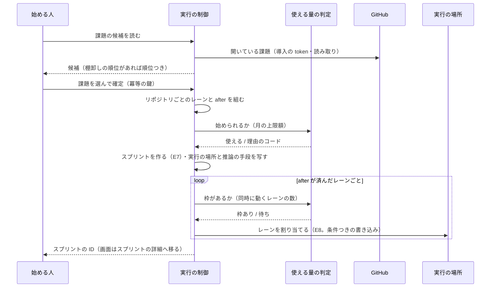
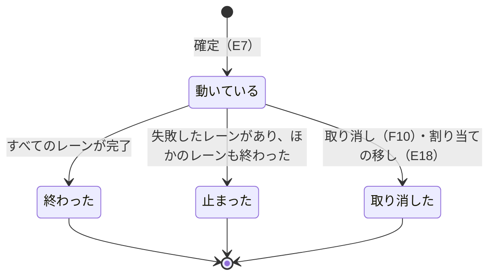
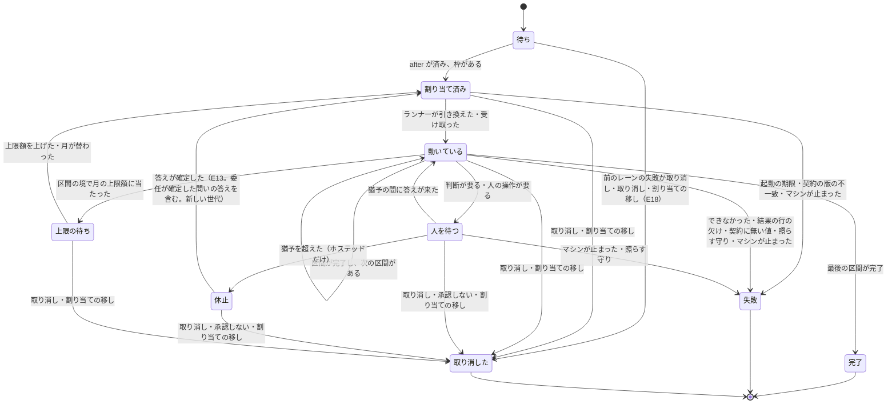
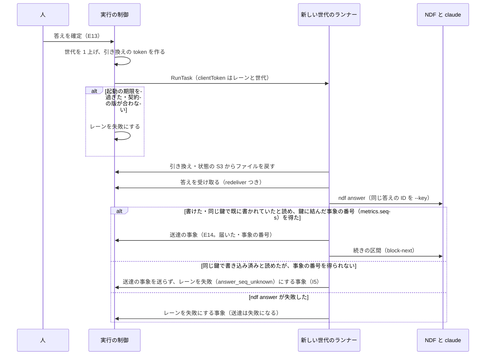
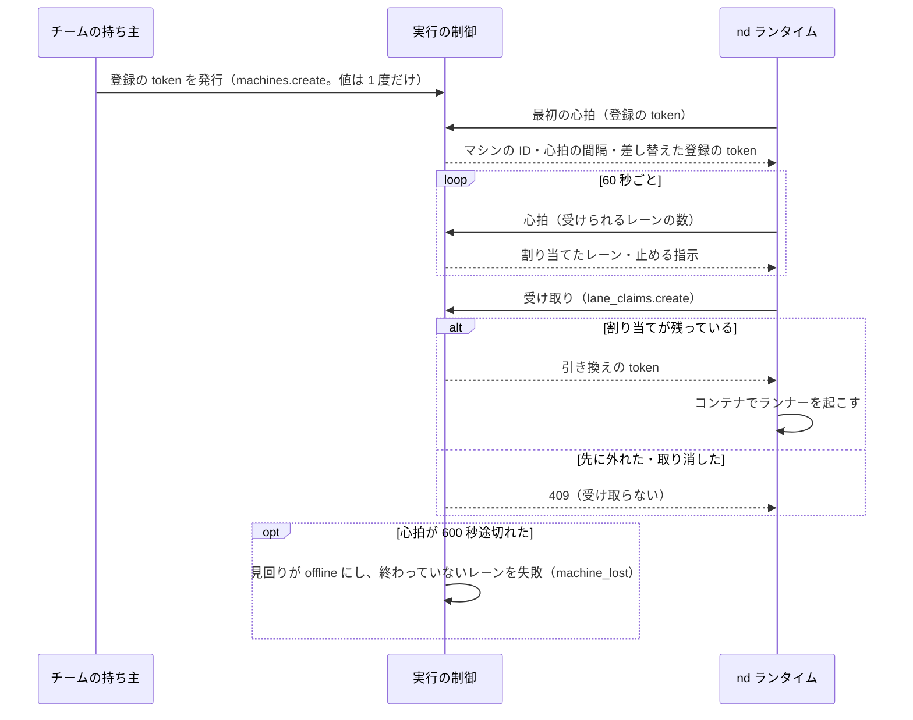
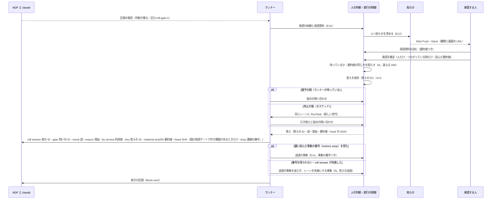
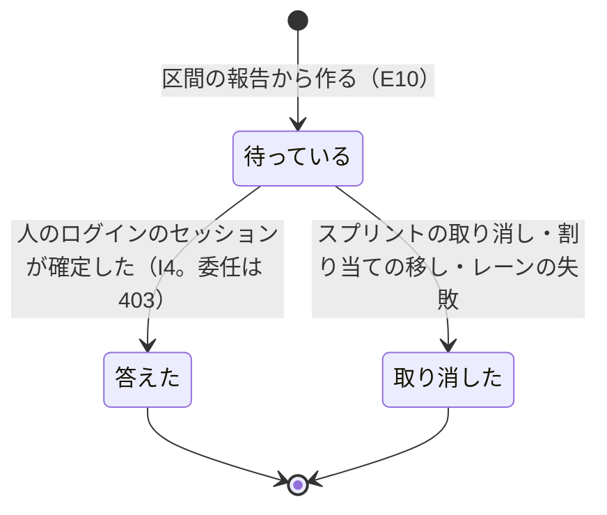
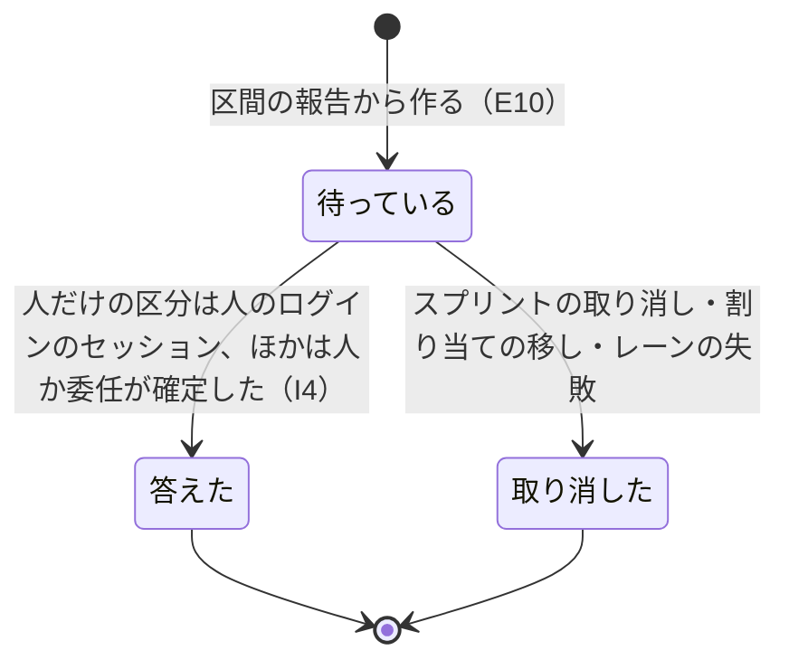
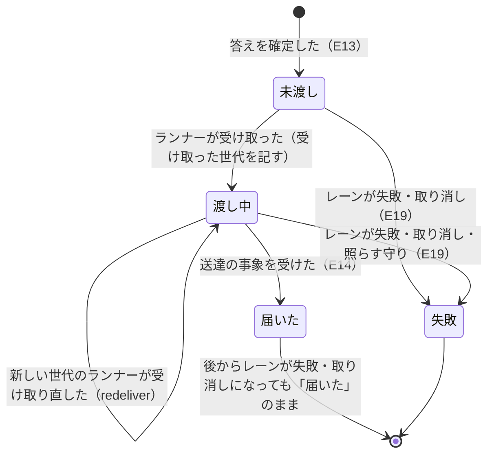

# 実行: 課題を指せば並列に回り、人を待つのは承認と問いだけになる

スプリントとレーンの動き方・実行の場所・NDF との契約と腐敗防止層のランナー・承認の依頼と問いの流れ・知らせ・使える量の判定を決める。

| 扱うもの | [全体の設計](overview.md) の項目 |
| --- | --- |
| コンテキスト | 「実行」「人の判断」「知らせ」「使える量と費用」の 4 つ |
| 場面 | S1・S3〜S5・S10 |
| 機能 | F8・F10〜F15・F17〜F19・F23 |
| 不変条件 | I4〜I8・I11・I13・I21 |

語・番号（S・F・I・E）は [全体の設計](overview.md) のものである。
画面の項目は [画面](screens.md)、HTTP の経路と認可は [API と MCP](api.md)、置き場とインフラは [プラットフォーム](platform.md) が持つ。

## 全体の形

実行のコンテキストの中の部品と、それぞれが書き換えてよいものを先に決める。

| 部品 | 動く所 | 責務 | 書き換えてよいもの |
| --- | --- | --- | --- |
| 実行の制御 | API（Lambda） | スプリントを作る・計画を組む・レーンを実行の場所へ割り当てる・答えを受けて同じレーンを起こし直す・取り消す | スプリント・レーン・区間・手元のマシン |
| 進捗の受け口 | API（Lambda） | ランナーが送る進捗の事象を、レーンの token と連番で照らして追記する（I13）。事象から実行の制御・人の判断・使える量へ事象を回す | 進捗の事象（追記だけ） |
| 人の判断のモジュール | API（Lambda） | 承認の依頼と問いを作る・答えを確定する（I4）・答えの送達の状態を持つ（I5） | 承認の依頼・問い |
| 知らせのモジュール | API（Lambda） | E12 を受けて知らせを作り、通知先へ送る | 知らせ・通知先 |
| 使える量の判定 | API の中の横断の部品（1 か所） | 始める・割り当てる・区間の境で「使えるか」と理由のコードを返す（I8） | 費用の記録（追記だけ） |
| ランナー | ホステッドの ECS のタスク、または手元のマシンの nd ランタイムが起こすコンテナ | NDF を起動し、NDF のファイルを読み、進捗の事象と承認の依頼・問いへ翻訳する腐敗防止層。答えを `ndf answer` で渡す | 何も持たない（API へ送るだけ） |

## スプリントを始める流れ

場面 S1・機能 F8 の流れである。人（または委任された AI のエージェント）は、課題を選んで 1 回確定するだけでスプリントが始まる（Value 1）。計画・判定・割り当ては実行の制御が行い、人へ途中の確認を求めない。

| 段 | 何をするか | 決まり |
| --- | --- | --- |
| 1. 課題を選ぶ | 「スプリントを始める」の画面か API で、プロジェクトの課題の候補を読み、1 つ以上を選ぶ | 候補は、プロジェクトに登録したリポジトリの開いている GitHub の課題。NDF の棚卸しの順位があれば順位つきで並べる。読む token は GitHub App の導入の token（読み取りだけ）で、API の中で使って捨てる |
| 2. 計画 | 選んだ課題をリポジトリごとにまとめ、リポジトリごとに 1 つのレーンを作る。リポジトリをまたぐ順序は、レーンの `after`（前に終わっているべきレーンの名前）で表す | 計画の形は NDF の計画の宣言（`parallel-plan.schema.json` の `lane`）の `name`・`repo`・`after`・`rows` にそろえる（決定 60）。`after` の既定は「サブリポジトリのレーンは主リポジトリのレーンの後」ではなく空（並列）で、始める人が画面で順序を付けたときだけ足す。輪になる `after` は 400 で拒む |
| 3. 使える量の判定 | 判定の 1 か所へ「このチームがこのスプリントを始められるか」を問う | 月の上限額に当たっていれば、スプリントを作らずに理由のコードを返す（E16）。同時に動くレーンの数は、ここでは断らず段 5 で待たせる（決定 76） |
| 4. 実行の場所を選ぶ | チームの設定の実行の場所と推論の手段を、スプリントへ写す | 下の [実行の場所](#実行の場所) の「どちらを選ぶか」。スプリントの途中で場所を変えない |
| 5. レーンの割り当て | `after` が済み、使える量の判定が枠を返したレーンから、実行の場所へ割り当てる（E8） | 割り当ては条件つきの書き込みで 1 レーン 1 つだけ（I7）。枠が無いレーンは「待ち」に残り、ほかのレーンが終わったときに判定し直す |

確定の要求は冪等の鍵を持つ（形は [呼び出しの規約](api.md#呼び出しの規約)）。同じ鍵の 2 回目は同じスプリントを返し、2 つ目を作らない。

### 1 つのレーンの中の課題

レーンは、1 つのリポジトリの課題を NDF の 1 つのスプリント（`supervise.py new sprint` の流れ）で回す単位である。NDF はレーンの中で課題を worktree で並列に回す。

ただし、固定した版の NDF の契約は、起動の口 `skill-workflow` の引数を 2 つに限る（`entrypoints.json` の `skill-workflow` の `args`）。「課題の番号 1 つ（`#N`）」か「開発ループ（`--loop`）」である。複数の課題を 1 回の起動で渡す口は契約に無い。そこで、契約がその口を持つまでは、ランナーはレーンの課題を選んだ順に `#N` で 1 つずつ起動する（決定 61）。この間、同じリポジトリの課題はレーンの中で順に流れ、並列はリポジトリの間だけになる。

## スプリントとレーンの状態

### スプリントの状態

スプリントの状態は、レーンの状態から決まる。人を待つものがあるかはスプリントの状態にせず、承認の依頼と問いの一覧から読む（[ホーム（いま）](screens.md#ホームいま)）。

| 遷移 | 決まり |
| --- | --- |
| レーンが失敗した | そのレーンを `after` に持つレーンは「取り消した」（理由: 前のレーンが失敗した）にする。`after` で結ばれていないレーンは続ける |
| 終わった・止まった | E15 を出す。知らせ（始めた人へ）と費用の締めが受ける |
| 取り消した | 動いているレーンを止める（ホステッドはタスクを止め、手元のマシンは次の心拍で止める指示を返す）。レーンの token と渡した GitHub の token を断つ。待っている承認の依頼と問いは「取り消した」にし、答えを受けない |
| 失敗したレーンのやり直し | 最初の版は持たない。新しいスプリントを始める。ただし `ndf-ask:human-action` の問いで止まったレーンは、人が答えた後に同じレーンで続ける（下の表） |

### レーンの状態

図はレーンの遷移のすべてを持つ。本文と他の文書が書く遷移（割り当ての移しの取り消し・`machine_lost`・`contract_mismatch` など）は、この図の辺のどれかに当たる。図に無い遷移は書かない。

レーンの行は、実行の場所への割り当て（場所の種類・タスクかマシンの ID・世代の番号）を 1 つだけ持つ。世代の番号は割り当てのたびに 1 つ上がり、レーンの token は世代に結ばれる。前の世代の token からの要求は 401 になる（I7・I11）。

### 区間と結果の行

区間は、ランナーが claude（`NDF_FACTORY_RUN` を入れた人のいない実行）を 1 回起動して、次の区切りまで動かした分である。区間が終わったら、ランナーは claude の最後の応答の末尾の区間の報告を読む。値は応答の文の**最後の** `- 結果:` の行だけで決める（決定 62、I6）。

| 区間の報告 | 区間 | レーン |
| --- | --- | --- |
| `完了` で、`ndf-next` のブロックがある（カットポイント） | 成功で閉じる | 動いているまま。ブロックの中身（`block-next` の口の形）で次の区間を起こす |
| `完了` で、ブロックが無い | 成功で閉じる | その課題が終わった。レーンの次の課題があれば `#N` で次の区間、無ければ「完了」 |
| `判断が要る` | 成功で閉じる | 「人を待つ」。区分・承認ゲート・問い・Pull Request・材料から承認の依頼か問いを作る（E10。[承認と問いの流れ](#承認と問いの流れ)） |
| `できなかった` で、区分が `ndf-ask:human-action` | 成功で閉じる | 「人を待つ」。「人に頼むこと」を問いにし、人が「済んだ」と答えたら `次のコマンド:` の行で同じレーンを続ける |
| `できなかった`（ほか） | 失敗で閉じる | 「失敗」。理由の行を進捗の事象に残す |
| `- 結果:` の行が無い | 失敗で閉じる | 「失敗」。理由のコードは `result_line_missing` |
| 値が `完了`・`判断が要る`・`できなかった` のどれでもない（例: `保留`） | 失敗で閉じる | 「失敗」。理由のコードは `result_value_unknown` と読んだ値（伏せ字を通す） |
| claude が異常終了した・区間の時間の上限を超えた | 失敗で閉じる | 「失敗」。理由のコードは `segment_crashed`・`segment_timeout` |

失敗で閉じた区間は自動で繰り返さない。

| 決まり | 書かれている所 |
| --- | --- |
| 結果の値の 3 つ | 契約の `report-unattended` の行 |
| 「最後の行で読む」 | NDF の手順の文書（`asking.md` の「人のいない実行」）。契約のファイルには無い |

## 実行の場所

### どちらを選ぶか

| 決まり | 中身 |
| --- | --- |
| 選ぶ所 | チームの持ち主が、チームの設定で「ホステッド」か「手元のマシン」と推論の手段を決める（F17）。スプリントは始める時にその値を写す（決定 68） |
| 自動で移さない | ホステッドに空きが無い・手元のマシンが止まったときも、もう一方へ移さない。コードと NDF の状態が置かれる所が変わり、チームが選んだ置き場の外へ出るためである |
| 使えないとき | ホステッドを料金プランが許さない・推論の手段が使えない（`managed` で推論の役割が無い環境、`byok` でキーが無い）なら、使える量の判定が段 3 で理由のコードを返す。手元のマシンで受け取れるマシンが 1 台も `online` でなければ、レーンは「待ち」に残り、10 分を超えたら始めた人へ知らせる |
| 推論の手段 | ホステッドは `managed`（Bedrock、API が一時の資格情報を渡す）か `byok`（チームが秘密の器へ置いた API キー）。手元のマシンは `byok` だけで、マシンの claude のログインを使い、サービスは推論の資格情報を渡さない（決定 67） |

### ホステッド

ECS Fargate のタスクを `RunTask` で 1 レーンに 1 つ起こす。タスクは公開のサブネットで公開 IP を受け、NAT を通らずに API・GitHub・Bedrock へ出る（[インフラ](platform.md#インフラ)）。タスクの役割は AWS の権限を持たない（I11）。

| 段 | 中身 |
| --- | --- |
| 起こす | 実行の制御が、10 分・1 回だけの引き換えの token を作り、`RunTask` の環境の上書きで渡す。`clientToken` は「レーンの ID と世代の番号」で、同じ世代の起こし直しの送り直しは 2 つ目のタスクを作らない（決定 64、LIB61） |
| 引き換える | ランナーは引き換えの token を API へ出し、次を受ける: レーンの token（1 時間）・レーンの指示（課題・リポジトリ・起動の口）・そのリポジトリ 1 つに絞った GitHub の token・そのプロジェクトの進行表の DB の URL・状態の S3 の署名つき URL・`managed` なら推論の一時の資格情報、`byok` ならチームの API キー |
| 心拍 | 60 秒ごとに API へ心拍を送り、レーンの token と推論の資格情報を期限の前に取り直す。レーンの終わり・取り消し・割り当ての変更の後は、API が取り直しを断る |
| 指示の問い合わせ | 「人を待つ」の間、10 秒ごとに答えの指示を問い合わせる |
| 承認の待ちの猶予 | 待ちが猶予（設定の値、既定 5 分）を超えたら、ランナーは NDF の手元のファイルを状態の S3 へ固め、「休止」の事象を送り、進行表の DB の接続を閉じて終わる（決定 65）。レーンの割り当ては外さない |
| 起こし直す | 答えが確定したら（E13。委任が確定した問いの答えを含む）、実行の制御は同じレーンの世代を 1 つ上げ、新しい引き換えの token で `RunTask` を打つ。新しいタスクは状態の S3 からファイルを戻し、答えを受けて `ndf answer` を打ち、次の区間を起こす |
| 起動の期限 | 割り当てから 10 分の間に引き換えが無ければ、そのレーンを「失敗」（理由 `runner_not_started`）にする |

起こし直しの順と失敗の分かれは次のとおりである（答えの送達は [答えの送達](#答えの送達)）。

「同じ鍵で既に書かれていた」ときの `ndf answer` の終了コードと出力は実測していない（[確かめられなかったこと](#確かめられなかったこと)）。#6 の詳細設計で実測し、2 回目が成功の終了コードを返すなら図のとおりにする。失敗の終了コードを返すなら、ランナーはその出力が同じ鍵の書き込み済みを示すときだけ書き込み済みとして扱う。どちらの場合も「届いた」として E14 と続きの区間へ進むのは、鍵に結んだ事象の番号を得たときだけで、得られなければ I5 のとおり `answer_seq_unknown` でレーンを失敗にする。どちらでもなく見分けられないなら、決定 100 を決め直して設計承認ゲートへ戻す。

待ちの間はタスクも DB の接続も無いため、Fargate と Aurora の計算の費用が止まる（[費用](platform.md#費用)）。猶予を持つのは、すぐ答えたときに起こし直しの待ち（タスクの起動と DB の再開）を足さないためである（Value 1）。

### 手元のマシン

チームが登録した利用者のマシンで、nd ランタイムがレーンを受け取り、コンテナでランナーを動かす（F18）。nd ランタイムは待ち受けのポートを開かず、外向きの HTTPS だけで API とやり取りする（決定 67、PRD60）。

| 段 | 中身 |
| --- | --- |
| 登録 | チームの持ち主が画面で登録の token を発行する（値は発行の応答に 1 回だけ載り、サービスは要約値だけを持つ）。マシンはそのとき「登録待ち」になる。登録の経路は持たず、最初の心拍が登録を兼ねる。最初の心拍の応答で、マシンの ID・心拍の間隔・差し替えた登録の token を受け、画面に見せた値は 1 回使った時点で使えなくなる（決定 102。経路は [API の文書の手元のマシンの HTTP の経路](api.md#ランナー手元のマシンdb-の用意のタスクの-http-の経路)）。登録の token を取り消すと、そのマシンは次の見回りで止まる |
| 心拍 | 60 秒ごと。同時に受けるレーンの数（1〜16、マシンが申告する）を添える。最後の心拍から 600 秒を超えたマシンは見回りが `offline` にし、そのマシンの終わっていないレーンを「失敗」（理由 `machine_lost`）にする |
| 受け取り | 心拍の後に空きがあれば受け取りを出し、割り当て済みのレーンの指示とレーンの token を受ける。割り当ては「待ち」のレーンを、そのチームの `online` で空きのあるマシンへ、心拍の新しい順に寄せる |
| 動かす | レーンごとにコンテナを起こし、ホステッドと同じランナーを動かす。進行表の DB の URL は渡さない（DB は外から接続できない置き場にある。[データの進行表の DB](data.md#進行表の-db)）。NDF の状態はマシンの手元の既定（`progress.sqlite`）に置く |
| 人を待つ | 休止しない。NDF の状態がマシンの手元にあり、別のマシンへ移せないためである。レーンは同じマシンに留まり、空きの数に数える |
| 終わり | レーンのプロセスが終わったら終わりを知らせ、届いてからレーンの作業場所を消す |

マシンの状態は「登録待ち」・`online`・`offline` の 3 つである。登録と受け取りの順は次のとおりである。

### I7・I11 をどう守るか

| 不変条件 | 守り方 |
| --- | --- |
| I7 1 レーンに同時に 1 つ | 割り当ては「レーンの行に割り当てが無い、または前の世代が終わっている」を条件にした書き込みだけで行う。ホステッドの `RunTask` の `clientToken` も世代で決まる。進捗の受け口は、今の世代でない token の事象を 401 で断る |
| I11 権限を持たない・token はレーンの間だけ | タスクの役割は権限の文を持たない（検査がスタックの合成の出力で照らす）。ECR の取得とログはタスクの実行の役割が受け持ち、タスクの中のプログラムからは使えない。レーンの token・推論の一時の資格情報・GitHub の token は 1 時間以内で、レーンの終わり・取り消し・割り当ての変更で取り直しを断る。手元のマシンの登録の token はレーンの token と別で、レーンのコンテナへ渡さない |

## ランナーの責務

ランナーは、NDF の語をサービスの語へ写す腐敗防止層である。サービスの API・画面は NDF のファイルの形を知らない。知るのは、ランナーが送る進捗の事象と承認の依頼・問いの形（形の正本、`packages/contracts/`）だけである。

| 責務 | 決まり |
| --- | --- |
| NDF を起動する | 呼べる口（[NDF との契約](#ndf-との契約)）だけで claude を起こす。環境変数は契約が許す名前の一覧から組み、ほかの名前は子のプロセスへ渡さない（端末向けの中継・リレーハブの系の変数を含む） |
| 進捗の事象へ訳す | 区間の間は 30 秒ごとと区間の終わりに、契約の `reader: service` のファイルのうち使うものを読み、増えた行を進捗の事象へ訳して送る（決定 63）。事象はレーンの ID・世代・連番を持ち、受け口は同じ連番の 2 件目を足さない（I13） |
| 承認の依頼と問いへ訳す | 区間の報告が `判断が要る` か `ndf-ask:human-action` なら、区分で承認の依頼か問いを選んで送る（E10）。承認資料の材料（下の [承認と問いの流れ](#承認と問いの流れ)）を集めて添える |
| 答えを 1 回だけ渡す | 答えを受けたら答えの ID を鍵に `ndf answer` を打ち、事象の番号を添えて送達の事象を送る（E14、I5。決定 71・100。起こし直しの打ち直しは [答えの送達](#答えの送達)） |
| 伏せ字 | API へ送る前のすべての本文（事象・承認資料・問い・ログ）に、形の正本の秘密の形の表の伏せ字を通す。値の一部も残さない |
| 承認ゲートを無効にさせない | 下の「守り」（決定 70） |
| 費用の量を送る | 区間の終わりに、区間の時間と claude の結果の推論の量（入力・出力・キャッシュの token の数）を事象で送る |

読むファイルと、訳す先の事象:

| NDF のファイル（`ndf-files.json` の id） | 読むか | 訳す先の進捗の事象 |
| --- | --- | --- |
| 区間の報告（claude の最後の応答） | 読む | 区間の終わり（結果・区分）・承認の依頼・問い |
| `plan-progress`（`step`・`attention`） | 読む | 工程の進み（どの工程のどの段か）・注意 |
| `ask-journal`（`ask.jsonl`） | 読む | 判断の記録（AI が自分で決めた問いを含む）。承認の依頼と問いの ID の材料 |
| `gate-rejections`（`gate-rejections.jsonl`） | 読む | 差し戻しの記録 |
| `issue-request` | 読む | 起票の依頼（[起票の依頼](#起票の依頼)） |
| `loop-record` | 読まない | 開発ループを使わないため |
| `organizer-*` の 4 行 | 読まない | オーガナイザーの置き場を使わないため（決定 73） |

### 守り: 承認ゲートを無効にさせない

コンテナの中の claude が `ndf answer` を打つか答えを直に書けば、人の答え無しに承認ゲートを通れる。NDF は `--by service:<主体>` の答えをどこまで信用するかを契約に持たない。そこで 2 つの守りを重ねる（決定 70）。

| 守り | 中身 |
| --- | --- |
| 防ぐ: 別の OS の利用者 | コンテナの中で、ランナーと claude を別の OS の利用者で動かす。レーンの token・GitHub の token の取り直し・推論の資格情報の取り直しはランナーの利用者だけが持つ |
| 防ぐ: 答えのファイル | NDF が答えを書くファイルはランナーの利用者が持ち、claude の利用者に書き込みの権限を与えない。権限は OS が掛けるため、claude が起こす子のプロセスにも効く。承認の依頼を書くファイルは claude の利用者が書ける |
| 防ぐ: 許可の設定 | claude の許可の設定でも `ndf answer` と答えのファイルへの書き込みを拒む。許可の設定は claude のツールと認識できるコマンドにだけ効くため、重ねる守りに留める |
| 照らす | 控えは、API が `/v1/runner/answers/list` の応答の `delivered_seqs` で返すそのレーンの届いた答えの事象の番号から組む（起動し直したランナーも受け取りの 1 回目で取り直し、照らしには最後の E14 の確定を反映した控えを使う。[答えの送達](#答えの送達)）。区間の後に `ndf progress show <表の ID>` で答えの事象（`answered`・`row_answered`）を読み、控えの番号に無い答えが現れたら、レーンを「失敗」（理由 `answer_outside_runner`）にし、始めた人とチームの持ち主へ知らせ、進捗の事象に残す（I5） |

答えが進行表の DB の行として書かれる版の NDF では、claude の利用者も `NDF_PROGRESS_DB` の URL で答えの行を書ける。そのときはファイルの権限の守りが効かない。そこで、ランナーと claude で DB のログインの役割を分け、claude の役割から答えの表へ書けないようにする形へ設計を戻す（[未確認のまま残ること](#未確認のまま残ること)）。

## NDF との契約

NDF（devbasex/ai-plugins の `ndf-next` プラグイン）は上流である。nd-factory は、契約のファイル（`plugins/ndf-next/contracts/`）に載るものだけでやり取りする。NDF の集約を直に書かず、NDF の内部のスクリプトと状態のファイルに頼らない。以下の表の `C/` は `plugins/ndf-next/contracts/` の略である。

| 項目 | 決まり | 契約の置き場 |
| --- | --- | --- |
| 固定の置き場 | 使う NDF のコミットは `ndf-pin.json` のキー `ndf_ref` の 1 か所だけに置く。ランナーのイメージはその版の NDF を入れて作る | `ndf-pin.json`（このリポジトリ） |
| NDF 11 の名前 | この文書の NDF の名前（記録の ID `ask-journal`・口 `file-journals`・答えの語 `request_changes`）は NDF 11 の契約の名前で、旧い名前（NDF 11 の前の契約の名前）を書かない。今の `ndf_ref` の点の契約は旧い名前を持つため、`ndf_ref` を NDF 11.0.0 の配布のコミットへ付け替え、受ける契約の版と sha256 の組を同じ変更で直す（#1。版の数字は比べない） | `C/domains/ndf-files.json`・`C/domains/entrypoints.json`・`C/facts/answers.json`・`C/schemas/io/answer.args.schema.json` |
| 契約の版の照らし | 契約の版は `C/version.json` の `history` の最後の行（版と sha256）。nd-factory は「受ける契約の版と sha256 の組」の集合を形の正本のデータに 1 か所だけ置き、ランナーは起動の時に照らす。集合に無ければ claude を起こさずにレーンを「失敗」（理由 `contract_mismatch`）にする | `C/version.json`（今の `ndf_ref` の点で版 4。NDF 11.0.0 へ付け替えるときに受ける組を直す） |
| 版の数字を比べない | NDF の版の数字（`NDF_VERSION` の値・プラグインの版）を読んで大小を比べる処理を書かない。参照の検査が落とす。機能の有無は契約の版と sha256 で判断する | — |
| 呼べる口 | `C/domains/entrypoints.json` の 15 行の口だけ。nd-factory が使うのは下の「使う口」の表の行だけ | `C/domains/entrypoints.json` |
| 渡す環境変数 | 口の行の `env` 列に載る名前だけ。値の出所は下の「渡す環境変数」の表 | `C/domains/env.json`・各口の `env` |
| 読むファイル | `C/domains/ndf-files.json` の `reader: service` の行のうち、[ランナーの責務](#ランナーの責務) の表で「読む」とした行だけ。読み手は知らない項目を受け流す | `C/domains/ndf-files.json` |
| 承認の答えの渡し方 | `ndf answer` の副命令だけ。答えのファイルを直に書かない | `C/schemas/io/answer.args.schema.json` |
| 承認ゲートの名前 | 正の名前「設計承認ゲート」「リリース承認ゲート」だけを API・画面・事象の値に使う | `C/domains/entrypoints.json` の `gate-record`・`C/domains/entrypoint-cases.json` の `gate-legacy`（`valid: false`） |
| 答えの語 | 承認ゲートの結果の `routes` のキー。語の一覧は `C/facts/answers.json`（`approved`・`rejected`・`request_changes`・`retry`・`finish`・`cancel`） | `C/facts/answers.json`・`C/schemas/result.schema.json` |
| 契約の照合 | 下の「契約の照合の定期の検査」（F23） | — |

使う口:

| 口（`entrypoints.json` の id） | 種類 | nd-factory での使い方 |
| --- | --- | --- |
| `skill-workflow` | skill | レーンの課題ごとの最初の区間を `#N` で起こす。`--loop` は使わない |
| `block-next` | block | カットポイントと答えの後の続きの区間を、区間の報告の `ndf-next` のブロックの中身で起こす |
| `report-unattended` | report | 区間の報告の `- 結果:` の値（3 つ）を読む |
| `hook-unattended-start`・`hook-unattended-stop`・`hook-unattended-end` | hook | NDF のプラグインが claude に登録する。ランナーは `NDF_FACTORY_RUN` を入れるだけで、hook を足さない・外さない |
| `file-plan-progress`・`file-journals`・`file-issue-request` | file | 読むファイルの置き場 |
| `gate-record` | command | ランナーは打たない。承認ゲートの名前の正の値の出所として使う |
| `spec-io` | spec | `ndf answer` と `ndf progress show` の引数を `C/schemas/io/` の引数のスキーマで組み、打つ前に照らす |
| 使わない口 | — | `file-organizer`（オーガナイザーを使わない、決定 73）・`file-loop-record`（ループを使わない）・`spec-pages`・`spec-declarations`（設定のページを最初の版に持たない） |

渡す環境変数:

| 名前 | 渡すか | 値の出所 | 秘密 |
| --- | --- | --- | --- |
| `NDF_FACTORY_RUN` | 渡す | 空でない固定の値 | いいえ |
| `NDF_VERSION` | 渡す | イメージに入れた NDF が名乗る値をそのまま。読んで比べない | いいえ |
| `NDF_STATE_HOME` | 渡す | コンテナの中のレーンの作業場所の下 | いいえ |
| `NDF_MVV_STATE_DIR` | 渡す | 同上。`ask.jsonl`・`gate-rejections.jsonl` の置き場 | いいえ |
| `NDF_ISSUE_REQUEST_FILE` | 渡す | 作業のリポジトリの外のファイル | いいえ |
| `NDF_PROGRESS_DB` | ホステッドだけ渡す | 引き換えで受けた、そのプロジェクトの進行表の DB の URL（I10）。手元のマシンには渡さない | はい |
| `GH_TOKEN` | 渡す | 引き換え・心拍で受けた、レーンのリポジトリ 1 つに絞った GitHub App の導入の token（決定 69） | はい |
| `NDF_LOOP_EXCLUDE` | 渡さない | 開発ループを使わない | — |
| `NDF_ORGANIZER_DIR`・`NDF_ORGANIZER_LANE` | 渡さない | オーガナイザーの置き場を使わない（決定 73） | — |

秘密の値はプロセスの環境だけに置き、ファイルとログに書かない。claude の推論の設定（`managed` の Bedrock の設定、`byok` の API キー）は NDF の契約の外にある。これは claude 自身の設定として渡す（[推論の資格情報](#推論の資格情報)）。

### 推論の資格情報

| 手段 | 渡し方 |
| --- | --- |
| `managed` | API が推論だけの IAM の役割を `sts:AssumeRole` で引き受け（セッションの名前はレーンの ID、期間は 1 時間）、得た一時の資格情報を引き換えと心拍でランナーへ渡す。Lambda の役割から引き受けるため役割の連鎖になり、1 時間を超えられない（LIB62）。claude には起動時の環境の値で渡さず、設定の `awsCredentialExport` に小さなコマンドを置く。コマンドはランナーがコンテナの中だけで開くローカルのソケットから今の値を受けて返す。claude はセッションの始まりと読み直しのたびにこのコマンドを打ち、`Expiration` の 5 分前まで値を持つ（LIB63、決定 66） |
| `byok`（ホステッド） | チームが秘密の器へ置いた API キーを引き換えで受け、claude のプロセスの環境だけに入れる |
| `byok`（手元のマシン） | マシンの claude のログインを使う。サービスは何も渡さない |

### 契約の照合の定期の検査

機能 F23 である。CI の検査で行い、AWS の資格情報を持たない（決定 79）。

| 項目 | 中身 |
| --- | --- |
| いつ | 固定の点の契約は、すべての Pull Request・main への push・毎日 1 回・手動の起動。先端の契約は、`ndf-pin.json` を変える Pull Request・main への push・毎日 1 回・手動の起動。固定の点をすべての Pull Request で照らすのは、照らす相手の形の正本（`packages/contracts`）の呼び出しの判定と NDF の契約の使い方のデータが、固定の点を変えない Pull Request でも変わるためである（決定 79） |
| 何を読むか | 固定の点（`ndf-pin.json` の点）の契約のファイルと、先端の契約のファイル（読むだけ）。先端は NDF の develop の先端である。#41 の決定 107（ai-plugins の既定の枝の先端へ移す。承認待ち）が承認されたら、先端は既定の枝の先端に替わり、#41 の実装がこの行を直す。F23 の実装（#1）は #41 の承認の後に始めるので、実装が取る先端は既定の枝の先端である |
| 何を照らすか | (1) `C/domains/entrypoint-cases.json` の 26 件の見本を、形の正本の呼び出しの判定（ランナーが NDF を起こす前に通す判定）へ通し、`valid` と同じ判定になるか。(2) `C/version.json` の最後の行が、受ける契約の版の集合にあるか。(3) `C/domains/env.json` の `set_by: service` の名前と、口の `env` 列の名前が、形の正本の NDF の契約の使い方に口ごと・実行の場（ホステッドと手元のマシン）ごとに置いた渡す環境変数の名前を含むか。(4) `C/domains/ndf-files.json` の `reader: service` の行の `fields` が、使い方に置いた翻訳が読む項目を含むか。検査はランナーのコードを読み込まない（`tools` は `apps/` に依らない）。ランナーが実際に組み立てる呼び出しと環境変数がこの判定とデータに合うかは、#6 の `apps/runner` のテストが照らす（#1 の設計の K6-2・K6-3） |
| 落ちたとき | 固定の点で落ちたら検査を失敗にする（CI の失敗として運用する人が受ける）。先端だけが食い違うときは、固定の点を変えずに検査の要約へ食い違った見本の id と契約のファイルのパスを並べる |
| 反映との結び | 反映のパイプラインは CI の結果を読まない。そこで、承認する人は、承認の画面に出たコミットで `ndf-contract` が成功したことを確かめてから承認し、成功の実行が無ければ（失敗・終わっていない・実行が無い）承認しない（[pipeline-approval.md](../operations/pipeline-approval.md#承認する人が読むもの)、決定 79） |

## 承認と問いの流れ

場面 S3・S4、機能 F11〜F13 の流れである。人を待つものは 2 種類だけである。

| 種類 | 中身 |
| --- | --- |
| 承認の依頼 | NDF の設計承認ゲート・リリース承認ゲート・レッドラインに当たる操作 |
| 問い | NDF の区分つきの問い |

### 区分と、だれが答えられるか

区分は区間の報告の「区分」の行の値である（NDF の `asking.md` の区分の表）。

| 区分 | 種類 | 人だけが答えるか | 答えの選択肢 |
| --- | --- | --- | --- |
| `ndf-gate:1` | 承認の依頼（設計承認ゲート） | 人だけ | 承認ゲートの結果の `routes` のキー（例: 承認する・指摘を添えて差し戻す・承認しない）。設計承認ゲートでは外す課題（`--drop`）を選べる |
| `ndf-gate:2` | 承認の依頼（リリース承認ゲート） | 人だけ | 同上 |
| `ndf-ask:redline:<番号>` | 承認の依頼（レッドライン。`C1`〜`C8`・`P1`・`P2`・スプリントの R） | 人だけ | 承認する・承認しない |
| 起票の依頼（[下](#起票の依頼)） | 承認の依頼（レッドライン C5 として扱う） | 人だけ | 起票する・起票しない |
| `ndf-ask:cost`・`ndf-ask:irreversible`・`ndf-ask:legal`・`ndf-ask:<プロジェクトが足した名前>` | 問い | 人か、その人の委任 | 問いの選択肢と推しの案 |
| `ndf-ask:human-action` | 問い（人の操作の待ち） | 人だけ（人にしかできない操作の後に「済んだ」と答えるため） | 済んだ・取り消す |
| 区分の無い値・知らない区分 | 問い（人だけ） | 人だけ | 承認する・承認しない。見せてよいか迷うときと同じく、強い側へ倒す |

この表が、人だけが答える範囲の正本である。問いの「人だけか」は、問いを作るときにこの表の区分で決めて問いの行に持ち、API はその値で要素ごとに断る（[API の文書の人だけにした理由](api.md#人だけにした理由)）。「人だけ」の答えは、人のログインのセッション（画面か、人が同じ API を直に呼ぶ）の要求だけが確定できる。委任の資格情報・レーンの token からの確定は、API・MCP とも 403 `human_only` である（I4、[認可](api.md#認可)）。API と MCP からは依頼と承認資料を読める。

### 承認資料

承認の依頼は、承認の判断に要る材料を 1 枚にまとめた承認資料を持つ。ランナーが集めて送り、API が状態の S3 へコピーを置く。

| 項目 | 出所 |
| --- | --- |
| 題・区分・承認ゲート・問い | 区間の報告 |
| 対象の課題の番号の並び | 区間の報告と `plan-progress`。設計承認ゲートで外す課題（`--drop`）はこの並びから選ぶ |
| 目的と判断の材料 | 区間の報告の「材料」（`本文` なら最後の応答の「判断の材料」の節） |
| Pull Request の URL・head の SHA・変えたファイルの数と行の数・CI の結果 | ランナーが GitHub の API で読む（レーンの token の GitHub の token） |
| NDF の MVV 判定の助言 | `ask.jsonl` の該当の行（あれば） |
| このスプリントで使った額 | 費用の記録（API が足す） |
| 要約値 | 上の項目を決まった順に並べた JSON の sha256。head の SHA を含むため、Pull Request が動けば要約値も変わる |

起票の依頼の承認資料は、宛先・題・本文・ラベルと、確かめる段で読んだ宛先の公開範囲を持つ（[起票の依頼](#起票の依頼)）。

承認資料の本文は伏せ字を通した後のものだけを置く。画面は要約値で版を見分け、つながらない間は最後に受け取った承認資料を読める（[オフライン](screens.md#オフライン)）。

### 確定から NDF まで

| 段 | 決まり |
| --- | --- |
| 確定 | 確定の要求は「読んだ要約値」を持つ。サーバーは、依頼がまだ待っていることと要約値が今のものと同じことを、答えの保存と同じ条件つきの書き込みで照らす。合わなければ 409 で、画面は読み直しを促す（I4） |
| つながらない端末 | 画面は確定のボタンを確定待ちの操作に変え、つながった後に同じ照らし合わせを通す。確定待ちのまま送らない（[オフライン](screens.md#オフライン)） |
| 理由 | `--reason` は契約の必須の引数である（STD63）。答えの理由の欄（任意、2,000 字まで）の値を渡す。空なら、ランナーが答えの語と答えの ID から作る定型の文（nd-factory で確定したこと）を渡す（決定 103） |
| 外す課題 | `--drop` は設計承認ゲートの依頼の答えだけが持つ。`approvals.answer` の要素 `drop_issues`（整数の配列）で受け、承認資料の対象の課題の番号に限る。ほかの承認ゲートの依頼に付けたら要素の 400 `item_invalid` |
| NDF へ 1 回だけ | 冪等の鍵は答えの ID。結果が分からないまま起動し直したランナーは、同じ答えの ID を `--key` にして打ち直し、新しい答えの ID を作らない。NDF は同じ鍵の 2 回目を書かない。送達の状態と起こし直しは下の [答えの送達](#答えの送達) が持つ（I5・決定 100） |
| 違う鍵の答え | 照らす守りが、控えに無い答えの事象を見つけたらレーンを止めて知らせる（I5。控えの組み方は [答えの送達](#答えの送達) の「照らす」） |
| `--material-sha256`・`--head` | 人が読んだ承認資料の要約値と Pull Request の head の SHA を NDF へ渡し、NDF の側の記録にも人が見た版を残す |

### 承認の依頼と問いの状態

状態の値と遷移の正本である（サービスの表の `state` の列は [データ](data.md#テーブル定義) がこの節を指す）。

承認の依頼と問いは同じ 3 つの状態を持つ。差し戻しは答えの語（`request_changes`）で表し、状態にしない。確定できる主体が違うため、図を集約ごとに分ける。

承認の依頼:

問い:

| 遷移 | 決まり |
| --- | --- |
| 答えた（語が `request_changes`） | 前の依頼は「答えた」で閉じる。NDF がもう一度承認ゲートに着いたら、新しい依頼を作る |
| 答えた（起票の依頼） | 状態は「答えた」で閉じ、作ったかどうかは起票の結果（作った・作らなかった）で持つ。作成の直前の照らし（I21）で作らなかったときも「答えた」のまま |
| 取り消した | 答えを受けない（確定は 409 `state_mismatch`）。知らせの送っていない分を捨てる。レーンの終わり（E19）を受けた人の判断のモジュールが書く |

### 答えの送達

確定した答えを、ランナーが NDF へ `ndf answer` で渡し終えるまでの流れである。状態は未渡し・渡し中・届いた・失敗の 4 つである。

| 段 | 決まり |
| --- | --- |
| 対象 | NDF の区間の報告から作った承認の依頼（`ndf-gate:*`・`ndf-ask:redline:<番号>`）の答えと、`ndf-ask:human-action` を除く問いの答え（委任が確定した問いを含む）を送達し、届いたらレーンを続ける。`ndf-ask:human-action` の答えと起票の依頼の答えは `/v1/runner/answers/list` に載せず、送達の状態を持たない |
| 受け取る | ランナーは起動の後と指示の問い合わせのたびに答えを読む。渡し中のまま前の世代が受け取った答えは `redeliver` が真 |
| 打ち直す | `redeliver` が真の答えは、同じ答えの ID を `--key` にして `ndf answer` を打ち直す。NDF は同じ鍵の 2 回目を書かない（STD63）。新しい答えの ID を作らない |
| 番号を添える | ランナーは `ndf answer` の結果の `metrics.seqs`（書いた答えの事象の番号）を送達の事象（E14）に添える。番号は鍵に結んだ `ndf answer` の結果からだけ得る。打ち直しで `metrics.replayed` が真なのに `metrics.seqs` が空のときは、答えの一覧の `gate_id` や `by` から番号を推さず、送達の事象を送らずにレーンを失敗（`answer_seq_unknown`）にし、始めた人とチームの持ち主へ知らせる（I5）。同じ鍵の 2 回目が最初の番号を返すかは #6 の詳細設計で実測し、返さないなら決定 100 を決め直して設計承認ゲートへ戻す（[未確認のまま残ること](#未確認のまま残ること)） |
| 照らす | 照らす守りの控えは、API が `/v1/runner/answers/list` の応答の `delivered_seqs` で返すそのレーンの届いた答えの事象の番号から組む。起動し直したランナーも、受け取りの 1 回目で控えを取り直す。照らしには、そのレーンの最後の E14 の確定を反映した控えを使う（E14 を API が受けた後に `/v1/runner/answers/list` を読み直した `delivered_seqs`。起動の直後に受けた古い `delivered_seqs` を使い続けず、打ち直しで届いた正規の答えを控えに無いと読まない）。書き込みの後の読み取りは API の契約で保証する: `/v1/runner/answer_deliveries/create` は、送達の状態を「届いた」にし `ndf_event_seqs` を記す書き込みが確定してから成功を返し（確定する前に受け取りを返さない）、`/v1/runner/answers/list` は `delivered_seqs` をそのレーンの答えの行の強い整合の読みから組む（最終的な整合の索引から組まない）。ランナーは E14 の成功の応答を受けてから読み直し、成功の応答を受けていない E14 の答えは未渡し・渡し中として照らしを待つ。NDF の答えの一覧の事象のうち、控えの番号に無いものがあれば「控えに無い答え」としてレーンを止める（I5）。未渡し・渡し中の答えがあるうちは照らしを待ち、番号が届いてから照らす。ランナーの手元の控えが起動し直しで消えても、渡した答えを控えに無いと読まない |

### 差し戻し

| 答え | 扱い |
| --- | --- |
| 指摘を添えて差し戻す（`request_changes`） | 人の指摘の本文を答えに持つ。ランナーは指摘をファイルに書いて `--notes` で渡し、続きの区間を起こす。NDF が直して、もう一度承認ゲートに着けば、新しい承認の依頼になる（前の依頼は「答えた」で閉じる。[承認の依頼と問いの状態](#承認の依頼と問いの状態)） |
| 承認しない（`rejected`）・取り消す（`cancel`） | `ndf answer` で渡した後、続きの区間を起こさずにレーンを「取り消した」にする |
| 同じ作業を打ち直す（`retry`）・残りを打たずに終える（`finish`） | 承認ゲートの結果の `routes` にあるときだけ選択肢に出す。渡した後の続きは NDF の `routes` に従う |

### 問いの答え

問いの答えも、承認の依頼と同じく答えの ID を冪等の鍵にして `ndf answer` で渡す。問いの ID と表の ID は、区間の報告と `ask.jsonl` の行から得る。問いの行がこの 2 つを持つかは契約の `fields` に無く、未確認である（[未確認のまま残ること](#未確認のまま残ること)）。`ndf-ask:human-action` の答えは送達の対象外で `ndf answer` を打たず、「済んだ」なら区間の報告の `次のコマンド:` の行で続きの区間を起こし、「取り消す」ならレーンを取り消す（E19）。

## 起票の依頼

NDF は、作業のリポジトリと別の宛先へ課題を起こすとき、`NDF_ISSUE_REQUEST_FILE` があれば承認資料を書かない。代わりに依頼の 1 行（`{repo, title, body, labels}`）をそのファイルへ足して続ける。出所は `C/domains/env.json` と `C/domains/ndf-files.json` の `issue-request` である。NDF の共通原則では、他のリポジトリへの起票はレッドライン C5 に当たる。そこで、サービスは依頼を承認の依頼として人へ出し、人が承認したときだけ起票する（決定 78）。起票の依頼の専用の画面は作らず、承認の画面に並べる。

| 段 | 決まり |
| --- | --- |
| 受ける | ランナーが増えた行を読み、伏せ字を通して進捗の事象「起票の依頼」として送る。題か本文が上限を超える行は送らず、注意の事象にする |
| 確かめる | API は次の順に確かめる: 秘密らしい値が無い / 宛先がそのプロジェクトに登録したリポジトリ / GitHub App が宛先に入っている / 宛先の公開範囲が、レーンのリポジトリより広くない / そのスプリントで起こした数が上限（設定の値、既定 10）より少ない。外れたら起票せず、理由を事象に残し、始めた人へ知らせる |
| 人へ出す | 確かめが通った依頼を、承認の依頼（区分は `ndf-ask:redline:C5` として扱う、人だけ）にする。承認資料は宛先・題・本文・ラベルと、確かめる段で読んだ宛先の公開範囲 |
| 起こす直前に照らす | 人が「起票する」と答えたら、作成の要求の直前に宛先を読み直し、(1) 今もそのプロジェクトに登録したリポジトリである、(2) 公開範囲が承認資料に載せた宛先の公開範囲より広くない、(3) 公開範囲がレーンのリポジトリの公開範囲より広くない、の 3 つをすべて満たすときだけ起こす（I21）。公開範囲の広さは `private` ＜ `internal` ＜ `public` の順で比べる（LIB65）。外れたら作らずに、起票の結果を「作らなかった」（(1) は理由 `destination_unregistered`、(2)(3) は `visibility_widened`）にして事象（E20）に残し、始めた人へ知らせる。承認の依頼は「答えた」のまま閉じる |
| 起こす | 照らしが通ったら、API が宛先の 1 リポジトリと `issues: write` だけに絞った導入の token を作り、Lambda の中で 1 回使って捨てる（LIB60）。ランナーへ渡さない |
| 1 件だけ | 依頼の鍵は「スプリントの ID と、宛先（小文字）・題・本文の sha256」。同じ鍵の依頼から課題は 1 件だけ作る。作成の要求の直前に印を書き、印のある依頼は応答が届かなくても作り直さない（GitHub の課題の作成は冪等の鍵を持たないため） |
| レーンとの関係 | NDF は依頼を書いた後に止まらず続けるため、起票の承認はレーンを止めない |

## 知らせ

場面 S5、機能 F14・F15 である。知らせを作るのは知らせのモジュールだけで、ほかは E12 を出す。知らせは先に画面の一覧（知らせの行）に置き、通知先への送信はその後に行う。送れなくても知らせは画面に残る。

### 何で知らせるか

| 種類 | 引き金 | 宛先 |
| --- | --- | --- |
| 承認の依頼 | E10（承認の依頼） | スプリントを始めた人 |
| 問い | E10（問い） | スプリントを始めた人 |
| スプリントが終わった | E15（終わった） | スプリントを始めた人 |
| 止まった | E15（止まった）・レーンの失敗・手元のマシンが止まった・照らす守り・受け取るマシンが 10 分無い | スプリントを始めた人。照らす守りはチームの持ち主にも |
| 上限に当たった | E16 | スプリントを始めた人（始める時に断ったときは始めようとした人）とチームの持ち主 |

### 宛先の選び方

| 決まり | 中身 |
| --- | --- |
| 始めた人 | スプリントを始めた利用者。委任から始めたスプリントは、委任した利用者 |
| 席を失ったとき | 始めた人がチームの席を失っていれば、チームの持ち主全員へ送る |
| 割り当ての外へ送らない | 送る直前に、宛先の利用者がそのプロジェクトを見られるか（I2）を認可の判定へ問う。見られなければ送らず、知らせの行も作らない |
| 既読 | 知らせは利用者ごとの行で、既読は利用者ごと（F14） |

### 通知先

| 通知先 | 送り方 | 本文に載せるもの | 載せないもの |
| --- | --- | --- | --- |
| Web Push（端末に入れた Web アプリ） | 購読をアプリのサーバーの公開鍵（VAPID）に結び、その秘密鍵で署名して送る（STD60）。本文は端から端まで暗号化する（STD61） | 種類・プロジェクトの名前・知らせの ID と画面の URL（`/p/:projectId/approvals/:approvalId` などの HTTP の経路で、ID だけを持つ。[画面の文書の決定 38](screens.md#決定の記録)）。押すと承認の画面を直に開く | 課題の題・承認資料の中身・リポジトリの名前 |
| Slack（Incoming Webhook） | チームの人が登録した 1 つのチャンネル宛ての URL へ送る。URL は秘密として秘密の器に置き、ARN だけを持つ（LIB64） | 種類ごとの 1 文と画面の URL（URL は ID だけで、名前を含まない） | プロジェクト・リポジトリの名前、課題の番号と題、承認資料 |

Slack の本文にはプロジェクトの中身を載せない。チャンネルの参加者はサービスの認可の外にあり、チームの外の人が読めるためである（Value 9、決定 75）。Web Push は宛先の端末だけが本文を読めるため、どのプロジェクトかが分かる名前までを載せ、中身はサインインした画面で読む。

### 送れなかったとき

| 場面 | 扱い |
| --- | --- |
| Web Push が 404（購読が切れた） | その通知先を「無効」にし、次から送らない。画面の通知先の一覧に出す（STD61） |
| Web Push・Slack が 5xx・応答なし | 最大 3 回、間を倍にして送り直す |
| Slack が 429 | `Retry-After` の秒（10 秒まで）を待って送り直す。10 秒を超えるなら送り直さない（LIB64） |
| Slack がほかの 4xx（`channel_not_found`・`invalid_token` など） | 送り直さず、その通知先を「失敗」にして画面に出す |
| 事象が古い | 事象の時刻から 60 分を超えたものは通知先へ送らない。知らせの行は作る |
| 尽きたとき | 知らせの行の通知先ごとの送達の状態を「失敗」にし、ログに種類・試みの回数・状態のコードだけを 1 行出す（宛先の値を含めない） |

## 使える量の判定

不変条件 I8、イベント E16、機能 F19 である。使える量は判定の 1 か所（横断の部品）だけで比べ、画面は料金プランの名前で分岐せず、API が返す「使えるか」と理由のコードだけを見る。判定の外で上限を比べるコードを検査が落とす。

### いつ判定するか

| 時点 | 問い | 当たったとき |
| --- | --- | --- |
| スプリントを始める | 月の上限額に当たっていないか・実行の場所と推論の手段を料金プランが許すか | スプリントを作らず、理由のコード（`monthly_cap_reached`・`place_not_allowed` など）を返す。E16 |
| レーンを割り当てる | 同時に動くレーンの数に空きがあるか | 割り当てず「待ち」に残す。ほかのレーンが終わったら判定し直す。E16 は出さない（待つだけで人の操作は要らない） |
| 区間の境（区間の終わりの費用の事象を受けた時） | 月の上限額に当たっていないか | 次の区間を起こさず、レーンを「上限の待ち」にする。動いている区間は途中で切らない（区間の途中で切ると NDF の状態が半端に残る）。E16 |
| 上限額を変えた・月が替わった | 「上限の待ち」のレーンを判定し直す | 使えるようになったレーンから割り当て直す |

「同時に動くレーンの数」は、チームの中で「割り当て済み」「動いている」「人を待つ」のレーンの数である。「休止」「上限の待ち」は数えない。手元のマシンのレーンは、マシンが申告する数で別に絞り、料金プランの同時の数にも数える。

### 料金プランと月の上限額

| 決まり | 中身 |
| --- | --- |
| 料金プランの表 | 設定の値として形の正本のデータ（`packages/contracts/data/`）に置く。各行は名前・使える実行の場所・同時に動くレーンの数・月の上限額の既定と最大・通貨を持つ。どの表を使うかは設置の設定のファイルで選ぶ（決定 77） |
| 自分で設置した環境 | 既定は「上限なし」の行で、料金プランの上限（同時の数・使える実行の場所）を切る |
| 月の上限額 | チームの持ち主が決める（F19）。通貨とともに保存する（I15）。自分で設置した環境でも、持ち主が決めた値は効く（決めなければ無し） |
| 通貨 | 費用の記録と上限額は同じ通貨で持つ（最初の版は USD）。通貨の換算をしない。違う通貨の値どうしを比べない |
| 課金の請求 | 最初の版に入れない。支払いの受け取り・請求書・プランの購入の画面を作らない（決定 77） |

### 費用の記録

| 項目 | 中身 |
| --- | --- |
| いつ書くか | 区間の終わりの事象を受けたとき（1 区間 1 件）と、休止とレーンの終わりの締め。E11 は区間の終わりごとに出る使った量の事象で、区間の境で月の上限額を照らす |
| 計算の費用 | ホステッドだけ。タスクの動いた時間 × タスクの大きさ（vCPU・メモリ）× 単価 |
| 推論の費用 | `managed` だけ。claude の結果の推論の量（入力・出力・キャッシュの token の数）× モデルごとの単価 |
| 量だけ残すもの | `byok` の推論の量と、手元のマシンの時間。サービスは払わないため金額を 0 にし、量を残す |
| 単価 | 設定の値（設置の設定のファイル）で持ち、通貨とともに置く。単価の改定は設定を変えて反映する |
| 形 | 金額・通貨・量の種類・量・スプリントの ID・レーンの ID・時刻（UTC）。追記だけ |

## 設定の値

実行の値の既定である。値は設置の設定のファイルで受け、形の正本の設定の形に置く。

| 値 | 既定 | 使う所 |
| --- | --- | --- |
| 承認の待ちの猶予 | 5 分 | ホステッドの休止 |
| 引き換えの token の寿命 | 10 分・1 回 | ホステッドの起動 |
| レーンの token・推論の一時の資格情報の寿命 | 1 時間（心拍で取り直す） | ランナー |
| 心拍の間隔 | 60 秒 | ランナー・手元のマシン |
| 手元のマシンの途切れの判定 | 600 秒（心拍の間隔の 2 倍より小さい値は読み込みで断る） | 見回り |
| 指示の問い合わせの間隔 | 10 秒 | ランナー |
| 進捗のファイルを読む間隔 | 30 秒 | ランナー |
| 起動の期限 | 10 分 | ホステッド |
| 受け取るマシンが無いときの知らせ | 10 分 | 手元のマシン |
| 区間の時間の上限 | NDF の上限の宣言に任せ、nd-factory は持たない | — |
| 1 スプリントの起票の上限 | 10 件 | 起票の依頼 |
| 答えの理由の欄の上限 | 2,000 字 | 確定から NDF まで |
| 知らせを送る事象の古さの上限 | 60 分 | 知らせ |

## 外部の調査

| 種類 | 調べるか | 理由 |
| --- | --- | --- |
| 標準・仕様 | 調べる | 端末への知らせ（Web Push）に標準があり、NDF との契約は上流の公開された仕様である |
| 主要な製品 | 調べる | 利用者のマシンでジョブを受けて動かす製品の、つなぎ方を比べる |
| ライブラリとサービス | 調べる | GitHub の token・Fargate の起動・一時の資格情報・Bedrock の資格情報の渡し方・Slack の送り方を、使うサービスの一次情報で確かめる |

### 標準・仕様

| # | 標準・仕様 | 何を定めているか | 設計への反映 | 出典 |
| --- | --- | --- | --- | --- |
| STD60 | VAPID（RFC 8292） | アプリのサーバーが ES256 の JWT（`aud` 必須、`exp` は要求から 24 時間以内）と公開鍵で名乗る。購読をサーバーの公開鍵に結ぶと、push のサービスはその秘密鍵で署名した送信だけを受ける | Web Push の購読をアプリの公開鍵に結び、秘密鍵は秘密の器に置く | https://www.rfc-editor.org/rfc/rfc8292（2026-11-17） |
| STD61 | Web Push のプロトコル（RFC 8030） | 切れた購読への送信に push のサービスは 404 を返す。TTL の間だけ保つ。TLS は push のサービスから中身を守らず、端から端までの暗号化を求める | 404 で通知先を無効にする。本文は暗号化し、載せる中身も絞る | https://www.rfc-editor.org/rfc/rfc8030（2026-11-17） |
| STD62 | NDF の契約のファイル（`plugins/ndf-next/contracts/`、固定の点のコミット） | 呼び手が使える口・環境変数・読むファイル・答えの引数・答えの語・契約の版 | [NDF との契約](#ndf-との契約) の表の全体 | `gh api repos/devbasex/ai-plugins/contents/plugins/ndf-next/contracts`（`ref` は `ndf-pin.json` の固定の値）（2026-11-17） |
| STD63 | NDF の契約の `ndf answer` の引数と結果（`C/schemas/io/answer.args.schema.json`・`answer.result.schema.json`、固定の点） | 必須は `table_id`・`--gate`・`--result`・`--reason`・`--by`・`--key`。`--drop` は整数の配列で「設計承認ゲートで外す課題の番号」。`--key` は「同じ鍵の答え直しは書かない」。結果の `metrics.seqs` は書いた事象の番号、`metrics.replayed` は同じ鍵の答えが書いてあったか。一覧の `items` は事象ごとに `seq`・`gate_id`・`by` を持つ | 確定から NDF への図の `--reason` と `--drop`。起こし直しの打ち直しを `--key` に任せ、照らす守りを事象の番号で行う（決定 100・103） | `gh api repos/devbasex/ai-plugins/contents/plugins/ndf-next/contracts/schemas/io/answer.args.schema.json` と同じ置き場の `answer.result.schema.json`（`ref` は `ndf-pin.json` の固定の値）（2026-11-18） |

### 主要な製品

| # | 製品 | どう解いているか | 設計への反映 | 出典 |
| --- | --- | --- | --- | --- |
| PRD60 | GitHub Actions の自前のランナー | ランナーのホストは 443 への外向きの HTTPS だけを要る。1 回のジョブで登録を外す使い捨てのランナーがある。古い版のランナーへはジョブを渡さない | 手元のマシンは外向きの HTTPS だけで登録・心拍・受け取りを行い、待ち受けのポートを開かない | https://docs.github.com/en/actions/reference/runners/self-hosted-runners（2026-11-17） |

### ライブラリとサービス

| # | 候補 | 版 | ライセンス | 最後のリリースの日付 | 終了のアナウンス | 要件を満たすか | 出典 |
| --- | --- | --- | --- | --- | --- | --- | --- |
| LIB60 | GitHub App の導入の token（REST） | —（サービス） | —（サービス） | — | 無し | 満たす。`repositories`・`repository_ids` と `permissions` で 1 リポジトリ・特定の権限に絞れ、作ってから 1 時間で切れる。`DELETE /installation/token` でその token を失効できる | https://docs.github.com/en/rest/apps/apps#create-an-installation-access-token-for-an-app ・ https://docs.github.com/en/rest/apps/installations#revoke-an-installation-access-token（2026-11-17） |
| LIB61 | Amazon ECS の `RunTask` | —（サービス） | —（サービス） | — | 無し | 満たす。`clientToken`（64 字まで）で冪等にでき、違う要求に同じ値を使うと `ConflictException`。`assignPublicIp` で公開 IP を付けられる。上書き（環境変数を含む）は合わせて 8,192 字まで | https://docs.aws.amazon.com/AmazonECS/latest/APIReference/API_RunTask.html（2026-11-17） |
| LIB62 | AWS STS の `AssumeRole` | —（サービス） | —（サービス） | — | 無し | 満たす。既定 3,600 秒。役割の連鎖（引き受けた役割からの引き受け）は 1 時間を超えられない | https://docs.aws.amazon.com/STS/latest/APIReference/API_AssumeRole.html（2026-11-17） |
| LIB63 | Claude Code の Bedrock の設定（`awsCredentialExport`） | —（固定の版で確かめる） | —（製品） | — | 無し | 満たす。コマンドはセッションの始まりと資格情報の読み直しのたびに打たれ、`Expiration` の 5 分前まで値を持つ。API の資格情報の誤りで手元の値を捨てて読み直す | https://code.claude.com/docs/en/amazon-bedrock（2026-11-17） |
| LIB64 | Slack の Incoming Webhook | —（サービス） | —（サービス） | — | 無し | 満たす。URL は 1 つの利用者と 1 つのチャンネルに結ばれた秘密。1 秒に 1 通（短い突発は可）を超えると 429 と `Retry-After`。`channel_not_found`・`invalid_token` などは送り直しても通らない | https://docs.slack.dev/messaging/sending-messages-using-incoming-webhooks ・ https://docs.slack.dev/apis/web-api/rate-limits（2026-11-17） |
| LIB65 | GitHub の REST のリポジトリの取得 | —（サービス） | —（サービス） | — | 無し | 満たす。応答にリポジトリの `visibility`（`public` など）を持つ | https://docs.github.com/en/rest/repos/repos （2026-11-18） |

### 確かめられなかったこと

| 対象 | 試した手段 | 結果と理由 |
| --- | --- | --- |
| GitHub Actions の自前のランナーが長い問い合わせで仕事を受けること・止まったランナーを自動で外す日数 | https://docs.github.com/en/actions/hosting-your-own-runners/managing-self-hosted-runners/about-self-hosted-runners と上の PRD60 の頁 | 2 つの頁に記述が無かった |
| Web Push の本文の暗号化の方式（RFC 8291）の細部 | 試していない | RFC 8030 の頁は暗号化を求めるだけで方式を名指さない。使う部品の側で確かめる |
| Claude Code の `-p` の結果の出力が推論の量（token の数）を持つ項目の名前 | 試していない | 固定の版の claude で確かめる |
| 同じ鍵で `ndf answer` を 2 回打ったときの終了コードと出力（STD63） | 試していない。読んだのはスキーマの説明だけ | 打つと NDF の進行表へ答えが書かれるため打っていない。#6 の詳細設計で、試しの進行表に対して実測する |

調べた量: 候補 9 件・取得の試み 13 回（2026-11-17）。#32 で候補 2 件を足した（2026-11-18）。

## 決定の記録

### 決定 60: スプリントを 1 回の確定で始めるため、計画をサービスが組み、リポジトリごとに 1 レーンと `after` で表す

課題を選んだ人に計画の確認を求めると、始める手数が増える（Value 1）。リポジトリごとに 1 レーンにすれば、NDF の 1 つのスプリントの単位と合い、ブランチと Pull Request がレーンの中で閉じる。順序は NDF の計画の宣言の `after` の形にそろえ、契約の語で表す。

採らなかった案: 課題ごとに 1 レーンにする形は、同じリポジトリのレーンの間で触る場所が重なり、NDF の側の重なりの判定に頼ることになる。

根拠: Value 1 / Vision（MVV 版 1）

### 決定 61: 契約の外の口を使わないため、複数の課題を渡す起動の口が契約に無い間は、レーンの課題を `#N` で 1 つずつ順に起動する

固定した契約の `skill-workflow` の引数は課題の番号 1 つか `--loop` だけを受ける。ここで契約に無い引数や内部のスクリプト（`supervise.py`・`ndf progress new`）を使うと、NDF の版が変わったときに黙って壊れる。並列はリポジトリの間で得られ、契約が複数の課題の口を持ったら、ランナーの起動の組み立てだけを差し替える。

採らなかった案: `--loop` と `NDF_LOOP_EXCLUDE` で選定を絞る形は、NDF の棚卸しの選定に頼り、選んだ課題と違う課題が流れうる。`ndf progress new --issues` を打つ形は、ランナーが NDF の conductor の役を担い、NDF の集約を直に書く。

根拠: Value 4（MVV 版 1）

### 決定 62: 結果の行が欠けた区間を成功と読まないよう、最後の `- 結果:` の行だけを読み、無いか契約に無い値なら失敗にする

区間の途中の報告を結果と読むと、終わっていない区間を成功とみなす。権限の不足で区間の報告を書かずに終わった区間も、成功と読めば見逃す。I6 のテストで縛る。

採らなかった案: 最初の行で読む形と、行が無いときに成功とみなす形は、上の 2 つを見逃す。

根拠: Value 4 / Value 1（MVV 版 1）

### 決定 63: NDF に事象の流れの口が無い間も進捗を届けるため、ランナーが NDF のファイルを読んで進捗の事象へ訳す

契約に事象を流す口は無く、読める形は `reader: service` のファイルだけである。サービスは進行表の DB に接続しない（Lambda は VPC の外）ため、読めるのはファイルの手元にいるランナーだけである。翻訳はランナーの 1 か所に閉じ、契約の形が変わってもサービスの API と画面を変えない。

採らなかった案: API が進行表の DB を読む形は、Lambda を VPC へ入れるか DB を外へ開くことになる（Value 6・Value 7）。

根拠: Value 4 / Value 6（MVV 版 1）

### 決定 64: 1 つのレーンを 2 つのタスクで動かさないため、ホステッドは引き換えの token と、レーンの世代で決めた `clientToken` で起こす

`RunTask` の環境の上書きはタスクの記述から読めるため、そこに置くのは 10 分・1 回だけの引き換えの token にする。世代を `clientToken` にすれば、送り直しで 2 つ目のタスクができず、世代の古い token の事象は受け口が断る（I7）。

採らなかった案: レーンの token を直に上書きで渡す形は、タスクの記述から 1 時間有効な token が読める。タスクの役割に権限を付けてタスクが自分で値を取る形は、レーンごとの範囲を IAM で表せない（I11）。

- 作り方: ライブラリやサービスを使う
- 比べた候補: LIB61 / LIB62

根拠: Value 7 / Value 9（MVV 版 1）

### 決定 65: 承認の待ちの間の費用を止めるため、待ちが猶予を超えたらホステッドのタスクを休止し、答えで同じレーンに新しいタスクを起こす

人が承認ゲートで答えるまでには数時間〜数日かかる。その間タスクと DB の接続を残すと、Fargate と Aurora の計算の費用が待ちの時間だけ掛かる（Value 6）。猶予を置くのは、すぐ答えたときに起こし直しの待ちを足さないためである（Value 1）。

採らなかった案: 待ちの間もタスクを動かし続ける形は、待つほど費用が増える。猶予なしにすぐ止める形は、すぐ答えても答えの後の待ちが延びる。

根拠: Value 6 / Value 1（MVV 版 1）

### 決定 66: タスクに権限を持たせずに `managed` の推論を呼ぶため、API が引き受けた 1 時間の一時の資格情報を `awsCredentialExport` のコマンドで claude へ渡す

タスクの役割に推論の権限を付けると、`byok` のタスクにも権限が付く（I11）。起動時の環境の値で渡すと、claude のプロセスの中で値が変わらず、1 時間で推論が切れる。`awsCredentialExport` は読み直しのたびに打たれ、ランナーが取り直した値を返せる（LIB63）。役割の連鎖で 1 時間を超えられないため（LIB62）、取り直しを心拍に乗せる。

採らなかった案: API を推論の中継にする形は、長く流れる応答を Lambda で中継し、時間と費用の上限に当たる。

- 作り方: ライブラリやサービスを使う
- 比べた候補: LIB62 / LIB63

根拠: Value 7 / Value 6（MVV 版 1）

### 決定 67: 利用者のマシンを外から開かずに使うため、手元のマシンは外向きの HTTPS の登録・心拍・受け取りだけでつなぎ、推論はマシンの claude のログインを使う

待ち受けのポートを開かなければ、利用者の家や社内のネットワークの設定を変えずに使える（PRD60）。推論の資格情報をサービスから利用者のマシンへ渡すと、チームの外の人も触れるマシンへ AWS の資格情報が出る。進行表の DB は外から接続できない置き場にあるため、NDF の状態はマシンの手元に置く。

採らなかった案: サービスがマシンへ接続して指示を押す形は、マシンに待ち受けを要する。手元のマシンにも `managed` を許す形は、Bedrock の一時の資格情報が利用者の管理の及ぶ所へ出る。

- 作り方: 自前で作る・標準に倣う
- 比べた候補: PRD60

根拠: Value 3 / Value 7（MVV 版 1）

### 決定 68: コードと状態の置き場をチームの選んだ所から動かさないため、実行の場所はチームの設定を始める時に写し、空きが無くても自動で移さない

ホステッドと手元のマシンでは、コード・NDF の状態・推論の手段の置き場が違う。空きの無いときに自動で移すと、チームが選んでいない所でコードが動く（Value 9）。待つだけなら人の操作は要らず、手数は増えない。

採らなかった案: スプリントごとに場所を選ばせる形は、始める手数を増やす（Value 1）。空きで自動に移す形は上の理由で採らない。

根拠: Value 9 / Value 1（MVV 版 1）

### 決定 69: GitHub への書き込みをレーンのリポジトリに閉じるため、ランナーへは 1 リポジトリに絞った 1 時間の導入の token を渡し、区間ごとに取り直す

導入の token は 1 リポジトリと権限に絞れ、1 時間で切れる（LIB60）。区間は claude を 1 回起こす単位で、区間の始めに新しい token を環境へ入れられる。取り消し・割り当ての変更では、渡し済みの token を `DELETE /installation/token` で失効させる。

採らなかった案: 導入の全リポジトリに効く token を渡す形は、プロジェクトの外のリポジトリへ書ける（Value 9）。利用者の個人の token を使う形は、権限が広く、だれの操作かが混ざる。

- 作り方: ライブラリやサービスを使う
- 比べた候補: LIB60

根拠: Value 9 / Value 7（MVV 版 1）

### 決定 70: NDF が答えの信用の規則を持たない間も承認ゲートを無効にさせないため、防ぐ守り（別の OS の利用者・答えのファイルの権限）と照らす守り（控えと答えの事象）を重ねる

承認の確定は人だけ（Value 4）で、コンテナの中の claude が答えを書けばそれが破れる。防ぐ守りは書き込みの時点で止め、照らす守りは防ぐ守りを抜けた書き込みを後から見つける。答えの鍵は NDF の事象の表に無いため、照らすのは「控えに無い答えの事象があるか」である。

採らなかった案: 許可の設定だけで防ぐ形は、子のプロセスの間接の書き込みを防がない。照らす守りだけの形は、通った後にしか分からない。

根拠: Value 4（MVV 版 1）

### 決定 71: 1 つの答えを NDF へ 1 回だけ渡し、人が見た版を NDF にも残すため、`ndf answer` に答えの ID を `--key`、承認資料の要約値と head の SHA を `--material-sha256`・`--head` で渡す

`--key` は契約が冪等の鍵として定める。要約値と head の SHA を渡せば、NDF の側でも人が読んだ版と答えが結ばれ、確定の後に Pull Request が動いた場合を見分けられる（I4・I5）。

採らなかった案: 答えのファイルをランナーが直に書く形は、契約の外の置き場に頼る。

根拠: Value 4（MVV 版 1）

### 決定 72: 人だけが確定する範囲を NDF の区分から機械で決めるため、`ndf-gate:*`・`ndf-ask:redline:*`・`ndf-ask:human-action`・知らない区分を人だけにし、ほかの区分は委任でも答えられる

承認ゲートとレッドラインは人だけ（Value 4・共通原則）。知らない区分は、見せてよいか迷うときと同じく強い側へ倒す。`cost`・`irreversible`・`legal` とプロジェクトが足した区分は、人が任せた範囲で AI のエージェントも答えられ、待ちを減らす（Mission）。

採らなかった案: すべての問いを人だけにする形は、AI のエージェントへ任せた人の待ちを減らさない。

根拠: Value 4 / Mission（MVV 版 1）

### 決定 73: リリースのまとめをサービスに持たないため、オーガナイザーの置き場の変数を入れず、オーガナイザーのファイルを読まない

リリースはレーン（リポジトリ）ごとに NDF が行う。オーガナイザーの置き場を入れると、NDF のレーンがリリースの依頼をサービスへ出し、サービスがリリースのまとめを担うことになる。機能を増やさず、承認の流れを区間の報告の 1 本に絞る（Value 1）。

採らなかった案: オーガナイザーの置き場を受けてリリースをまとめる形は、まとめの画面と状態が要り、最初の版の範囲を超える。

根拠: Value 1（MVV 版 1）

### 決定 74: 知らせを必要な人にだけ届けるため、宛先はスプリントを始めた人（委任なら委任した人）にし、上限と照らす守りだけチームの持ち主にも送る

チームの全員へ送ると、答えない人の知らせが増え、だれが答えるかがぼやける（Value 1）。始めた人が席を失ったときは持ち主へ送り、だれにも届かない依頼を残さない。送る直前に認可の判定を通し、割り当ての外へ届けない（Value 9）。

採らなかった案: 宛先の選び方を利用者ごとの設定にする形は、設定の画面と操作が増える。

根拠: Value 1 / Value 9（MVV 版 1）

### 決定 75: 割り当ての外の人へ中身を見せないため、Slack の本文は種類の 1 文と ID だけの URL にし、Web Push の本文はプロジェクトの名前までにする

Slack のチャンネルの参加者はサービスの認可の外にある（Value 9）。Web Push は宛先の端末だけが本文を読める（STD60・STD61）。どちらも中身は、サインインして認可を通った画面で読む。

採らなかった案: Slack へ課題の題や承認資料の要約を載せる形は、チームの外の参加者へ中身が見える。メールの通知先は最初の版に入れない。

- 作り方: 標準に倣う・ライブラリやサービスを使う
- 比べた候補: STD60 / STD61 / LIB64

根拠: Value 9（MVV 版 1）

### 決定 76: 使える量を 1 か所で判定し、待ちで済むものは人へ戻さないため、月の上限額は始める時と区間の境、同時の数はレーンの割り当てで判定する

月の上限額は超えると費用が戻らないため、始める前と区間の境で止める。同時の数は待てば空くため、断らずに待たせて始める手数を増やさない（Value 1）。区間の途中で切らないのは、NDF の状態を半端に残さないためである。判定は 1 か所に置き、画面はプランの名前で分岐しない（I8）。

採らなかった案: 同時の数に当たったらスプリントを断る形は、人が後で始め直す手数を生む。区間の途中で切る形は、続けられない状態を残す。

根拠: Value 1 / Value 6（MVV 版 1）

### 決定 77: 公開したコードで誰でも全部を使えるよう、料金プランは設定の値の表にし、自分で設置した環境は上限なしの行を既定にし、課金の請求は最初の版に入れない

料金プランの表をコードの分岐でなく設定の値にすれば、運営する環境と自分で設置した環境で同じコードが動く（Value 6）。チームの持ち主が決めた月の上限額は、自分の費用を守る値なので、自分で設置した環境でも効かせる。請求と支払いの受け取りは法令と通貨の扱い（Value 5）を伴い、承認と実行の流れを先に作るため最初の版に入れない。

採らなかった案: 自分で設置した版の機能を絞る形は、公開したコードを信頼の材料にできない。

根拠: Value 6 / Value 5（MVV 版 1）

### 決定 78: 他のリポジトリへの起票を人の承認の外で行わないため、NDF の起票の依頼を承認の依頼（C5）として人へ出し、承認されたらサービスが 1 リポジトリに絞った token で起こす

他のリポジトリへの起票は共通原則のレッドライン C5 に当たる。NDF は `NDF_ISSUE_REQUEST_FILE` があると承認資料を書かずに依頼を足して続けるため、サービスが自動で起こせば C5 の承認を飛ばす。承認の画面に並べれば、専用の画面を作らずに済む（Value 1）。起こす token は API の中で 1 回使って捨て、ランナーへ渡さない。

人の承認までに数日かかることがあり、その間に宛先が公開へ変わりうる。そこで承認資料に宛先の公開範囲を載せ、作成の要求の直前に宛先の登録と公開範囲を読み直し、承認資料の値とレーンのリポジトリの値のどちらより広くても作らない（I21）。リポジトリの取得の応答が `visibility` を持つ（LIB65）。レーンと比べるだけでは、レーンが `public` のとき宛先が承認の後に `public` へ変わっても通るため、承認資料の値とも比べる。承認の後に登録を外せるため、登録も直前に照らす。GitHub のリポジトリごとの閲覧者の集まりは比べず、宛先をそのプロジェクトに登録したリポジトリに限ることで、閲覧者を割り当てたチームが登録した範囲に収める。承認資料に公開範囲を載せて人に見せるだけの形は、承認の後の変化を止めないため採らない。

採らなかった案: ランナーが起こす形は、レーンの token がレーンのリポジトリの外へ書ける権限を持つことになる。宛先と数の条件だけで自動で起こす形は、C5 の承認を経ない。

- 作り方: ライブラリやサービスを使う
- 比べた候補: LIB60 / LIB65

根拠: Value 4 / Value 9（MVV 版 1）

### 決定 79: NDF の契約の食い違いを反映の前に知るため、固定の点の契約をすべての Pull Request・main への push・毎日・手動で、先端の契約を固定の点を変える Pull Request・main への push・毎日・手動で CI が照らす

契約の見本（`entrypoint-cases.json`）は呼び手の側の判定を確かめる材料として NDF が出している。CI で照らせば、AWS の資格情報を持たずに検査できる（Value 8）。先端（「契約の照合の定期の検査」の「何を読むか」の行。今は develop の先端で、#41 の決定 107 の承認で既定の枝の先端に替わる）だけの食い違いは、固定の点を変える前の予告として要約に出す。

固定の点の契約はすべての Pull Request で照らす。照らす相手は形の正本（`packages/contracts`、#2）の呼び出しの判定と NDF の契約の使い方のデータで、それを変える Pull Request は固定の点を変えないためである（#1 の設計の決定 6 で改めた）。検査はランナーのコードを読み込まないので、ランナー（#6）が実際に組み立てる呼び出しと環境変数は照らさない。それを判定とデータに照らすのは #6 の `apps/runner` のテスト（#1 の設計の K6-2・K6-3）で、ランナーだけを変える Pull Request はそのテストが `check` で落とす。

反映の前に知るだけでは、固定の点の照合が失敗したコミットも反映のパイプラインで承認できる。パイプラインは CI の結果を読まないため、承認する人が、承認の画面に出たコミット（`CustomData`）で `ndf-contract` の成功した実行があることを確かめてから承認する（[pipeline-approval.md](../operations/pipeline-approval.md#承認する人が読むもの)）。起点のブランチが main でなく push の実行が無いときは、その枝を選んだ手動の起動で照らしてから承認する。

採らなかった案: ランナーの起動の時だけ照らす形は、反映した後にしか食い違いが分からない。

採らなかった案: 固定の点も毎日と固定の点を変える Pull Request だけで照らす形（改める前の結論）は、形の正本だけを変えた Pull Request の食い違いが、マージした後の毎日の実行まで分からない。

採らなかった案: 準備の段が GitHub の検査の結果を読んで止める形は、準備の役割に GitHub を読む資格情報を足すことになり、パイプラインの権限が広がる。承認する人が読む資料に検査の結果を足せば、資格情報を足さずに済む。

根拠: Value 8 / Value 4（MVV 版 1）

### 決定 100: 結果が分からない送達を失わず 2 重にも書かないため、起動し直したランナーは同じ答えの ID で打ち直し、NDF の冪等の鍵に任せる

ランナーが `ndf answer` を打った後、送達の事象を送る前に止まると、NDF に書かれたかが分からない。打たないと答えが渡らず、新しい鍵で打つと違う鍵の答えになり照らす守りがレーンを止める。契約の `--key` は「同じ鍵の答え直しは書かない」と定めるため（STD63）、同じ鍵での打ち直しは書いていれば何も起こさず、書いていなければ書く。

NDF の答えの事象は鍵を持たない（決定 70）。そこで、正規の送達と承認の外の書き込みを見分ける根拠は、NDF と API の両方に残る NDF の答えの事象の番号にする。`ndf answer` は結果の `metrics.seqs` に書いた事象の番号を返し、答えの一覧の各事象は `seq` を持つ（STD63）。ランナーが番号を送達の事象に添えて API の答えの行に記せば、起動し直した後も、照らす守りは API の記録だけから「控えに無い答え」を決められる。答えの ID の一覧だけでは、NDF の事象にその ID が無いため照らせない。

採らなかった案: `ndf progress show` で答えの事象を探してから打つ形は、答えの事象が鍵を持たず（決定 70）、どの答えかを照らせない。

- 作り方: ライブラリやサービスを使う
- 比べた候補: STD63

根拠: Value 4（MVV 版 1）

### 決定 101: 承認の依頼と問いの状態を文書の間で 1 つにするため、状態を「待っている・答えた・取り消した」の 3 つにし、差し戻しは答えの語で表す

待ちが解けた状態を「取り下げた」「取り消した」「差し戻した」と呼び分けると、文書の間で集まりが食い違う。差し戻しは答えの語（`request_changes`）で、確定の後に状態が分かれる理由が無い。待ちが解ける理由はスプリントの取り消し・割り当ての移し・レーンの失敗で、どれも人が答えずに閉じるため 1 つの状態にまとめる。起票の直前の照らし（I21）は人が答えた後に起きるため、状態を「答えた」のまま閉じ、起票の結果（作った・作らなかった）で表す。確定できる主体は承認の依頼と問いで違うため（I4）、状態遷移図は集約ごとに分ける。

採らなかった案: 「差し戻した」を状態に持つ形は、答えの語と状態の 2 か所で同じことを表す。

根拠: Value 4 / Value 1（MVV 版 1）

### 決定 102: 画面に見せた登録の token を使い捨てにするため、手元のマシンの登録を最初の心拍で兼ね、その応答で登録の token を差し替える

手元のマシンは登録の段を持つ。心拍の応答は「差し替えた登録の token」を持つため、最初の心拍で差し替えれば、画面に 1 度だけ出した値は 1 回使った時点で使えなくなる。経路を 1 本増やさずに済む。

採らなかった案: 登録の経路を別に足す形は、登録と心拍で同じ token の照らしと差し替えを 2 つの経路に持つ。

根拠: Value 7 / Value 1（MVV 版 1）

### 決定 103: NDF の必須の引数を満たし、人が書かなかった理由を作り話にしないため、`--reason` には人の理由を渡し、空なら答えの語と ID からの定型の文を渡す

`--reason` は契約の必須の引数である（STD63）。承認する人は理由の欄を任意で書く（承認するに確かめのダイアログを置かない。[画面の決定 23](screens.md#決定の記録)）。空のときに AI が理由の文を作ると、人の判断として記録される。定型の文（答えの語・答えの ID・nd-factory で確定したこと）なら、人が書いていないことが記録から読める。`--drop` は設計承認ゲートの依頼だけが受け、対象の課題の番号に限る。

採らなかった案: 理由の欄を必須にする形は、承認の手数を増やす（Value 1）。

根拠: Value 4 / Value 1（MVV 版 1）

## 未確認のまま残ること

| 項目 | 何が分からないか | いつ・何で分かるか |
| --- | --- | --- |
| 複数の課題を 1 つのレーンで回す口 | 契約の `skill-workflow` は `#N` 1 つだけを受ける。NDF が複数の課題の口を契約に足すか | 契約の照合の検査が、固定の点を変える Pull Request で `entrypoints.json` の差分として知らせる |
| 問いと承認ゲートの ID の得方 | `ndf answer` の `table_id`・`--gate` の値を、ランナーが `ask.jsonl` の行か区間の報告から得られるか（`fields` に無い） | 固定の版の NDF で承認ゲートを 1 回通して確かめる |
| 防ぐ守りの下での承認ゲート | 答えを書くファイルを claude の利用者から書けない権限の下で、承認ゲートが承認の依頼を書き、区間が `判断が要る` で終わるか | 同上。あわせて claude の利用者から `ndf answer` を打つと書き込みが失敗することを確かめる |
| 答えの置き場が進行表の DB か | 答えの事象が進行表の DB の行に書かれ、claude の利用者が `NDF_PROGRESS_DB` で書けるか | 同上。書けるなら DB のログインの役割を分ける形へ設計を戻す |
| 答えの事象の項目 | `answered`・`row_answered` の 1 行が表の ID と時刻を持つか（契約の事象の表は種類と主体だけ） | 同上 |
| 休止の後の続き | 状態の S3 から戻したファイルと進行表の DB だけで、新しいタスクが `ndf answer` の後の区間を続けられるか | 同上 |
| 1 時間を超える区間での GitHub の token | `GH_TOKEN` は claude の起動時の環境で、区間が 1 時間を超えると切れる。`gh` が環境の値以外から取り直す手段を NDF の流れで使えるか | 固定の版で長い区間を通して確かめる。切れるなら区間の時間の上限を NDF の宣言で 1 時間より短くする |
| `awsCredentialExport` の読み直し | 期限の 5 分前を過ぎた後にコマンドが打ち直されること（文書は「読み直しのたび」と書く） | 固定の版の claude で 1 時間を超える区間を通して確かめる |
| 推論の量の項目 | claude の `-p` の結果の出力の、token の数の項目の名前 | 固定の版の claude で確かめる |
| 同じ鍵の `ndf answer` の 2 回目 | 成功の終了コードを返すか、見分けられる失敗を返すか。`metrics.replayed` が真のときに `metrics.seqs` が最初に書いた事象の番号を返すか（決定 100） | #6 の詳細設計で実測する。見分けられなければ決定 100 を決め直す |
| リポジトリの `visibility` の値の集まり | `private`・`internal`・`public` の 3 つで尽きるか（I21） | #8 の実装の時に GitHub の REST の文書の応答の形で確かめる |
