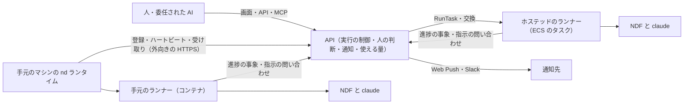
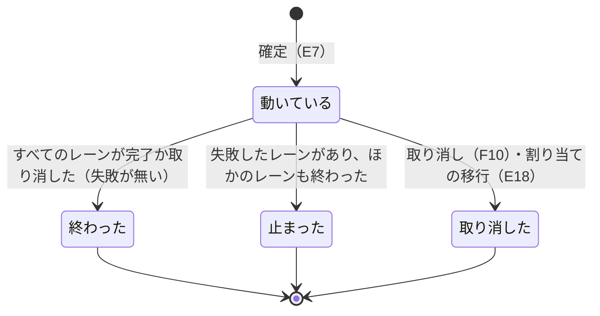
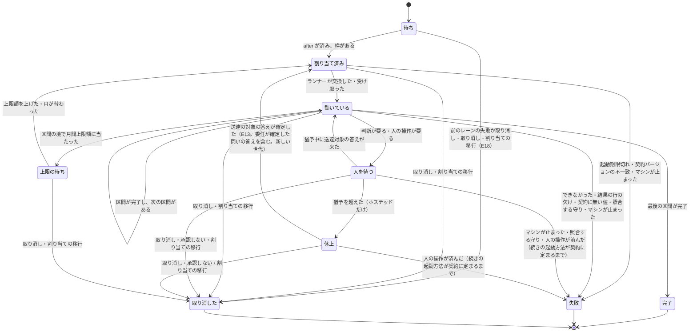
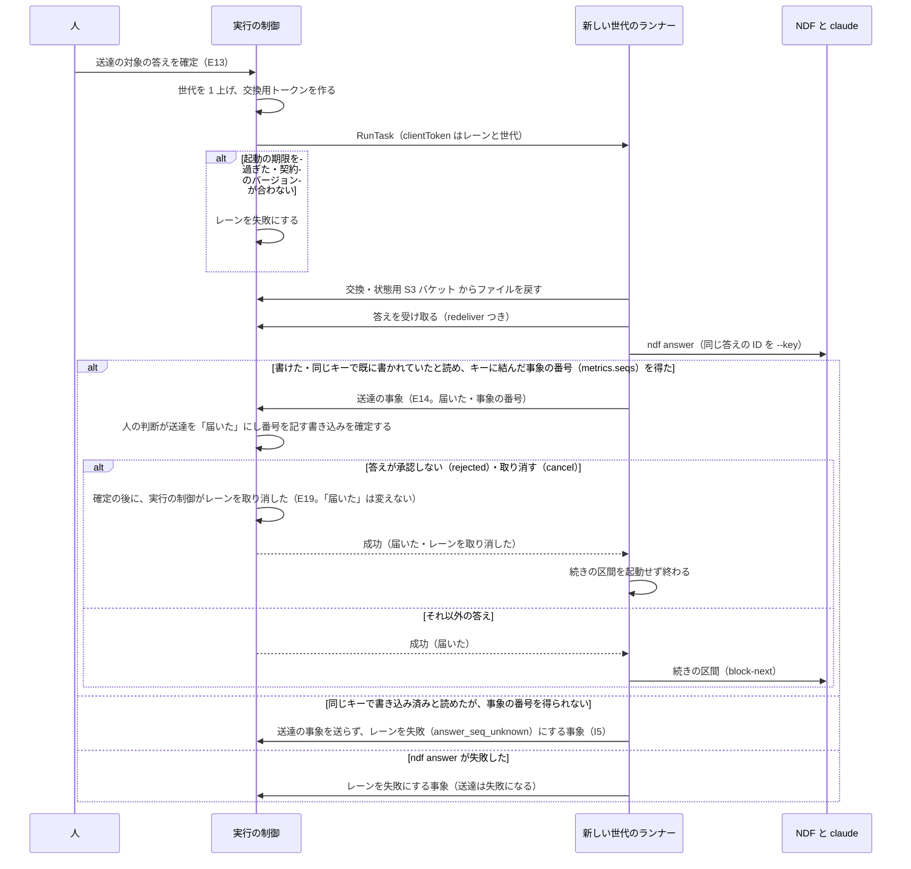
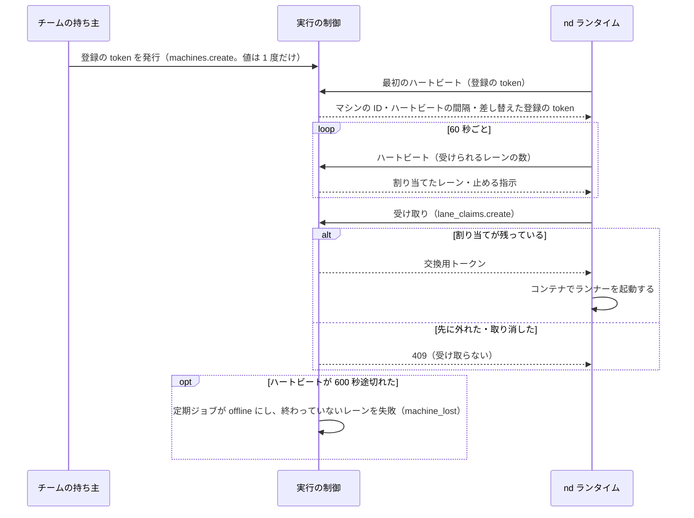
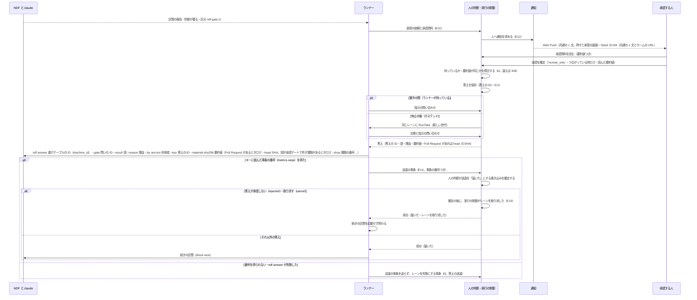
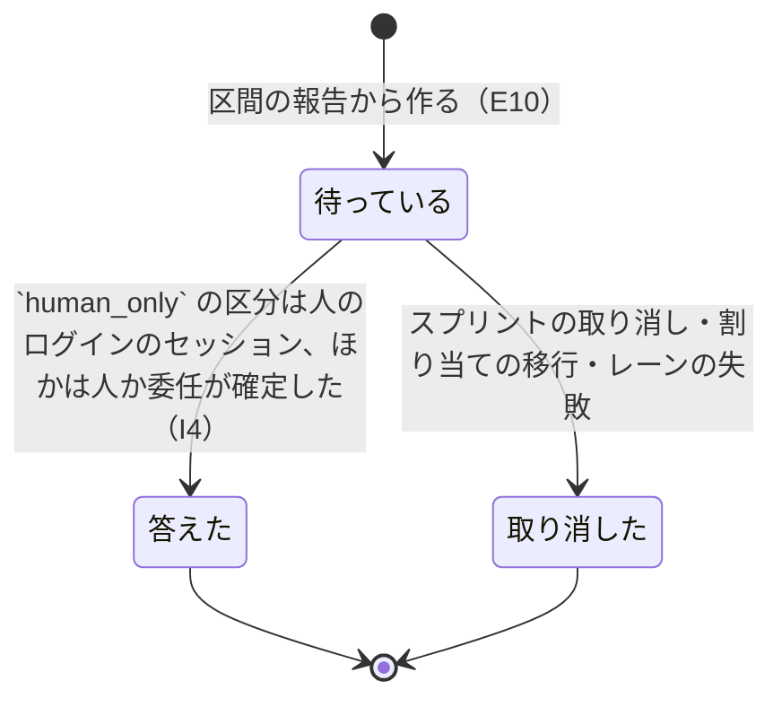

# 実行: 課題を指せば並列に回り、人を待つのは承認と問いだけになる

スプリントとレーンの動き方・実行の場所・NDF との契約と腐敗防止層であるランナー・承認の依頼と問いの流れ・通知・使える量の判定を決める。

| 扱うもの | [全体の設計](overview.md) の項目 |
| --- | --- |
| コンテキスト | 「実行」「人の判断」「通知」「使える量と費用」の 4 つ |
| 場面 | S1・S3〜S5・S10 |
| 機能 | F8・F10〜F15・F17〜F19・F23 |
| 不変条件 | I4〜I8・I11・I13・I21 |

語・番号（S・F・I・E）は [全体の設計](overview.md) のものである。
画面の項目は [画面](screens.md)、HTTP のルートと認可は [API と MCP](api.md)、保存先とインフラは [プラットフォーム](platform.md) が持つ。

## 全体の形

実行のコンテキストの中の部品と、それぞれが書き換えてよいものを先に決める。

| 部品 | 動く所 | 責務 | 書き換えてよいもの |
| --- | --- | --- | --- |
| 実行の制御 | API（Lambda） | スプリントを作る・計画を組む・レーンを実行の場所へ割り当てる・答えを受けて同じレーンを再起動する・取り消す | スプリント・レーン・区間・手元のマシン |
| 進捗のエンドポイント | API（Lambda） | ランナーが送る進捗の事象を、レーンの token と連番で照合して追記する（I13）。事象から実行の制御・人の判断・使える量へ事象を回す | 進捗の事象（追記だけ） |
| 人の判断のモジュール | API（Lambda） | 承認の依頼と問いを作る・答えを確定する（I4）・答えの送達の状態を持つ（I5） | 承認の依頼・問い |
| 通知のモジュール | API（Lambda） | E12 を受けて通知を作り、通知先へ送る | 通知・通知先 |
| 使える量の判定 | API の中の横断の部品（1 か所） | 始める・割り当てる・区間の境で「使えるか」と理由のコードを返す（I8） | 費用の記録（追記だけ） |
| オーガナイザーのレーン | スプリントのレーンと同じ実行の場所とランナー | NDF を起動せず、MCP のツールを持つ claude を動かし、会話の項目を受けて答えを返す。MCP はレーンの token で呼び、API がオーガナイザーの専用の委任を主体にする。交換とハートビートで受けるのはレーンの token と推論の資格情報だけで、GitHub の token と進行テーブルの DB の URL は受けない（[オーガナイザーの資格情報](organizer.md#資格情報)） | 会話の項目（答えの追記と、渡した・受け取った時刻）・会話のキャッシュ（状態用 S3 バケット 内の、そのオーガナイザー用プレフィックスの下だけ） |
| ランナー | ホステッドの ECS のタスク、または手元のマシンの nd ランタイムが起こすコンテナ | NDF を起動し、NDF のファイルを読み、進捗の事象と承認の依頼・問いへ翻訳する腐敗防止層。答えを `ndf answer` で渡す | 何も持たない（API へ送るだけ） |

## スプリントを始める流れ

場面 S1・機能 F8 の流れである。人（または委任された AI エージェント）は、課題を選んで 1 回確定するだけでスプリントが始まる（Value 1）。計画・判定・割り当ては実行の制御が行い、人へ途中の確認を求めない。

| 段 | 何をするか | 決まり |
| --- | --- | --- |
| 1. 課題を選ぶ | 「スプリントを始める」の画面か API で、プロジェクトの課題の候補を読み、1 つ以上を選ぶ | 候補は、プロジェクトに登録したリポジトリの開いている GitHub の課題。NDF の棚卸しの順位があれば順位つきで並べる。読む token は GitHub App の導入の token（読み取りだけ）で、API の中で使って捨てる |
| 2. 計画 | 選んだ課題をリポジトリごとにまとめ、リポジトリごとに 1 つのレーンを作る。リポジトリをまたぐ順序は、レーンの `after`（前に終わっているべきレーンの名前）で表す | 計画の形は NDF の計画の宣言（`parallel-plan.schema.json` の `lane`）の `name`・`repo`・`after`・`rows` にそろえる（決定 60）。`after` の既定は「サブリポジトリのレーンは主リポジトリのレーンの後」ではなく空（並列）で、始める人が画面で順序を付けたときだけ足す。輪になる `after` は 400 で拒む |
| 3. 使える量の判定 | 判定の 1 か所へ「このチームがこのスプリントを始められるか」を問う | 月間上限額に当たっていれば、スプリントを作らずに理由のコードを返す（E16）。同時に動くレーンの数は、ここでは拒否せず段 5 で待たせる（決定 76） |
| 4. 実行の場所を選ぶ | チーム設定にある実行の場所と推論の手段を、スプリントへ写す | 下の [実行の場所](#実行の場所) の「どちらを選ぶか」。スプリントの途中で場所を変えない |
| 5. レーンの割り当て | `after` が済み、使える量の判定が枠を返したレーンから、実行の場所へ割り当てる（E8） | 割り当ては条件付き書き込みで 1 レーン 1 つだけ（I7）。枠が無いレーンは「待ち」に残り、ほかのレーンが終わったときに判定し直す |

確定のリクエストは冪等キーを持つ（形は [呼び出しの規約](api.md#呼び出しの規約)）。同じキーの 2 回目は同じスプリントを返し、2 つ目を作らない。

### 1 つのレーンの中の課題

レーンは、1 つのリポジトリの、スプリントで選んだ課題を NDF で回す単位である。現行版では、1 つのレーンが課題の数だけ進行テーブル（NDF のスプリントのステートマシン）を持つ。

固定したバージョンの NDF の契約は、起動のインタフェース `skill-workflow` の引数を 2 つに限る（`entrypoints.json` の `skill-workflow` の `args`）。「課題の番号 1 つ（`#N`）」か「開発ループ（`--loop`）」である。複数の課題を 1 回の起動で渡すインタフェースは契約に無い。そこで、契約がそのインタフェースを持つまでは、ランナーはレーンの課題を選んだ順に `#N` で 1 つずつ起動する（決定 61）。この間、同じリポジトリの課題はレーンの中で順に流れ、並列はリポジトリの間だけになる。

進行テーブルは、`#N` で起動した NDF の `skill-workflow` が、その課題のために作る。ランナーも API も `ndf progress new` を打たない（決定 61）。そのため、進捗の読み出しと答えの送達に使う進行テーブル ID（`machine_id`）は、レーンで 1 つに固定せず、課題ごとに決まる。

| 場面 | 使う進行テーブルの ID |
| --- | --- |
| 承認の依頼と問いを作る（E10） | その依頼や問いを出した区間の課題の進行テーブルの ID を、依頼と問いのレコードに記す（得方は決定 106。[未確認のまま残ること](#未確認のまま残ること)） |
| 答えを渡す（`ndf answer`） | 答える依頼や問いのレコードに記した進行テーブルの ID。レーンで最初に作られた進行テーブルの ID や、いま動いている課題の進行テーブルの ID を使わない |
| 進捗を読む・照合する守り（`ndf progress show`） | その区間の課題の進行テーブルの ID。課題が替わったら、次の課題の進行テーブルを読む |

## スプリントとレーンの状態

### スプリントの状態

スプリントの状態は、レーンの状態から決まる。人を待つものがあるかはスプリントの状態にせず、承認の依頼と問いを並べた一覧から読む（[承認待ちの一覧](screens.md#承認待ちの一覧)）。

| 遷移 | 決まり |
| --- | --- |
| レーンが失敗した | そのレーンを `after` に持つレーンは「取り消した」（理由: 前のレーンが失敗した）にする。`after` で結ばれていないレーンは続ける |
| すべてのレーンが終わった | スプリントの状態は、終わったレーンの組で決める。失敗したレーンが 1 つでもあれば「止まった」。失敗が無ければ、取り消したレーンがあっても「終わった」にする。人が承認しない・取り消すと答えてレーンが取り消しになったときと、前のレーンが取り消されたために後のレーンも取り消しになったときが当たる。取り消しは人の判断で、スプリント全体の取り消し（F10）でも失敗でもないためである。単一のレーンのスプリントで人が承認しなかったときも「終わった」になる |
| 終わった・止まった | E15 を出す。E15 は完了・失敗・取り消したレーンの数を持つ。通知（始めた人へ）と費用の締めが受ける |
| 取り消した | 動いているレーンを止める（ホステッドはタスクを止め、手元のマシンは次のハートビートで止める指示を返す）。レーンの token と渡した GitHub の token を断つ。待っている承認の依頼と問いは「取り消した」にし、答えを受けない |
| 失敗したレーンのやり直し | 最初のバージョンは持たない。新しいスプリントを始める。`ndf-ask:human-action` の問いで止まったレーンも、続きの区間の起動方法が契約に定まるまでは、人が「済んだ」と答えたら失敗にする（下の表）。定まった後は同じレーンで続ける形へ設計を戻す |

### レーンの状態

図はレーンの遷移のすべてを持つ。本文と他の文書が書く遷移（割り当ての移行の取り消し・`machine_lost`・`contract_mismatch` など）は、この図の辺のどれかに当たる。図に無い遷移は書かない。

「人を待つ」「休止」からレーンを続ける 2 つの辺（猶予の間の答え・休止の後の再起動）は、[答えの送達](#答えの送達) の対象の答え（`/v1/runner/answers/list` に載る答え）だけで通る。`ndf-ask:human-action` の答えは送達の対象外で、この 2 つの辺を通らない。実行の制御は E13 でその答えを受けたら、ランナーへ渡さず `RunTask` も打たずに、「済んだ」ならレーンを「失敗」（`human_action_resume_undefined`）、「取り消す」なら「取り消した」へ進める（E19。続きの区間の起動方法が契約に定まるまで。[区間と結果の行](#区間と結果の行)）。「人を待つ」の間のランナーは、レーンの終わりを 401 で知って止まる。レーンが終わると API は期限の前でもレーンの token を断つため（[API の文書の token の有効期間](api.md#token-の有効期間)）、その後に指示を問い合わせる（`/v1/runner/answers/list`）とハートビートはどちらも 401（`unauthorized`）になる。ランナーはレーンの token で 401 を受けたら、答えを待たずに進行テーブルの DB の接続を閉じて終わる。空の一覧は「まだ答えが無い」ことだけを表し、レーンの終わりを表さない（`ndf-ask:human-action` の答えは一覧に載らないため、一覧の中身で終わりを読まない）。

レーンのレコードは、実行の場所への割り当て（場所の種類・タスク ID かマシン ID・世代番号）を 1 つだけ持つ。世代番号は割り当てのたびに 1 つ上がり、レーンの token は世代に結ばれる。前の世代の token からのリクエストは 401 になる（I7・I11）。

### 区間と結果の行

区間は、ランナーが claude（`NDF_FACTORY_RUN` を入れた人のいない実行）を 1 回起動して、次の区切りまで動かした分である。区間が終わったら、ランナーは claude の最後の応答の末尾にある区間の報告を読む。値は応答の文の**最後の** `- 結果:` の行だけで決める（決定 62、I6）。

| 区間の報告 | 区間 | レーン |
| --- | --- | --- |
| `完了` で、`ndf-next` のブロックがある（カットポイント） | 成功で閉じる | 動いているまま。ブロックの中身（`block-next` のインタフェースの形）で次の区間を起動する |
| `完了` で、ブロックが無い | 成功で閉じる | その課題が終わった。レーンの次の課題があれば `#N` で次の区間、無ければ「完了」 |
| `判断が要る` | 成功で閉じる | 「人を待つ」。区分・承認ゲート・問い（項目「質問」）・Pull Request・材料から承認の依頼か問いを作る（E10。[承認と問いの流れ](#承認と問いの流れ)） |
| `できなかった` で、区分が `ndf-ask:human-action` | 成功で閉じる | 「人を待つ」。「人に頼むこと」を問いにする。続きの区間の起動方法は契約に無い（`次のコマンド:` の行は `shape.items` に無く、行の無い報告も有効である）。そこで、契約に定まるまでは、人が「済んだ」と答えたら問いを「答えた」で閉じ、レーンを「失敗」（理由のコードは `human_action_resume_undefined`）にして始めた人へ通知する。人は新しいスプリントで続ける。`次のコマンド:` の行が報告にあっても使わない。「取り消す」ならレーンを取り消す（決定 108。[未確認のまま残ること](#未確認のまま残ること)） |
| `できなかった`（ほか） | 失敗で閉じる | 「失敗」。理由の行を進捗の事象に残す |
| `- 結果:` の行が無い | 失敗で閉じる | 「失敗」。理由のコードは `result_line_missing` |
| 値が `完了`・`判断が要る`・`できなかった` のどれでもない（例: `保留`） | 失敗で閉じる | 「失敗」。理由のコードは `result_value_unknown` と読んだ値（伏せ字を通す） |
| claude が異常終了した・区間の時間の上限を超えた | 失敗で閉じる | 「失敗」。理由のコードは `segment_crashed`・`segment_timeout` |

失敗で閉じた区間は自動で繰り返さない。

区間の報告の決まりは、契約の `C/hooks/unattended-report.json`（`C/` は [NDF との契約](#ndf-との契約) の略）にある（決定 108）。

| 決まり | 書かれている所 |
| --- | --- |
| 「最後の `- 結果:` の行で読む」と、結果の行より後ろの `- <項目>: <値>` の行を項目として読むこと | `rule` |
| 結果の値の 3 つ | `shape.values` |
| 項目の名前（結果・課題・区分・承認ゲート・質問・Pull Request・材料・人に頼むこと・理由） | `shape.items` |
| 値ごとに要る項目 | `shape.required` |
| 材料の形（`本文` か `https://` の URL） | `shape.material` |

## 実行の場所

### どちらを選ぶか

| 決まり | 中身 |
| --- | --- |
| 選ぶ所 | チームの持ち主が、チームの設定で「ホステッド」か「手元のマシン」と推論の手段を決める（F17）。スプリントは始める時にその値を写す（決定 68） |
| 自動で移さない | ホステッドに空きが無い・手元のマシンが止まったときも、もう一方へ移さない。コードと NDF の状態が置かれる所が変わり、チームが選んだ保存先の外へ出るためである |
| 使えないとき | ホステッドを料金プランが許さない・推論の手段が使えない（`managed` で推論の役割が無い環境、`byok` でキーが無い）なら、使える量の判定が段 3 で理由のコードを返す。手元のマシンで受け取れるマシンが 1 台も `online` でなければ、レーンは「待ち」に残り、10 分を超えたら始めた人へ通知する |
| 推論の手段 | ホステッドは `managed`（Bedrock、API が一時の資格情報を渡す）か `byok`（チームがシークレットへ置いた API キー）。手元のマシンは `byok` だけで、マシンの claude のログインを使い、サービスは推論の資格情報を渡さない（決定 67） |

### ホステッド

ECS Fargate のタスクを `RunTask` で 1 レーンに 1 つ起こす。タスクは公開のサブネットで公開 IP を受け、NAT を通らずに API・GitHub・Bedrock へ出る（[インフラ](platform.md#インフラ)）。タスクの役割は AWS の権限を持たない（I11）。

| 段 | 中身 |
| --- | --- |
| 起こす | 実行の制御が、10 分・1 回だけの交換用トークンを作り、`RunTask` の環境の上書きで渡す。`clientToken` は「レーンの ID と世代の番号」で、同じ世代の再起動の送り直しは 2 つ目のタスクを作らない（決定 64、LIB61） |
| 交換する | ランナーは交換用トークンを API へ出し、次を受ける: レーンの token（1 時間）・レーンの指示（課題・リポジトリ・起動のインタフェース）・そのリポジトリ 1 つに絞った GitHub の token・そのプロジェクトの進行テーブルの DB の URL・`managed` なら推論の一時の資格情報、`byok` ならチームの API キー。オーガナイザーのレーンは、レーンの token と推論の資格情報だけを受ける（[オーガナイザーの資格情報](organizer.md#資格情報)）。状態用 S3 バケット の署名つき URL は交換では受けず、NDF のファイルを送る・受ける直前に `/v1/runner/state_urls/create` で受ける（[データの署名つき URL](data.md#署名つき-url)） |
| ハートビート | 60 秒ごとに API へハートビートを送り、レーンの token と推論の資格情報を期限の前に再取得する。レーンの終わり・取り消し・割り当ての変更の後は、API が再取得を拒否する |
| 指示の問い合わせ | 「人を待つ」の間、10 秒ごとに答えの指示を問い合わせる。レスポンスが 401 なら、レーンが終わった（または世代が替わった）として止まる。空の一覧では待ち続ける（[レーンの状態](#レーンの状態)） |
| 承認の待ちの猶予 | 待ちが猶予（設定の値、既定 5 分）を超えたら、ランナーは NDF の手元のファイルを状態用 S3 バケット へ固め、「休止」の事象を送り、進行テーブルの DB の接続を閉じて終わる（決定 65）。レーンの割り当ては外さない |
| 再起動する | 休止の間に [答えの送達](#答えの送達) の対象の答えが確定したら（E13。委任が確定した問いの答えを含む）、実行の制御は同じレーンの世代を 1 つ上げ、新しい交換用トークン で `RunTask` を打つ。新しいタスクは状態用 S3 バケット からファイルを戻し、答えを受けて `ndf answer` を打ち、送達の事象（E14）を送る。その後は答えの選択肢で分かれる: 「承認しない」（`rejected`）・「取り消す」（`cancel`）なら次の区間を起動せず、実行の制御が、人の判断モジュールが「届いた」の書き込みを確定してからレーンを「取り消した」にする（E19。確定の前には取り消さない。通知の経路は [答えの送達](#答えの送達) の「渡した後の取り消し」）。それ以外の答えなら次の区間を起動する（[差し戻し](#差し戻し)）。`ndf-ask:human-action` の答えでは起こし直さず、レーンを失敗か取り消しへ進める（[レーンの状態](#レーンの状態)） |
| 起動の期限 | 割り当てから 10 分の間に交換が無ければ、そのレーンを「失敗」（理由 `runner_not_started`）にする |

再起動の順序と失敗時の分岐は次のとおりである（答えの送達は [答えの送達](#答えの送達)）。図の答えは送達対象の答えだけで、`ndf-ask:human-action` の答えはこの図に入らない。

「同じキーで既に書かれていた」ときの `ndf answer` の終了コードと出力は実測していない（[確認できなかったこと](#確認できなかったこと)）。#6 の詳細設計で実測し、2 回目が成功の終了コードを返すなら図のとおりにする。失敗の終了コードを返すなら、ランナーはその出力が同じキーの書き込み済みを示すときだけ書き込み済みとして扱う。どちらの場合も「届いた」として E14 と続きの区間へ進むのは、キーに結んだ事象の番号を得たときだけで、得られなければ I5 のとおり `answer_seq_unknown` でレーンを失敗にする。どちらでもなく見分けられないなら、決定 100 を決め直して設計承認ゲートへ戻す。

待ちの間はタスクも DB の接続も無いため、Fargate と Aurora の計算の費用が止まる（[費用](platform.md#費用)）。猶予を持つのは、すぐ答えたときに再起動の待ち（タスクの起動と DB の再開）を足さないためである（Value 1）。

### 手元のマシン

チームが登録した利用者のマシンで、nd ランタイムがレーンを受け取り、コンテナでランナーを動かす（F18）。nd ランタイムはリッスンするポートを開かず、外向きの HTTPS だけで API とやり取りする（決定 67、PRD60）。

| 段 | 中身 |
| --- | --- |
| 登録 | チームの持ち主が画面で登録の token を発行する（値は発行のレスポンスに 1 回だけ載り、サービスは要約値だけを持つ）。マシンはそのとき「登録待ち」になる。登録の経路は持たず、最初のハートビートが登録を兼ねる。最初のハートビートのレスポンスで、マシンの ID・ハートビートの間隔・差し替えた登録の token を受け、画面に見せた値は 1 回使った時点で使えなくなる（決定 102。経路は [API の文書の手元のマシンの HTTP のルート](api.md#ランナー手元のマシンの-http-のルート)）。登録の token を取り消すと、そのマシンは次の定期ジョブで止まる |
| ハートビート | 60 秒ごと。同時に受けるレーンの数（1〜16、マシンが申告する）を添える。最後のハートビートから 600 秒を超えたマシンは定期ジョブが `offline` にし、そのマシンの終わっていないレーンを「失敗」（理由 `machine_lost`）にする |
| 受け取り | ハートビートの後に空きがあれば受け取りを出し、割り当て済みのレーンの指示とレーンの token を受ける。割り当ては「待ち」のレーンを、そのチームの `online` で空きのあるマシンへ、ハートビートの新しい順に寄せる |
| 動かす | レーンごとにコンテナを起こし、ホステッドと同じランナーを動かす。進行テーブルの DB の URL は渡さない（DB は外から接続できない保存先にある。[データの進行テーブルの DB](data.md#進行テーブルの-db)）。NDF の状態はマシンの手元の既定（`progress.sqlite`）に置く |
| 人を待つ | 休止しない。NDF の状態がマシンの手元にあり、別のマシンへ移せないためである。レーンは同じマシンに留まり、空きの数に数える |
| 終わり | レーンのプロセスが終わったら終わりを通知し、届いてからレーンの作業場所を消す |

マシンの状態は「登録待ち」・`online`・`offline` の 3 つである。登録と受け取りの順は次のとおりである。

### I7・I11 をどう守るか

| 不変条件 | 守り方 |
| --- | --- |
| I7 1 レーンに同時に 1 つ | 割り当ては「レーンのレコードに割り当てが無い、または前の世代が終わっている」を条件にした書き込みだけで行う。ホステッドの `RunTask` の `clientToken` も世代で決まる。進捗のエンドポイントは、今の世代でない token の事象を 401 で拒否する |
| I11 権限を持たない・token はレーンの間だけ | タスクの役割は権限の文を持たない（検査がスタックの合成の出力で照合する）。ECR の取得とログはタスクの実行の役割が受け持ち、タスクの中のプログラムからは使えない。レーンの token・推論の一時の資格情報・GitHub の token は 1 時間以内で、レーンの終わり・取り消し・割り当ての変更で再取得を拒否する。手元のマシンの登録の token はレーンの token と別で、レーンのコンテナへ渡さない |

## ランナーの責務

ランナーは、NDF の語をサービスの語へ写す腐敗防止層である。サービスの API・画面は NDF のファイルの形を知らない。知るのは、ランナーが送る進捗の事象と、承認の依頼・問いの形（スキーマの正本、`packages/contracts/`）だけである。

| 責務 | 決まり |
| --- | --- |
| NDF を起動する | 呼べるインタフェース（[NDF との契約](#ndf-との契約)）だけで claude を起こす。環境変数は契約が許す名前の一覧から組み、ほかの名前は子のプロセスへ渡さない（端末向けの中継・リレーハブの系の変数を含む） |
| 進捗の事象へ訳す | 区間の間は 30 秒ごとと区間の終わりに、契約の `reader: service` のファイルのうち使うものを読み、増えた行を進捗の事象へ訳して送る（決定 63）。事象はレーンの ID・世代・連番を持ち、エンドポイントは同じ連番の 2 件目を足さない（I13） |
| 承認の依頼と問いへ訳す | 区間の報告が `判断が要る` か `ndf-ask:human-action` なら、区分で承認の依頼か問いを選んで送る（E10）。承認資料の材料（下の [承認と問いの流れ](#承認と問いの流れ)）を集めて添える |
| 答えを 1 回だけ渡す | 答えを受けたら答えの ID をキーに `ndf answer` を打ち、事象の番号を添えて送達の事象を送る（E14、I5。決定 71・100。再起動のリトライは [答えの送達](#答えの送達)） |
| 伏せ字 | API へ送る前のすべての本文（事象・承認資料・問い・ログ）に、スキーマの正本にある秘密のパターン表でマスクをかける。値の一部も残さない |
| 承認ゲートを無効にさせない | 下の「守り」（決定 70） |
| 費用の量を送る | 区間の終わりに、区間の時間と claude の結果の推論の量（入力・出力・キャッシュの token の数）を事象で送る |

読むファイルと、訳す先の事象:

| NDF のファイル（`ndf-files.json` の id） | 読むか | 訳す先の進捗の事象 |
| --- | --- | --- |
| 区間の報告（claude の最後の応答） | 読む | 区間の終わり（結果・区分）・承認の依頼・問い |
| `plan-progress`（`step`・`attention`） | 読む | 工程の進み（どの工程のどの段か）・注意 |
| `ask-journal`（`ask.jsonl`） | 読む | 判断の記録（AI が自分で決めた問いを含む）。承認の依頼と問いの ID の材料 |
| `gate-rejections`（`gate-rejections.jsonl`） | 読む | 差し戻しの記録 |
| `issue-request` | 読む | 起票の依頼（[起票の依頼](#起票の依頼)） |
| `loop-record` | 読まない | 開発ループを使わないため |
| `organizer-*` の 4 行 | 読まない | オーガナイザーの保存先を使わないため（決定 73） |

### 守り: 承認ゲートを無効にさせない

コンテナの中の claude が `ndf answer` を打つか答えを直に書けば、人の答え無しに承認ゲートを通れる。NDF は `--by service:<主体>` の答えをどこまで信用するかを契約に持たない。そこで 2 つの守りを重ねる（決定 70）。

| 守り | 中身 |
| --- | --- |
| 防ぐ: 別の OS の利用者 | コンテナの中で、ランナーと claude を別の OS の利用者で動かす。レーンの token・GitHub token の再取得・推論の資格情報の再取得はランナー用の利用者だけが持つ |
| 防ぐ: 答えのファイル | NDF が答えを書くファイルはランナーの利用者が持ち、claude の利用者に書き込みの権限を与えない。権限は OS が掛けるため、claude が起こす子のプロセスにも効く。承認の依頼を書くファイルは claude の利用者が書ける |
| 防ぐ: 許可の設定 | claude の許可の設定でも `ndf answer` と答えのファイルへの書き込みを拒む。許可の設定は claude のツールと認識できるコマンドにだけ効くため、重ねる守りに留める |
| 照合する | キャッシュは、API が `/v1/runner/answers/list` のレスポンスの `delivered_seqs` で返す、そのレーンに届いた答えの事象の番号から組む（起動し直したランナーも受け取りの 1 回目で再取得し、照合には最後の E14 の確定を反映したキャッシュを使う。[答えの送達](#答えの送達)）。区間の後に `ndf progress show <進行表の ID（machine_id）>` で答えの事象（`answered`・`row_answered`）を読み、キャッシュの番号に無い答えが現れたら、レーンを「失敗」（理由 `answer_outside_runner`）にし、始めた人とチームの持ち主へ通知し、進捗の事象に残す（I5） |

答えが進行テーブルの DB の行として書かれるバージョンの NDF では、claude の利用者も `NDF_PROGRESS_DB` の URL で答えのレコードを書ける。そのときはファイル権限による保護が効かない。そこで、ランナーと claude で DB のログインの役割を分け、claude の役割から答えのテーブルへ書けないようにする形へ設計を戻す（[未確認のまま残ること](#未確認のまま残ること)）。

## NDF との契約

NDF（devbasex/ai-plugins の `ndf` プラグイン）は上流である。nd-factory は、契約のファイル（`plugins/ndf/contracts/`）に載るものだけでやり取りする。NDF の集約を直に書かず、NDF の内部のスクリプトと状態のファイルに頼らない。以下の表の `C/` は `plugins/ndf/contracts/` の略である。

| 項目 | 決まり | 契約の保存先 |
| --- | --- | --- |
| 固定の保存先 | 使う NDF のコミットは `ndf-pin.json` のキー `ndf_ref` の 1 か所だけに置く。ランナーのイメージはそのバージョンの NDF を入れて作る | `ndf-pin.json`（このリポジトリ） |
| NDF 11 の名前 | この文書の NDF の名前（記録の ID `ask-journal`・インタフェース `file-journals`・設定のスキーマのインタフェース `spec-ndf_settings`・答えの語 `request_changes`・`ndf answer` と `ndf progress` の位置引数と結果の ID `machine_id`）は、固定の点（ndf v11.0.12 の配布コミット）での契約名である。旧い名前（NDF 11 より前の契約名）を書かない | `C/domains/ndf-files.json`・`C/domains/entrypoints.json`・`C/facts/answers.json`・`C/schemas/io/answer.args.schema.json` |
| 契約のバージョンの照合し | 契約のバージョンは `C/version.json` の `history` の最後の行（バージョンと sha256）。nd-factory は「受ける契約のバージョンと sha256 の組」の集合をスキーマの正本のデータ内に 1 か所だけ置き、ランナーは起動の時に照合する。集合に無ければ claude を起こさずにレーンを「失敗」（理由 `contract_mismatch`）にする | `C/version.json`（固定の点でバージョン 8・sha256 `ed8b036584bec284dfc93a2bb5b988e2385b4f8f297d659399f5d3cb91b520c4`。受ける組はこの 1 つ。固定の点を付け替える変更で、受ける組も同じ変更で直す。決定 104） |
| バージョンの数字を比べない | NDF のバージョンの数字（`NDF_VERSION` の値・プラグインのバージョン）を読んで大小を比べる処理を書かない。参照の検査が落とす。機能の有無は契約のバージョンと sha256 で判断する | — |
| 呼べるインタフェース | `C/domains/entrypoints.json` の 15 行のインタフェースだけ。nd-factory が使うのは下の「使うインタフェース」の表の行だけ | `C/domains/entrypoints.json` |
| 渡す環境変数 | インタフェースのレコードの `env` 列に載る名前だけ。値の出所は下の表「渡す環境変数」 | `C/domains/env.json`・各インタフェースの `env` |
| 読むファイル | `C/domains/ndf-files.json` の `reader: service` の行のうち、[ランナーの責務](#ランナーの責務) の表で「読む」とした行だけ。読み手は知らない項目を受け流す | `C/domains/ndf-files.json` |
| 承認の答えの渡し方 | `ndf answer` の副命令だけ。答えのファイルを直に書かない | `C/schemas/io/answer.args.schema.json` |
| 承認ゲートの名前 | 正の名前「設計承認ゲート」「リリース承認ゲート」だけを API・画面・事象の値に使う | `C/domains/entrypoints.json` の `gate-record`・`C/domains/entrypoint-cases.json` の `gate-legacy`（`valid: false`） |
| 答えの語 | 承認ゲートの結果の `routes` のキー。語の一覧は `C/facts/answers.json`（`approved`・`rejected`・`request_changes`・`retry`・`finish`・`cancel`） | `C/facts/answers.json`・`C/schemas/result.schema.json` |
| 契約の照合 | 下の「契約の照合の定期の検査」（F23） | — |

使うインタフェース:

| インタフェース（`entrypoints.json` の id） | 種類 | nd-factory での使い方 |
| --- | --- | --- |
| `skill-workflow` | skill | レーンが持つ課題ごとに最初の区間を `#N` で起こす。`--loop` は使わない |
| `block-next` | block | カットポイントと答えの後に続く区間を、区間の報告にある `ndf-next` ブロックの中身で起こす |
| `report-unattended` | report | `C/hooks/unattended-report.json` の形（`rule`・`shape`）で区間の報告を読む。インタフェースのレコードの `source` は無い保存先（`forms/unattended-report.json`）を指すため、保存先は `source` から引かない（決定 108） |
| `hook-unattended-start`・`hook-unattended-stop`・`hook-unattended-end` | hook | NDF のプラグインが claude に登録する。ランナーは `NDF_FACTORY_RUN` を入れるだけで、hook を足さない・外さない |
| `file-plan-progress`・`file-journals`・`file-issue-request` | file | 読むファイルの保存先 |
| `gate-record` | command | ランナーは打たない。承認ゲート名の正しい値の出所として使う |
| `spec-io` | spec | `ndf answer` と `ndf progress show` の引数を `C/schemas/io/` の引数のスキーマで組み、打つ前に照合する |
| 使わないインタフェース | — | `file-organizer`（オーガナイザーを使わない、決定 73）・`file-loop-record`（ループを使わない）・`spec-pages`・`spec-ndf_settings`（設定のページを最初のバージョンに持たない） |

渡す環境変数:

| 名前 | 渡すか | 値の出所 | 秘密 |
| --- | --- | --- | --- |
| `NDF_FACTORY_RUN` | 渡す | 空でない固定の値 | いいえ |
| `NDF_VERSION` | 渡す | イメージに入れた NDF が名乗る値をそのまま。読んで比べない | いいえ |
| `NDF_STATE_HOME` | 渡す | コンテナ内にあるレーンの作業場所の下 | いいえ |
| `NDF_MVV_STATE_DIR` | 渡す | 同上。`ask.jsonl`・`gate-rejections.jsonl` の保存先 | いいえ |
| `NDF_ISSUE_REQUEST_FILE` | 渡す | 作業のリポジトリの外のファイル | いいえ |
| `NDF_PROGRESS_DB` | ホステッドだけ渡す | 交換で受けた、そのプロジェクトの進行テーブルの DB の URL（I10）。手元のマシンには渡さない | はい |
| `GH_TOKEN` | 渡す | 交換・ハートビートで受けた、レーンのリポジトリ 1 つに絞った GitHub App の導入の token（決定 69） | はい |
| `NDF_LOOP_EXCLUDE` | 渡さない | 開発ループを使わない | — |
| `NDF_ORGANIZER_DIR`・`NDF_ORGANIZER_LANE` | 渡さない | オーガナイザーの保存先を使わない（決定 73） | — |

秘密の値はプロセスの環境だけに置き、ファイルとログに書かない。claude の推論の設定（`managed` の Bedrock の設定、`byok` の API キー）は NDF の契約の外にある。これは claude 自身の設定として渡す（[推論の資格情報](#推論の資格情報)。オーガナイザーのレーンの `byok` はキーを渡さず、推論の中継の送信先だけを渡す）。

### 推論の資格情報

| 手段 | 渡し方 |
| --- | --- |
| `managed` | API が推論だけの IAM の役割を `sts:AssumeRole` で引き受け（セッションの名前はレーンの ID、期間は 1 時間）、得た一時の資格情報を交換とハートビートでランナーへ渡す。Lambda の役割から引き受けるため役割の連鎖になり、1 時間を超えられない（LIB62）。claude には起動時の環境の値で渡さず、設定の `awsCredentialExport` に小さなコマンドを置く。コマンドはランナーがコンテナの中だけで開くローカルのソケットから今の値を受けて返す。claude はセッション開始時と読み直しのたびにこのコマンドを打ち、`Expiration` の 5 分前まで値を持つ（LIB63、決定 66） |
| `byok`（ホステッド） | チームがシークレットへ置いた API キーを交換で受ける。スプリントのレーンでは、claude のプロセスの環境だけに入れる。オーガナイザーのレーンでは claude の環境に入れず、ランナーだけが持ち、claude にはランナーの推論の中継を通して使わせる（[オーガナイザーの資格情報](organizer.md#資格情報)） |
| `byok`（手元のマシン） | マシンの claude のログインを使う。サービスは何も渡さない |

### 契約の照合の定期の検査

機能 F23 である。CI の検査で行い、AWS の資格情報を持たない（決定 79）。

| 項目 | 中身 |
| --- | --- |
| いつ | すべての Pull Request・main への push・毎日 1 回（手でも起こせる）。どの起動でも固定の点とデフォルトブランチの HEAD の両方を照合する。照合する相手のスキーマの正本（呼び出しの判定と NDF の契約の使い方）は、固定の点を変えない Pull Request でも変わるためである（決定 79） |
| 何を読むか | 固定の点の契約のファイルと、ai-plugins のデフォルトブランチ（リポジトリの `default_branch`。ブランチの名前は書き込まずリポジトリの設定から引く）の HEAD の契約のファイル（読むだけ。決定 107） |
| 何を照合するか | (1) `C/domains/entrypoint-cases.json` のサンプルを 2 段で照合する。先に、すべてのサンプル（固定の点 `ndf--v11.0.36` では 26 件）が参照するインタフェースの id が `C/domains/entrypoints.json` にあるかを確かめ、無ければ食い違いにする。この段は使うインタフェースで絞らない。次に、上の「使うインタフェース」の表に載るインタフェースへのサンプル（同じ固定の点で 21 件）だけを、ランナーの呼び出しの組み立てと環境変数の組み立てへ通し、`valid` と同じ判定になるかを比べる。使わないインタフェースのサンプルは、この判定の比較から外す。使い方のデータが表のインタフェースをちょうど持つことは、スキーマの正本の単体テストで確かめる（[NDF の固定の点を上げて照合を必ず実行する課題 #136](https://github.com/devbasex/nd-factory/issues/136) の設計の決定 4）。(2) `C/version.json` の最後の行が、受ける契約バージョンの集合にあるか。(3) インタフェースと実行の場（ホステッド・手元のマシン）の組ごとに、ランナーが組む環境変数の名前がインタフェースの `env` 列と `C/domains/env.json` の行にあり、その行の `set_by` が許す値か。ランナーの使い方の `set_by` の許容（`envSetBy`。名前と `set_by` の値の組。固定の点では `GH_TOKEN`・`NDF_STATE_HOME` の `user`）に載せた名前は、`set_by` が載せた値と一致することを求める（`service` でも載せた値と違えば食い違い）。載せない残りの名前は `set_by` が `service` であることを求める。(4) `C/domains/ndf-files.json` の `reader: service` の行の `fields` が、翻訳が読む項目を含むか。あわせて、読むファイルの行の `path` が、ランナーの使い方に写した `path` と同じか（#136 の設計の決定 5）。(5) `C/hooks/unattended-report.json` の `shape.values`・`shape.items`・`shape.required`・`shape.material` が、ランナーが区間の報告から読む値と項目を含むか。あわせて同じファイルの `cases` のサンプルを、ランナーが区間の報告を読み取る処理へ通し、`result` と `errors` の有無が同じ判定になるか（決定 108）。(6) 使うインタフェースが `C/domains/entrypoints.json` にあり、ランナーの使い方に写した行の `kind`・`target`・`lead`・`args`・`env`・`files` が契約の行と同じか（#136 の設計の決定 5） |
| 落ちたとき | 固定の点で落ちたら検査を失敗にする（CI の失敗として運用する人が受ける）。デフォルトブランチの HEAD だけが食い違うときは、固定の点を変えずに検査の要約へ食い違ったサンプルの id（`id` を持たない `cases` は配列の位置）と契約ファイルのパスを並べる。`C/hooks/unattended-report.json` では、足された・消えた・名前の変わった項目（`shape.items` などの差分）も並べる |
| 通ったときの差分 | 判定が通っても、デフォルトブランチの HEAD の `C/hooks/unattended-report.json` の `shape.values`・`shape.items`・`shape.required`・`shape.material` を固定の点と比べ、1 つでも違えば検査の要約へ差分（足された・消えた・名前の変わった値と項目、要る項目の変わった値）を並べる。任意の項目だけが足されサンプルの判定が変わらない場合も、この差分で先端での追加を通知する。検査は失敗にせず、固定の点を付け替える Pull Request で読み方を足すかを決める材料にする |

## 承認と問いの流れ

場面 S3・S4、機能 F11〜F13 の流れである。人を待つものは 2 種類だけである。

| 種類 | 中身 |
| --- | --- |
| 承認の依頼 | NDF の設計承認ゲート・リリース承認ゲート・レッドラインに当たる操作 |
| 問い | NDF の区分つきの問い |

### 区分と、だれが答えられるか

区分は区間の報告にある「区分」行の値である（NDF の `asking.md` の区分の表）。

| 区分 | 種類 | `human_only` か | 答えの選択肢 |
| --- | --- | --- | --- |
| `ndf-gate:1` | 承認の依頼（設計承認ゲート） | `human_only` | 承認ゲートの結果の `routes` のキー（例: 承認する・指摘を添えて差し戻す・承認しない）。設計承認ゲートでは外す課題（`--drop`）を選べる |
| `ndf-gate:2` | 承認の依頼（リリース承認ゲート） | `human_only` | 同上 |
| `ndf-ask:redline:<番号>` | 承認の依頼（レッドライン。`C1`〜`C8`・`P1`・`P2`・スプリントの R） | `human_only` | 承認する・承認しない |
| 起票の依頼（[下](#起票の依頼)） | 承認の依頼（他のリポジトリへの公開。共通原則 C5） | `human_only` でない（人か、その人の委任。利用者の決定、2026-11-24） | 起票する・起票しない |
| `ndf-ask:irreversible` | 問い（取り消せない操作） | プロジェクトの設定（既定は `human_only`。下の「プロジェクトで変えられる区分」） | 問いの選択肢と推しの案 |
| `ndf-ask:cost`・`ndf-ask:legal`・`ndf-ask:<プロジェクトが足した名前>` | 問い | プロジェクトの設定（既定は `human_only`） | 問いの選択肢と推しの案 |
| `ndf-ask:human-action` | 問い（人の操作の待ち） | `human_only`（人にしかできない操作の後に「済んだ」と答えるため） | 済んだ・取り消す |
| 区分の無い値・知らない区分 | 問い | プロジェクトの設定（既定は `human_only`。見せてよいか迷うときと同じく、強い側へ倒す） | 承認する・承認しない |

操作の中身が共通原則の C1〜C8 かプロジェクト MVV の P に当たる問いは、区分の名前によらず `ndf-ask:redline:<番号>` で届く（NDF の `asking.md` は、レッドラインに当たる操作に `irreversible` やプロジェクトの区分より先に `redline` を付ける）。サービスは区分の名前だけで決め、中身を推し量って委任に開かない。

**プロジェクトで変えられる区分。** `ndf-ask:irreversible`・`ndf-ask:cost`・`ndf-ask:legal`・プロジェクトが足した区分・区分の無い値と知らない区分は、プロジェクトの設定 `ask_human_only`（区分ごとの真偽。`projects.update`）で `human_only` にするかを決める。既定はすべて `human_only` で、設定を外したときと読めないときも `human_only` に倒す。承認ゲート（`ndf-gate:*`）・レッドライン（`ndf-ask:redline:*`）・`ndf-ask:human-action` は設定で外せない。問いの「`human_only` か」は、問いを作るときの設定で決めて問いのレコードに持ち、後から設定を変えても作った問いは変えない。

この表が、`human_only` の範囲を決める正本である。この範囲を人に限るのは段階が `human` の設置だけで、段階が `ai` の設置では委任と専用の委任も答えられる（API の文書の [人の確定の段階](api.md#人の確定の段階)）。問いの「`human_only` か」は、問いを作るときにこの表の区分で決めて問いのレコードに持ち、API はその値でアイテムごとに拒否する（[API の文書の `human_only` にした理由](api.md#human_only-にした理由)）。「`human_only`」の答えは、人がログインしたセッション（画面か、人が同じ API を直に呼ぶ）のリクエストだけが確定できる。委任の資格情報・レーンの token からの確定は、API・MCP とも 403 `human_only` である（I4、[認可](api.md#認可)）。API と MCP からは依頼と承認資料を読める。

### 承認資料

承認の依頼は、承認の判断に要る材料を 1 枚にまとめた承認資料を持つ。ランナーが集めて送り、API が状態用 S3 バケット へコピーを置く。

| 項目 | 出所 |
| --- | --- |
| 区分・問い（項目「質問」） | 区間の報告（`C/hooks/unattended-report.json` の項目。決定 108） |
| 承認ゲートの正規の名前 | 区間の報告の項目から読まず、区分から決める。`ndf-gate:1` は「設計承認ゲート」、`ndf-gate:2` は「リリース承認ゲート」。`ndf-ask:redline:<番号>` は承認ゲートの名前を持たず「無し」と書く（決定 108） |
| 題 | ランナーが作る（契約の項目に無い）。区間の報告の項目「承認ゲート」があり値が「無し」でなければ、その文言（「設計 Pull Request のマージ」「本番系へ届く操作」など。正規の名前ではない）と問いから作る。項目が無いか「無し」なら（`ndf-ask:redline:<番号>` など）、問いだけから作る（決定 108） |
| 対象の課題番号の並び | 区間の報告と `plan-progress`。設計承認ゲートで外す課題（`--drop`）はこの並びから選ぶ |
| 目的と判断の材料 | 区間の報告の「材料」（`本文` なら最後の応答にある「判断の材料」節） |
| Pull Request の URL・head の SHA・変えたファイルの数と行の数・CI の結果 | 区間の報告の項目「Pull Request」が URL のときだけ、ランナーがその Pull Request を GitHub の API で読む（レーンの token の GitHub の token）。契約は項目「Pull Request」を承認ゲートが「設計 Pull Request のマージ」のときだけ要るとし、設計承認ゲートの委任の承認やリリース承認ゲート（「本番系へ届く操作」）では「無し」でも有効な報告である（STD65）。項目が無いか「無し」なら、この 4 つを承認資料に持たず「無し」と書く |
| NDF の MVV 判定の助言 | `ask.jsonl` の該当の行（あれば） |
| このスプリントで使った額 | 費用の記録（API が足す） |
| 要約値 | 上の項目を決まった順に並べた JSON の sha256。Pull Request があれば head の SHA を含むため、Pull Request が動けば要約値も変わる |

起票の依頼の承認資料は、送信先・題・本文・ラベルと、確認する段で読んだ送信先の公開範囲を持つ（[起票の依頼](#起票の依頼)）。

承認資料の本文は伏せ字を通した後のものだけを置く。画面は要約値でバージョンを見分け、つながらない間は最後に受け取った承認資料を読める（[オフライン](screens.md#オフライン)）。

### 確定から NDF まで

| 段 | 決まり |
| --- | --- |
| 確定 | 確定のリクエストは「読んだ要約値」を持つ。サーバーは、依頼がまだ待っていることと要約値が今のものと同じことを、答えの保存と同じ条件付き書き込みで照合する。合わなければ 409 で、画面は読み直しを促す（I4） |
| つながらない端末 | 画面は確定のボタンを確定待ちの操作に変え、つながった後に同じ照合し合わせを通す。確定待ちのまま送らない（[オフライン](screens.md#オフライン)） |
| 理由 | `--reason` は契約の必須の引数である（STD63）。答えの理由の欄（任意、2,000 字まで）の値を渡す。空なら、ランナーが答えの語と答えの ID から作る定型の文（nd-factory で確定したこと）を渡す（決定 103） |
| 外す課題 | `--drop` は設計承認ゲートの依頼の答えだけが持つ。`approvals.answer` のアイテム `drop_issues`（整数の配列）で受け、承認資料が対象とする課題番号に限る。ほかの承認ゲートでの依頼に付けたらアイテムの 400 `item_invalid` |
| NDF へ 1 回だけ | 冪等キーは答えの ID。結果が分からないまま起動し直したランナーは、同じ答えの ID を `--key` にしてリトライし、新しい答えの ID を作らない。NDF は同じキーの 2 回目を書かない。送達の状態と再起動は下の [答えの送達](#答えの送達) が持つ（I5・決定 100） |
| 違うキーの答え | 照合する守りが、キャッシュに無い答えの事象を見つけたらレーンを止めて通知する（I5。キャッシュの組み方は [答えの送達](#答えの送達) の「照合する」） |
| `--material-sha256`・`--head` | 人が読んだ承認資料の要約値と Pull Request の head の SHA を NDF へ渡し、NDF の側の記録にも人が見たバージョンを残す。`--head` は契約の必須の引数ではない（STD63）。承認資料が Pull Request を持たない（区間の報告の項目「Pull Request」が無いか「無し」）ときは `--head` を付けず、`--material-sha256` だけを渡す |

### 承認の依頼と問いの状態

状態の値と遷移の正本である（サービスのテーブルの `state` の列は [データ](data.md#テーブル定義) がこの節を指す）。

承認の依頼と問いは同じ 3 つの状態を持つ。差し戻しは答えの語（`request_changes`）で表し、状態にしない。確定できる主体が違うため、図を集約ごとに分ける。

承認の依頼:

問い:

| 遷移 | 決まり |
| --- | --- |
| 答えた（語が `request_changes`） | 前の依頼は「答えた」で閉じる。NDF がもう一度承認ゲートに着いたら、新しい依頼を作る |
| 答えた（起票の依頼） | 状態は「答えた」で閉じ、作ったかどうかは起票の結果（作った・作らなかった）で持つ。作成の直前の照合し（I21）で作らなかったときも「答えた」のまま |
| 取り消した | 答えを受けない（確定は 409 `state_mismatch`）。通知の送っていない分を捨てる。レーンの終わり（E19）を受けた人の判断のモジュールが書く |

### 答えの送達

確定した答えを、ランナーが NDF へ `ndf answer` で渡し終えるまでの流れである。状態は未渡し・渡し中・届いた・失敗の 4 つである。

| 段 | 決まり |
| --- | --- |
| 対象 | NDF の区間の報告から作った承認の依頼（`ndf-gate:*`・`ndf-ask:redline:<番号>`）の答えと、`ndf-ask:human-action` を除く問いの答え（委任が確定した問いを含む）を送達し、届いたらレーンを続ける。`ndf-ask:human-action` の答えと起票の依頼の答えは `/v1/runner/answers/list` に載せず、送達の状態を持たない |
| 受け取る | ランナーは起動後と、指示を問い合わせるたびに答えを読む。渡し中のまま前の世代が受け取った答えは `redeliver` が真 |
| やり直す | `redeliver` が真の答えは、同じ答えの ID を `--key` にして `ndf answer` をリトライする。NDF は同じキーの 2 回目を書かない（STD63）。新しい答えの ID を作らない |
| 番号を添える | ランナーは `ndf answer` の結果の `metrics.seqs`（書いた答えの事象の番号）を送達の事象（E14）に添える。番号はキーに結んだ `ndf answer` の結果からだけ得る。リトライで `metrics.replayed` が真なのに `metrics.seqs` が空のときは、答えの一覧の `gate_id` や `by` から番号を推さず、送達の事象を送らずにレーンを失敗（`answer_seq_unknown`）にし、始めた人とチームの持ち主へ通知する（I5）。同じキーの 2 回目が最初の番号を返すかは #6 の詳細設計で実測し、返さないなら決定 100 を決め直して設計承認ゲートへ戻す（[未確認のまま残ること](#未確認のまま残ること)） |
| 照合する | 照合する守りのキャッシュは、API が `/v1/runner/answers/list` のレスポンスの `delivered_seqs` で返す、そのレーンに届いた答えの事象の番号から組む。起動し直したランナーも、受け取りの 1 回目でキャッシュを再取得する。照合には、そのレーンの最後の E14 の確定を反映したキャッシュを使う（E14 を API が受けた後に `/v1/runner/answers/list` を読み直した `delivered_seqs`。起動の直後に受けた古い `delivered_seqs` を使い続けず、リトライで届いた正規の答えをキャッシュに無いと読まない）。書き込みの後の読み取りは API の契約で保証する: `/v1/runner/answer_deliveries/create` は、送達の状態を「届いた」にし `ndf_event_seqs` を記す書き込みが確定してから成功を返し（確定する前に受け取りを返さない）、`/v1/runner/answers/list` は `delivered_seqs` を、そのレーンが持つ答えのレコードを強整合で読み込んで組む（結果整合のインデックスから組まない）。ランナーは E14 の成功レスポンスを受けてから読み直し、成功レスポンスを受けていない E14 の答えは未渡し・渡し中として照合を待つ。NDF の答えの一覧の事象のうち、キャッシュにある番号に無いものがあれば「キャッシュに無い答え」としてレーンを止める（I5）。未渡し・渡し中の答えがあるうちは照合を待ち、番号が届いてから照合する。ランナーの手元のキャッシュが起動し直しで消えても、渡した答えをキャッシュに無いと読まない |
| 渡した後の取り消し | 承認しない（`rejected`）・取り消す（`cancel`）の答えでレーンを取り消すのは、実行の制御だけである。E14 は `/v1/runner/answer_deliveries/create` で実行の制御が受け、人の判断モジュールに送達を「届いた」にし番号を記す書き込みをさせる。この書き込みが確定した後に、同じ処理の中で答えの語を読み、承認しない・取り消すならレーンを「取り消した」にして E19 を出す。両方が確定してから成功を返す。E19 を受けた人の判断は「届いた」の送達を変えないため、NDF に書き込んだ答えが「渡し中」から「失敗」にならない。取り消しの書き込みが失敗したら成功を返さず、ランナーは同じ答えの ID で E14 を送り直す（番号は空のときだけ書くため、2 回目は記した番号を変えずに取り消しだけをやり直す）。ランナーは成功レスポンスを受けるまで続きの区間を起動せず、成功を受けたら答えの語で分かれる |

### 差し戻し

| 答え | 扱い |
| --- | --- |
| 指摘を添えて差し戻す（`request_changes`） | 人の指摘の本文を答えに持つ。ランナーは指摘をファイルに書いて `--notes` で渡し、続きの区間を起動する。NDF が直して、もう一度承認ゲートに着けば、新しい承認の依頼になる（前の依頼は「答えた」で閉じる。[承認の依頼と問いの状態](#承認の依頼と問いの状態)） |
| 承認しない（`rejected`）・取り消す（`cancel`） | `ndf answer` で渡した後、続きの区間を起動せずにレーンを「取り消した」にする |
| 同じ作業をやり直す（`retry`）・残りを打たずに終える（`finish`） | 承認ゲートの結果の `routes` にあるときだけ選択肢に出す。渡した後の続きは NDF の `routes` に従う |

### 問いの答え

問いの答えも、承認の依頼と同じく答えの ID を冪等キーにして `ndf answer` で渡す。問いの ID と進行テーブルの ID（`machine_id`）は、区間の報告と `ask.jsonl` の行から得る。問いのレコードがこの 2 つを持つかは契約に無い（`ask-journal` の行が `fields` を持たない）。上流へ契約への追加を依頼しており、足されるまで未確認である（決定 106。[未確認のまま残ること](#未確認のまま残ること)）。`ndf-ask:human-action` の答えは送達の対象外で `ndf answer` を打たない。続きの区間の起動方法は契約に無いため、契約に定まるまでは、「済んだ」ならレーンを「失敗」（`human_action_resume_undefined`）にして始めた人へ通知し、「取り消す」ならレーンを取り消す（E19）。区間の報告の `次のコマンド:` の行は、あっても使わない（決定 108。[区間と結果の行](#区間と結果の行)）。

## 起票の依頼

NDF は、作業のリポジトリと別の送信先へ課題を起こすとき、`NDF_ISSUE_REQUEST_FILE` があれば承認資料を書かない。代わりに依頼の 1 行（`{repo, title, body, labels}`）をそのファイルへ足して続ける。出所は `C/domains/env.json` と `C/domains/ndf-files.json` の `issue-request` である。NDF の共通原則では、他のリポジトリへの起票はレッドライン C5 に当たる。そこで、サービスは依頼を承認の依頼として人へ出し、人が承認したときだけ起票する（決定 78）。起票依頼の専用画面は作らず、承認の画面に並べる。

| 段 | 決まり |
| --- | --- |
| 受ける | ランナーが増えた行を読み、伏せ字を通して進捗の事象「起票の依頼」として送る。題か本文が上限を超える行は送らず、注意の事象にする |
| 確認する | API は次の順に確認する: 秘密らしい値が無い / 送信先がそのプロジェクトに登録したリポジトリ / GitHub App が送信先に入っている / 送信先の公開範囲が、レーンのリポジトリより広くない / そのスプリントで起こした数が上限（設定の値、既定 10）より少ない。外れたら起票せず、理由を事象に残し、始めた人へ通知する |
| 承認へ出す | 確認が通った依頼を、承認の依頼（起票の依頼。`human_only` でなく、人かその人の委任が答える）にする。承認資料は送信先・題・本文・ラベルと、確認する段で読んだ送信先の公開範囲 |
| 起こす直前に照合する | 「起票する」の答えが確定したら、作成のリクエストの直前に送信先を読み直し、(1) 今もそのプロジェクトに登録したリポジトリである、(2) 公開範囲が承認資料に載せた送信先の公開範囲より広くない、(3) 公開範囲がレーンのリポジトリの公開範囲より広くない、の 3 つをすべて満たすときだけ起こす（I21）。公開範囲の広さは `private` ＜ `internal` ＜ `public` の順で比べる（LIB65）。外れたら作らずに、起票の結果を「作らなかった」（(1) は理由 `destination_unregistered`、(2)(3) は `visibility_widened`）にして事象（E20）に残し、始めた人へ通知する。承認の依頼は「答えた」のまま閉じる |
| 起こす | 照合が通ったら、API が送信先の 1 リポジトリと `issues: write` だけに絞った導入の token を作り、Lambda の中で 1 回使って捨てる（LIB60）。ランナーへ渡さない |
| 1 件だけ | 依頼のキーは「スプリントの ID と、送信先（小文字）・題・本文の sha256」。同じキーの依頼から課題は 1 件だけ作る。作成のリクエストの直前にフラグを書き、フラグのある依頼はレスポンスが届かなくても再作成しない（GitHub の課題の作成は冪等キーを持たないため） |
| レーンとの関係 | NDF は依頼を書いた後に止まらず続けるため、起票の承認はレーンを止めない |

### オーガナイザーからの起票の依頼

オーガナイザーはスプリントを持たずに起票を頼まれる（[オーガナイザーの形](organizer.md#ai-のオーガナイザーの形)）。そこで、NDF のファイルを通らない入口を 1 つ足し、上の段のうち「受ける」と「1 件だけ」のキーと上限だけを替える。確認する・人へ出す・起こす直前に照合する・起こすは上の表のとおりである。

| 段 | 決まり |
| --- | --- |
| 受ける | オーガナイザーのレーンが MCP のツール `issue_requests.create`（専用の委任・`run`）で送信先・題・本文・ラベルを出す。呼べるのはオーガナイザー専用の委任だけで、人とふつうの委任からは 403 である（人は自分で課題を起こせる）。API は伏せ字を通し、題か本文が上限を超えれば 400 で拒否する |
| 公開範囲の比較元 | 会話の中身はプロジェクトのどのリポジトリから来たかを区別できないため、「レーンのリポジトリ」の代わりに、そのプロジェクトに登録したリポジトリのうち最も狭い公開範囲と比べる（I21 の (3)） |
| キーと上限 | 依頼のキーは「オーガナイザーの ID と、送信先（小文字）・題・本文の sha256」。上限は 1 つのオーガナイザーで 1 日 10 件（設定の値） |
| 人へ出す | 承認の依頼は、スプリントの代わりにオーガナイザーに属する（承認の依頼のレコードの `organizer_id`）。承認待ちの一覧に並び、そのオーガナイザーとの会話に承認待ちの項目を足す。通知の送信先は立てた人 |
| 答えの送達 | 起票の依頼の答えは NDF へ送らない（上の表と同じ）。結果（作った・作らなかった）は会話の項目として足し、オーガナイザーは会話でそれを読む |

## 通知

場面 S5、機能 F14・F15 である。通知を作るのは通知のモジュールだけで、ほかは E12 を出す。通知は先に画面の一覧（通知の行）に置き、通知先への送信はその後に行う。送れなくても通知は画面に残る。

### 何で通知するか

| 種類 | 引き金 | 送信先 |
| --- | --- | --- |
| 承認の依頼 | E10（承認の依頼） | スプリントを始めた人 |
| 問い | E10（問い） | スプリントを始めた人 |
| スプリントが終わった | E15（終わった） | スプリントを始めた人 |
| 止まった | E15（止まった）・レーンの失敗・手元のマシンが止まった・照合する守り・受け取るマシンが 10 分無い | スプリントを始めた人。照合する守りはチームの持ち主にも |
| 上限に当たった | E16 | スプリントを始めた人（始める時に拒否したときは始めようとした人）とチームの持ち主 |

### 送信先の選び方

| 決まり | 中身 |
| --- | --- |
| 始めた人 | スプリントを始めた利用者。委任から始めたスプリントは、委任した利用者 |
| 席を失ったとき | 始めた人がチームの席を失っていれば、チームの持ち主全員へ送る |
| 割り当ての外へ送らない | 送る直前に、送信先の利用者がそのプロジェクトを見られるか（I2）を認可の判定へ問う。見られなければ送らず、通知のレコードも作らない |
| 既読 | 通知は利用者ごとの行で、既読は利用者ごと（F14） |

### 通知先

通知は、サインインする前に見える所から、チームの外の人へプロジェクトの存在と動きを伝えてはならない（Value 9、決定 75）。チームのプロジェクトが 1 つだけなら、中身を伏せた 1 文でも、通知が届いたという事実だけで、そのプロジェクトがあることと何かが起きたことが伝わる。そこで、見える文面と、届いたことが見える相手の両方を次のように絞る。

- 送信先は、その利用者だけが読む所に限る。Web Push は利用者の端末へ、Slack は利用者と nd-factory の Slack アプリの 1 対 1 の DM へ送る。チャンネルの参加者はサービスの認可の範囲外にあり、チーム外の人も読めるため、チャンネルへは送らない
- サインインの前に見える文面（OS の通知とロック画面のプレビュー、Slack の通知のプレビューと DM の本文）は、Web Push も Slack も、どの通知でも同じ 1 文にする。通知の種類も載せない
- 通知が届いたことそのものは、ロック画面や Slack の通知として、端末を見た人に見える。Web Push は購読の `userVisibleOnly` を真にし、届くたびに OS の通知を出す（偽の購読を受けるブラウザーの範囲は下の「確認できなかったこと」）。届いたことを隠して送れない。Slack の DM も同じである。そこで、通知先は既定では 1 つも無く、利用者が自分の設定で足したときだけ送る。足すときの画面は、次の利用条件を示し、利用者がそれを読んだうえで足す

| 利用の条件 | 理由 |
| --- | --- |
| 自分だけが使う端末と Slack のアカウントにだけ足す | 共用の端末や共用のアカウントでは、ほかの人が通知を読む |
| ロック画面に通知を出さない設定（iOS・Android の「ロック画面に表示しない」、Slack の「通知のプレビューを出さない」）を勧める | 届いた時刻も、端末を見た人に伝わらないようにするため。nd-factory からは OS と Slack の設定を変えられないので、案内に留める |
| 届いたことを見られたくない場面では、通知先を外す（`notification_targets.delete`） | 待っているものは承認待ちの一覧に残るので、通知先が無くても読める |

| 通知先 | 送り方 | 載せるもの | 載せないもの |
| --- | --- | --- | --- |
| Web Push（端末に入れた Web アプリ） | 購読をアプリのサーバーの公開鍵（VAPID）に結び、その秘密鍵で署名して送る（STD60）。暗号化した本文（ペイロード）は端末の Service Worker だけが読む（STD61） | 暗号化した本文: 種類・通知の ID・開く画面の URL（下の「Web Push のリンク先」。HTTP のルートで、ID だけを持つ）・OS に出す 1 文（送信先の利用者が使う言語に訳したもの）。OS に出す文面: どの通知でも同じ 1 文（日本語なら「nd-factory に新しい通知があります」）だけ | OS に出す文面: 通知の種類、プロジェクト・リポジトリの名前と ID、課題の番号と題、承認資料。暗号化した本文: 名前（プロジェクト・リポジトリ）、課題の番号と題、承認資料の中身 |
| Slack（利用者とアプリの DM） | 利用者が自分の設定（R14）から Slack の OAuth で nd-factory の Slack アプリを入れて登録する（下の「Slack の登録」）。登録で得た `authed_user.id`（Slack 側でアプリを認可した人の Slack の ID）と bot の token を、登録を始めた nd-factory の利用者の通知先に結ぶ。token は秘密としてシークレットに置き、ARN だけを持つ。送るときは `chat.postMessage` の `channel` にその Slack の ID を渡し、アプリとその人の DM へ送る（LIB64）。チャンネルの ID を送信先に受けない | どの通知でも同じ 1 文（Web Push と同じ文。送信先の利用者が使う言語に訳したもの）と、承認待ちの一覧の共通 URL（`/approvals`） | 通知の種類、プロジェクト・承認・スプリントの ID を含む URL、プロジェクト・リポジトリの名前、課題の番号と題、承認資料 |

OS の通知の文面（ロック画面のプレビューを含む）は、端末を見る人がだれでも読め、サービスの認可が掛からない。そこで Service Worker は、暗号化した本文を受けた後、本文の中の 1 文だけを `showNotification` に渡し、URL と通知の ID は通知の `data` に持たせて画面に出さない。どのプロジェクトの何の通知かは、押した後のサインインした画面で読む。Slack の DM も、Slack の通知のプレビューとしてロック画面に出るため、同じ 1 文にする。

1 文を訳すのは、通知の送信側（サーバー）である。送信側は、送信先の利用者の言語設定（`users.update` で変えた値）を読み、画面と同じ翻訳のファイルからキー `notifications.push.generic` の文を引いて、Web Push の暗号化した本文と Slack の DM の本文に入れる。その言語の文が無ければ既定言語の文を使う。Service Worker は訳さず、受けた 1 文をそのまま出す。Service Worker が訳す形にすると、利用者の言語を Service Worker から読める所に保存する必要があり、別の端末で言語を変えたときに古い言語で出る。

### Slack の登録

Slack の通知先は、登録を始めた nd-factory の利用者とサインインのセッションが、戻りを受けたときも同じである場合にだけ登録する。Slack の `authed_user.id` が示すのは、Slack 側でアプリを認可した人であり、nd-factory のどの利用者が登録を始めたかは示さない。戻りを登録の開始と照合しないと、攻撃者は自分の Slack で得た認可コードの戻りの URL を、サインインした利用者に開かせられる。すると、その利用者の通知先に攻撃者の Slack が結ばれ、利用者のプロジェクトで事象が起きた時刻が攻撃者の DM へ届く。

ブラウザーの `state` を照合するだけでは足りない。同じタブでも、Slack から戻った後にサインインし直すと、nd-factory の利用者が入れ替わりうる。そのまま登録すると、登録を始めた利用者の Slack に、入れ替わった先の利用者が持つプロジェクトの事象の時刻が届く。そこで、登録の開始をサーバーに「Slack の認可の取引」として記録し、利用者とセッションに結ぶ。セッションは、Cognito の access token の `origin_jti`（そのセッションの refresh token を指す値）で見分ける（[Cognito の access token](https://docs.aws.amazon.com/cognito/latest/developerguide/amazon-cognito-user-pools-using-the-access-token.html)）。

Slack アプリには、戻り先として、設置先の画面のオリジンに `/me` を付けた HTTPS の絶対 URL（例: `https://<画面のドメイン>/me`）を登録する。認可リクエストと認可コードの交換では、その同じ URL を `redirect_uri` に指定する（[Slack の OAuth](https://docs.slack.dev/authentication/installing-with-oauth/)）。通知の送信に使う `chat.postMessage` は bot の `chat:write` の権限が要るため、認可リクエストでは `scope=chat:write` を指定する（[chat.postMessage](https://docs.slack.dev/reference/methods/chat.postMessage/)）。

1. 利用者が自分の設定（R14）で「Slack に追加」を押すと、画面は `notification_targets.authorize` を呼ぶ。サーバーは暗号論的な乱数で `state` を作り、取引の行（`state` の要約値・利用者・セッションの `origin_jti`・作った時刻・未使用）を書き、`state`・`scope=chat:write`・上の `redirect_uri` を入れた Slack の認可の URL を返す。画面は `state` をタブの `sessionStorage` に置いてから、その URL へ移る
2. 戻りは `/me` で受ける。画面は検索の値の `state` を `sessionStorage` の値と照合し、照合した直後に `sessionStorage` から消す。検索の値も履歴から消す。一致しない・`sessionStorage` に無いときは、認可コードを使わずに捨て、「Slack の登録をやり直してください」を出す
3. 一致したときだけ、画面は認可コードと `state` を `notification_targets.create` に渡す。`notification_targets.create` は `human_only` の操作である。サーバーはまず、リクエストした利用者の取引の行を `state` の要約値で読み、セッションの `origin_jti` が行と同じで、未使用で、作ってから 10 分以内であることを確認する。確認した行は、条件付き書き込みで使用済みにしてから先へ進む。どれかが合わなければ認可コードを交換せずに 409 を返し、画面は「Slack の登録をやり直してください」を出す
4. サーバーはアプリの秘密（client secret）と同じ `redirect_uri` で `oauth.v2.access` を呼び、認可コードを token に替える。交換の結果に、`scope` に `chat:write` を含む bot の token があるときだけ、得た `authed_user.id` と bot の token をその利用者の通知先に結ぶ（LIB64）。無ければ通知先を作らず、画面は「Slack の権限が足りません。登録をやり直してください」を出す。認可コードと取引はどちらも 1 回しか使えないので、同じ戻りを開き直しても 2 つ目の通知先は出来ない

セッションが切れた・サインアウトした・サインインし直したときは、`origin_jti` が変わるため、取引は手順 3 で合わない。この取引は使えないので破棄し、利用者は登録を初めからやり直す。使われなかった取引の行は、作ってから 10 分を有効期限（DynamoDB の TTL）にして消す。TTL の削除は遅れることがあるため、期限は手順 3 で時刻を比べて判定する。

### Web Push のリンク先

通知を押すと、Service Worker が通知の `data` の URL を開く。開いた画面が対象をどう読むかは、つながっているかで分かれる。

- つながっているときは、対象の読み出しに API の認可を掛ける。割り当ての外なら「見つからない」を出し、そのプロジェクトの写しを端末から消す
- つながっていないときは、[画面の文書の端末に保存するもの](screens.md#端末に保存するもの)に従い、今の利用者の端末に保存してある対象を出す。キャッシュに無ければ「つながると読めます」を出す。つながった後に API の認可を掛け直す

| 種類 | 開く画面 |
| --- | --- |
| 承認の依頼 | 承認の詳細（`/p/:projectId/approvals/:approvalId`） |
| 問い | 問い（`/p/:projectId/questions/:questionId`） |
| スプリントが終わった・止まった | スプリントの詳細（`/p/:projectId/sprints/:sprintId`） |
| 上限に当たった（スプリントの途中） | スプリントの詳細（`/p/:projectId/sprints/:sprintId`） |
| 上限に当たった（始める時に拒否した） | 使える量と費用（`/t/:teamId/usage`）。スプリントがまだ無いため |
| オーガナイザーが止まった（E23） | そのオーガナイザーの会話（`/p/:projectId/organizers/:organizerId`）。会話の見出しに止まった理由と、理由に応じた手（再開する・実行の場所の設定・使える量）を出す |

### 送れなかったとき

| 場面 | 扱い |
| --- | --- |
| Web Push が 404（購読が切れた） | その通知先を「無効」にし、次から送らない。画面の通知先の一覧に出す（STD61） |
| Web Push・Slack が 5xx・レスポンスなし | 最大 3 回、間を倍にして送り直す |
| Slack が 429 | `Retry-After` の秒（10 秒まで）を待って送り直す。10 秒を超えるなら送り直さない（LIB64） |
| Slack のレスポンスの `error` が `channel_not_found`・`invalid_auth`・`token_revoked`・`account_inactive` | 送り直さず、その通知先を「失敗」にして画面に出す（LIB64） |
| 事象が古い | 事象の時刻から 60 分を超えたものは通知先へ送らない。通知のレコードは作る |
| 尽きたとき | 通知レコードにある通知先ごとの送達状態を「失敗」にし、ログに種類・試行回数・ステータスコードだけを 1 行出す（送信先の値を含めない） |

## 使える量の判定

不変条件 I8、イベント E16、機能 F19 である。使える量は判定の 1 か所（横断の部品）だけで比べ、画面は料金プランの名前で分岐せず、API が返す「使えるか」と理由のコードだけを見る。判定の外で上限を比べるコードを検査が落とす。

### いつ判定するか

| 時点 | 問い | 当たったとき |
| --- | --- | --- |
| スプリントを始める | 月間上限額に当たっていないか・実行の場所と推論の手段を料金プランが許すか | スプリントを作らず、理由のコード（`monthly_cap_reached`・`place_not_allowed` など）を返す。E16 |
| レーンを割り当てる | 同時に動くレーンの数に空きがあるか | 割り当てず「待ち」に残す。ほかのレーンが終わったら判定し直す。E16 は出さない（待つだけで人の操作は要らない） |
| 区間の境（区間の終わりに費用の事象を受けた時） | 月間上限額に当たっていないか | 次の区間を起動せず、レーンを「上限の待ち」にする。動いている区間は途中で切らない（区間の途中で切ると NDF の状態が半端に残る）。E16 |
| 上限額を変えた・月が替わった | 「上限の待ち」のレーンを判定し直す | 使えるようになったレーンから割り当て直す |
| オーガナイザーを立てる・`paused` か `stopped` から `active` にする | 月間上限額に当たっていないか。立てる時と `stopped` から戻す時は、同じプロジェクトで枠を持つ（`active` か `paused` の）オーガナイザーの数が設定の値より少ないか | 立てる・再開するは 409（`monthly_cap_reached`・`organizer_limit`）。自動の再起動と戻りでは `stopped`（`usage_limit`・`organizer_limit`）にして立てた人へ通知する（[オーガナイザーの単位と状態](organizer.md#単位と状態)） |

「同時に動くレーンの数」は、チームの中で「割り当て済み」「動いている」「人を待つ」のレーンの数である。「休止」「上限の待ち」は数えない。オーガナイザーのレーンも数えない。オーガナイザーはプロジェクトごとの枠の数で別に絞り、費用は月間上限額で同じく抑える。手元のマシンのレーンは、マシンが申告する数で別に絞り、料金プランの同時の数にも数える。

### 料金プランと月間上限額

| 決まり | 中身 |
| --- | --- |
| 料金プランの表 | 設定値としてスキーマの正本のデータ（`packages/contracts/data/`）に置く。各行は名前・使える実行の場所・同時に動くレーンの数・月間上限額の既定と最大・通貨を持つ。どの表を使うかは設置用の設定ファイルで選ぶ（決定 77） |
| 自分で設置した環境 | 既定は「上限なし」の行で、料金プランの上限（同時の数・使える実行の場所）を切る。オーガナイザーの枠数は料金プランの表に置かず設定の値（下の [設定の値](#設定の値)）に置くため、この行でも既定 3 が効く |
| 月間上限額 | チームの持ち主が決める（F19）。通貨とともに保存する（I15）。自分で設置した環境でも、持ち主が決めた値は効く（決めなければ無し） |
| 通貨 | 費用の記録と上限額は同じ通貨で持つ（最初のバージョンは USD）。通貨の換算をしない。違う通貨の値どうしを比べない |
| 課金の請求 | 最初のバージョンに入れない。支払いの受け取り・請求書・プランの購入の画面を作らない（決定 77） |

### 費用の記録

| 項目 | 中身 |
| --- | --- |
| いつ書くか | 区間の終わりの事象を受けたとき（1 区間 1 件）と、休止とレーンの終わりの締め。E11 は区間の終わりごとに出る使った量の事象で、区間の境で月間上限額を照合する |
| 計算の費用 | ホステッドだけ。タスクの動いた時間 × タスクの大きさ（vCPU・メモリ）× 単価 |
| 推論の費用 | `managed` だけ。claude の結果の推論の量（入力・出力・キャッシュの token の数）× モデルごとの単価 |
| 量だけ残すもの | `byok` の推論量と、手元のマシンの稼働時間。サービスは払わないため金額を 0 にし、量を残す |
| 単価 | 設定の値（設置の設定のファイル）で持ち、通貨とともに置く。単価の改定は設定を変えて反映する |
| 形 | 金額・通貨・量の種類・量・スプリントの ID・レーンの ID・時刻（UTC）。追記だけ |

## 設定の値

実行の値の既定である。値は設置用の設定ファイルで受け、スキーマの正本にある設定の形に置く。

| 値 | 既定 | 使う所 |
| --- | --- | --- |
| 承認の待ちの猶予 | 5 分 | ホステッドの休止 |
| オーガナイザーの入力待ちの猶予 | 5 分 | ホステッドで動くオーガナイザーのレーンの休止 |
| 同じプロジェクトで枠を持つオーガナイザーの数 | 3 | 使える量の判定（オーガナイザーを立てる・`stopped` から戻す） |
| 交換用トークン の有効期間 | 10 分・1 回 | ホステッドの起動 |
| レーンの token・推論用の一時資格情報の有効期間 | 1 時間（ハートビートで再取得する） | ランナー |
| ハートビートの間隔 | 60 秒 | ランナー・手元のマシン |
| 手元のマシンの途切れ判定 | 600 秒（ハートビートの間隔の 2 倍より小さい値は読み込みで拒否する） | 定期ジョブ |
| 指示の問い合わせの間隔 | 10 秒 | ランナー |
| 進捗のファイルを読む間隔 | 30 秒 | ランナー |
| 起動の期限 | 10 分 | ホステッド |
| 受け取るマシンが無いときの通知 | 10 分 | 手元のマシン |
| 区間の時間の上限 | NDF の上限の宣言に任せ、nd-factory は持たない | — |
| 1 スプリントの起票の上限 | 10 件 | 起票の依頼 |
| 答えの理由の欄の上限 | 2,000 字 | 確定から NDF まで |
| 通知を送る事象の古さの上限 | 60 分 | 通知 |

## 外部の調査

| 種類 | 調べるか | 理由 |
| --- | --- | --- |
| 標準・仕様 | 調べる | 端末への通知（Web Push）に標準があり、NDF との契約は上流の公開された仕様である |
| 主要な製品 | 調べる | 利用者のマシンでジョブを受けて動かす製品の、つなぎ方を比べる |
| ライブラリとサービス | 調べる | GitHub の token・Fargate の起動・一時の資格情報・Bedrock の資格情報の渡し方・Slack の送り方を、使うサービスの一次情報で確認する |

### 標準・仕様

| # | 標準・仕様 | 何を定めているか | 設計への反映 | 出典 |
| --- | --- | --- | --- | --- |
| STD60 | VAPID（RFC 8292） | アプリのサーバーが ES256 の JWT（`aud` 必須、`exp` はリクエストから 24 時間以内）と公開鍵で名乗る。購読をサーバーの公開鍵に結ぶと、push のサービスはその秘密鍵で署名した送信だけを受ける | Web Push の購読をアプリの公開鍵に結び、秘密鍵はシークレットに置く | https://www.rfc-editor.org/rfc/rfc8292（2026-11-17） |
| STD61 | Web Push のプロトコル（RFC 8030） | 切れた購読への送信に push のサービスは 404 を返す。TTL の間だけ保つ。TLS は push のサービスから中身を守らず、端から端までの暗号化を求める | 404 で通知先を無効にする。本文は暗号化し、載せる中身も絞る | https://www.rfc-editor.org/rfc/rfc8030（2026-11-17） |
| STD62 | NDF の契約のファイル（固定の点 `752a9cf`（`ndf--v11.0.12`）の `plugins/ndf/contracts/`。前の固定の点 `f37ea4c` の `ndf-next` プラグインの契約のディレクトリと突き合わせた） | 呼び出し元が使えるインタフェース・環境変数・読むファイル・答えの引数・答えの語・契約バージョン。保存先は `ndf-next` プラグインの下から `plugins/ndf/contracts/` へ移った。`version.json` の最後の行はバージョン 4・`e80d8578…` からバージョン 8・`ed8b036584bec284dfc93a2bb5b988e2385b4f8f297d659399f5d3cb91b520c4` へ（v11.0.0 はバージョン 6）。インタフェースは 15 行・サンプルは 26 件・`set_by: service` の環境変数は 6 つのまま。記録のインタフェースとサンプルの id・設定のスキーマのインタフェース・答えの語は NDF 11 の名前（`file-journals`・`ask-journal`・`spec-ndf_settings`・`request_changes`）へ改名された。`reader: service` の読むファイルの `fields` は変わらず、`ask-journal` は `fields` を持たない | [NDF との契約](#ndf-との契約) の表の全体（決定 104・106） | `gh api repos/devbasex/ai-plugins/contents/plugins/ndf/contracts`（`ref` は `ndf-pin.json` の固定の値）と、2 つの固定点の契約ディレクトリの突き合わせ（2026-11-21） |
| STD63 | NDF の契約の `ndf answer` と `ndf progress` の引数と結果（`C/schemas/io/answer.args.schema.json`・`answer.result.schema.json`・`progress.args.schema.json`・`progress.result.schema.json`、固定の点） | `ndf answer` の必須は `machine_id`（位置引数。進行テーブルの ID。前の固定の点から改名された）・`--gate`・`--result`・`--reason`・`--by`・`--key`。`--drop` は整数の配列で「設計承認ゲートで外す課題の番号」。`--key` は「同じキーの答え直しは書かない」。結果の `metrics.seqs` は書いた事象の番号、`metrics.replayed` は同じキーの答えが書いてあったか。一覧の `items` は事象ごとに `seq`・`gate_id`・`by` を持つ。`ndf progress` の副命令の位置引数も `machine_id`。結果の ID は 2 つとも `metrics.machine_id`（前の固定の点から改名された） | 確定から NDF への図の `--reason` と `--drop`。再起動のリトライを `--key` に任せ、照合する守りを事象の番号で行う（決定 100・103・105） | `gh api repos/devbasex/ai-plugins/contents/plugins/ndf/contracts/schemas/io/answer.args.schema.json` と同じ保存先の `answer.result`・`progress.args`・`progress.result`（`ref` は `ndf-pin.json` の固定の値）。前の固定点の同じ 4 つと `diff` で突き合わせた（2026-11-21） |
| STD64 | devbasex/ai-plugins のブランチとタグ | デフォルトブランチは `main`。`develop` の HEAD は 2026-11-17 の `f37ea4c`（ndf v10.27.75 の配布）から進んでいない。`ndf--v11.0.12` のタグは軽量のタグ（参照が直にコミットを指す）で、`main` の上の `752a9cf`（2026-11-20） | 固定の点と、契約照合の検査が読む先（決定 104・107） | `gh api repos/devbasex/ai-plugins --jq .default_branch`、`gh api repos/devbasex/ai-plugins/git/ref/tags/ndf--v11.0.12`、`git log -1 origin/develop`（2026-11-21） |
| STD65 | NDF の契約の区間の報告（固定の点の `C/hooks/unattended-report.json`。前の固定の点には無い） | `rule` が最後の `- 結果:` の行の値（前後の空白を除く）で読むことと、結果の行より後ろの `- <項目>: <値>` の行を項目として読むことを定める。`shape.values` は `判断が要る`・`完了`・`できなかった`、`shape.items` は 結果・課題・区分・承認ゲート・質問・Pull Request・材料・人に頼むこと・理由、`shape.required` は `判断が要る` に区分・質問・材料（区分が `ndf-gate:` なら承認ゲート、承認ゲートが「設計 Pull Request のマージ」なら Pull Request）、`できなかった` に理由（区分が `ndf-ask:human-action` なら人に頼むこと）、`shape.material` は `本文`（前に `## 判断の材料` の節）か `https://` の URL。`source` は「Factory のランナーが読むのは結果の行だけ」と注する。`entrypoints.json` の `report-unattended` の `source` は無い `forms/unattended-report.json` を指す。`次のコマンド:` の行と承認資料の「題」は `shape.items` に無い | [区間と結果の行](#区間と結果の行)・[承認資料](#承認資料)・使うインタフェースの `report-unattended`（決定 108） | `git show 752a9cf:plugins/ndf/contracts/hooks/unattended-report.json`・`hooks/guards.json`・`domains/entrypoints.json` と、前の固定点にある契約ディレクトリの一覧を突き合わせた（2026-11-21） |

### 主要な製品

| # | 製品 | どう解いているか | 設計への反映 | 出典 |
| --- | --- | --- | --- | --- |
| PRD60 | GitHub Actions の自前のランナー | ランナーのホストは 443 への外向きの HTTPS だけを要る。1 回のジョブで登録を外す使い捨てのランナーがある。古いバージョンのランナーへはジョブを渡さない | 手元のマシンは外向きの HTTPS だけで登録・ハートビート・受け取りを行い、リッスンするポートを開かない | https://docs.github.com/en/actions/reference/runners/self-hosted-runners（2026-11-17） |

### ライブラリとサービス

| # | 候補 | バージョン | ライセンス | 最後のリリースの日付 | 終了のアナウンス | 要件を満たすか | 出典 |
| --- | --- | --- | --- | --- | --- | --- | --- |
| LIB60 | GitHub App の導入の token（REST） | —（サービス） | —（サービス） | — | 無し | 満たす。`repositories`・`repository_ids` と `permissions` で 1 リポジトリ・特定の権限に絞れ、作ってから 1 時間で切れる。`DELETE /installation/token` でその token を失効できる | https://docs.github.com/en/rest/apps/apps#create-an-installation-access-token-for-an-app ・ https://docs.github.com/en/rest/apps/installations#revoke-an-installation-access-token（2026-11-17） |
| LIB61 | Amazon ECS の `RunTask` | —（サービス） | —（サービス） | — | 無し | 満たす。`clientToken`（64 字まで）で冪等にでき、違うリクエストに同じ値を使うと `ConflictException`。`assignPublicIp` で公開 IP を付けられる。上書き（環境変数を含む）は合わせて 8,192 字まで | https://docs.aws.amazon.com/AmazonECS/latest/APIReference/API_RunTask.html（2026-11-17） |
| LIB62 | AWS STS の `AssumeRole` | —（サービス） | —（サービス） | — | 無し | 満たす。既定 3,600 秒。役割の連鎖（引き受けた役割からの引き受け）は 1 時間を超えられない | https://docs.aws.amazon.com/STS/latest/APIReference/API_AssumeRole.html（2026-11-17） |
| LIB63 | Claude Code の Bedrock の設定（`awsCredentialExport`） | —（固定のバージョンで確認する） | —（製品） | — | 無し | 満たす。コマンドはセッション開始時と資格情報を読み直すたびに打たれ、`Expiration` の 5 分前まで値を持つ。API の資格情報のエラーで手元の値を捨てて読み直す | https://code.claude.com/docs/en/amazon-bedrock（2026-11-17） |
| LIB64 | Slack の `chat.postMessage` と OAuth v2（`oauth.v2.access`） | —（サービス） | —（サービス） | — | 無し | 満たす。bot の token で `channel` に利用者の ID を渡すと、アプリの bot とその利用者の 1 対 1 の DM を開いて送る。OAuth の戻りの `authed_user.id` は、Slack 側でアプリを認可した人の ID で、どの nd-factory の利用者が登録を始めたかは示さない。戻りを登録の開始に結ぶのは、呼び出し元が `state` で照合する。1 つの送信先へ 1 秒に 1 通が目安で、超えると 429 と `Retry-After`。`channel_not_found`・`invalid_auth`・`token_revoked`・`account_inactive` は送り直しても通らない | https://docs.slack.dev/reference/methods/chat.postMessage ・ https://docs.slack.dev/reference/methods/oauth.v2.access ・ https://docs.slack.dev/authentication/installing-with-oauth/ ・ https://docs.slack.dev/apis/web-api/rate-limits（2026-11-24） |
| LIB65 | GitHub の REST のリポジトリの取得 | —（サービス） | —（サービス） | — | 無し | 満たす。レスポンスにリポジトリの `visibility`（`public` など）を持つ | https://docs.github.com/en/rest/repos/repos （2026-11-18） |

### 確認できなかったこと

| 対象 | 試した手段 | 結果と理由 |
| --- | --- | --- |
| GitHub Actions の自前のランナーが長い問い合わせで仕事を受けること・止まったランナーを自動で外す日数 | https://docs.github.com/en/actions/hosting-your-own-runners/managing-self-hosted-runners/about-self-hosted-runners と上の PRD60 のページ | 2 つのページに記述が無かった |
| Web Push の購読で `userVisibleOnly` を偽にできるブラウザーの範囲 | 試していない | 通知を出さない受け方は採らないので、設計は変わらない。主要なブラウザーが偽の購読を拒否することを、使う部品の側で確認する |
| Web Push の本文の暗号化の方式（RFC 8291）の細部 | 試していない | RFC 8030 のページは暗号化を求めるだけで方式を名指さない。使う部品の側で確認する |
| Claude Code の `-p` の結果の出力が推論の量（token の数）を持つ項目の名前 | 試していない | 固定のバージョンの claude で確認する |
| 同じキーで `ndf answer` を 2 回打ったときの終了コードと出力（STD63） | 試していない。読んだのはスキーマの説明だけ | 打つと NDF の進行テーブルへ答えが書かれるため打っていない。#6 の詳細設計で、試しの進行テーブルに対して実測する |

調べた量: 候補 9 件・取得の試み 13 回（2026-11-17）。#32 で候補 2 件を足した（2026-11-18）。#41 で STD62・STD63 を固定の点の契約で調べ直し、候補 2 件（STD64・STD65）を足した（2026-11-21）。Slack の通知先をアプリとの DM に変え、LIB64 を `chat.postMessage` と OAuth v2 で調べ直した（取得の試み 3 回、2026-11-24）。

## 決定の記録

### 決定 60: スプリントを 1 回の確定で始めるため、計画をサービスが組み、リポジトリごとに 1 レーンと `after` で表す

課題を選んだ人に計画の確認を求めると、始める手数が増える（Value 1）。リポジトリごとに 1 レーンにすれば、NDF の 1 つのスプリントの単位と合い、ブランチと Pull Request がレーンの中で閉じる。順序は NDF の計画の宣言の `after` の形にそろえ、契約の語で表す。

採らなかった案: 課題ごとに 1 レーンにする形は、同じリポジトリのレーンの間で触る場所が重なり、NDF の側の重なりの判定に頼ることになる。

根拠: Value 1 / Vision（MVV バージョン 3）

### 決定 61: 契約の外のインタフェースを使わないため、複数の課題を渡す起動のインタフェースが契約に無い間は、レーンの課題を `#N` で 1 つずつ順に起動する

固定した契約の `skill-workflow` の引数は課題の番号 1 つか `--loop` だけを受ける。ここで契約に無い引数や内部のスクリプト（`supervise.py`・`ndf progress new`）を使うと、NDF のバージョンが変わったときに黙って壊れる。並列はリポジトリの間で得られ、契約が複数の課題のインタフェースを持ったら、ランナーの起動の組み立てだけを差し替える。

採らなかった案: `--loop` と `NDF_LOOP_EXCLUDE` で選定を絞る形は、NDF の棚卸しの選定に頼り、選んだ課題と違う課題が流れうる。`ndf progress new --issues` を打つ形は、ランナーが NDF の conductor の役を担い、NDF の集約を直に書く。

根拠: Value 4（MVV バージョン 3）

### 決定 62: 結果の行が欠けた区間を成功と読まないよう、最後の `- 結果:` の行だけを読み、無いか契約に無い値なら失敗にする

区間の途中の報告を結果と読むと、終わっていない区間を成功とみなす。権限の不足で区間の報告を書かずに終わった区間も、成功と読めば見逃す。I6 のテストで縛る。

採らなかった案: 最初の行で読む形と、行が無いときに成功とみなす形は、上の 2 つを見逃す。

根拠: Value 4 / Value 1（MVV バージョン 3）

### 決定 63: NDF に事象の流れのインタフェースが無い間も進捗を届けるため、ランナーが NDF のファイルを読んで進捗の事象へ訳す

契約に事象を流すインタフェースは無く、読める形は `reader: service` のファイルだけである。サービスは進行テーブルの DB に接続しない（Lambda は VPC の外）ため、読めるのはファイルの手元にいるランナーだけである。翻訳はランナーの 1 か所に閉じ、契約の形が変わってもサービスの API と画面を変えない。

採らなかった案: API が進行テーブルの DB を読む形は、Lambda を VPC へ入れるか DB を外へ開くことになる（Value 6・Value 7）。

根拠: Value 4 / Value 6（MVV バージョン 3）

### 決定 64: 1 つのレーンを 2 つのタスクで動かさないため、ホステッドは交換用トークン と、レーンの世代で決めた `clientToken` で起こす

`RunTask` の環境の上書きはタスクの記述から読めるため、そこに置くのは 10 分・1 回だけの交換用トークン にする。世代を `clientToken` にすれば、送り直しで 2 つ目のタスクができず、世代の古い token の事象はエンドポイントが拒否する（I7）。

採らなかった案: レーンの token を直に上書きで渡す形は、タスクの記述から 1 時間有効な token が読める。タスクの役割に権限を付けてタスクが自分で値を取る形は、レーンごとの範囲を IAM で表せない（I11）。

- 作り方: ライブラリやサービスを使う
- 比べた候補: LIB61 / LIB62

根拠: Value 7 / Value 9（MVV バージョン 3）

### 決定 65: 承認の待ちの間の費用を止めるため、待ちが猶予を超えたらホステッドのタスクを休止し、答えで同じレーンに新しいタスクを起こす

人が承認ゲートで答えるまでには数時間〜数日かかる。その間タスクと DB の接続を残すと、Fargate と Aurora の計算の費用が待ちの時間だけ掛かる（Value 6）。猶予を置くのは、すぐ答えたときに再起動の待ちを足さないためである（Value 1）。

採らなかった案: 待ちの間もタスクを動かし続ける形は、待つほど費用が増える。猶予なしにすぐ止める形は、すぐ答えても答えの後の待ちが延びる。

根拠: Value 6 / Value 1（MVV バージョン 3）

### 決定 66: タスクに権限を持たせずに `managed` の推論を呼ぶため、API が引き受けた 1 時間の一時の資格情報を `awsCredentialExport` のコマンドで claude へ渡す

タスクの役割に推論の権限を付けると、`byok` のタスクにも権限が付く（I11）。起動時の環境の値で渡すと、claude のプロセスの中で値が変わらず、1 時間で推論が切れる。`awsCredentialExport` は読み直しのたびに打たれ、ランナーが再取得した値を返せる（LIB63）。役割の連鎖で 1 時間を超えられないため（LIB62）、再取得をハートビートに乗せる。

採らなかった案: API を推論の中継にする形は、長く流れるレスポンスを Lambda で中継し、時間と費用の上限に当たる。

- 作り方: ライブラリやサービスを使う
- 比べた候補: LIB62 / LIB63

根拠: Value 7 / Value 6（MVV バージョン 3）

### 決定 67: 利用者のマシンを外から開かずに使うため、手元のマシンは外向きの HTTPS の登録・ハートビート・受け取りだけでつなぎ、推論はマシンの claude のログインを使う

リッスンするポートを開かなければ、利用者の自宅や社内ネットワークの設定を変えずに使える（PRD60）。推論の資格情報をサービスから利用者のマシンへ渡すと、チームの外の人も触れるマシンへ AWS の資格情報が出る。進行テーブルの DB は外から接続できない保存先にあるため、NDF の状態はマシンの手元に置く。

採らなかった案: サービスがマシンへ接続して指示を押す形は、マシンにリッスンを要する。手元のマシンにも `managed` を許す形は、Bedrock の一時資格情報が利用者の管理下へ出る。

- 作り方: 自前で作る・標準に倣う
- 比べた候補: PRD60

根拠: Value 3 / Value 7（MVV バージョン 3）

### 決定 68: コードと状態の保存先をチームの選んだ所から動かさないため、実行の場所はチームの設定を始める時に写し、空きが無くても自動で移さない

ホステッドと手元のマシンでは、コード・NDF の状態・推論の手段の保存先が違う。空きの無いときに自動で移すと、チームが選んでいない所でコードが動く（Value 9）。待つだけなら人の操作は要らず、手数は増えない。

採らなかった案: スプリントごとに場所を選ばせる形は、始める手数を増やす（Value 1）。空きで自動に移す形は上の理由で採らない。

根拠: Value 9 / Value 1（MVV バージョン 3）

### 決定 69: GitHub への書き込みをレーンのリポジトリに閉じるため、ランナーへは 1 リポジトリに絞った 1 時間の導入の token を渡し、区間ごとに再取得する

導入の token は 1 リポジトリと権限に絞れ、1 時間で切れる（LIB60）。区間は claude を 1 回起こす単位で、区間の始めに新しい token を環境へ入れられる。取り消し・割り当ての変更では、渡し済みの token を `DELETE /installation/token` で失効させる。

採らなかった案: 導入の全リポジトリに効く token を渡す形は、プロジェクトの外のリポジトリへ書ける（Value 9）。利用者の個人の token を使う形は、権限が広く、だれの操作かが混ざる。

- 作り方: ライブラリやサービスを使う
- 比べた候補: LIB60

根拠: Value 9 / Value 7（MVV バージョン 3）

### 決定 70: NDF が答えの信用の規則を持たない間も承認ゲートを無効にさせないため、防ぐ守り（別の OS の利用者・答えのファイルの権限）と照合する守り（キャッシュと答えの事象）を重ねる

承認の確定は `human_only`（Value 4）で、コンテナの中の claude が答えを書けばそれが破れる。防ぐ守りは書き込みの時点で止め、照合する守りは防ぐ守りを抜けた書き込みを後から見つける。答えのキーは NDF の事象の表に無いため、照合するのは「キャッシュに無い答えの事象があるか」である。

採らなかった案: 許可の設定だけで防ぐ形は、子プロセスによる間接的な書き込みを防がない。照合する守りだけの形は、通った後にしか分からない。

根拠: Value 4（MVV バージョン 3）

### 決定 71: 1 つの答えを NDF へ 1 回だけ渡し、人が見たバージョンを NDF にも残すため、`ndf answer` に答えの ID を `--key`、承認資料の要約値と head の SHA を `--material-sha256`・`--head` で渡す

`--key` は契約が冪等キーとして定める。要約値と head の SHA を渡せば、NDF の側でも人が読んだバージョンと答えが結ばれ、確定の後に Pull Request が動いた場合を見分けられる（I4・I5）。

採らなかった案: 答えのファイルをランナーが直に書く形は、契約の外の保存先に頼る。

根拠: Value 4（MVV バージョン 3）

### 決定 72: `human_only` の範囲を NDF の区分から機械で決めるため、`ndf-gate:*`・`ndf-ask:redline:*`・`ndf-ask:irreversible`・`ndf-ask:human-action`・知らない区分を `human_only` にし、ほかの区分は委任でも答えられる

承認ゲートとレッドラインは `human_only`（Value 4・共通原則）。取り消せない操作（`irreversible`）は共通原則 C4 に当たるので `human_only` にする。知らない区分は、見せてよいか迷うときと同じく強い側へ倒す。中身がレッドラインに当たる問いは NDF が `redline` の区分で出すので、区分の名前だけで判定してもレッドラインを委任へ開かない。`cost`・`legal` とプロジェクトが足した区分は、人が任せた範囲で AI エージェントも答えられ、待ちを減らす（Mission）。

採らなかった案: すべての問いを `human_only` にする形は、AI エージェントへ任せた人の待ちを減らさない。

根拠: Value 4 / Mission（MVV バージョン 3）。共通原則 C4

2026-11-24 の利用者の決定で改めた: 起票の依頼は `human_only` から外す。`ndf-ask:irreversible`・`cost`・`legal`・プロジェクトが足した区分・知らない区分は、プロジェクトの設定 `ask_human_only` で決め、既定は `human_only` にする（[区分の表](#区分とだれが答えられるか)）。承認ゲート・レッドライン・`ndf-ask:human-action` は設定で外せない。
### 決定 73: リリースのまとめをサービスに持たないため、オーガナイザーの保存先の変数を入れず、オーガナイザーのファイルを読まない

リリースはレーン（リポジトリ）ごとに NDF が行う。オーガナイザーの保存先を入れると、NDF のレーンがリリースの依頼をサービスへ出し、サービスがリリースのまとめを担うことになる。機能を増やさず、承認の流れを区間の報告の 1 本に絞る（Value 1）。

採らなかった案: オーガナイザーの保存先を受けてリリースをまとめる形は、まとめの画面と状態が要り、最初のバージョンの範囲を超える。

根拠: Value 1（MVV バージョン 3）

### 決定 74: 通知を必要な人にだけ届けるため、送信先はスプリントを始めた人（委任なら委任した人）にし、上限と照合する守りだけチームの持ち主にも送る

チームの全員へ送ると、答えない人の通知が増え、だれが答えるかがぼやける（Value 1）。始めた人が席を失ったときは持ち主へ送り、だれにも届かない依頼を残さない。送る直前に認可の判定を通し、割り当ての外へ届けない（Value 9）。

採らなかった案: 送信先の選び方を利用者ごとの設定にする形は、設定の画面と操作が増える。

根拠: Value 1 / Value 9（MVV バージョン 3）

### 決定 75: 割り当ての外の人へ中身も存在も見せないため、通知先を本人だけが読める所に限り、OS と Slack に出す文面にプロジェクトを指すものを載せない

Value 9 は、通知からもプロジェクトの中身と存在を隠すことを求める。チームのプロジェクトが 1 つだけなら、中身を伏せた 1 文でも、通知が届いたことそのものがプロジェクトの存在と事象を伝える。そこで、サインインの前に見える所を 3 つに分けて絞る。

1 つ目は送信先である。Slack チャンネルの参加者はサービスの認可の範囲外にあるので、Slack は利用者とアプリの 1 対 1 の DM にだけ送る。送信先は OAuth で得た Slack の ID だけで、チャンネルを送信先に選べない（LIB64）。その Slack の ID は、登録を始めた nd-factory の利用者のタブで作った使い切りの `state` と照合した戻りからだけ受ける（[通知先の Slack の登録](#slack-の登録)）。照合しないと、チームの外の人が自分の Slack を利用者の通知先に結び、事象の時刻を受け取れる。

2 つ目は文面である。本人だけが読める送信先でも、OS と Slack の通知のプレビューはロック画面で端末を見る人に読める。Web Push の暗号化（STD60・STD61）は配送の途中を守るだけで、端末に届いた後の表示を守らない。そこで、暗号化した本文と OS に出す文面を分け、Web Push も Slack も、どの通知でも同じ 1 文だけを出す。通知の種類も出さない。種類を出すと「承認の依頼」のように事象の中身の一部が伝わるためである。どのプロジェクトの何の通知かは、サインインして認可を通った画面で読む。

3 つ目は届いたことそのものである。Web Push は届くたびに OS の通知を出す決まりで、Slack の DM も通知を出す。届いたことを隠して送る方法は無い。そこで、通知先は既定で 1 つも無くし、利用者が利用の条件（自分だけが使う端末とアカウントに限る・ロック画面に出さない設定を勧める・見られたくない場面では外す）を読んで自分で足したときだけ送る。通知先が無くても、待っているものは承認待ちの一覧で読める。

採らなかった案: Slack のチャンネル宛ての Incoming Webhook に、種類を伏せた 1 文だけを送る形は、投稿そのものがチームの外の参加者へプロジェクトの存在を伝える。Web Push の OS の文面を種類ごとの 1 文（「承認の依頼があります」など）にする形は、押す前に急ぐかを決められるが、ロック画面を見た人へ事象の種類が伝わる。Web Push を通知を出さずに受ける形（`userVisibleOnly` を偽にする）は、受けないブラウザーがあり、端末によって届いたり届かなかったりする。Slack へ課題の題や承認資料の要約を載せる形は、中身が見える。Web Push の OS の文面にプロジェクトの名前を出す形は、どのプロジェクトかが分かって 1 手早いが、ロック画面を見たチームの外の人へ名前が届く。決まった時刻に通知の有無によらず送る形は、存在を伝えないが、待つものができたと知る役に立たない（Value 1）。メールの通知先は最初のバージョンに入れない。

- 作り方: 標準に倣う・ライブラリやサービスを使う
- 比べた候補: STD60 / STD61 / LIB64

根拠: Value 9 / Value 1（MVV バージョン 3）

### 決定 76: 使える量を 1 か所で判定し、待ちで済むものは人へ戻さないため、月間上限額は始める時と区間の境、同時の数はレーンの割り当てで判定する

月間上限額は超えると費用が戻らないため、始める前と区間の境で止める。同時の数は待てば空くため、拒否せずに待たせて始める手数を増やさない（Value 1）。区間の途中で切らないのは、NDF の状態を半端に残さないためである。判定は 1 か所に置き、画面はプランの名前で分岐しない（I8）。

採らなかった案: 同時の数に当たったらスプリントを拒否する形は、人が後で始め直す手数を生む。区間の途中で切る形は、続けられない状態を残す。

根拠: Value 1 / Value 6（MVV バージョン 3）

### 決定 77: 公開したコードで誰でも全部を使えるよう、料金プランは設定の値の表にし、自分で設置した環境は上限なしの行を既定にし、課金の請求は最初のバージョンに入れない

料金プランの表をコードの分岐でなく設定値にすれば、運営する環境と自分で設置した環境で同じコードが動く（Value 6）。チームの持ち主が決めた月間上限額は、自分の費用を守る値なので、自分で設置した環境でも効かせる。請求と支払いの受け取りは法令と通貨の扱い（Value 5）を伴い、承認と実行の流れを先に作るため最初のバージョンに入れない。

採らなかった案: 自分で設置したバージョンの機能を絞る形は、公開したコードを信頼の材料にできない。

根拠: Value 6 / Value 5（MVV バージョン 3）

### 決定 78: 他のリポジトリへの起票を承認の外で行わないため、NDF の起票の依頼を承認の依頼（C5）として出し（2026-11-24 の利用者の決定で `human_only` から外し、人かその人の委任が答える）、承認されたらサービスが 1 リポジトリに絞った token で起こす

他のリポジトリへの起票は共通原則のレッドライン C5 に当たる。NDF は `NDF_ISSUE_REQUEST_FILE` があると承認資料を書かずに依頼を足して続けるため、サービスが自動で起こせば C5 の承認を飛ばす。承認の画面に並べれば、専用の画面を作らずに済む（Value 1）。起こす token は API の中で 1 回使って捨て、ランナーへ渡さない。

人の承認までに数日かかることがあり、その間に送信先が公開へ変わりうる。そこで承認資料に送信先の公開範囲を載せ、作成リクエストの直前に送信先の登録と公開範囲を読み直し、承認資料の値とレーンのリポジトリが持つ値のどちらより広くても作らない（I21）。リポジトリの取得のレスポンスが `visibility` を持つ（LIB65）。レーンと比べるだけでは、レーンが `public` のとき送信先が承認の後に `public` へ変わっても通るため、承認資料の値とも比べる。承認の後に登録を外せるため、登録も直前に照合する。GitHub のリポジトリごとの閲覧者の集まりは比べず、送信先をそのプロジェクトに登録したリポジトリに限ることで、閲覧者を割り当てたチームが登録した範囲に収める。承認資料に公開範囲を載せて人に見せるだけの形は、承認の後の変化を止めないため採らない。

採らなかった案: ランナーが起動する形は、レーンの token がレーンのリポジトリの外へ書ける権限を持つことになる。送信先と数の条件だけで自動で起動する形は、C5 の承認を経ない。

- 作り方: ライブラリやサービスを使う
- 比べた候補: LIB60 / LIB65

根拠: Value 4 / Value 9（MVV バージョン 3）

### 決定 79: NDF の契約の食い違いを反映の前に知るため、固定の点とデフォルトブランチの HEAD の契約を、すべての Pull Request・main への push・毎日 CI が照合する

契約のサンプル（`entrypoint-cases.json`）は呼び出し元の側の判定を確認する材料として NDF が出している。CI で照合すれば、AWS の資格情報を持たずに検査できる（Value 8）。デフォルトブランチの HEAD だけの食い違いは、固定の点を変える前触れとして要約に出す。読む先は初め NDF の `develop` の HEAD だったが、`develop` が 2026-11-17 から進まず配布のタグがデフォルトブランチから切られるようになったため、デフォルトブランチの HEAD へ移した（決定 107・STD64）。

照合する相手はスキーマの正本による呼び出しの判定と、NDF 契約の使い方でもあり、それを変える Pull Request は固定の点を変えない。そのため、すべての Pull Request で照合する（#1 の設計の決定 6 で改めた）。

反映との結びは、承認する人が反映するコミットの `ndf-contract` の実行を読むことで保つ（[承認の手順](../operations/pipeline-approval.md#承認する人が読むもの)）。必須のチェックと main の保護は Pull Request のコミットを縛るだけで、パイプラインは GitHub の検査を待たずにソースブランチへの push で始まるため、main でないソースブランチのコミットや、push の実行が失敗したコミットも承認の段へ来る。

採らなかった案: ランナーの起動の時だけ照合する形は、反映した後にしか食い違いが分からない。

採らなかった案: 毎日と固定の点を変える Pull Request だけで照合する形（改める前の結論）は、スキーマの正本だけを変えた Pull Request の食い違いがマージした後まで分からず、必須のチェックに載せるとほかの Pull Request で照合せずに通す分岐が要る。

根拠: Value 8 / Value 4 / Value 17（MVV バージョン 3）

### 決定 100: 結果が分からない送達を失わず 2 重にも書かないため、起動し直したランナーは同じ答えの ID でリトライし、NDF の冪等キーに任せる

ランナーが `ndf answer` を打った後、送達の事象を送る前に止まると、NDF に書かれたかが分からない。打たないと答えが渡らず、新しいキーで打つと違うキーの答えになり照合する守りがレーンを止める。契約の `--key` は「同じキーの答え直しは書かない」と定めるため（STD63）、同じキーでのリトライは書いていれば何も起こさず、書いていなければ書く。

NDF の答えの事象はキーを持たない（決定 70）。そこで、正規の送達と承認の外の書き込みを見分ける根拠は、NDF と API の両方に残る NDF の答えの事象の番号にする。`ndf answer` は結果の `metrics.seqs` に書いた事象の番号を返し、答え一覧の各事象は `seq` を持つ（STD63）。ランナーが番号を送達の事象に添えて API の答えのレコードに記せば、起動し直した後も、照合する守りは API の記録だけから「キャッシュに無い答え」を決められる。答えの ID の一覧だけでは、NDF の事象にその ID が無いため照合できない。

採らなかった案: `ndf progress show` で答えの事象を探してから打つ形は、答えの事象がキーを持たず（決定 70）、どの答えかを照合できない。

- 作り方: ライブラリやサービスを使う
- 比べた候補: STD63

根拠: Value 4（MVV バージョン 3）

### 決定 101: 承認の依頼と問いの状態を文書の間で 1 つにするため、状態を「待っている・答えた・取り消した」の 3 つにし、差し戻しは答えの語で表す

待ちが解けた状態を「取り下げた」「取り消した」「差し戻した」と呼び分けると、文書の間で集まりが食い違う。差し戻しは答えの語（`request_changes`）で、確定の後に状態が分かれる理由が無い。待ちが解ける理由はスプリントの取り消し・割り当ての移行・レーンの失敗で、どれも人が答えずに閉じるため 1 つの状態にまとめる。起票の直前の照合し（I21）は人が答えた後に起きるため、状態を「答えた」のまま閉じ、起票の結果（作った・作らなかった）で表す。確定できる主体は承認の依頼と問いで違うため（I4）、状態遷移図は集約ごとに分ける。

採らなかった案: 「差し戻した」を状態に持つ形は、答えの語と状態の 2 か所で同じことを表す。

根拠: Value 4 / Value 1（MVV バージョン 3）

### 決定 102: 画面に見せた登録の token を使い捨てにするため、手元のマシンの登録を最初のハートビートで兼ね、そのレスポンスで登録の token を差し替える

手元のマシンは登録の段を持つ。ハートビートのレスポンスは「差し替えた登録の token」を持つため、最初のハートビートで差し替えれば、画面に 1 度だけ出した値は 1 回使った時点で使えなくなる。経路を 1 本増やさずに済む。

採らなかった案: 登録の経路を別に足す形は、登録とハートビートで同じ token の照合と差し替えを 2 つの経路に持つ。

根拠: Value 7 / Value 1（MVV バージョン 3）

### 決定 103: NDF の必須の引数を満たし、人が書かなかった理由を作り話にしないため、`--reason` には人の理由を渡し、空なら答えの語と ID からの定型の文を渡す

`--reason` は契約の必須の引数である（STD63）。承認する人は理由の欄を任意で書く（承認するに確認のダイアログを置かない。[画面の決定 23](screens.md#決定の記録)）。空のときに AI が理由の文を作ると、人の判断として記録される。定型の文（答えの語・答えの ID・nd-factory で確定したこと）なら、人が書いていないことが記録から読める。`--drop` は設計承認ゲートの依頼だけが受け、対象の課題の番号に限る。

採らなかった案: 理由の欄を必須にする形は、承認の手数を増やす（Value 1）。

根拠: Value 4 / Value 1（MVV バージョン 3）

### 決定 104: 古い契約の点を残さず、上流の最新の配布と同じ契約で作るため、固定の点を ndf v11.0.12 のタグのコミットにし、受ける契約の組をバージョン 8 の 1 つにする

固定の点は `ndf--v11.0.12` のタグのコミット（`752a9cf`）で、受ける組は `{版 8, ed8b0365…}` の 1 つである（64 桁は [NDF との契約](#ndf-との契約) の「契約のバージョンの照合し」の行）。受ける組は、契約の `version.json` の `history` の最後の行が持つ契約バージョンと、そのバージョンの契約ファイルの sha256 の対である。ランナーは起動の時にこの対だけを照合し、バージョン番号の大小は比べない。スキーマの正本のデータへ置くのは #2 である。利用者の手元の NDF と同じ配布の契約で作れば、ランナーと検査が古い保存先と名前で作られない（Value 8）。

採らなかった案: ndf v11.0.0 の配布のコミット（バージョン 6）へ付け替える形は、その後 v11.0.12 までに契約が 2 バージョン進んでおり、付け替えた直後に古い点になる。受ける組にバージョン 6〜8 の 3 つを持つ形は、動いているランナーがまだ無く古い組を受ける理由が無いうえ、照合の検査が見る形も増える。デフォルトブランチの HEAD のコミットを固定の点にする形は、配布していない変更を含み、利用者の手元の NDF と同じにならない。

代償: NDF の配布が進むたびに、固定の点と受ける組を同じ Pull Request で直す手間が残る。

- 作り方: 標準に倣う
- 比べた候補: STD62

根拠: Value 8 / Value 4（MVV バージョン 3）

### 決定 105: nd-factory の語を変えずに契約の引数の名前に合わせるため、「進行テーブル」の語を残し、ID を「進行テーブルの ID（`machine_id`）」と書く

契約は `ndf answer` と `ndf progress` の位置引数と結果の ID を `machine_id`（ステートマシンの ID）と呼ぶ（STD63）。この文書で ID を指す箇所（照合する・確定から NDF までの図・問いへの答え・未確認のまま残ること）は引数の名前を `machine_id` にし、語は「進行テーブルの ID（`machine_id`）」と書く。「進行テーブル」「進行テーブルの DB」の語は用語集のまま残す。

採らなかった案: この文書の「進行テーブル」をすべて NDF 11 の語「ステートマシン」へ言い換える形は、7 本で 60 か所を超え、用語集の語「進行テーブルの DB」と環境変数 `NDF_PROGRESS_DB` の読みも変わる。語の揃えは #34 の範囲である。

代償: nd-factory の語（進行テーブル）と NDF の語（ステートマシン）が違うまま残り、読み手は括弧の識別子で対応を読む。

根拠: Value 4（MVV バージョン 3）

### 決定 106: 契約に載るものだけで問いに答えるため、`ask-journal` の `fields` を上流の契約へ足すよう依頼し、足されるまで未確認として残す

ランナーが `ndf answer` に渡す問いの ID（`--gate`）と進行テーブルの ID（`machine_id`）の取り出し元が、固定の点の契約にも無い（`ask-journal` の行が `fields` を持たない。STD62）。そこで devbasex/ai-plugins へ、`ask-journal` の行に `fields`（問いの ID・進行テーブルの ID・区分）を足す依頼を起こした（[devbasex/ai-plugins#3947](https://github.com/devbasex/ai-plugins/issues/3947)）。同じ依頼に、決定 108 の区間の報告の 2 件（`report-unattended` の行の `source` が無い保存先を指すこと・`ndf-ask:human-action` の後に続く区間の起動方法が `shape.items` に無いこと）を入れた。他のリポジトリへの起票はレッドライン C5 に当たるため、設計承認ゲートで人が承認した後に起こした。足されるまで [未確認のまま残ること](#未確認のまま残ること) に残し、#6 の詳細設計はこのレコードを前提にしない。

採らなかった案: 契約に無いまま、固定のバージョンの NDF で承認ゲートを 1 回通して実測で確認する形は、得た形が契約に無く NDF の内部の形に頼ることになり、照合の検査（F23）で食い違いを拾えない。NDF の実装（`ask.jsonl` を書くスクリプト）を読んで項目を決める形も、同じく契約の外の形に頼る。

代償: 上流が契約を足すまで、ランナーへ問いの答えを渡す方法（#6）が決まらない。上流の返事を待つ時間が #6 の詳細設計の前に入りうる。

根拠: Value 4 / Value 8（MVV バージョン 3）

### 決定 107: 次の配布の契約の食い違いを先に知るため、契約の照合の検査（F23）は固定の点と ai-plugins のデフォルトブランチの HEAD を照合する

読む先は、配布のタグを切るブランチである ai-plugins のデフォルトブランチ（GitHub のリポジトリの `default_branch`。今は `main`）の HEAD の `plugins/ndf/contracts/` である。ブランチの名前を設計と検査に書き込まず、リポジトリの設定から引く。`develop` の HEAD は 2026-11-17 から進まず、今は固定の点の前の点と同じで、予告にならない（STD64）。タグはデフォルトブランチから切られるので、デフォルトブランチの HEAD は次のタグの候補を先に含む（決定 79）。

採らなかった案: 最新の配布のタグ（`ndf--v*`）を読む形は、どれが最新かを決める規則が上流の契約に無い。タグ名のバージョン番号で並べるとバージョン番号を比べない決まりに反し、作った日付で並べると上流のタグの作り方に頼る。

代償: デフォルトブランチの HEAD は配布の前の変更を含むため、要約に出る食い違いには配布されないまま変わるものも入る。検査を失敗にするのは固定の点の契約が食い違ったときだけで、先端の食い違いは要約に出すだけという扱いは変えない。

- 作り方: 標準に倣う
- 比べた候補: STD64

根拠: Value 8（MVV バージョン 3）

### 決定 108: 区間の報告を契約に載るものだけで読むため、決まりの出所を契約の `C/hooks/unattended-report.json` にし、読む項目を契約の項目と照合する

固定の点の契約に、区間の報告の決まり（`C/hooks/unattended-report.json`）が入った（STD65）。最後の `- 結果:` の行は `rule`、値の 3 つは `shape.values`、項目は `shape.items`、値ごとに要る項目は `shape.required`、材料の形は `shape.material` から読む（[区間と結果の行](#区間と結果の行)）。報告から読む項目は契約の項目の名前で書く（問いは項目「質問」）。

報告の項目「承認ゲート」には、契約の例で「設計 Pull Request のマージ」「本番系へ届く操作」など止まった操作の文言が入り、この文書が API・画面・事象に許す正規の名前「設計承認ゲート」「リリース承認ゲート」とは値が違う。そこで正規の名前は区分から決め（`ndf-gate:1` は設計承認ゲート、`ndf-gate:2` はリリース承認ゲート、`ndf-ask:redline:<番号>` は名前を持たない）、報告の項目「承認ゲート」の文言は題にだけ使う（[承認資料](#承認資料)）。契約に無い 2 つは次のとおり扱う。承認資料の「題」は報告から読まずランナーが作る。`ndf-ask:human-action` の後の `次のコマンド:` の行は、手順書が任意で残してよいとし守りも通すので報告に残せるが、契約の項目に無く、行の無い報告も有効である。そこで、続きの区間を起動するのに使える項目として契約に定めるかを上流へ確認（決定 106 の依頼に含めた。[devbasex/ai-plugins#3947](https://github.com/devbasex/ai-plugins/issues/3947)）、定まるまでは行を使わず、人が「済んだ」と答えたらレーンを「失敗」（`human_action_resume_undefined`）にする（[区間と結果の行](#区間と結果の行)）。同じレーンで続ける形は、契約に定まった後に戻す。`report-unattended` のインタフェースのレコードの `source` は無い保存先を指すため、保存先は `source` から引かず `C/hooks/unattended-report.json` として読む。

採らなかった案: 出所を NDF の手順の文書（`asking.md`）のまま残す形は、契約に入った決まりを契約の外で読むことになり、F23 が食い違いを拾えない。契約の `source` の注（「Factory のランナーが読むのは結果の行だけ」）に合わせ、ランナーは結果の値だけを読み承認の依頼の中身を人に読ませる形は、依頼の区分と承認ゲートを選べず E10 が成り立たない。項目の名前と要る項目は `shape` に契約として載っているので、読むのは契約の範囲内である。

代償: 上流が項目の名前を手順書の語に合わせて変えると、nd-factory の読み方も変わる（F23 が `shape.items` の差分として通知する）。

- 作り方: 標準に倣う
- 比べた候補: STD65

根拠: Value 4 / Value 8（MVV バージョン 3）

## 未確認のまま残ること

| 項目 | 何が分からないか | いつ・何で分かるか |
| --- | --- | --- |
| 複数の課題を 1 つのレーンで回すインタフェース | 契約の `skill-workflow` は `#N` 1 つだけを受ける。NDF が複数の課題のインタフェースを契約に足すか | 契約照合の検査が、固定の点を変える Pull Request で `entrypoints.json` の差分として通知する |
| 問いと承認ゲートの ID の得方 | `ndf answer` の位置引数 `machine_id`（進行テーブルの ID）と `--gate` の値を、ランナーが `ask.jsonl` の行か区間の報告から得られるか（`ask-journal` の行が `fields` を持たない） | 上流へ `ask-journal` の行に `fields`（問いの ID・進行テーブルの ID・区分）を足すよう依頼した（[devbasex/ai-plugins#3947](https://github.com/devbasex/ai-plugins/issues/3947)。決定 106）。上流の答えで分かり、足されたらその配布の点へ付け替える Pull Request でこのレコードを消す。足されるまで #6 の詳細設計はこのレコードを前提にしない |
| 防ぐ守りの下での承認ゲート | 答えを書くファイルを claude の利用者から書けない権限の下で、承認ゲートが承認の依頼を書き、区間が `判断が要る` で終わるか | 固定のバージョンの NDF の試しの進行テーブルで承認ゲートを 1 回通して確認する。あわせて claude の利用者から `ndf answer` を打つと書き込みが失敗することを確認する |
| 答えの保存先が進行テーブルの DB か | 答えの事象が進行テーブルの DB の行に書かれ、claude の利用者が `NDF_PROGRESS_DB` で書けるか | 同上。書けるなら DB のログインの役割を分ける形へ設計を戻す |
| 答えの事象の項目 | `answered`・`row_answered` の 1 行が進行テーブルの ID と時刻を持つか（契約の事象の表は種類と主体だけ） | 同上 |
| 休止の後の続き | 状態用 S3 バケット から戻したファイルと進行テーブルの DB だけで、新しいタスクが `ndf answer` の後の区間を続けられるか | 同上 |
| 1 時間を超える区間での GitHub の token | `GH_TOKEN` は claude の起動時の環境で、区間が 1 時間を超えると切れる。`gh` が環境の値以外から再取得する手段を NDF の流れで使えるか | 固定のバージョンで長い区間を通して確認する。切れるなら区間の時間の上限を NDF の宣言で 1 時間より短くする |
| `awsCredentialExport` の読み直し | 期限の 5 分前を過ぎた後にコマンドがリトライされること（文書は「読み直しのたび」と書く） | 固定のバージョンの claude で 1 時間を超える区間を通して確認する |
| 推論の量の項目 | claude の `-p` の結果の出力の、token の数の項目の名前 | 固定のバージョンの claude で確認する |
| 同じキーの `ndf answer` の 2 回目 | 成功の終了コードを返すか、見分けられる失敗を返すか。`metrics.replayed` が真のときに `metrics.seqs` が最初に書いた事象の番号を返すか（決定 100） | #6 の詳細設計で実測する。見分けられなければ決定 100 を決め直す |
| リポジトリの `visibility` の値の集まり | `private`・`internal`・`public` の 3 つで尽きるか（I21） | #8 の実装の時に GitHub の REST の文書のレスポンスの形で確認する |
| 契約の `report-unattended` の出所のファイル | `C/domains/entrypoints.json` の `report-unattended` の行の `source` は `plugins/ndf/contracts/forms/unattended-report.json` を指すが、固定の点に `forms/` は無く、同じ名前の契約は `C/hooks/unattended-report.json` にある（`C/hooks/guards.json` の `unattended` もこの保存先を引く）。この文書はこの保存先を読み、#1 の照合の検査も保存先を `source` から引かない（決定 108） | `source` の直しを上流へ依頼した（[devbasex/ai-plugins#3947](https://github.com/devbasex/ai-plugins/issues/3947)。決定 106・108）。上流の答えで分かる |
| `ndf-ask:human-action` の後に続く区間の起動方法 | 人が「済んだ」と答えた後に同じレーンの続きの区間を起動する方法が契約に無い。手順書 `plugins/ndf/skills/development-workflow/references/asking.md` の「人のいない実行」は区分が `ndf-ask:human-action` なら再開用に `次のコマンド:` を残して終えてよいと書き、守りもそれを通すので、行は報告に残せる。未確認なのは、この行が手順書でも任意（「残してよい」）で、`C/hooks/unattended-report.json` の `shape.items` に無く、続きの区間を起動するのに使える項目として契約に定められていないことである。定まるまでは行を使わず、「済んだ」でレーンを「失敗」（`human_action_resume_undefined`）にして始めた人へ通知し、人は新しいスプリントで続ける（[区間と結果の行](#区間と結果の行)。決定 108） | 契約に定めるかを上流へ依頼した（[devbasex/ai-plugins#3947](https://github.com/devbasex/ai-plugins/issues/3947)。決定 106・108）。上流の答えで分かり、#6 の詳細設計はこのレコードを前提にしない |
