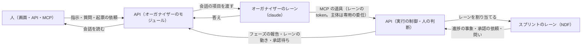

# オーガナイザー: AI のオーガナイザーと会話しながら、開発を回す

ログインの後の最初の画面を、AI のオーガナイザーの一覧と会話にする。利用者は、手元の Claude Code で conductor と会話しながら開発を進めるのと同じく、Web の画面と API・MCP からオーガナイザーへ指示・質問・起票の依頼を送り、オーガナイザーの答え・フェーズの報告・レーンの動き・承認待ちの知らせを時系列に読む。スプリント・承認・問い・設定の画面は、会話から辿る付属の画面になる（#140 の利用者の決定、2026-11-24）。

| 扱うもの | [全体の設計](overview.md) の項目 |
| --- | --- |
| コンテキスト | 「オーガナイザー」（新しく足す） |
| 場面 | S2・S15・S16 |
| 機能 | F7・F24・F25 |
| 不変条件 | I2・I4・I9・I11・I14・I20・I23・I24 |

語・番号（S・F・I・E）は [全体の設計](overview.md) のものである。画面の項目は [画面](screens.md)、HTTP の経路と認可は [API と MCP](api.md)、置き場は [データ](data.md)、レーンの動き方は [実行](execution.md) が持つ。

## この文書で決めること

| 節 | 決めること | 決定 |
| --- | --- | --- |
| [AI のオーガナイザーの形](#ai-のオーガナイザーの形) | オーガナイザーは、立てた人の委任で nd-factory の API と MCP を使う AI のエージェントで、オーガナイザーのレーンで動く。NDF の並列のオーガナイザーをそのまま conductor にしない | 150・151 |
| [立てた人だけが動かす](#立てた人だけが動かす) | 会話へ送る・取り下げる・終える・再開するは立てた人だけ。立てる・再開するは人だけ | 150・152 |
| [単位と状態](#単位と状態) | プロジェクトの中で、利用者が会話のように立てる。状態は動いている・休止・止まった・終わった。`paused` も枠を持ち、動かす前に毎回同じ照らしを掛ける | 152 |
| [会話の項目](#会話の項目) | 項目の種類・並べ方・本文の描き方・渡すと取り下げるの排他。会話は承認と問いを確定しない（I23） | 153 |
| [動く場所と休止](#動く場所と休止) | ホステッドでは入力を待つ間は休止し、手元のマシンが止まっている間の入力は控える。レーンにはレーンの token と推論の資格情報だけを渡す。会話の控えの置き場と消し方、割り当てを移すときの止め方 | 150・154 |
| [付属の画面](#付属の画面) | 承認待ちの一覧・スプリント・設定は付属の画面にし、会話のリンクとナビゲーションから開く | 155 |

## 位置づけ

この文書は B（nd-factory が回す開発）の製品の設計である（[nd-factory 自体の開発と、nd-factory が回す開発](overview.md#nd-factory-自体の開発とnd-factory-が回す開発)）。旧い側では、同じ方向の設計（旧い側の #254）を利用者が 2026-11-14 に承認し、旧い側の main へ 2026-11-15 にリリースした。作り直しの全体の設計（#24）はこれを比べずにホーム（いま）へ戻していた。#140 で、利用者が会話を主にする形に決めた。旧い側の形は出発点にせず（Value 16）、作り直しの設計の部品（委任・実行の場所・ランナー・人の判断）の上に組み直す。

| 決まっていること | 中身 |
| --- | --- |
| 承認と答えは会話の外で確定する | 承認の依頼は承認の詳細のボタン（`approvals.answer`。人だけ）で確定する。問いは問いの画面か `questions.answer` で確定し、答えられるのは人と、人が発行したふつうの委任である（人だけの区分の問いは人だけ）。会話の入力欄の文・オーガナイザーの発言・会話の操作・オーガナイザーの専用の委任は、承認の依頼と問いの状態を変えない（I4・I23・I24） |
| 見える範囲 | オーガナイザーと会話は 1 つのプロジェクトに属し、割り当てたチームの席を持つ人とその委任だけが読める。ほかからは一覧・会話・知らせ・件数のどこからも見えない（I2） |
| 同じ操作は API と MCP にも | 会話へ送る・取り下げる・読むは、画面と同じ API の操作と MCP の道具で行える。立てる・再開するは専用の委任を発行するため、終えるは戻せず会話の控えを消すため人だけの操作にし、MCP では `organizers.list`・`organizers.get` を対になる読み出しの道具にする（I14） |

## AI のオーガナイザーの形

**オーガナイザーは、立てた人がそのオーガナイザーに発行した委任で動く AI のエージェントである。** レーンと同じ実行の場所で動く「オーガナイザーのレーン」の中で claude を動かし、nd-factory の MCP の道具（課題の候補を読む・スプリントを始める・取り消す・進みを読む・承認の依頼と問いを読む・起票の依頼を出す（`issue_requests.create`））だけで開発を回す（決定 150）。

| 項目 | 決まり |
| --- | --- |
| 委任 | オーガナイザーを立てると、立てた人の名でそのオーガナイザー専用の委任を作る。範囲はそのプロジェクトと `read`・`run`、期限は作ってから 30 日である。期限を延ばす操作は持たず、続けるときは立てた人が再開で新しい専用の委任を発行する（[単位と状態](#単位と状態)）。専用の委任は token（秘密の値）を持たない。オーガナイザーのレーンはレーンの token で MCP を呼ぶ（[資格情報](#資格情報)） |
| 専用の委任で断る操作 | 人だけの操作・`manage` の印を持つ操作・`approvals.answer`・`questions.answer`・オーガナイザーを立てる・終える・再開する・会話へ送る・取り下げる・委任の操作。どれも 403 で断る（I24）。会話へ送れないため、オーガナイザーが自分やほかのオーガナイザーを起こすことはない |
| 使う道具 | nd-factory の MCP の道具だけ。GitHub・AWS・NDF の進行表へは直に触れない。スプリントは `sprints.create` で始め、レーンの動き方は [実行](execution.md) のとおり実行の制御が決める |
| 人へ出すもの | 承認の依頼と問いはレーンが出し、人の判断のモジュールが持つ。オーガナイザーはそれを会話に「承認待ち」「問い」の項目として知らせ、承認の詳細・問いの画面へのリンクを張る。オーガナイザーは承認の依頼にも問いにも答えない。利用者が会話で「この問いに A で答えて」と頼んでも、問いの画面へのリンクを返す。オーガナイザーが自分で人に問いたいときは、会話の発言で問い、答えは利用者の次の発言で受ける（承認の依頼も問いも作らない） |
| 起票の依頼 | 利用者が会話で起票を頼むと、オーガナイザーは課題の案を作り、MCP の道具 `issue_requests.create` で起票の依頼（C5）として人の承認へ出す。承認の外で課題を作らない。鍵・上限・確かめ・承認資料は [実行の文書のオーガナイザーからの起票の依頼](execution.md#オーガナイザーからの起票の依頼) |
| 手順 | オーガナイザーの手順（システムのプロンプトと道具の範囲）はサービスが持ち、版を付けてオーガナイザーの行に写す。利用者のリポジトリの指示書（AGENTS.md など）は、そのリポジトリのレーンの NDF が読む。オーガナイザーは読まない |
| 推論の手段 | チームの推論の手段（`managed`・`byok`）と実行の場所に従う。費用は費用の記録へオーガナイザーの ID とともに書き、使える量の判定（I8）を同じく通す |
| 始めたスプリントの結び付け | オーガナイザーが `sprints.create` を呼ぶと、API は要求の主体（専用の委任）からオーガナイザーの ID を引き、スプリントの行の `organizer_id` に書く。要素からは受けない。フェーズの報告・レーンの動き・承認待ちの項目は、この ID のオーガナイザーの会話にだけ足す。同じ人が同じプロジェクトで複数のオーガナイザーを使っても、報告は始めたオーガナイザーの会話に出る |

## 立てた人だけが動かす

**オーガナイザーを動かせるのは立てた人だけで、プロジェクトのほかのメンバーは読むだけである。** オーガナイザーは立てた人の名の委任でスプリントを始め・取り消す。ほかの人の指示で動けると、操作の記録には立てた人の操作として残り、指示した人が分からなくなる（I9）。

| 操作 | 呼べる主体 | 外れたとき |
| --- | --- | --- |
| 立てる（`organizers.create`） | プロジェクトの席を持つ人（人だけ） | 委任からは 403 `human_only` |
| 再開する（`organizers.resume`） | 立てた人（人だけ） | 委任からは 403 `human_only`。ほかの人は 403 `organizer_owner_only` |
| 会話へ送る・取り下げる | 立てた人と、立てた人が発行したふつうの委任 | ほかの人とその委任は 403 `organizer_owner_only`。専用の委任は 403（I24） |
| 終える（`organizers.close`） | 立てた人（人だけ）。戻せず、会話の控えを消すため（C4） | 委任からは 403 `human_only`。ほかの人は 403 `organizer_owner_only` |
| 一覧と会話を読む | プロジェクトの席を持つ人とその委任（専用の委任を含む） | 見えないプロジェクトは 404（I2） |

## 単位と状態

**オーガナイザーはプロジェクトの中に、利用者が会話のように立てる。** 1 つのプロジェクトに複数を立ててよい。同じプロジェクトで枠を持つ（`active` か `paused` の）オーガナイザーの数は、設定の値（既定 3。[実行の文書の設定の値](execution.md#設定の値)）までである。数は使える量の判定（I8）の一部として、枠を持つ状態へ移す書き込みと同じトランザクションで確保し（下の「枠は」の段落）、超えると立てる・再開するを 409 `organizer_limit` で断る（決定 152）。

`paused` も枠を持つ。休止中のオーガナイザーは新しい項目で自動で起きるため、起きる時に枠が無くて項目を渡せない、という事態を作らないためである。

| 状態 | 意味 | 枠 | 一覧の区分 | 移る先 |
| --- | --- | --- | --- | --- |
| `active` | 応答中か、入力を待っている（ホステッドで休止していない） | 持つ | 動いているもの | `paused`・`stopped`・`ended` |
| `paused` | 入力を待つ間に休止した（ホステッド）。次の入力で起きる | 持つ | 動いているもの（「休止中」の札） | `active`（新しい項目で自動で）・`stopped`・`ended` |
| `stopped` | 動けない。理由のコードを持つ（下の表） | 持たない | 止まったもの | `active`（理由が `machine_offline` のときだけ、マシンが戻った時に自動で。ほかの理由は立てた人の再開で）・`ended` |
| `ended` | 立てた人が終えた。会話は読めるが、送れない | 持たない | 終わったもの | —（再開しない。新しく立てる） |

**立てる時と、`paused` か `stopped` から `active` へ移す前には、毎回照らしを掛ける。** 照らしが外れたら `active` にせず、次の表の理由で `stopped` にする。立てる・再開するの操作では、`stopped` にせずにその誤りを返す。

照らす相手は、自動で動かすか人の操作で動かすかで分ける。新しい項目による自動の起こし直しと、マシンの戻りによる自動の戻りは、今ある専用の委任と、オーガナイザーの行の割り当ての ID を照らす。立てる・再開するは、この操作で作る新しい専用の委任で動き、オーガナイザーの行の割り当ての ID を今の割り当てに替える。そのため、今ある委任と割り当ての ID は照らさない。再開は、委任の期限切れ・取り消しや割り当ての移しで止まったオーガナイザーを戻す操作なので、今ある委任と割り当ての ID の一致を求めると戻せなくなる。

| 照らし | 自動の起こし直しと戻り | 立てる・再開する | 外れたときの理由のコード | 戻し方 |
| --- | --- | --- | --- | --- |
| 専用の委任 | 今の専用の委任が期限の内で、取り消されていない | 照らさない（新しい専用の委任を同じトランザクションで作る） | `delegation_ended` | 立てた人の再開（新しい専用の委任を発行する） |
| 立てた人の席 | 立てた人が今もプロジェクトを見られる | 立てた人が今の割り当てのチームの席を持つ | `creator_lost_access`。立てる・再開するは 403 | 再開できない。終える |
| 割り当て | プロジェクトが移し中でなく、差し替えの保留も無く、今の割り当てがオーガナイザーの行の割り当ての ID と同じ | プロジェクトが移し中でなく、差し替えの保留も無い。割り当ての ID は今の割り当てに書き替える | `project_transferred`。移し中と差し替えの保留中の立てる・再開するは 409 `project_transfer_in_progress`・`credential_rotation_in_progress`（I20） | 受け入れの後、立てた人が移す先のチームの席を持っていれば再開できる（下の「再開する」の行） |
| 使える量 | 使える量の判定で、月の上限額に当たっていない | 同じ | `usage_limit` | 上限額を変えたか月が替わった後の再開 |
| 枠 | `stopped` から戻す時だけ、枠が空いている（`paused` は枠を持つため数えない） | 枠が空いている（再開は `stopped` からだけ） | `organizer_limit`。マシンの戻りによる自動の戻りでは、理由を `machine_offline` からこれに替え、立てた人へ知らせる | ほかのオーガナイザーを終えた後の再開 |

照らしのほかに止まる理由は、起動できない（`start_failed`）と、手元のマシンが止まった（`machine_offline`）である。

**`active` のまま動いている間も、上の表の初めの 2 つの照らし（専用の委任と、立てた人の席）を掛け続ける。** 専用の委任の期限切れは取り消しの操作を伴わず、入力が続くオーガナイザーは休止を通らないためである。API は次の 2 つの時点で照らし、外れたらその場で `stopped`（`delegation_ended` か `creator_lost_access`）にし、レーンを止めてレーンの token を断つ。

- オーガナイザーのレーンの token で `/mcp` を呼んだ時。主体の専用の委任を引くたびに、期限と取り消しと立てた人の席を照らす。外れた要求は 401 で断る
- オーガナイザーのレーンの心拍（60 秒ごと）。入力を待っていて `/mcp` を呼ばない間も、1 分以内に止まる

**枠は、プロジェクトの行の数（`organizer_slots_used`）で数え、枠を持つ状態へ移す書き込みと同じトランザクションで確保する。** 立てる・`stopped` からの再開・マシンの戻りによる自動の戻りは、数が設定の値より小さいことを条件に 1 足す。条件が外れたら、立てる・再開するは 409 `organizer_limit` を返し、自動の戻りは `stopped`（`organizer_limit`）のままにする。枠を持つ状態から `stopped`・`ended` へ移す書き込みは、同じトランザクションで 1 引く。数を別の読み出しで比べてから書く形にすると、同時に来た作成や戻りが同じ残りの枠を取り合い、上限を超える。

**枠を引くのは、枠を持つ状態から離れる書き込みの 1 回だけである。** 状態を変える書き込みは、読んだ時の状態と版（`version`）を条件にし、引くかどうかを読んだ状態で決める。すでに `stopped` のオーガナイザーを割り当ての移しで止め直すときは、理由のコードだけを書き替え、枠を引かない。条件が外れたら読み直して決め直す。同じオーガナイザーを 2 つの書き込みが同時に止めても、版の条件でどちらか 1 つだけが確定し、枠は 1 回だけ引かれる。止まったものから引くと、数が実際より少なくなり、移す先で設定の上限を超えて立てられる。

状態を変える操作は、次の行を 1 つのトランザクションで書く（[データの一緒に確定する書き込み](data.md#表と鍵)）。

| 操作 | 書くもの |
| --- | --- |
| 立てる | オーガナイザーの行（`active`・立てた時の割り当ての ID）・専用の委任の行・プロジェクトの行の枠の数を 1 足す条件つきの更新 |
| 再開する | オーガナイザーの行を `active` にし、割り当ての ID を今の割り当てにする更新・前の専用の委任の取り消し・新しい専用の委任（期限 30 日）の行・プロジェクトの行の枠の数を 1 足す条件つきの更新。API は書く前に、立てた人が今の割り当てのチームの席を持つことを照らす。割り当ての移しの後の再開も、これで新しい割り当てで動く |
| マシンの戻りによる自動の戻り | オーガナイザーの行を `active` にする更新・プロジェクトの行の枠の数を 1 足す条件つきの更新 |
| 止める（`stopped` にする） | 読んだ時の状態と版を条件に、オーガナイザーの行を `stopped` にし理由のコードを書く更新。読んだ状態が `active` か `paused` のときだけ、プロジェクトの行の枠の数を 1 引く更新を足す。読んだ状態が `stopped` なら理由のコードだけを書き替える |
| 終える | 読んだ時の状態と版を条件に、オーガナイザーの行を `ended` にする更新・専用の委任の取り消し・会話の控えを消す期限（`files_delete_after`）の更新（計算に使った `state_url_max_expiry` が読んだ値のままであることも条件にする。[会話の控え](#会話の控え)）・枠を持つ状態からなら枠の数を 1 引く更新。確定の後の最初の要求から、専用の委任を主体とする要求は 401 になる。オーガナイザーのレーンは止める指示を受けて止まり、レーンの token も断つ |

- オーガナイザーを終えても、それが始めたスプリントは止めない。止めるのはスプリントの取り消し（F10）である
- 状態の移りはオーガナイザーのモジュールだけが書く。進捗の受け口からの事象（オーガナイザーのレーンの起動・休止・終わり）、手元のマシンの `online`・`offline` の変わり目、上の `/mcp` と心拍での照らしで動かす
- 人が委任の一覧から専用の委任を取り消した（`delegations.revoke`）ときも、オーガナイザーを `stopped`（`delegation_ended`）にしてレーンを止める

## 会話の項目

会話は、1 つのオーガナイザーの項目を時系列に並べたものである。項目は追記だけで持ち、取り下げも新しい項目で表す（Value 10）。

| 種類 | 書き手 | 中身 |
| --- | --- | --- |
| 指示・質問・起票の依頼 | 立てた人（画面・API・MCP。立てた人のふつうの委任も書ける） | 本文（Markdown の文字列、上限 8,000 字）・送った主体・冪等の鍵 |
| 取り下げ | 立てた人 | 取り下げた項目の ID。オーガナイザーへ渡す前の項目だけを取り下げられる（[渡し方と取り下げ](#渡し方と取り下げ)） |
| 答え | オーガナイザー | 本文（Markdown）と、応えた人の項目の ID |
| フェーズの報告 | オーガナイザーのモジュール（進捗の事象から） | オーガナイザーが始めたスプリントの工程の移り（設計 → 実装 など）と、スプリントの詳細へのリンク |
| レーンの動き | オーガナイザーのモジュール（進捗の事象から） | レーンの始まり・終わり・失敗・休止。レーンの状況（スプリントの詳細）へのリンク |
| 承認待ち・問い | オーガナイザーのモジュール（E10 から） | 種類・題と、承認の詳細・問いの画面へのリンク。答えが確定したら同じ項目に「答えた」の札を足す（新しい項目で） |
| オーガナイザーの状態 | オーガナイザーのモジュール | 休止・止まった（理由）・再開・終わり |

| 決まり | 中身 |
| --- | --- |
| 渡し方 | 人の項目は API が追記した時点で確定し、オーガナイザーのレーンへは追記の順に 1 件ずつ渡す（[渡し方と取り下げ](#渡し方と取り下げ)）。渡す前の項目は「控え中」の札で出し、取り下げられる |
| 承認にしない | 項目の本文がどうであれ、会話の操作は `approvals.answer`・`questions.answer` を呼ばず、承認の依頼と問いの状態を変えない。オーガナイザーの専用の委任からの `approvals.answer`・`questions.answer` も 403 で断る（I23・I24）。承認待ちの項目には「承認は承認の画面のボタンで行います」の 1 行を添える |
| 見える範囲 | 会話の項目はオーガナイザーのプロジェクトの見える範囲に従う（I2）。フェーズの報告・レーンの動き・承認待ちの項目は、スプリントの行の `organizer_id` がそのオーガナイザーのスプリントの分だけを足す |
| 本文の描き方 | 会話の本文は、人の項目もオーガナイザーの答えも、信頼しない入力として描く。生の HTML は描かずに文字のまま出す。画像を含め、外の資源を自動で読み込まない（画像の記法はリンクの文字として出す）。リンクは Markdown を解析した後の URL を照らし、nd-factory の画面の経路（同じオリジンで、[画面の地図](screens.md#画面の地図) にある path）と `https://github.com/` の下の URL だけを押せる形で出す。ほかの URL（`javascript:`・`data:`・ほかのホストを含む）は文字のまま出す |
| 読み方 | `organizer_messages.list` は時系列の昇順で、カーソルで古い方へ遡る（[ページ送り](api.md#ページ送り)） |
| つながらないとき | 画面は最後に受け取った一覧と会話を読める。送る項目は「控えて送る」（[操作の 3 つの区分](screens.md#操作の-3-つの区分)）で、つながってからサーバーへ届けた時点で確定する |

### 渡し方と取り下げ

**1 つの項目は「渡した」と「取り下げた」のどちらか一方にだけ確定する。** 人の項目の行には、空のときに 1 回だけ書く列を 3 つと、渡すたびに書き直す列を 1 つ置く。

| 列 | 書くとき | 書く条件 |
| --- | --- | --- |
| `delivered_at` | ランナーが `/v1/runner/organizer_inputs/list` で次の項目を求めた時。API はこの書き込みが確定してから項目を返す | `delivered_at` と `withdrawn_at` がどちらも空で、オーガナイザーの行が token の世代で `active`、`inflight_message_id` が空（下の表） |
| `delivered_generation` | `delivered_at` を書く時と、渡し直す時。渡した先のレーンの token の世代を書く | 項目がそのオーガナイザーのもので、`received_at` が空。オーガナイザーの行が token の世代で `active`（下の表） |
| `withdrawn_at` | `organizer_messages.withdraw`。取り下げの項目の追記と同じトランザクションで書く | `delivered_at` と `withdrawn_at` がどちらも空。外れたら 409 `already_delivered` を返し、取り下げの項目も足さない |
| `received_at` | ランナーが `/v1/runner/organizer_receipts/create` で、項目の処理を終えたと知らせた時 | オーガナイザーの行の `inflight_message_id` がその項目で、その項目への答えが会話に追記済み |

**渡した項目の処理が終わるまで、次の項目は渡さない。** 処理中の項目（渡して受け取りの無い項目）は、オーガナイザーの行の `inflight_message_id` に 1 つだけ記す。項目の行を調べるだけでは、同じ世代の取得の要求が 2 つ重なったとき、両方が「処理中の項目は無い」と読み、別々の項目に `delivered_at` を書けてしまう。そこで、渡す書き込みと受け取りの書き込みを、どちらもオーガナイザーの行への条件つきの書き込みで直列にする。

| 書き込み | 同じトランザクションで書くもの | 条件 |
| --- | --- | --- |
| 次の項目を渡す（`/v1/runner/organizer_inputs/list`） | オーガナイザーの行の `inflight_message_id` をその項目の ID にする・項目の `delivered_at` と `delivered_generation` | オーガナイザーの行が `active` で、`generation` が token の世代と同じで、`inflight_message_id` が空。項目の `delivered_at` と `withdrawn_at` がどちらも空 |
| 渡し直す（`/v1/runner/organizer_inputs/list`） | 項目の `delivered_generation` を token の世代にする | オーガナイザーの行が `active` で、`generation` が token の世代と同じで、`inflight_message_id` がその項目の ID。項目の `received_at` が空 |
| 答えを追記する（`/v1/runner/organizer_replies/create`） | 答えの項目・オーガナイザーの行の `ConditionCheck` | オーガナイザーの行が `active` で、`generation` が token の世代と同じ。応えた項目がそのオーガナイザーのもので、`delivered_generation` が token の世代と同じ |
| 受け取る（`/v1/runner/organizer_receipts/create`） | 項目の `received_at`・オーガナイザーの行の `inflight_message_id` を空にする | オーガナイザーの行が `active` で、`generation` が token の世代と同じで、`inflight_message_id` がその項目の ID。項目の `delivered_generation` が token の世代と同じ。下の答えの条件 |

渡す・渡し直すの書き込みに、オーガナイザーの状態と世代を条件として入れるのは、古い世代の要求が新しい世代の配信の記録を書き換えないようにするためである。認証を通った後に止まっていた前の世代のランナーの要求が、再開の後に届くことがある。この要求が `delivered_generation` を前の世代へ戻すと、新しい世代のランナーの答えと受け取りが 404 になり、利用者の次の指示が渡らなくなる。

答えの追記と受け取りにも、同じ状態と世代の条件を入れる。項目の `delivered_generation` だけを照らすと、止める前に認証を通った要求は、次のランナーが渡し直しを受けるまで条件を満たす。そのため、利用者がオーガナイザーを止めた後に、前のランナーが会話へ答えを足したり、指示を処理済みにしたりできてしまう。

`/v1/runner/organizer_inputs/list` は、オーガナイザーの行を読み、次の順で返すものを決める。

1. `inflight_message_id` が空でなければ、その項目を上の表の「渡し直す」で書き、`redeliver` を真にして返す。前の世代が渡した項目も、今の世代のランナーが受け取れる。応答が途中で失われた場合も、同じ世代のランナーが呼び直せば同じ項目を受け取れる
2. 空なら、取り下げていない次の項目を選び、上の表の「次の項目を渡す」で書く。次の項目が無ければ空の一覧を返す
3. 1 か 2 の条件が外れたら、オーガナイザーの行を読み直す。状態が `active` でないか、`generation` が token の世代と違えば、401 を返して書かない。そうでなければ 1 からやり直す。ほかの要求が先に渡したときは 1 で同じ項目を渡し直す。利用者が候補を先に取り下げたときは `inflight_message_id` が空のままなので、2 で次の候補を選び直す。2 つの要求が別々の項目を受け取ることはない

**受け取りは、答えが会話に追記された項目だけで確定する。** ランナーが SIGTERM で会話の控えを固めると、項目の ID は入っていても、そのターンの答えが無い控えが残りうる。そのため、受け取りの判定は控えでなく、サーバーの会話にある答えで行う。

- 答えの追記（`/v1/runner/organizer_replies/create`）は、応えた項目の ID を冪等の鍵にする。送り直しで同じ答えが 2 件にならない
- `/v1/runner/organizer_receipts/create` は、その項目への答えが会話に無ければ 409 `reply_missing` で断り、`received_at` を書かない
- `redeliver` の項目には、答えが会話にあるか（`replied`）を添えて返す。真ならランナーは claude へ渡さず、受け取りだけを知らせる。偽なら、控えに項目の ID があっても claude へ渡し直す。渡し直すときは、前のターンが途中で終わったかもしれないことを添え、claude が会話の項目とスプリントの一覧を読んでから続けるようにする

**渡し直しで同じ書き込みを 2 回しないよう、オーガナイザーの書き込みの重複はサーバーが判定する。** 渡し直しは、マシンが 24 時間を超えて止まった後や、再開で専用の委任が替わった後にも起こる。そのため、24 時間で消え、委任ごとに分かれるふつうの冪等の鍵（[API の文書の冪等の鍵](api.md#冪等の鍵)）では防げない。

- 専用の委任を主体とする書き込み（`sprints.create` など）は、冪等の鍵の組を「オーガナイザーの ID・発行元の項目の ID・操作の名前・鍵」にする。鍵はオーガナイザーの手順が、操作の対象（リポジトリと課題など）から作る
- 発行元の項目の ID は、要求を受けた時点の処理中の項目から引かず、ランナーが要求に付ける。claude の MCP の要求は、レーンの token を持つランナーの中継を通って API へ届く（[資格情報](#資格情報)）。ランナーは、そのとき claude へ渡している項目の ID を、中継する要求の見出し（`Nd-Organizer-Item`）に付ける。claude は見出しを書けない。受けた時点の処理中の項目に結ぶと、前のターンの要求が遅れて、または送り直しで次の項目の処理中に届いたとき、組が変わって 2 回目の書き込みが通る
- API は、書き込みの前に次を照らす。見出しの項目が、レーンの token のオーガナイザーの人の項目で、`delivered_at` が空でないこと。外れたら 409 `state_mismatch` で断る
- 照らしの後、元の組の済みの行があれば、項目の処理が終わっていても 1 回目の結果を返す。済みの行が無いときだけ新しく書く。新しく書けるのは、その項目がオーガナイザーの行の `inflight_message_id` と同じで、`delivered_generation` が token の世代と同じときだけである。この 2 つは書き込みと同じトランザクションの条件にし、外れたら 409 `state_mismatch` で断る。終わった項目のための書き込みが、後から新しく通ることはない
- この組の済みの行は、オーガナイザーの会話の項目と同じ `db-organizers` の表に置き、オーガナイザーの会話を消すまで残す。委任を替えても、期間が過ぎても、同じ組の 2 回目は 1 回目の結果を返す。中身が違えば 422 `idempotency_key_reused` にする

**ランナーの経路の対象は、要素でなくレーンの token から決める。** `/v1/runner/organizer_inputs/list`・`/v1/runner/organizer_replies/create`・`/v1/runner/organizer_receipts/create` は、オーガナイザーの ID を要素から受けず、レーンの token のオーガナイザーと世代を使う。答えと受け取りの書き込みは、オーガナイザーの行が `active` で `generation` が token の世代と同じこと、項目がそのオーガナイザーのもので `delivered_generation` が token の世代と同じことを、同じトランザクションの条件にする。オーガナイザーの行の条件が外れたら 401、項目の条件が外れたら 404 を返して書かない。

## 動く場所と休止

オーガナイザーのレーンは、スプリントのレーンと同じ実行の場所と同じランナーで動く（[実行の場所](execution.md#実行の場所)）。違いは、NDF を起動せず、nd-factory の MCP の道具を持つ claude を起動することと、受け取る資格情報が少ないことである（決定 154）。

| 場所 | 起こす | 入力を待つ間 | 起こし直す |
| --- | --- | --- | --- |
| ホステッド | 立てた時と、`paused` の間に新しい項目が来た時に、[起こす前の照らし](#単位と状態) を通してから、実行の制御が世代を 1 上げて `RunTask` で起こす（引き換えの token と `clientToken` の作りはスプリントのレーンと同じ。決定 64） | 入力の待ちが猶予（設定の値、既定 5 分）を超えたら、claude の会話の控えを状態の S3 へ固めて `paused` にして終わる | 新しいタスクが状態の S3 から `transcript_generation` の世代の会話の控えを戻し、控え中の項目を順に渡す。`transcript_generation` が空なら（移しで止めた後の再開など）、会話の項目から新しい claude の会話を始める |
| 手元のマシン | マシンが受け取りで受ける。マシンの claude のログインを使う（決定 67） | マシンの上で動き続ける。会話の控えは答えを追記するたびに状態の S3 へ固める | マシンが `offline` になったら `stopped`（`machine_offline`）にし、送られた項目は控え中に残す。マシンが `online` に戻ったら、起こす前の照らしを通したときだけ `active` に戻し、控えた項目を送られた順に渡す |

- オーガナイザーのレーンも I7（1 つのレーンを動かすコンテナは同時に 1 つ）と I11（AWS の権限を持たない・token はレーンが動く間だけ）に従う
- オーガナイザーのレーンが使える量の判定で断られたら `stopped`（`usage_limit`）にし、会話に理由を出す

### 資格情報

**オーガナイザーのレーンが受け取る資格情報は、レーンの token と推論の資格情報だけである。claude から使える資格情報は、どれも 1 時間以内に切れるか、サーバーがレーンの token を断った時点で使えなくなる。** 専用の委任は token を持たないので、休止から起こし直すたびに秘密を渡し直す必要も、秘密を保存しておく必要も無い。

| 資格情報 | 受け取り方 | 寿命と取り直し | 断つとき |
| --- | --- | --- | --- |
| 引き換えの token | ホステッドは `RunTask` の環境の上書き、手元のマシンは受け取り（`/v1/machine/lane_claims/create`）の応答 | 10 分・1 回だけ | 引き換えた時点 |
| レーンの token（宛先は「オーガナイザーのレーン」） | 引き換え（`/v1/runner/exchanges/create`） | 1 時間。心拍で取り直す | 休止・止める・終える・割り当ての移しで、期限の前でも断つ（I11） |
| 推論の一時の資格情報（`managed`） | 引き換えと心拍 | 1 時間（役割の連鎖の上限）。心拍で取り直す（[実行の文書の推論の資格情報](execution.md#推論の資格情報)） | 期限の前には失効させられない。API が取り直しを断つため、レーンの token を断ってから 1 時間以内に切れる |
| チームの API キー（`byok`。ホステッドだけ） | 引き換え。ランナーだけが持ち、claude へは渡さない | キー自体に期限は無い。チームが秘密の器のキーを替えるまで有効 | claude は、ランナーがコンテナの中で開く推論の中継（下）を通してだけ推論を呼ぶ。ランナーは、次のどちらかが起きた時点で中継を止め、キーをメモリから消す。(1) 心拍・引き換えの取り直しを API が断った。(2) 最後に受けたレーンの token の期限までに、新しいレーンの token を受け取れなかった（API と話せない間も、期限を過ぎて中継を続けない） |

- `byok` のキーは期限を持たず、サーバーから失効させられない。claude の環境に入れると、claude が読んだキーをレーンの終わりや割り当ての移しの後も使えてしまう。そのため、オーガナイザーのレーンでは、ランナーがキーをメモリだけに持ち、コンテナの中だけで開くローカルのソケットに推論の中継を置く。claude には中継の宛先（`ANTHROPIC_BASE_URL`）だけを渡す。claude はランナーと別の OS の利用者で動くため（[実行の文書の承認ゲートの守り](execution.md#守り-承認ゲートを無効にさせない)）、ランナーのメモリのキーを読めない。スプリントのレーンでキーを claude の環境に入れる形（[実行の文書の推論の資格情報](execution.md#推論の資格情報)）は、オーガナイザーのレーンには使わない
- 中継が止まる時は、レーンの token が使えなくなる時にそろえる。レーンの token は期限（1 時間）を過ぎれば API が受けないため、中継もその期限を越えて動かさない。心拍だけが API に届かないレーンでも、立てた人が終えてから 1 時間以内にチームのキーでの推論が止まる
- 引き換えの応答は、レーンの種類で中身を分ける。オーガナイザーのレーンには、GitHub の token・進行表の DB の URL・NDF の起動の指示を渡さない（[API の文書のランナーの HTTP の経路](api.md#ランナー手元のマシンの-http-の経路)）
- オーガナイザーのレーンは、レーンの token で `/mcp` を呼ぶ。claude はレーンの token を読めないため、ランナーがコンテナの中だけで開く MCP の中継へ要求を送る。中継はレーンの token と、発行元の項目の ID の見出し（[渡し方と取り下げ](#渡し方と取り下げ)）を付けて API へ送る。API は、token の世代が今の世代で、オーガナイザーが `active` であることを照らす。そのうえで、レーンの token のオーガナイザーの ID から専用の委任を引き、引くたびに期限・取り消し・立てた人の席を照らしてから（[単位と状態](#単位と状態)）、その委任の主体として認可を判定する。どれかが外れたら 401 にする。この規則は [API の文書の認証と主体](api.md#認証と主体) の「オーガナイザーのレーン」の行と [MCP の受ける token](api.md#mcp) と同じである。操作の記録には、専用の委任・立てた人・オーガナイザーの ID が残る
- 休止の後の新しいタスクは、新しい世代の引き換えの token で新しいレーンの token を受ける。前の世代のレーンの token は、世代が替わった時点で断つ
- ランナーは、レーンの token と推論の資格情報を、メモリとコンテナの中のソケットだけに置く。会話の控え・状態の S3・表には書かない

### 会話の控え

claude の会話の記録（会話の控え）は、プロジェクトへの指示と推論の履歴を含む。そのため、NDF のファイルと同じく状態の S3 の、オーガナイザーごとの頭の下にだけ置く（[データの状態の S3](data.md#状態の-s3)）。

**会話の控えは世代ごとに別の頭へ書き、復元に使う世代はサーバーが 1 つに決める。** 署名つき URL は発行した後は止められず、期限（15 分）まで使える。書き込み先が世代をまたいで共通だと、前の世代が持つ URL の PUT が、再開した後の新しい控えを上書きしたり、消した後の控えを書き戻したりできる。

| 決まり | 中身 |
| --- | --- |
| 置き場 | `v1/projects/<プロジェクト>/organizers/<オーガナイザー>/<世代>/…`。世代はオーガナイザーのレーンの token の世代 |
| 書く | 今の世代のレーンの token で `/v1/runner/state_urls/create` を呼ぶと、その世代の頭の下にだけ PUT の URL（15 分で切れる）を出す。API は、オーガナイザーが `active` か `paused` で世代が token と同じことを条件に、オーガナイザーの行の `state_url_max_expiry` へ URL の期限を記してから返す。前の世代の token と、止めた・終えた後の要求は 401 |
| 復元に使う世代を決める | ランナーは控えを書き終えたら、`/v1/runner/organizer_transcripts/create` で知らせる。API は、token の世代が今の世代で、オーガナイザーが `active` か `paused` であることを条件に、オーガナイザーの行の `transcript_generation` をその世代にする。前の世代の頭は、下の「消す」の手順で消す対象にする |
| 読む | GET の URL は、`transcript_generation` の世代の頭の下にだけ出す。`transcript_generation` が空なら控えは無いとして、会話の項目から新しい claude の会話を始める |
| 中身 | claude の会話の記録と、claude へ渡した項目の ID だけ。資格情報の置き場（環境の値・資格情報を渡すソケット）は含めない。受け取りの判定には使わない（[渡し方と取り下げ](#渡し方と取り下げ)） |
| 割り当ての移し | 移し中は URL を出さずに 409 を返す。受け入れは、スプリントのレーンと同じく `state_url_max_expiry` が過ぎたことを照らす |
| 手元のマシン | 下の「手元のマシンの会話の記録」 |

**控えを消すのは、消す世代へ書ける URL がすべて切れた後である。** オーガナイザーの行に、消す世代の上限（`files_delete_below_generation`。この世代以下を消す）と消す期限（`files_delete_after`）を持つ。

1. 次の表の時に、`files_delete_below_generation` を今の値と表の「消す世代の上限」の大きい方へ更新し、`files_delete_after` を、今の時刻とオーガナイザーの行の `state_url_max_expiry`（このオーガナイザーへ出した署名つき URL の期限の最大値）の遅い方にする。URL の期限は、その世代が書き込める状態であることを条件に記すため（[データの署名つき URL](data.md#署名つき-url)）、止めた・終えた・世代が替わった後に、記した期限より遅くまで使える URL は出ない

    消す期限を書く書き込みは、どの経路でも、計算に使った `state_url_max_expiry` が読んだ値のまま（読んだ時に空なら空のまま）であることを条件に入れる。条件が外れたら、行を読み直して期限を計算し直し、書き直す。期限を読んだ後、書く前に URL の発行が確定すると、古い期限を書いてしまい、消した後も有効な URL で控えを書き戻せるためである

    | 時 | 消す世代の上限 | `transcript_generation` |
    | --- | --- | --- |
    | `transcript_generation` を進めた時 | 進める前の世代 | 進めた世代 |
    | 終えた時・割り当ての移しで止めた時 | そのときの世代 | 空にする |

2. 見回りは、`files_delete_after` を過ぎたオーガナイザーについて、`files_delete_below_generation` 以下の世代の頭のオブジェクトをすべて消し、一覧が空と読んでから、`files_delete_after` が読んだ値のままであることを条件に空にする（[データの NDF のファイルの消し方](data.md#ndf-のファイルの消し方) と同じ手順）
3. 割り当ての移しの後の再開は、新しい世代で動き、`transcript_generation` が空のため控えを読まない。見回りが消すのは止めた時の世代以下だけなので、再開の後に作った控えは消さない

**手元のマシンの会話の記録は、レーンが動く間だけ、コンテナの中のメモリの上のファイルシステムに置く。** マシンのディスクに残さず、コンテナと作業の場所を消せば会話も消える形にして、割り当てを移す前に消し終えたことを確かめられるようにするためである。

**割り当ての移しの受け入れは、マシンが作業の場所を消し終えたと世代つきで知らせるまで待つ。** token の期限が過ぎたことは、消し終えた証にしない。スリープ中のマシンでは期限の時刻に消す処理が動かず、メモリの上のファイルシステムも復帰するまで残るためである。

まだ消し終えたと知らせていない記録は、プロジェクトの行の `organizer_wipes_pending`（文字列の集合）に、マシン・オーガナイザー・世代の組ごとに 1 つの要素（`<マシンの ID>#<オーガナイザーの ID>#<世代>`）として持つ。記録をプロジェクトの行に集めるのは、受け入れの確定でこの 1 行を照らせば済むようにするためである。マシンの行ごとに照らすと、登録したマシンが多いチームでは、割り当ての更新と合わせて DynamoDB の 1 つのトランザクションの上限（100 件）を超え、移しを確定できなくなる。

| 段 | 誰が | 何をする |
| --- | --- | --- |
| 渡す前に記す | nd ランタイム | 心拍の応答の割り当ては、オーガナイザーのレーンについて、オーガナイザーの ID と世代を持つ。nd ランタイムは、受け取り（`/v1/machine/lane_claims/create`）を呼ぶ前に、知らせに使うオーガナイザーの ID と世代を、消去の記録としてマシンのディスクに書く。同じ記録に、作業の場所と受け取りの呼び直しに使うレーンの ID と、受け取りに使ったマシンの ID を書く。会話は書かない。受け取りの応答が失われても、応答を受ける前に再起動しても、知らせに要る組はディスクに残る |
| 渡した記録 | API | 手元のマシンへオーガナイザーのレーンを渡す時（受け取りの `/v1/machine/lane_claims/create`）に、同じトランザクションで、プロジェクトの行の `organizer_wipes_pending` へ、そのマシン・オーガナイザー・世代の要素を足す。同じマシンへ前に渡した世代の要素は残し、置き換えない。この更新は移し中の印（`transfer_in_progress`）が空であることを条件にし、移しを始めた後に記録が増えないようにする。同じトランザクションにプロジェクトの行の `ConditionCheck`（I20 など）があれば、その条件もこの更新の条件へ移す（1 つのトランザクションで同じ行を 2 回指せない）。応答は、引き換えの token と、足した要素のオーガナイザーの ID と世代を持つ |
| 受け取りを呼び直す | API・nd ランタイム | 受け取りの応答を受けなかった nd ランタイムは、同じレーンの ID で受け取りを呼び直す。API は、同じマシンの呼び直しには要素を足し直さず、同じオーガナイザーの ID と世代を返す。引き換えの token は、まだ引き換えていない間だけ出し直し、前に出した token を無効にする。引き換えた後とレーンが止まった後は 409 で、本文にオーガナイザーの ID と世代を添える。nd ランタイムは返った組をディスクの記録と照らし、記録に無い組なら記録に足す |
| 消す | nd ランタイム | 次のどれかで、そのオーガナイザーのレーンのコンテナを止めて作業の場所を消す。(1) レーンが止まった。(2) 心拍の応答の割り当てから外れた。(3) レーンの token を期限の前に取り直せなかった（期限の時点で消す）。(4) スリープなどから戻った時に、時計が最後に受けたレーンの token の期限を過ぎていた（コンテナを動かし直す前に消す）。(5) 心拍が 401 で断られた（登録を外した時の `machine_deleted` を含む）。このときは残っているすべてのオーガナイザーのレーンの作業の場所を消す |
| 知らせる | nd ランタイム | ディスクの記録にある組を消し終えたら、オーガナイザーの ID と世代の組を `/v1/machine/organizer_wipes/create` で送る。組は世代ごとに 1 つずつ送る。受け取りが 409 だった組や、受け取りの応答を受けなかった組も送る（記録が無ければ API は何も外さずに受け取る）。API の応答を受けるまで同じ組を送り直し、受けたら記録から外す。再起動の後は、記録にある作業の場所を消してから、その組を知らせる |
| 記録を外す | API | 知らせを受けたら、組ごとにオーガナイザーの行からプロジェクトを引き、プロジェクトの行の `organizer_wipes_pending` から、登録の token のマシンと知らせた組が一致する要素だけを外す。ほかの世代の要素は外さない。外す更新は何度行っても同じ結果になるため、組ごとに別の書き込みでよい |
| 受け入れで照らす | API | プロジェクトの行の `organizer_wipes_pending` が空であること。受け入れでプロジェクトの行を書き替える更新の条件に入れる（下の [割り当てを移すとき](#割り当てを移すとき)） |

**マシンの登録を外しても、そのマシンの未消去の記録は外さない。** 登録を外すこと（`machines.delete`）は人だけの操作だが、消去の確認の代わりにすると、消去を確かめないまま待ちを解けてしまう。また、外したマシンがオフラインのままなら、その上に会話が残っていても確かめられない。

- 登録を外したマシンの行は「外した」の印（`deleted_at`）を付けて残す。その登録の token は、`/v1/machine/organizer_wipes/create` だけを受け、ほかの `/v1/machine/…` の経路を 401 `machine_deleted` で断る。外したマシンが戻ると、心拍の 401 で (5) により作業の場所を消し、その後で消した組を知らせる。知らせが届けば記録が外れ、受け入れを進められる
- 登録の token の期限（最後の心拍から 90 日）を過ぎた後も、その token は `/v1/machine/organizer_wipes/create` だけを受け、ほかの経路を 401 で断る。期限で断つのはレーンの受け取りと実行の権限で、消去の知らせの経路は残す。90 日を過ぎて戻ったマシンも、心拍の 401 で (5) により作業の場所を消し、元のマシンの ID の組をその token で知らせられる。このため、マシンの行と token の照合の値は、外した後も期限の後も消さない
- 期限の後にマシンを登録し直すと、新しいマシンの ID と登録の token を受ける。nd ランタイムは、前の登録の token を、前のマシンの ID の記録がディスクに残る間は消さずに持ち、その記録の組は前の登録の token で知らせる
- マシンが戻らないまま壊れた・無くした場合、記録は残り、受け入れは 409 `organizer_wipe_pending` で待ち続ける。移す元のチームのマシンに会話が残っていないことを確かめられない限り、移す先へ移さない（Value 9）。このときは割り当ての移しを取り下げ、プロジェクトを移す元のチームに残す

### 割り当てを移すとき

**割り当ての移しを始めたら、そのプロジェクトのオーガナイザーをすべて止め、移す元のチームの実行の場所に会話を残さない。** E18 を受けた実行の制御が、スプリントのレーンを止めるのと同じ流れで、次を行う（[全体の設計の割り当てを変える流れ](overview.md#割り当てを変える流れ)）。

1. 終わっていないオーガナイザーを `stopped`（`project_transferred`）にし、専用の委任を取り消す。書き込みは上の表の「止める」の行のとおりで、`active` か `paused` だったものだけ枠の数を 1 引き、すでに `stopped` のものは理由のコードだけを書き替える
2. オーガナイザーのレーンを止め、レーンの token を断つ
3. 会話の控えを消す世代の上限と期限を記す（[会話の控え](#会話の控え)）

- 移し中は、立てる・再開する・`paused` からの自動の起こし直し・マシンの戻りによる自動の戻りを止める（I20）。送られた項目は控え中に残る
- 受け入れは、次の 2 つも「止め終えた」に含めて照らす
  - オーガナイザーのレーンが止まり、専用の委任を取り消し終えた
  - プロジェクトの行の `organizer_wipes_pending` が空（どのマシンも、渡されたすべての世代の作業の場所を消し終えたと知らせた）。マシンが `offline` のままなら、そのマシンの登録を外した後も、知らせが届くまで受け入れは 409 `organizer_wipe_pending` で待つ（[手元のマシンの会話の記録](#会話の控え)）
- 会話の項目は、受け入れの後は移す先のチームから読める。立てた人が移す先のチームの席を持っていれば、受け入れの後に再開できる。再開は今の割り当てのチームの席を照らし、オーガナイザーの行の割り当ての ID を今の割り当てに替える（[単位と状態](#単位と状態)の「再開する」の行）

## 付属の画面

最初の画面はオーガナイザーの一覧と、最後に開いたオーガナイザーの会話である（[画面の地図](screens.md#画面の地図)）。ほかの画面は付属の画面にし、会話の項目のリンクとナビゲーションから開く（決定 155）。

| 付属の画面 | 役目 |
| --- | --- |
| 承認待ちの一覧 | 待っている承認の依頼と問いを、プロジェクトをまたいで古い順に並べる（旧ホームの「人を待つもの」）。会話の知らせを読み落としても、ここから辿れる |
| スプリントの一覧・詳細・始める | オーガナイザーを通さずにスプリントを読む・始める・取り消す（F8〜F10）。会話を使わない人と、委任のエージェントの経路として残す |
| 承認の詳細・問い | 承認と答えを確定する唯一の画面（I4） |
| 設定（プロジェクト・チーム・自分） | 今までのとおり |

## 外部の調査

| 番号 | 種類 | 対象 | 比べた中身 | この設計で採ったもの |
| --- | --- | --- | --- | --- |
| PRD70 | 主要な製品 | [Claude のアプリ](https://claude.ai) | 会話の一覧と会話を並べ、狭い幅では切り替えて 1 つずつ出す。会話は利用者が立てる | 一覧と会話の並べ方・立て方（旧い側の #254 の利用者の指示「Claude アプリが参考」） |
| PRD71 | 主要な製品 | [Claude Code](https://docs.anthropic.com/en/docs/claude-code/overview) の conductor | 手元で conductor と会話しながら、承認は別の手順で答える | 会話とフェーズの報告を時系列に混ぜて並べる。承認は会話の外で確定する |
| PRD72 | 主要な製品 | [GitHub Copilot coding agent](https://docs.github.com/en/copilot/concepts/coding-agent/coding-agent) | 課題を任せると、エージェントが Pull Request を作り、人がレビューで承認する | エージェントに承認の確定を持たせない形 |

## 決定の記録

### 決定 150: 人と同じ操作だけで開発を回すため、オーガナイザーを立てた人の委任で MCP の道具を使う AI のエージェントにする

結論: オーガナイザーは、立てた人がそのオーガナイザーに発行した委任（`read`・`run`）で、nd-factory の MCP の道具だけを使う。

理由: Value 4 は「AI からも人と同じく」使えることと、承認の確定を人だけにすることを求める。オーガナイザーを委任のエージェントにすると、認可（I2）・人だけの操作（I4）・操作の記録（I9）が、今の委任の作りのまま効く。専用の委任には token を持たせず、レーンの token から委任を引く。30 日の委任の秘密をコンテナと状態の S3 に置かずに済み、レーンの token の寿命と断ち方（I11）がそのまま効く。

採らなかった案: オーガナイザーに専用の資格情報と道具を持たせる形は、委任と別の認可の経路を作り、人だけの操作の守りを 2 か所に持つ（Value 13）。

根拠: Value 4 / Value 9 / Value 13（MVV バージョン 3）

### 決定 151: レーンの割り当てを 1 か所に保つため、NDF の並列のオーガナイザー（`--parallel`）をそのまま conductor にしない

結論: オーガナイザーのレーンは NDF を起動しない。レーンを起こすのは実行の制御だけで、オーガナイザーは `sprints.create` を呼ぶ。

理由: NDF の並列のオーガナイザーは、同じマシンの中でレーンの conductor を起動する（`ndf lanes run`・`ndf relay spawn`）。nd-factory はレーンをホステッドのタスクか手元のマシンへ割り当て、1 つのレーンを 1 つのコンテナで動かす（I7）。NDF の並列のオーガナイザーをそのまま動かすと、レーンを起こす者が 2 つになり、使える量の判定（I8）と割り当ての照らしを通らないレーンができる。決定 73（オーガナイザーの置き場の変数を入れない）も保つ。Mission は、利用者のプロジェクトの開発で nd-factory が NDF の UI に徹することを求める。オーガナイザーは NDF の工程を置き換えず、スプリントを始めて NDF に回させる。

採らなかった案: 旧い側の #254 の前提 1（NDF の並列のオーガナイザーを conductor にする）。NDF の外のオーガナイザーの口（`NDF_ORGANIZER_DIR`）でサービスが NDF のオーガナイザーの役を担う形は、リリースのまとめをサービスへ持ち込む（決定 73）。NDF の契約にレーンの起動をサービスへ任せる口が足されたら、比べ直す（[未確認のまま残ること](#未確認のまま残ること)）。

根拠: Mission / Value 4 / Value 6（MVV バージョン 3）

### 決定 152: 手元の会話と同じく使えるよう、オーガナイザーはプロジェクトの中で利用者が立て、枠を持つ数を設定の値で絞る

結論: 単位は「利用者が立てる」。1 つのプロジェクトに複数を立てられ、枠を持つ（`active` か `paused` の）数は設定の値（既定 3）まで。動かせるのは立てた人だけにする。

理由: 手元の Claude Code では、目的ごとに会話を分けて進めている。プロジェクトに 1 つの固定にすると、目的の違う指示が 1 つの会話に混ざる。同時の数を絞るのは、オーガナイザーのレーンの費用を使える量の判定で抑えるためである（I8）。数を料金プランの表でなく設定の値にするのは、自分で設置した環境の既定の「上限なし」の行でも、利用者の費用の歯止めを残すためである。`paused` にも枠を持たせ、新しい項目による自動の起こし直しが枠で断られないようにする。立てた人だけが動かすのは、オーガナイザーが立てた人の名の委任で操作し、ほかの人の指示を通すと操作の記録から指示した人が消えるためである（I9）。

採らなかった案: プロジェクトに 1 つ（会話が混ざる）、チームに 1 つ（見える範囲がプロジェクトをまたぎ I2 と食い違う）。`paused` を枠に数えない形は、休止中の会話へ送るたびに枠の確保が要り、枠が無いと送った項目が渡らずに残る。

根拠: Value 1 / Value 6 / Value 9（MVV バージョン 3）

### 決定 153: 会話の文で承認が動かないよう、会話の操作は承認の依頼と問いを変えず、承認待ちの項目は承認の画面へのリンクにする

結論: 会話の項目の種類に承認を持たせない。承認待ちの項目はリンクで、承認の確定は承認の詳細のボタンだけで行う。オーガナイザーの専用の委任は、承認の依頼にも問いにも答えない（I23・I24）。

理由: 入力欄の「承認します」を承認として受けると、承認資料の要約値と照らさずに確定し（I4）、委任のエージェントの発言でも承認が動く（Value 4）。問いも同じで、専用の委任に `questions.answer` を許すと、会話の「A で答えて」の 1 文で問いが確定し、問いの画面で選択肢と材料を読む手順を通らない。

採らなかった案: 会話の中に「承認する」のボタンを置く形は、承認資料を読まずに押せる場所を増やし、手数の目標（S3 は承認の詳細で 2 手）を変えずに済む利点も無い。委任で答えられる区分の問いにはオーガナイザーが答えてよいとする形は、会話の文で問いが確定する経路を作り、I23 の守りに例外を足す。

根拠: Value 4（MVV バージョン 3）

### 決定 154: 入力を待つ間の費用を止めるため、ホステッドのオーガナイザーのレーンは入力の待ちで休止し、新しい項目で起こし直す

結論: 待ちが猶予（既定 5 分）を超えたら会話の控えを状態の S3 へ固めて休止し、次の項目で同じオーガナイザーに新しいタスクを起こす。

理由: オーガナイザーは人の入力を待つ時間が長い。決定 65（承認の待ちで休止）と同じ作りにすると、部品を足さずに待ちの費用を止められる（Value 6）。

採らなかった案: Lambda で 1 回ずつ答える形（旧い側の #180）は、レーンと別の実行の場所を足し、手元のマシンと同じ形にならない。常に動かす形は、使わない間の費用が 0 に近い前提（姿 5）を崩す。

根拠: Value 6（MVV バージョン 3）

### 決定 155: 会話を読み落としても承認を落とさないよう、承認待ちの一覧を付属の画面として残し、ナビゲーションに数を出す

結論: 承認待ちの一覧（プロジェクトをまたぐ）を付属の画面にし、ナビゲーションの「承認待ち」に待ちの数を出す。

理由: 会話の知らせは、オーガナイザーを通さずに始めたスプリントの承認を含まない。会話を開かずに知らせから承認する場面（S5）も残る。

採らなかった案: 承認待ちを会話の中だけに出す形は、オーガナイザーの外で始めたスプリントの承認を落とす。

根拠: Vision / Value 1（MVV バージョン 3）

## 未確認のまま残ること

| 項目 | 内容 |
| --- | --- |
| オーガナイザーの推論の費用 | 会話 1 回・1 日あたりの推論の量の見込みが無い。#138 の費用の見込みに、オーガナイザーのレーンの行を足す |
| NDF の並列のオーガナイザーとの比べ直し | NDF の契約に、レーンの起動を外の呼び手へ任せる口が足されたら、決定 151 を比べ直す |
| モックの承認 | 画面のモックは、旧い側の 2 つのモックを統合したキャンバスで作り直し、#12・#10 の最初の工程で利用者が承認する |
| オーガナイザーの手順の中身 | システムのプロンプトと道具の範囲の具体は #10 の詳細設計で決める |
