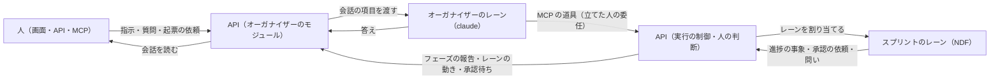

# オーガナイザー: AI のオーガナイザーと会話しながら、開発を回す

ログインの後の最初の画面を、AI のオーガナイザーの一覧と会話にする。利用者は、手元の Claude Code で conductor と会話しながら開発を進めるのと同じく、Web の画面と API・MCP からオーガナイザーへ指示・質問・起票の依頼を送り、オーガナイザーの答え・フェーズの報告・レーンの動き・承認待ちの知らせを時系列に読む。スプリント・承認・問い・設定の画面は、会話から辿る付属の画面になる（#140 の利用者の決定、2026-11-24）。

| 扱うもの | [全体の設計](overview.md) の項目 |
| --- | --- |
| コンテキスト | 「オーガナイザー」（新しく足す） |
| 場面 | S2・S15・S16 |
| 機能 | F7・F24・F25 |
| 不変条件 | I2・I4・I14・I23・I24 |

語・番号（S・F・I・E）は [全体の設計](overview.md) のものである。画面の項目は [画面](screens.md)、HTTP の経路と認可は [API と MCP](api.md)、置き場は [データ](data.md)、レーンの動き方は [実行](execution.md) が持つ。

## この文書で決めること

| 節 | 決めること | 決定 |
| --- | --- | --- |
| [AI のオーガナイザーの形](#ai-のオーガナイザーの形) | オーガナイザーは、立てた人の委任で nd-factory の API と MCP を使う AI のエージェントで、オーガナイザーのレーンで動く。NDF の並列のオーガナイザーをそのまま conductor にしない | 150・151 |
| [単位と状態](#単位と状態) | プロジェクトの中で、利用者が会話のように立てる。状態は動いている・休止・止まった・終わった | 152 |
| [会話の項目](#会話の項目) | 項目の種類・並べ方・控えと取り下げ。会話は承認を確定しない（I23） | 153 |
| [動く場所と休止](#動く場所と休止) | ホステッドでは入力を待つ間は休止し、手元のマシンが止まっている間の入力は控える | 154 |
| [付属の画面](#付属の画面) | 承認待ちの一覧・スプリント・設定は付属の画面にし、会話のリンクとナビゲーションから開く | 155 |

## 位置づけ

この文書は B（nd-factory が回す開発）の製品の設計である（[nd-factory 自体の開発と、nd-factory が回す開発](overview.md#nd-factory-自体の開発とnd-factory-が回す開発)）。旧い側では、同じ方向の設計（旧い側の #254）を利用者が 2026-11-14 に承認し、旧い側の main へ 2026-11-15 にリリースした。作り直しの全体の設計（#24）はこれを比べずにホーム（いま）へ戻していた。#140 で、利用者が会話を主にする形に決めた。旧い側の形は出発点にせず（Value 16）、作り直しの設計の部品（委任・実行の場所・ランナー・人の判断）の上に組み直す。

| 決まっていること | 中身 |
| --- | --- |
| 承認を確定するのは人だけ | 承認の依頼の確定は承認の詳細のボタンだけで行う。会話の入力欄の文・オーガナイザーの発言・API と MCP の会話の操作は、承認の依頼と問いの状態を変えない（I4・I23） |
| 見える範囲 | オーガナイザーと会話は 1 つのプロジェクトに属し、割り当てたチームの席を持つ人とその委任だけが読める。ほかからは一覧・会話・知らせ・件数のどこからも見えない（I2） |
| 同じ操作は API と MCP にも | 立てる・終える・再開する・送る・取り下げる・読むは、画面と同じ API の操作と MCP の道具で行える（I14） |

## AI のオーガナイザーの形

**オーガナイザーは、立てた人がそのオーガナイザーに発行した委任で動く AI のエージェントである。** レーンと同じ実行の場所で動く「オーガナイザーのレーン」の中で claude を動かし、nd-factory の MCP の道具（課題の候補を読む・スプリントを始める・取り消す・進みを読む・承認の依頼と問いを読む・起票の依頼を出す）だけで開発を回す（決定 150）。

| 項目 | 決まり |
| --- | --- |
| 委任 | オーガナイザーを立てると、立てた人の名でそのオーガナイザー専用の委任を発行する。範囲はそのプロジェクトと `read`・`run`、期限はオーガナイザーが終わるまで（最長 30 日。続けるときは立てた人が再開で延ばす）。`manage` と人だけの操作は持たない（I4・I3） |
| 使う道具 | nd-factory の MCP の道具だけ。GitHub・AWS・NDF の進行表へは直に触れない。スプリントは `sprints.create` で始め、レーンの動き方は [実行](execution.md) のとおり実行の制御が決める |
| 人へ出すもの | 承認の依頼と問いはレーンが出し、人の判断のモジュールが持つ。オーガナイザーはそれを会話に「承認待ち」「問い」の項目として知らせ、承認の詳細・問いの画面へのリンクを張る。オーガナイザーが自分で人に問いたいときは、会話の発言で問い、答えは利用者の次の発言で受ける（承認の依頼を作らない） |
| 起票の依頼 | 利用者が会話で起票を頼むと、オーガナイザーは課題の案を作り、起票の依頼（C5。[実行の文書の起票の依頼](execution.md#起票の依頼)）として人の承認へ出す。承認の外で課題を作らない |
| 手順 | オーガナイザーの手順（システムのプロンプトと道具の範囲）はサービスが持ち、版を付けてオーガナイザーの行に写す。利用者のリポジトリの指示書（AGENTS.md など）は、そのリポジトリのレーンの NDF が読む。オーガナイザーは読まない |
| 推論の手段 | チームの推論の手段（`managed`・`byok`）と実行の場所に従う。費用は費用の記録へオーガナイザーの ID とともに書き、使える量の判定（I8）を同じく通す |

## 単位と状態

**オーガナイザーはプロジェクトの中に、利用者が会話のように立てる。** 1 つのプロジェクトに複数を立ててよい。同じプロジェクトで同時に動くオーガナイザーの数はチームの料金プランの値（自分で設置した環境の既定は 3）までで、超えると立てる・再開するを 409 `organizer_limit` で断る（決定 152）。

| 状態 | 意味 | 一覧の区分 | 移る先 |
| --- | --- | --- | --- |
| `active` | 応答中か、入力を待っている（ホステッドで休止していない） | 動いているもの | `paused`・`stopped`・`ended` |
| `paused` | 入力を待つ間に休止した（ホステッド）。次の入力で起きる | 動いているもの（「休止中」の札） | `active`・`ended` |
| `stopped` | 起動できない・手元のマシンが止まった・使える量の上限に当たった・委任が切れた。理由のコードを持つ | 止まったもの | `active`（再開）・`ended` |
| `ended` | 利用者が終えた。会話は読めるが、送れない | 終わったもの | —（再開しない。新しく立てる） |

- オーガナイザーを終えても、それが始めたスプリントは止めない。止めるのはスプリントの取り消し（F10）である
- 状態の移りはオーガナイザーのモジュールだけが書き、進捗の受け口からの事象（オーガナイザーのレーンの起動・休止・終わり）で動かす

## 会話の項目

会話は、1 つのオーガナイザーの項目を時系列に並べたものである。項目は追記だけで持ち、取り下げも新しい項目で表す（Value 10）。

| 種類 | 書き手 | 中身 |
| --- | --- | --- |
| 指示・質問・起票の依頼 | 人（画面・API・MCP。委任も書ける） | 本文（Markdown の文字列、上限 8,000 字）・送った主体・冪等の鍵 |
| 取り下げ | 人 | 取り下げた項目の ID。オーガナイザーへ渡す前の項目だけを取り下げられる |
| 答え | オーガナイザー | 本文（Markdown）。リンクは nd-factory の画面の経路と GitHub の URL だけを押せる形で出し、ほかは文字のまま出す |
| フェーズの報告 | オーガナイザーのモジュール（進捗の事象から） | オーガナイザーが始めたスプリントの工程の移り（設計 → 実装 など）と、スプリントの詳細へのリンク |
| レーンの動き | オーガナイザーのモジュール（進捗の事象から） | レーンの始まり・終わり・失敗・休止。レーンの状況（スプリントの詳細）へのリンク |
| 承認待ち・問い | オーガナイザーのモジュール（E10 から） | 種類・題と、承認の詳細・問いの画面へのリンク。答えが確定したら同じ項目に「答えた」の札を足す（新しい項目で） |
| オーガナイザーの状態 | オーガナイザーのモジュール | 休止・止まった（理由）・再開・終わり |

| 決まり | 中身 |
| --- | --- |
| 渡し方 | 人の項目は API が追記した時点で確定し、オーガナイザーのレーンへは追記の順に 1 件ずつ渡す。渡した項目に `delivered_at` を書く。渡す前の項目は「控え中」の札で出し、取り下げられる |
| 承認にしない | 項目の本文がどうであれ、会話の操作は `approvals.answer`・`questions.answer` を呼ばず、承認の依頼と問いの状態を変えない（I23）。承認待ちの項目には「承認は承認の画面のボタンで行います」の 1 行を添える |
| 見える範囲 | 会話の項目はオーガナイザーのプロジェクトの見える範囲に従う（I2）。フェーズの報告・レーンの動き・承認待ちの項目は、オーガナイザーが始めたスプリントの分だけを足す |
| 読み方 | `organizer_messages.list` は時系列の昇順で、カーソルで古い方へ遡る（[ページ送り](api.md#ページ送り)） |
| つながらないとき | 画面は最後に受け取った一覧と会話を読める。送る項目は「控えて送る」（[操作の 3 つの区分](screens.md#操作の-3-つの区分)）で、つながってからサーバーへ届けた時点で確定する |

## 動く場所と休止

オーガナイザーのレーンは、スプリントのレーンと同じ実行の場所と同じランナーで動く（[実行の場所](execution.md#実行の場所)）。違いは、NDF を起動せず、nd-factory の MCP の道具を持つ claude を起動することだけである（決定 154）。

| 場所 | 起こす | 入力を待つ間 | 起こし直す |
| --- | --- | --- | --- |
| ホステッド | 立てた時と、`paused` の間に新しい項目が来た時に、実行の制御が `RunTask` で起こす（引き換えの token・`clientToken` はスプリントのレーンと同じ。決定 64） | 入力の待ちが猶予（設定の値、既定 5 分）を超えたら、claude の会話の控えを状態の S3 へ固めて `paused` にして終わる | 新しいタスクが状態の S3 から会話の控えを戻し、控えた項目を順に渡す |
| 手元のマシン | マシンが受け取りで受ける。マシンの claude のログインを使う（決定 67） | マシンの上で動き続ける | マシンが `offline` の間は `stopped`（`machine_offline`）にし、送った項目は控える。マシンが戻ると `active` に戻し、控えた項目を送った順に渡す |

- オーガナイザーのレーンも I7（1 つのレーンを動かすコンテナは同時に 1 つ）と I11（AWS の権限を持たない・token はレーンが動く間だけ）に従う
- オーガナイザーのレーンが使える量の判定で断られたら `stopped`（`usage_limit`）にし、会話に理由を出す

## 付属の画面

最初の画面はオーガナイザーの一覧と、最後に開いたオーガナイザーの会話である（[画面の地図](screens.md#画面の地図)）。ほかの画面は付属の画面にし、会話の項目のリンクとナビゲーションから開く（決定 155）。

| 付属の画面 | 役目 |
| --- | --- |
| 承認待ちの一覧 | 待っている承認の依頼と問いを、プロジェクトをまたいで古い順に並べる（旧ホームの「人を待つもの」）。会話の知らせを読み落としても、ここから辿れる |
| スプリントの一覧・詳細・始める | オーガナイザーを通さずにスプリントを読む・始める・取り消す（F8〜F10）。会話を使わない人と、委任のエージェントの経路として残す |
| 承認の詳細・問い | 承認と答えを確定する唯一の画面（I4） |
| 設定（プロジェクト・チーム・自分） | 今までのとおり |

## 外部の調査

| 番号 | 種類 | 対象 | 比べた中身 | この設計で採ったもの |
| --- | --- | --- | --- | --- |
| PRD70 | 主要な製品 | [Claude のアプリ](https://claude.ai) | 会話の一覧と会話を並べ、狭い幅では切り替えて 1 つずつ出す。会話は利用者が立てる | 一覧と会話の並べ方・立て方（旧い側の #254 の利用者の指示「Claude アプリが参考」） |
| PRD71 | 主要な製品 | [Claude Code](https://docs.anthropic.com/en/docs/claude-code/overview) の conductor | 手元で conductor と会話しながら、承認は別の手順で答える | 会話とフェーズの報告を時系列に混ぜて並べる。承認は会話の外で確定する |
| PRD72 | 主要な製品 | [GitHub Copilot coding agent](https://docs.github.com/en/copilot/concepts/coding-agent/coding-agent) | 課題を任せると、エージェントが Pull Request を作り、人がレビューで承認する | エージェントに承認の確定を持たせない形 |

## 決定の記録

### 決定 150: 人と同じ操作だけで開発を回すため、オーガナイザーを立てた人の委任で MCP の道具を使う AI のエージェントにする

結論: オーガナイザーは、立てた人がそのオーガナイザーに発行した委任（`read`・`run`）で、nd-factory の MCP の道具だけを使う。

理由: Value 4 は「AI からも人と同じく」使えることと、承認の確定を人だけにすることを求める。オーガナイザーを委任のエージェントにすると、認可（I2）・人だけの操作（I4）・操作の記録（I9）が、今の委任の作りのまま効く。

採らなかった案: オーガナイザーに専用の資格情報と道具を持たせる形は、委任と別の認可の経路を作り、人だけの操作の守りを 2 か所に持つ（Value 13）。

根拠: Value 4 / Value 9 / Value 13（MVV バージョン 3）

### 決定 151: レーンの割り当てを 1 か所に保つため、NDF の並列のオーガナイザー（`--parallel`）をそのまま conductor にしない

結論: オーガナイザーのレーンは NDF を起動しない。レーンを起こすのは実行の制御だけで、オーガナイザーは `sprints.create` を呼ぶ。

理由: NDF の並列のオーガナイザーは、同じマシンの中でレーンの conductor を起動する（`ndf lanes run`・`ndf relay spawn`）。nd-factory はレーンをホステッドのタスクか手元のマシンへ割り当て、1 つのレーンを 1 つのコンテナで動かす（I7）。NDF の並列のオーガナイザーをそのまま動かすと、レーンを起こす者が 2 つになり、使える量の判定（I8）と割り当ての照らしを通らないレーンができる。決定 73（オーガナイザーの置き場の変数を入れない）も保つ。

採らなかった案: 旧い側の #254 の前提 1（NDF の並列のオーガナイザーを conductor にする）。NDF の外のオーガナイザーの口（`NDF_ORGANIZER_DIR`）でサービスが NDF のオーガナイザーの役を担う形は、リリースのまとめをサービスへ持ち込む（決定 73）。NDF の契約にレーンの起動をサービスへ任せる口が足されたら、比べ直す（[未確認のまま残ること](#未確認のまま残ること)）。

根拠: Value 4 / Value 6 / MVV 版 3 の「NDF の UI に徹する」

### 決定 152: 手元の会話と同じく使えるよう、オーガナイザーはプロジェクトの中で利用者が立て、同時に動く数を料金プランで絞る

結論: 単位は「利用者が立てる」。1 つのプロジェクトに複数を立てられ、同時に動く数は料金プランの値（既定 3）まで。

理由: 手元の Claude Code では、目的ごとに会話を分けて進めている。プロジェクトに 1 つの固定にすると、目的の違う指示が 1 つの会話に混ざる。同時の数を絞るのは、オーガナイザーのレーンの費用を使える量の判定で抑えるためである（I8）。

採らなかった案: プロジェクトに 1 つ（会話が混ざる）、チームに 1 つ（見える範囲がプロジェクトをまたぎ I2 と食い違う）。

根拠: Value 1 / Value 6 / Value 9（MVV バージョン 3）

### 決定 153: 会話の文で承認が動かないよう、会話の操作は承認の依頼と問いを変えず、承認待ちの項目は承認の画面へのリンクにする

結論: 会話の項目の種類に承認を持たせない。承認待ちの項目はリンクで、確定は承認の詳細のボタンだけで行う（I23）。

理由: 入力欄の「承認します」を承認として受けると、承認資料の要約値と照らさずに確定し（I4）、委任のエージェントの発言でも承認が動く（Value 4）。

採らなかった案: 会話の中に「承認する」のボタンを置く形は、承認資料を読まずに押せる場所を増やし、手数の目標（S3 は承認の詳細で 2 手）を変えずに済む利点も無い。

根拠: Value 4（MVV バージョン 3）

### 決定 154: 入力を待つ間の費用を止めるため、ホステッドのオーガナイザーのレーンは入力の待ちで休止し、新しい項目で起こし直す

結論: 待ちが猶予（既定 5 分）を超えたら会話の控えを状態の S3 へ固めて休止し、次の項目で同じオーガナイザーに新しいタスクを起こす。

理由: オーガナイザーは人の入力を待つ時間が長い。決定 65（承認の待ちで休止）と同じ作りにすると、部品を足さずに待ちの費用を止められる（Value 6）。

採らなかった案: Lambda で 1 回ずつ答える形（旧い側の #180）は、レーンと別の実行の場所を足し、手元のマシンと同じ形にならない。常に動かす形は、使わない間の費用が 0 に近い前提（姿 5）を崩す。

根拠: Value 6（MVV バージョン 3）

### 決定 155: 会話を読み落としても承認を落とさないよう、承認待ちの一覧を付属の画面として残し、ナビゲーションに数を出す

結論: 承認待ちの一覧（プロジェクトをまたぐ）を付属の画面にし、ナビゲーションの「承認待ち」に待ちの数を出す。

理由: 会話の知らせは、オーガナイザーを通さずに始めたスプリントの承認を含まない。会話を開かずに知らせから承認する場面（S5）も残る。

採らなかった案: 承認待ちを会話の中だけに出す形は、オーガナイザーの外で始めたスプリントの承認を落とす。

根拠: Vision / Value 1（MVV バージョン 3）

## 未確認のまま残ること

| 項目 | 内容 |
| --- | --- |
| オーガナイザーの推論の費用 | 会話 1 回・1 日あたりの推論の量の見込みが無い。#138 の費用の見込みに、オーガナイザーのレーンの行を足す |
| NDF の並列のオーガナイザーとの比べ直し | NDF の契約に、レーンの起動を外の呼び手へ任せる口が足されたら、決定 151 を比べ直す |
| モックの承認 | 画面のモックは、旧い側の 2 つのモックを統合したキャンバスで作り直し、#12・#10 の最初の工程で利用者が承認する |
| オーガナイザーの手順の中身 | システムのプロンプトと道具の範囲の具体は #10 の詳細設計で決める |
