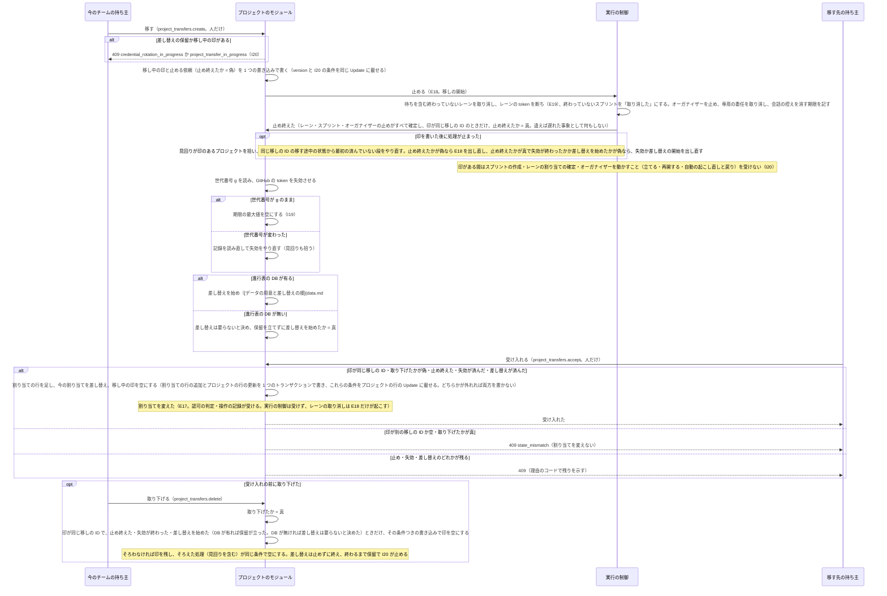

# nd-factory: 人が承認と判断に集中し、どこからでも、AI からも同じく開発を回せる（#24）

## 目的

- **今どうなっているか**: nd-factory は、全体の設計・詳細設計・実装計画が無いまま機能を足してきた。その結果、プロジェクト MVV（版 1）が目指す姿（承認と判断に集中できる・どこでも分かる・AI からも同じく使える・チームにだけ見える・誰でも安く設置できる）から離れた（[#24 の要求](../design-process/issue-24/requirements.md) の目的）
- **何が成り立つか**: 下の表のことが成り立つ。プロジェクト MVV（今の版は [.ndf/mvv.json](../../.ndf/mvv.json) の versions の最後。この見直しの時点で版 3）の Mission・Vision・Value 1〜9 を、利用者と利用の場面から、機能・画面・API・データ・アーキテクチャ・運用まで一続きに受け、Value 10〜17（開発の目標）をこのリポジトリの開発の決まりで受ける。MVV に照らして入れる機能だけを作る。設計の各節の「根拠: Value n（MVV）」は版を書かず、ここの版を指す
- **誰に効くか**: 開発を任せて承認する人、そのチームの人、人が任せた AI のエージェント、nd-factory を自分の AWS へ設置する人、運用する人

| nd-factory が成り立たせること | 受ける MVV の項目・不変条件 |
| --- | --- |
| ホーム（いま）1 枚で、人を待つもの（承認・問い）が先頭に読める（S2） | Vision |
| スマートフォンとタブレットで使え、つながらなくても読める | Value 3 |
| 画面の操作はすべて API と MCP にもある。承認の確定は人だけ | Value 4・I14 |
| 認可はプロジェクトの単位でサーバーの側で判定し、割り当てたチームにだけ見せる | Value 9・I2 |

## 適用範囲

- **働く範囲**: このリポジトリ（devbasex/nd-factory）の画面・API・MCP・形の正本・インフラの定義・設置のコマンド。NDF（devbasex/ai-plugins のプラグイン）は外部の系で、この設計は NDF を変えない
- **プロジェクトごとに違うもの**: AWS のアカウントとリージョンは profile から受ける。ほかの環境の値は、リポジトリの外の設定のファイルから受ける（[docs/operations/settings.md](../operations/settings.md) ）。秘密の値は秘密の器から受ける
- **当たるモード**: `standard`（NDF の工程の振り分けの区分）。設計と詳細設計を書き、設計承認ゲートで人が承認してから実装へ進む

## nd-factory 自体の開発と、nd-factory が回す開発

この設計には、開発が 2 つ出てくる。節ごとにどちらの話かを決めて読む。

| | A. nd-factory 自体の開発 | B. nd-factory が回す開発 |
| --- | --- | --- |
| 対象 | このリポジトリ（devbasex/nd-factory）のコード・インフラの定義・設置のコマンド | 利用者のプロジェクトのリポジトリ |
| 回す人と道具 | nd-factory の開発者が NDF（devbasex/ai-plugins）を使って回す | 利用者と、利用者が任せた AI のエージェントが、nd-factory の画面・API・MCP から NDF の工程を回す |
| 品質の確かめ | このリポジトリの CI（[プラットフォームの検査](platform.md#検査)）と、NDF の工程のレビューと完了判定 | NDF の工程と ai-plugins の道具が担う。nd-factory は検査を持たず、結果と承認の材料を見せ、人の承認を NDF へ渡す |
| 承認と反映 | このリポジトリの Pull Request の承認と、nd-factory 自身の反映（[反映と設置](platform.md#反映と設置)） | 利用者のスプリントの承認ゲート（[実行](execution.md)）。反映するのは利用者のプロジェクト |

nd-factory は B に対して NDF の UI に徹する。工程・検査・契約の中身は NDF が持ち、nd-factory は NDF の契約に載るものだけで工程を起こし、状態を読み、人の答えを渡す（[NDF との契約](execution.md#ndf-との契約)）。B のために nd-factory が持つのは、画面・API・MCP・認可・記録と、NDF の工程を動かす場所（[実行](execution.md)）である。

| 文書・節 | 話の対象 |
| --- | --- |
| [screens.md](screens.md)・[api.md](api.md)・[data.md](data.md)・[execution.md](execution.md) | B を回すための nd-factory の製品 |
| [platform.md](platform.md) のアーキテクチャ・状態の置き場・インフラ・費用・反映と設置 | nd-factory の製品の動く場所と、その設置（設置と反映は A） |
| [platform.md](platform.md) の検査・横断の部品と定数の置き場・言語と書き方の決まり | A（このリポジトリの開発の決まり） |
| [docs/design-process/](../design-process/) | A（この設計を作った経緯） |

## あるべき姿

| # | あるべき姿 |
| --- | --- |
| 姿 1 | チームの人は、スマートフォン・タブレット・PC の Web の画面から、プロジェクトの課題を指して 1 回の確定でスプリントを始める。リポジトリごとのレーンが、選んだ実行の場所（サービスのコンテナか手元のマシン）で NDF の工程を並列に回す |
| 姿 2 | ログインの後は AI のオーガナイザーの一覧と最後に開いた会話が出る。利用者は手元の Claude Code と同じく、オーガナイザーへ指示・質問・起票の依頼を送り、答え・フェーズの報告・レーンの動き・承認待ちを時系列に読む。人を待つ承認の依頼と問いは、会話の知らせと承認待ちの一覧の両方から辿れる。待つものができると Web Push か Slack で知らせが届き、Web Push の知らせから 2 手で、Slack からは承認待ちの一覧を通って 3 手で承認を確定できる。つながらない間も読め、取り消せない確定はつながってから行う |
| 姿 3 | 画面で行える操作はすべて同じ API と MCP の道具にもあり、人が委任した AI のエージェントが同じ操作を行える。承認ゲートとレッドラインに当たる確定だけは人が行う。読み取りを含むすべての操作が、だれが・いつ・どの入口から・何をしたかの追記だけの記録に残る |
| 姿 4 | プロジェクトは 1 つのチームに割り当て、その席を持つ人と委任だけが中身と存在を見られる。認可はサーバーの側の 1 か所がプロジェクトの単位で判定する |
| 姿 5 | だれでも公開のコードから自分の AWS へ、設置のコマンドで差分と確認の値を見て反映できる。常駐する計算と NAT を持たず、使わない間の費用は 0 に近い。運用する環境は反映のパイプラインで人が承認した差分だけを反映する |

要求と受け入れ条件は #24 の本文にある（コピーは [requirements.md](../design-process/issue-24/requirements.md)）。この文書は「どう作るか」だけを扱う。

## あるべき姿の根拠

各行の「支える姿」は、上の表のどの行の根拠かを示す。外部の一次情報の行は、出典へのリンクと、比べた中身を載せた外部の調査の表（番号つき）を添える。

| 支える姿 | 根拠 | 種類 | 何を示すか |
| --- | --- | --- | --- |
| 姿 1〜5 | [プロジェクト MVV](../../.ndf/mvv.md)（Mission・Vision・Value 1〜17・P1・P2）  | 利用者が承認した MVV | 目指す姿と判断の基準。項目ごとの受け先は下の「MVV と設計の節の対応」 |
| 姿 1 | NDF の契約のファイル（`plugins/ndf/contracts/`、[実行の文書の NDF との契約](execution.md#ndf-との契約)、調査の番号 STD62） | 外部の一次情報 | 外の呼び手が NDF を起動する口・環境変数・結果の行の形。レーンが NDF の工程をこの口だけで回せる |
| 姿 1 | [GitHub Actions の自前のランナー](https://docs.github.com/en/actions/reference/runners/self-hosted-runners)（[実行の文書の主要な製品](execution.md#主要な製品)、PRD60） | 外部の一次情報 | 利用者のマシンを外から開かず、外向きの HTTPS だけで仕事を受ける形が広く使われている。手元のマシンを実行の場所にできる |
| 姿 2 | W3C の [Web Application Manifest](https://www.w3.org/TR/appmanifest/)・[Service Workers](https://www.w3.org/TR/service-workers/)・[Push API](https://www.w3.org/TR/push-api/)（[画面の文書の標準・仕様](screens.md#標準仕様)、STD20・STD22） | 外部の一次情報 | Web の画面を端末に入れ、つながらなくても読め、承認待ちの知らせを受けられる標準がある |
| 姿 2 | [iOS・iPadOS の Safari の Web Push](https://webkit.org/blog/13878/web-push-for-web-apps-on-ios-and-ipados/)（[画面の文書の主要な製品](screens.md#主要な製品)、PRD20） | 外部の一次情報 | ホーム画面に加えた Web アプリなら iPhone にも知らせが届く |
| 姿 2 | [Slack の `chat.postMessage`](https://docs.slack.dev/reference/methods/chat.postMessage)（[実行の文書のライブラリとサービス](execution.md#ライブラリとサービス)、LIB64） | 外部の一次情報 | 利用者とアプリの DM へ知らせを送る口があり、送る量の上限と失敗の扱いが決まっている |
| 姿 3 | [Model Context Protocol の仕様 2026-07-28 版](https://modelcontextprotocol.io/specification/2026-07-28/basic/transports/streamable-http)（[API の文書の標準・仕様](api.md#標準仕様)、STD40） | 外部の一次情報 | AI のエージェントが外の道具を呼ぶ標準の形。API と同じ操作を道具として出せる |
| 姿 3 | [GitHub の遠くの MCP サーバー](https://github.com/github/github-mcp-server)（[API の文書の主要な製品](api.md#主要な製品)、PRD42） | 外部の一次情報 | GitHub が自分のサービスの操作を遠くの MCP サーバーとして出し、OAuth と貼る token の両方で使わせている例 |
| 姿 4 | [プロジェクト MVV](../../.ndf/mvv.md) の Value 9 と P2 | 利用者が承認した MVV | 割り当てたチームの外へ存在も見せない。割り当てを変えるのは人の承認 |
| 姿 5 | [Aurora Serverless v2 の自動の一時停止](https://docs.aws.amazon.com/AmazonRDS/latest/AuroraUserGuide/aurora-serverless-v2-auto-pause.html)（[プラットフォームの文書のライブラリとサービス](platform.md#ライブラリとサービス)、LIB80） | 外部の一次情報 | 接続が無い間は DB の計算の費用が止まる |
| 姿 5 | [ECS Fargate のタスクのネットワーク](https://docs.aws.amazon.com/AmazonECS/latest/developerguide/fargate-task-networking.html)（同、LIB82）と [DynamoDB の要求の数の課金](https://docs.aws.amazon.com/amazondynamodb/latest/developerguide/capacity-mode.html)（同、LIB81） | 外部の一次情報 | 公開のサブネットで公開 IP を付ければ NAT なしで外へ出られ、表は使った分だけ課金される |
| 姿 5 | [プロジェクト MVV](../../.ndf/mvv.md) の Value 7・Value 8・P1 | 利用者が承認した MVV | 公開を前提に実際の値を置かない。反映はパイプラインか設置のコマンドだけで、人が差分を見て承認する |

## 文書の地図

設計は主題ごとに次の 9 本に分ける。画面のモックのコードは [mock/](mock/) に置く。

| 文書 | 主題 |
| --- | --- |
| [overview.md](overview.md) | 目的・MVV との対応・利用者と場面・ドメインモデル・機能一覧・不変条件のテスト設計 |
| [screens.md](screens.md) | 画面: 画面の地図・共通の部品・端末の幅・オフライン・国際化・画面ごとの項目 |
| [api.md](api.md) | API と MCP: 呼び出しの規約・操作の一覧・認可・委任・操作の記録・形の正本 |
| [organizer.md](organizer.md) | オーガナイザー: AI のオーガナイザーの形・単位と状態・会話の項目・動く場所と休止・付属の画面 |
| [execution.md](execution.md) | 実行: スプリントとレーン・実行の場所・NDF との契約・承認と問いの流れ・知らせ |
| [platform.md](platform.md) | プラットフォーム: アーキテクチャ（arc42・C4）・インフラ・反映と設置・費用・検査・言語と書き方の決まり・非機能 |
| [data.md](data.md) | データ: 状態の置き場（サービスの表と共通の列・状態の S3・進行表の DB の用意と差し替え・形の版・CRUD 図） |
| [decisions.md](decisions.md) | 外部の調査と決定の記録 |
| [detail.md](detail.md) | 詳細設計: 受け持つ子の課題・モジュールの置き場と依存の向き・横断の部品の型と関数の仕様と異常系 |

## 人へ残す判断

下の 5 件は、レッドライン（下の表）に当たる設計判断である。AI が決めずに、人が承認して決める。各行の「推しの案」はこの設計が採った案で、理由と採らなかった案は「詳しい置き場」の決定にある。

| 判断 | 当たるレッドライン | なぜ当たるか | 推しの案 | 詳しい置き場 |
| --- | --- | --- | --- | --- |
| プロジェクトの割り当ての作り | P2 | 割り当てがプロジェクトを見られるチームを決める | 1 つのプロジェクトは同時に 1 チームだけに割り当てる。作成と同じ操作で割り当てる。移すときは今のチームと移す先のチームの持ち主が両方とも画面で確定する。チームの外へ見せる操作は作らない | [プロジェクトとチーム](#プロジェクトとチーム)・I2・I3 |
| 認可と委任の作り | C2 / P2 | だれが何をできるか、どの主体がプロジェクトを見られるかが決まる | 認可はプロジェクトの単位でサーバーの 1 か所が判定する。委任の範囲はプロジェクトの並びと操作の種類 `read`・`run`・`manage`、期限は 1 時間〜30 日（既定 7 日）。承認の確定・割り当て・委任の発行など「人だけ」の操作は委任から 403。問いは NDF の区分で分け、承認ゲート・レッドライン・取り消せない操作・人の手の要る区分と知らない区分だけを人だけにする | [API の文書の認可](api.md#認可)・[委任](api.md#委任)・決定 49・決定 72 |
| NDF の起票の依頼の扱い | C5 | 他のリポジトリへ課題を公開する条件が決まる | NDF がスプリントの中で他のリポジトリへ課題を起こそうとしたら、承認の依頼として承認の画面に並べる。人が承認したものだけ、サービスが 1 リポジトリに絞った token で起こす。1 スプリントで 10 件まで | [起票の依頼](execution.md#起票の依頼)・決定 78 |
| 秘密の置き方と渡し方 | C1 | 秘密の値を置く所と受け取れる主体が決まる | 秘密の器を用途ごと（サービス・プロジェクトごとの進行表の DB・通知先ごと）に分け、関数ごとに使う器だけを名前で読めるようにする（管理の役割の器は DB の用意の関数だけ、Web Push の私有鍵と通知先の宛先は知らせの送り手だけ。API の関数は App の私有鍵・プロジェクトの URL など自分が使う器だけで、応答に載せるのは引き換えでそのレーンのランナーへ渡すプロジェクトの URL と持ち込みのキーだけ）。レーンの token はレーンが動く間だけ、GitHub の token は 1 リポジトリに絞って 1 時間。端末のログインの控え（refresh token）は取り出せない鍵で暗号化して IndexedDB に置く | 決定 90・決定 69・決定 31・I10・I11 |
| NDF への課題の起票（複数の課題を 1 回で受ける起動の口） | C5 | 他のリポジトリ（devbasex/ai-plugins）へ課題を起こす | 最初の版はレーンの中の課題を順に流し、並列はリポジトリの間だけにする。NDF（devbasex/ai-plugins）へ口を求める課題は、人の承認を得て devbasex/ai-plugins#3783 として出した（済み） | [未確認のまま残ること](#未確認のまま残ること) |

レッドラインは、AI が自分で進めずに必ず人の承認を求める操作の種類である。C は NDF の共通原則が、P はプロジェクト MVV が定める。この設計に当たるものだけを載せる。

| レッドライン | 定める所 | 操作 | なぜ人の承認が要るか |
| --- | --- | --- | --- |
| C1 | NDF の共通原則 | 秘密（token・鍵・資格情報）に触れる | 漏れると取り消せない |
| C2 | NDF の共通原則 | 認証・認可を変える | だれが何をできるかが変わる |
| C5 | NDF の共通原則 | 他のリポジトリへ公開する（課題を起こすことを含む） | 他者が読む内容を外へ出す |
| P1 | [プロジェクト MVV](../../.ndf/mvv.md) | 反映のパイプラインと設置のコマンドの外で AWS の資源を作る・変える・消す、`cdk bootstrap` を打つ・その版を上げる（初回も更新も、リリース承認ゲートの後だけ。[反映と設置](platform.md#反映と設置)） | 人が差分を見て承認する経路を通らない |
| P2 | プロジェクト MVV | プロジェクトをチームに割り当てる・変える・外す、見られる範囲を広げる | 他のチームへ一度見えた中身は取り消せない |

## MVV と設計の節の対応

MVV の各項目を、それを受ける設計の節へ対応づける。設計の判断で迷ったら、この表の行の MVV の項目を基準に戻る。Mission・Vision・Value 1〜9・P2 は B（nd-factory が回す開発）のための製品の判断の基準である。P1 は B に加えて、nd-factory 自体を設置・反映する経路（A の運用）にも効く。Value 10〜17（開発の目標）は A（nd-factory 自体の開発）にだけ当てる（[nd-factory 自体の開発と、nd-factory が回す開発](#nd-factory-自体の開発とnd-factory-が回す開発)）。

| MVV の項目 | 要点 | 受ける設計の節 |
| --- | --- | --- |
| Mission | 工程を Web の画面から、人も AI も同じく回す。承認は人。待ちと手間を減らす | [利用者と利用の場面](#利用者と利用の場面)・[機能一覧](#機能一覧) |
| Vision | 課題を指せば並列に回り、人を待つのは承認だけ。どこでも何が動き何が待つかが分かる。チームにだけ見える。API と MCP。国を越える。公開で安く設置。承認した範囲だけ反映 | [ホーム（いま）](screens.md#ホームいま)・[スプリントを始める流れ](execution.md#スプリントを始める流れ) |
| Value 1 操作を速く分かりやすく | 機能の数より迷わない速さ | [手数の目標](screens.md#手数の目標) |
| Value 2 画面先行 | 画面の基盤 → 機能の画面をダミーデータで → API をつなぐ。API は機能から起こし常に配列 | [呼び出しの規約](api.md#呼び出しの規約) |
| Value 3 どこでも、つながらなくても | スマートフォンとタブレット。オフラインで読める。端末のデータは暗号化。取り消せない操作はつながってから確定 | [オフライン](screens.md#オフライン)・[端末の幅](screens.md#端末の幅) |
| Value 4 AI からも人と同じく | 画面の操作はすべて API と MCP にも。承認の確定は人だけ。委任とクライアントを確かめる。すべての操作を記録 | [操作の一覧](api.md#操作の一覧)・[MCP](api.md#mcp)・[操作の記録](api.md#操作の記録) |
| Value 5 国や地域を越えて | 翻訳のファイル・UTC で保存・通貨とともに・法令に応じられる作り。先回りしない | [国際化](screens.md#国際化)・[値の形](api.md#値の形) |
| Value 6 自前の構成で安く | 相乗りしない。NAT なし・Lambda は VPC の外・Fargate は公開のサブネット。費用が増える構成は理由と代案 | [インフラ](platform.md#インフラ)・[費用](platform.md#費用) |
| Value 7 公開を前提に値を置かない | 実際の値・秘密を置かない。検査で止める | [検査](platform.md#検査) |
| Value 8 承認した範囲だけ反映 | パイプラインか設置のコマンドだけ。CI は資格情報を持たない | [反映と設置](platform.md#反映と設置) |
| Value 9 割り当てたチームにだけ見せる | 認可はプロジェクトの単位でサーバーの側。存在も見せない | [認可](api.md#認可) |
| Value 10 正しいデータ構造から作る（A） | 同じ事実を 2 か所に持たない。履歴は追記だけ。写しは根拠を書いてから | [データ](data.md)・[共通の列](data.md#共通の列)（置き場の欠けは #133） |
| Value 11 責務の分かれた設計（A） | 業務の規則はドメイン。外の接続はインタフェースの裏。型で早く誤りを見つける | [詳細設計](detail.md)・[設計の決まりを縛る検査](platform.md#設計の決まりを縛る検査) |
| Value 12 リファクタリングを続ける（A） | 機能を足すたびに構造を見直す。変える前に振る舞いを固定するテスト | 受け先の節が無い（#137） |
| Value 13 重複と冗長を作らない（A） | 1 か所に置いて参照。定義から作れるものは生成する。使わないものは残さない | [横断の部品と定数の置き場](platform.md#横断の部品と定数の置き場)・[基本の検査](platform.md#基本の検査) |
| Value 14 モダンな開発の手順（A） | テスト先行・自動の検査・レビュー。依存を新しく。判断を理由とともに残す | [検査](platform.md#検査)・[決定の記録](decisions.md#決定の記録)（依存の更新と脆弱性は #137） |
| Value 15 車輪の再発明をしない（A） | 実績のあるライブラリ・サービスを設計の時点で調べ、候補と選んだ理由を書く | 各文書の外部の調査（[外部の調査](decisions.md#外部の調査)） |
| Value 16 前の形に縛られない（A） | 類似・競合の製品と最新の考え方を調べて取り込む | 受け先の節が無い（#137。外部の調査は主要な製品を調べないと決めている） |
| Value 17 目先の手間より長く良い形（A） | 書き換える手間を選ばない理由にしない | [決定の記録](decisions.md#決定の記録)（各決定の採らなかった案） |
| P1 パイプラインと設置のコマンドの外の AWS の変更 | 人の承認 | [反映と設置](platform.md#反映と設置)・[人へ残す判断](#人へ残す判断) |
| P2 プロジェクトの割り当てと見せる範囲 | 人の承認 | [割り当てを変える流れ](#割り当てを変える流れ)・[人へ残す判断](#人へ残す判断) |

## 利用者と利用の場面

### 利用者

| # | 利用者 | どう使うか | 主な端末 |
| --- | --- | --- | --- |
| A1 | 開発を任せる人 | 課題を指してスプリントを始め、承認ゲートと問いに答える。承認と判断に集中し、待ちと手間を減らしたい | スマートフォン・タブレット・PC。移動中を含む |
| A2 | チームの人 | 割り当てられたプロジェクトの進み具合を読み、スプリントを始め、自分に向いた問いに答える | PC・スマートフォン |
| A3 | チームの持ち主 | チームの人を足す・外す。プロジェクトを作り、チームへ割り当てる（P2）。実行の場所と上限額を決める | PC |
| A4 | 人が任せた AI のエージェント | 委任を受けて、API と MCP から人と同じ操作を行う。承認の依頼と材料を読めるが、承認を確定できない | —（API・MCP） |
| A5 | 連携するシステム | 委任を受けて API から状態を読み、決まった操作を行う（例: 社内のチャットへ流す・課題の管理から始める） | —（API） |
| A6 | 自分で設置する人 | 自分の AWS へ設置のコマンドで設置し、自分のチームで使う | PC |
| A7 | 運用する人 | 運用する環境を反映のパイプラインで反映し、費用と障害を見る | PC |

A1〜A3 は同じ人が兼ねてよい。A1 と A2 は使い方の違いで、権限は同じである。権限はチームの席の役割（持ち主・メンバー）だけで決まり、持ち主は A3 の操作も行える。承認ゲートの承認と問いへの答えは、プロジェクトを割り当てたチームの席を持つ人なら役割によらず確定できる（[席の役割ごとの操作](api.md#席の役割ごとの操作)）。

### 利用の場面

場面は、利用者が nd-factory を開く理由である。機能一覧の各行は、この表のどれかの場面から来る。

| # | 場面 | 利用者 | いま困っていること（MVV の項目） | nd-factory で成り立つこと |
| --- | --- | --- | --- | --- |
| S1 | 課題を指してスプリントを始める | A1・A2・A4 | 課題を選ぶ・始める手数が多い（Value 1） | プロジェクトの課題の候補から選んで 1 回の確定で始まる。リポジトリごとのレーンが並列に回る（レーンの中の並列は NDF の契約の口を待つ。未確認のまま残ること） |
| S2 | いま何が動いていて、何が人を待つかを知る | A1・A2・A4 | 画面を渡り歩かないと分からない（Vision） | オーガナイザーの会話で進みが時系列に読め、人を待つもの（承認・問い）は承認待ちの一覧 1 枚で読める |
| S3 | 承認ゲートで承認する・差し戻す | A1・A2（人だけ） | 材料を開くのに手数がかかり、スマートフォンで読めない（Value 1・3） | 承認資料を 1 画面で読み、承認か差し戻しを確定する。つながらない間は読めて、確定はつながってから |
| S4 | AI の問いに答える | A1・A2 | 何を問われているかが分かりにくい（Value 1） | 問いと選択肢と推しの案を読み、答える。レッドラインに当たる問いは人だけ（承認ゲートは問いでなく承認の依頼として S3 で扱う） |
| S5 | 人を待つものができたと知る | A1・A2 | 画面を開くまで気づかない（Vision） | 端末への知らせ（Web Push）か Slack で知る。Web Push の知らせからは承認の画面を直に開き、Slack からは承認待ちの一覧を開く |
| S6 | 移動中に読む | A1・A2 | 電波が弱いと読めない（Value 3） | 最後に受け取ったスプリントの一覧・詳細・承認資料を、つながらなくても読める |
| S7 | プロジェクトを用意する | A3 | — | プロジェクトを作り、GitHub のリポジトリ（主 1・サブ 0 以上）を登録し、チームへ割り当てる |
| S8 | チームを整える | A3 | — | チームを作り、人を招き、役割を変え、外す |
| S9 | AI のエージェントに任せる | A1・A2 → A4 | 画面にしか無い操作がある（Value 4） | 範囲と期限を決めて委任を発行し、エージェントが MCP か API で同じ操作を行う。取り消せる |
| S10 | 実行の場所と費用を決める | A3 | — | ホステッド（サービスが起こすコンテナ）か手元のマシンかを選び、月の上限額を決め、使った額を通貨で読む |
| S11 | だれが何をしたかを確かめる | A3（運用する人 A7 は AWS の側の構造化ログで読む） | — | プロジェクトの操作の記録を、だれが・いつ・どの入口から・何をの形で読む |
| S12 | 自分の言語と時刻帯で使う | 全員 | 日本語だけで、時刻は端末の時刻帯と混ざる（Value 5） | 言語と時刻帯を選び、日時と金額がその形で出る |
| S13 | 自分の AWS へ設置する | A6 | — | 設置のコマンドで差分と確認の値を見て反映し、足りない設定の一覧を受ける |
| S14 | 運用する環境を反映する | A7 | — | 起点のブランチへの push から、準備・人の承認・反映が流れる |
| S15 | AI のオーガナイザーと会話しながら開発を進める | A1・A2・A4 | 手元の Claude Code では conductor と会話して進めるのに、Web の画面ではできない（Mission・Value 1） | オーガナイザーへ指示・質問・起票の依頼を送り、答えと進みを同じ会話で読む。承認は会話のリンクから承認の画面で確定する |
| S16 | 目的ごとにオーガナイザーを立てる・終える | A1・A2・A4 | 目的の違う指示が 1 つの流れに混ざる（Value 1） | プロジェクトの中で会話のように立て、終えたものは読めるまま残る |

## ドメインモデル

### コンテキスト

| コンテキスト | 用語集の `id` | 何の語が 1 つの意味に決まるか |
| --- | --- | --- |
| 利用者とチーム | `identity` | 利用者・ログインの組・IdP の主体の一意の行・チーム・席・席の役割・委任・利用者の設定 |
| プロジェクト | `project` | プロジェクト・リポジトリ・主リポジトリ・プロジェクトの割り当て・割り当てを移す流れ・GitHub の token の失効 |
| 実行 | `execution` | スプリント・レーン・区間・実行の場所・手元のマシン（登録）・推論の手段・進捗の事象・起こし直し |
| 人の判断 | `judgment` | 承認の依頼・問い・答え・答えの送達・人だけの区分・承認資料 |
| 知らせ | `notice` | 知らせ・通知先・既読 |
| 使える量と費用 | `usage` | 料金プラン・使える量・月の上限額・費用の記録 |
| 操作の記録 | `audit` | 操作の記録・主体・入口 |
| オーガナイザー | `organizer` | AI のオーガナイザー・オーガナイザーのレーン・会話の項目・付属の画面 |
| プラットフォーム | `platform` | 進行表の DB の用意・資格情報の差し替え・サービスの表の共通の列 |
| NDF（外部） | — | 工程・承認ゲート・進行表・結果の行・問いの区分。nd-factory は変えない |

コンテキストマップの関係（関係の語は、公開された言語・顧客 / 供給者・順応者・腐敗防止層・共有カーネルの 5 つから選ぶ）:

| 上流 | 下流 | 関係 | 中身 |
| --- | --- | --- | --- |
| NDF | 実行・人の判断 | 公開された言語 | NDF の契約（[NDF との契約](execution.md#ndf-との契約)）だけでやり取りする。ランナーが腐敗防止層として、NDF の結果の行と承認ゲート・問いを進捗の事象と承認の依頼・問いへ翻訳する |
| 利用者とチーム | ほかのすべて | 顧客 / 供給者 | 下流は利用者とチームを ID で参照する |
| プロジェクト | 実行・人の判断・知らせ・操作の記録の読み出し・プラットフォーム（DB の用意） | 顧客 / 供給者 | 下流は「この主体がこのプロジェクトを見られるか」を、プロジェクトの認可の判定 1 か所へ問う（I2）。進行表の DB の列と GitHub の token の世代番号はプロジェクトの集約にあり、DB の用意の関数・見回り・token の取り直しは、プロジェクトのモジュールの関数を呼んで書く（直に表へ書かない） |
| 実行 | 人の判断 | 公開された言語 | 実行は承認の依頼・問い（E10）と、答えの送達の結果（E14）・レーンの終わり（E19）・起票の結果（E20）を形の正本の事象の形で出し、人の判断が受けて自分の表へ書く |
| 人の判断 | 実行 | 顧客 / 供給者 | 人の判断が確定した答え（E13）と、答えの受け取りの関数（渡し中を記して答えを返す）を実行へ出す。実行の制御は人の判断の表へ直に書かず、この関数を呼ぶ |
| 実行・人の判断 | 知らせ | 公開された言語 | 知らせを作るのは知らせのモジュールだけで、ほかは「人へ知らせを求める」事象（E12）を出す |
| 実行 | 使える量と費用 | 公開された言語 | 実行は区間の終わりごとに使った量の事象（E11）を出し、使える量と費用がそれを集計する。開始の前の判定は使える量の判定 1 か所へ問う（I8） |
| ほかのすべて | 操作の記録 | 公開された言語 | 操作 1 回ごとに共通の形（主体・入口・操作・対象の ID・結果）を送る。操作の記録は追記だけ |

### 集約

| 集約 | 持ち主（書き換えてよいもの） | 根 | エンティティ | 値オブジェクト |
| --- | --- | --- | --- | --- |
| 利用者 | 利用者とチームのモジュール | 利用者 | ログインの組 | 呼び名・利用者の設定（言語・時刻帯）・IdP の主体から利用者を引く行 |
| チーム | 利用者とチームのモジュール | チーム | 席・招待 | 席の役割・料金プラン・月の上限額・通貨・実行の場所・推論の手段 |
| 委任 | 利用者とチームのモジュール | 委任 | — | 範囲（プロジェクトの並びと操作の種類 read・run・manage）・期限・クライアントの名前 |
| プロジェクト | プロジェクトのモジュール | プロジェクト | リポジトリ（主 1・サブ 0 以上） | 名前・宣言の置き場・移し中の印（今の移しの ID）・進行表の DB の名前と役割の名前・用意の ID・差し替えの番号・GitHub の token の世代番号・版 |
| プロジェクトの割り当て | プロジェクトのモジュール | 割り当て | — | チームの ID・割り当てた人・時刻 |
| スプリント | 実行の制御 | スプリント | レーン・区間 | 課題の参照・実行の場所・推論の手段・冪等の鍵・レーンの割り当て（場所の種類・タスクかマシンの ID・世代の番号） |
| 手元のマシン | 実行の制御 | 手元のマシン | — | 状態（登録待ち・`online`・`offline`）・登録の token の指紋・心拍の時刻・同時に受けるレーンの数 |
| 進捗の事象 | 進捗の受け口（追記だけ） | 事象の 1 件 | — | 種類・レーンの ID・連番・時刻 |
| 承認の依頼 | 人の判断のモジュール | 承認の依頼 | 答え | 承認ゲートの種類・状態（待っている・答えた・取り消した）・承認資料の要約値・対象の課題の番号の並び・答えの送達の状態・起票の結果（起票の依頼だけ。作った・作らなかった） |
| 問い | 人の判断のモジュール | 問い | 答え | 区分・状態（同上）・選択肢・推しの案・人だけか（区分から決める）・答えの送達の状態 |
| 知らせ | 知らせのモジュール | 知らせ | — | 宛先の利用者・既読・通知先ごとの送達の状態 |
| 通知先 | 知らせのモジュール | 通知先 | — | 種類（Web Push・Slack）・宛先の値の指紋 |
| 費用の記録 | 使える量と費用のモジュール（追記だけ） | 記録の 1 件 | — | 金額・通貨・量の種類・スプリントの ID |
| 操作の記録 | 操作の記録のモジュール（追記だけ） | 記録の 1 件 | — | 主体・入口・操作・対象の ID・結果 |
| オーガナイザー | オーガナイザーのモジュール | オーガナイザー | 会話の項目（追記だけ） | 題・状態（`active`・`paused`・`stopped`・`ended`）と理由・立てた人・専用の委任の ID・手順の版・実行の場所・推論の手段 |

#### 集約を書き換える経路

持ち主の外で起きた出来事は、持ち主のモジュールへ事象か関数の呼び出しで頼み、持ち主だけが書く。

| 書き換える値 | 起こすもの | 頼み方 | 書くもの |
| --- | --- | --- | --- |
| 答えの送達の状態（渡し中） | ランナーの受け取り（`/v1/runner/answers/list`） | 実行の制御が人の判断のモジュールの受け取りの関数を呼ぶ（人の判断が上流の顧客 / 供給者） | 人の判断のモジュール |
| 答えの送達の状態（届いた）と NDF の答えの事象の番号 | ランナー | 送達の事象（E14） | 人の判断のモジュール |
| 承認しない・取り消すの答えを渡した後のレーンの取り消し | 実行の制御（`/v1/runner/answer_deliveries/create` を受けた処理。人の判断の「届いた」の書き込みが確定した後） | 確定の後に同じ処理の中でレーンを「取り消した」にし、レーンの終わりの事象（E19）を出す。どちらも確定してから成功を返す | 実行の制御（レーン）・人の判断のモジュール（E19 を受けた依頼と問い） |
| 答えの送達の状態（未渡し・渡し中から失敗へ）・承認の依頼と問いの取り消し | 実行の制御（レーンの失敗・取り消し。割り当ての移しは E18 を受けた実行の制御がレーンを取り消す） | レーンの終わりの事象（E19） | 人の判断のモジュール |
| 起票の結果 | 実行の制御（起こす段。I21） | 起票の結果の事象（E20。作らなかったときは理由 `visibility_widened` か `destination_unregistered`） | 人の判断のモジュール |
| 移し中の印と移す途中の状態（止め終えたか・失効が終わったか・差し替えを始めたか・取り下げたか） | API の移しの作成・受け入れ・取り下げ・実行の制御（止め終えた）・見回り（印のあるプロジェクトを拾い、同じ移しの ID の移す途中の状態から最初の済んでいない段をやり直す。止め終えたかが偽なら E18 を出し直し、止め終えたかが真で失効が終わったかが偽なら失効を、差し替えを始めたかが偽なら差し替えの開始を出し直す。取り下げた移しは、そろった後に印を空にする） | プロジェクトのモジュールの関数を呼ぶ（`version` の条件つきの書き込み） | プロジェクトのモジュール |
| 進行表の DB の列（名前・用意の ID・差し替えの番号と保留） | API の開始と移し・DB の用意の関数の終わりの記録・見回り | プロジェクトのモジュールの関数を呼ぶ（`version` の条件つきの書き込み） | プロジェクトのモジュール |
| GitHub の token の世代番号 | 実行の制御（心拍の token の取り直し）・プロジェクトのモジュール（失効） | 実行の制御はプロジェクトのモジュールの取り直しの関数を呼ぶ | プロジェクトのモジュール |

進行表の DB の中の差し替えの番号の表は、DB の用意の関数だけが書く（[データの差し替えの番号](data.md#差し替えの番号)）。

### プロジェクトとチーム

プロジェクトは主リポジトリ 1 つとサブリポジトリ 0 以上の集まりで、課題・承認・リリースの順を共有する。どのチームのものかは割り当てだけで決まる。個人で使う人は 1 人のチームとして扱い、「個人のアカウント」という別の器を持たない。

| 問い | 決まり |
| --- | --- |
| 1 つのプロジェクトを割り当てるチームの数 | 同時にちょうど 1 つ（I3）。割り当ての変更は履歴の行として足す |
| プロジェクトの持ち主 | 今割り当てているチーム。割り当てと別に持ち主を持たない |
| 作ったとき | 作った人が選んだチームへ、作成と同じ操作で割り当てる。割り当ての無いプロジェクトを作る操作を持たない |
| 割り当てを変える | 下の「割り当てを変える流れ」。人だけが確定する（P2） |
| 割り当てを外す | プロジェクトを閉じる操作としてだけ持つ。閉じた後はどのチームからも見えない |
| 見える範囲を広げる（チームの外へ見せる） | 作らない。必要になったら MVV の P2 の承認を経て設計へ足す |

#### 割り当てを変える流れ

| 段 | 決まり |
| --- | --- |
| 始める | 今のチームの持ち主が画面で「移す」を確定する（人だけ）。レーンを止める前に、移し中の印と止める依頼を 1 つの書き込みで書き（E18）、待ちを含む終わっていないレーンを取り消しと同じ手順で止め、レーンの token と渡し済みの GitHub の token を断つ（I19）。オーガナイザーも止め、専用の委任を取り消し、会話の控えを消す（[オーガナイザーの割り当てを移すとき](organizer.md#割り当てを移すとき)）。進行表の DB があれば資格情報の差し替えを始める |
| 受け入れる | 移す先のチームの持ち主が画面で受け入れる（人だけ）。印が対象の移しの ID で取り下げていないこと・止め終えたこと（オーガナイザーのレーンを動かした手元のマシンの作業の場所の消し終わりを含む。[オーガナイザーの割り当てを移すとき](organizer.md#割り当てを移すとき)）・token が残っていないこと・状態の S3 の署名つき URL の期限が過ぎたこと（[データの署名つき URL](data.md#署名つき-url)）・差し替えが済んだことを、割り当ての行の差し替えと同じ条件つきの書き込みで照らし、同じ書き込みで印を空にする。印が外れていれば 409 `state_mismatch`、残りがあれば 409 |
| 取り下げる | 受け入れの前なら、今のチームの持ち主が取り下げられる。止めたスプリントは戻らず、始め直す。差し替えは止めずに終える。印を空にするのは、止め終えた・失効が終わった・差し替えを始めた（DB が無ければ要らないと決めた）がそろった後だけで、そろうまでは見回りが同じ条件で空にする。印か差し替えの保留が残る間は、そのプロジェクトのスプリントの作成・レーンの割り当ての確定・オーガナイザーを立てる・再開する・割り当ての移しの作成を 409（`project_transfer_in_progress`・`credential_rotation_in_progress`）で止める（I20・[プラットフォームの決定 98](platform.md#決定の記録)） |
| 移した後 | レーンは移す先のチームの実行の場所にだけ割り当てる。進行表の DB の資格情報は差し替える（[データの割り当てを移すときの差し替え](data.md#割り当てを移すときの差し替え)） |

割り当てを移す順と失敗の分かれ:

### 不変条件

| # | 集約 | 条件 | 破れたときの扱い |
| --- | --- | --- | --- |
| I1 | プロジェクト | リポジトリのうち主リポジトリはちょうど 1 つ | 主の無い登録・2 つ目の主の登録を 409 で拒む |
| I2 | プロジェクトの割り当て | プロジェクトとその中身（リポジトリ・課題・スプリント・承認の依頼・問い・知らせ・費用の記録・操作の記録）を読めるのは、割り当てたチームの席を持つ人と、その人の委任だけ。ランナーと手元のマシンは、自分に割り当てたレーンのプロジェクトの分だけを自分向けの HTTP の経路で読める。DB の用意の関数は、呼び出しで渡された 1 つのプロジェクトの分だけを用意し、その終わりだけを記す。見回り（サービスの定期の処理）は、人へ値を返さない保守の操作だけを行う。割り当てを移す途中の移す先のチームの持ち主は、受け入れの前にプロジェクトの名前だけを読める。ほかの主体には、存在しないときと同じ応答を返す | 認可の判定が 404 を返す。一覧・検索・件数・知らせ・記録からも除く |
| I3 | プロジェクトの割り当て | 今の割り当ては 1 つのチームだけ。作成・変更・削除は人のログインのセッションからの要求だけが通る（画面はこのセッションで同じ API を呼ぶ。人は API からも呼べる） | 2 つ目を条件つきの書き込みで拒む。委任・レーンの token からの要求は 403 |
| I4 | 承認の依頼・問い | 承認の依頼すべてと、人だけの区分の問いの答えを確定できるのは、人のログインのセッションからの要求だけ。つながっていない端末では確定しない。確定の時点でサーバーの今の状態（待っている・承認資料の要約値が同じ）と照らす | 合わなければ 409。委任からの確定は 403 `human_only` |
| I5 | 承認の依頼・問い | 送達の対象の答え（[実行の文書の答えの送達](execution.md#答えの送達) の対象）は、NDF へ 1 回だけ書かれる（冪等の鍵は答えの ID）。結果が分からないまま起動し直したランナーは同じ答えの ID で打ち直し、違う答えの ID を作らない。正規の送達と承認の外の書き込みは、NDF の答えの事象の番号（`ndf answer` の結果の `metrics.seqs`、答えの一覧の `seq`）で見分ける。ランナーは `ndf answer` が返した番号を送達の事象（E14）に添え、API は答えの行の `ndf_event_seqs` に、送達の状態を「届いた」にする書き込みと同じ書き込みで、列が空のときだけ 1 回記す（答えの行のほかの確定した列は上書きしない。[データの答えの列](data.md#テーブル定義)）。番号は鍵に結んだ値（`ndf answer` の結果）からだけ得て、答えの一覧の `gate_id` や `by` から推して決めない。NDF の答えの一覧の事象のうち、そのレーンの答えの行に記した番号に無いものを「控えに無い答え」とする。この照らしは、そのレーンの未渡し・渡し中の送達がすべて E14 を記した（または「失敗」になった）後にだけ行い、それまでは控えに無い答えと決めない（`ndf answer` の書き込みの直後にランナーが止まっても、正規の答えを控えに無いと読まない）。照らしに使う控えは、そのレーンの最後の E14 の確定を反映したもの（E14 を API が受けた後に読み直した `delivered_seqs`）で、起動の直後に受けた古い控えを使い続けない | 同じ鍵の 2 回目は NDF が書かない。控えに無い答えが現れたらレーンを止めて知らせる。鍵に結んだ番号を得られなければ、送達の事象を送らずにレーンを失敗（`answer_seq_unknown`）にして知らせる |
| I6 | スプリント | 区間の結果の行が無いか、契約に無い値なら、その区間は失敗 | 区間を失敗で閉じ、理由を進捗の事象に残す |
| I7 | スプリント | 1 つのレーンを動かすコンテナは同時に 1 つだけ | 2 つ目の割り当てを条件つきの書き込みで拒む |
| I8 | チーム | 使える量の判定は 1 か所だけで行い、画面は料金プランの名前で分岐しない | 判定の外で上限を比べるコードを検査が落とす |
| I9 | 操作の記録 | 追記だけで、秘密と個人情報の値を含まない。読み取りを含むすべての要求が、1 つの記録の ID（要求の要約の行 1 件と、書いた要素ごとの行）で残る。記録の行の無い状態の書き込みを作らない（記録の行は要素の確定と同じトランザクションに入れる） | 要約の行を書けなければ 503。確定した要素は冪等の鍵で送り直すと同じ結果を返す |
| I10 | スプリント | 進行表の DB は、プロジェクトごとに別のデータベースとログインの役割を持つ | 他のプロジェクトの DB の資格情報を渡す手段を作らない |
| I11 | スプリント | レーンのコンテナは AWS の権限を持たず、レーンの token はレーンが動く間だけ有効 | レーンの終わり・取り消しで token を断つ |
| I12 | （すべての API） | 取得・作成・更新・削除とも配列で受け渡す。GitHub の Webhook は GitHub が形を決めるので外す | 配列でない本文を 400 で拒む |
| I13 | 進捗の事象 | 追記だけ。同じレーンの同じ連番は 1 件だけ | 2 件目は前の 1 件を返して足さない |
| I14 | （すべての API） | 画面で行える操作は、同じ API の操作で行え、MCP の道具にもある。画面だけの操作と、API・MCP だけの抜け道を持たない。人だけの操作は MCP の道具を持たず、対になる読み出しの道具（依頼と材料と確定の場所を返す）で満たす | 形の正本の操作の一覧と画面・MCP の対応を検査が照らし、欠けを落とす |
| I15 | 利用者・費用の記録 | 日時は UTC で保存し、金額は通貨とともに保存する | 時刻帯の無い日時・通貨の無い金額を形の正本の検証が拒む |
| I16 | 利用者 | 1 つの IdP のアカウントは、ちょうど 1 人の利用者に結ぶ。IdP の主体ごとに一意の行（[データの IdP の主体の一意の行](data.md#idp-の主体の一意の行)）を持ち、ログインの組の行と同じトランザクションで書く | 一意の行が既にあれば 409 |
| I17 | プロジェクト | 進行表の DB の資格情報の差し替えは、プロジェクトの差し替えの番号を DB の側の排他の鎖の下で照らし、DB に記した番号より大きいときだけパスワードと番号を書く。番号 n を書いたときも、記した番号が n と同じだったときも、DB の用意の関数は役割の古い接続を切り、役割の接続が残っていないと読んでから終わりを記す | 記した番号が n より大きければ何も変えずに、記した番号を添えて `rotation_superseded` で終える。記した番号が n と同じなら、パスワードは書かずに古い接続を切り、残りが無いと読んでから記した番号を添えて `rotation_superseded` で終え、API は適用と同じく保留を下ろす。接続が残ると読んだら終わりを記さずに落ち、I22 で呼び直す |
| I18 | プロジェクト | DB の用意の関数の時間切れ（5 分）は作成の時間切れ（15 分）より短くし、非同期の呼び出しの自動の再試行は 0 回、待ち行列の最大の年齢は 60 秒にし、関数は SQL の前に用意の ID が今の値であることを読み直す。作成の時間切れを過ぎても進行表の DB が `有る` にならなければ、見回りが用意の ID が同じことを条件に `作成中` から `無い` へ戻し、用意の ID を外す。見回りが期限を過ぎた行を見つけた時点で、前の用意の ID の呼び出しは Lambda の時間切れの上限で終わり、Data API へ送った文と開いたトランザクションも DB に残っていない（待ち行列の 60 秒＋関数の 5 分＋Data API の開いたトランザクションが無通信で巻き戻るまでの 3 分 = 9 分。[プラットフォームの決定 96](platform.md#決定の記録)）。外した用意の ID の終わりは書かれない（用意の ID の条件が外れる） | 条件の書き込みが通らなければ（その間に終わりが記された）戻さずに行を読み直す。戻した後は、次の開始で同じ名前で作り直す |
| I19 | プロジェクト | GitHub の token の失効の完了は、移し中の印が失効を始めた移しの ID のままで、失効を始めたときの世代番号と今の世代番号が同じときだけ記録する。失効させるのは移す元の割り当てで渡した token だけにする | 違えば完了を記録せず、記録を読み直して失効をやり直す |
| I20 | プロジェクト | 割り当ての移しの間（移し中の印を書いてから、受け入れか取り下げで消すまで）と、進行表の DB の資格情報の差し替えの保留の間は、そのプロジェクトのスプリントの作成・レーンの割り当ての確定・オーガナイザーを `active` にすること（立てる・再開する・自動の起こし直しと戻り）・割り当ての移しの作成を受けない。照らしは、その作成と確定の書き込みと同じトランザクションの中で、プロジェクトの行の移し中の印と差し替えの保留を読んで行う。プロジェクトの行を書かないスプリントの作成とレーンの割り当ての確定は `ConditionCheck` で、プロジェクトの行へ印を書く移しの作成はその `Update` の `ConditionExpression` で照らす（プラットフォームの文書の LIB81。1 つのトランザクションで同じ行を 2 回指せない）。人と委任の要求（スプリントの作成・移しの作成）は、同じ条件に、認可の判定に使った今の割り当ての ID（`current_assign_id`）がプロジェクトの行の値と同じことも入れる（認可を通った直後に移しが終わって印と保留が空に戻っても、前のチームの要求を確定させない） | 移しの間は 409 `project_transfer_in_progress`、差し替えの保留の間は 409 `credential_rotation_in_progress`。今の割り当ての ID が認可の判定のときと違えば、認可の判定と同じく存在しないときの 404 を返して書かない（I2）。実行の制御はレーンを割り当てず、待ちのまま残す（移しの停止で取り消す） |
| I21 | 承認の依頼 | 起票の依頼から課題を作るのは、作成の要求の直前に読み直した宛先が次の 3 つをすべて満たすときだけ: (1) 今もそのプロジェクトに登録したリポジトリである（閲覧者を、割り当てたチームが登録した範囲に収める）、(2) 公開範囲が、承認資料に載せて人に示した宛先の公開範囲より広くない（承認の後に広がっていない）、(3) 公開範囲が、レーンのリポジトリ（オーガナイザーからの依頼では、プロジェクトに登録したリポジトリのうち最も狭いもの）の公開範囲より広くない | 作らずに、起票の結果を「作らなかった」（(1) は理由 `destination_unregistered`、(2)(3) は理由 `visibility_widened`）にして事象（E20）に残し、始めた人へ知らせる。承認の依頼は人が答えたため「答えた」のまま閉じる |
| I22 | プロジェクト | 差し替えの保留は、差し替えの期限（作成の時間切れと同じ設定の値）を過ぎても保留が下りていなければ（保留を下ろす終わりの記録が無ければ。`failed` や記した番号 > n の `rotation_superseded` の記録は、呼び直しと上限の後の運用の知らせを妨げない）、見回りが用意の ID を新しい値へ替える条件つきの書き込みの後に、同じ番号 n と同じ版の ID（プロジェクトの行に結んだ秘密の器の版）のパスワードで DB の用意の関数を呼び直す。前の用意の ID の終わりは受けない。保留を下ろすのは、番号と版の ID の合う終わりの記録（適用か、記した番号 = n の `rotation_superseded`。どちらも古い接続を切り、結んだ版へ `AWSCURRENT` を移したと読み直した後に記す。I17・[データのパスワードの版](data.md#パスワードの版)）だけ | 呼び直しが上限の回数（設定の値、既定 3）を超えたら、保留を残したまま（I20 の 409 を続ける）運用の知らせへ送り、人が直す |
| I23 | オーガナイザー | 会話の操作（送る・取り下げる・読む）・オーガナイザーの発言・オーガナイザーの専用の委任からの呼び出しは、承認の依頼と問いの状態を変えない。承認の依頼を確定できるのは人の `approvals.answer` だけ（I4）。問いの答えを確定できるのは `questions.answer` だけで、呼べるのは人と人が発行したふつうの委任である（人だけの区分の問いは人だけ。I4）。専用の委任はどちらも呼べない（I24） | 会話の項目から答えを作るコードを持たない。項目の本文によらず状態が変わらない。専用の委任からの `approvals.answer`・`questions.answer` は 403 |
| I24 | オーガナイザー | オーガナイザーの専用の委任は、そのプロジェクトの `read`・`run` だけを持つ。人だけの操作・`manage` の操作・`approvals.answer`・`questions.answer`・オーガナイザーの書き込み（立てる・終える・再開する）・会話へ送る・取り下げる・委任の操作を通さない。専用の委任は token を持たず、オーガナイザーのレーンの token からだけ使える。立てる・再開する（専用の委任を作る操作）は人だけ | 403。委任からの `organizers.create`・`organizers.resume` は 403 `human_only` |

答えの送達の対象と状態は [実行の文書の答えの送達](execution.md#答えの送達)、公開範囲の広さは `private` ＜ `internal` ＜ `public` の順で比べる（I21）。I17〜I19・I22 の順は [データの進行表の DB](data.md#進行表の-db) にある。

### ドメインイベント

番号は E5 から振る。E1〜E4 は #24 の要求の文書の改訂の流れのイベントに使ったため、製品のイベントと番号を分けた。

| # | イベント | 発生元 | 受け手 |
| --- | --- | --- | --- |
| E5 | 利用者がサインインした | 利用者とチーム | 操作の記録 |
| E6 | プロジェクトを作り、チームへ割り当てた | プロジェクト | 認可の判定・操作の記録 |
| E7 | スプリントを始めた（課題とレーンの計画が決まった） | 実行の制御 | 実行の制御（レーンの割り当て） |
| E8 | レーンを実行の場所へ割り当てた | 実行の制御 | ランナー（ホステッドのコンテナか手元のマシン） |
| E9 | 区間が終わり、結果の行を受けた | ランナー | 実行の制御 |
| E10 | 承認の依頼か問いを出した | ランナー（NDF の承認ゲートと問いを翻訳） | 人の判断 |
| E11 | 区間が終わり、使った量を出した | 実行の制御 | 使える量と費用（区間の境で月の上限額を照らす） |
| E12 | 人へ知らせを求めた | 人の判断・実行の制御 | 知らせ（知らせの表を送り出しの控えにし、表のストリームで送り手を起こす） |
| E13 | 答えが確定した（人の答えと、委任で答えられる区分の問いを委任が確定した答えの両方。I4） | 人の判断 | 実行の制御。委任が確定した答えでも、人の答えと同じく出す（出さないと休んでいるレーンが起きない）。後に続く処理は、依頼の種類と答えの選択肢の組で決める。送達の対象の答え（NDF の区間の報告から作った承認の依頼 `ndf-gate:*`・`ndf-ask:redline:<番号>` と問い。[実行の文書の答えの送達](execution.md#答えの送達) の対象）は、選択肢によらずレーンへ渡し、渡した後の続きは選択肢で決める（承認しない・取り消すはレーンを取り消す。実行の文書の「差し戻し」）。`ndf-ask:human-action` の答えは、続きの区間の起こし方が契約に定まるまで、「済んだ」のときはレーンを失敗にして始めた人へ知らせ（[実行の文書の区間と結果の行](execution.md#区間と結果の行)）、「取り消す」のときはレーンを取り消す（E19）。起票の依頼の答えは「起票する」のときだけ起こす段（I21）へ回し、「起票しない」のときは課題を作らずに閉じる |
| E14 | 答えを NDF へ渡した（答えの ID と、`ndf answer` が返した NDF の答えの事象の番号を持つ） | ランナー | 人の判断（送達の状態を「届いた」にし、事象の番号を答えの行に記す。I5）・実行の制御（人の判断の「届いた」の書き込みが確定した後にだけ受ける。答えの語が承認しない（`rejected`）・取り消す（`cancel`）なら、レーンを「取り消した」にして E19 を出す。確定の前には取り消さないため、NDF に書き込んだ答えの送達が「渡し中」から「失敗」にならない） |
| E15 | スプリントが終わった | 実行の制御 | 知らせ・使える量と費用 |
| E16 | 使える量の上限に当たった | 使える量と費用 | 要求した主体（上限と理由）・知らせ（スプリントを始めた人（始める時に断ったときは始めようとした人）とチームの持ち主） |
| E17 | プロジェクトの割り当てを変えた（受け入れで今の割り当てを差し替えた） | プロジェクト | 認可の判定・操作の記録。実行の制御は E17 を受けない。移しによるスプリントとレーンの取り消しの引き金は E18 だけで、受け入れの前に E18 で止め終えている。受け入れの後に新しいチームが作ったスプリントとレーンは、E17 で止めずに続ける |
| E18 | 割り当ての移しを始めた（移し中の印と、移す途中の状態の「止め終えたか」を偽にした止める依頼を、同じ書き込みで書いた。移しの ID を持つ） | プロジェクト | 実行の制御（プロジェクトの行の移し中の印が事象の移しの ID と同じときだけ、そのプロジェクトの終わっていないレーンを、待ちのレーンを含めてすべて取り消し、レーンの token を断つ。入口の照らしだけに頼らず、レーンごとの取り消しの書き込みにも、プロジェクトの行の印が事象の移しの ID と同じことを `ConditionCheck` で同じトランザクションに入れる（LIB81）。スプリントを「取り消した」にする書き込みのトランザクションにも、同じ `ConditionCheck` を入れる。外れたら、その取り消しを書かずに残りのレーンとスプリントの取り消しもやめる（重複した E18 が入口の後で止まり、その間に移しが確定しても、移しの後のレーンとスプリントを取り消さない）。あわせて、そのプロジェクトの終わっていないオーガナイザーを `stopped`（`project_transferred`）にし、専用の委任を取り消し、オーガナイザーのレーンを止めてレーンの token を断ち、会話の控えを消す期限を記す（[オーガナイザーの割り当てを移すとき](organizer.md#割り当てを移すとき)）。この書き込みにも同じ `ConditionCheck` を入れる。止め終えたら（対象のレーンの取り消しと、終わっていないスプリント本体を「取り消した」にする書き込みと、オーガナイザーを止める書き込みがすべて確定してから。どれかの書き込みが失敗したら真にせず、見回りの出し直しで残りのレーンとスプリントを拾い直す）、印が同じ移しの ID であることを条件に「止め終えたか」を真にする。印が空か別の移しの ID なら、遅れて届いた事象として何もしない）・操作の記録。印を書いた後に処理が止まっても、見回りが印があって「止め終えたか」が偽のプロジェクトを拾い、印の移しの ID で E18 を出し直す（取り消しは冪等） |
| E19 | レーンが終わった（失敗・取り消し。理由を持つ） | 実行の制御 | 人の判断（未渡し・渡し中の答えの送達だけを「失敗」にし、「届いた」の送達は変えない。待っている承認の依頼と問いを「取り消した」にする）・知らせ（始めた人とチームの持ち主）・操作の記録 |
| E20 | 起票の結果が決まった（作った・作らなかった。作らなかったときは理由） | 実行の制御（起こす段。I21） | 人の判断（起票の結果を承認の依頼に記す）・知らせ（作らなかったとき、始めた人へ）・操作の記録 |
| E21 | オーガナイザーを立てた（専用の委任を発行した） | オーガナイザー | 実行の制御（オーガナイザーのレーンを割り当てる）・操作の記録 |
| E22 | 会話へ人の項目を追記した | オーガナイザー | 実行の制御（`paused` なら起こし直す）・ランナー（オーガナイザーのレーンへ順に渡す） |
| E23 | オーガナイザーの状態が変わった（休止・止まった・再開・終わり。理由を持つ） | オーガナイザー・実行の制御 | 会話（状態の項目）・知らせ（止まったときだけ立てた人へ。Web Push はその会話を開き、Slack の共通の URL の承認待ちの一覧には「止まったオーガナイザー」の節に出す） |

### 用語

| 用語 | 意味 | 用語集への反映 |
| --- | --- | --- |
| チーム | プロジェクトを割り当てる単位で、席を持つ人の集まり。個人で使う人は 1 人のチーム | 追加 |
| 席 | 利用者がチームに属すること。役割（持ち主・メンバー）を持つ | 追加 |
| プロジェクト | 主リポジトリ 1 つとサブリポジトリ 0 以上の集まり。1 つのチームに割り当てる | 追加 |
| プロジェクトの割り当て | プロジェクトを見られるチームを決める関係。作る・変える・外すのは人だけ（P2） | 追加 |
| 委任 | 利用者が AI のエージェントか連携するシステムへ、範囲と期限を決めて自分の操作を任せること。承認の確定は含まない | 追加 |
| スプリント | 1 つのプロジェクトで、選んだ課題を NDF の工程で通す 1 回の実行。1 つ以上のレーンからなる | 追加 |
| レーン | スプリントの中で、1 つのリポジトリの課題を NDF の工程で回す単位。同時に 1 つのコンテナで動く。NDF の契約が複数の課題を 1 回で渡す口を持つまでは、レーンの中の課題を順に流し、並列はリポジトリの間だけになる | 追加 |
| 区間 | レーンの中で、ランナーが claude（環境変数 `NDF_FACTORY_RUN` を入れ、NDF が人のいない実行として動くもの）を 1 回起動して次の区切り（承認・問い・終わり）まで動かした分 | 追加 |
| 実行の場所 | レーンを動かす所。ホステッド（サービスが起こすコンテナ）か手元のマシン | 追加 |
| 手元のマシン | チームが登録し、nd ランタイムがレーンを受けて動かす利用者のマシン | 追加 |
| 推論の手段 | レーンの claude が推論を呼ぶ手段。サービスの推論（`managed`）か持ち込みのキー（`byok`） | 追加 |
| 承認の依頼 | NDF の承認ゲート（設計・リリース）か、レッドラインに当たる操作で、人の承認を求めるもの | 追加 |
| 問い | NDF が区分を付けて人へ出す、承認の依頼でない問い | 追加 |
| 承認資料 | 承認の依頼が添える、承認の判断に要る材料（題・目的・差分の要約・リンク）。要約値で版を見分ける | 追加 |
| 知らせ | 人を待つものができた・終わった・止まったことを、利用者へ届けるもの。通知先へ送り、画面に並ぶ | 追加 |
| 進行表の DB | NDF の進行表と耐久の記録を置く PostgreSQL。プロジェクトごとに分ける | 追加 |
| サービスの表 | サービスの状態を置く DynamoDB の表。持ち主のモジュールごとに分け、区切りの鍵の頭にプロジェクトかチームの ID を置く | 追加 |
| 状態の S3 | 承認資料の本文と、休止したレーンの NDF のファイルを置く S3 のバケット | 追加 |
| AI のオーガナイザー | プロジェクトの中で利用者が立て、立てた人の委任で nd-factory の MCP の道具を使って開発を回す AI のエージェント。承認は確定しない | 追加 |
| オーガナイザーのレーン | AI のオーガナイザーが動くレーン。NDF を起動せず、MCP の道具を持つ claude を動かす | 追加 |
| 会話の項目 | オーガナイザーの会話に追記だけで並ぶもの（人の指示・質問・起票の依頼、オーガナイザーの答え、フェーズの報告、レーンの動き、承認待ち・問い、状態） | 追加 |
| 付属の画面 | 会話のリンクとナビゲーションから開く、会話以外の画面（承認待ちの一覧・スプリント・承認・問い・設定） | 追加 |
| 形の正本 | API の HTTP の経路と形・型・JSON Schema・MCP の道具・環境変数・終了コードを定義し、ほかの表現を生成する元（`packages/contracts/`） | 追加 |
| 入口 | 要求が入ってきた所の種類（画面・API・MCP・ランナー・手元のマシン・GitHub・見回り・DB の用意）。操作の記録の項目。URL の道筋は「HTTP の経路」と書いて分ける | 追加 |
| ホーム（いま） | 人を待つものと動いているスプリントを 1 枚に並べる、ログインの後に最初に開く画面 | 追加 |
| 端末の控え | 画面が受け取った API の応答を、端末の IndexedDB に暗号化して置いた写し。つながらない間に読む | 追加 |
| 控えて送る | 取り消せる操作を、先に端末の控えへ映し、つながってから送る扱い | 追加 |
| 確定待ち | 取り消せない操作を、押した時点の版とともに控え、つながってからサーバーの今の状態と照らして確定する扱い | 追加 |

## 機能一覧

利用者から見た単位で並べる。各行は場面（S）から来て、画面と API の操作の両方を持つ（[画面一覧](screens.md#画面一覧)・[操作の一覧](api.md#操作の一覧)）。「人だけ」の行は、人のログインのセッション（画面か、人が同じ API を直に呼ぶ）だけが確定でき、委任の token からは API・MCP とも 403 `human_only` で断る。MCP は対になる読み出しの道具（依頼と材料と確定の場所）だけを持つ（I3・I4・I14）。

| # | 機能 | 誰が使うか | 場面 |
| --- | --- | --- | --- |
| F1 | Google か GitHub でサインインし、サインアウトする。Google と GitHub のログインを同じ利用者へつなぐ・外す | A1・A2・A3 | 全部 |
| F2 | 言語と時刻帯と呼び名を決める | A1・A2・A3 | S12 |
| F3 | チームを作り、人を招き、役割を変え、外す | A3 | S8 |
| F4 | プロジェクトを作り、チームへ割り当てる | A3 | S7 |
| F5 | GitHub App を入れ、プロジェクトへリポジトリ（主 1・サブ）を登録し、外す | A3・A4 | S7 |
| F6 | プロジェクトの割り当てを別のチームへ移す・受け入れる・取り下げる・閉じる（人だけ） | A3 | S7 |
| F7 | 承認待ちの一覧で、人を待つもの（承認の依頼と問い）をプロジェクトをまたいで読む（専用の操作を持たず、承認・問いの一覧と待ちの数を組んで読む） | A1・A2・A4 | S2・S6 |
| F8 | 課題の候補から選び、スプリントを始める | A1・A2・A4 | S1 |
| F9 | スプリントの一覧と詳細（工程・レーン・PR・CI・費用）を読む | A1・A2・A4 | S2・S6 |
| F10 | スプリントを取り消す | A1・A2・A4 | S1 |
| F11 | 承認の依頼と承認資料を読む（NDF の起票の依頼（C5）も承認の依頼として並ぶ） | A1・A2・A4 | S3・S6 |
| F12 | 承認ゲートと起票の依頼を承認する・差し戻す（人だけ） | A1・A2 | S3 |
| F13 | 問いを読み、答える（人だけの区分の問いは人だけ。区分は [実行の文書の区分の表](execution.md#区分とだれが答えられるか)） | A1・A2・A4 | S4 |
| F14 | 知らせを読み、既読にする | A1・A2・A4 | S5 |
| F15 | 通知先（この端末の Web Push・Slack）を足す・試す・外す | A1・A2 | S5 |
| F16 | AI のエージェントへの委任を発行し、一覧を読み、取り消す | A1・A2 | S9 |
| F17 | 実行の場所（ホステッド・手元のマシン）と推論の手段を決める | A3 | S10 |
| F18 | 手元のマシンを登録し、外す | A3 | S10 |
| F19 | 料金プラン・使える量・月の上限額・使った額を読み、上限額を変える | A3 | S10 |
| F20 | 操作の記録を読む | A3 | S11 |
| F24 | AI のオーガナイザーを立てる・一覧を読む・終える・再開する（[オーガナイザー](organizer.md)） | A1・A2・A4 | S2・S16 |
| F25 | オーガナイザーの会話を読み、指示・質問・起票の依頼を送る・控えた項目を取り下げる | A1・A2・A4 | S2・S15・S6 |
F1〜F20・F24・F25 は B（nd-factory が回す開発）のための製品の機能で、I14 の照らし合わせの対象である。

次の 3 行は A（nd-factory 自体の開発と運用）の機能で、画面と API を持たない（設置のコマンド・パイプライン・このリポジトリの CI）。製品の機能一覧に数えず、設計は [反映と設置](platform.md#反映と設置) と [検査](platform.md#検査) が持つ。

| # | A の機能 | 誰が使うか | 場面 |
| --- | --- | --- | --- |
| F21 | 自分の AWS へ設置のコマンドで設置し、足りない設定の一覧を受ける | A6 | S13 |
| F22 | 運用する環境を反映のパイプラインで反映する | A7 | S14 |
| F23 | このリポジトリへの漏れ・秘密の形・NDF の契約の見本との食い違いを、PR ごとと定期の検査で知る | A7 | S14 |

## テスト設計

不変条件 I1〜I22 ごとに、どの振る舞いで縛り、どう壊したら落ちるべきかを置く。I17〜I22 のテストは受け持つ子の課題（[詳細設計の受け持つ子の課題](detail.md#受け持つ子の課題)）の実装が持つ。

| 不変条件 | どの振る舞いで縛るか | どう壊したら落ちるべきか |
| --- | --- | --- |
| I1 | プロジェクトのリポジトリの登録の API | 主の無い登録・主の 2 つ目が通ると落ちる |
| I2 | 割り当ての外の主体での、画面・API・MCP・操作の記録・知らせ・検索・件数の 7 つの出口の読み出し。プロジェクト A の進行表の役割から B のデータベースと役割を読む・接続する | どれか 1 つで 404 以外か件数の違いが出ると落ちる。A の役割で B を読めるか接続できると落ちる |
| I3 | 委任とレーンの token での割り当ての操作。同じプロジェクトへの 2 つ目の今の割り当て | 403 以外が返る・2 つとも通ると落ちる |
| I4 | 委任からの承認の確定と、人だけの区分（`ndf-ask:human-action`・知らない区分）の問いへの答え。オフラインの端末からの確定。待ちが解けた後・承認資料が変わった後の確定 | 確定が通ると落ちる |
| I5 | 渡し中の答えを持つレーンを新しい世代で起こし直す。届いた答えを持つレーンを起こし直す。答えの事象の番号を記した後に、控えに無い答えの事象を NDF へ足す。打ち直しの結果が `metrics.replayed` = 真で `metrics.seqs` が空になる。届いた後にレーンを取り消す。`ndf answer` の書き込みの直後、E14 を送る前にランナーを止める | 新しい答えの ID で打つ・打ち直さない・送達が 2 回届く・事象の番号が答えの行に残らない・起動し直した後に届いた答えの番号が控えに無い・控えに無い事象でレーンが止まらない・`gate_id` や `by` から番号を推して送る・「届いた」が「失敗」に変わる・E14 の前に照らして正規の答えでレーンが止まる・`ndf_event_seqs` が 2 回書かれるか答えのほかの列が上書きされると落ちる |
| I6 | 結果の行が無い・契約に無い値・最後でない行だけにある | 区間が失敗で閉じないと落ちる |
| I7 | 同じレーンを 2 つのコンテナへ同時に割り当てる | 2 つとも通ると落ちる |
| I8 | 判定の外で上限を比べるコード・プランの名前で分岐する画面 | 検査が通ると落ちる |
| I9 | 記録の更新・削除の試み、秘密の形の値を含む操作、記録の書き込みの失敗 | 更新が通る・値が残る・操作が成功すると落ちる |
| I10 | 同じチームの 2 つのプロジェクトのレーンへ渡す進行表の DB の資格情報 | データベースか役割が同じだと落ちる |
| I11 | コンテナのタスクの役割の方針、終わったレーンの token での送信 | 許可の文がある・送信が通ると落ちる |
| I12 | 配列でない本文の要求 | 400 以外が返ると落ちる |
| I13 | 同じ連番の事象の再送・事象の更新と削除の試み | 2 件目が足される・更新が通ると落ちる |
| I14 | 形の正本の操作の一覧と、画面の操作・MCP の道具の対応の検査 | 画面だけの操作か、道具の無い操作を足すと落ちる |
| I15 | 時刻帯の無い日時・通貨の無い金額を形の正本の検証へ渡す | 通ると落ちる |
| I16 | 別の利用者へ結ばれた Google か GitHub のログイン（IdP の主体）をつなぐ | 通る・一意の行が 2 つ書けると落ちる |
| I17 | 番号 n を書き終えて古い接続を切る前に落ちた呼び出しの後に、同じ番号 n で関数を呼び直す。時間切れの守りが外れて呼び出しが重なった場面として、記した番号が n のときに番号 n−1 の呼び出しを着かせる | 呼び直しがパスワードを書き直す・古い接続が残ったまま保留が下りる・`rotation_superseded` で保留が下りない・n−1 の呼び出しがパスワードを書くと落ちる |
| I18 | 作成の時間切れの前に見回りを走らせる。作成の時間切れを過ぎた後に、外した用意の ID の呼び出しが終わりを記そうとする。`無い` へ戻した後に次の開始で作り直す | 時間切れの前に `無い` へ戻る・外した用意の ID の終わりが書かれて `有る` になる・作り直しが別の名前で作ると落ちる |
| I19 | 失効の間に世代番号を 1 上げる | 期限の最大値が空になると落ちる |
| I20 | 移し中の印を書いた後・差し替えの保留の間の `sprints.create`・`project_transfers.create`・レーンの割り当ての確定。待ちのレーンを持つプロジェクトで移しを始める。印を書いた直後・止め終えたと書いた直後に処理を落とす。止め終える前・差し替えを始める前に取り下げる。取り下げた後、印が空になる前に移す先が受け入れる。進行表の DB が無いプロジェクトで取り下げる。移しが終わった後に前の移しの E18 が遅れて届く。前のチームの `sprints.create` が認可を通った直後に移しを確定させる。重複した E18 が入口の照らしの後に止まり、その間に移しを確定させる。受け入れの書き込みの途中で処理を落とす | 前のチームの `sprints.create` が認可を通った直後に移しを確定させたときは 404 を返して書かないのが合格で、それ以外の場面で 409 以外が返る・前のチームの要求に 404 以外が返るか書かれる・レーンが割り当てられる・移しの作成のトランザクションが同じ行の 2 回の指定で落ちる・待ちのレーンが取り消されない・見回りが E18 や失効や差し替えの開始を出し直さない・止めと差し替えの開始の前に印が空になる・取り下げた移しの受け入れが通る・DB が無いときに印が空にならない・遅れた E18 や重複した E18 が新しいレーンかスプリントを取り消す・前のチームのスプリントが作られる・割り当ての履歴と今の割り当てが食い違うと落ちる |
| I21 | レーンのリポジトリが `public` のとき、承認の後に宛先を `private` から `public` へ変えて作成へ進める。承認の後に宛先の登録を外して作成へ進める | 課題が作られる・起票の結果が「作らなかった」にならない・承認の依頼が「答えた」以外になると落ちる |
| I22 | 差し替えの呼び出しを動かさない・書く前に落とす・期限を過ぎさせる。呼び直しを上限の回数だけ失敗させる。前の用意の ID の呼び出しが、用意の ID を替えた後に終わりを記そうとする | 保留が下りないまま呼び直しが起きない（`failed` を記した後を含む）・別の番号やパスワードで呼び直す・上限の後に保留が下りる・運用の知らせが出ない・前の用意の ID の終わりで保留が下りる・`AWSCURRENT` を結んだ版へ移す前に保留が下りると落ちる |
| I23 | 会話へ「承認します」「承認」・承認の依頼と問いの ID を含む文・「問いに A で答えて」を、人とふつうの委任で送り、オーガナイザーに答えさせる | 承認の依頼か問いの状態・答えが 1 つでも変わると落ちる |
| I24 | オーガナイザーの専用の委任で `approvals.answer`・`questions.answer`（人だけでない区分の問いを含む）・`organizers.create`・`organizers.resume`・`organizer_messages.create`・`project_transfers.create`・別のプロジェクトの読み出しを呼ぶ。ふつうの委任で `organizers.create`・`organizers.resume` を呼ぶ | 403・404 以外が返ると落ちる |

### #24 の受け入れ条件

#24 の要求の受け入れ条件（[requirements.md](../design-process/issue-24/requirements.md) の受け入れ条件）を、全体の設計のどこで満たし、どう確かめるかに対応づける。

| # | 受け入れ条件 | 満たす所 | 確かめ方 |
| --- | --- | --- | --- |
| 1 | MVV の項目すべてに受ける節がある | [MVV と設計の節の対応](#mvv-と設計の節の対応) | 表の行が Mission・Vision・Value 1〜17・P1・P2 の 21 行で、各行にリンクか、受け先の欠けを受ける課題がある（#24 の時点は版 1 の 13 行。版 2 の Value 10〜17 は 2026-11-24 の見直しで足した） |
| 2 | 利用者ごとの利用の場面があり、機能一覧の各行が場面を指す | [利用者と利用の場面](#利用者と利用の場面)・[機能一覧](#機能一覧) の「場面」の列 | 機能一覧の場面の列に空の行が無い |
| 3 | 機能一覧の各行が画面と API の操作の両方へ対応づき、人だけの確定を明記する | [機能一覧](#機能一覧)・[画面一覧](screens.md#画面一覧)・[操作の一覧](api.md#操作の一覧) | I14 の検査が、画面だけ・API だけの操作で落ちる |
| 4 | 画面の基盤の 5 つを機能の画面より先に定める | [画面](screens.md) の地図・部品・端末の幅・オフライン・国際化の節 | 5 つの節が機能の画面の節より前にある |
| 5 | API の HTTP の経路がエンティティと操作から起き、配列で受け渡す | [API の文書の操作の一覧](api.md#操作の一覧)・[本文は配列](api.md#本文は配列) | I12 のテスト |
| 6 | 認可が 7 つの出口で存在しないときと同じ応答を返す | [API の文書の 7 つの出口での絞り方](api.md#7-つの出口での絞り方) | I2 のテスト |
| 7 | 旧い側の機能の一覧に MVV で入れるかの列がある（付録） | [設計の経緯の付録](../design-process/issue-24/legacy.md) | 付録の表の各行に MVV の項目の列が埋まっている |
| 8 | 本文に旧い側との同等・凍結・入れ替えを主題にした節が無い | `docs/design/` の全体 | 見出しに旧い側を主題にした節が無い |
| 9 | 詳細設計が置き場と依存の向きと横断の部品の仕様と異常系を持つ | [詳細設計](detail.md) | 詳細設計の節がそろっている |
| 10 | 子の切り方が画面先行の順で並び、子ごとに受け持つ機能と不変条件を持つ | [開発の計画](../design-process/issue-24/plan.md)・[詳細設計の受け持つ子の課題](detail.md#受け持つ子の課題) | 子の課題の本文に受け持つ機能と不変条件がある |
| 11 | 設計文書が 1 本 1,000 行以下で、用語の検査の当たりが 0 件 | `docs/design/*.md` | `wc -l docs/design/*.md` と `glossary.py check --file` |
| 12 | 設計文書・課題・PR に実際の値が無い | `docs/design/`・課題・PR | 漏れの検査（`docs/` へも掛ける。[プラットフォームの文書の非機能](platform.md#非機能の実現方式)） |
| 13 | 設計 PR が cross-review と設計承認ゲートを通る | 設計 PR | PR の承認 |
| 14 | 承認の後に子の課題の本文が新しい子の切り方に合う | 子の課題の本文 | 子の課題の本文と [詳細設計の受け持つ子の課題](detail.md#受け持つ子の課題) の表が食い違わない |

## 設計の結果

この設計は実装の Pull Request を持たない（実装は設計に沿って別の課題で行う）。

| 課題 | 扱い | 取り込み先 | 触るファイル |
| --- | --- | --- | --- |
| #24 | 閉じる | — | — |

## 未確認のまま残ること

| 項目 | 内容 |
| --- | --- |
| iOS の Safari での Web Push | ホーム画面に加えた Web アプリでだけ届く（PRD20。[画面の文書の外部の調査](screens.md#外部の調査)）。実機で、加えた後に知らせが届くことを確かめる |
| 端末のデータの暗号化の鍵の置き場 | Web Crypto の取り出せない鍵を IndexedDB に置く形で、ブラウザのデータの消去で読めなくなること・他のサイトから読めないことを、実機で確かめる |
| MCP の認可の仕様の版 | MCP の認可（OAuth 2.1 に基づく）の仕様が改訂中である（STD40）。作る時点の版で確かめる |
| Aurora の一時停止と進行表の DB | レーンが動いていない間に接続が 0 本になって一時停止に入ること、再開の待ちがレーンの起動に収まることを実測する |
| NDF が複数の課題を 1 回で受ける起動の口 | 固定した NDF の契約は Factory の実行に課題を 1 つずつ（`#N`）しか渡せない。口が足されればレーンの中でも課題が並列に回る（Vision）。口は NDF の課題 devbasex/ai-plugins#3783 で求めている。足されたら、ランナーの起動の組み立てだけを差し替える（決定 61） |
| 1 か月の費用 | 見込みは [費用](platform.md#費用) にある。反映した後の 1 か月の請求で確かめる。見込みにレーンの推論の費用が入っていない（#138） |
| GitHub のサインインの仲介 | Cognito は GitHub を OIDC の IdP として直に受けられない。仲介する OIDC の IdP を決める（#86） |

### 2026-11-24 の見直しで見つけた欠け

NDF 11.0.32 への移行に合わせて全体の設計を見直し、設計の作業が要る欠けを課題に起こした。各課題の設計で、ここに挙げた文書の節を直す。

| 課題 | 欠け | 直す文書 |
| --- | --- | --- |
| #129 | アラームと流量の上限が無い（運用の知らせは 4 つだけ） | [platform.md](platform.md) |
| #130 | 戻しの手順・保持の期間・閉じたプロジェクトの片付けが無い | [data.md](data.md)・[platform.md](platform.md)・`docs/operations/` |
| #131 | 退会とチームの削除の操作が無い（Value 5） | この文書の機能一覧・[api.md](api.md)・[data.md](data.md) |
| #132 | 秘密の回し方が無い | [platform.md](platform.md)・`docs/operations/` |
| #133 | 招待・GitHub App の導入・持ち込みのキー・実行の設定・上限額・セッションの取り消しの行が無い | [data.md](data.md)・この文書の集約 |
| #134 | NDF の進め方 auto・fast の承認ゲートの自動の通過を扱っていない | [execution.md](execution.md) |
| #135 | 子へ渡す環境変数・引継ぎ文書の保持・承認資料の材料が NDF 11.0.32 と食い違う | [execution.md](execution.md) |
| [#136](https://github.com/devbasex/nd-factory/issues/136) | 2 つの問題がある。1 つ目に、NDF の固定の点（`ndf-pin.json`）が 11.0.12（契約の版 8）のままで、受ける契約の組を版 8 に限る決定 104 のままでは、開発に使う 11.0.32 で作ったイメージが `contract_mismatch` になる。2 つ目に、契約の照合（`npm run ndf-contract`）は、照らす口の書き出し（`ndf-contract-use`。#2）がまだ無いため `skip: no-contract-use` で通り、照らすこと 1〜6 を 1 つも実行していない。固定の点を上げるだけでは照合は動かず、書き出しを足して照合が skip せずに通るまでを直す | [execution.md](execution.md) の決定 104・`ndf-pin.json`・照合の書き出し |
| #137 | Value 12・14・16 の受け先が無い | [platform.md](platform.md)・[decisions.md](decisions.md) |
| #138 | 費用の見込みに推論が無い | [platform.md](platform.md) |
| #140 | 旧い側で承認・実装したオーガナイザーの会話を主にする画面の地図を、決定 4・5 が比べずにホーム（いま）へ戻していた | 利用者が会話を主にする形に決めた（2026-11-24）。[organizer.md](organizer.md) を足し、決定 4・5・画面の地図・機能一覧を直した |
