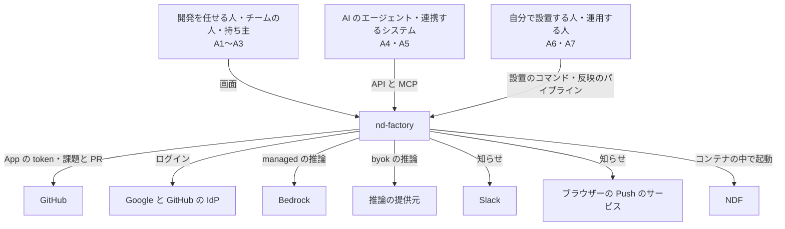
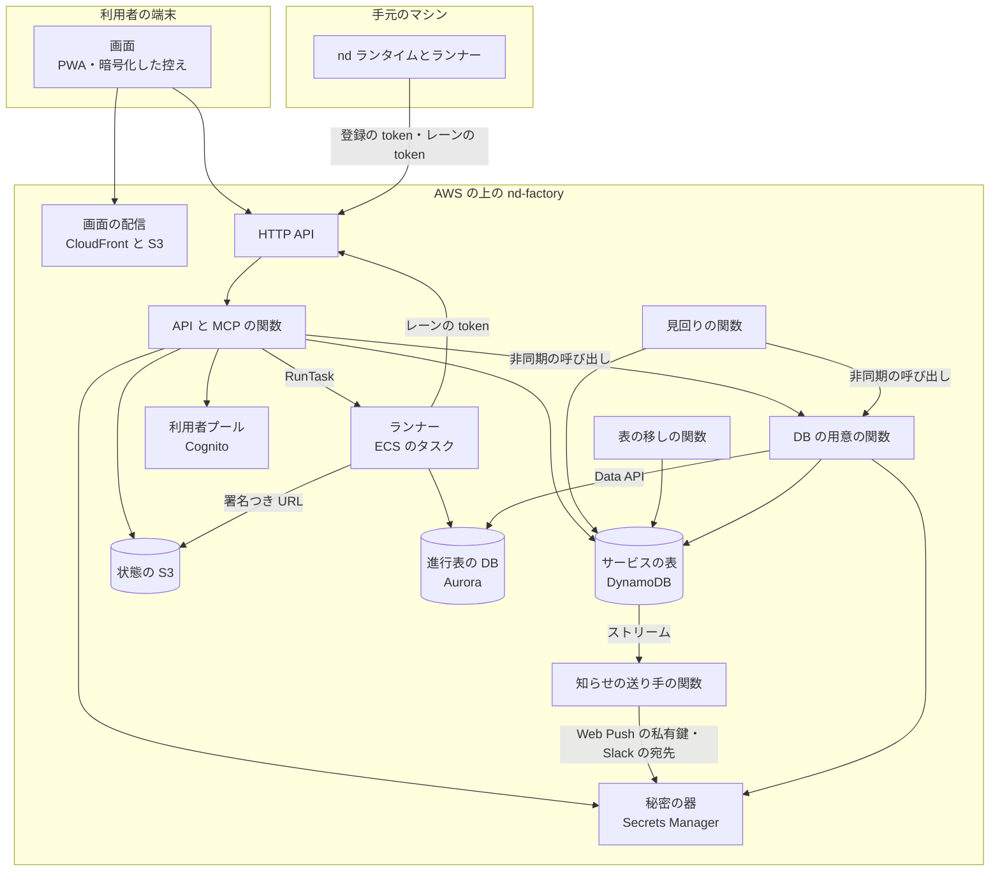
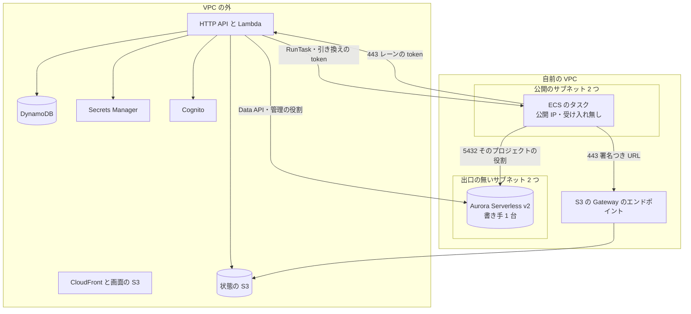

# プラットフォーム: 誰でも自分の AWS へ安く設置でき、承認した差分だけが反映され、値の漏れを検査で止められる

[全体の設計](overview.md)のドメインモデル（集約・不変条件 I1〜I16）を、置き場とインフラへ下ろす。
MVV の項目と、それを受ける節は次のとおりである。

| MVV の項目 | 受ける節 |
| --- | --- |
| Value 6 | インフラ・費用 |
| Value 7 | 検査 |
| Value 8 と P1 | 反映と設置 |

画面・API・実行の振る舞いは [画面](screens.md)・[API と MCP](api.md)・[実行](execution.md) にあり、ここではそれらが動くプラットフォームだけを扱う。
アーキテクチャは arc42（STD1）の 12 章と C4（STD2）の図で書く。
値はすべて作り物（AWS のアカウント `123456789012`・リージョン `us-west-2`・接頭辞 `acme`・環境 `test`）か設計の既定値である。

## アーキテクチャ

### arc42 の章との対応

| 章 | arc42 の章 | 受ける所 |
| --- | --- | --- |
| 1 | 導入と目標 | 全体の設計の [目的](overview.md#目的)・[MVV と設計の節の対応](overview.md#mvv-と設計の節の対応) |
| 2 | 制約 | 下の [制約](#制約) |
| 3 | 文脈と範囲 | 下の [文脈の図](#文脈の図) |
| 4 | 解決の方針 | 下の [解決の方針](#解決の方針) |
| 5 | 構成要素の見方 | 下の [コンテナの図](#コンテナの図)・[構成要素](#構成要素)。Component と Code の階層は [詳細設計](detail.md) |
| 6 | 実行時の見方 | [実行](execution.md) のスプリントを始める流れ・承認と問いの流れ |
| 7 | 配置の見方 | 下の [配置の図](#配置の図)・[インフラ](#インフラ) |
| 8 | 横断の概念 | [データと状態の置き場](data.md)・[横断の部品と定数の置き場](#横断の部品と定数の置き場)・[認可](api.md#認可) |
| 9 | 設計の決定 | 下の [決定の記録](#決定の記録)（決定 80〜99・140）と [決定の置き場](decisions.md#決定の置き場) |
| 10 | 品質の要求 | 下の [非機能の実現方式](#非機能の実現方式) |
| 11 | リスクと技術的負債 | 下の [未確認のまま残ること](#未確認のまま残ること)・全体の設計の [未確認のまま残ること](overview.md#未確認のまま残ること) |
| 12 | 用語集 | 全体の設計の [用語](overview.md#用語)・`docs/glossary/glossary.json` |

### 制約

| 制約 | 出所 |
| --- | --- |
| このリポジトリのスタックだけで立つ。他の資源に相乗りしない。特定の環境にしか無い資源を前提にしない | Value 6 |
| NAT を置かない。Lambda は VPC の外、Fargate は公開のサブネット | Value 6 |
| 実際のインフラの値・秘密をリポジトリ・合成の出力・CI の記録に置かない。AWS のアカウントとリージョンは profile、ほかは設定のファイル、秘密は秘密の器から受ける | Value 7、[settings.md](../operations/settings.md) |
| 反映は反映のパイプラインか設置のコマンドだけ。CI は AWS の資格情報を持たない | Value 8、P1、[setup.md](../operations/setup.md)・[pipeline-approval.md](../operations/pipeline-approval.md) |
| nd-factory の外で書かれたデータを取り込まない。作り直しの前のサービスの利用者のデータは引き継がない。表の移し（[形の版と移し方](data.md#形の版と移し方)）は nd-factory が書いた行の形の版を上げるためだけに使う | [要求](../design-process/issue-24/requirements.md) の前提 3 |
| NDF は外部の系で変えない。やり取りは NDF の契約だけ。NDF の版の数字で振る舞いを変えない | 全体の設計の [適用範囲](overview.md#適用範囲)、[NDF との契約](execution.md#ndf-との契約) |

### 解決の方針

| 方針 | 中身 | 決定 |
| --- | --- | --- |
| 使わない間は止まる部品で組む | 画面は静的な配信、API は Lambda、レーンは動く間だけの Fargate のタスク、進行表の DB は 0 ACU で一時停止する Aurora | 決定 80・83・85 |
| サービスの状態はサーバーの側の 1 つの置き場 | サービスの状態は DynamoDB、大きい本文は S3、NDF の状態は進行表の DB。どれもプロジェクトかチームの ID で区切り、認可の判定（I2）と同じ単位にそろえる | 決定 81・82・84 |
| 反映の道筋は 2 つだけにする | 設置のコマンド（`diff` → `deploy --confirm`）と反映のパイプライン（push → 準備 → 人の承認 → 反映）。資源はアプリのスタックへ入れ、確認の値で縛る | 決定 89・87 |
| 値の漏れと規約の破れは検査で止める | 漏れ・参照・形の往復・境界・I8・I14 の検査を CI に置き、スタックのテストがインフラの決まりを照らす | 決定 92 |

### 文脈の図

C4 の System context（STD2）。nd-factory を 1 つの箱にし、こちらが変えられない外部の系だけを描く。

| 外部の系 | 流れるもの | nd-factory から変えられるか |
| --- | --- | --- |
| GitHub | App の導入・1 つのリポジトリに絞った token・課題と PR の読み書き | 変えられない |
| Google と GitHub の IdP | ログイン（OAuth と OIDC） | 変えられない |
| Bedrock・推論の提供元 | レーンの claude の推論（`managed` は API が渡す 1 時間の一時の資格情報、`byok` は持ち込みのキー） | 変えられない |
| Slack・ブラウザーの Push のサービス | 人を待つものの知らせ | 変えられない |
| NDF | 契約ファイル・コンテナの中で動く工程 | 変えられない（読むだけ） |

### コンテナの図

C4 の Container（STD2）。ここの「コンテナ」は C4 の語で、動く単位の箱を指す。

形の正本・設置のコマンド・反映のパイプライン・検査は、組み立てと反映の時に働く要素で、この図に描かない（下の [構成要素](#構成要素)）。

### 構成要素

| 要素 | 責務 | 動く所 |
| --- | --- | --- |
| 画面 | 画面の地図・部品・オフラインの控え・国際化。操作はすべて API を通す | 端末（CloudFront から配る） |
| API | 認証・認可の判定（I2）・使える量の判定（I8）・各コンテキストのモジュール・操作の記録（I9）。操作の表から HTTP の経路を作る | Lambda（VPC の外） |
| MCP | 操作の表から作った道具の一覧と呼び出し。API と同じ関数・同じ認可を通る（I14） | API と同じ Lambda |
| ランナー | レーンの中で NDF を区間ごとに起動し、NDF の結果の行・承認ゲート・問いを進捗の事象・承認の依頼・問いへ翻訳する（腐敗防止層）。AWS の権限を持たない（I11） | ECS のタスクか手元のマシン |
| nd ランタイム | 手元のマシンの登録・心拍・レーンの受け取り・コンテナでのランナーの起動 | 手元のマシン |
| DB の用意の関数 | プロジェクトの進行表のデータベースと役割を作る・役割のパスワードを差し替える。進行表の DB へは RDS Data API で触れ、用意の ID と対象の読み出しと終わりの記録は、プロジェクトのモジュールの操作を関数の中から呼んで行う（サービスの表へ届く権限は、プロジェクトの表の読みと条件つきの書き込み・操作の記録の表の追記だけ。付けるのは口をつなぐ #6） | Lambda（VPC の外。API と見回りが非同期で呼ぶ） |
| 見回り | 定期に起き、心拍の切れたレーンと手元のマシン・猶予を過ぎた答えの送達・やり直しの残る失効（GitHub の token・DB の資格情報）を見つけて、持ち主のモジュールの操作を呼ぶ | Lambda（スケジュールで起動） |
| 知らせの送り手 | 知らせの表に足された行を通知先（Web Push・Slack）へ送り、通知先ごとの送達の状態を書く | Lambda（知らせの表のストリームで起動） |
| 表の移し | サービスの表の古い形の版の項目を新しい版へ書き換える（[形の版と移し方](data.md#形の版と移し方)） | Lambda（反映の後に 1 回） |
| 形の正本 | 設定のファイル・操作の表・事象・値の形・終了コードを zod で持ち、型・JSON Schema・OpenAPI・MCP の道具・ダミーデータ・文書の表を作る | 組み立ての時（`packages/contracts/`） |
| 設置のコマンド | 確かめ・合成・差分・確認の値・反映（`npm run nd-setup`） | 設置する人の端末 |
| 反映のパイプライン | 起点のブランチへの push → 準備 → 人の承認 → 反映 | CodePipeline と CodeBuild |
| 検査 | 漏れ・参照・形の往復・境界・依存の向き・I8・I14・CI の資格情報・使っていないコード・ワークフローの点検・NDF の契約の照合 | GitHub の workflow |

### 配置の図

C4 の Deployment（STD2）。VPC の中と外で何が動き、境界を何が流れるかを示す。

| 境界をまたぐ線 | 流れるもの | 保護の条件 |
| --- | --- | --- |
| API → タスク | `RunTask` の環境の上書きで渡す、10 分・1 回だけの引き換えの token | タスクの記述から読めても 1 回で失効する（[実行](execution.md)） |
| タスク → API | レーンの token・進捗の事象・指示の問い合わせ | TLS。レーンの token はレーンが動く間だけ有効（I11） |
| タスク → Aurora | そのプロジェクトの役割のパスワードを含む URL での接続 | Aurora の SG はタスクの SG からの 5432 だけを受ける。役割はそのデータベースだけに権限を持つ（I10） |
| タスク → 状態の S3 | NDF のファイル | API が出す、そのレーンの頭だけの署名つき URL |
| DB の用意の関数 → Aurora | RDS Data API の文。管理の役割の秘密の器を Data API に渡して打つ | 関数は VPC に入らず、Aurora の SG を通らない。Data API を呼べるのは DB の用意の関数だけ（決定 83） |

## 状態の置き場

状態の置き場（サービスの表・状態の S3・進行表の DB）の答えは [データ](data.md) が正本である。この節には、前の見出しから移した先の対応だけを残す。置き場を選んだ理由はこの文書の決定 81〜84・93・95〜99 にある。

| 前の見出し | 移した先 |
| --- | --- |
| 置き場の分け方 | [data.md の置き場の分け方](data.md#置き場の分け方) |
| サービスの表（ER 図・表と鍵・テーブル定義） | [data.md のサービスの表](data.md#サービスの表) |
| 状態の S3 | [data.md の状態の S3](data.md#状態の-s3) |
| 進行表の DB（用意の手順・割り当てを移すときの差し替え） | [data.md の進行表の DB](data.md#進行表の-db) |
| 形の版と移し方 | [data.md の形の版と移し方](data.md#形の版と移し方) |
| CRUD 図 | [data.md の CRUD 図](data.md#crud-図) |

## インフラ

### 資源ごとの形

| 資源 | 形 | 理由（MVV） |
| --- | --- | --- |
| VPC | 自前で作る。2 つの AZ に公開のサブネットと出口の無いサブネットを 1 つずつ。AZ は `Fn::GetAZs` で反映の時に選び、合成で lookup を使わない | Value 6（相乗りしない）。合成を資格情報なしで通す（Value 8） |
| NAT ゲートウェイ | 置かない。スタックのテストが 0 件を照らす | Value 6。1 つで時間あたり 0.045 ドル掛かる（[費用](#費用) の単価の出典） |
| Gateway のエンドポイント | S3 だけ置く（無料）。DynamoDB の分は置かない。Interface 型は置かない | タスクは DynamoDB に触れない（権限を持たない）。Interface 型は時間で費用が掛かる |
| API・MCP・見回り・知らせの送り手・表の移し・DB の用意の Lambda | VPC の外。Node 24・ARM64。束ねは esbuild。DB の用意の関数は時間切れ 5 分で、非同期の呼び出しの自動の再試行を 0 回、待ち行列の最大の年齢を 60 秒にする（決定 96） | Value 6。DynamoDB・S3・Secrets Manager・Cognito・ECS・RDS Data API の API は VPC の外から届く |
| ECS のタスク（ランナー） | Fargate。公開のサブネットで公開 IP を付ける。ECS のサービスを作らず `RunTask` で起こす（決定 86）。x86_64 | 公開 IP で ECR・CloudWatch Logs・API・推論の端点へ出る。動く間だけ費用が掛かる |
| タスクの役割 | AWS の権限を持たない（I11）。ECR からの取得とログの書き込みはタスクの実行の役割だけが持つ | 必要なものはすべて API から引き換えで受ける |
| タスクの SG | 受け入れを空にする。行きは 443（任意の宛先）と 5432（Aurora の SG だけ） | 公開のサブネットに置くため、外から入る道筋を持たない |
| Aurora Serverless v2 | PostgreSQL（自動の一時停止を持つ版、LIB80）。出口の無いサブネット。書き手 1 台・読み手なし。最小 0 ACU。最大 ACU は設定のファイルで受ける。Data API を有効にする（CDK の `enableDataApi: true`。使うのは DB の用意の関数だけ。決定 83） | Value 6（使わない間は計算の費用が 0） |
| Aurora の SG | タスクの SG からの 5432 だけを受ける | DB へ接続するのはタスクだけ。DB の用意の関数は Data API で触れ、SG を通らない |
| Cognito | 利用者プール。自分の登録を止め、Google（と GitHub）の IdP からだけ入る | Value 9（だれが入れるかをサーバーの側で決める） |
| CloudFront と画面の S3 | 置き場は公開せず、配信は OAC で読む（LIB83）。料金は従量の課金（定額のプランに入らない）で、価格の区分は 100 | Value 3（HTTPS の配信で Service Worker が動く）・Value 6 |
| 状態の S3 | 公開を止め、暗号化し、TLS だけ。NDF のファイルは 14 日で消す規則 | Value 7・Value 6 |
| ECR | nd-factory 専用のリポジトリ（イメージごとに 1 つ）。ランナーのイメージは、設置のコマンドと反映のパイプラインが作ってここへ push する。ライフサイクルの規則で push の新しい版を戻せる数より多めに残し、古い版を消す（決定 87・LIB85） | Value 6（保管の費用を抑える）・Value 8（ダイジェストで引き、確認の値で縛る） |
| Secrets Manager | 器は CDK が作り、値は人か API が入れる。名前は `<prefix>/<environment>/<用途>`（決定 90） | Value 7 |
| HTTP API | 利用者の JWT（利用者プール）と、委任・レーン・マシンの token を受ける。token は API の関数の中の 1 か所で確かめ、HTTP API の JWT の前段を利用者向けの HTTP の経路に置かない（[API と MCP](api.md#認証と主体)）。CORS は配信の元だけ | Value 4・Value 9 |
| 予算 | AWS Budgets の月の予算と知らせ（[費用](#費用)） | Value 6 |

### ECS.2 と公開 IP

Security Hub の ECS.2 は、ECS のサービス（`AWS::ECS::Service`）で公開 IP の自動の割り当てが有効なときに失敗する。ECS.16 は同じことをタスクセット（`AWS::ECS::TaskSet`）で見る（STD81）。nd-factory は `RunTask` だけでタスクを起こし、どちらの資源も作らないため、2 つのコントロールの対象を持たない。

| 扱い | 中身 |
| --- | --- |
| 作らない資源 | `AWS::ECS::Service` と `AWS::ECS::TaskSet`。スタックのテストが 0 件を照らす |
| 抑止のルール | 作らない（決定 86）。設定のファイルに抑止のキーを置かない |
| サービスを足す日 | 足す PR が、公開 IP を外せるか（NAT を置かずに出る道筋）と、Security Hub の自動化ルール（STD82）で理由つきに抑止するかを決め、[費用が増える構成を足すとき](#費用が増える構成を足すとき) の形で理由と代案を書く |
| ほかの ECS のコントロール | 非 root の利用者で動かす（ECS.20）。秘密を環境の値に書かない（ECS.8。引き換えの token は 1 回で失効し、タスクの定義には書かない）。ルートのファイルシステムを読むだけにできるか（ECS.5）は、NDF の作業場所の書き込みと合わせて確かめる（[未確認のまま残ること](#未確認のまま残ること)） |

### 環境の値の受け方

環境の値は [settings.md](../operations/settings.md) の決まりで受ける。

| 値 | 受ける所 | リポジトリに置くもの |
| --- | --- | --- |
| AWS のアカウントとリージョン | 設置のコマンドへ渡す profile | 置かない。CI の合成は作り物の値 |
| 接頭辞・環境・ログインの IdP・反映のパイプラインの起点・予算・最大 ACU・推論の手段の可否など | 設定のファイル（リポジトリの外。運用する環境では SSM のパラメーターが正本） | 形の正本の zod の定義・JSON Schema・作り物の値の見本 |
| 秘密の値 | 秘密の器 | 器の名前の付け方だけ |

設定のファイルのキーは、それを読む構成要素と同じ変更で足す（読み手の無いキーを先に足さない）。キーの名前と形は、読む構成要素を受け持つ子の課題が形の正本に書く。今あるキー（接頭辞・環境・ログインの IdP・反映のパイプラインの起点）は [settings.md](../operations/settings.md) と形の正本にある。

| 値 | 読む構成要素 | キーを受け持つ子の課題 |
| --- | --- | --- |
| 予算・最大 ACU・運用の知らせの宛先・設置全体の同時のレーンの数・差し替えの呼び直しの上限の回数（既定 3）・承認資料と操作の記録の保存期間（既定 1 年） | インフラ・見回り・表と S3 の期限 | #13 |
| 実行の設定の値（猶予・寿命・間隔・期限・起票の上限）・推論の手段の可否 | 実行の制御・ランナー（[実行の設定の値](execution.md#設定の値)） | #6 |
| Web Push の公開鍵 | 知らせの送り手・画面 | #8 |
| 料金プランの表の選びと単価 | 使える量の判定 | #29 |

### 資源の名前

資源の名前は `<prefix>-<environment>-<用途>` にする。秘密の器と SSM のパラメーターは `<prefix>/<environment>/<用途>` にする（`infra/lib/naming.ts`）。すべての資源にタグ `app-prefix` と `app-env` を付け、費用をこのタグで分けて読む。S3 のバケットは名前を付けず（全リージョンで一意のため）、タグで見分ける。

| 用途 | 例（作り物） |
| --- | --- |
| スタック | `acme-test-app`・`acme-test-pipeline` |
| 利用者プール・ドメイン・クライアント | `acme-test-users`・`acme-test-login`・`acme-test-web` |
| HTTP API・JWT の認可 | `acme-test-api`・`acme-test-jwt`。JWT の認可は利用者向けの HTTP の経路に置かず、token は API の関数の中で確かめる（[API の決定 48](api.md#決定の記録)） |
| サービスの表 | `acme-test-db-users`・`acme-test-db-projects` など（[表と鍵](data.md#表と鍵)）。利用者の表を `db-users` と呼ぶのは、「アカウント」を AWS のアカウントの意味だけで使うためである |
| Lambda | `acme-test-api-fn`・`acme-test-patrol`・`acme-test-notifier`・`acme-test-migrate`・`acme-test-db-prep` |
| VPC・SG | `acme-test-vpc`・`acme-test-task-sg`・`acme-test-db-sg` |
| ECS のクラスタ・タスクの定義 | `acme-test-runner`・`acme-test-runner`（族） |
| Aurora のクラスタ | `acme-test-progress-db` |
| 予算 | `acme-test-budget` |
| 秘密の器 | `acme/test/google-oauth`・`acme/test/github-oauth`・`acme/test/github-app`・`acme/test/web-push`・`acme/test/progress-db-admin`・`acme/test/progress-db/<無作為>`・`acme/test/notify/<通知先>` |

## 費用

### 予算と知らせ

| 項目 | 決まり |
| --- | --- |
| 月の予算 | AWS Budgets で、タグ `app-prefix`・`app-env` の資源の月の費用に予算を置く。予算の監視と知らせは無料（LIB84） |
| 知らせ | 実績が 80%・100%、見込みが 100% に達したとき。宛先は設定のファイル（反映のパイプラインと同じく運用の宛先）。宛先が空なら予算だけ作る |
| 既定の額 | 下の見込みから決める。設定のファイルで変えられる |
| 利用者の上限額との違い | 月の予算は AWS の請求全体の見張り（運用する人向け）。チームの月の上限額（F19）は使える量の判定（I8）が開始の前に止める線で、別に持つ |

### 使わない間に止まる資源

| 資源 | 使わない間 | 止まる仕組み |
| --- | --- | --- |
| Lambda・HTTP API | 0 | 呼ばれた分だけ |
| Fargate のタスクと公開 IP | 0 | レーンが動く間だけ。承認の待ちが猶予（既定 5 分）を超えたらタスクを止める（[実行](execution.md)） |
| Aurora の計算 | 0 | 接続 0 本で 300 秒の後に一時停止（LIB80）。保守のために起きることがある（起きた後 20 分以上は止まらない） |
| DynamoDB | 保存の量だけ | 要求の数の課金（LIB81） |
| Cognito | 0 | 月の利用者 10,000 までは無料（下の単価の出典） |
| CloudFront | 0 | 従量の課金。アカウントごとに毎月 1 TB・1,000 万回の要求までは無料（LIB83） |
| 掛かり続けるもの | 秘密の器の数・Aurora のストレージ・ECR の保管（残す版の数で上限がある）・ログの保管・S3 の保管 | 量に比例する。秘密の器が最も大きい（1 つ月 0.40 ドル） |

### 見込み

作り物の前提で、使い方ごとの月の額を出す。単価はバージニア北部（`us-east-1`）の公開の単価で、ほかのリージョンは違う。ACU の平均は実測していないため 1 ACU と置いた。

| 前提 | 使わない月 | 1 人のチーム | 5 人のチーム |
| --- | --- | --- | --- |
| プロジェクト・Slack の通知先 | 0・0 | 1・0 | 3・1 |
| スプリント × レーン | 0 | 10 × 1 | 40 × 2（2 本ずつ並行） |
| タスクの動く時間（区間・猶予・起こし直しの合計） | 0 時間 | 10 時間 | 80 時間 |
| Aurora の起きている時間（並行は重ねて数え、一時停止の前の 5 分を足す） | 0 時間 | 13 時間 | 50 時間 |

| 費用の項目 | 単価 | 使わない月 | 1 人のチーム | 5 人のチーム |
| --- | --- | --- | --- | --- |
| Fargate（1 vCPU・2 GB、x86） | 0.0405 ドル/vCPU 時・0.00445 ドル/GB 時 | 0 | 0.49 | 3.95 |
| 公開 IP | 0.005 ドル/時 | 0 | 0.05 | 0.40 |
| Aurora の計算 | 0.12 ドル/ACU 時 | 0 | 1.56 | 6.00 |
| Aurora のストレージ（1〜3 GB） | 0.10 ドル/GB 月 | 0.10 | 0.10 | 0.30 |
| 秘密の器（サービスの 5 つ ＋ プロジェクト ＋ 通知先） | 0.40 ドル/月 | 2.00 | 2.40 | 3.60 |
| ECR の保管（自前のリポジトリ。ランナーのイメージの新しい 30 版。版の間で共通のレイヤーは 1 度だけ数えると置いて 5 GB とした。ランナーのイメージの大きさは #6 で測る） | 0.10 ドル/GB 月 | 0.50 | 0.50 | 0.50 |
| HTTP API（0・5 万・50 万回） | 1.00 ドル/百万回 | 0 | 0.05 | 0.50 |
| DynamoDB（書き 0・10 万・100 万、読み 0・50 万・500 万） | 書き 0.625・読み 0.125 ドル/百万 | 0 | 0.13 | 1.25 |
| ログ（0・1・8 GB。月 5 GB まで無料） | 0.50 ドル/GB | 0 | 0 | 1.50 |
| Lambda・Cognito・CloudFront・S3・予算 | 無料の枠の中 | 0 | 0 | 0 |
| **合計（約）** | | **2.6 ドル** | **5.3 ドル** | **18.0 ドル** |

読み方: 使わない月は秘密の器が大半で、使う月は Aurora の起きている時間が最も効く。Aurora の起きている時間はタスクの動く時間に比例し、承認の待ちの間はタスクも接続も持たないため増えない。ACU の平均・保守で起きる時間・ログの量は実測で確かめる（[未確認のまま残ること](#未確認のまま残ること)）。

単価の出典（取得日 2026-11-17）は次の頁である。頁の多くは単価の表が取得の結果に出ず、例の計算の中の単価を読んだ（[確かめられなかったこと](#確かめられなかったこと)）。

| 費用の項目 | 出典 |
| --- | --- |
| Fargate | [Fargate](https://aws.amazon.com/fargate/pricing/) |
| Aurora | [Aurora](https://aws.amazon.com/rds/aurora/pricing/) |
| 公開 IP・NAT・Gateway のエンドポイント | [VPC](https://aws.amazon.com/vpc/pricing/) |
| DynamoDB | [DynamoDB](https://aws.amazon.com/dynamodb/pricing/on-demand/) |
| 秘密の器 | [Secrets Manager](https://aws.amazon.com/secrets-manager/pricing/) |
| ECR | [ECR](https://aws.amazon.com/ecr/pricing/) |
| HTTP API | [API Gateway](https://aws.amazon.com/api-gateway/pricing/) |
| Lambda | [Lambda](https://aws.amazon.com/lambda/pricing/) |
| Cognito | [Cognito](https://aws.amazon.com/cognito/pricing/) |
| ログ | [CloudWatch](https://aws.amazon.com/cloudwatch/pricing/) |
| CloudFront | [CloudFront](https://aws.amazon.com/cloudfront/pricing/) |

### 費用が増える構成を足すとき

Value 6 のとおり、運用の費用が増える構成や依存を足す PR は、設計文書か PR の本文に次の表を置く。スタックのテストの「時間で費用が掛かる資源を作らない」に当たる資源を足すときは、同じ PR でテストの許しの一覧へ理由つきで足す。

| 欄 | 書くこと | 例 |
| --- | --- | --- |
| 足すもの | 資源か依存 | Interface 型の ECR のエンドポイント |
| 増える額 | 単価と見込みの使い方での月の額（出典つき） | 2 つの AZ で時間の課金 × 730 時間 |
| 理由 | どの MVV の項目のどの要求に要るか | なぜ公開 IP で足りないか |
| 代案 | 費用の増えない作り方と、採らない理由 | 公開 IP で取る（今の形） |
| 使わない間 | 止まるか。止まらないなら月の固定の額 | 止まらない |

## 反映と設置

### 2 つの反映の道筋

反映は設置のコマンドと反映のパイプラインの 2 つの道筋で行う。VPC・Aurora・ECS・ECR・表・予算は、アプリのスタック（`app`）へ入れ、同じ確認の値と要約値で縛る（決定 89）。手順の正本は [setup.md](../operations/setup.md)・[pipeline-approval.md](../operations/pipeline-approval.md)・[settings.md](../operations/settings.md) である。

| 環境 | 反映の道筋 | 人の承認 |
| --- | --- | --- |
| 自分で設置する人（A6） | `npm run nd-setup -- diff --profile <profile> --settings <設定のファイル> --out <置き場>` で差分と確認の値を見て、`npm run nd-setup -- deploy --profile <profile> --assembly <置き場> --confirm <確認の値>` で反映する | 設置する人が差分を読んで確認の値を渡す |
| 運用する環境のアプリのスタック（A7） | 起点のブランチへの push → 準備（合成・差分・要約値）→ 人の承認 → 反映（要約値を数え直して同じときだけ） | 承認のアクションで人が差分を承認する。AI の主体は承認を拒む方針で送れない |
| 運用する環境のパイプラインのスタック | 設置のコマンドに `--stack pipeline` を渡す | `diff` の差分をリリース承認ゲートで承認した後にだけ `deploy` を打つ |

`cdk deploy` を設置のコマンドの外で直に打たない。CI は検査だけを行い、AWS の資格情報を持たない（`tools/test/ci-definition.test.ts`）。

### 設置の段ごとの振る舞い

| 段 | 何が起きるか | 止まるとき | P1 |
| --- | --- | --- | --- |
| 引数・設定のファイル | 形の正本で照らし、足りない・誤ったキーを 1 件 1 行で示す（終了コード 2・3） | 足すキー（予算の宛先など）が形に合わない | — |
| profile | アカウントは主体から、リージョンは profile から読む（4） | 資格情報やリージョンが無い | — |
| イメージ | ランナーのイメージを作って自前の ECR へ push し、ダイジェストを合成の入力へ渡す（決定 87）。push は承認の前に起きるが、反映されなければどのタスクの定義からも引かれない。リポジトリのまだ無いイメージは、そのタスクの定義を持たない版を合成し、反映の後の次の `diff` で push する | Docker が無い・push できない | 当たらない（自前の ECR への push は設置のコマンドとパイプラインの中だけで行う） |
| 合成 | 画面のビルド・Lambda の束ね・イメージのダイジェストをタスクの定義へ入れる（6）。lookup を使わない | Aurora の自動の一時停止を持つ版が選べないなど、合成で分かる不足 | — |
| bootstrap | 既定の qualifier の版を読み、足りなければ求める版と今の版と打つコマンドを示して止まる（5）。コマンドは bootstrap を打たない | 版が足りない | 当たる。運用する環境では bootstrap を打つ・上げるのはリリース承認ゲートの後だけ。自分で設置する人は自分の AWS のアカウントで打つ |
| 差分と確認の値 | スタックごとの足し・変え・消し、作る資源の名前、戻り先の URL、確認の値を出す | — | — |
| 反映 | 保存した合成の結果だけを、確認の値が同じときだけ反映する（7・8） | 合成の結果が書き換わった・アカウントかリージョンが違う | 外で打つ反映は当たる。このコマンドと反映のパイプラインの中なら当たらない |
| 秘密の待ち | 器だけができる。値が入るまで、画面は「ログインの設定を待っています」、リポジトリの登録は App の作り方、通知先の Web Push は「設定の待ち」を示す | — | — |
| 足りない設定の一覧 | `diff` の出力に、値の入っていない器と、無いと止まる機能（GitHub の App が無ければリポジトリを登録できない、Bedrock を使えないリージョンなら `managed` を切る、など）を並べる（F21） | — | — |
| 初めの反映の後 | 運用する環境では、接続を有効にし、承認を拒む方針を AI の主体へ付けて確かめるまで push しない（[pipeline-approval.md](../operations/pipeline-approval.md)） | — | — |

### 設置と反映の前提

| 項目 | 中身 |
| --- | --- |
| ランナーのイメージの前提 | イメージを作る場所（`diff` を打つ端末と、反映のパイプラインの準備のアクション）に Docker が要る。設置の前提の表（setup.md）に Docker を載せる。準備のアクションの CodeBuild は特権（`privileged`）にして Docker を持たせ、その役割に自前の ECR への push を許す。反映のアクションは変えない。パイプラインのスタックは設置のコマンド（`--stack pipeline`）でだけ反映され、起点のブランチへの push では変わらない。そのため、特権と push の権限を持つ版のパイプラインのスタックを先に反映し、その後でイメージを引くアプリのスタックを起点のブランチへ push する（逆の順では、準備のアクションがイメージを作れずに止まる） |
| 足りない設定の一覧 | `diff` の出力の 1 欄。終了コードは持たない（足りない設定があっても反映はできる） |
| 設定のファイルのキー | 予算・最大 ACU・推論の手段の可否・Web Push の公開鍵など。読む構成要素と同じ変更で足す |

## 検査

検査は GitHub の workflow で走らせ、AWS の資格情報を持たない。照合の語と実際の値はリポジトリに置かず、CI の秘密から受ける。

### 基本の検査

| 検査 | 置き場 | 落とすもの |
| --- | --- | --- |
| lint・型検査・生成物の差・単体テスト | `npm run check`（CI の `check`） | 形の正本から作り直していない生成物（`generate:check`）・型の誤り |
| 作り物の値での合成 | CI の `synth` | 資格情報が要る合成（lookup） |
| 画面の e2e | CI の `e2e` | 画面の振る舞いの壊れ |
| 参照の検査 | `tools/ref-check`（CI の `ref-check`） | 照合の語（CI の秘密 `REF_CHECK_TERMS`）の当たり・NDF の固定の値が `ndf-pin.json` の 1 か所でない・NDF の版を読む式と大小の比べが同じ行にある |
| CI の定義のテスト | `tools/test/ci-definition.test.ts` | ジョブの集合と NDF の宣言の必須のチェックの食い違い・AWS の資格情報の語 |
| スタックのテスト | `infra/test/` | 接頭辞の無い名前・タグの欠け・時間で費用が掛かる資源・合成の出力の秘密の値 |

### 設計の決まりを縛る検査

| 検査 | 落とすもの | 縛る MVV と不変条件 |
| --- | --- | --- |
| 漏れの検査 | 作り物の値（`123456789012`・`us-west-2`・`acme`・`example.com`）でない AWS のアカウント ID の形の 12 桁・ARN・資源の ID・端点の形と、CI の秘密から受ける実際の値（アカウント・profile・環境の名前）の当たり。秘密の形（私有鍵の頭・token の頭）も同じ検査で探す | Value 7 |
| 形の往復 | 形の正本 → JSON Schema・OpenAPI・MCP の道具 → 見本の値の検証が往復で同じ結果にならない | Value 2・Value 4 |
| 境界の検査（横断の部品の外での直の利用） | 下の [横断の部品の置き場の基準](#横断の部品の置き場の基準) の「置き場の外で直に使わないもの」のうち、関数・グローバル・import の名前で書けるもの。自前の再試行のループと入口ごとの独自の認可の判定は構文で見分けられないので検査で落とさず、外部の呼び出しを横断の部品だけに通すこと（再試行は部品の中にある）と、振り分けが操作ごとに認可の判定を通すこと（#2 の I2 のテスト）で守る | Value 1・Value 7 |
| 使える量の判定の外の比べ | 判定の外で上限の値と比べるコード・料金プランの名前で分ける画面 | I8 |
| 操作の一覧と画面と MCP の対応 | 形の正本の操作の表に、画面の操作か MCP の道具の無い行がある・表に無い画面の操作がある（F1〜F20） | I14・Value 4 |
| NDF の契約の照合（定期） | 固定の NDF の契約の見本と、ランナーの翻訳の食い違い（F23）。すべての PR・main への push・毎日 1 回で走らせる（[実行の契約の照合の定期の検査](execution.md#契約の照合の定期の検査)） | F23 |
| 使っていないコード | どこからも読まれないファイル・使われない書き出し・使われない依存（knip）。検査の CI は #1 が足す | Value 13 |
| ワークフローの点検 | ワークフローの広すぎる権限・資格情報の持ち出し・固定していない動作の参照など（zizmor）。検査の CI は #1 が足す | Value 8 |
| 依存の向き | `packages/contracts` → `packages/core` → `apps/*` の一方向に反する import・`apps/*` どうしの import・`infra` から `apps/*` への import（[詳細設計の依存の表](detail.md#クラスと関数の構造)）。検査の CI は #1 が足す | Value 1・Value 7 |
| スタックのテストに足す行 | NAT が 1 件以上・タスクの SG に受け入れの規則・Lambda が VPC の中・`AWS::ECS::Service` か `TaskSet` が 1 件以上・タスクの役割に許可の文・Aurora の最小が 0 でない・表とバケットが消せる設定・PITR が無い | Value 6・I11 |

NDF の版の数字の比べ（参照の検査）と CI の資格情報（CI の定義のテスト）は基本の検査が受け持つ。設計の決まりを縛る検査は CI の必須のチェック（`.ndf/project.json` の宣言）に載せ、CI の定義のテストが食い違いを落とす。

## 横断の部品と定数の置き場

### 横断の部品の置き場の基準

横断の部品は 1 つのパッケージ `packages/core/` にだけ置く（モジュールと関数の粒度は [詳細設計](detail.md)）。境界の検査は、実行の時に動くコード（`apps/` の置き場）で、置き場の外での直の利用を落とす。組み立てと反映の時だけ動く `infra/` と `tools/` は対象から外す（決定 91）。

| 部品 | 引き受けること | 置き場の外で直に使わないもの |
| --- | --- | --- |
| 時計 | 今の時刻（UTC）と、テストでの差し替え | `Date.now`・引数なしの `new Date()` |
| ID と冪等の鍵 | ID の生成（無作為）・冪等の鍵の記録と照合 | 乱数からの直の生成 |
| ログと伏せ字 | 構造化したログ。秘密の形の値（登録の token・委任の token・レーンの token・引き換えの token・DB の URL・推論の一時の資格情報・OAuth と App の秘密）をどの鍵の下でも伏せる。秘密の形（鍵の名前と値の形）はデータで `packages/contracts/data/` に持つ | `console.log` |
| 外部の呼び出し | HTTP と AWS SDK の呼び出し・時間切れ・失敗の分類 | `fetch`・AWS SDK のクライアントの直の生成 |
| 再試行 | 回数と待ちの方針（データで `packages/contracts/data/` に持つ） | 自前の再試行のループ |
| 条件つきの書き込み | DynamoDB の条件式と競合の扱い（409 か前の 1 件を返す） | 条件式を直に組む書き込み |
| 認可の判定 | 主体とプロジェクトの見える範囲（I2）・人だけが確定できる操作（I4） | 入口ごとの独自の判定 |
| 使える量の判定 | 料金プランの値と使った量から、開始してよいかと理由を返す（I8） | 上限の値との直の比べ |
| 操作の記録の書き手 | 1 操作 1 件の追記（I9）。書けなければ操作を失敗させる | 表への直の書き込み |

### 定数とデータの置き場の基準

| 種類 | 置き場 | 例 |
| --- | --- | --- |
| 事実と方針（変わりうる値と表） | 形の正本の下の JSON のデータのファイルと、その形 | 置き場は `packages/contracts/data/`。料金プランの値・再試行の方針・秘密の形（伏せ字が読む。漏れの検査は gitleaks の既定の規則とリポジトリの `.gitleaks.toml` が持つ）・終了コード（`exit-codes.json`） |
| 閉じた語の集まり | 形の正本の値の集合（zod の列挙。TypeScript の enum は使わない） | 承認ゲートの種類・実行の場所・推論の手段・入口の種類 |
| 外部の仕様の値 | 出所を添えた定数 | NDF の環境変数の名前・GitHub の Webhook の種類・AWS の上限 |
| 環境ごとに違う値 | 設定のファイル（リポジトリの外）と profile | 接頭辞・環境・予算の宛先・最大 ACU |
| 秘密 | 秘密の器（値は人か API が入れる） | OAuth の client secret・App の私有鍵・DB の URL・Web Push の私有鍵 |
| 画面の文言 | 言語ごとの翻訳のファイル | 知らせの文言のキー（[国際化](screens.md#国際化)） |

## 言語と書き方の決まり

子の課題が詳細設計で引く、言語と画面の組み方と TypeScript の書き方の細則の正本である（決定 140）。縛るのは共通の `tsconfig.base.json`（各置き場の `tsconfig.json` が `extends` で引く）・`apps/web/tsconfig.json`・`eslint.config.js`・`.dependency-cruiser.cjs`・`apps/web/package.json`・`apps/web/vite.config.ts` である。画面の組み方の行（React と TSX）を除き、値は今のリポジトリの設定と同じである。React と TSX の規約は #12 で入れ、その PR が `apps/web/package.json` の依存（LIB87・LIB90）、`apps/web/tsconfig.json` の `jsx` と `include` の `.tsx`、`apps/web/vite.config.ts` の React のプラグインを整える。画面の外から React を import すると落とす規則（dependency-cruiser の `react-only-in-web`。型だけの import を含む）と、`apps/web` の外の `*.tsx` を落とす規則（ESLint）は、#1 が CI の検査として先に入れる（[#1 の設計](../design-process/issue-1/design.md)）。それまでの画面は今の骨組み（素の TypeScript）のままである。`AGENTS.md` は手順（`npm run generate`・`npm run check`）だけを持ち、細則はこの節を指す。

| 項目 | 決まり | 縛るもの |
| --- | --- | --- |
| 言語 | コードは TypeScript だけで書く。画面の外（API・インフラ・設置のコマンド・検査）は Node 24 の型の剥がし（STD84）で直に打ち、出力のための変換の段を持たない（Lambda の束ねは esbuild）。画面は TSX で書き、Vite と vitest が変換する | `tsconfig.base.json`（`noEmit`） |
| 使う構文 | 型の注釈を消すだけで JavaScript に戻る構文だけを使う。enum・引数のプロパティ・namespace を使わない。閉じた語の集まりは zod の列挙で持つ（[定数とデータの置き場の基準](#定数とデータの置き場の基準)） | `erasableSyntaxOnly`（型検査が落とす） |
| 型の厳しさ | `strict` と `noUncheckedIndexedAccess` を外さない | `tsconfig.base.json` |
| import | 型だけの import は `import type` で書く。相対の import は実ファイルの拡張子（`.ts` か `.tsx`）まで書く。画面や単体テストから部品を import するときは `.tsx` を書く | `verbatimModuleSyntax`・`allowImportingTsExtensions`、ESLint の `consistent-type-imports` |
| 使わない名前 | 使わない引数と変数は `_` で始める | ESLint の `no-unused-vars` |
| 画面の組み方 | #12 から、部品は React 19（LIB87）の関数の部品として TSX で書く。束ねと開発のサーバーは Vite（LIB86）と React の Vite のプラグイン（LIB90）。部品の単体テストは vitest で書く。画面の外のコードは TSX と React を import しない | `apps/web/package.json` の依存・`apps/web/tsconfig.json` の `jsx`・`.dependency-cruiser.cjs` の `react-only-in-web`（画面の外の React の import）・`eslint.config.js` の置き場ごとの規則（画面の外の `*.tsx`） |
| テスト | 振る舞いを足すときは先に落ちるテストを書く。単体は vitest、画面は Playwright の e2e | `npm run check`・`npm run e2e`（[基本の検査](#基本の検査)） |
| NDF の版 | NDF の版の数字を読んで大小を比べない | 参照の検査 |

## 非機能の実現方式

要求の条件は MVV と全体の設計の不変条件から写す。

| 大項目 | 要求の条件 | 実現方式 | 確かめ方 |
| --- | --- | --- | --- |
| 可用性 | 承認と問いに、どこからでも答えられる（Vision） | 画面・API・表は 1 つのリージョンのマネージドサービスで組み、サーバーを持たない。API は進行表の DB に依らず、Aurora が止まってもホームと承認は読める（決定 93） | Aurora を止めた環境でホームと承認の依頼を読む |
| 可用性 | 書いた判断と記録を失わない（I5・I9） | サービスの表は PITR、Aurora は自動の保存、表とバケットとクラスタはスタックを消しても残す | スタックのテストが PITR と残す設定を照らす。戻しの予行を 1 回行う |
| 性能 | 初めの表示がスマートフォンで速い（Value 1・3） | 画面の初めの表示（LCP）を、スマートフォンの 75 パーセンタイルで 2.5 秒以内にする（STD80）。2 回目からは Service Worker が控えた画面の殻と、暗号化した IndexedDB の端末の控えから、1 秒以内に最後の内容を出す（[画面の文書のオフライン](screens.md#オフライン)） | e2e で端末の幅と回線を絞って測る。控えからの表示を測る |
| 性能 | 操作の応答が速い（Value 1） | 操作への画面の応答（INP）を 200 ミリ秒以内（STD80）。API の応答は温まった Lambda で 95 パーセンタイル 1 秒以内。一覧は区切って返す | e2e と API の負荷の試験で測る |
| 性能 | 承認の後にレーンが早く続く（Value 1） | 猶予の間の答えは同じタスクで続ける。猶予の後はタスクの起動と Aurora の再開（約 15 秒、LIB80）を足した時間で続く | 答えから次の区間の開始までを測る |
| 運用・保守 | 障害と費用を運用する人が知る（A7） | ログは CloudWatch Logs に 30 日。運用の知らせの資源を 1 つの SNS のトピック（`<prefix>-<environment>-ops`）にし、予算の知らせ・パイプラインの失敗・見回りが見つけた止まったレーンの数・差し替えの呼び直しの上限（I22）をここへ送る。宛先のメールは設定のファイルで受け、空なら購読を作らない（LIB84。時間の課金を持たない。[決定 9](decisions.md#決定の記録)）。トピックの資源と宛先のキーは #13 | 予算の知らせを低い額で試す |
| 運用・保守性 | 子の課題の担当が、全体の設計だけを読んで新たに決めずに詳細設計へ進める（#24） | 「詳細設計が持つ」の行き先を、受け持つ子の課題か [詳細設計](detail.md) の節に限る。受け持つ子の表を [詳細設計の受け持つ子の課題](detail.md#受け持つ子の課題) に置く | `grep -n '詳細設計' docs/design/*.md` の当たりが子の課題の番号か詳細設計の節を指す |
| 移行 | 形を変えても読めなくならない | 項目ごとの形の版と 2 段の反映（[形の版と移し方](data.md#形の版と移し方)） | 1 つ前の版の項目を読む単体テスト |
| 移行 | 2 段目の反映を戻せる | 書き手だけを前の版へ戻す反映を出し、1 段目は次の版の項目が 0 件のときだけ戻す（[形の版と移し方](data.md#形の版と移し方)）。読み手と表の移しは #2、切り戻しの手順を設置の手順に書くのは #14 | 切り戻しの予行（#14） |
| 性能 | 増えたときに AWS の上限より先に止まる | 設置全体の同時に動くレーンの数の上限を設定の値で持ち、使える量の判定が料金プランの同時の数と合わせて照らす（`concurrency_full` で待たせる）。Lambda・Fargate のクォータの値は設置する人が Service Quotas で読み、足りない設定の一覧に並べる。判定は #29、上限の設定のキーは #13 | 上限の数だけレーンを動かし、次のレーンが待つことを試す |
| セキュリティ | 割り当ての外から存在が見えない（Value 9・I2） | 区切りの頭のプロジェクトとチームの ID・認可の判定 1 か所・進行表の DB のプロジェクトごとの役割・S3 の頭ごとの署名つき URL | I2 の 7 つの出口の試験と、役割の接続の実測 |
| セキュリティ | 秘密を置かない・渡し先を絞る（Value 7・C1） | 秘密は器だけ。合成の出力には動的な参照だけ。タスクの役割は権限なし。通信は TLS、保存は既定の暗号化 | スタックのテストと漏れの検査 |
| セキュリティ | 設計文書を含む差分が漏れの検査に当たらない（#24） | 漏れの検査（[設計の決まりを縛る検査](#設計の決まりを縛る検査)）を `docs/` にも掛ける。検査の CI は #1 | 作り物でない 12 桁を `docs/` に置いた PR が落ちる |
| システム環境 | 誰でも自分の AWS へ設置できる（Value 6・Vision） | Node 24・AWS CDK（TypeScript）・Docker（ランナーのイメージ）。Aurora の自動の一時停止と Bedrock の使えるリージョンに依る機能は、合成か足りない設定の一覧で示す | 作り物の値での合成（CI）と、別のリージョンでの設置の予行 |

## 外部の調査

| 種類 | 調べるか | 理由 |
| --- | --- | --- |
| 標準・仕様 | 調べる | 画面の性能の目標と、Security Hub のコントロールに一次の定めがある。DB の側の排他は PostgreSQL の機能で、書き方の細則は Node の型の剥がしが打てる構文で決まる。arc42 と C4 は全体の設計の STD1・STD2 を引く |
| 主要な製品 | 調べない | 置き場とインフラの選び方は MVV の Value 6（自前・NAT なし・Lambda は VPC の外・Fargate は公開のサブネット）と AWS のサービスの性質で決まり、他の製品の構成で変わらない |
| ライブラリとサービス | 調べる | 進行表の DB・サービスの表・タスクのネットワークと停止・配信・予算と運用の知らせ・イメージの置き場に AWS のサービスを使い、その性質と費用が設計を決める。画面の組み方は UI のフレームワークの候補と比べて決める |

### 標準・仕様

| # | 標準・仕様 | 何を定めているか | 設計への反映 | 出典 |
| --- | --- | --- | --- | --- |
| STD80 | Core Web Vitals | 良い体験の目安を LCP 2.5 秒以内・INP 200 ミリ秒以内・CLS 0.1 以内とし、スマートフォンと PC に分けた 75 パーセンタイルで測る | 画面の性能の目標に採る（決定 94） | https://web.dev/articles/vitals （2026-11-17） |
| STD81 | Security Hub の ECS のコントロール | ECS.2 は `AWS::ECS::Service` の `AssignPublicIP` が `ENABLED` で失敗（重要度 High）。ECS.16 は `AWS::ECS::TaskSet` で同じ。ECS.8 は環境の値の AWS の鍵、ECS.20 は root の利用者を見る | ECS のサービスとタスクセットを作らず、対象を持たない（決定 86） | https://docs.aws.amazon.com/securityhub/latest/userguide/ecs-controls.html （2026-11-17） |
| STD82 | Security Hub の自動化ルール | 条件に合う検出結果の workflow の状態（`SUPPRESSED` など）と注記を自動で変える。作れるのは Security Hub の管理者のアカウントだけで、作ったリージョンにだけ効く | 今は作らない。ECS のサービスを足す日に比べる（決定 86） | https://docs.aws.amazon.com/securityhub/latest/userguide/automation-rules.html （2026-11-17） |
| STD83 | PostgreSQL 16 の advisory lock | `pg_advisory_xact_lock` はトランザクションの単位の排他の鎖を取り、要れば待つ。トランザクションの終わりで外れる | 差し替えの番号を照らして書く間、同じ役割の差し替えを DB の側で 1 つにする（決定 95） | https://www.postgresql.org/docs/16/functions-admin.html （2026-11-18） |
| STD84 | Node の型の剥がし（type stripping）と TypeScript の `erasableSyntaxOnly` | Node は型の注釈を消すだけで `.ts` を打つ。enum・引数のプロパティ・namespace のような JavaScript へ消すだけでは戻らない構文と、`.tsx` の JSX は打てない。`erasableSyntaxOnly` はそれらの構文を型検査で落とす | 書き方の細則を「消すだけで打てる構文だけを使う」にそろえ、型検査で縛る（決定 140） | https://nodejs.org/api/typescript.html ・ https://www.typescriptlang.org/tsconfig/#erasableSyntaxOnly （2026-11-18） |
| STD85 | Lighthouse の通信の絞り | スマートフォンの既定の絞りは Slow 4G を模した RTT 150 ミリ秒・下り 1,638.4 Kbps と、CPU の 4 倍の遅さ | 配る束の転送の時間を LCP の目標と比べる目安に使う（決定 140） | https://github.com/GoogleChrome/lighthouse/blob/main/docs/throttling.md （2026-11-21） |

### ライブラリとサービス

| # | 候補 | 版 | ライセンス | 最後のリリースの日付 | 終了のアナウンス | 要件を満たすか | 出典 |
| --- | --- | --- | --- | --- | --- | --- | --- |
| LIB80 | Aurora Serverless v2 の自動の一時停止（PostgreSQL） | PostgreSQL 16.3・15.7・14.12・13.15 以上 | AWS のサービス | — | 無し | 満たす。最小 0 ACU で、利用者の接続が無い状態が既定 300 秒（300〜86,400 秒）続くと止まり、止まる間の計算の費用は 0。再開は通常 約 15 秒、24 時間を超えた後は 30 秒以上。利用者の接続が 1 本でも開いていると止まらない。RDS Proxy を付けると止まらない。保守で起き、起きた後 20 分以上は止まらない | https://docs.aws.amazon.com/AmazonRDS/latest/AuroraUserGuide/aurora-serverless-v2-auto-pause.html （2026-11-17） |
| LIB81 | DynamoDB（要求の数の課金・TTL・条件式・ストリーム） | — | AWS のサービス | — | 無し | 満たす。要求の数の課金は使った分だけ。TTL は期限の後に数日のうちに書き込みの量を使わずに消す。条件式は鍵で指した 1 行を照らして外れたら書かない。ストリームを Lambda が 1 秒に 4 回読み、失敗は記録が切れるまでやり直す（1 つのストリームに 2 つの関数まで）。`TransactWriteItems` は 100 件までの書き込みを表をまたいで 1 つにまとめ、書かない行の条件は `ConditionCheck` で照らす。1 つのトランザクションで同じ行を 2 回指せない | https://docs.aws.amazon.com/amazondynamodb/latest/developerguide/capacity-mode.html ・ 同 TTL.html ・ 同 Expressions.ConditionExpressions.html ・ 同 Streams.Lambda.html ・ https://docs.aws.amazon.com/amazondynamodb/latest/APIReference/API_TransactWriteItems.html （2026-11-17・2026-11-18） |
| LIB82 | ECS Fargate のタスク（ネットワーク・`RunTask`） | プラットフォームの版 1.4.0 | AWS のサービス | — | 無し | 満たす。イメージを取るには外への道筋が要り、公開のサブネットで公開 IP を付けるか、NAT か、ECR の Interface 型のエンドポイント。1.4.0 からは ECR・ログ・秘密の取得もタスクのネットワークを通る。`clientToken` は起動の要求の冪等の鍵（64 字まで） | https://docs.aws.amazon.com/AmazonECS/latest/developerguide/fargate-task-networking.html （2026-11-17）・ https://docs.aws.amazon.com/AmazonECS/latest/APIReference/API_RunTask.html （2026-11-18） |
| LIB83 | CloudFront の OAC | — | AWS のサービス | — | 無し | 満たす。OAI より OAC を推す（全リージョンの S3・SSE-KMS）。従量の課金は、毎月 1 TB の転送と 1,000 万回の HTTP(S) の要求までが常に無料で、超えた分は米国・メキシコ・カナダで HTTPS の要求 1 万回 0.0100 ドル・転送 1 GB 0.085 ドル（次の 9 TB まで）。定額のプランは配信ごとの月額で、超えた分の課金を持たない。Free（0 ドル）の目安の量は月 100 万回・100 GB で、目安は固い上限ではなく、50%・80%・100% でメールが届き、初めて 3 倍までを超えた月は影響しない。何か月も大きく超え続けると、遠い拠点から配るなど配信が調整されることがあり、上の段（Pro は月 15 ドル・1,000 万回・50 TB）へ上げると戻る。AWS の無料の利用枠を使うアカウントは定額のプランに入れない | https://docs.aws.amazon.com/AmazonCloudFront/latest/DeveloperGuide/private-content-restricting-access-to-s3.html ・ https://aws.amazon.com/cloudfront/pricing/ （2026-11-17）・ https://aws.amazon.com/cloudfront/pricing/pay-as-you-go/ ・ https://docs.aws.amazon.com/AmazonCloudFront/latest/DeveloperGuide/flat-rate-pricing-plan.html （2026-11-21） |
| LIB84 | AWS Budgets と Amazon SNS（運用の知らせ） | — | AWS のサービス | — | 無し | 満たす。予算の監視と知らせは無料。動作つきの予算は 2 つまで無料。SNS は時間の課金を持たず、月 100 万回の要求とメールの 1,000 通までは無料の枠 | https://aws.amazon.com/aws-cost-management/aws-budgets/pricing/ （2026-11-17）・ https://aws.amazon.com/sns/pricing/ （2026-11-18） |
| LIB85 | ECR のライフサイクルの規則 | — | AWS のサービス | — | 無し | 満たす。押した数（`imageCountMoreThan`）か日数で古いイメージを 24 時間のうちに消す | https://docs.aws.amazon.com/AmazonECR/latest/userguide/LifecyclePolicies.html （2026-11-17） |
| LIB86 | `vite` | 8.3.8 | MIT | 2026-11-11 | 無し | 満たす。画面を束ね、開発のサーバーを持つ。開発の依存だけで、配る画面に実行の時の依存を足さない。今の `apps/web` が使っている | https://registry.npmjs.org/vite （2026-11-18） |
| LIB87 | `react`・`react-dom` | 19.3.1 | MIT | 2026-10-14 | 無し | 満たす。採る（決定 140）。2026 年 10 月の npm の取得数は約 8.5 億回で、比べた候補の中で最も多い（preact 約 1.8 億回・lit 約 3,200 万回）。実行の時の依存が 2 つ増える（`react-dom` の展開後 約 7.7 MiB。React と `react-dom` だけを描く最小の画面を束ねると 1 つの JS のファイルで 219,469 バイト、gzip で 68.57 kB（Vite の表示。1 kB は 1,000 バイト）。測り方は下の [束の大きさの測り方](#束の大きさの測り方)）。TSX は Node の型の剥がしで打てないため、画面のコードは Vite と vitest で変換する（STD84） | https://registry.npmjs.org/react ・ https://registry.npmjs.org/react-dom （2026-11-18）・ https://api.npmjs.org/downloads/point/2026-10-01:2026-10-31/react （同 preact・lit。2026-11-21） |
| LIB88 | `preact` | 11.2.0 | MIT | 2026-11-06 | 無し | 満たす。React と書き方が近く小さい。React の周りの部品は互換の層 `preact/compat` を通して使う。互換の層は React との 100% の互換を目指す薄い層で、Preact は React の再実装ではなく、合成のイベントを持たないなどの違いが残る。最小の画面を束ねると 11,481 バイト、gzip で 4.95 kB（[束の大きさの測り方](#束の大きさの測り方)） | https://registry.npmjs.org/preact （2026-11-18）・ https://preactjs.com/guide/v10/differences-to-react ・ https://preactjs.com/guide/v10/switching-to-preact （2026-11-21） |
| LIB89 | `lit` | 3.3.3 | BSD-3-Clause | 2026-05-14 | 無し | 満たす。Web Components の上で JSX を使わずに書ける。宣言の書き方の多くがデコレーターに寄る。2026 年 10 月の npm の取得数は約 3,200 万回で、React の 4% ほど | https://registry.npmjs.org/lit （2026-11-18） |
| LIB90 | `@vitejs/plugin-react` | 6.3.0 | MIT | 2026-11-09 | 無し | 満たす。Vite で TSX を変換し、開発のサーバーで部品を差し替える。開発の依存だけ | https://registry.npmjs.org/@vitejs/plugin-react （2026-11-21） |
| LIB91 | RDS Data API（Aurora PostgreSQL） | Aurora PostgreSQL 16.1 以上（13.11・14.8・15.3・17.4・18.3 以上も） | AWS のサービス | — | 無し | 条件つきで満たす。Aurora PostgreSQL の Serverless と provisioned のクラスタで使え、米国西部（オレゴン）を含む各リージョンに版の下限つきで載る。HTTPS の端点で SQL を打ち、Lambda を VPC に入れずに届く。一時停止した書き手へ Data API の要求が来ると、Aurora が書き手を再開してから処理する。再開の間の要求は `DatabaseResumingException` で断られ、数秒待って打ち直すよう示される。呼び出しは同期で、45 秒で終わらなければ取り消して時間切れを返す（`continueAfterTimeout` の既定は偽。真にすると文は止まらずに続く）。SDK の時間切れは 45 秒より長く（1 分以上を推す）する。トランザクションは、その ID を使う呼び出しが 3 分無いと時間切れになり自動で巻き戻り、最長 1 時間で巻き戻る。`transactionId` の無い文は自動で確定する。応答は 1 MiB まで。Aurora PostgreSQL 14 以上ではパスワードの暗号化に `scram-sha-256` だけを受ける。Data API は接続の池を持って呼び出しの間で使い回し、使い回す前に PostgreSQL では `DISCARD ALL` を打つ。池の接続が一時停止を妨げるかは書かれていない（一時停止は利用者の接続が開いている間は起きず、Data API の要求が頻繁だと止まらない、とだけある） | https://docs.aws.amazon.com/AmazonRDS/latest/AuroraUserGuide/Concepts.Aurora_Fea_Regions_DB-eng.Feature.Data_API.html ・ https://docs.aws.amazon.com/AmazonRDS/latest/AuroraUserGuide/data-api.limitations.html ・ https://docs.aws.amazon.com/AmazonRDS/latest/AuroraUserGuide/data-api.session-management.html ・ https://docs.aws.amazon.com/AmazonRDS/latest/AuroraUserGuide/data-api-timeouts.html ・ https://docs.aws.amazon.com/AmazonRDS/latest/AuroraUserGuide/data-api.calling.cli.html ・ https://docs.aws.amazon.com/rdsdataservice/latest/APIReference/API_ExecuteStatement.html ・ https://docs.aws.amazon.com/rdsdataservice/latest/APIReference/API_BeginTransaction.html ・ https://docs.aws.amazon.com/AmazonRDS/latest/AuroraUserGuide/aurora-serverless-v2-auto-pause.html （2026-11-21） |
| LIB92 | Lambda の非同期の呼び出し（待ち行列・再試行・最大の年齢） | — | AWS のサービス | — | 無し | 満たす。既定では関数が誤りを返すと 2 回まで再試行し、待ち行列に最大 6 時間置く。スロットリングとシステムの誤りでは、既定で 6 時間まで待ち行列へ戻して打ち直す。`MaximumRetryAttempts`（0〜2）と `MaximumEventAgeInSeconds`（60〜21,600 秒）で狭められる。待ち行列は結果整合で、同じ呼び出しを関数へ 2 回以上届けうるため、関数は重複を扱う必要がある | https://docs.aws.amazon.com/lambda/latest/dg/invocation-async-error-handling.html ・ https://docs.aws.amazon.com/lambda/latest/api/API_PutFunctionEventInvokeConfig.html （2026-11-21） |
| LIB93 | Secrets Manager の版とラベル（`CreateSecret`・`PutSecretValue`・`UpdateSecretVersionStage`） | — | AWS のサービス | — | 無し | 満たす。値を持つ `CreateSecret` は最初の版を作り `AWSCURRENT` を付ける。`PutSecretValue` は `VersionStages` を渡さないと `AWSCURRENT` を新しい版へ移し、渡せばそのラベルだけを付ける（別の版に付いていたラベルは外れる）。`ClientRequestToken` が版の ID になり、同じ ID と同じ値の送り直しは何もしない（値が違えば失敗）。`UpdateSecretVersionStage` は `MoveToVersionId` と `RemoveFromVersionId` でラベルを移し、`AWSCURRENT` を移すと `AWSPREVIOUS` が自動で移る。ラベルを失った版は片付けの対象になるが、作って 24 時間の版は残る。Secrets Manager は結果整合で、ラベルを移した直後の `GetSecretValue` と `DescribeSecret` は前の版を返しうる（版の ID を指した読みはラベルの付き外しに依らない） | https://docs.aws.amazon.com/secretsmanager/latest/apireference/API_CreateSecret.html ・ https://docs.aws.amazon.com/secretsmanager/latest/userguide/troubleshoot.html ・ https://docs.aws.amazon.com/secretsmanager/latest/apireference/API_PutSecretValue.html ・ https://docs.aws.amazon.com/secretsmanager/latest/apireference/API_UpdateSecretVersionStage.html （2026-11-21） |

### 束の大きさの測り方

2026-11-21 に Linux（Node 26.13.1・npm）の空の作業場所で測った。大きさの単位はバイトで、kB は 1,000 バイトである。

| 項目 | React（LIB87） | Preact（LIB88） |
| --- | --- | --- |
| 依存（版を固定） | `react`・`react-dom` 19.3.1、開発の依存 `vite` 8.3.8・`@vitejs/plugin-react` 6.3.0 | `preact` 11.2.0、開発の依存 `vite` 8.3.8 |
| `index.html` | `
` と `<script type="module" src="/src/main.tsx">` だけ | 同じ |
| `src/main.tsx` | `createRoot(document.getElementById("root")!).render(
hello
)`（`react-dom/client` から import） | `render(
hello
, document.getElementById("root")!)`（`preact` から import） |
| `vite.config.ts` | `plugins: [react()]` | `oxc: { jsx: { runtime: "automatic", importSource: "preact" } }` |
| 束ね方 | `npm install --ignore-scripts` の後に `npx vite build`（既定の設定。圧縮あり） | 同じ |
| 出た JS | 1 ファイル 219,469 バイト | 1 ファイル 11,481 バイト |
| gzip | Vite の表示で 68.57 kB。`gzip -c -9` で 67,652 バイト | Vite の表示で 4.95 kB。`gzip -c -9` で 4,943 バイト |

下の計算は Vite の表示の gzip の値（68,570 バイト）を使う。

### 確かめられなかったこと

| 対象 | 試した手段 | 結果と理由 |
| --- | --- | --- |
| Fargate・Aurora の `us-west-2` の単価 | https://aws.amazon.com/fargate/pricing/ ・ https://aws.amazon.com/rds/aurora/pricing/ | 取得の結果に `us-east-1` の例の単価しか出なかった。単価の表が取得の結果に出ない |
| CloudWatch Logs の単価の表 | https://aws.amazon.com/cloudwatch/pricing/ | 単価の表が取得の結果に出ず、例の計算の単価（取り込み 0.50 ドル/GB）だけを読んだ |
| Lambda の ARM64 の GB 秒の単価 | https://aws.amazon.com/lambda/pricing/ | 頁の取得の結果に無かった。見込みは無料の枠の中と置いた |
| GitHub を Cognito の OIDC の IdP として直に受けられるか | 試していない | GitHub の文書と Cognito の文書で確かめる |
| EventBridge のスケジュール・DynamoDB の PITR・ストリームの単価 | 試していない | 上限の前に、見込みの額への効きが小さいと置いて取得しなかった。単価の頁で確かめる |
| `ALTER ROLE … PASSWORD` を advisory lock と同じトランザクションの中で打てること | 試していない | PostgreSQL の `ALTER ROLE` の頁を取得していない。[未確認のまま残ること](#未確認のまま残ること)へ移した |
| AWS のクォータ（Lambda の同時実行・Fargate の vCPU）の既定の値 | 試していない | 値はアカウントとリージョンで違い、設置する人が Service Quotas で読む |

調べた量: 候補 9 件・取得の試み 24 回（2026-11-17）。#32 で候補 8 件・取得の試み 13 回を足し、同じサービスの行（LIB81・LIB82・LIB84）は 1 行に畳んだ（2026-11-18）。CloudFront の料金の頁 2 つの取得と、束の大きさの測りを 2 回足した（2026-11-21）。#13 の DB の用意の Data API の関数への移しで、候補 3 件（LIB91〜LIB93）・取得の試み 13 回（LIB91 の頁 8・LIB92 の頁 2・LIB93 の頁 3）を足した（2026-11-21）。決定 83・95・96 の Data API・非同期の呼び出し・秘密の器の版の事実は、この 3 行を出典にする。

## 決定の記録

### 決定 80: 使わない間の費用を 0 に近づけるため、常駐する計算を持たない構成にする

結論: 画面は CloudFront と S3 の静的な配信にする。API と MCP と見回りと知らせの送り手は Lambda、レーンは `RunTask` の Fargate のタスク、進行表の DB は 0 ACU で止まる Aurora にする。API と MCP は 1 つの関数にまとめ、同じ操作の表と認可の判定を通す。見回り・知らせの送り手・表の移しは起動の仕方が違うため別の関数にする。

理由: Value 6 は誰でも安く運用できることを求める。どの部品も使った分だけの課金で、使わない月は秘密の器とストレージだけになる（[見込み](#見込み)）。API と MCP を 1 つの関数にすると、Value 4 の「画面と API と MCP が同じ操作と認可を通る」を配置の単位でも崩さない。

採らなかった案: 常駐の ECS のサービスや EC2 に API を置く形は、使わない間も時間の費用が掛かる。HTTP の経路ごとに関数を分ける形は、認可の判定と操作の記録の書き手を関数の数だけ束ね、食い違う余地が増える。

- 作り方: ライブラリやサービスを使う
- 比べた候補: LIB80 / LIB81 / LIB82 / LIB83

根拠: Value 6 / Value 4（MVV バージョン 3）

### 決定 81: 存在をチームの外へ見せないため、サービスの表を持ち主のモジュールごとに分け、区切りの鍵の頭にプロジェクトかチームの ID を置く

結論: 表はコンテキストごとに 10 に分ける（[表と鍵](data.md#表と鍵)）。プロジェクトに属する行は区切りの鍵の頭に `PROJECT#<ID>` を置き、区切りの外でも `project_id` を持つ。表はすべて要求の数の課金にする。

理由: Value 9 と I2 は、認可の判定が同じ ID で絞れることを求める。区切りの鍵の頭をプロジェクトの ID にすると、読み出しが 1 つのプロジェクトの範囲から出ず、割り当ての外の行を読んでから捨てる処理ができない。表を持ち主ごとに分けると、関数の IAM の方針とテストが表の単位で持ち主を照らせる。要求の数の課金は表を増やしても使わない間の費用が増えない（LIB81）。

採らなかった案: 1 つの表にすべてを入れる形は、索引と IAM の方針が全集約で共有になり、持ち主の外からの書き込みを表の単位で止められない。チームの ID を頭に置く形は、割り当てを移すたびに行の鍵を書き換えることになる。

- 作り方: ライブラリやサービスを使う
- 比べた候補: LIB81

根拠: Value 9 / Value 6（MVV バージョン 3）

### 決定 82: 判断と記録を後から確かめられるよう、割り当て・答え・進捗の事象・費用・操作の記録を追記だけにし、形の版を 2 段で上げる

結論: 割り当ては履歴保持型、答え・進捗の事象・費用の記録・操作の記録は事象の記録（追記だけ）にする。状態の行（スプリント・レーン・プロジェクト）は上書きし、状態の移りは進捗の事象と操作の記録から辿る。形を変えるときは読み手を先に、書き手を後に上げる。

理由: Value 4 は読み取りを含むすべての操作を追記だけの記録に残すことを、Value 8 と P2 は人の確定の跡を求める。状態の行を上書きしても、過去は事象と記録から再構成できる。形の 2 段の上げ方は、反映の途中で読み手と書き手の版が食い違う時間を作らない。

採らなかった案: 状態の行も二重時間軸で持つ形は、書き込みが倍になり、事象の記録と同じ過去を 2 か所で持つ。反映のときに全件を書き換える形は、反映の途中に読めない項目ができる。

根拠: Value 4・Value 8・P2（MVV バージョン 3）

### 決定 83: 使わない間の費用を止めつつ NDF の進行表を動かすため、進行表の DB を Aurora Serverless v2 の 0 ACU にし、接続するのをランナーのタスクだけ、DB の用意を Data API だけにする

結論: 1 つのクラスタ・書き手 1 台・最小 0 ACU を出口の無いサブネットに置く。接続するのはホステッドのランナーだけで、RDS Proxy を使わない。DB の用意の関数だけが Data API で触れ、クラスタは Data API を有効にする。Lambda は VPC の外に置き、DB に接続しない。

理由: 利用者の接続が 0 本なら一時停止し、計算の費用が 0 になる（LIB80）。承認の待ちでタスクを止めると接続も 0 本になり、待ちの時間が費用にならない。Proxy は接続を開き続けて一時停止を妨げる（LIB80）。Data API は文ごとの要求で、接続を残さない（反映した環境で確かめる。[未確認のまま残ること](#未確認のまま残ること)）。DB の用意の関数は VPC に入らずに用意と差し替えの SQL を打てるため、NAT も Interface 型のエンドポイントも要らない。Data API の要求の課金は、用意 1 回あたり数十の文で、使い方の見込みでは月 1 セントに満たない。サービスが NDF の表を読まないと、NDF の形が変わっても API が壊れない。

採らなかった案: 読み手を足す形は、使わない間も止まらない読み手の費用か再開の待ちが増え、1 チームの規模で要らない。Lambda を VPC に入れて DB を読む形は、NAT か Interface 型のエンドポイントの時間の費用が要る。DB の用意を ECS のタスクで動かす形は、タスク・イメージ・引き換えの token・タスクの停止を確かめる手順と、それを支える見回りの分かれが要り、動く部品が多い。Data API なら VPC の外から同じ SQL を打てる。API の関数の中で同期に打つ形は、再開の待ちが最大 30 秒以上かかり、スプリントの開始の応答を待たせる。Secrets Manager の公式のローテーションの Lambda は、VPC に入れて NAT か Interface 型のエンドポイントが要り、予定の差し替えで I17 の番号の照らしを持たない。

- 作り方: ライブラリやサービスを使う
- 比べた候補: LIB80 / LIB91

根拠: Value 6（MVV バージョン 3）

### 決定 84: 他のプロジェクトの NDF の状態を読ませないため、進行表の DB をプロジェクトごとのデータベースと役割に分け、名前を無作為にする

結論: プロジェクトごとにデータベースと、そのデータベースだけに権限を持つ役割を作る（I10）。名前は無作為にし、カタログと統計の読み取りと他のデータベースへの接続の権限を外す（[用意の手順](data.md#用意の手順)）。割り当てを移すときは役割のパスワードを差し替える。

理由: Value 9 は割り当ての外から中身も存在も見せないことを求める。分ける単位を見せる範囲の単位（プロジェクト）にそろえると、割り当てを移した後に古いチームのレーンから読めない。データベースはクラスタの中に作るため、プロジェクトの数だけ固定の費用は増えない（増えるのは秘密の器の 1 つ）。

採らなかった案: チームごとに分ける形は、同じチームの別のプロジェクトを移したときに、移した先から元のプロジェクトの状態が読める。プロジェクトごとにクラスタを作る形は、ストレージと保守の起き上がりがプロジェクトの数だけ増える。

根拠: Value 9 / Value 6（MVV バージョン 3）

### 決定 85: NAT を置かずにタスクを外へ出すため、Fargate を公開のサブネットで公開 IP を付けて動かし、受け入れを空にする

結論: タスクは公開のサブネットで公開 IP を持ち、SG の受け入れは空、行きは 443 と Aurora への 5432 だけにする。Gateway のエンドポイントは S3 だけ置き、Interface 型は置かない。

理由: Fargate がイメージを取るには、公開 IP・NAT・ECR の Interface 型のエンドポイントのどれかが要る（LIB82）。公開 IP は動く間だけ時間あたり 0.005 ドルで、NAT（時間あたり 0.045 ドル、止まらない）より安い。受け入れを空にすると、公開 IP があっても外から入る道筋を持たない。

採らなかった案: NAT か Interface 型のエンドポイントを置く形は、使わない間も時間の費用が掛かり、Value 6 の決まり（NAT を立てない）に合わない。

- 作り方: ライブラリやサービスを使う
- 比べた候補: LIB82

根拠: Value 6（MVV バージョン 3）

### 決定 86: 検出結果に例外を作らずに公開 IP を使うため、ECS のサービスとタスクセットを作らず、ECS.2 の抑止のルールも作らない

結論: タスクは `RunTask` だけで起こす。ECS.2・ECS.16 の対象の資源を持たないため、抑止の自動化ルールと設定のキーを置かない。スタックのテストが `AWS::ECS::Service` と `AWS::ECS::TaskSet` の 0 件を照らす。

理由: ECS.2 は ECS のサービス、ECS.16 はタスクセットだけを見る（STD81）。対象が無ければ失敗の検出結果は出ない。自動化ルールは Security Hub の管理者のアカウントでしか作れず（STD82）、自分で設置する人の環境では作れないことがあり、読み手の無い設定のキーが増える。

採らなかった案: 後のために抑止のルールを先に定義する形は、使わない資源と設定を先回りで足す。ECS のサービスを足す日に、その PR が理由と代案とともに決める。

- 作り方: ライブラリやサービスを使う
- 比べた候補: STD81 / STD82

根拠: Value 6 / Value 7（MVV バージョン 3）

### 決定 87: 人が承認したものだけを反映するため、イメージを自前の ECR へ push し、テンプレートからダイジェストで引いて確認の値で縛る

結論: ランナーのイメージは、設置のコマンド（`diff` の前）と反映のパイプライン（準備のアクション）が、イメージを作って `app` のスタックの nd-factory 専用の ECR へ push し、得たダイジェストを合成の入力へ渡す。タスクの定義はイメージをダイジェスト（`<リポジトリ>@sha256:…`）で引く。イメージの中身が変わればダイジェストが変わり、テンプレートと合成の結果の要約値（確認の値）が変わる。ベースのイメージはダイジェストで固定し、NDF は `ndf-pin.json` の固定の値で取る。古い版はリポジトリのライフサイクルの規則で消し、push の新しい版を戻せる数より多めに残す（残す数の既定は #13 が決める）。残す数より古い版へ戻すときは、その版のコミットからイメージを作り直して push し直す。CPU の種類は x86_64 にする。

理由: Value 8 は差分を見て承認した範囲だけを反映することを求める。ダイジェストは中身の要約値で、テンプレートが引く値が変われば確認の値も変わるため、承認した確認の値と違う中身は反映されない。push は承認の前に起きるが、反映されなければどのタスクの定義からも引かれない。Value 6 は保管の費用を抑えることを求め、自前のリポジトリならライフサイクルの規則（LIB85）で古い版を確実に消せる。x86_64 にすると、反映のパイプライン（x86 の CodeBuild）と多くの設置する人の端末で、まねをせずにイメージを作れる。ARM との差は 5 人のチームの見込みで月 1 ドルに満たない（[見込み](#見込み)）。

採らなかった案: イメージを CDK のアセットにする形（この決定の直す前の結論）。アセットのイメージは bootstrap のアセットのリポジトリにしか置けず（bootstrap の `image-publishing` の役割の書き込み先がそのリポジトリだけ）、bootstrap の規則はタグの付くアセットを消さない。自前の ECR へ写しても bootstrap の側に古い版が残る。古い版を CDK の CLI のアセットの片付け（`cdk gc`）で消す形も比べたが、片付けが設置する人の手の操作に依り、その機能は安定でない（`--unstable` を付けたときだけ動く）。bootstrap はほかのアプリと共有されうるため、その片付けはほかのアプリのアセットにも及ぶ。公開のレジストリのイメージをタグで引く形は、タグの指す中身が承認の後に変わりうり、外部のレジストリへの依存が増える。ARM64 にする形は、x86 の環境でのまねのビルドが遅く、設置の手順が増える。

根拠: Value 8 / Value 6（MVV バージョン 3）

### 決定 88: 知らせを操作の応答を待たせずに確実に送るため、知らせの表を送り出しの控えにし、表のストリームで送り手を起こす

結論: 人へ知らせを求める事象（E12）は、知らせのモジュールが知らせの行を書くことで受ける。送り手の関数は知らせの表のストリームで起き、通知先ごとに送って送達の状態を書く。失敗はストリームの記録が切れるまでやり直し、切れた分は見回りが拾う。

理由: Value 1 は待ち時間を減らすことを求める。API の関数の中で送ると、Push と Slack の遅れが承認の応答を待たせる。行を書くことと送ることを分けても、行が送り出しの控えになるため、書いたのに送られない知らせは見回りが見つけられる。ストリームは時間の費用を持たない部品で足りる（LIB81）。

採らなかった案: 待ち行列（SQS）を挟む形は、知らせの行と待ち行列の 2 か所へ書き、食い違いの扱いが増える。API の関数の中で送る形は、応答が遅れ、失敗のやり直しの置き場が無い。

- 作り方: ライブラリやサービスを使う
- 比べた候補: LIB81

根拠: Value 1 / Vision（MVV バージョン 3）

### 決定 89: 承認する人が 1 つの差分と確認の値で反映を承認できるよう、資源をアプリのスタックへまとめる

結論: VPC・Aurora・ECS・ECR・サービスの表・状態の S3・予算は `app` のスタックに入れ、スタックの種類（`app`・`pipeline`）を増やさない。状態を持つ資源（表・バケット・クラスタ）は、スタックから消しても残る設定にする。

理由: Value 8 は差分を見て承認した範囲だけを反映することを求める。反映のパイプラインは `app` だけを反映し、パイプライン自身は設置のコマンドで反映する（[pipeline-approval.md](../operations/pipeline-approval.md)）。スタックを増やすと、確認の値・反映のアクション・承認の資料がスタックごとに分かれ、承認する人が読む差分も分かれる。消しても残す設定で、1 つのスタックに状態を持つ資源を置いても、差分の誤りで消えない。

採らなかった案: ネットワークと状態を別のスタックに分ける形は、パイプラインが複数のスタックの順序と差分を扱うように変わり、承認する人が読む差分が分かれる。

根拠: Value 8（MVV バージョン 3）

### 決定 90: 秘密を受け取れる主体を絞るため、秘密の器を用途ごとに分け、関数ごとに実行の時に使う器だけを名前で読めるようにする

結論: 秘密の器は `<prefix>/<environment>/<用途>` にする。サービスの秘密（OAuth・App・Web Push・DB の管理）・プロジェクトごとの進行表の DB の URL・通知先ごとの宛先の値（Slack）を、別の器にする。読み手は関数ごとに器の名前（か名前の形）で許し、`<prefix>/<environment>/` の頭の全体や `*` を許す関数を置かない。

| 器 | 読める（`GetSecretValue`）主体 | ほかに許す操作 |
| --- | --- | --- |
| `progress-db-admin`（管理の役割） | DB の用意の関数だけ（Data API に渡す） | 無し。値は CDK が作る |
| `progress-db/*`（プロジェクトの役割の URL） | API の関数（引き換えでランナーへ渡す、保留の下りた行に結んだ版。ラベルでは読まない）・DB の用意の関数（結んだ版） | API の関数: `CreateSecret`・`PutSecretValue`・`DescribeSecret`。DB の用意の関数: `DescribeSecret`・`UpdateSecretVersionStage`（[パスワードの版](data.md#パスワードの版)） |
| `github-app`（App の私有鍵） | API の関数（導入の token を作る） | 無し |
| `web-push`（Web Push の私有鍵） | 知らせの送り手の関数だけ（VAPID の署名。STD60） | 無し |
| `notify/*`（Slack の宛先の URL） | 知らせの送り手の関数だけ（送る） | API の関数: `CreateSecret`・`PutSecretValue`・`DeleteSecret`（通知先の登録・外し）。読まない |
| `google-oauth`・`github-oauth`（client secret） | どの関数も読まない。利用者プールの IdP へは CloudFormation が動的参照で渡す | 無し |
| API の関数が実行の時に使うほかの器（レーンの JWT の署名の鍵・Webhook の署名の秘密・持ち込みのキー） | API の関数だけ | 器の名前と許しは、読み手を作る子の課題が同じ変更で足す（読み手の無い器を許さない） |

見回りの関数・表の移しの関数・タスクの役割は、どの器も読めない。見回りの GitHub の token の失効のやり直しは、失効を呼ぶモジュールの操作が器を読まずに済むかを #33 が決める（[GitHub の token の失効](data.md#github-の-token-の失効)）。読む器が要るなら、#33 がその器の名前を見回りの許しに足し、この表へ行を足す。`github-oauth` も、GitHub のログインを利用者プールの IdP として直に受けられないとき（[未確認のまま残ること](#未確認のまま残ること)）は、ログインを足す変更が読み手の関数と許しを同じ形で足す。

値はログ・合成の出力・CI の記録に出さない。API の応答に秘密の値を載せるのは、次の表の場面だけである。表に無い応答（一覧・詳細などの通常の読み出し）は秘密の値を返さない。持ち込みのキーと通知先の宛先も、受け取った後は値を返さない。

| 場面 | 返す秘密 | 受け取れる主体 | 返し方 |
| --- | --- | --- | --- |
| 委任の発行（`delegations.create`） | 委任の token | 発行した人（画面。人だけの操作） | 発行の応答で 1 回だけ。冪等の鍵の 2 回目は `null`（[API と MCP の冪等の鍵](api.md#冪等の鍵)） |
| マシンの登録（`machines.create`） | 登録の token | 登録した人（画面。人だけの操作）。人はこれを手元のマシンへ写す | 同じ |
| 手元のマシンの心拍（`/v1/machine/heartbeats/create`。登録を兼ねる最初の心拍を含む） | 差し替えた登録の token | その登録の token で呼んだ手元のマシン | 心拍の応答ごと。サービスは要約だけを持つ |
| ランナーの引き換え（`/v1/runner/exchanges/create`） | レーンの token・プロジェクトの進行表の DB の URL・1 つのリポジトリに絞った GitHub の token・推論の一時の資格情報（`managed`）か持ち込みのキー（`byok`） | 認可したホステッドのランナー（下の段落） | 起動の直後に 1 回だけ |
| ランナーの心拍（`/v1/runner/heartbeats/create`） | 取り直したレーンの token と資格情報 | そのレーンのランナー | 期限の前に取り直す |

ランナーの引き換えで秘密の器から読んで返すのは、認可したホステッドのランナー（そのレーンの引き換えの token を出した 1 つのタスク）へ渡す 2 つだけである。1 つは、そのレーンのプロジェクトの進行表の DB の URL で、もう 1 つは、`byok` のときのそのチームの持ち込みのキーである（[API と MCP](api.md#ランナー手元のマシンの-http-の経路)・[実行](execution.md)）。DB の URL は `progress-db/*` の器から、プロジェクトの行を強い整合で読んで差し替えの保留が無いことを照らした、同じ読みの行に結んだ版を読む。その版の ID（`progress_db_secret_version`）を `GetSecretValue` の `VersionId` に渡して読み、`AWSCURRENT` のラベルでは読まない。ラベルの読みは結果整合で、保留を下ろした直後に前の版を返しうるためである（I10・[パスワードの版](data.md#パスワードの版)）。ほかのプロジェクトの URL・ほかの器の値・手元のマシンへの DB の URL は、どの応答にも載せない。

理由: Value 7 は秘密を秘密の器から受けることを、I10・I11 は渡し先を絞ることを求める。関数の役割に頭の全体を許すと、その関数が使わない器（管理の役割・client secret・通知先）まで受け取れる主体が増える。API の関数は外から届く要求を受ける面で、受け取れる秘密が最も広く漏れうるため、特に管理の役割の器を外す。管理の役割の器を読めなければ、API の関数は Data API に渡す秘密を持たず、決定 83 の「Data API を呼べるのは DB の用意の関数だけ」が、`rds-data:*` を DB の用意の関数の役割だけに許すことと重なって IAM の上でも成り立つ（関数の役割を足す子の課題のスタックのテストが、その役割に `rds-data:*` と管理の役割の器の読みが無いことを照らす）。Web Push の私有鍵と Slack の宛先を使うのは送ることだけで、送るのは知らせの送り手だけのため（決定 88）、送り手だけが読み、API は宛先を書くだけにする。名前で許すと、新しい器は読み手を足す変更で許しも足すため、許しが使い道と離れて広がらない。DB の用意の関数に許す操作は #13 の詳細設計の `DbPrepFunction` にある。器を分けると、割り当てを移したときの差し替え・通知先を外したときの削除が 1 つの器で閉じる。1 つ月 0.40 ドルで、3 プロジェクトと 1 つの通知先で月 1.60 ドルの増えに留まる（[見込み](#見込み)）。

採らなかった案: すべてを 1 つの器の JSON にまとめる形は、1 つの値を変えるたびに全体を書き換え、プロジェクトの間の値を同じ器で持つ。表に暗号化して置く形は、鍵の管理（KMS の鍵）の費用と部品が増える。API の関数に頭の全体を許し、管理の役割の器だけを拒む形は、器を足すたびに既定で読めるようになり、外し忘れが漏れになる。知らせの送り手へ API が宛先の値を渡す形は、知らせの表かストリームに秘密の値が載る。

根拠: Value 7 / Value 9（MVV バージョン 3）

### 決定 91: 同じ役割の処理を重ねないため、横断の部品を 1 か所に置き、外での直の利用を境界の検査で落とす

結論: 時計・ID と冪等の鍵・ログと伏せ字・外部の呼び出し・再試行・条件つきの書き込み・認可の判定・使える量の判定・操作の記録の書き手を 1 つのパッケージに置く。置き場の外での直の利用は境界の検査が落とす。

理由: Value 7 の伏せ字と Value 9 の認可の判定は、1 か所でも抜けると漏れになる。規約の文書だけでは守られないため、検査に載せる。

採らなかった案: 入口ごとに判定と伏せ字を持つ形は、入口を足すたびに抜けが生じうる。

根拠: Value 7 / Value 9（MVV バージョン 3）

### 決定 92: 実際の値の混入を CI で止めるため、漏れの検査を形と照合の語の 2 つで行う

結論: 漏れの検査は 2 つで行う。1 つは、作り物の値でない AWS のアカウント ID の形・ARN・資源の ID・端点・秘密の形を、形で探すことである。もう 1 つは、CI の秘密から受ける実際の値（アカウント・profile・環境の名前）との照合である。照合の語はリポジトリに置かず、出力に語そのものを出さない（参照の検査と同じ扱い）。

理由: Value 7 はリポジトリが公開されている前提で、混入を検査で機械的に止めることを求める。形だけでは profile と環境の名前を見つけられず、照合だけでは知らない値を見つけられない。

採らなかった案: レビューで探す形は、見落としが公開の後に分かる。

根拠: Value 7（MVV バージョン 3）

### 決定 93: 承認と判断を DB の停止に左右させず失わないため、1 リージョンのマネージドサービスで組み、PITR と残す設定で守る

結論: 冗長は 1 リージョンの中のマネージドサービスに任せ、Aurora は書き手 1 台にする。サービスの表は PITR を有効にし、表・バケット・クラスタはスタックから消しても残す。API は進行表の DB に依らないため、Aurora が止まってもホーム・承認・問いは読め、答えはレーンが戻ったときに渡る。

理由: Vision は、どこでも何が待つかが分かることを求め、Value 6 は安く運用できることを求める。人の判断の読み書きを Aurora から切り離したため、Aurora の冗長に費用を掛けなくても承認は止まらない。PITR は誤った反映と書き込みからの戻しを持つ。

採らなかった案: Aurora に読み手を足して切り替えを速くする形は、使わない間の費用が増え、止まるのはホステッドのレーンだけで人の判断は止まらない。

根拠: Vision / Value 6（MVV バージョン 3）

### 決定 94: スマートフォンでも速く迷わず操作できるよう、画面の性能の目標を Core Web Vitals に合わせる

結論: 初めの表示（LCP）2.5 秒以内・操作の応答（INP）200 ミリ秒以内を、スマートフォンの 75 パーセンタイルで目標にする。API は温まった Lambda で 95 パーセンタイル 1 秒以内にする。

理由: Value 1 は速く迷わない操作を、Value 3 はスマートフォンで使えることを求める。業界の一次の目安（STD80）に合わせると、測り方と合否の線を新たに決めずに済む。

採らなかった案: 独自の目標の値を置く形は、測り方と根拠を別に持つことになる。

- 作り方: 標準に倣う
- 比べた候補: STD80

根拠: Value 1 / Value 3（MVV バージョン 3）

### 決定 95: 古い差し替えが新しいパスワードを上書きしないため、差し替えの番号を API が上げ、DB の用意の関数が DB の側の排他の鎖の下で番号を照らしてから書く

結論: 差し替えのたびに API がプロジェクトの差し替えの番号を 1 上げる。DB の用意の関数は 1 つの Data API のトランザクションの中で `pg_advisory_xact_lock` を取り、進行表の DB に記した番号より大きいときだけパスワードと番号を同じトランザクションで書く。記した番号が n 以下なら役割の古い接続を切り、残りが無いと読んでから終わりを記す（I17・[差し替え](data.md#割り当てを移すときの差し替え)）。

理由: 保留の間は移しの作成を 409 で止めるため（I20・決定 98）、番号の違う 2 つの差し替えの呼び出しが同時に動くことは起きない。I17 が守るのは、同じ番号 n で関数を呼び直す場面（I22）である。番号 n を書いた後、終わりの記録の前に落ちた呼び出しの後で、呼び直した関数が同じ書き込みを繰り返しても何も変えず、記した番号 = n を返せば API は保留を下ろせる。番号の照らしが終わりの記録にだけ掛かると、この場面で呼び直しが書き終えたかを DB から読めない。パスワードを書いた後、古い接続を切る前に落ちると古いパスワードでの接続が残るため、記した番号 = n のときも古い接続を切ってから記す。時間切れの守り（決定 96）が外れて呼び出しが重なった場面でも、番号の小さい呼び出しは何も変えない。

採らなかった案: サービスの表の条件つきの書き込みだけで排他する形は、関数が DB へ書く時点を縛れない（LIB81 は DynamoDB の中だけを照らす）。

- 作り方: 標準に倣う・自前で作る
- 比べた候補: STD83 / LIB81 / LIB91 / LIB93

根拠: Value 9（MVV バージョン 3）

### 決定 96: 2 つの呼び出しが同じデータベースと役割を変えないため、作成の時間切れを DB の用意の関数の時間切れより長くし、用意の ID の条件つきの書き込みで「無い」へ戻す

結論: DB の用意の関数の時間切れは 5 分、作成の時間切れと差し替えの期限は 15 分にする。非同期の呼び出しの自動の再試行は 0 回にし、待ち行列に残る呼び出しの最大の年齢は 60 秒（`MaximumEventAgeInSeconds` の最小）にする。関数は SQL を打つ前に、用意の ID が今の値であることをプロジェクトのモジュールの操作で読み、違えば何もせずに終える。やり直しは見回りだけが行う。作成の時間切れを過ぎても `有る` にならなければ、見回りが用意の ID が同じことを条件に `無い` へ戻し、用意の ID を外す（I18）。外した用意の ID の終わりは書かれない（条件が外れる）。次の開始で同じ名前で作り直す。差し替えの期限を過ぎたときは、用意の ID を新しい値へ替える条件つきの書き込みの後に、同じ番号 n で関数を呼び直す（I22）。

理由: 時間切れの後に「無い」へ戻すと、次の開始が新しい呼び出しを起こし、前の呼び出しが動いたままなら同じデータベースと役割を 2 つの呼び出しが変える。作成の時間切れは、前の呼び出しが DB へ働きうる最も遅い時刻より長いため、見回りが期限を過ぎた行を見つけた時点で、前の用意の ID の呼び出しは待ち行列から捨てられたか、Lambda の時間切れの上限で終わり、DB にも文とトランザクションを残していない。Lambda の時間切れは関数を止めるだけで、その時点で Data API へ送っていた文は Aurora の側で続きうるが、Data API は 45 秒で終わらない呼び出しの文を取り消し（関数は `continueAfterTimeout` を偽のまま渡す）、開いたままのトランザクションは、その ID の呼び出しが 3 分無いと巻き戻して排他の鎖を外す（LIB91）。最も遅い時刻は、待ち行列の 60 秒＋関数の 5 分＋3 分（文の 45 秒より長い）で 9 分になり、期限の 15 分まで 6 分の余裕がある。この上限は値を #13 の形の正本の 1 つの定数に置いて単体テストで照らし、時間切れの後に鎖が 3 分のうちに外れることを反映した環境で確かめる（[未確認のまま残ること](#未確認のまま残ること)）。スロットリングなどで待ち行列に残った呼び出しは、既定では 6 時間まで後から動きうるため、最大の年齢を短くし、さらに関数が SQL の前に用意の ID を読み直す。止めたことを読む手順を持たずに、前の呼び出しが動いていないと言える。終わりの記録は用意の ID と差し替えの番号が今の値と合うときだけ書くため、前の用意の ID の呼び出しは保留を下ろさず、状態を `有る` にしない。

採らなかった案: DB の用意を ECS のタスクで動かし、見回りがタスクを `StopTask` で止めて `DescribeTasks` で `STOPPED` を読んでから戻す形は、タスクの ID を記す手順・引き換えでの照らし・ID が空の間の分かれが要る。関数の時間切れと Data API の時間切れの上限で前の呼び出しの終わりを言えるため、これらは要らない。

- 作り方: ライブラリやサービスを使う
- 比べた候補: LIB91 / LIB92

根拠: Value 9（MVV バージョン 3）

### 決定 97: 失効の後に渡した token を残したまま受け入れないため、失効の完了を GitHub の token の世代番号の条件つきの書き込みで記録する

結論: 失効を始めるときに `gh_token_generation` を読み、記録の行を失効させ、世代番号が読んだ値と同じことを条件に期限の最大値を空へ書く（I19・[GitHub の token の失効](data.md#github-の-token-の失効)）。違えば記録を読み直してやり直す。

理由: 失効の間に心拍の取り直しが新しい token を渡すと、記録の行と世代番号が増える。完了の記録が世代番号を照らさないと、新しい token が残ったまま期限の最大値が空になり、移す先の受け入れが通る。世代番号を条件に書けば（LIB81 の条件式）、間に渡した token があれば完了にならない。

採らなかった案: 失効の間は token の取り直しを拒むだけの形は、拒みと失効の間の競り合いを残す。拒みは既にあり（割り当ての変更の後は取り直しを断る）、世代番号の照らしはその後ろの守りとして重ねる。

- 作り方: ライブラリやサービスを使う
- 比べた候補: LIB81

根拠: Value 9（MVV バージョン 3）

### 決定 98: 差し替えの途中の資格情報をレーンへ渡さないため、移しの間と差し替えが終わるまで、スプリントの開始と割り当ての移しの作成を 409 で止める

結論: 移しの作成で、レーンを止める前に移し中の印を書く（E18 はその後に出す）。移し中の印か差し替えの保留が残る間、そのプロジェクトのスプリントの作成・レーンの割り当ての確定・割り当ての移しの作成を 409（`project_transfer_in_progress`・`credential_rotation_in_progress`）にする（I20）。照らしは作成と確定の書き込みと同じトランザクションで行う（LIB81 の `ConditionCheck`）。取り下げた後も差し替えは止めずに終える。

理由: 取り下げの後も、止めたレーンへ渡した古いパスワードは差し替えで断つ必要があり、差し替えを途中で止めない。その間にスプリントを始めると、保留の版と今の版のどちらを渡すかが決まらない。移しの作成を受けると、差し替えの番号が重なる。移しを始めてから保留が立つまでの間に新しいレーンが作られると、停止と資格情報の失効の対象から漏れるため、印を先に書く。止める単位は実行の場所によらずプロジェクトにし、規則を 1 つにする。差し替えは数分で終わり、待ちは短い。

採らなかった案: ホステッドのレーンの割り当てだけを止める形は、手元のマシンのレーンを待たせずに済むが、止める場所が実行の制御の割り当てと API の開始の 2 か所に分かれる。

- 作り方: ライブラリやサービスを使う
- 比べた候補: LIB81

根拠: Value 9 / Value 1（MVV バージョン 3）

### 決定 99: 1 つの IdP のアカウントを 2 人へ結ばないため、IdP の主体ごとに一意の行を置き、ログインの組の行と同じトランザクションで書く

結論: `db-users` に `LOGIN#<IdP>#<主体>` を区切りの鍵にした行を置き、ログインの組の行と同じトランザクションで `putIfAbsent` する（I16・[IdP の主体の一意の行](data.md#idp-の主体の一意の行)）。サインインはこの行を強い整合で読んで利用者を引く。

理由: ログインの組の行は利用者の区切りの下にあり、IdP の主体から利用者を引けず、一意も照らせない。主体を区切りの鍵にした行を同じトランザクションに入れれば、2 人目へ結ぶ書き込みは条件で外れる（LIB81）。

採らなかった案: 主体を鍵にした索引を張る形は、索引が結果整合で一意を照らせない。

- 作り方: ライブラリやサービスを使う
- 比べた候補: LIB81

根拠: Value 9（MVV バージョン 3）

### 決定 140: 子の課題が言語と画面の組み方を 1 か所から読めるよう、書き方の細則をプラットフォームの文書に置き、画面は React 19 と TSX で組む

結論: 書き方の細則を [言語と書き方の決まり](#言語と書き方の決まり) に置き、`AGENTS.md` はそこを指す。画面は React 19（LIB87）の関数の部品を TSX で書き、Vite（LIB86）と React の Vite のプラグイン（LIB90）で束ねる。画面の外のコードは今までどおり Node の型の剥がしで直に打ち、TSX と React を持たない。

理由: Value 2 は画面の基盤（画面の地図・共通の部品・端末の幅・オフライン・国際化）を先に固め、20 の機能の画面をダミーデータで作り切ることを求める。オフラインの確定待ちと控え・国際化・部品の組み合わせを DOM の API で自前に書くと、DOM の差分の更新と状態の扱いを作り直すことになる。実績のある最新のフレームワークを使えば、その部分を書かずに部品と画面へ手を回せ、周りの部品（国際化・PWA・テスト）も選べる。React は比べた候補の中で最も多く使われている（2026 年 10 月の npm の取得数で約 8.5 億回。LIB87）。国際化・PWA・テストの個々の部品が React 19 に対応するかは確かめていない（[未確認のまま残ること](#未確認のまま残ること)）。Value 6 は運用の費用が増える構成や依存を足すときに理由と代わりの案を示すことを求め、依存を足すこと自体は禁じていない。React で配る束は gzip で 68.57 kB 増えるが、CloudFront の従量の課金の無料の枠（毎月 1 TB・1,000 万回、LIB83）の中に収まり、見込みの利用量では月の費用は 0 ドルのまま変わらない（下の表と費用の見積もり）。TSX は Node の型の剥がしで打てないが（STD84）、画面は Vite と vitest が変換するため、変換の段を持たない決まりは画面の外に限れば保てる。

| 欄 | この決定で足すもの |
| --- | --- |
| 足すもの | 実行の時の依存 `react`・`react-dom`（LIB87）と、開発の依存 `@vitejs/plugin-react`（LIB90） |
| 増える額 | 見込みの利用量で月 0 ドル（下の費用の見積もり）。配る束は gzip で 68.57 kB 増える（LIB87 で測った最小の画面）。要求の数は増えない（Vite の既定では React は画面の JS と同じファイルに束ねられ、測った最小の画面でも JS は 1 ファイル）。S3 の保管は 0.22 MB 増え、[見込み](#見込み) の無料の枠の中 |
| 理由 | Value 2 の画面の基盤（オフライン・国際化・共通の部品）を自前で書かずに組む |
| 代案 | 素の TypeScript と DOM の API・Preact・Lit（下の採らなかった案） |
| 使わない間 | 配る量に比例し、使わない月は 0 ドル。固定の額は無い |

費用の見積もり: 料金は CloudFront の従量の課金とし、定額のプランに入らない。定額の Free は目安の量（月 100 万回）が従量の課金の無料の枠（1,000 万回）の 10 分の 1 で、超え続けると配信が調整され、AWS の無料の利用枠を使うアカウントは入れない（LIB83）。従量の課金は [CloudFront と画面の S3](#資源ごとの形) の価格の区分の設定とも合う。見積もりは Service Worker の控えに頼らず（控えの設計は #12 以降）、画面を開くたびに全部を CloudFront から取ると置く。

| 前提と結果 | 1 人のチーム | 5 人のチーム |
| --- | --- | --- |
| 画面を開く回数（1 人 1 日 100 回 × 30 日と置いた） | 3,000 回 | 15,000 回 |
| 1 回の要求（HTML・JS・CSS・manifest・アイコン・Service Worker・翻訳のファイルを多めに 10 回と置いた） | 3 万回 | 15 万回（無料の枠の 1.5%） |
| React で増える転送（68,570 バイト × 回数） | 0.21 GB | 1.03 GB（無料の枠の 0.1%） |
| 増える額 | 0 ドル | 0 ドル |

無料の枠は要求の数が先に当たる。1 回 10 の要求なら月 100 万回の開く回数で 1,000 万回に達し、転送の 1 TB は React の分だけなら約 1,460 万回まで当たらない。React は要求の数を増やさないため、枠に達する時期を早めない。枠を超えると止まらずに従量で課金され、米国では要求 100 万回で 1.00 ドル、React の分の転送は開く 100 万回で約 5.8 ドル（68,570 バイト × 0.085 ドル/GB）増える（LIB83）。超えたことは [月の予算](#予算と知らせ) の知らせで分かる。

画面の性能への効き: 68,570 バイトの転送は、Lighthouse のスマートフォンの絞り（下り 1,638.4 Kbps、STD85）で約 0.33 秒と計算でき（1 Kbps を 1,000 ビットとして 0.335 秒、1,024 ビットとして 0.327 秒）、LCP の目標 2.5 秒（決定 94）の 13% ほどに当たる。解析と実行の時間を含む LCP は測っていない（[未確認のまま残ること](#未確認のまま残ること)）。

採らなかった案: UI のフレームワークを入れず、素の TypeScript と DOM の API で組む形（この決定の直す前の結論。骨組みの画面の形をそのまま決まりにしたもので、Value 6 を「依存を足さない」と読んでいた）は、画面の基盤の範囲に対して自前で書く量が多い。Preact（LIB88）は束が 63.62 kB 小さく、上の絞りで転送が約 0.31 秒短い。費用はどちらも無料の枠の中で変わらない。周りの部品が動くかはどちらも確かめていない（React は React 19 への対応で、[未確認のまま残ること](#未確認のまま残ること)に置く。Preact は互換の層 `preact/compat` の上で動くか）。確かめた事実で違うのは、使われる数が React の約 21%（npm の取得数、LIB87）であることと、Preact の文書自身が互換の層の上でも React との違いが残る（合成のイベントを持たないなど）と書くことである。転送の 0.31 秒は LCP の目標の中で、使われる数と、部品が対象にする本体をそのまま使えることを採った。Lit（LIB89）は JSX を使わずに書けるが、宣言の書き方がデコレーターに寄り、使われる数が React の 4% ほどである。

見直す条件: React の大きな版が出て、今の版の保守が終わるとき。または配る束の大きさが画面の性能の目標（決定 94）を損なうと測れたとき。

- 作り方: 既存の部品を使う
- 比べた候補: LIB86 / LIB87 / LIB88 / LIB89 / LIB90 / STD84 / STD85

根拠: Value 2 / Value 6（MVV バージョン 3）

## 未確認のまま残ること

| 項目 | 内容 | いつ・何で分かるか |
| --- | --- | --- |
| Aurora の一時停止（接続なし） | タスクの無い間に接続が 0 本のまま一時停止に入り続けること・保守で起きる回数 | 反映した環境で数日の観測（`ServerlessDatabaseCapacity` の 0 の時間）。DB へ接続しない（#13） |
| Aurora の再開（接続あり） | 再開の待ちがランナーのタスクの起動に収まること | ランナーのタスクが接続する実測（#44。引き換えの経路は #6） |
| Data API で打つ用意と差し替え | Data API で用意の手順と差し替えの文（`CREATE DATABASE`・`REVOKE`・`pg_terminate_backend`・`pg_advisory_xact_lock`）が打てること・Data API が接続を残さず一時停止を妨げないこと・再開の間の `DatabaseResumingException` を関数が再試行で待てること（決定 83）・`DatabaseResumingException` を返した要求の文が DB で打たれていないこと（関数は `transactionId` の無い文をこの例外で打ち直す。AWS の文書は要求が取り消されたことだけを言い、文が届いていないことまでは書いていない。外れていれば `CREATE DATABASE` の打ち直しが「既にある」で落ち、その回が `sql_failed` になる） | 反映した環境の Aurora へ Data API で打つ実測（#44）。後者は一時停止させた書き手へ、打たれたかを後で読める文（目印の表への `INSERT`）を `transactionId` なしで打ち、`DatabaseResumingException` が返った要求の行が残らないことを読む |
| カタログの分け方 | Aurora の管理の役割でカタログと統計の読み取りを外せること・A の役割から B と `postgres`・`template1` へ接続できないこと | 反映した環境で接続する実測（#44） |
| DBOS と Aurora の版 | NDF の固定の版の DBOS が、一時停止を持つ PostgreSQL の版で進行表を作れること・長い待ちの後も接続が保たれること | 固定の版の NDF で接続する実測（#44） |
| ACU の平均 | 見込みは起きている間の平均を 1 ACU と置いた | 接続する実測（#44）と、反映した後の請求 |
| 1 か月の費用 | [見込み](#見込み) の額 | 反映した後の請求（タグ `app-prefix`・`app-env` で分けて読む） |
| ルートのファイルシステムを読むだけにできるか（ECS.5） | NDF の作業場所の書き込みをボリュームへ寄せられるか | ランナーのイメージで確かめる |
| GitHub の IdP | GitHub のログインを Cognito の IdP として直に受けられるか（外部の調査で試していない） | GitHub と Cognito の文書で確かめる |
| `us-west-2` などの単価 | 見込みは `us-east-1` の単価で出した | 設置する人がリージョンの単価の頁で読む |
| パスワードを含む文の DB の側のログ | スタックがクラスタのパラメータで置く `log_parameter_max_length`・`log_parameter_max_length_on_error` の 0 が、Data API の接続の `current_setting` で 0 と読めること（`log_parameter_max_length` は SUSET で、Aurora の管理の役割（superuser でない）はセッションで変えられないため、関数は置かずに読んで照らす。0 でなければ、また pgAudit が引数の値か役割の文を書く設定なら、関数は検証子を送らずに止まり、用意と差し替えが通らない）。役割のパスワードの文が成功したときと失敗したときの両方で、`log_statement` を `all` にしても Aurora の PostgreSQL のログに平文も検証子も残らないこと（関数は平文を文にも引数にも載せず、検証子を文の本文に載せない。#13 の設計の決定 17） | 作り物のパスワードで文を成功させ、また失敗させ、ログのファイルを読む実測（#44） |
| 時間切れの後の DB への働き | 関数が Data API のトランザクションの中で排他の鎖を持ったまま時間切れになった後、3 分のうちにトランザクションが巻き戻って鎖が外れること・送っていた文が 45 秒のうちに取り消されること（決定 96） | 予行の環境で関数の時間切れを短くして鎖を持たせ、`pg_locks` を読む実測（#44） |
| プロジェクトの役割のパスワードの変更の禁止 | クラスタのパラメータ `rds.restrict_password_commands` = 1 の下で、プロジェクトの役割が自分の役割へ打つ `ALTER ROLE … PASSWORD` が拒まれ、管理の役割の差し替え（用意の手順の 6）が通ること（[データの用意の手順](data.md#用意の手順)・[Aurora のパスワードの管理](https://docs.aws.amazon.com/AmazonRDS/latest/AuroraUserGuide/Appendix.PostgreSQL.CommonDBATasks.RestrictPasswordMgmt.html)） | 反映した環境の Aurora へ両方の役割で接続する実測（#44） |
| `ALTER ROLE` と advisory lock の同じトランザクション | パスワードの変更と差し替えの番号の書き込みを 1 つの Data API のトランザクションで確定できること（決定 95） | 反映した環境の Aurora へ接続する実測（#44） |
| ECR のライフサイクルの規則の残し方 | push の新しい版を残す数だけ残し、それより古い版だけを消すこと | 反映した環境でライフサイクルの規則の試し（preview）を読む（#13） |
| 画面の周りの部品の React 19 への対応 | 国際化・PWA・テストの部品のうち使うものが React 19 で動くこと（決定 140） | #12 で部品を選ぶときに、各部品の対応の版を読み、単体テストで確かめる |
| React を入れた画面の LCP | 束の転送は計算で約 0.33 秒。解析と実行を含む LCP が 2.5 秒以内に収まること（決定 94・決定 140） | #12 の e2e で端末の幅と回線を絞って測る |
| AWS のクォータの値 | Lambda の同時実行と Fargate の vCPU の既定の値は、アカウントとリージョンで違う | 設置する人が Service Quotas で読む（#14 の設置の予行） |
