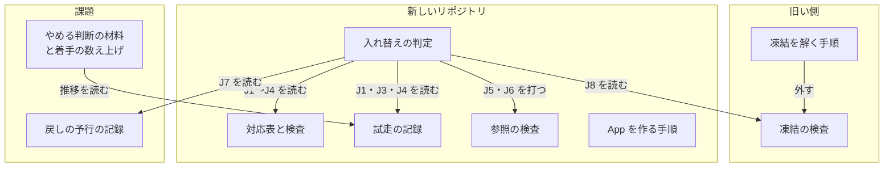
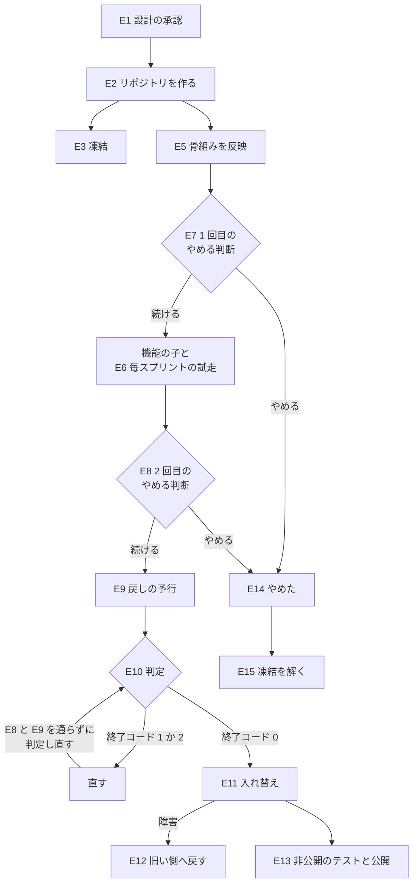
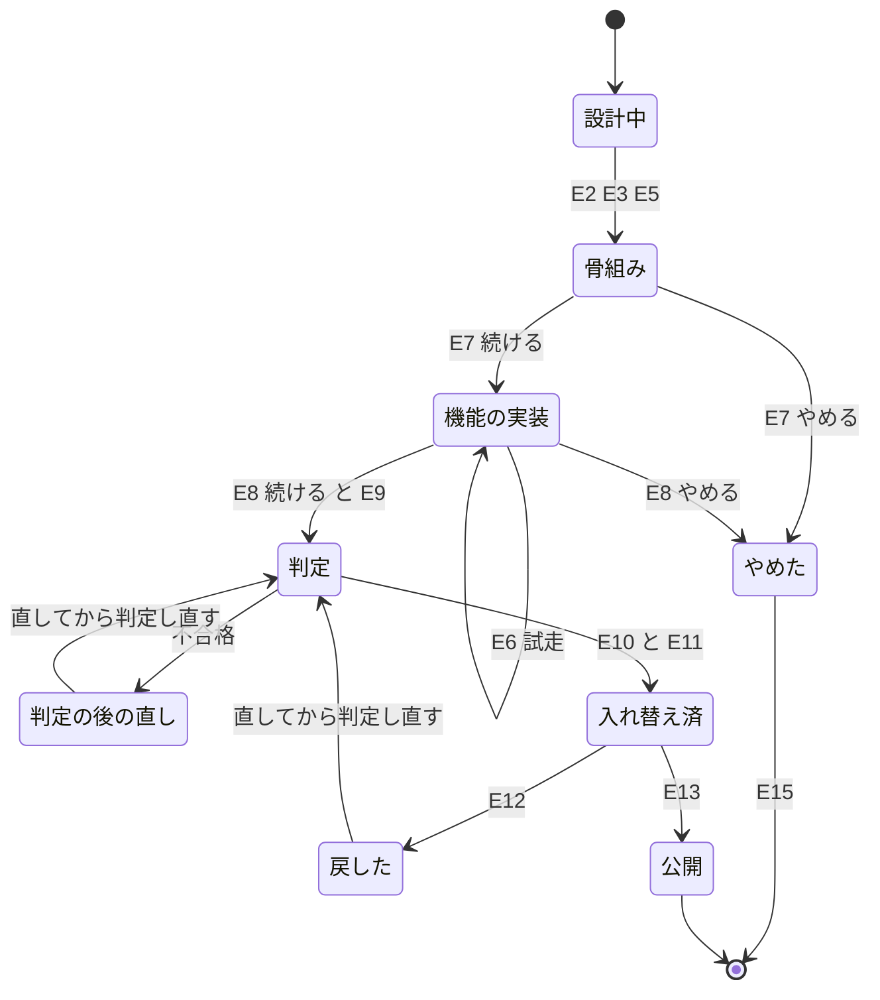

# 作り直しの判定の規則: 同等・凍結・入れ替え・やめる判断を、子が機械か記録で確かめられる形にする

## 目的

- **今どうなっているか**: 作り直しの価値の判断（同等・凍結・データ・App・入れ替えの判定・やめる判断）は、この設計の要求で答えと受け入れ条件（J1〜J8・R1〜R13）になった。要求は旧い側の課題の本文にあり、移していない。ただし、条件が読む値（対応表の行の状態・作らない理由・試走の結果）の集合と、判定の入出力は、まだどの子も決めていない
- **誰に効くか**: 条件を実装する子（[対応表の設計](03-parity.md)・[全体の設計](05-overall.md)・骨組み・#3・#15・#16）と、やめる判断と入れ替えを承認する人
- **変えると何が成り立つか**: 子が同じ値の集合と同じ判定の形を使う。そのため、入れ替えの判定のスクリプトが J1〜J6 を機械で判定でき、J7・J8・R11・R12 は記録の有無で判定できる。判定の条件を実装の途中で読み替える余地が無くなる

## 適用範囲

- **働く範囲**: 作り直しの子（対応表の設計・全体の設計・骨組み・#1〜#16）の要求と設計。この課題でコード・CI・スタックは変えない。旧い側では凍結の検査（骨組みが置く）だけが働き、新しいリポジトリでは対応表・試走・判定・参照の検査が働く
- **プロジェクトごとに違うもの**: 無し。作り直しは nd-factory の 1 件だけの取り組みで、利用先のリポジトリへ配らない
- **当たるモード**: `standard`（種類は作り直しの要求。設計まで）

## あるべき姿の根拠

| 根拠 | 種類 | 何を示すか |
| --- | --- | --- |
| ndf-next は価値の判断を実装中に 6 回以上覆し、範囲も途中で広がった（作り直しの調査（旧い側。移していない）の 2 節の 10・15） | 実測 | 判定の条件を読む値の集合を、実装の前に固定する必要がある |
| 入れ替えの判定の条件の型 6 つ（同じ調査の 3 節「入れ替えの判定の条件（推奨）」） | 実測 | J1〜J8 の出所。判定をスクリプトで行い、行の一覧を返す形 |
| 利用者の答え「止めて CI で守る／移さず作り直す／新しく作る／骨組みの後と中間の 2 回」（利用者の答え（2026-11-16）。旧い側の記録で、移していない） | 利用者の指示の原文 | 凍結・データ・App・やめる判断の時点を、この設計で変えない |
| 既存の全機能の同等を目標にすると、使われていない機能まで作り直す（STD2） | 外部の一次情報 | 同等の範囲を「今の dev で動いている行」に絞る形を支える（決定 2） |
| 待機の側を残して振り先を戻すと、すぐに戻せる。待機の側に無いデータの扱いは別に要る（STD3） | 外部の一次情報 | 旧い側を戻し先として残し、戻すと新しい側のデータが見えなくなることを先に書く（決定 6） |
| ルールセットの「更新を制限する」は、抜け道の一覧にいる人だけが push できる（PRD1） | 外部の一次情報 | 緊急の直しを記録つきで通す凍結を、ブランチのロックでは作れない（決定 7） |

要求と受け入れ条件は、この設計の要求にある。要求は旧い側の課題の本文で、移していない。この文書は「どう作るか」だけを扱う。どう作るかの中身は、子が実装するときに従う値の集合・判定の入出力・記録の形である。

## ドメインモデル

### コンテキスト

| コンテキスト | 何の語が 1 つの意味に決まるか |
| --- | --- |
| Neural Development Factory（`ndf-factory`） | 作り直し・新しいリポジトリ・旧い側・試走の記録・同等・同等の範囲・作らない理由の種類・凍結・緊急の直し・移す先の課題・入れ替え・入れ替えの判定・戻しの予行・やめる判断・やめる判断の材料・範囲の追加 |
| 作り直し（`rebuild`） | 機能の対応表・試走（[対応表の設計](03-parity.md)が用語集に置いた語。意味は用語集を正とする） |

変更は 2 つのコンテキストの中で閉じる。下の集約の持ち主は、このコンテキストの中の別々の子である（対応表の設計・骨組み・#3・#15・作り直しの親の課題（旧い側））。

- 子どうしは、この設計の「データ構造」の値の集合と「入出力の契約」の形を**公開された言語**として使う
- 子は値の集合を自分で読み替えない。変えるときはこの設計を改訂する
- [全体の設計](05-overall.md)のドメインモデルは、この節の集約と E1〜E15 の番号を引き継ぐ

### 集約

| 集約 | 持ち主（書き換えてよいもの） | 根 | エンティティ | 値オブジェクト |
| --- | --- | --- | --- | --- |
| 機能の対応表 | 対応表の検査を通した PR（検査と最初の行は[対応表の設計](03-parity.md)が置く。最初の行は対応表の設計の PR に入れ、その PR のマージのコミットが I6 の基準になる。範囲の追加の行は、その子が自分の設計承認ゲートの後に同じ検査を通して足す） | 対応表 | 行 | 行の種類・今の dev での状態・行き先・作らない理由・範囲の追加の記録 |
| 試走の記録 | 試走のコマンド（#3） | 試走の回（スプリントごと） | 行の結果 | 試走の結果・流した日時・行の ID・最新の回の結果（生成物。対応表の行の `trial` へ写す） |
| 凍結 | 旧い側の凍結の検査（骨組みが置く） | 凍結 | — | 緊急の直しの印・移す先の課題の参照・凍結の状態 |
| やめる判断 | 作り直しの親の課題（旧い側）で材料を出す段（E7・E8） | 判断の回（1 回目・2 回目） | 材料・答え | 試走で通った行の数の推移・始めてからの日数・費用・残りの見積り・答えの値 |
| 入れ替え | 入れ替えの判定のスクリプトと手順（#15） | 入れ替え | 判定の結果・戻しの予行の記録 | 終了コード・合わない行 |
| 新しいリポジトリの構成 | 新しいリポジトリの CI の検査（骨組みが置く。各子は検査を通した PR でだけ書き換える） | 新しいリポジトリ | — | NDF の版の固定の値 |

**試走の結果の正は「試走の記録」の集約が持つ。機能の対応表の行の試走の結果（[対応表の設計](03-parity.md)の `trial`）は、最新の回の結果の写しである**（決定 3）。

- 行ごとの最新の回の結果は、試走のコマンドが試走の記録から作り直す生成物で、試走の記録の集約に属する
- 試走のコマンドは写しを作るだけで、対応表を直に書かない。写しは対応表の検査を通した PR で入る
- 対応表を書き換える経路は「対応表の検査を通した PR」の 1 つのままで、各集約の書き手は 1 つずつに決まる

やめる判断の「答え」は人が書く。集約の持ち主は材料を出す段で、人の答えは E7・E8 のドメインイベントとして受ける。

### 不変条件

| # | 集約 | 条件 | 破れたときの扱い |
| --- | --- | --- | --- |
| I1 | 機能の対応表 | 各行は、行き先の子か「作らない」のどちらか一方だけを持つ。「作らない」の行は、作らない理由の種類と空でない理由の文を持つ | 対応表の検査が行の ID を示して止まる |
| I2 | 機能の対応表 | 作らない理由の種類は「捨てる」「今も動かない」「NDF 待ち」の 3 つのどれかである。「今も動かない」の行の今の dev での状態は「届かず」か「未」（まだ調べていなければ「未調査」）、「NDF 待ち」の行は行の種類が「NDF 11 で確かめる」で NDF の課題番号を持つ | 対応表の検査が止まる。判定では J2 の不合格になる |
| I3 | 機能の対応表 | 今の dev での状態が「済」か「済(残)」で、行の種類が「NDF 11 で確かめる」でない行（同等の範囲の候補）が「作らない」を持つなら、理由の種類は「捨てる」である。行の種類が「NDF 11 で確かめる」の行は、状態によらず同等の外（NDF 待ち）に置く | 判定で J2 の不合格になる |
| I4 | 機能の対応表 | 行の種類が「既知の不具合の回帰」の行と「権限の境界」の行は、それぞれ 1 行以上あり、どれも「作らない」を持たない | 対応表の検査が止まる。判定では J3 の不合格になる |
| I5 | 機能の対応表・試走の記録 | 行き先の子の課題が閉じた行は、最新の試走の回で `passed` であり、今の dev での状態が「未調査」でなく、新しいリポジトリでの確かめ方が「未決」でない | 判定で J4（試走）か J2（未調査・未決）の不合格になる（#3 の閉じる条件の検査は、どちらも閉じる前に止める） |
| I6 | 機能の対応表 | [対応表の設計](03-parity.md)の承認の後に足した行（対応表の設計の PR のマージのコミットにある対応表に、行の ID が無い行。最初の行は対応表の設計の PR に入れる）は、足した日付・承認した課題の番号・範囲の追加の理由の種類を持つ。入れ替えの前に足した行の理由の種類は「同等に要る」「セキュリティ」「公開に要る」のどれかである。設計承認の時点の行は範囲の追加の記録を問わない | 対応表の検査が行の ID を示して止まる |
| I7 | 入れ替え | 判定は J1〜J6 がすべて合うときだけ合格の終了コードを返す。入力を読めないときは、合格とも不合格とも違う終了コードを返す | 合格でない限り、#15 のリリース承認ゲートへ入れ替えの承認を出さない |
| I8 | 入れ替え | 新しい側の作業（入れ替え・戻しの予行・新しい側の反映）は、旧い側の資源とデータを #16 が閉じるまで消さず、書き換えない。緊急の直し（E4）を旧い側のリリースの PR で旧い側へ反映すること、旧い側の利用者の操作でデータが変わることは、この条件の外である | #15 の入れ替えと戻しの予行の手順が、旧い側のスタックを反映・削除の対象に含むか、旧い側のデータを書く操作を含むなら、その手順を止める。旧い側の `cdk diff` に緊急の直しによる差分が出ても止めない |
| I9 | 凍結 | 凍結の間、旧い側の main を宛先とする PR は、緊急の直しの印と移す先の課題の参照の両方を本文に持つときだけ凍結の検査を通る | 凍結の検査が失敗し、欠けたものを示す |
| I10 | 凍結 | 凍結を解くのは作り直しをやめたとき（E14）だけで、解く手順は旧い側の文書にある | 手順の無いまま E14 に至ったら、骨組みの受け入れ条件 R4 の不合格として扱う |
| I11 | やめる判断 | 材料のコメントから人の答えまでの間に、新しく着手した機能の子は 0 件である | 着手した子の番号を作り直しの親の課題（旧い側）に書き、その子の作業を答えが出るまで止める |
| I12 | やめる判断 | 各回の材料のコメントは 4 つの材料をすべて持ち、人の答え（続ける・やめる）が同じ課題に記録される | 欠けた材料を足して出し直す。答えの無い回は E8 と E10 へ進まない |
| I13 | 新しいリポジトリの構成 | 新しいリポジトリのコード・CI・文書に、旧い側への参照が 0 件である | 新しいリポジトリの CI の参照の検査が失敗する |
| I14 | 新しいリポジトリの構成 | 新しいリポジトリに、今の 7 表と状態のバケットを読む処理が無い | 同じ検査が失敗する |
| I15 | 新しいリポジトリの構成 | NDF の版の固定の値は 1 か所にあり、コードに NDF の版の数字を比べる処理が 0 件である | 同じ検査が失敗する |

### ドメインイベント

番号は要求の「ドメインイベント」を引き継ぐ。

| # | イベント | 発生元 | 受け手 |
| --- | --- | --- | --- |
| E1 | 作り直しの要求・機能の対応表・全体の設計が承認された | 設計承認ゲート（人） | 骨組み（リポジトリを作る段） |
| E2 | 新しいリポジトリを作った | 骨組み | 凍結の検査（移す先の課題の参照の宛先が決まる） |
| E3 | 旧い側を凍結した | 骨組みの PR のマージ | 凍結の集約（凍結の状態が「凍結中」になる） |
| E4 | 緊急の直しを旧い側へ入れ、移す先の課題を作った | 旧い側の PR | 入れ替えの判定（J8 の一覧） |
| E5 | 骨組みを運用する環境へ反映した | 骨組みのリリース承認ゲート | やめる判断（1 回目の材料を出す） |
| E6 | 試走を流し、行ごとの結果を書いた | 試走のコマンド（#3） | 試走の記録（最新の回の結果を作り直す）・やめる判断の材料 |
| E7 | 1 回目のやめる判断の材料を出し、人が答えた | やめる判断（材料）と人（答え） | 機能の子の着手（続けるなら再開）・E14 |
| E8 | 機能の子の 5 件目が閉じ、2 回目の材料を出し、人が答えた | やめる判断（材料）と人（答え） | 機能の子の着手・E14 |
| E9 | 戻しの予行をした | #15 の手順 | 入れ替えの判定（J7 の記録） |
| E10 | 入れ替えの判定のスクリプトが合格を返した | 入れ替えの判定のスクリプト | #15 のリリース承認ゲート |
| E11 | 入れ替えた | #15 のリリース承認ゲート | 非公開のテスト（#16） |
| E12 | 旧い側へ戻した | 入れ替えの後の障害を受けた #15 の戻しの手順 | 入れ替えの集約（状態が「戻した」になる） |
| E13 | 非公開のテストを終え、公開した | #16 の承認 | 旧い側の片付けの課題（I8 が解ける） |
| E14 | 作り直しをやめた | E7 か E8 の人の答え | 凍結の集約（E15） |
| E15 | 旧い側の凍結を解いた | 凍結を解く手順（I10） | 旧い側の開発の再開 |

### 用語

| 用語 | 意味 | 用語集への反映 |
| --- | --- | --- |
| 機能の対応表 | 今の nd-factory の、利用者から見た振る舞いを 1 行ずつ並べ、行ごとに行き先の子と、試走の最新の回の結果の写しを持つ表（[対応表の設計](03-parity.md)）。試走の結果の正は試走の記録に置く | 意味を変える（要求の用語の表の「行ごとに行き先の子と試走の結果を持つ表」の試走の結果を、試走の記録の写しとする。決定 3） |
| 試走の記録 | 試走の 1 回（スプリントごと）に流した、行ごとの試走の結果と流した日時の記録。試走の結果を持つのはこの記録だけで、行ごとの最新の回の結果もこの記録から作る | 追加 |
| 同等の範囲 | 機能の対応表の行のうち、今の dev での状態が「済」か「済(残)」で、行の種類が「NDF 11 で確かめる」でなく、作らない理由の種類が「捨てる」でない行 | 追加 |
| 作らない理由の種類 | 機能の対応表の「作らない」の行が持つ理由の区分。「捨てる」「今も動かない」「NDF 待ち」の 3 つ | 追加 |
| 入れ替えの判定 | 入れ替えの前に、J1〜J6 を機械で判定し、合わない行の一覧と終了コードを返すスクリプト（#15）。J7・J8 は記録として一覧に添える | 追加 |
| やめる判断の材料 | やめる判断の各回で作り直しの親の課題（旧い側）にコメントとして出す 4 つの数（試走で通った行の数の推移・始めてからの日数・新しい側の AWS の費用・残りの見積り） | 追加 |
| 範囲の追加 | 機能の対応表の設計承認の後に行を足すこと。足した日付・承認した課題の番号・理由の種類を行に持たせる | 追加 |

## 外部の調査

| 種類 | 調べるか | 理由 |
| --- | --- | --- |
| 標準・仕様 | 調べる | 旧い系を新しい系へ入れ替える型（段階的な置き換え・機能の同等・ブルーグリーン）と、値の集合を検査する形式に定着した形がある |
| 主要な製品 | 調べる | 凍結を GitHub の機能（ルールセット・必須のチェック）でどう作れるかを比べる |
| ライブラリとサービス | 調べる | 対応表の値の検査と PR の本文の検査に使える既存のライブラリ、費用の材料に使える AWS の機能を比べる |

### 標準・仕様

| # | 標準・仕様 | 何を定めているか | 設計への反映 | 出典 |
| --- | --- | --- | --- | --- |
| STD1 | Strangler Fig Application（Martin Fowler） | 旧い系の周りに新しい系を段階的に育て、投資と効果を少しずつ見える形で得る。共存のための一時的な構成が要る | 採らない。利用者の答え 2 で一括の入れ替えと戻し先の保持に決まっており、共存の構成は作らない（決定 6） | https://martinfowler.com/bliki/StranglerFigApplication.html （2026-11-16） |
| STD2 | Feature Parity（Patterns of Legacy Displacement） | 新しい系で既存の系と同じ機能と振る舞いを作る型。使われていない機能まで作り直すため、勧めない型としている | 同等の範囲を「今の dev で動いている行」に絞り、捨てる仕組みを外す（決定 2） | https://martinfowler.com/articles/patterns-legacy-displacement/feature-parity.html （2026-11-16） |
| STD3 | Blue-Green Deployment（Martin Fowler） | 2 つの環境を並べ、振り先を替えて切り替える。戻すときは振り先を戻す。待機の側に無いトランザクションの扱いは別に要る | 旧い側を待機の側として残し、戻しは振り先を戻すだけにする。新しい側で作ったデータは戻すと見えなくなる（決定 6） | https://martinfowler.com/bliki/BlueGreenDeployment.html （2026-11-16） |
| STD4 | JSON Schema 2020-12 | JSON の値の型・列挙・条件つきの必須を宣言で書く形式 | 対応表の値の集合（列挙）と、値どうしの条件（I1・I2）を宣言で検査できる（決定 4） | https://json-schema.org/draft/2020-12 （2026-11-16） |
| STD5 | Architectural Decision Records | 設計の判断を、理由とともに記録として残す | 範囲の追加の記録を行に持たせ、承認した課題の番号で判断の記録へたどれるようにする（決定 9） | https://adr.github.io/ （2026-11-16） |

### 主要な製品

| # | 製品 | どう解いているか | 設計への反映 | 出典 |
| --- | --- | --- | --- | --- |
| PRD1 | GitHub のルールセット（更新を制限する・抜け道の一覧） | 「更新を制限する」を選ぶと、抜け道の権限を持つ人・チーム・App だけがブランチへ push できる | 凍結に使わない。抜け道は人の単位で、PR ごとの緊急の直しの印と移す先の課題を条件にできない（決定 7） | https://docs.github.com/en/repositories/configuring-branches-and-merges-in-your-repository/managing-rulesets/available-rules-for-rulesets （2026-11-16） |
| PRD2 | GitHub のルールセット（マージの前に必須のチェックを通す） | 選んだチェックが通るまでマージを止める。選ばなければマージに制限は無い | 凍結の検査は CI のチェックとして作り、必須にするかは R3 で人が決める（決定 7） | 同上（2026-11-16） |

### ライブラリとサービス

| # | 候補 | 版 | ライセンス | 最後のリリースの日付 | 終了のアナウンス | 要件を満たすか | 出典 |
| --- | --- | --- | --- | --- | --- | --- | --- |
| LIB1 | jsonschema（Python） | 4.26.0 | MIT | 2026-01-07 | 無し | 満たす。STD4 の列挙と条件つきの必須を検査できる。対応表の検査の言語（対応表の設計が決める）が Python なら使える | https://pypi.org/pypi/jsonschema/json （2026-11-16） |
| LIB2 | actions/github-script | v9.0.0 | MIT | 2026-04-09 | 無し（アーカイブされていない） | 満たす。PR の本文と宛先を読む凍結の検査を、ワークフローの 1 ステップとして書ける | https://api.github.com/repos/actions/github-script/releases/latest （2026-11-16） |
| LIB3 | AWS のコスト配分タグ（Billing and Cost Management） | — | — | — | 無し | 条件つきで満たす。利用者の定義したタグのキーを有効にすると、そのタグで費用を分けて読める。有効にする操作が要る | https://docs.aws.amazon.com/awsaccountbilling/latest/aboutv2/activating-tags.html （2026-11-16） |

### 確かめられなかったこと

| 対象 | 試した手段 | 結果と理由 |
| --- | --- | --- |
| 運用する環境のアカウントで、新しい側の資源に付けるタグのキーが、コスト配分タグとして有効かどうか | 試していない | 新しい側のタグのキーは[全体の設計](05-overall.md)が決める。キーが決まる前は確かめる対象が無い |

調べた量: 候補 10 件・取得の試み 18 回。

## 機能一覧

| # | 機能 | 誰が使うか |
| --- | --- | --- |
| F1 | 機能の対応表の行が、同等の範囲に入るかを、行の値だけから導ける | 入れ替えの判定・対応表の検査 |
| F2 | 「作らない」の行が、理由の種類で区分され、種類と行の状態が食い違わない | 対応表の検査・設計承認ゲートで表を読む人 |
| F3 | 試走の結果がスプリントごとに残り、通った行の数の推移を数えられる | 試走のコマンド・やめる判断の材料を出す段 |
| F4 | 入れ替えの判定が、合わない行の一覧と、合格・不合格・判定できないの 3 つの終了コードを返す | #15 の手順・リリース承認ゲートで承認する人 |
| F5 | 凍結の間、旧い側の main への PR は、緊急の直しの印と移す先の課題の参照が無ければ止まる | 旧い側へ PR を出す人と AI |
| F6 | 作り直しをやめたとき、凍結を手順どおりに解ける | 旧い側の持ち主 |
| F7 | やめる判断の各回で、4 つの材料と人の答えが作り直しの親の課題（旧い側）に残り、答えの前に着手した子を数えられる | やめる判断をする人・材料を出す段 |
| F8 | 対応表に設計承認の後で行を足すとき、理由と承認した課題が行に残る | 子の設計者・設計承認ゲートで承認する人 |
| F9 | 新しいリポジトリが、旧い側への参照・データの移行の処理・NDF の版の比べを持たないことを CI が確かめる | 新しいリポジトリへ PR を出す人と AI |

## 構成要素

この課題はコードを作らない。下の要素は子が作り、この設計はそれぞれの責務と、要素どうしで受け渡す値の形を決める。

### 要素と作る子

| 要素 | 責務 | 作る子 |
| --- | --- | --- |
| 対応表の値の集合 | 行の種類・今の dev での状態・行き先・作らない理由の種類・範囲の追加の理由の種類・試走の結果の値を定める（「データ構造」） | [対応表の設計](03-parity.md)（この設計の値を写す） |
| 対応表の検査 | I1・I2・I4・I6 を、行の ID と違反の種類を示して確かめる。対応表を書き換える PR はすべてこの検査を通す | [対応表の設計](03-parity.md) |
| 試走の記録 | 試走の回ごとに行の結果を残し、行ごとの最新の回の結果を記録から作り直す。対応表は書かない | #3 |
| 凍結の検査 | I9 を、旧い側の main を宛先とする PR ごとに確かめる | 骨組み（旧い側） |
| 凍結を解く手順 | E14 の後に凍結の検査を外す手順を、旧い側の文書に置く（I10） | 骨組み（旧い側） |
| 入れ替えの判定のスクリプト | J1〜J6 を判定し、J7・J8 の記録の一覧を添えて返す（I7。「入出力の契約」） | #15（新しいリポジトリ） |
| 戻しの予行の記録 | 旧い側へ戻した手順と、戻した後に旧い側でログインしてスプリントの一覧が出たことを #15 に書く（J7） | #15 |
| やめる判断の材料のコメント | E5 と E8 の後に、4 つの材料を作り直しの親の課題（旧い側）へコメントとして出す（I12） | 作り直しの親の課題（旧い側）の材料を出す段 |
| 着手の数え上げ | 材料のコメントから答えまでの間に「設計」以降の進行を記録した機能の子を数える（I11） | 作り直しの親の課題（旧い側）の材料を出す段 |
| 参照の検査 | I13・I14・I15 を新しいリポジトリの CI で確かめる | [全体の設計](05-overall.md)が形を決め、骨組みが置く |
| App とクライアントを作る手順 | 自分で設置する人と同じ手順で GitHub App・GitHub の OAuth App・Google の OAuth クライアントを作る（R7）。判定の入力にならず、R7 として骨組み・#14 の受け入れ条件で確かめるため、下の図の辺を持たない | 骨組み・#14 |

### 要素どうしの読み書きの向き

## データ構造

**この節は、判定の条件が読む値の集合と意味だけを決める**（決定 1・決定 4）。対応表と試走の記録の形式・置き場・キーの名前は、対応表の設計・全体の設計・#3 が決める。

### 機能の対応表の行が持つ値

| 値 | 取りうる値 | 意味 | 使う不変条件・判定 |
| --- | --- | --- | --- |
| 行の種類 | 振る舞い・既知の不具合の回帰・権限の境界・NDF 11 で確かめる | [対応表の設計](03-parity.md)の受け入れ条件 12 の 4 つ | I2・I4・J3 |
| 今の dev での状態 | 済・済(残)・届かず・未・未調査 | 調査の対応表の素の状態の列をそのまま写す。素から写せない行は「未調査」とし、行き先の子が自分の設計承認ゲートで実機を確かめて埋める（行き先の子を持たない作らない行は試走の子 #3 が埋める。[対応表の設計](03-parity.md)の決定 13）。「未調査」の行は同等の範囲に入るかを決められないため、J2 で合わない行に数える | I2・I3・J2 |
| 行き先 | 子の課題の番号（骨組みか #1〜#16）か「作らない」 | どちらか一方 | I1・J1 |
| 作らない理由の種類 | 捨てる・今も動かない・NDF 待ち | 「作らない」の行だけが持つ | I2・I3・J2 |
| 作らない理由の文 | 空でない文 | 種類の中での具体の理由 | I1 |
| NDF の課題番号 | devbasex/ai-plugins の課題番号 | 理由の種類が「NDF 待ち」の行だけが持つ | I2 |
| 範囲の追加の記録 | 足した日付・承認した課題の番号・理由の種類（同等に要る・セキュリティ・公開に要る） | 設計承認の後に足した行だけが持つ。入れ替えの後に足した行は理由の種類を問わない | I6・R13 |

**同等の範囲は行の値から導き、行に別の印を持たせない**（決定 2）。次の 3 つをすべて満たす行が同等の範囲である。

- 今の dev での状態が「済」か「済(残)」である
- 行の種類が「NDF 11 で確かめる」でない
- 作らない理由の種類が「捨てる」でない

行の種類が「NDF 11 で確かめる」の行は、要求の「同等の外」の NDF 待ちに当たる。そのため、状態が「済」でも同等の範囲に入れない。

要求の「同等の外」の区分のうち、次の 2 つは作らない理由の種類に入れない。

| 区分 | 理由の種類に入れない理由 |
| --- | --- |
| 既知の不具合 | 誤った振る舞いの行を作らず、正しい振る舞いを行の種類「既知の不具合の回帰」の行として持つ |
| 料金プランの差 | 同等をすべての機能が使える設定で判定する |

### 試走の記録

| 値 | 取りうる値 | 意味 |
| --- | --- | --- |
| 試走の回 | スプリントの名前と流した日時 | 1 回の試走。上書きせずに追記する |
| 行の結果 | 行の ID と `passed`・`failed`・`not_run` の組 | その回で流した結果。流さなかった行は `not_run` |
| 最新の回の結果 | 行の ID と `passed`・`failed`・`not_run` の組 | 行ごとの、最も新しい回の結果。試走のコマンドが記録から作り直す生成物で、手で書かない。対応表の行の `trial` へ写し、対応表の検査を通した PR で入れる（写しと記録が食い違えば記録が正）。まだ流していない行は `not_run`。J1・J3・J4 が読む |

試走の記録を追記にするのは、やめる判断の材料の「試走で通った行の数のスプリントごとの推移」を、後から数え直せるようにするためである（決定 3）。

### やめる判断の材料

| 材料 | 数え方 | 出所 |
| --- | --- | --- |
| 試走で通った行の数の推移 | 試走の回ごとの `passed` の行の数と、同等の範囲の行の数 | 試走の記録・対応表 |
| 始めてからの日数 | E1（設計承認）の日から材料を出す日までの暦の日数 | 設計 PR のマージの日時 |
| 新しい側の AWS の費用 | 新しい側の資源のタグ（キーは[全体の設計](05-overall.md)が決める）で分けた、E5 から材料を出す日までの費用 | AWS のコスト配分タグ（LIB3） |
| 残りの見積り | `passed` でない同等の範囲の行の数、開いている機能の子の数、`estimate` の Skill による残りの子の見積り | 対応表・課題・見積り |

答えの値は「続ける」「やめる」の 2 つで、作り直しの親の課題（旧い側）の同じコメントへの返信か、続くコメントに人が書く。

## 入出力の契約

### 入れ替えの判定のスクリプト

| 項目 | 契約 |
| --- | --- |
| 入力 | 機能の対応表・試走の記録（最新の回の結果を含む）・新しいリポジトリの課題の状態（行き先の子が閉じているか）・新しいリポジトリの合成とスタックのテストの結果（作り物の値）・漏れの検査の結果 |
| 標準出力 | 合わないものを 1 件 1 行で `J<番号>` ・対象（行の ID・ファイル・課題の番号）・理由の 3 つで並べる。続けて、J7 と J8 の記録の一覧（戻しの予行の記録の場所と、凍結の後に main へ入った PR と移す先の課題の組）を「人が確かめる」として並べる |
| 終了コード 0 | J1〜J6 がすべて合う |
| 終了コード 1 | J1〜J6 のどれかが合わない（合わない行が標準出力にある） |
| 終了コード 2 | 入力のどれかを読めない（入力が無い・形が違う・GitHub に届かない）。読めなかった入力を標準エラーに出す |
| しないこと | 対応表・試走の記録・課題を書き換えない。J7・J8 の合否を返さない |

J7・J8 を機械の合否に入れないのは、要求が「記録の有無で判定する」としているためである。判定のスクリプトは一覧を作るだけで、合否は #15 のリリース承認ゲートで人が読む。

### 凍結の検査

| 項目 | 契約 |
| --- | --- |
| 対象 | 旧い側の main を宛先とする PR（リリースの PR とスプリントの PR を含む） |
| 入力 | PR の宛先のブランチと本文 |
| 合格 | 宛先が main でない。または、本文に緊急の直しの印と、新しいリポジトリの課題の完全な参照（`<組織>/<リポジトリ>#<番号>` か URL）の両方がある |
| 失敗 | 宛先が main で、印か参照のどちらかが欠ける。欠けたものを出力に示す |
| 参照の宛先 | 新しいリポジトリの名前を検査の設定の 1 か所に置き、ほかのリポジトリの参照は数えない |
| しないこと | 移す先の課題があるか・開いているかを GitHub に問い合わせない（決定 8）。印の形（ラベルか本文の行か）と検査の置き場は骨組みの設計（旧い側）が決める（要求の未決） |

## 処理の流れ

### 段の順序

作り直しの段の順序と、やめる判断・判定で止まる所を示す。番号は E1〜E15 である。

- E4（緊急の直し）は E3 の後のどの時点でも起き、E10 の判定で J8 の一覧に現れる
- 判定が不合格のときは、合わない行を直して E10 へ戻る。やめる判断（E7・E8）と戻しの予行（E9）はやり直さない
- やめる判断の時点は要求の Q8 の 2 回だけである

### 作り直しの状態

作り直しの状態を次に示す。凍結の状態は「やめた」でだけ解ける（I10）。

### 段と構成要素の対応

| 段 | 担う構成要素 |
| --- | --- |
| E3 | 凍結の検査 |
| E6 | 試走の記録 |
| E7・E8 | やめる判断の材料と着手の数え上げ |
| E9 | 戻しの予行の記録 |
| E10 | 入れ替えの判定 |
| E15 | 凍結を解く手順 |

対応表と検査・参照の検査・App とクライアントを作る手順は、この図に含めない。各段の PR の CI と受け入れ条件で働き、段の順序を変えないためである。判定が読む入力の向きは「構成要素」の図にある。

## 非機能の実現方式

| 大項目 | 要求の条件 | 実現方式 |
| --- | --- | --- |
| 移行性 | データは移さない。旧い側を #16 まで残す。戻しの予行を入れ替えの前に 1 回行う | 新しいリポジトリに移行の処理を置かないことを参照の検査で確かめる（I14）。#15 の入れ替えと戻しの予行の手順が、旧い側のスタックを反映・削除の対象に含まず、旧い側のデータを書かないことを、手順の操作の一覧で確かめる（I8）。緊急の直しによる旧い側の差分は、旧い側の CD が人の承認を経て反映するもので、I8 では止めない。予行の記録を J7 の一覧に出す |
| セキュリティ | 新しいリポジトリのファイル・履歴・課題に、インフラの実際の値と秘密の値が無い | 判定のスクリプトが漏れの検査をファイル・全履歴・課題と PR の本文とコメントに打ち、0 件を J6 の条件にする。漏れの検査そのものは #1（検査の子）が作る |

## 決定の記録

### 決定 1: 子が条件を読み替えないよう、判定が読む値の集合をこの設計で決め、子はそれを写す

J1〜J8 と R1〜R13 は、対応表の値（状態・行き先・理由）と試走の記録の値（試走の結果）を読む。値の集合を子ごとに決めると、対応表の設計と #15 が別の集合を作る。すると、判定の段で条件を読み替えることになる。ndf-next はこの形で条件が 6 回以上覆った。

| 決める所 | 決めるもの |
| --- | --- |
| この設計 | 値の集合と意味 |
| 子 | 形式・置き場・キーの名前 |

子の要求が条件を写すときは、この設計の `R<番号>`・`J<番号>` と番号で指し、文を言い換えない。

各子が値の集合を自分の要求で決める形は採らない。同じ設計承認ゲートで[対応表の設計](03-parity.md)と並べて承認するため、この設計で 1 か所に決めても遅れない。

根拠: Mission / Value 1（MVV 版 1）

### 決定 2: 同等の範囲を行の値から導き、行に「同等の範囲か」の印を持たせない

同等の範囲は 3 つの値から決まる（「データ構造」の導き方）。別の印を持たせると、印と状態が食い違ったときにどちらが正か決まらない。範囲を「今動いている行」に絞る理由は、既存の全機能を作り直す型（STD2）が、使われていない機能まで作り直すとしているためである。

行に「同等の範囲」の真偽を持たせる形は、上の食い違いのため採らない。

- 作り方: 自前で作る・標準に倣う
- 比べた候補: STD2 / STD4

根拠: Value 1（MVV 版 1）

### 決定 3: スプリントごとの推移を数え直せるよう、試走の結果の正を追記の試走の記録に置く

やめる判断の材料は、試走で通った行の数のスプリントごとの推移を求める（R11）。結果を 1 つの列に上書きすると、前の回の数が消える。そこで次の形にする。

- 試走の記録を回ごとに追記する
- 行ごとの最新の回の結果は、試走のコマンドが記録から作り直す生成物として、試走の記録の集約に置く
- 対応表の行の試走の結果（[対応表の設計](03-parity.md)の `trial`）は、この生成物の写しとする。試走のコマンドが作った写しを、対応表の検査を通した PR で入れる
- 試走のコマンドは対応表を直に書かない

これで、書き手は次の 1 つずつに決まる。範囲の追加（R13・Q9）の行も、足す子が同じ検査を通した PR で足すため、書き手が増えない。

| 書き換える対象 | 書き手 |
| --- | --- |
| 対応表 | 対応表の検査を通した PR |
| 試走の記録 | 試走のコマンド（#3） |

次の形は採らない。

| 採らない形 | 理由 |
| --- | --- |
| 対応表に最新の回の結果の列を持たせ、試走のコマンドが直に書き込む | 対応表の書き手が 2 つになる |
| 対応表の行から試走の結果を外す | [対応表の設計](03-parity.md)（行の `trial` と記録を指す `record`）と食い違う。表だけを読む人が今の合否を見られない（設計 PR のマージで対応表の設計と揃えた） |
| 結果を 1 つの列だけに持ち、回ごとの数を作り直しの親の課題（旧い側）のコメントに手で写す | 転記の誤りを検査できない |

根拠: Value 1（MVV 版 1）

### 決定 4: 値の検査を宣言で書けるよう、値の集合を列挙と条件で表せる形にする

I1・I2・I6 は「どちらか一方」「この種類ならこの値を持つ」という条件で、列挙と条件つきの必須で表せる。形式に JSON を選ぶなら、JSON Schema 2020-12（STD4）で宣言として書ける。この設計は値の集合と条件だけを決め、形式と、宣言で書くか検査のコードで書くかは対応表の設計・全体の設計が決める。Python で書くなら jsonschema（LIB1）が使える。

検査を手書きの分岐だけで書くと決める形は、条件の一覧と検査のコードが別々に古くなるため、この設計では決めない。

- 作り方: 標準に倣う
- 比べた候補: STD4 / LIB1

根拠: Value 1（MVV 版 1）

### 決定 5: 合格でないことを見落とさないよう、判定のスクリプトは「判定できない」を独自の終了コードで返す

入力を読めないとき（GitHub に届かない・ファイルが無い）に 0 を返すと、合格と区別できない。1 を返すと、直す行が無いのに不合格に見える。終了コードを 0（合格）・1（不合格）・2（判定できない）の 3 つに分け、0 のときだけ入れ替えの承認を出す。J7・J8 は記録の一覧として出し、機械の合否に入れない。

J7・J8 も機械で合否を返す形は採らない。要求が「記録の有無で判定する」としており、記録の中身（予行で画面が出たか）を機械で確かめられないためである。

- 作り方: 自前で作る
- 比べた候補: STD3 / STD5

根拠: Value 8 / Mission（MVV 版 1）

### 決定 6: 戻しを振り先の切り替えだけで済ませるため、旧い側を待機の側として残し、データは双方向に流さない

利用者の答え 2 は「移さず作り直す。旧い側は戻し先として残す」である。ブルーグリーンの型（STD3）に倣い、戻しは利用者が使う先を旧い側へ戻す操作だけにする。新しい側の作業から旧い側のデータを書き換えない（I8）。その結果、入れ替えの後に新しい側で作った登録とスプリントの記録は、戻すと旧い側には無い。この事実を #15 の戻しの手順と、入れ替えのリリース承認ゲートの資料に書く。

新しい側のデータを旧い側へも書く形は、旧い側のデータを書き換えることになり、利用者の答え 2 に反するため採らない。段階的な置き換え（STD1）は、共存の構成を作ることになり一括の入れ替えと合わないため採らない。

- 作り方: 標準に倣う
- 比べた候補: STD1 / STD3

根拠: Value 8（MVV 版 1）

### 決定 7: 緊急の直しを PR ごとに通すため、凍結をブランチのロックではなく CI のチェックで作る

利用者の答え 1 は「止めて CI で守る。例外は緊急の直しで、移す先の課題を必須にする」である。ルールセットの「更新を制限する」（PRD1）は、抜け道の一覧にいる人だけが push できる仕組みである。PR ごとに印と移す先の課題を条件にできない。凍結の検査を CI のチェックとして作り、PR の本文を読んで判定する。チェックを必須にするか（PRD2）は R3 のとおり骨組みで人が決める。

- 作り方: 自前で作る・ライブラリやサービスを使う
- 比べた候補: PRD1 / PRD2 / LIB2

根拠: Value 8（MVV 版 1）

### 決定 8: 旧い側の CI が新しいリポジトリの資格情報を持たないよう、凍結の検査は移す先の課題の形だけを確かめる

新しいリポジトリは非公開のテストの間は非公開で、旧い側の CI の既定のトークンでは課題を読めない。読めるトークンを旧い側へ置くと、別のリポジトリへの資格情報が増える。

| 確かめるもの | 確かめる所 |
| --- | --- |
| 参照の形と宛先のリポジトリの名前 | 凍結の検査 |
| 課題があるか・閉じたか | 入れ替えの判定（J8 の一覧）。新しいリポジトリを読める手元で打つ |

凍結の検査が GitHub に課題の有無を問い合わせる形は、上の資格情報のため採らない。

根拠: Value 7 / Value 8（MVV 版 1）

### 決定 9: 範囲の広がりを後から数えられるよう、範囲の追加の記録を対応表の行に持たせる

R13 は、設計承認の後に足した行に理由と承認した課題の番号を求める。記録を別の文書に置くと、行と記録の対応が切れる。行そのものに足した日付・承認した課題の番号・理由の種類を持たせ、対応表の検査（I6）で確かめる。承認した課題の番号から、その子の設計の決定の記録（STD5）へたどれる。

範囲の追加を課題のコメントだけに残す形は、対応表の検査で確かめられないため採らない。

- 作り方: 自前で作る・標準に倣う
- 比べた候補: STD5

根拠: Value 1（MVV 版 1）

### 決定 10: 答えの前の着手を止めるため、着手を進行の記録で定め、後から数えて確かめる

R12 は、材料を出してから答えまでの間に新しく着手した機能の子を 0 件にする。「着手」を、機能の子（#4〜#13）の課題の本文の `## 進行` に「設計」以降の工程が記録されたことと定める。材料のコメントの日時と答えの日時の間に、その記録の日時がある子を数える。数えるのは各回の答えを記録するときで、1 件以上あれば I11 のとおり作り直しの親の課題（旧い側）に番号を書く。

スプリントの計画の工程に着手を止める仕組みを新しく足す形は、承認の工程を増やすことになるため採らない。止めるのは材料を出す段が計画に機能の子を入れないことで足り、記録で後から確かめる。

根拠: Mission / Value 1（MVV 版 1）

### 決定 11: 費用の材料を旧い側と分けて数えるため、新しい側の資源のタグで費用を読む

運用する環境には旧い側と新しい側が同じアカウントに同時にある（要求の前提 5）。AWS のサービスごとの費用では両者を分けられない。新しい側の資源にタグを付け（キーは[全体の設計](05-overall.md)が決める）、コスト配分タグ（LIB3）で費用を分けて読む。タグのキーを有効にする操作は「人へ残す判断」に置く。

アカウント全体の費用を材料にする形は、旧い側の費用が混ざり、作り直しに掛かった費用として読めないため採らない。

- 作り方: ライブラリやサービスを使う
- 比べた候補: LIB3

根拠: Value 6（MVV 版 1）

## テスト設計

この課題はテストを持たない。下の行は、各子が自分の受け入れ条件として写し、その子のテストで縛る。

| 受け入れ条件・不変条件 | どの振る舞いで縛るか | どう壊したら落ちるべきか |
| --- | --- | --- |
| 受け入れ条件 1 | 「問いと答え」の表の Q1〜Q10 の各行に答えの列があり、空でない | 答えの列を空にした行があると、設計承認ゲートの資料で人が差し戻す |
| 受け入れ条件 2 | J1〜J8・R1〜R13 の各行が、この表のどれかの行で「縛る振る舞い」を持つ | この表から J か R の行を 1 つ消すと、突き合わせで欠けが見つかる |
| 受け入れ条件 3 | 利用者の答え（2026-11-16。旧い側の記録で、移していない）に Q2・Q4・Q5・Q8 に当たる 4 つの答えがある | 答えの行を消すと、要求の「決めた人: 利用者」の行の出所が無くなる |
| I1（J1） | 行き先の子と「作らない」の両方を持つ行、どちらも持たない行、理由の文が空の行で、対応表の検査が止まる | 検査が「どちらか一方」を見ず、両方を持つ行を通すと落ちる |
| J1 | 最新の回の結果が `failed` の行を 1 行含む入力と、`not_run` の行を 1 行含む入力のそれぞれで、判定が終了コード 1 と、その行の ID を持つ J1 の行を返す | 行き先と「作らない」の形だけを見て、最新の回の結果を見ないと落ちる |
| I2（J2） | 理由の種類が 3 つの外の行、「今も動かない」で状態が「済」の行、「NDF 待ち」で課題番号の無い行で、検査が止まる | 理由の種類を自由な文として受けると落ちる |
| I3（J2） | 状態が「済」で理由の種類が「今も動かない」の行で、判定が終了コード 1 と J2 の行を返す。行の種類が「NDF 11 で確かめる」・状態が「済」・理由の種類が「NDF 待ち」の行では、J2 の行を返さない | 同等の範囲を状態だけで導き、理由の種類か行の種類を見ないと落ちる |
| I4（J3） | 回帰の行が 0 行の表、権限の境界の行に「作らない」がある表で、判定が J3 を返す | 行の種類を数えずに `passed` の行だけを見ると落ちる |
| I5（J4） | 行き先の子が閉じ、最新の回が `failed` の行で、判定が J4 を返す。#3 の閉じる条件の検査が、最新の回が `passed` でも `未調査` か `未決` の残る行を持つ子で止まる | 最新の回ではなく最初の回の結果を読むと落ちる。閉じる条件が試走の結果だけを見ると落ちる |
| I6（R13） | 設計承認の後に足した行で、承認した課題の番号か理由の種類が欠けると検査が止まる。入れ替えの前に理由の種類が 3 つの外なら止まる | 足した日付だけを見て、理由の種類を見ないと落ちる |
| I7（J1〜J6） | J1〜J6 がすべて合う入力で 0、1 つ合わない入力で 1、対応表が無い入力で 2 を返す | 入力を読めないときに 0 か 1 を返すと落ちる |
| I8（R8） | 入れ替えか戻しの予行の手順に、旧い側のスタックを反映・削除する操作か、旧い側のデータを書く操作があると、手順が止まる。緊急の直しで旧い側のスタックが変わっていても、手順は止まらない | 手順の操作の一覧を見ずに入れ替えへ進むと落ちる。旧い側の `cdk diff` に差分があることだけで止めると、緊急の直しの後に入れ替えられず落ちる |
| I9（R1） | main を宛先とし、印か移す先の課題の参照のどちらかが無い PR で凍結の検査が失敗する | 印だけを見て参照を見ないと落ちる |
| I9（R2） | `release/*` から main への PR とスプリントの PR で、印と参照を持つものは凍結の検査を通る。止めない書き手の一覧は骨組みの設計（旧い側）の影響評価にある | 枝の名前で一律に止めると落ちる |
| I9（J8） | 凍結の後に main へ入った PR と移す先の課題の組が、判定の一覧に 1 件ずつ出る | 一覧が凍結の前の PR を含むか、凍結の後の PR を落とすと落ちる |
| I10（R4） | 凍結を解く手順の文書が旧い側にあり、その手順で凍結の検査が外れる | 手順の文書が無い状態で骨組みを閉じようとすると、受け入れ条件 R4 が満たされない |
| I11（R12） | 材料のコメントと答えの間に「設計」の進行を記録した子を、数え上げが番号つきで示す | 答えの後に記録した子を数えるか、間の子を数えないと落ちる |
| I12（R11） | 各回のコメントに 4 つの材料と、人の答え（続ける・やめる）がある | 材料が 3 つのコメントを出すと、答えを記録する前に欠けが見つかる |
| I13（R5） | 新しいリポジトリのファイルに旧い側のリポジトリの名前を足すと、参照の検査が失敗する | 検査が文書（`.md`）を読まないと落ちる |
| I14（R6） | 今の 7 表か状態のバケットを読む処理を足すと、参照の検査が失敗する | 検査が表の名前を見ないと落ちる |
| I15（R10） | NDF の版の固定の値を 2 か所に置くか、版の数字を比べる処理を足すと、検査が失敗する | 固定の値の数を数えないと落ちる |
| R3 | 凍結の検査を必須にするかの人の答えが骨組みの課題（旧い側）に記録されている | 記録の無いまま骨組みを閉じると、受け入れ条件 R3 が満たされない |
| R7 | 運用する環境の新しい側が、新しいリポジトリの文書の手順どおりに作った App とクライアントで、ログインと GitHub の連携まで動く | 旧い側の App の識別子を新しい側に設定すると、新しい手順の確かめにならず、#14 の受け入れで差し戻す |
| R9 | 対応表の各行が、旧い側のテストのパス（無ければ「無し」）と新しいリポジトリでの確かめ方を持ち、欠けた行で検査が止まる。列と値の形は[対応表の設計](03-parity.md)が決め、値は行き先の子が設計承認で埋める。「未決」の行は入れ替えの判定で合わない行になる | 確かめ方の列を空で通すと落ちる。「未決」の行を残したまま判定を打つと、判定が J2 の行を返す |
| J5 | 作り物の値（運用する環境と違うアカウント ID とリージョン）で、新しいリポジトリの合成とスタックのテストが通り、判定が J5 を返さない | 合成が運用する環境の値を読むように壊すと、判定が J5 を返す |
| J6 | 漏れの検査がファイル・全履歴・課題と PR の本文とコメントで 0 件のとき、判定が J6 を返さない | 履歴にだけ実際の値を残すと、判定が J6 を返す |
| J7 | 戻しの予行の記録（戻した手順と、旧い側でログインしてスプリントの一覧が出たこと）が #15 にあり、判定の一覧にその場所が出る | 記録の無いまま判定を打つと、一覧に「記録なし」が出る |

## 設計の結果

| 課題 | 扱い | 取り込み先 | 触るファイル |
| --- | --- | --- | --- |
| この設計（判定の規則。旧い側の課題） | 閉じる | — | — |

この課題の成果物は要求と設計の文書だけで、実装の PR を持たない。R1〜R13・J1〜J8 は、次の子の要求が受け入れ条件として写す: 作り直しの親の課題・対応表の設計・全体の設計・骨組み・#3・#14・#15・#16。

## 人へ残す判断

| 判断 | 当たるレッドライン | なぜ当たるか |
| --- | --- | --- |
| 新しい側の資源のタグのキーを、運用する環境のコスト配分タグとして有効にするか（決定 11。やめる判断の材料の費用に要る） | P1 | 有効にする操作は請求の設定を変える操作で、CD（`deploy.sh`）の外で AWS の設定を変え、旧い側と同じアカウントに効く |

## 未確認のまま残ること

| 項目 | 内容 |
| --- | --- |
| 入れ替えで旧い側の資源が変わるか | 利用者が使う先を替える手段（画面の URL か、ドメインの付け替えか）は[全体の設計](05-overall.md)が決める（全体の設計の[決定 22](11-overall-decisions.md) は、案内する画面の URL の切り替えとした）。手段によっては入れ替えの手順が旧い側のスタックを書き換える操作を含み、I8 と食い違う。全体の設計の承認ゲートで手段が決まった時点で分かる |
| 費用の材料を取れるか | 新しい側のタグのキーが有効になっているかは、キーを全体の設計が決めた後、1 回目の材料（E5 の後）を出す時点で分かる。有効でなければ、その回の費用は「読めない」と書いて出す |
| [対応表の設計](03-parity.md)がこの値の集合を写すか | 分かった（2026-11-16）。今の dev での状態・作らない理由の種類・NDF の課題番号・新しいリポジトリでの確かめ方は、対応表の設計の実装の cross-review で列と検査を足した（[対応表の設計](03-parity.md)の決定 13・I12）。素から写せない値は「未調査」「未決」として置き、行き先の子が自分の設計承認ゲートで埋める。残る行は入れ替えの判定で合わない行になる |
| 判定のスクリプトが GitHub の課題を読める場所 | 新しいリポジトリは非公開で、判定は読めるトークンのある手元で打つ（決定 8）。CI で打てるかは #15 の設計で分かる |
