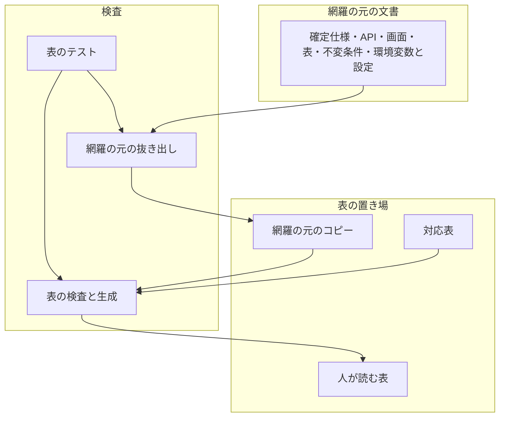
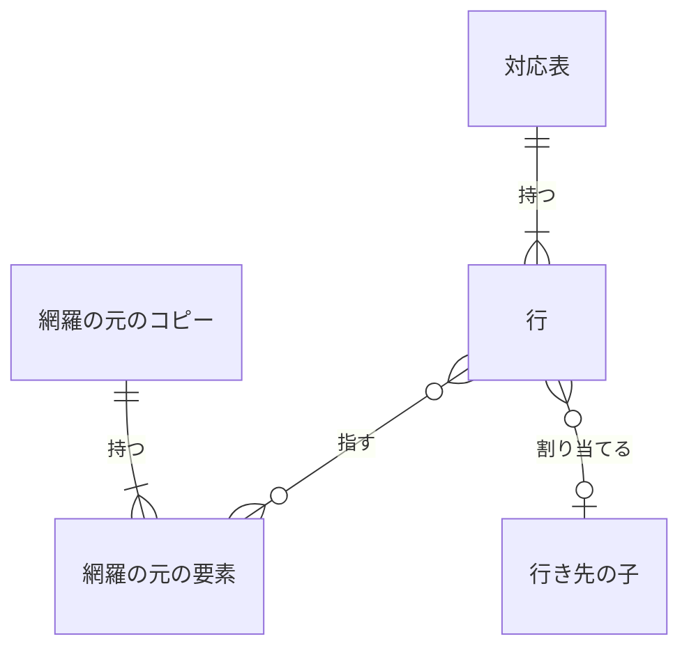
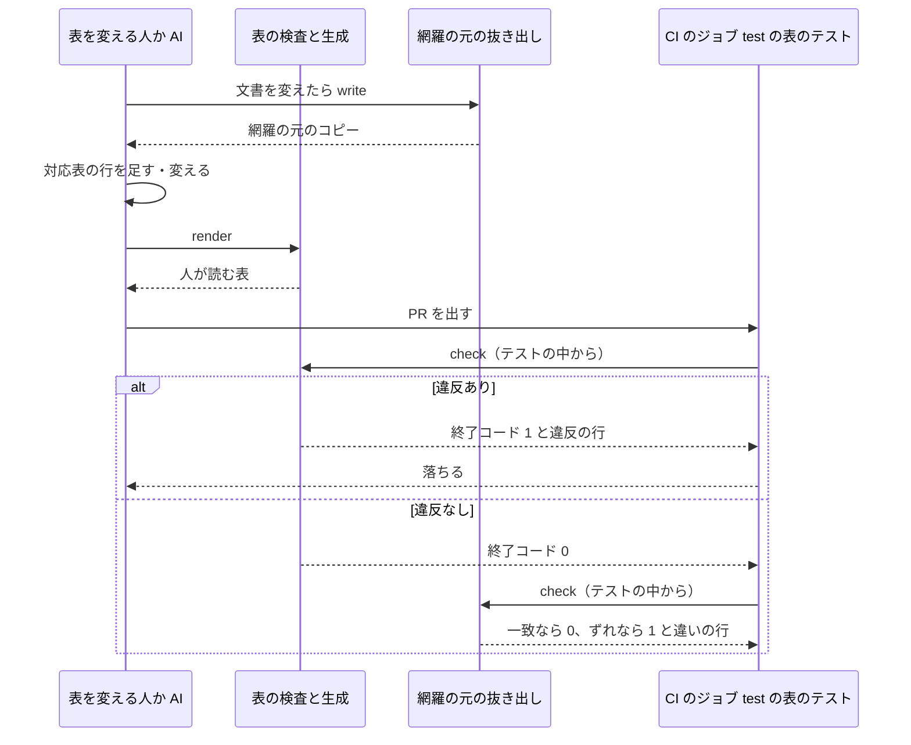

# 作り直しの機能の対応表: 今の振る舞いを 1 行 1 振る舞いで並べ、網羅の漏れを検査で止める

## 目的

- **今どうなっているか**: 作り直しで新しいリポジトリへ入れ替えてよいかを判定する物差しが無い。今の振る舞いの一覧は調査の文書（約 100 行の素）にあるだけで、行き先の子も試走の結果も持たない。確定仕様・API・画面などの要素をすべて指しているかを確かめる手段も無い
- **誰に効くか**: 入れ替えを判定する利用者と、作り直しの子（骨組みと #1〜#16）を進める AI と人
- **変えると何が成り立つか**: 今の振る舞いが 133 行の表になり、各行が行き先の子か作らない理由を持つ。網羅の元の 639 要素のどれかを指し忘れる・行き先を欠く・生成物が古い・インフラの値が混ざる、のどれでも検査が PR ごとに止まる

## 適用範囲

- **働く範囲**: 旧い側だけ。新しいリポジトリへ移すまで、表と検査を旧い側に置く。移した後は新しいリポジトリで同じ検査が動く（決定 3）
- **プロジェクトごとに違うもの**: 無し（作り直しのための 1 回きりの表）
- **当たるモード**: `standard`

## あるべき姿の根拠

| 根拠 | 種類 | 何を示すか |
| --- | --- | --- |
| 作り直しの決まったこと「今の機能の対応表の全行が通ったことを確かめてから入れ替える」 | 利用者の指示の原文 | 入れ替えの判定の単位が対応表の行であること |
| PRD1（ndf-next の対応表）と、作り直しの調査の反省点 1〜3（作り直しの調査（旧い側。移していない）） | 外部の一次情報 | ファイルの単位で作った表は後から 20 行が足され、行き先の無い機能 5 つが 2 回目の試走で見つかった。行を振る舞いの単位にし、回帰と境界の行を初めから持たせる根拠 |
| 網羅の元の抜き出し（2026-11-16、旧い側の b4072cc の文書） | 実測 | 確定仕様の条件 338 と節を持たない確定仕様 4・環境変数 120・経路 94・画面 35・環境の設定 33・表 8・インフラの不変条件 7 の計 639 要素。133 行のどれかがすべてを指す |
| PRD2（OpenFastTrace） | 外部の一次情報 | 仕様の項目に ID を振り、覆う側の印で網羅を数え、覆われない項目を報告する形が、要求の追跡で使われていること |

要求と受け入れ条件は、この設計の要求（旧い側の課題の本文。移していない）にある。この文書は「どう作るか」だけを扱う。表そのものは旧い側の対応表のファイル（`issues/` の下）にあり、設計承認ゲートで全行を読む。

## ドメインモデル

### コンテキスト

| コンテキスト | 何の語が 1 つの意味に決まるか |
| --- | --- |
| 作り直し（`rebuild`） | 機能の対応表・網羅の元・行き先の子・作らない行・試走・回帰と境界の行 |

1 つのコンテキストに収まる。行き先の子の番号（骨組みと #1〜#16）は課題の番号として読むだけで、子の課題の中身へは踏み込まない。

### 集約

| 集約 | 持ち主（書き換えてよいもの） | 根 | エンティティ | 値オブジェクト |
| --- | --- | --- | --- | --- |
| 機能の対応表 | E9 の前と後で変わる（下の表） | 対応表 | 行 | 行き先（子か作らない理由）・試走の結果・網羅の元への参照・使える料金プラン・足した日と理由 |
| 網羅の元のコピー | E9 の前と後で変わる（下の表） | 網羅の元のコピー | — | 網羅の元の要素（ID・出所・要旨） |

対応表は網羅の元の要素を ID で指し、要素の中身を持たない。

表とコピーを書き換えてよい者は、E9（表を新しいリポジトリへ移した）の前と後のそれぞれで次のとおり決まる。

| 時期と置き場 | 機能の対応表 | 網羅の元のコピー |
| --- | --- | --- |
| E9 の前 | 行と列はこの課題の設計と、設計承認の後の設計の差分（E7）。試走の結果は試走（#3） | 網羅の元の抜き出し（旧い側だけ） |
| E9 の後の新しいリポジトリ | 試走（#3）が持つ | 試走（#3）が持つ |
| E9 の後に緊急の直しで網羅の元が変わったとき | その直しが持つ移す先の課題が、行を #3 の表へ足す（決定 2） | その直しが持つ移す先の課題が、要素を #3 のコピーへ足す（決定 2） |
| E9 の後の旧い側 | 凍結し、だれも書き換えない（決定 3） | 凍結し、だれも書き換えない（決定 3） |

### 不変条件

| # | 集約 | 条件 | 破れたときの扱い |
| --- | --- | --- | --- |
| I1 | 機能の対応表 | 行の ID は表の中で一意である | 検査が止まり、重なった ID を示す |
| I2 | 機能の対応表 | どの行も 13 の列（ID・領域・行の種類・振る舞い・正本・今の実装・確かめ方・行き先・使える料金プラン・試走の結果・網羅の元への参照・今の dev での状態・新しいリポジトリでの確かめ方）と足した日を持つ。今の dev での状態は「済」「済(残)」「届かず」「未」「未調査」のどれかである。新しいリポジトリでの確かめ方は空でない（決まるまでは「未決」）。根拠は[判定の規則](01-rules.md)の R9・決定 13 | 検査が止まり、行の ID と欠けた列か形の違う列を示す |
| I3 | 機能の対応表 | 試走の結果は「通った」「通らない」「まだ流していない」のどれかで、「通らない」は理由を持つ | 検査が止まる |
| I4 | 機能の対応表 | 行の種類は「振る舞い」「既知の不具合の回帰」「権限の境界」「NDF 11 で確かめる」の 4 つのどれかで、振る舞い以外の行は追う対象（課題の番号か境界の名前）を持つ | 検査が止まる |
| I5 | 機能の対応表 | 各行は、行き先の子（骨組みと #1〜#16 のどれか）か、空でない作らない理由の、どちらか一方だけを持つ | 検査が止まり、行の ID と違反の形（両方・どちらも無い・範囲の外）を示す |
| I6 | 機能の対応表・網羅の元のコピー | 網羅の元のすべての要素が 1 行以上から指され、行が指す要素はすべて網羅の元にある | 検査が止まり、指されていない要素を出所ごとに、知らない要素を行ごとに示す |
| I7 | 機能の対応表 | 必ず要る行（既知の不具合の回帰 4 行・権限の境界 6 行・NDF 11 で確かめる 14 行）が、追う対象ごとに 1 行以上ある | 検査が止まり、欠けた追う対象を示す |
| I8 | 機能の対応表 | 人が読む表が、今の対応表と網羅の元のコピーから作った中身と一致する | 検査が止まり、生成物の食い違いを示す |
| I9 | 機能の対応表・網羅の元のコピー | 対応表・網羅の元のコピー・人が読む表のどこにも、環境の設定の漏れの検査の対象の値が含まれない（文の中に埋め込まれた値も含む） | 検査が止まり、値の種類とファイルを示す（値は出さない） |
| I10 | 機能の対応表 | 設計承認の時点の行の ID の集合に無い行（設計承認の後に足した行）は、足した理由・承認した課題の番号・範囲の追加の理由の種類（「同等に要る」「セキュリティ」「公開に要る」のどれか。[判定の規則](01-rules.md)の I6・R13）を持つ | 検査が止まり、行の ID と欠けたもの（理由は空、課題の番号は `added_issue`、理由の種類は `added_kind`）を示す |
| I11 | 網羅の元のコピー | 旧い側では、網羅の元のコピーが今の文書から抜き出した一覧と一致する | 抜き出しの検査が止まり、足された要素と消えた要素を示す |
| I12 | 機能の対応表 | 作らない行だけが作らない理由の種類（「捨てる」「今も動かない」「NDF 待ち」）を持ち、作らない行は必ず持つ。「今も動かない」の行の今の dev での状態は「済」「済(残)」でない。「NDF 待ち」の行は行の種類が「NDF 11 で確かめる」で、devbasex/ai-plugins の課題番号を持つ。ほかの行は課題番号を持たない（[判定の規則](01-rules.md)の I2。判定の規則の I3 はこの 2 つの条件から導かれる）。行の種類が「既知の不具合の回帰」「権限の境界」の行は作らないを持たない（判定の規則の I4） | 検査が止まり、行の ID と破れた条件を示す |

### ドメインイベント

| # | イベント | 発生元 | 受け手 |
| --- | --- | --- | --- |
| E1 | 網羅の元の要素の一覧を作った | 網羅の元の抜き出し | 網羅の元のコピー（書き出す）・抜き出しの検査（I11 で照らす） |
| E2 | 対応表の行を書いた | 設計者（この設計の段） | 表の検査 |
| E3 | 行に行き先を付けた | 設計者 | 表の検査（I5） |
| E4 | 表を検査した | 手元のコマンドと CI のジョブ `test` | 設計 PR・実装 PR のレビュー |
| E5 | 人が読む表を作り直した | 表の生成のコマンド | 表の検査（I8） |
| E6 | 設計承認ゲートで表を承認した | 人 | 対応表（承認の日と、承認の時点の行の ID の集合を書く。決定 9） |
| E7 | 行を足した・変えた | 設計の差分を書く人か AI | 表の検査（I10）・その差分の PR のレビュー |
| E8 | 試走の結果を書いた | 試走（#3） | 表の検査（I3）・入れ替えの判定（#15） |
| E9 | 表を新しいリポジトリへ移した | 試走（#3） | 新しいリポジトリの表の検査（決定 3） |

### 用語

| 用語 | 意味 | 用語集への反映 |
| --- | --- | --- |
| 網羅の元の要素 | 網羅の元の 1 項目。確定仕様の常に成り立つ条件の 1 行・API の経路 1 つ・画面 1 行など。区分と出所の中の名前を組んだ ID で指す | 追加（`rebuild`） |
| 網羅の元のコピー | 網羅の元の要素の一覧を、ID・出所・要旨とともに書き出したファイル。新しいリポジトリへ移した後も、旧いリポジトリの文書を読まずに網羅を検査するために持つ | 追加（`rebuild`） |
| 追う対象 | 振る舞い以外の行が確かめる相手。既知の不具合の回帰と NDF 11 で確かめる行は課題の番号（と確認の番号）、権限の境界の行は境界の名前 | 追加（`rebuild`） |
| 機能の対応表 | 要求の「用語」の節のとおり | 用語集の `rebuild` に既にある。変えない |
| 網羅の元 | 要求の「用語」の節のとおり | 用語集の `rebuild` に既にある。変えない |
| 行き先の子 | 要求の「用語」の節のとおり | 用語集の `rebuild` に既にある。変えない |
| 作らない行 | 要求の「用語」の節のとおり | 用語集の `rebuild` に既にある。変えない |
| 試走 | 要求の「用語」の節のとおり | 用語集の `rebuild` に既にある。変えない |
| 既知の不具合の回帰の行 | 要求の「用語」の節のとおり | 用語集の `rebuild` に既にある。変えない |
| 権限の境界の行 | 要求の「用語」の節のとおり | 用語集の `rebuild` に既にある。変えない |
| NDF 11 で確かめる行 | 要求の「用語」の節のとおり | 用語集の `rebuild` に既にある。変えない |

追加する 3 語は、この設計と同じコミットで旧い側の用語集へ足す。足す先は `docs/glossary/glossary.json` と、生成した `docs/glossary.md` である（「設計の結果」の触るファイル）。

## 外部の調査

| 種類 | 調べるか | 理由 |
| --- | --- | --- |
| 標準・仕様 | 調べる | 表の形の検査に、JSON の形を宣言する事実上の標準がある |
| 主要な製品 | 調べる | 同じ問題（今の機能を新しい作りへ漏れなく移し、通ったかを数える）を解いた先例と、要求の追跡のツールがある |
| ライブラリとサービス | 調べる | 形の検査と網羅の数え上げを、既存のライブラリやツールで置き換えられるかを決める |

### 標準・仕様

| # | 標準・仕様 | 何を定めているか | 設計への反映 | 出典 |
| --- | --- | --- | --- | --- |
| STD1 | JSON Schema 2020-12（Core・Validation） | JSON の値の形（必須のキー・型・列挙・条件つきの必須）を宣言する語彙 | 形の規則（必須の列・列挙・どちらか一方）を、この語彙で書ける規則に限って決めた。検査は宣言を読まずに書く（決定 5） | https://json-schema.org/draft/2020-12/json-schema-validation （2026-11-16） |

### 主要な製品

| # | 製品 | どう解いているか | 設計への反映 | 出典 |
| --- | --- | --- | --- | --- |
| PRD1 | ndf-next の機能の対応表（devbasex/ai-plugins の作り直し） | 216 行の JSON。各行が `to`（行き先の子）か `not_built`（理由）と `trial`（`passed`・`failed`・`not_run`）を持ち、JSON Schema で形を確かめる。行の単位はファイルと副命令で、網羅の元との照らしは持たない | 行き先・作らない理由・試走の 3 つのキーと、試走の 3 つの値を同じにした。行の単位と網羅の元の照らしは、反省点に沿って足した | devbasex/ai-plugins の `scripts/ndf-next-parity/parity/features.json`・`schema.json`・`README.md`（develop 70f5fe685、2026-11-16） |
| PRD2 | OpenFastTrace | 仕様の項目に ID を振り、コードとテストに付けた印が覆うかを数え、覆われない項目を報告する | 網羅の元の要素に ID を振り、行が ID で指し、指されない要素を報告する形にした | https://github.com/itsallcode/openfasttrace （GitHub の API と `doc/user_guide/user_guide.md`、2026-11-16） |
| PRD3 | Doorstop | 要求・テストを 1 項目 1 ファイルの YAML で持ち、文書の間のリンクを木として検査し、文書を生成する | 正を機械が読む形で持ち、人が読む文書を生成する形を採った。1 行 1 ファイルの持ち方は採らない（決定 1） | https://github.com/doorstop-dev/doorstop の README（2026-11-16） |

### ライブラリとサービス

| # | 候補 | 版 | ライセンス | 最後のリリースの日付 | 終了のアナウンス | 要件を満たすか | 出典 |
| --- | --- | --- | --- | --- | --- | --- | --- |
| LIB1 | jsonschema（Python） | 4.26.0 | MIT | 2026-01-07 | 無し | 形の検査だけを満たす。網羅・行き先の範囲・生成物・中身の漏れは満たさない。エラーは JSON の位置で出て、行の ID で 1 件 1 行に出す要件は別に組む | https://pypi.org/pypi/jsonschema/json （2026-11-16） |
| LIB2 | doorstop | 3.2 | LGPLv3 | 2026-07-10 | 無し | 項目の間のリンクの検査は満たす。持ち方が 1 項目 1 ファイルの YAML で、網羅の元の 639 要素を項目として持つ必要がある | https://pypi.org/pypi/doorstop/json （2026-11-16） |
| LIB3 | OpenFastTrace | 4.11.0 | GPL-3.0 | 2026-10-18 | 無し（アーカイブされていない） | 網羅の数え上げは満たす。Java の実行環境と、印の形への書き換えが要る | https://api.github.com/repos/itsallcode/openfasttrace （2026-11-16） |

### 確かめられなかったこと

| 対象 | 試した手段 | 結果と理由 |
| --- | --- | --- |
| OpenFastTrace の利用者の手引きの網羅の報告の書式 | https://raw.githubusercontent.com/itsallcode/openfasttrace/main/doc/user_guide.md | HTTP 404（置き場が `doc/user_guide/` へ移っていた）。移った先は冒頭の説明だけを読み、報告の書式は読んでいない |

調べた量: 候補 7 件・取得の試み 12 回。

## 機能一覧

| # | 機能 | 誰が使うか |
| --- | --- | --- |
| F1 | 対応表の全行を人が読む表で読み、行の単位・行き先・作らない理由を確かめる | 設計承認ゲートの人 |
| F2 | 表を検査し、違反を 1 件 1 行で読む | 表を変える人と AI・CI |
| F3 | 表を変えた後に人が読む表を作り直す | 表を変える人と AI |
| F4 | 網羅の元の文書が変わったとき、網羅の元のコピーを作り直し、足された要素を行へ結ぶ | 旧い側の文書を変える人と AI |
| F5 | 試走の結果を行に書く（形だけをこの課題が決める） | 試走（#3） |
| F6 | 表と検査を新しいリポジトリへ移す | 試走（#3） |

## 構成要素

| 要素 | 責務 |
| --- | --- |
| 対応表（旧い側の対応表のファイルの `parity.json`。`issues/` の下） | 133 行の正。行の列・行き先・試走の結果・網羅の元への参照を持つ |
| 網羅の元のコピー（旧い側の対応表のファイルの `coverage.json`） | 639 要素の ID・出所・要旨。表の検査はこのファイルだけを網羅の元として読む |
| 人が読む表（旧い側の対応表のファイルの `parity.md`） | 生成物。領域ごとの行の表と、要素から行への逆引き |
| 表の検査と生成（旧い側の `scripts/parity.py`） | 3 つのファイルを読み、I1〜I10・I12 を確かめる。人が読む表を作る。旧いリポジトリの文書を読まない |
| 網羅の元の抜き出し（旧い側の `scripts/parity-extract.py`） | 旧い側の文書から網羅の元の要素を抜き出し、コピーを書き出す・照らす（I11）。新しいリポジトリへ移さない |
| 表のテスト（旧い側の `tests/test_parity.py`） | 本物の表が通ること、規則ごとに壊した表で止まることを確かめる。CI のジョブ `test` が PR ごとに動かす |



## データ構造

### 保存する形



行は行き先の子をちょうど 0 か 1 つ持ち、0 のときは作らない理由を持つ（I5）。要素は 1 行以上から指される（I6）。

### 対応表の頭

| 列 | 型 | 空を許すか | 意味 |
| --- | --- | --- | --- |
| `version` | 整数 | 許さない | 形の版。今は 1 |
| `as_of` | 日付（`YYYY-MM-DD`） | 許さない | 表を作った日 |
| `approved_on` | 日付 | 許す | 設計承認ゲートで表を承認した日。空は「まだ承認していない」 |
| `approved_rows` | 行の ID の配列 | `approved_on` が空のときだけ空の配列を許す | 設計承認の時点の行の ID の集合。`approved_on` と同じコミットで 1 回だけ書き、後から変えない |
| `children` | 課題の番号 → 子の名前 | 許さない | 行き先にしてよい子。骨組みと #1〜#16 の 17 個 |
| `areas` | 記号 → 領域の名前 | 許さない | 領域 A〜N の 14 個 |
| `plan_values` | 文字列の配列 | 許す（空の配列） | 使える料金プランの列に書いてよい値。空は「値の集合が決まっていない」 |
| `rows` | 行の配列 | 許さない | 行 |

### 行

| 列 | 型 | 空を許すか | 意味 |
| --- | --- | --- | --- |
| `id` | 文字列 | 許さない | 行の ID（決定 7）。書き換えない |
| `area` | `areas` の記号 | 許さない | 領域 |
| `kind` | `behavior`・`regression`・`boundary`・`ndf11` | 許さない | 行の種類（振る舞い・既知の不具合の回帰・権限の境界・NDF 11 で確かめる） |
| `behavior` | 文字列 | 許さない | 利用者から見た振る舞い |
| `source` | 文字列 | 許さない | 正本（確定仕様の節・設計文書・課題） |
| `now` | 文字列 | 許さない | 今の実装の置き場。無いときは `—` |
| `verify` | 文字列 | 許さない | 旧い側での確かめ方（テストのパスと手順）。無いときは `—`（[判定の規則](01-rules.md)の R9 の「無し」） |
| `verify_new` | 文字列 | 許さない | 新しいリポジトリでの確かめ方（[判定の規則](01-rules.md)の R9）。決まるまでは `未決` で、行き先の子が自分の設計承認ゲートで埋める。行き先の子を持たない作らない行は試走の子（#3）が埋める（決定 13） |
| `dev_state` | `済`・`済(残)`・`届かず`・`未`・`未調査` | 許さない | 今の dev での状態（[判定の規則](01-rules.md)の「機能の対応表の行が持つ値」）。前の 4 つは調査の対応表の素の状態の列を写す。`未調査` は素に状態が無いか推測の行で、行き先の子が自分の設計承認ゲートで実機を確かめて埋める。行き先の子を持たない作らない行は試走の子（#3）が埋める（決定 13） |
| `to` | `children` の番号 | どちらか一方だけ | 行き先の子 |
| `not_built` | 文字列 | どちらか一方だけ | 作らない理由の文。空の文字列を許さない |
| `not_built_kind` | `捨てる`・`今も動かない`・`NDF 待ち` | `not_built` の行は許さない。ほかの行は持たない | 作らない理由の種類（[判定の規則](01-rules.md)の I2・この設計の I12） |
| `ndf_issue` | 正の整数 | `not_built_kind` が `NDF 待ち` の行は許さない。ほかの行は持たない | devbasex/ai-plugins の課題番号（[判定の規則](01-rules.md)の I2・この設計の I12） |
| `plans` | `未決` か、`plan_values` の値の空でない配列 | 許さない | 使える料金プラン。値の集合が決まるまで全行が `未決` |
| `trial` | `{"result": …, "reason"?: …, "record"?: …}` | 許さない | 試走の結果。`result` は `passed`・`failed`・`not_run`。`failed` は `reason` を必ず持つ。`record` は試走の記録の置き場（試走の子（#3）が決める） |
| `refs` | 網羅の元の要素の ID の配列 | 空の配列を許す | 網羅の元への参照。空は「この行が網羅の元のどの要素も単独では担わない」 |
| `tracks` | 文字列 | 振る舞いの行では持たない。ほかは許さない | 追う対象（既知の不具合の課題の番号・`human-only`・確かめる課題の番号と確認の番号の組（`G1` など）など。課題の番号は旧い側の番号） |
| `added` | 日付 | 許さない | 行を足した日 |
| `added_reason` | 文字列 | `approved_on` があり、行の ID が `approved_rows` に無いなら許さない | 設計承認の後に足した理由 |
| `added_issue` | 正の整数 | `added_reason` と同じ | 範囲の追加を設計承認ゲートで承認した課題の番号（[判定の規則](01-rules.md)の R13）。その子の設計の決定の記録へたどる |
| `added_kind` | `同等に要る`・`セキュリティ`・`公開に要る` | `added_reason` と同じ | 範囲の追加の理由の種類（[判定の規則](01-rules.md)の I6）。入れ替えの前の規則で、入れ替えの後に足す行の扱いは #15 が入れ替えのときに決める |

### 網羅の元のコピー

頭は `version`・`as_of`・`base`（抜き出した文書のコミット）・`elements` を持つ。要素は次の 3 列を持つ。

| 列 | 型 | 空を許すか | 意味 |
| --- | --- | --- | --- |
| `id` | 文字列 | 許さない | 要素の ID（決定 6） |
| `source` | パス | 許さない | 抜き出した文書 |
| `title` | 文字列（90 字まで） | 許す | 要旨。新しいリポジトリで元の文書を読まずに要素の中身が分かるように持つ |

### 機能との対応

| 機能 | 対応表 | 網羅の元のコピー | 人が読む表 |
| --- | --- | --- | --- |
| F1 読む | — | — | R |
| F2 検査する | R | R | R |
| F3 作り直す | R | R | C・U |
| F4 網羅の元を作り直す | U（行へ結ぶ） | C・U | U |
| F5 試走の結果を書く | U（`trial` だけ） | — | U |
| F6 移す | C（移した先） | C（移した先） | C（移した先） |

### 時系列の扱い

行と試走の結果は上書きする。表が持つべきは「今の判定に使う状態」だけである。試走の履歴を表の中で積むと、入れ替えの判定が最新の結果を選ぶ処理を要する。

| 過去のもの | 持つ所 |
| --- | --- |
| 表の過去の版 | git の履歴 |
| 試走の回ごとの記録 | 試走（#3）の記録のファイル（行の `record` が指す） |
| 設計承認の後に足した行 | `approved_rows` に無いことと `added_reason` で区別できる |
| 承認の時点の表 | `approved_on` と `approved_rows` を書いたコミットで再現できる |

### 移行

既存のデータは無い。網羅の元のコピーは網羅の元の抜き出しで作る。

### 検査の手段

旧い側の `python3 scripts/parity.py check` と `python3 scripts/parity-extract.py check`。どちらも旧い側の `tests/test_parity.py` から CI のジョブ `test` で動く。

## 入出力の契約

3 つのコマンドを旧い側に足す。どれも標準のライブラリだけで動き、旧い側のリポジトリの根から打つ。

| 名前 | 入力 | 出力 | 失敗の形 |
| --- | --- | --- | --- |
| `python3 scripts/parity.py check [--dir <置き場>]` | 置き場（既定は旧い側の対応表の置き場。`issues/` の下）の 3 つのファイル。漏れの値は `config.environments.public_leak_values()` から読む | 違反が無ければ標準出力に行と要素の数の 1 行。違反は標準出力に 1 件 1 行 `<違反の種類>\t<行の ID か要素の ID>\t<詳細>` | 0 違反なし、1 違反あり、2 ファイルが読めない・JSON として読めない・引数の誤り（標準エラーに理由） |
| `python3 scripts/parity.py render [--dir <置き場>]` | 対応表と網羅の元のコピー | 人が読む表を書き出す | 0 書いた、1 対応表に `形`・`欠けた列` の違反がある（人が読む表を書かない）、2 読めない |
| `python3 scripts/parity-extract.py {write,check} [--dir <置き場>]` | 旧い側の網羅の元の文書 | `write` は網羅の元のコピーを書き出す。`check` は違いを 1 件 1 行 `網羅の元のずれ\t<足された・消えた・要旨の違い>\t<要素の ID>` | 0 一致（`write` は書いた）、1 違いあり、2 文書が読めない |

違反の種類は次の 11 個に限る。行は違反の種類の順、同じ種類の中は行の順か要素の出所の順に並べる。

| 違反の種類 | 当たる不変条件 | 2 列目 |
| --- | --- | --- |
| `形` | I2〜I5 の型と列挙の違い（`kind`・`area`・`trial.result`・`plans`・`dev_state`・`verify_new` の値） | 行の ID（頭の違反は `頭`） |
| `重なり` | I1 | 行の ID |
| `欠けた列` | I2 | 行の ID（3 列目に欠けた列の名前） |
| `行き先` | I5 | 行の ID（3 列目に `両方`・`無い`・`範囲の外 <番号>`） |
| `作らない理由` | I12 | 行の ID（3 列目に `not_built_kind`・`ndf_issue`・`今も動かない dev_state`・`NDF 待ち kind`・`回帰・境界 kind`） |
| `漏れ` | I6 の指されていない要素 | 要素の ID（3 列目に出所の区分） |
| `知らない要素` | I6 の網羅の元に無い参照 | 行の ID（3 列目に要素の ID） |
| `必ず要る行` | I7 | 行の種類（3 列目に欠けた追う対象） |
| `足した理由` | I10 | 行の ID |
| `生成物の食い違い` | I8 | 人が読む表のパス |
| `中身の漏れ` | I9 | ファイルのパス（3 列目に値の種類。値は出さない） |

互換性: 新しいコマンドで、既存の呼び出し側は無い。

### 人が読む表の形

`render` の出力は次の順に並べる。`check` はこの出力と人が読む表をバイト単位で比べる。

1. 題と、生成物であることと作り直すコマンドの 1 文
2. 表の日付・設計承認の日（空なら `未承認`）・行の数・網羅の元の要素の数
3. 行の種類ごと・行き先ごと・今の dev での状態ごと・新しいリポジトリでの確かめ方の決まり具合（決めた・`未決`）ごと・試走の結果ごとの行の数の表
4. 領域ごとの節。節は次の 2 つの表を持つ
   - 振る舞いの表: ID・行の種類と追う対象・振る舞い・今の dev での状態・行き先・試走
   - 詳細の表: ID・正本・今の実装・確かめ方・新しいリポジトリでの確かめ方・使える料金プラン・足した日・網羅の元の数
   - 作らない行の行き先は `作らない（<理由の種類>[ devbasex/ai-plugins#<番号>]）: <理由の文>` と書く
5. 網羅の元から行への逆引き。出所の区分ごとの節に、要素・要旨・指す行

セルの中の `|` は `\|` に、改行は空白に置き換える。

## 処理の流れ



`check` は次の順に確かめ、ファイルが読めないときだけ途中で 2 を返す。違反があっても残りの規則を確かめ、すべての違反を出す。

1. 3 つのファイルを読む（読めなければ 2）
2. 頭と行の形（`形`・`欠けた列`）
3. ID の重なり（`重なり`）
4. 行き先（`行き先`）
5. 作らない理由（`作らない理由`）
6. 網羅（`漏れ`・`知らない要素`）
7. 必ず要る行（`必ず要る行`）
8. 足した理由（`足した理由`）
9. 生成物（`生成物の食い違い`）
10. 中身の漏れ（`中身の漏れ`）

## 非機能の実現方式

| 大項目 | 要求の条件 | 実現方式 | 確かめ方 |
| --- | --- | --- | --- |
| 運用・保守性 | 検査が止まったとき、違反の行の ID か要素と、違反の種類（重なり・欠けた列・行き先・漏れ・生成物の食い違い・中身の漏れ）を 1 件 1 行で示す | 違反を `<違反の種類>\t<対象>\t<詳細>` の 1 行で出し、すべての規則を確かめてから終わる | 規則ごとに壊した表で、出た行の 1 列目と 2 列目を確かめる |
| 移行性 | 新しいリポジトリへ移した後も、旧いリポジトリの文書を読まずに網羅の検査が動く | 表の検査は網羅の元のコピーだけを網羅の元として読む。文書を読むのは網羅の元の抜き出しだけで、これを移さない（決定 2・3） | 表の検査が文書を開かないことを、文書の置き場を空にした一時の置き場で `check` が 0 を返すことで確かめる |
| セキュリティ | 対応表とその生成物に、インフラの実際の値・秘密の値・人の名前を書かない | 3 つのファイルの中身の全文に、漏れの検査の対象の値が部分文字列として含まれるかで照らす（行の文やセルに埋め込まれた値も見つける）。値は出力に出さない。人の名前と内部の事情は設計承認ゲートで人が読む | 漏れの対象の値を植えた一時の置き場で `中身の漏れ` が出て、出力に値が無いことを確かめる |

## 決定の記録

### 決定 1: 移しやすく機械で読めるよう、表を 1 つの JSON にし、網羅の元のコピーと生成物を同じ置き場に置く

対応表の正は旧い側の対応表のファイル（`issues/` の下）の `parity.json` の 1 ファイルにする。網羅の元のコピー `coverage.json` と人が読む表 `parity.md` も同じディレクトリに置く。試走（#3）が行の `trial` を書き、入れ替えの判定（#15）が全行を読むため、機械で読める 1 つのファイルが要る。置き場を 1 つのディレクトリにまとめると、新しいリポジトリへはディレクトリと 2 つのファイル（検査とテスト）を移せば足りる。

1 行 1 ファイルの持ち方（PRD3）は採らない。133 行と 639 要素を 772 のファイルに分けると、行き先や網羅の一覧を読むたびに全ファイルを開くことになる。設計承認ゲートで全行を 1 か所で読むこともできない。

根拠: Value 1（MVV 版 1）

### 決定 2: 新しいリポジトリで旧いリポジトリの文書を読まずに網羅を検査できるよう、網羅の元の要素の一覧をコピーとして表と一緒に持ち、旧い側では文書と照らす

要求の未決 2 への答えである。網羅の元の要素を ID・出所・要旨とともに `coverage.json` に書き出し、表の検査はこれだけを網羅の元として読む。これで、移すまでのコピーの古さと、新しいリポジトリでの読めなさの両方を防ぐ。

コピーの古さの防ぎ方は、表と検査を新しいリポジトリへ移す前と後で変わる。

| 時期 | コピーの古さの防ぎ方 |
| --- | --- |
| 移すまで | 網羅の元の抜き出しが文書から一覧を作り直してコピーと照らし、文書が変われば止まる |
| 移した後 | 抜き出しの照らし合わせでは防がない（決定 3 で旧い側の表のテストを外す）。移した後に旧い側の文書を変えるのは、利用者の答え（旧い側を止めて CI で守る）の緊急の直しだけである。その PR は新しいリポジトリ側の移す先の課題を必ず持つ。新しいリポジトリのコピーと対応表は、その移す先の課題が網羅の元の要素と行を足して保つ |

| 採らない形 | 理由 |
| --- | --- |
| 検査のたびに文書から抜き出すだけ | 新しいリポジトリは旧いリポジトリを参照できない構成にする（作り直しの決まり）ため、移した後に網羅の検査が動かなくなる |
| コピーだけを持つ | 旧い側の文書が緊急の直しで変わったとき、表が古いまま通る |

- 作り方: 自前で作る・標準に倣う
- 比べた候補: PRD1 / PRD2 / LIB3

根拠: Value 6（MVV 版 1）

### 決定 3: 試走と表の持ち主を揃えるため、表と検査を新しいリポジトリへ移すのは試走（#3）とし、移した後の旧い側の表は検査から外して凍結したまま残す

要求の未決 3 への答えである。表の `trial` を書き、子を閉じる条件に行の結果を使うのは試走（#3）で、移した後の表の持ち主も #3 になる。移すものは置き場のディレクトリ・表の検査と生成・表のテストで、網羅の元の抜き出しは移さない。移すときに次を差し替える。

| 差し替えるもの | 移した先での扱い |
| --- | --- |
| 漏れの値の出所 | 新しいリポジトリの漏れの検査（#1）のものへ差し替える |
| 網羅の元の抜き出しの確かめ | テストから外す |
| 「承認の前は全行が `not_run`」の確かめ（受け入れ条件 5） | テストから外す。承認の後は `approved_on` があり、もともと確かめない |

同じ #3 の作業で、旧い側から表のテスト（旧い側の `tests/test_parity.py`）を外す。網羅の元の抜き出しと表の検査のスクリプトは残すが、CI のジョブ `test` からは打たない。移した後に緊急の直しで旧い側の文書が変わっても、旧い側の CI は表のことで落ちない。網羅の古さは決定 2 のとおり、緊急の直しが持つ移す先の課題で新しいリポジトリの表へ反映する。

骨組みは端から端まで通る最小の切れ端を作る子で、表の検査を足すと PR が大きくなる。

旧い側の表は消さずに残す。利用者の答え（旧い側を止めて CI で守る）で、移した後に旧い側へ入る PR は緊急の直しだけになり、表を書き換える PR は入らない。2 つの表は分かれて育たず、旧い側の表は承認の時点と移した時点の記録として読める。

根拠: Value 8（MVV 版 1）

### 決定 4: 新しいジョブを足さずに PR ごとに動かすため、表の検査を既存の CI のジョブ `test` のテストとして動かす

受け入れ条件 14 は、表の検査が PR ごとに CI で動くことを求める。旧い側の `tests/test_parity.py` が本物の表に `check` と網羅の元の抜き出しの `check` を打ち、0 でなければ落ちる。ジョブ `test` は PR と main への push のすべてで走る。旧い側の `.ndf/project.json` の `ci.required_checks` にも入っている。

専用のジョブを足すと、必須のチェックの宣言とルールセットを合わせて直す手間が増える（作り直しの調査の反省点 11）。テストとして動かせば宣言は変わらない。

根拠: Value 6（MVV 版 1）

### 決定 5: 違反を行の ID で 1 件 1 行に出すため、形の検査を標準のライブラリだけで書き、JSON Schema のライブラリを足さない

形の規則（必須の列・列挙・どちらか一方・条件つきの必須）は、JSON Schema 2020-12（STD1）の語彙で書ける範囲に限って決める。検査は Python の標準のライブラリで書く。

網羅・行き先の範囲・必ず要る行・生成物・中身の漏れは JSON Schema の外の規則で、どのみち自前で書く。形だけをライブラリへ渡すと、エラーが JSON の位置（`/rows/12/to`）で出る。要件の「行の ID と違反の種類を 1 件 1 行」へ並べ直す処理が要る。

| 採らない形 | 理由 |
| --- | --- |
| jsonschema（LIB1）を依存に足す | 満たすのは 11 個の違反の種類のうち形の 1 つで、Python の依存が 1 つ増える |
| 追跡のツール（LIB2・LIB3） | 項目の持ち方と実行環境（YAML のファイル群・Java）を変える費用が、133 行の表の検査に見合わない |

- 作り方: 自前で作る・標準に倣う
- 比べた候補: STD1 / LIB1 / LIB2 / LIB3

根拠: Value 6（MVV 版 1）

### 決定 6: 要素を一意に指せるよう、網羅の元の要素の ID を「区分:出所の中の名前」にし、番号の無い条件は出現の順で番号を振る

抜き出す範囲のパスは、旧い側の文書である。

| 区分 | ID の形 | 抜き出す範囲 | 数 |
| --- | --- | --- | --- |
| 確定仕様の常に成り立つ条件 | `spec:<確定仕様の名前>:<条件の番号>`。番号の無い表は `C01` から出現の順。節を持たない確定仕様は `spec:<確定仕様の名前>` | `docs/specifications/ndf-factory-*.md` の、見出しの深さを問わない「常に成り立つ条件」で始まる節の表の行（見出しの行を除く） | 342 |
| API の経路 | `route:<メソッド> <パス>` | `docs/design/api.md` の「経路の一覧」の表。1 行に 2 つのメソッドがあれば 2 つ | 94 |
| 画面 | `screen:<経路>`。経路の無い予定の行は `screen:<経路の欄>:<画面の名前>` | screen-map の「画面の地図」の表 | 35 |
| 表と状態のバケット | `table:<名前の用途の部分>` と `table:state-bucket` | `docs/design/database.md` の「7 表の一覧」 | 8 |
| 全体設計の不変条件 | `infra:<番号>` | 旧い側の全体設計の文書（`issues/` の下）の「不変条件」 | 7 |
| 環境変数 | `env:<名前>` | `docs/design/environment-variables.md` の表の 1 列目の名前（大文字・数字・`_`）。「突き合わせ」の節より前だけ。同じ名前は 1 つ | 120 |
| 環境の設定の項目 | `config:<項目>` | `docs/design/configuration.md` の「`EnvSettings` の項目」 | 33 |

確定仕様の名前は、ファイル名から頭の `ndf-factory-` と末尾の `.md` を除いたものである。条件の番号は確定仕様の中で重なることがある（たとえば I19〜I24 が 2 本にある）ため、確定仕様の名前で区切る。

番号の無い 4 本の条件に出現の順で番号を振ると、文書の並びを変えたときに ID がずれる。ずれは網羅の元の抜き出しが「足された」「消えた」として示し、対応表の参照を直すまで CI が落ちる。確定仕様の書き直しは新しいリポジトリで番号を振り直す。そのため、旧い側で条件に番号を書き足す変更は行わない。

この数え方は要求の前提 5 と網羅の単位が違う。そのため「設計承認ゲートで確かめる決定」の 1 に載せる。

環境変数の「突き合わせ」の節は、食い違いの記録で、定数の名前（`PARENT_ONLY` など）を 1 列目に持つため範囲から外す。

根拠: Value 1（MVV 版 1）

### 決定 7: 行の種類と領域が ID から読めるよう、行の ID を種類ごとの頭と番号にする

| 行の種類 | ID の形 | 例 |
| --- | --- | --- |
| 振る舞い | `<領域の記号>-<2 桁の番号>` | `A-01` |
| 既知の不具合の回帰 | `REG-<2 桁>` | `REG-01` |
| 権限の境界 | `BND-<2 桁>` | `BND-01` |
| NDF 11 で確かめる | `N11-<確認の番号>` | `N11-G1`・`N11-A5`・`N11-30-13`・`N11-38` |

ID は行の同一性で、行を消しても番号を詰めず、振り直さない。回帰と境界の行も領域を持ち、人が読む表では領域の節に並ぶ。

根拠: 根拠なし（MVV 版 1）

### 決定 8: 必ず要る行を表から消して検査を通すことができないよう、追う対象の一覧を検査の側に持つ

受け入れ条件 9〜11 の追う対象を、表の検査の定数として持つ。

| 行の種類 | 追う対象 |
| --- | --- |
| 既知の不具合の回帰 | 旧い側の 4 つの既知の不具合の課題の番号（ECS のレーンの秘密の器・契約の応答の 409 と 503・環境変数の食い違い・確定仕様のデータの行の表の食い違い） |
| 権限の境界 | `human-only`（人だけが確定できる操作を委任から確定できない）・`delegation-scope`（委任の範囲の外の操作を断る）・`account-isolation`（他のアカウントの中身が見えない）・`seat-role`（席の役割で操作が変わる）・`lane-token-scope`（レーンの token が自分の実行の範囲だけに効く）・`job-role-scope`（実行ジョブの役割が自分のジョブの行とキーの範囲だけに効く） |
| NDF 11 で確かめる | 旧い側の課題の番号と確認の番号の組（承認ゲートの通知の通しの G1〜G5・レーンの通しの実環境の A5〜A11・手元のマシンが承認を待つレーンを受け取る確認の 13・同じリポジトリで 2 本の開発ループを回す確認） |

追う対象を表の頭に持つと、表から行と対象を一緒に消せば検査が通る。対象を足すときは検査の定数とテストを同じ PR で変える。表には 2 つ目のアカウントの GitHub App の認可の回帰の行（REG-05）も置くが、必ず要る対象には入れない。

根拠: Value 4（MVV 版 1）

### 決定 9: 承認の後の追加を記録に残すため、承認の日を表の頭に書き、それより後に足した行に理由を求める

設計承認ゲートで表を承認したら、この課題の実装が同じコミットで次の 2 つを書く。

- `approved_on` に承認の日
- `approved_rows` にその時点の全行の ID

`approved_on` があり、行の ID が `approved_rows` に無い行は、`added_reason`・`added_issue`・`added_kind` を必須にする。承認の前は `approved_on` が空で、理由を求めない。行の `added` は足した日の記録として持ち、承認の後かの見分けには使わない。

| 採らない形 | 理由 |
| --- | --- |
| 日付どうしの比較（`added` が `approved_on` より後か） | 承認と同じ日に承認の後で足した行を見分けられず、受け入れ条件 15 を満たさない。行の ID は振り直さない（決定 7）ため、ID の集合と照らせば日付の粒度に左右されない |
| 行ごとに「承認の後か」の印を持たせる | 印の付け忘れを検査が見分けられない |

`approved_rows` を後から書き換えて理由を逃れることは、頭の差分としてその PR のレビューで見る。

根拠: Value 8（MVV 版 1）

### 決定 10: 今の振る舞いを写す表にするため、今の実装に無い機能は作らない行にし、要求が名指す行だけを例外にする

調査の素で状態が「未」の機能は、理由「今の nd-factory に実装が無い」の作らない行にする。当たる機能は、料金プランの請求の画面・クラウドの実行時間・承認資料の 2 つ・オーガナイザーの続きの 4 つ・オーガナイザーの起票の依頼である（G-05・G-06 は決定 13 のとおり行き先を #10・#6 へ移した）。入れ替えの判定は「今の機能が新しいリポジトリで動くか」である。今の機能に無いものを判定に入れると、入れ替えの条件が今より広がる。作るかは[全体の設計](05-overall.md)が決め、作るなら設計の差分で行き先を付け替える。

行き先の子へ割り当てる行は、次のどれかに当たるものに限る。

| 当たるもの | 行 |
| --- | --- |
| 今の実装か今の文書（網羅の元）にある振る舞い | ECS Fargate のレーン（C-12。今の実装 `factory/api/src/runs/ecs.ts` と環境変数 `RUNNER_*` がある）・反映のパイプライン（M-02。今の実装 `stacks/pipeline.py` がある）など、L-10・L-14 を除く行 |
| 今の実装に無いが、要求の受け入れ条件が名指す行 | 実行ジョブの役割の絞り込み（BND-06。受け入れ条件 10 の 6 つ目） |

自前の VPC を NAT なしで作る行（L-14）と、ECS・ECR と NDF の状態の DB を持つ行（L-10）は、今の実装も網羅の元の参照も持たない。要求の受け入れ条件も名指さない。作り直しの計画（旧い側の作り直しの親の課題）が名指すため、表の形の設計の段階では #13 へ割り当てて置いている。

2 行は、要求の用語「機能の対応表」の定義（今の nd-factory の振る舞いを並べる表）の外にある。入れ替えの判定に足すと要求の範囲を広げる判断に当たるため、「設計承認ゲートで確かめる決定」の 2 に載せる。人が足さないと決めたら、2 行を作らない行（理由「今の nd-factory に実装が無い。作るかは全体の設計が決める」）へ替える。

根拠: Value 8（MVV 版 1）

### 決定 11: 料金プランの線引きが決まる前に表を検査できるよう、使える料金プランの列は「未決」か値の配列を許す

要求の未決 1 は[全体の設計](05-overall.md)が答える。値の集合が決まるまで、全行の `plans` を文字列 `未決` にし、頭の `plan_values` を空の配列にする。決まったら `plan_values` に値を書き、行の `plans` をその値の配列にする。検査は、`未決` か、`plan_values` の値だけからなる空でない配列を通す。

根拠: Value 5（MVV 版 1）

### 決定 12: 行の単位を利用者から見た振る舞いにするため、素の行を分け直し、インフラと運用の行も「何ができるか」で書く

素の 1 行が 2 つ以上の振る舞いを持つときは分け、画面だけの行は機能の行へ寄せた。素の J5（スプリントの画面）は E-05 へ、J6（リポジトリの画面）は B-06 へ寄せ、素の J7（開発計画）は J-05 にした。インフラと運用の行も、スタックの名前ではなく「作り直した後に利用者や運用者が何をできるか」で書く。網羅の元の要素は、その要素を確かめる振る舞いの行から指す。1 つの要素を 2 つ以上の行が指してよい（データを持つ表は機能の行と L-04 の両方から指す）。

根拠: Value 1（MVV 版 1）

### 決定 13: 推測の値で入れ替えの判定を通さないよう、判定の規則の値の列と検査は今足し、調べ切れない値は「未調査」「未決」とし、行き先の子が設計承認で埋める

[判定の規則](01-rules.md)は、入れ替えの判定（J2）の入力として、行ごとに今の dev での状態・作らない理由の種類・NDF の課題番号と、新しいリポジトリでの確かめ方（R9）を求める。最初の版の表はこれらの列を持たず、旧い側の PR の cross-review で同じ指摘が 4 回続いた。

133 行のうち、調査の対応表の素から状態を写せない行は 57 行あり、実機で調べ直さないと埋められない。写せない行は次のとおりである。

- 素に状態の列が無い K〜N・回帰・境界・NDF 11 の行
- 素の行と振る舞いが 1 対 1 に対応しない行
- 推測と書かれた行

AI が推して埋めると、承認の材料が推測になる。

利用者の答え（2026-11-16）で、列と検査をこの課題で足し、値は次のとおりにした。

| 列 | この課題で入れた値 | 埋める者 |
| --- | --- | --- |
| `dev_state` | 素の状態の列を写せる 75 行は写し、今の nd-factory に無い自前の VPC の行（L-14）は `未`、ほかの 57 行は `未調査` | 行き先の子が自分の設計承認ゲートで実機を確かめて書き換える（範囲の追加ではなく値の更新で、対応表の検査を通した PR で入れる）。行き先の子を持たない作らない行は試走の子（#3）が埋める（下の段落） |
| `not_built_kind` | 作らない 12 行。今の実装に無い 6 行は `今も動かない`（最初の版の 8 行のうち、G-05・G-06 は[全体の設計](05-overall.md)が AI のオーガナイザーとオーガナイザーのレーンを作ると決めたため、行き先を #10・#6 へ移した）。データを移さない・使わない・相乗りをやめるなどの 6 行は `捨てる` | 種類を変えるときは全体の設計か行き先の子の設計承認 |
| `ndf_issue` | 当たる行は無い（`NDF 待ち` の行が無い） | NDF 11 で確かめる行を作らないと決めた子 |
| `verify_new` | 全行 `未決` | 行き先の子が自分の設計承認ゲートで書く。行き先の子を持たない作らない行は試走の子（#3）が書く（下の段落） |

`未調査` と `未決` が残る行は、入れ替えの判定（#15）で合わない行に数える。値を埋め終える前に入れ替えへ進むことは無い。

行き先の子を持たない作らない行は 12 行ある（A-09・C-13・C-14・E-12・G-07・G-08・I-02・J-02・L-02・N-01〜N-03）。この課題の時点で 12 行とも `未決` で、うち L-02・N-01〜N-03 の 4 行は `未調査` である。この 12 行は、どの子の C3 にも閉じる条件にも入らない。

この 12 行の 2 つの値は、機能の対応表の全行を運用する環境で流す試走の子（#3）が、自分の設計承認ゲートで埋める。

| 列 | #3 が書く値 |
| --- | --- |
| `dev_state` | 今の dev で実機を確かめた値 |
| `verify_new` | 新しいリポジトリでその振る舞いを作っていないことの確かめ方（その経路・画面・資源が無いことを何で確かめるか） |

#3 の閉じる条件は、この 12 行に `未調査`・`未決` が残れば閉じる前に止める（[全体の設計の子の切り方](10-overall-children.md)）。作らない行を足したときも、行き先の子を持たない限り #3 が埋める。

| 採らない形 | 理由 |
| --- | --- |
| この課題で 57 行を実機で調べ直す | スプリントを大きく延ばし、まだ新しいリポジトリの構成が決まらないうちに確かめ方を決めることになる |
| 列の追加を別の課題へ分ける | 判定の規則とこの設計の食い違いが残り、入れ替えの判定の入力の形が決まらない |

根拠: Value 1（MVV 版 1）

## テスト設計

| 受け入れ条件・不変条件 | どの振る舞いで縛るか | どう壊したら落ちるべきか |
| --- | --- | --- |
| 受け入れ条件 1 | 本物の置き場で `check` が 0 を返す | 本物の表のどれかの規則を破ると、このテストが落ちる |
| 受け入れ条件 2・I8 | `render` が人が読む表を作り、`check` がそれと比べる | 行の `behavior` を変えて作り直さないと `生成物の食い違い` で 1 |
| 受け入れ条件 3・I1 | 重なった ID を示す | 2 つの行に同じ ID を付けると `重なり` の行にその ID |
| 受け入れ条件 4・I2 | 欠けた列を行の ID とともに示す | 行き先を除く 12 の列と足した日のどれか 1 つを消すと `欠けた列` の行に行の ID と列の名前（行き先を消したときは `行き先`。受け入れ条件 8） |
| 受け入れ条件 5・I3 | 試走の結果の値を 3 つに限る。「表を作った時点」は設計承認の前と読み、本物の表の `approved_on` が空の間だけ全行が `not_run` であることを確かめる | 値を `skipped` にすると `形`。`failed` で理由が無いと `形`。`approved_on` が空の表に `not_run` 以外があるとテストが落ち、`approved_on` がある表に `passed` があっても落ちない（試走が結果を書いても CI は落ちない）。移すときにこの確かめは外す（決定 3） |
| 受け入れ条件 6・7・I6 | 網羅の元のすべての要素が指され、指されない要素を出所ごとに示す | 行の参照から 1 要素を消すと `漏れ` の行にその要素と区分。網羅の元に無い ID を参照すると `知らない要素` |
| 受け入れ条件 8・I5 | 行き先は子か作らない理由の一方だけ | 両方を持つ・どちらも無い・範囲の外の番号を指す・作らない理由が空のそれぞれで `行き先` |
| 受け入れ条件 9〜11・I7 | 必ず要る行が追う対象ごとにある | 既知の不具合の回帰（ECS のレーンの秘密の器）の行を消すと `必ず要る行`。`job-role-scope` の行を消すと同じ。レーンの通しの実環境の A7 の行を消すと同じ。振る舞いの行に追う対象を付けると `形` |
| 受け入れ条件 12・I4 | 行の種類を 4 つに限る | `kind` を `other` にすると `形` |
| 受け入れ条件 13・I9 | 3 つのファイルに漏れの対象の値が含まれない | 環境の設定の漏れの対象の値を行の文の途中に前後の文字と続けて植えると `中身の漏れ` で 1。出力に値そのものが無い |
| 受け入れ条件 14 | ジョブ `test` が打つコマンド（`uv run pytest -q`）が表のテストを集め、本物の表を検査する | 本物の表の 1 行から行き先を消すと、ジョブ `test` と同じコマンドが落ちる |
| 受け入れ条件 15・I10・判定の規則の R13 | 承認の時点の行の ID の集合に無い行は理由・承認した課題の番号・理由の種類を持つ | `approved_rows` に無い行で `added_reason` が無いと `足した理由`。`added_issue` が正の整数でないと詳細 `added_issue`、`added_kind` が 3 つの外（「便利だから」など）だと詳細 `added_kind` の `足した理由`。`added` が `approved_on` と同じ日でも同じく止まる。承認の前（`approved_on` が空）は通る。`approved_on` があり `approved_rows` が空だと `形` |
| I2・決定 13 | 今の dev での状態と新しいリポジトリでの確かめ方の値 | `dev_state` を 5 つの外（`動く`）か空にすると `形`。`verify_new` を空白だけにすると `形`。2 列のどちらかを消すと `欠けた列` |
| I12・判定の規則の I2・I3 | 作らない理由の種類と条件 | 作らない行から `not_built_kind` を消す・3 つの外にすると `作らない理由`。「今も動かない」の行の状態を `済`・`済(残)` にすると同じ（`届かず`・`未`・`未調査` は通る）。作る行に `not_built_kind`・`ndf_issue` を付けると同じ。`NDF 待ち` の行が課題番号を持たない（`0`・文字列・真偽値を含む）と詳細 `ndf_issue`、NDF 11 で確かめる行でないと詳細 `NDF 待ち kind`。今動いている振る舞いの行を作らないとき、`捨てる` だけが通る（判定の規則の I3）。回帰か権限の境界の行（`REG-01`・`BND-01`）の行き先を消して作らないと 3 つのどの種類を付けても詳細 `回帰・境界 kind`（判定の規則の I4） |
| I11 | 旧い側の文書から作った一覧がコピーと一致する | コピーから 1 要素を消すと抜き出しの `check` が `足された` を示して 1。文書に無い要素を足すと `消えた` |
| 非機能の条件（移行性） | 表の検査は網羅の元の文書を読まない | 置き場の 3 ファイルだけを一時のディレクトリへコピーし、リポジトリの文書の無い場所で `check` が 0 |
| 非機能の条件（運用・保守性） | 違反を 1 件 1 行で、種類と対象を出す | 2 つの規則を同時に破ると 2 行が出て、どちらも 3 列 |

## 設計の結果

| 課題 | 扱い | 取り込み先 | 触るファイル |
| --- | --- | --- | --- |
| この設計（対応表の設計。旧い側の課題） | 実装する | — | 旧い側の `scripts/parity.py`、`scripts/parity-extract.py`、`tests/test_parity.py`、対応表のファイル（`issues/` の下の `parity.json`・`coverage.json`・`parity.md`）、`docs/glossary/glossary.json`、`docs/glossary.md`（生成物） |

旧い側の用語集の 2 つのファイルは、追加する 3 語（「用語」の節）のためにこの設計と同じコミットで変えた。

## 設計承認ゲートで確かめる決定

レッドラインには当たらないが、利用者の判断で変わりうる設計の選択である。この設計は「設計の扱い」の答えで進め、設計承認ゲートで違う答えが出たら右の列のとおり直す。

| # | 判断 | 設計の扱い | 人が違う答えを選んだとき |
| --- | --- | --- | --- |
| 1 | 確定仕様の網羅の単位（要求の前提 5・起票者の推定 S7 との差） | 「常に成り立つ条件」の節を持たない確定仕様を 4 本と数え、確定仕様の単位で数える。節を持つが条件に番号の無い 4 本（design-guidelines・design-keyboard・screen-map・ui-components）は、出現の順で `C01`〜 の番号を振った条件の単位で数える（決定 6）。文書の並びを変えると ID がずれ、網羅の元の抜き出しがずれを示して CI が落ちる | 要求どおり 8 本を確定仕様の単位で数えるなら、4 本の条件の要素を 4 つの確定仕様の要素に置き換え、行の参照を直す |
| 2 | 今の実装に無い L-10（ECS・ECR と NDF の状態の DB）と L-14（自前の VPC・NAT なし）を、入れ替えの判定に入れるか | 作り直しの計画（旧い側の作り直しの親の課題）が名指すため、#13 へ割り当てて表に置く（決定 10）。要求の「機能の対応表」の定義の外の行を判定に足すため、要求の範囲を広げる | 足さないなら、2 行を作らない行（理由「今の nd-factory に実装が無い。作るかは全体の設計が決める」）へ替える |

判断 2 の根拠は決定 10 にある。判断 1 の根拠は次の小見出しに置く。

### 判断 1 の根拠: 要求の前提 5 と数え直した値の差

要求の前提 5 は「常に成り立つ条件」の節を持たない確定仕様を 8 本と数えた。見出しの深さを問わずに旧い側の文書を数え直すと、節を持たないのは 4 本である。残りの 4 本は、節を 2 段目の見出しで持ち、条件に番号を振っていない。この 4 本は design-guidelines・design-keyboard・screen-map・ui-components である。

```text
$ grep -lE "^#+ 常に成り立つ条件" docs/specifications/ndf-factory-*.md | wc -l
23
$ grep -LE "^#+ 常に成り立つ条件" docs/specifications/ndf-factory-*.md
docs/specifications/ndf-factory-dev-loops-data-and-contracts.md
docs/specifications/ndf-factory-organizer-data-and-contracts.md
docs/specifications/ndf-factory-progress-data.md
docs/specifications/ndf-factory-runs-state-and-data.md
```

この設計は数え直した値で網羅の元を作る（決定 6）。4 本は確定仕様の単位ではなく、番号の無い条件に出現の順で番号（`C01`〜）を振った条件の単位で数える。網羅の単位が、要求の前提 5 と起票者の推定 S7（設計承認ゲートで確かめる前提）と違う。そのため上の表の 1 に載せた。要求のコピーは課題の本文が正のため、この文書では直さない。

## 未確認のまま残ること

| 項目 | 内容 |
| --- | --- |
| 新しいリポジトリでの漏れの値の出所 | 移した後に表の検査が照らす値（インフラの実際の値・内部の事情・人の名前）の出所は、新しいリポジトリの漏れの検査（#1）の設計で決まる。試走の子（#3）が移すときに差し替える |
| 試走の記録の形 | 行の `trial.record` が指す記録のファイルの形は試走（#3）の設計で決まる。この課題は `record` を任意の文字列として通す |
| 使える料金プランの値の集合 | [全体の設計](05-overall.md)の設計承認ゲートで決まる。決まるまで全行が `未決` |
