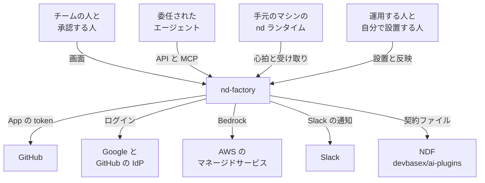
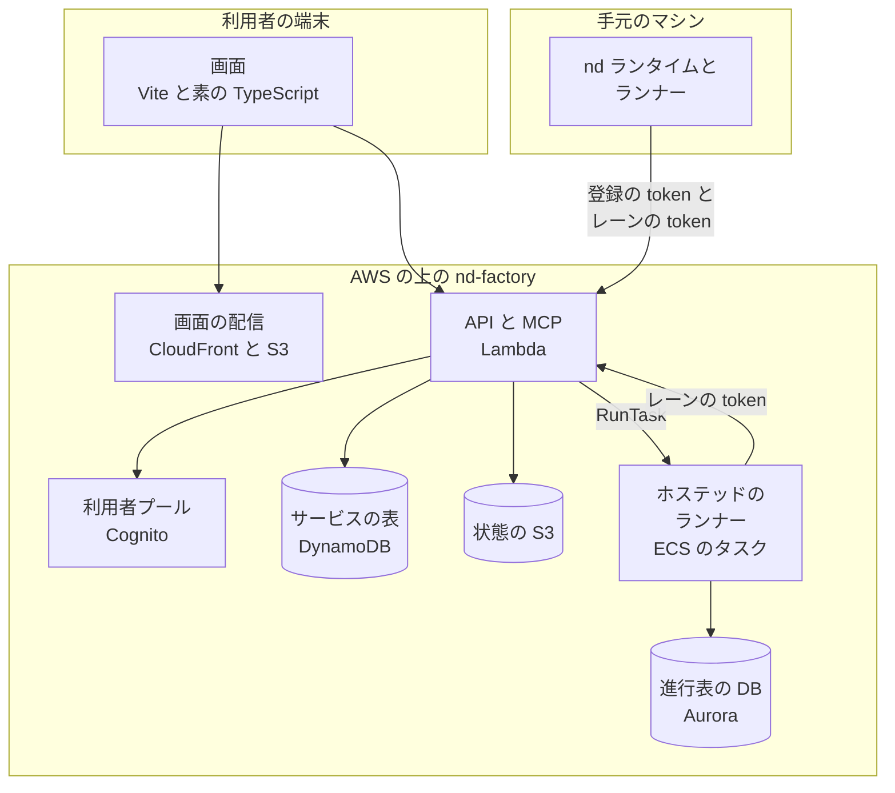
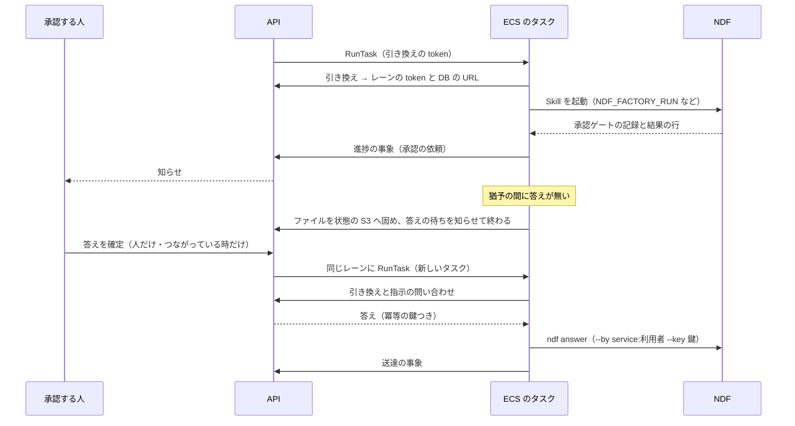

# 作り直しの全体設計: アーキテクチャと、自分で設置する人から見た振る舞い

頭の文書は [05-overall.md](05-overall.md) にある。この文書は次を扱う。

- アーキテクチャ（arc42 の章立てと C4 の図）
- 一括の入れ替えの比較
- 配る物と開発物・横断の部品・定数とデータの置き場
- 反映の経路と、自分で設置する人から見た振る舞い
- 影響評価の欄

arc42 の 12 章と節の対応は、末尾の [arc42 の章立て](#arc42-の章立て) の表にある。

## 解決の方針

| 方針 | 中身 | 決定 |
| --- | --- | --- |
| 一括の入れ替え | 新しいリポジトリで空から作り、機能の対応表の試走で同等を確かめてから、利用者の使う先を替える | 決定 1 |
| 公開された言語と腐敗防止層 | NDF とは契約ファイルの形だけでやり取りし、ランナーが NDF の語を進捗の事象へ翻訳する | 決定 2 |
| 認可をサーバーの 1 か所に置く | 画面・API・MCP が同じ API を通り、同じ認可の判定を受ける | 決定 5 |
| 形の正本を 1 つにする | TypeScript の 1 つのパッケージに形を定義し、型・JSON Schema・OpenAPI・環境変数の表・CDK のパラメーターを生成する | 決定 12・13 |
| 状態の正本をサーバー側に置く | サービスの状態は DynamoDB、NDF の状態はホステッドのレーンでは進行表の DB | 決定 6・19 |
| 使わない間は費用を止める | Lambda・`RunTask` のタスク・0 ACU まで止まる Aurora。承認の待ちが猶予を超えたらタスクを止め、DB の接続を 0 本にする | 決定 6・21・25 |

## 制約

| 制約 | 出所 |
| --- | --- |
| NAT ゲートウェイを置かない。ECS のタスクは公開のサブネットで公開 IP を持つ | 作り直しの決まったこと（NAT なし・Fargate を公開のサブネット） |
| 誰でも自分の AWS アカウントへ、profile を指定して設置できる。リポジトリには作り物の値だけを置く | 作り直しの決まったこと（誰でも `cdk deploy` で設置できる）、前提 2 |
| 旧い側のデータを移さない。新しいリポジトリから旧い側を参照しない | 利用者の答え（データを移さない）、[判定の規則](01-rules.md)の R5・R6 |
| NDF とは NDF 11 の契約ファイルだけでやり取りする。devbasex/ai-plugins は読むだけ | 要求の前提 4、[NDF との契約](07-overall-contracts.md#ndf-との契約) |
| 承認ゲートの承認と、C1〜C8・P1〜P3 に当たる操作の確定は人だけが行う | NDF の共通原則、プロジェクト MVV の Value 4 |

## 一括の入れ替えと段階的な置き換え

作り直しは一括の入れ替え（新しいリポジトリで作り、試走で同等を確かめてから使う先を替える）を採る。段階的な置き換え（API の経路ごとに、振り分ける層で新しい側へ付け替える。STD3・STD4）は採らない。

| 観点 | 一括の入れ替え（採る） | 段階的な置き換え（採らない） |
| --- | --- | --- |
| データ | 新しい側は空から始める。利用者の答え（データを移さない）と合う | 旧い側とのデータの同期（STD4 の結果整合）が要る。利用者の答え（データを移さない）と合わない |
| 認証 | 新しい GitHub App と OAuth のクライアントで動く（利用者の答え（App とクライアントを新しく作る）） | 同じ利用者のセッションを両方で受けるため、利用者プールかクライアントを共有する必要がある |
| 公開の妨げ | 新しいリポジトリに旧い値と事情が入らない | 振り分ける層が旧い側の資源の名前と経路を知る。公開するリポジトリに旧い事情が残る |
| 振り分ける層 | 要らない | API と画面の前に置く層が要り、単一障害点になる（STD4） |
| 確かめ方 | 機能の対応表の試走（#3）を毎スプリント流し、全行の結果で判定する（[判定の規則](01-rules.md)の J1〜J8） | 経路ごとに切り替えるたびに旧い側と見比べる |
| 戻し方 | 利用者の使う先を旧い側の URL へ戻す（決定 22）。旧い側は非公開のテストまで残す（[判定の規則](01-rules.md)の R8） | 経路ごとに振り分けを戻す |
| NDF 11 への合わせ | 新しい側は最初から NDF 11 の契約で作る | 旧い側の NDF 10 の呼び出し（スクリプトの直呼び・版の数字の比べ）と並ぶ期間ができる |

段階的な置き換えを採らない理由は、データを移さない決定（利用者の答え）と、公開するリポジトリに旧い事情を入れない制約の 2 つである。どちらも、振り分ける層とデータの同期を前提にする段階的な置き換えと両立しない。

## コンテキスト図

C4 の System context（STD2）。nd-factory を 1 つの箱にし、外との出入りだけを描く。



| 外部 | nd-factory が変えられるか | 流れるもの |
| --- | --- | --- |
| GitHub | 変えられない | App の導入・課題と PR の読み書き・Webhook |
| Google と GitHub の IdP | 変えられない | ログイン（OAuth と OIDC） |
| AWS のマネージドサービス | 変えられない | Bedrock の呼び出し（`managed` の実行の手段） |
| Slack | 変えられない | 承認待ちの知らせ |
| NDF | 変えられない（読むだけ） | 契約ファイル・コンテナの中の NDF の実行 |
| 手元のマシンの nd ランタイム | 一緒に変える（配る物） | レーンの受け取り・心拍・進捗の事象 |

## コンテナ図

C4 の Container（STD2）。中身の分担を示す。この図の「コンテナ」は C4 の語で、動く単位（画面・API・DB など）の箱を指す。Docker のコンテナとは別である。



実行の制御・承認のモジュール・オーガナイザーのモジュールは「API と MCP」の箱の中で動く。形の正本・横断の部品・検査・インフラの定義は組み立てと反映の時に働く要素で、この図と実行時の流れの図には描かない。

## 構成要素

| 要素 | 責務 | 受け持つ子 |
| --- | --- | --- |
| 画面 | 画面の地図・部品・端末の控え・オフラインの見せ方・文言。すべて API を通す | M9（#12） |
| API と MCP | 認証・認可の判定・使える量の判定・各コンテキストのモジュール・操作の記録・MCP の受け口 | M1〜M8 |
| 実行の制御 | スプリントの実行・レーンの割り当て・見回り・リリースのまとめ・`RunTask` | M3（#6） |
| ランナー | レーンのループ・区間の起動・NDF の翻訳（腐敗防止層）・答えの受け渡し・伏せ字 | M3（#6） |
| nd ランタイム | 手元のマシンの登録・心拍・コンテナの常駐・レーンの受け取り | M4（#7） |
| 承認のモジュール | 承認の依頼・答え・知らせ・Slack | M5（#8） |
| オーガナイザーのモジュール | AI のオーガナイザーと会話 | M7（#10） |
| 形の正本 | 型・JSON Schema・OpenAPI・環境変数の表・CDK のパラメーター・終了コードの生成元 | 土台（#2） |
| 横断の部品 | 時計・lock・外部の呼び出し・再試行・ログと伏せ字・ID・冪等の鍵・認可の判定・使える量の判定（[横断の部品の置き場](#横断の部品の置き場)） | 土台（#2） |
| インフラの定義 | CDK のスタック・設置のコマンド・反映のパイプライン | 骨組み・M10（#13） |
| 検査 | 漏れ・境界・照合・形の往復・閉じる語・PR の大きさ・契約の照合のジョブ | 検査（#1） |

## 実行時の流れ

ホステッドのレーンが承認ゲートで止まり、人が答えて続くまでの流れ。答えが猶予（既定 5 分）の後に来た場合を示す。猶予の間に答えが来たときは、タスクを止めずに同じタスクが指示の問い合わせで答えを受ける。参加者は 4 つに絞る。



## 配る物と開発物

配る範囲を新しいリポジトリの 1 つのファイル（配る範囲の宣言）で宣言し、CI が成果物の中身を宣言と照らす。宣言に無いファイルが成果物に入っていれば CI が落ちる。

| 区分 | 中身 | 配る先 |
| --- | --- | --- |
| 配る物 | API と MCP の Lambda のバンドル・画面の配信物・ランナーと nd ランタイムのコンテナのイメージ・CDK のアプリと設置のコマンド・設定のファイルの JSON Schema と作り物の値の見本 | 自分で設置する人（リポジトリの公開とイメージの公開）・運用する環境 |
| 開発物 | テスト・検査のスクリプト・開発の文書（`issues/`・設計）・契約の照合のジョブ・NDF の契約のコピー（テストの入力） | 配らない |
| 配らないと決めた物 | 旧い側の移行の仕組み・旧い経路の転送・旧いフェーズの名前の読み替え | 新しいリポジトリに置かない（[判定の規則](01-rules.md)の同等の外の「捨てる」） |

新しいリポジトリの最上位の置き場は次の形にする。ファイルの粒度は 骨組みと #2 の詳細設計が決める。

```text
<新しいリポジトリ>/
├── packages/contracts/   形の正本（型・JSON Schema・OpenAPI・環境変数の表・終了コード）
├── packages/core/        横断の部品
├── apps/api/             API と MCP
├── apps/web/             画面
├── apps/runner/          ランナー（腐敗防止層）
├── apps/nd-runtime/      nd ランタイム
├── infra/                CDK のアプリ（TypeScript）と設置のコマンド
├── tools/                検査
└── docs/                 確定仕様と運用の文書
```

## 横断の部品の置き場

横断の部品は `packages/core/` の 1 か所にだけ置く。検査（#1）が、置き場の外で下の「直に使わないもの」を呼ぶコードを落とす。

| 部品 | 引き受けること | 置き場の外で直に使わないもの |
| --- | --- | --- |
| 時計 | 今の時刻（UTC）と、テストでの時刻の差し替え | `Date.now`・`new Date()` の引数なし |
| lock と条件つきの書き込み | DynamoDB の条件つきの書き込みと版の競合の再試行 | 条件式を直に組む書き込み |
| 外部の呼び出し | HTTP の呼び出し・時間切れ・再試行・失敗の分類 | `fetch` と AWS SDK のクライアントの直の生成 |
| 再試行 | 回数と待ちの方針（データとして持つ） | 自前の再試行のループ |
| ログと伏せ字 | 構造化したログ・伏せ字（登録の token・委任の資格情報・レーンの token・引き換えの token・DB の URL・推論の一時の資格情報・GitHub と OAuth の秘密。[伏せ字](09-overall-trust.md#伏せ字)） | `console.log` |
| ID と冪等の鍵 | ID の生成・冪等の鍵の記録と照合 | 乱数からの ID の直の生成 |
| 認可の判定 | 主体とプロジェクトの見える範囲の判定 | 経路ごとの独自の判定 |
| 使える量の判定 | 料金プランと上限なしの行の判定 | 上限の値との直の比較 |

## 定数とデータの置き場の基準

| 種類 | 置き場 | 例 |
| --- | --- | --- |
| 事実と方針（変わりうる値・表） | JSON のデータのファイル（`packages/contracts/data/`）と、その JSON Schema | 使える量の表・再試行の方針・知らせの文言の鍵 |
| 語の集まり（値の種類が閉じている） | 形の正本の enum | 承認ゲートの名前・実行の形態・呼び出し元の種類 |
| 外部の仕様（他者が決めた値） | 出所を添えた定数 | NDF の環境変数の名前・GitHub の Webhook の種類・AWS の上限 |
| 環境ごとに違う値 | 設定のファイル（リポジトリの外）と profile | アカウント・リージョン・資源の接頭辞・予算・通知先 |
| 秘密 | 秘密の置き場の器（値は人が入れる） | App の秘密鍵・OAuth の client secret・DB の URL |

## 反映の経路

| 経路 | 誰が | どう承認するか | 何で反映するか |
| --- | --- | --- | --- |
| 運用する環境 | 運用する人 | 反映のパイプラインの承認のアクションで、人が `cdk diff` の差分を読んで承認する。AI は承認を送らない | AWS CodePipeline（起点のブランチの先頭を合成し、承認の後に同じ合成の結果を反映する） |
| 自分で設置する人 | 設置する人 | 設置のコマンドが差分を示し、設置する人が自分の端末で確かめる | 設置のコマンドが `cdk deploy` を打つ |

どちらも同じ CDK のアプリと設定のファイルの形を使い、経路ごとに違うのは承認と反映の打ち手だけである。CI は検査だけを行い、AWS の資格情報を持たない（プロジェクト MVV の Value 8）。反映のパイプラインのスタックは、設定のファイルで有効にしたときだけ作る。

## 自分で設置する人から見た振る舞い

設置の各段で何が起きるかを、4 つの場合で並べる。「運用する環境だけの事情」の列は、運用する環境だけに当たる事情と、それを置く場所を書く。

| 段 | 運用する環境 | 作り物のアカウント | 別リージョン | GitHub App が無い場合 | 運用する環境だけの事情 |
| --- | --- | --- | --- | --- | --- |
| 合成（資格情報なし） | 通る | 通る（CI が作り物の値で毎回合成する） | 通る（同じ） | 通る。App の値は設定のファイルの任意の項目 | 無し |
| bootstrap | アカウントの既定の qualifier の `CDKToolkit` を他のサービスと共有する。版が足りなければ人が上げる（P1） | 設置する人が `cdk bootstrap` を打つ。手順は README | 同じ。リージョンごとに要る | 同じ | 共有の `CDKToolkit` の版の管理は運用の文書（非公開）に置く |
| 反映 | 反映のパイプラインで、人が差分を承認した範囲だけ（決定 15） | 設置のコマンドが `cdk diff` を見せ、設置する人が確かめてから `cdk deploy` | 同じ。Bedrock を使える地域でなければ `managed` の実行の手段を切る | 同じ | パイプラインの承認者と通知先は設定のファイル（非公開の置き場） |
| 資源の名前 | 接頭辞は旧い側（`nd-factory-`）と重ならない値にする（決定 22） | 接頭辞は既定の値 | 同じ | 同じ | 接頭辞の値は設定のファイル |
| 秘密の値が無い | 運用する人が器へ値を入れる | 器だけができ、画面とログインが「設定の待ち」を示す。値の入れ方は README | 同じ | GitHub の秘密の器に値が無く、リポジトリの登録の画面が App の作り方を示す | 無し |
| ログイン | Google と GitHub | 設定のファイルで受ける IdP を選ぶ。どちらも無ければ合成で止まり、足りない値を示す | 同じ | GitHub のログインを切り、Google だけで受ける | OAuth のクライアントは運用する環境専用に新しく作る（利用者の答え（App とクライアントを新しく作る）） |
| リポジトリの登録（E4） | 新しい GitHub App で登録する | 設置する人が自分の App を作る | 同じ | 登録が止まり、App の作り方と入れ方を示す | 無し |
| ホステッドのレーン | ECS のタスクと進行表の DB で動く | 同じ | Aurora の 0 ACU の一時停止が使えない版の地域では、合成で止まる | レーンを始められない（リポジトリが無い） | 無し |
| セルフホストのレーン | 手元のマシンを登録して動く | 同じ | 同じ | 同じく始められない | 無し |
| 使える量と課金 | 運営のクラウドの料金プランの表 | 上限なしの行（決定 16） | 同じ | 同じ | 運営の課金の連携は運用する環境の設定だけで有効 |
| Security Hub | 有効。ECS.2 の抑止の定義を反映する | 設定のファイルで抑止の定義を作るかを選ぶ（既定は作らない） | 同じ | 同じ | 無し |
| 予算と知らせ | 月の予算と通知先を設定のファイルで受ける | 同じ。通知先が空なら予算だけ作る | 同じ | 同じ | 通知先のメールは設定のファイル（非公開の置き場） |
| 漏れの検査 | CI が新しいリポジトリのファイルと履歴を探す | 同じ（作り物の値は検査の許可の一覧） | 同じ | 同じ | 探す値の一覧は運用する人の非公開の置き場から CI へ秘密で渡す（#1） |

## 品質の要求

| 品質 | 要求 | 設計の節 |
| --- | --- | --- |
| セキュリティ | 割り当ての外から存在が見えない。承認は人だけ。秘密を書かない | [信頼の境界と権限](09-overall-trust.md#信頼の境界と権限) |
| 費用 | 使わない間は止まる。月の予算を置く | [費用の予算と資源の枠](08-overall-state-infra.md#費用の予算と資源の枠) |
| 移植性 | どのアカウントとリージョンにも設置できる | [自分で設置する人から見た振る舞い](#自分で設置する人から見た振る舞い) |
| 保守性 | 形の正本が 1 つ。横断の部品が 1 か所 | [入出力の規約と形の正本](07-overall-contracts.md#入出力の規約と形の正本)・[横断の部品の置き場](#横断の部品の置き場) |
| オフライン | 最後に受け取った一覧・詳細・承認資料を読める。取り消せない操作はつながってから確定 | [承認の確定](09-overall-trust.md#承認の確定) |

## 影響評価の欄

子の設計（と、機能を足す設計）は、次の欄を設計文書に置く。足した機能が、後から動く工程や自動の書き手を止めないためである（反省点 6）。

| 観点 | 書くこと | 例 |
| --- | --- | --- |
| 後続の工程 | 試走・入れ替えの判定・やめる判断の材料のどれが変わるか | 機能の対応表に行を足すと、試走の行と J1 の数え方が変わる |
| CI | 足す・変えるジョブと、`.ndf/project.json` の `ci.required_checks` への反映 | 新しい検査のジョブを足したら、宣言にも足す |
| 自動の書き手 | PR を作る自動の書き手（スプリントの PR・リリースの PR・並列の計画の PR・Dependabot）のうち、足した検査が止めうるもの | PR の本文に印を求める検査は、スプリントの PR が印を書くかを確かめる |
| 文書 | 確定仕様・運用の文書・設置の手順・用語集のどれを変えるか | 環境変数を足したら、生成した環境変数の表と設置の手順 |
| 形の正本 | 生成し直すもの（型・JSON Schema・OpenAPI・環境変数の表） | 形を変えたら、往復の検査で生成物と照らす |
| 設置する人 | [自分で設置する人から見た振る舞い](#自分で設置する人から見た振る舞い)の表のどの行が変わるか | 新しい秘密の器を足したら、「秘密の値が無い」の行 |

## arc42 の章立て

arc42 の 12 章（STD1）を、作り直しの設計文書の節へ当てる。章の中身はリンク先にあり、この表は索引である。

| 章 | arc42 の章 | 設計の節 |
| --- | --- | --- |
| 1 | 導入と目標 | [目的](05-overall.md#目的)・[あるべき姿の根拠](05-overall.md#あるべき姿の根拠) |
| 2 | 制約 | [制約](#制約) |
| 3 | 文脈と範囲 | [コンテキスト図](#コンテキスト図) |
| 4 | 解決の方針 | [解決の方針](#解決の方針) |
| 5 | 構成要素の見方 | [コンテナ図](#コンテナ図)・[構成要素](#構成要素) |
| 6 | 実行時の見方 | [実行時の流れ](#実行時の流れ) |
| 7 | 配置の見方 | [配置図](08-overall-state-infra.md#配置図) |
| 8 | 横断の概念 | [横断の部品の置き場](#横断の部品の置き場)・[定数とデータの置き場の基準](#定数とデータの置き場の基準)・[信頼の境界と権限](09-overall-trust.md#信頼の境界と権限) |
| 9 | 設計の決定 | [決定の記録](11-overall-decisions.md#決定の記録) |
| 10 | 品質の要求 | [品質の要求](#品質の要求) |
| 11 | リスクと技術的負債 | [未確認のまま残ること](05-overall.md#未確認のまま残ること)・[NDF 側の仮置き](07-overall-contracts.md#仮置きの一覧) |
| 12 | 用語集 | [ドメインモデルの用語](05-overall.md#用語)・`docs/glossary/glossary.json` |
