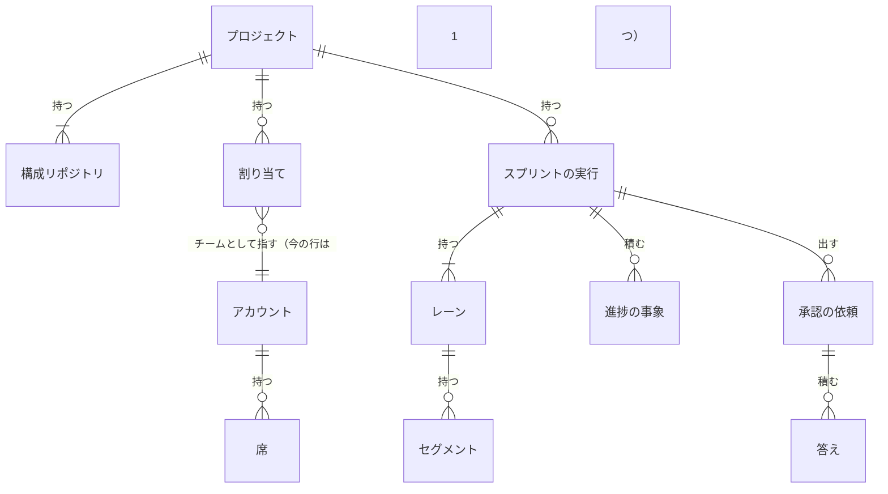
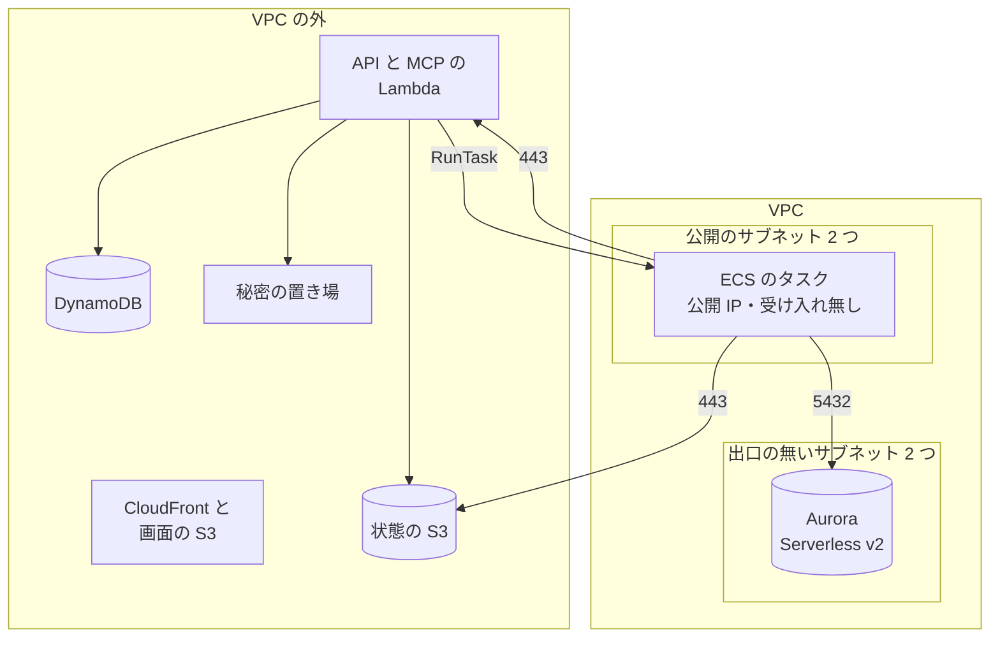

# 作り直しの全体設計: 状態の置き場とインフラ

頭の文書は [05-overall.md](05-overall.md) にある。この文書は次の 4 つを扱う。値はすべて作り物か設計の既定値で、実際のインフラの値を書かない。

| 章 | 扱うこと |
| --- | --- |
| [状態の置き場](#状態の置き場) | 状態を置く 3 つの置き場。作り直しの未決（進行表の DB の置き場）の答えは [進行表の DB](#進行表の-db) にある |
| [形の版と移し方](#形の版と移し方) | 置き場ごとに形を変えるときの出し方 |
| [インフラ](#インフラ) | 配置図・資源ごとの形・ECS.2 の抑止・環境の値の受け方・資源の名前 |
| [費用の予算と資源の枠](#費用の予算と資源の枠) | 既定の予算と枠、費用の見込みの出し方 |

## 状態の置き場

状態を 3 つの置き場に分ける。どの置き場も、プロジェクトとアカウントの ID を鍵に含め、認可の判定がその ID で絞れる形にする。

| 置き場 | 何を置くか | 書き手 | 形の版の持ち方 | 名前空間が無い間の分け方 |
| --- | --- | --- | --- | --- |
| サービスの表（DynamoDB） | 利用者・アカウント・プロジェクト・割り当て・ランナーへ渡した GitHub の token の記録・スプリントの実行・レーン・承認の依頼と答え・知らせ・進捗の事象・冪等の鍵・起票の依頼・委任の資格情報・操作の記録 | API の各モジュール（集約の持ち主だけ） | 項目ごとの整数の `schema_version`。読み手は今の版と 1 つ前の版を読める | 区切りの鍵の頭にアカウントかプロジェクトの ID を置く。表は全アカウントで共有する |
| 状態の S3 | 承認資料のコピー（要約値を名前にする）・NDF のファイルのうち進行表の DB に乗らないもの（承認の待ちでタスクを止めるとき・レーンの終わり・SIGTERM で固めたもの）・会話の長い本文 | API（承認資料）とランナー（署名つき URL で書く） | オブジェクトの名前の頭に形の版（`v1/`）を置く | 名前を `v1/<アカウント>/<プロジェクト>/<レーン>/...` にし、署名つき URL はその頭だけに出す |
| 進行表の DB（Aurora PostgreSQL） | NDF の進行表と DBOS の耐久の記録。サービスは中身を読み書きしない | コンテナの中の NDF だけ | NDF が持つ（nd-factory は形を変えない）。nd-factory は、データベースごとに作った時の NDF の契約の版をサービスの表に記録する | プロジェクトごとに別のデータベースとログインの役割（決定 7、仮置き。NDF の `NDF_NAMESPACE` は devbasex/ai-plugins#3694） |

### サービスの表

表は集約の持ち主ごとに分ける。1 つの処理が書き換える集約は 1 つで、表をまたぐ反映はドメインイベント（DynamoDB のストリームか、サービスの中の事象）で後から行う。

| 表 | 区切りの鍵 / 並びの鍵 | 持つ集約 | 時系列の扱い |
| --- | --- | --- | --- |
| 利用者と契約 | `ACCOUNT#<ID>` か `USER#<ID>` / 種類と ID | 利用者・アカウント・委任の資格情報 | 上書き。変更の履歴は操作の記録が持つ |
| プロジェクト | `PROJECT#<ID>` / 種類と ID | プロジェクト・構成リポジトリ・割り当て・ランナーへ渡した GitHub の token の記録 | 割り当ては変更ごとに新しい行を足し、今の行に印を付ける（履歴保持型）。渡した GitHub の token の記録は並びの鍵 `GHTOKEN#<期限>#<レーン>#<連番>` の行で、期限を TTL の属性に入れて期限を過ぎたら消す。プロジェクトの行は、渡した token の期限の最大値と記録の世代番号をそれぞれ 1 つの属性に持つ（下の「渡した GitHub の token の記録」） |
| 実行 | `PROJECT#<ID>` / `RUN#<ID>#...` | スプリントの実行・レーン・セグメント・リリースのまとめ | 状態は上書き。状態の移りは進捗の事象が持つ |
| 進捗の事象 | `RUN#<ID>` / 時刻と連番 | 進捗の事象 | 追記だけ（事象の記録） |
| 承認 | `PROJECT#<ID>` / `GATE#<ID>#...` | 承認の依頼・答え・知らせ | 答えは追記だけ。確定した答えを上書きしない |
| オーガナイザー | `PROJECT#<ID>` / `ORG#<ID>#...` | AI のオーガナイザーと会話 | 会話は追記だけ |
| 手元のマシン | `ACCOUNT#<ID>` / `MACHINE#<ID>` | 手元のマシン | 心拍は上書き |
| 冪等の鍵 | `<主体>#<鍵>` | — | 24 時間で消す |
| 起票の依頼の台帳 | `PROJECT#<ID>` / 依頼の ID | 起票の依頼 | 追記だけ |
| 操作の記録 | `PROJECT#<ID>` か `ACCOUNT#<ID>` / 時刻と連番 | 操作の記録 | 追記だけ。保存期間は M8（#11）で決める |

列の定義と索引は土台（#2）の詳細設計が決める。プロジェクトに属する行は、区切りの鍵の外でも `project_id` を持ち、一覧と件数を認可の判定で絞る前に読まない。

#### 渡した GitHub の token の記録

**渡した GitHub の token の記録はプロジェクトの集約に置く。** 記録の行と、プロジェクトの行の期限の最大値と世代番号の属性は、プロジェクトの集約に属する。

| 項目 | 決まり |
| --- | --- |
| 書く処理 | ランナーへ token を渡す引き換えと取り直し（M3） |
| 書き込みの規則 | プロジェクトの表の持ち主（M2）の関数が持つ |
| 渡すとき | 下の 3 つを、この集約だけの 1 つのトランザクションで書く。実行の表のレーンの行は同じトランザクションで書かない |
| 移す確定の失効 | 下の「移す確定の失効の順」で行う |
| 移す先の受け入れ | 記録の行を数えない。プロジェクトの行の期限の最大値が「無いか、今より前」であることを、割り当ての行の差し替えと同じ条件つきの書き込みで照らす |
| 1 つの属性へまとめる理由 | DynamoDB の条件つきの書き込みは、鍵で指した行しか照らせない。そのため、レーンごと・取り直しごとに増える記録を 1 つの属性へまとめる |

渡すときに 1 つのトランザクションで書くもの:

1. 記録の行を足す
2. 世代番号を必ず 1 つ上げる
3. 期限の最大値は、無いか新しい期限より小さいときだけ、新しい期限へ上げる

期限の最大値を上げないときも世代番号は上げる。記録の行だけを書く経路を作らない。

移す確定の失効の順（GitHub の失効の API の呼び方は [GitHub の token の失効](09-overall-trust.md#プロジェクトを別のチームへ移すときの-github-の-token-の失効)）:

1. 記録の行を読み、期限の前の token をすべて失効させる
2. 失効を受けた token と、既に期限切れ・失効済みで GitHub が認証の失敗を返した token は、失効済みとして記録から消す
3. すべて消し終えたら、読み始めた時の期限の最大値と世代番号のどちらも変わっていないことを条件に、期限の最大値の属性を消す
4. 条件に外れたら、記録の行を読み直して 1 から同じ手順をやり直す

期限の最大値以下の token が途中で足されても、世代番号が変わる。そのため、未失効の token を残したまま期限の最大値を消すことはない。

### 状態の S3

| 中身 | いつ書くか | 消し方 |
| --- | --- | --- |
| 承認資料のコピー | 承認の依頼を受けたとき | スプリントの実行の終わりから保存期間（土台の詳細設計で決める）の後 |
| NDF のファイル（進行表の DB に乗らないもの） | 承認の待ちでタスクを止めるとき・レーンの終わり・SIGTERM・セグメントの終わり | レーンの終わりから 14 日（NDF の鍵の記録の 14 日に合わせる） |
| 会話の長い本文 | 会話の項目が表の項目の大きさを超えるとき | 会話の削除と同時 |

### 進行表の DB

**作り直しの未決（進行表の DB の置き場）への答え: 進行表の DB は Aurora Serverless v2（PostgreSQL、最小 0 ACU で一時停止する）に置く。Aurora DSQL は採らない（決定 6）。** この答えは設計の決定で、設計承認ゲートでの承認がその採否になる。

DSQL を採らない理由は次の 3 つである（LIB3）。

- 楽観的な同時実行の制御で、lock を取らない
- 接続が 1 時間で切れる（LISTEN の常時接続と合わない）
- 一時表を持たない

DSQL が LISTEN と advisory lock を持つかどうかは、公式の文書に記述が無く、確かめていない。

DBOS が使う機能と、選んだ置き場で使えることの出典:

| DBOS が使う機能 | DBOS の側の出典 | Aurora Serverless v2 で使えるか | 出典 |
| --- | --- | --- | --- |
| advisory lock（セッション単位とトランザクション単位） | LIB1（`pg_try_advisory_lock`・`pg_try_advisory_xact_lock`）、NDF の `durable_locks.py` の 300・317 行目 | 使える。Aurora PostgreSQL は PostgreSQL のエンジンで、advisory lock は RDS Proxy のピン留めの対象として挙がる（Proxy を通さなければ制約は無い） | LIB4 の頁、LIB2 |
| LISTEN の常時接続 | LIB1（`LISTEN` で 3 つのチャネルを待つ）、NDF の `durable.py` の 758・766 行目 | 使える。ただし接続が開いている間は 0 ACU へ一時停止しない | LIB2（"Aurora won't pause an instance if there are any user-initiated connections open"） |
| keepalive | NDF の `durable.py` の 25・743・767 行目 | 未確認。PostgreSQL の接続の設定で、Aurora の文書で確かめていない。M10（#13）が骨組みの環境で、長い待ちの後も接続が保たれることを実測する | — |
| 接続の仲介を通さない | LIB1（トランザクションの単位でまとめる接続の仲介とは合わない） | RDS Proxy を置かない。タスクから直に接続する | LIB4 |

一時停止との関係: 進行表の DB へ接続するのは、ホステッドのランナーと DB の用意の ECS のタスクだけである（決定 8）。タスクが 1 つも動いていない間は接続が 0 本になり、既定の 300 秒の後に一時停止する。再開には通常 約 15 秒かかるため、タスクの起動の手順は DB への最初の接続を再試行で待つ。

承認の待ちの間の扱い（決定 25）: 人が承認ゲートで答えるまでには数時間〜数日かかる。その間タスクを動かし続けると、Fargate の費用が待ちの時間だけ掛かる。DBOS の LISTEN の接続も開いたままになり、Aurora も一時停止しない。そこで、承認の依頼で止まったセグメントの後に、タスクを次のとおり止めて起こし直す。

| 段 | 中身 |
| --- | --- |
| 待ちに入る | 区間の結果の行が `判断が要る` でセグメントが止まったら、ランナーは承認の依頼の事象を送る。猶予（設定のファイル、既定 5 分）の間に答えが来れば、同じタスクで次のセグメントへ進む |
| 止める | 猶予の間に答えが来なければ、ランナーは NDF のファイルを状態の S3 へ固め、レーンを「答えの待ち」にする事象を送ってから、DB の接続を閉じて終わる。NDF の耐久の記録は進行表の DB に残る。レーンの割り当ては外さず、同じレーンに 2 つ目のタスクを付けない（I7） |
| 起こし直す | 人が答えを確定したら（E9）、実行の制御は同じレーンに新しい引き換えの token で `RunTask` を打つ。新しいタスクは状態の S3 からファイルを戻し、指示の問い合わせで答え（セグメントの指示）を受け、`ndf answer` を打ってから次のセグメントを始める |
| 待ちの間の費用 | タスクと DB の接続が 0 になるため、Fargate と Aurora の計算の費用は掛からず、状態の S3 と Aurora のストレージだけが掛かる |

止めたタスクの後で、NDF のループが新しいタスクから続けられるかは未確認である。進行表の DB と戻したファイルだけで `ndf answer` の後に次の区間を始められるかは、契約ファイルに記述が無い。M3（#6）が固定の版の NDF で確かめる（[未確認のまま残ること](05-overall.md#未確認のまま残ること)）。

確かめられなかった点と、確かめる子:

| 点 | 確かめる子 |
| --- | --- |
| keepalive の設定が Aurora で効き、長い待ちの間に接続が切れないこと | M10（#13） |
| タスクの無い間（承認の待ちを含む）に一時停止し、再開の待ちがタスクの起動に収まること | M10（#13） |
| 承認の待ちで止めたタスクの後に、新しいタスクが NDF のループを続けられること | M3（#6） |
| NDF の固定の版の DBOS が、選んだエンジンの版で進行表を作れること | M10（#13）、骨組み |

### 名前空間が無い間の分け方

NDF に名前空間（devbasex/ai-plugins#3694 の `NDF_NAMESPACE`）が入るまで、進行表の DB は 1 つのクラスタの中でプロジェクトごとに分ける（仮置き）。分ける単位は、見せる範囲の単位（プロジェクト、I2）にそろえる。そのため、同じアカウントの別のプロジェクトを別のチームへ移しても、コンテナの中の claude が受け取る URL で他のプロジェクトの NDF の状態を読めない。

| 項目 | 中身 |
| --- | --- |
| 単位 | プロジェクトごとに 1 つのデータベースと、そのデータベースだけに権限を持つログインの役割。データベースはクラスタの中に作るため、プロジェクトの数だけストレージの最小の費用が増えることはない |
| 作る時 | そのプロジェクトの最初のホステッドのレーンを始めるとき。手順は下の「作る時」 |
| 渡し方 | API がレーンの token との引き換えのときに、そのプロジェクトの URL だけをタスクへ返す（[信頼の境界と権限](09-overall-trust.md#ecs-のタスクの種類と権限)） |
| カタログと統計 | ほかのプロジェクトのデータベースと役割の名前と数を読ませない。決まりは下の「カタログと統計」 |
| 名前空間が入った後 | 新しいプロジェクトは共有のデータベースに名前空間で入れ、既存のプロジェクトのデータベースはそのまま使う。移すかは NDF の移し方（`ndf db migrate`、devbasex/ai-plugins#3694）が出てから決める |

#### 作る時

そのプロジェクトの最初のホステッドのレーンを始めるときに、次の順で作る。

1. API が役割のパスワードを作る
2. API がプロジェクトの URL の秘密の器を作り、値を入れる
3. API が DB の用意のタスク（ECS のタスク 1 回）を起こす
4. タスクは、引き換えの token で受けた管理の接続とプロジェクトの役割の値で、データベースと役割を作る。タスクは秘密の置き場に触れない（[ECS のタスクの種類と権限](09-overall-trust.md#ecs-のタスクの種類と権限)）

| 進行表の DB の状態 | 扱い |
| --- | --- |
| `作成中` か `有る` | 何もしない |
| 作成が失敗するか時間切れになったとき | `無い` へ戻り、次のホステッドのレーンの開始で作り直す（[ECS のタスクの種類と権限](09-overall-trust.md#ecs-のタスクの種類と権限)の「進行表の DB の作成が失敗したとき」） |

#### カタログと統計

**プロジェクトの役割から、ほかのプロジェクトのデータベース・役割の名前と数を読めないことを条件にする（I2）。** データベースを分けても、次のものからは、ほかのプロジェクトのデータベースと役割の名前と数が読める（[pg_database](https://www.postgresql.org/docs/current/catalog-pg-database.html)、[pg_roles](https://www.postgresql.org/docs/current/view-pg-roles.html)、取得日 2026-11-16）。

- クラスタに 1 つの `pg_database`
- 誰でも読める `pg_roles`・`pg_stat_database`・`pg_stat_activity` などのビュー

そのため、次の (1)〜(5) を行う。

**(1) 名前を無作為の値にする。** データベースと役割の名前は、プロジェクト・チーム・リポジトリの名前や ID から作らない無作為の値にする。名前と割り当ての対応はサービスの表にだけ置く。

**(2) 作ったデータベースの中で読み取りを外す。** DB の用意のタスクは、作ったデータベースの中で、これらのカタログと統計のビューの読み取りを `PUBLIC` から外す。プロジェクトの役割を、`pg_read_all_data`・`pg_read_all_stats`・`pg_monitor` などの読み取りの既定の役割に入れない。

**(3) 外せるかを実測する。** Aurora の管理の役割（`rds_superuser`）でカタログの権限を外せるかは、一次の文書に無い。M10（#13）が骨組みの環境で、プロジェクトの役割からほかのデータベースと役割の名前と数を読めないことを実測する（[未確認のまま残ること](05-overall.md#未確認のまま残ること)）。読めるときは、ホステッドのレーンを 2 つ目のチームのプロジェクトへ出す前に、分け方を設計へ戻す。

**(4) 接続の権限を外してから接続を許す。** PostgreSQL は、データベースの `CONNECT` と `TEMPORARY` を既定で `PUBLIC` に与える（[Privileges](https://www.postgresql.org/docs/current/ddl-priv.html)、取得日 2026-11-16）。そのため、自分のデータベースの中でカタログの読み取りを外しても、ほかのプロジェクトのデータベースか `postgres` へ接続し直せば、そこのカタログと統計とオブジェクトの名前が読める。`CONNECT` の権限は接続を始めるときにしか照らされず、`REVOKE` は既に開いた接続を切らない。そのため DB の用意のタスクは、次の順で行う。タスク全体では、下の (5) を最初に行ってから (a)〜(f) を行い、(2) は (d) の中で行う。

| 順 | 行うこと | 理由と結果 |
| --- | --- | --- |
| (a) | 管理の接続（`postgres` などへつないだもの）から、データベースを `CREATE DATABASE ... ALLOW_CONNECTIONS false` で作る（作り直しで既に有れば作らない。[進行表の DB の作成が失敗したとき](09-overall-trust.md#進行表の-db-の作成が失敗したとき)） | 作った管理の役割がデータベースの持ち主になる |
| (b) | 同じ管理の接続のまま、そのデータベースの `CONNECT`・`TEMPORARY` を `PUBLIC` から外す | データベースへの `REVOKE` は、そのデータベースへ接続せずに打てる。これで `CONNECT` を持つのは持ち主の管理の役割だけになる |
| (c) | `ALTER DATABASE ... ALLOW_CONNECTIONS true` にする | `ALLOW_CONNECTIONS false` のままでは、管理の役割を含めてどの役割もそのデータベースへ接続できず（[CREATE DATABASE](https://www.postgresql.org/docs/current/sql-createdatabase.html)、取得日 2026-11-17）、(2) の外しをデータベースの中で打てない。(b) の後に許すため、接続できるのは持ち主の管理の役割だけである |
| (d) | 管理の役割でそのデータベースへ接続し、(2) の外しを終える | — |
| (e) | そのデータベースへの、プロジェクトの役割とタスク自身の管理の接続以外の接続を `pg_terminate_backend` で切る | 作り直し（[ECS のタスクの種類と権限](09-overall-trust.md#ecs-のタスクの種類と権限)の「進行表の DB の作成が失敗したとき」）で既に接続を許したデータベースを扱うときに、権限を整える前から残る接続を切る |
| (f) | プロジェクトの役割を作り（作り直しで既に有れば作らない）、最後にその役割にだけ `CONNECT` を与える | — |

`CREATE DATABASE` はトランザクションの中で打てない（[CREATE DATABASE](https://www.postgresql.org/docs/current/sql-createdatabase.html)、取得日 2026-11-16）。そのため作成と同じトランザクションにはできないが、次が成り立つ。

- (b) を終えるまでは、誰も接続できない
- (c) の後も、接続できるのは持ち主の管理の役割だけである
- プロジェクトの役割へ `CONNECT` を与えるのは、(2) の外しを終えた後である
- 名前は (1) の無作為の値である
- 外し終えるまで DB の状態を `有る` にしないため、その間にレーンへ URL は渡らない

I2 の確かめに、次の 2 つを含める。

- 作成中（B の役割へ `CONNECT` を与える前）に、プロジェクト A の役割で B のデータベースへ接続できない
- 作成の後に、A の役割の B のデータベースへの接続が残っていない

**(5) `postgres`・`template1` の接続の権限も外す。** 進行表の Aurora は、作り直しで自前の VPC に新しく作るクラスタである（決定 6、機能の対応表の L-02 の作らない理由: 相乗りをやめる）。ほかのサービスと共有しないため、`postgres`・`template1` の権限を変えることは、相乗りする資源の変更（P2）に当たらない。

- DB の用意のタスクは、どの種類で起きても最初に、`postgres`・`template1` の `CONNECT`・`TEMPORARY` を `PUBLIC` から外す（何度打っても同じ結果になる）
- 管理の接続は、管理の役割で `postgres` などへつなぐため、外しても使える
- M10（#13）は、このクラスタを作る反映の後に、DB の用意のタスクが外しを終えたことを実測する。あわせて (3) と一緒に骨組みの環境で、プロジェクト A の役割からプロジェクト B のデータベースと `postgres`・`template1` へ接続できないことを実測する
- 接続できるときは、ホステッドのレーンを 2 つ目のチームのプロジェクトへ出す前に、分け方を設計へ戻す

### 形の版と移し方

| 置き場 | 形を変えるとき |
| --- | --- |
| サービスの表 | 2 段で出す。1 段目で読み手が新しい版を読めるようにし、2 段目で書き手を新しい版へ上げる。古い版の項目は、移しの関数（VPC の外の Lambda。反映の後に 1 回起こし、冪等。時間切れの前に続きの位置を残して自分を起こし直す）が書き換える。ECS のタスクはサービスの表を書かない。読み手が受ける版は今と 1 つ前だけ |
| 状態の S3 | 新しい版の頭（`v2/`）へ書き、読み手は両方を読む。古い版は消し方の期限で消える |
| 進行表の DB | NDF が持つ。nd-factory は NDF の固定の点を変える PR で、契約の照合のジョブと試走を通してから上げる |

作り直しでは、旧い側のデータを読む移しの仕組みを置かない（[判定の規則](01-rules.md)の R6）。

## インフラ

### 配置図

C4 の Deployment（STD2）。VPC の中と外で何が動くかを示す。

### 資源ごとの形

| 資源 | 形 | 理由 |
| --- | --- | --- |
| VPC | 自前で作る。2 つの AZ に公開のサブネットと出口の無いサブネットを 1 つずつ。S3 と DynamoDB は Gateway 型のエンドポイント。Interface 型のエンドポイントは置かない | VPC・サブネット・Gateway 型のエンドポイントは無料。Interface 型は時間で費用が掛かる |
| NAT ゲートウェイ | 置かない。スタックのテストが、NAT ゲートウェイの資源が 0 件であることを確かめる | 作り直しの決まったこと（NAT なし・Fargate を公開のサブネット）。東京で 1 つ月に約 45 ドル掛かる |
| API と MCP の Lambda | VPC の外に置く | DynamoDB・S3・秘密の置き場・Cognito・ECS の API は VPC が無くても届く。進行表の DB には触れない（決定 8） |
| ECS のタスク（ホステッドのランナー・DB の用意） | Fargate。公開のサブネットに置き、公開 IP を付ける。ECS のサービスは作らず `RunTask` で起こす（決定 21） | 公開 IP で ECR・CloudWatch Logs・API へ出る。動く間だけ費用が掛かる |
| タスクの SG | 受け入れを空にする。行きは 443（任意の宛先）と 5432（Aurora の SG だけ）。スタックのテストが受け入れの規則 0 件を確かめる | 公開のサブネットに置くため、外から受け入れる経路を持たない |
| Aurora Serverless v2 | PostgreSQL。出口の無いサブネットに置く。最小 0 ACU・最大は設定のファイル（既定 2 ACU）。一時停止までの秒数は既定の 300 秒 | 使わない間はストレージの費用だけになる（決定 6） |
| Aurora の SG | タスクの SG からの 5432 だけを受ける | DB に触れるのはタスクだけ |
| DB の認証 | パスワード。プロジェクトごとの役割の URL を秘密の置き場に置く。IAM 認証は使わない（決定 9） | IAM 認証の token は 15 分で、NDF の DB の URL は token を取り直す口を持たない |
| 状態の S3・画面の S3 | 公開を止め、暗号化する。画面は CloudFront の OAC からだけ読む | — |
| ECR | ランナーのイメージを置く。残す版の数を決めて古い版を消す | 保管の費用を抑える |

### ECS.2 の抑止

ECS.2 は ECS のサービス（`AWS::ECS::Service`）で公開 IP の自動の割り当てが有効なときに失敗するコントロールである（STD5）。nd-factory は ECS のサービスを作らず `RunTask` でタスクを起こすため、ECS.2 の対象の資源を持たない。

それでも抑止の定義を置く理由は、後から ECS のサービスを足したとき（AI のオーガナイザーのレーンを常駐させるときなど）に、公開 IP が設計の意図であることを検出結果に残すためである。抑止は Security Hub の自動化ルール（STD6）として CDK に定義する。

| 自動化ルールの項目 | 中身 |
| --- | --- |
| 条件 | コントロール ECS.2 と nd-factory の資源のタグ |
| 操作 | workflow status を `SUPPRESSED` にする |
| 注記 | 理由（「NAT を置かず公開のサブネットで動かす設計。SG の受け入れは空」） |

自動化ルールは Security Hub を有効にしたアカウントでだけ作れるため、設定のファイルの項目で作るかを選び、既定は作らない。運用する環境では作る。

### 環境の値の受け方

| 値 | どこから受けるか | リポジトリに置くもの |
| --- | --- | --- |
| アカウントとリージョン | AWS の profile（`--profile`）。合成のときは CDK の `env` に、設置のコマンドが profile から読んだ値を渡す | 置かない。CI の合成は作り物のアカウントとリージョンを渡す |
| 資源の接頭辞・予算・通知先・受ける IdP・GitHub App の ID・最大の ACU・Security Hub の抑止の要否・反映のパイプラインの要否 | 設定のファイル（JSON。設置のコマンドの `--settings` で渡す。リポジトリの外に置く） | 設定のファイルの JSON Schema（形の正本から生成）と、作り物の値の見本 |
| 秘密の値（App の秘密鍵・OAuth の client secret・署名の鍵・DB の管理の接続の URL） | 秘密の置き場。CDK は器だけを作り、値は人が入れる | 器の名前の付け方だけ |

合成は資格情報なしで通る（lookup を使わない）。運用する環境の設定のファイルは、運用する人の非公開の置き場に置く。置き場は骨組みが決める。

### 資源の名前

資源の名前は `<接頭辞>-<環境>-<用途>` にし、接頭辞は設定のファイルから受ける（決定 22）。既定は新しいリポジトリの名前（作り直しの未決（新しいリポジトリの名前）で決まる）である。運用する環境では、旧い側の `nd-factory-` と重ならない接頭辞にし、同じアカウントに旧い側と新しい側を同時に置く（[判定の規則](01-rules.md)の要求の前提 5）。秘密の器の名前は `<接頭辞>/<環境>/<用途>` にする。

## 費用の予算と資源の枠

| 項目 | 既定の値（設定のファイルで変えられる） | 理由 |
| --- | --- | --- |
| 月の予算 | 20 ドル。80% と 100% で予算の知らせを送る | dev の見込み（月 1〜6 ドル、作り直しの親の課題（旧い側））の 3 倍以上の余裕を置き、増えたことを知らせる |
| 承認の待ちの猶予 | 5 分 | すぐ答えたときはタスクを起こし直さずに続け、それより長い待ちではタスクと DB の計算の費用を止める（決定 25） |
| Aurora の最大 ACU | 2 | 1 アカウントの少数のレーンの規模 |
| ECS のタスク 1 つ | 1 vCPU・2 GB | ランナーと NDF と claude の 1 組 |
| 同時に動くタスクの数 | アカウントごとは使える量の判定、環境の全体は設定のファイル（既定 3） | 予算の外へ費用が伸びないようにする |
| Lambda | メモリと時間切れは土台の詳細設計で決める | — |
| ログの保持 | 30 日 | 調べる期間と保管の費用 |

費用の見込みの出し方: 作り直しの親の課題（旧い側）の見込み（月 1〜6 ドル）は、計算の費用をジョブ（タスク）の動く時間に比例するとして出したものである。この設計の流れで計算の費用が掛かるのは、タスクが動く時間（区間を回す時間・承認の待ちの猶予 5 分・起こし直しの起動）と、その時間に 300 秒を足した Aurora の起きている時間だけである。承認の待ちの時間はタスクも DB の接続も持たないため、見込みの元の前提（動く時間に比例）がそのまま成り立つ。待ちの間に増えるのは、状態の S3 に固めたファイルの保管だけである。

| 費用の項目 | 掛かる時間 | 承認の待ちの間 |
| --- | --- | --- |
| Fargate のタスクと公開 IP | 区間を回す時間・猶予・起こし直しの起動 | 掛からない（猶予の後に止める） |
| Aurora の ACU | タスクが接続している時間と、その後の 300 秒 | 掛からない（接続 0 本で一時停止） |
| Aurora のストレージ・状態の S3・DynamoDB・Lambda | 量と回数に比例 | 状態の S3 の保管だけが増える |

1 か月の実際の費用は、骨組みを反映した後の請求で確かめる（[未確認のまま残ること](05-overall.md#未確認のまま残ること)）。
