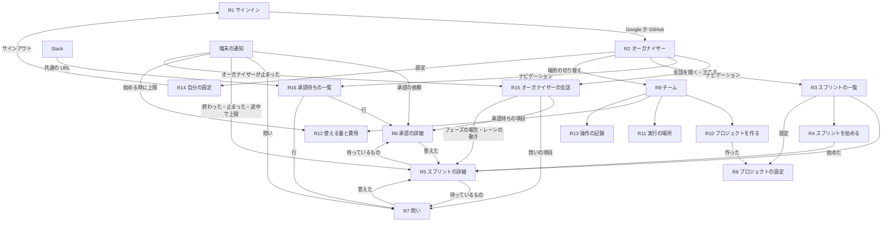
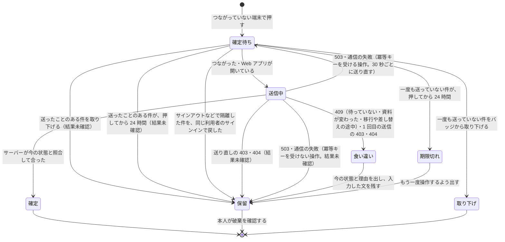

# 画面: どの端末でも、つながらなくても、人を待つものを少ない手数で片づけられる

画面は、[全体の設計](overview.md) の「利用の場面」（S1〜S6・S12・S15・S16）と「機能一覧」（F1〜F20・F24・F25）を受ける。オーガナイザーの形と会話の項目は [オーガナイザー](organizer.md) が持ち、この文書はその画面を持つ。
MVV の Value 2 の順に、画面の基盤（手数の目標・画面マップ・共通の部品・端末の幅・オフライン・国際化）を先に決め、その上に機能の画面を置く。
語・番号・不変条件（I1〜I16）は全体の設計に従う。API の操作は [API の操作一覧](api.md#操作の一覧) の名前（`sprints.create` など）で指す。

## この文書で決めること

| 段 | 節 | 決めること | 決定 |
| --- | --- | --- | --- |
| 基盤 | [手数の目標](#手数の目標) | 場面ごとの手数とページの数の上限を数で置き、e2e で数える | 20 |
| 基盤 | [画面マップ](#画面マップ) | HTTP のルートを 16 本にし、プロジェクトとチームをルートのプレフィックスに持つ。ルートは URL の path で持つ | 21・38 |
| 基盤 | [画面マップ](#画面マップ) | 最初の画面はオーガナイザーの一覧と会話。承認待ちの一覧はプロジェクトをまたいで並べ、通知の画面を別に持たない。ナビゲーションは 4 つの行き先 | 22・24 |
| 基盤 | [共通の部品とデザインの規約](#共通の部品とデザインの規約) | 「承認する」に確認のダイアログを置かない。押せる要素は 44 px 以上。ショートカットとコマンドパレットを入れない | 23・25・27 |
| 基盤 | [端末の幅](#端末の幅) | 区切りの幅を 640 px と 1024 px の 2 つにする | 26 |
| 基盤 | [オフライン](#オフライン) | 保存する範囲と期間・暗号鍵・ログインのキャッシュ・操作の 3 つの区分・サーバーを正にするそろえ方 | 28〜33 |
| 基盤 | [国際化](#国際化) | 翻訳ファイルの形・エラーは理由コードだけ・日時の出し方・右から左は作らない | 34〜37 |
| 機能の画面 | [画面一覧](#画面一覧)・[画面ごとの項目](#画面ごとの項目) | 16 本の経路ごとの機能・API の操作・オフライン・`human_only` の操作と、画面ごとの項目 | — |
| 機能の画面 | [ダミーデータで作り切る段](#ダミーデータで作り切る段) | ダミーデータをスキーマの正本のサンプルから作り、API をつなぐ前に画面を作り切る | 39 |

## 手数の目標

利用者がいちばん多く行う場面ごとに、手数（押す・選ぶの回数。文字の入力と IdP の画面の中の操作は数えない）と、通るページの数の上限を置く。
e2e で手数とページの数を数え、上限を超えたら落とす（決定 20）。

| 場面 | 始まり | 終わり | 手数の上限 | ページの数の上限 | 目標の待ち時間 |
| --- | --- | --- | --- | --- | --- |
| S15 会話で指示する | オーガナイザーの会話 | 指示がキャッシュ中か渡したと出る | 1（送る）＋文字の入力 | 0（同じ会話） | 送ってから項目が出るまで 1 秒以内（オフラインでもキャッシュ中で出す） |
| S1 始める（課題 1 つ。画面から） | スプリントの一覧 | 「始めました」の表示 | 3（始めるを開く → 課題を選ぶ → 始める） | 1（スプリントを始める） | 確定から表示まで 2 秒以内 |
| S1 始める（課題 n 個。画面から） | スプリントの一覧 | 同じ | 2 + n | 1 | 同じ |
| S2 いま | Web アプリを開く（サインイン済み） | 最後に開いた会話と、承認待ちの数が読める | 0 | 1（オーガナイザー） | 端末のキャッシュから 1 秒以内に描き、つながっていれば 3 秒以内に最新へ差し替える |
| S3 承認 | 会話にある承認待ちの項目か承認待ちの一覧 | 承認の確定 | 2（承認待ちのリンクか行 → 承認する） | 1（承認の詳細） | 確定から結果の表示まで 2 秒以内 |
| S3 差し戻し | 同じ | 差し戻しの確定 | 3（リンクか行 → 差し戻す → 確認で確定）＋理由の入力 | 1 | 同じ |
| S4 問い | 会話にある問いの項目・承認待ちの一覧か通知 | 答えの確定 | 3（問いのリンクか行 → 選択肢 → 答える） | 1（問い） | 同じ |
| S5 通知から承認 | 端末の通知（Web Push） | 承認の確定 | 2（通知 → 承認する） | 1（承認の詳細。会話を通らない） | 通知を押してから承認資料が読めるまで 2 秒以内 |
| S5 Slack から承認 | Slack | 承認の確定 | 3（Slack の URL → 承認待ちの行 → 承認する） | 2（承認待ちの一覧 → 承認の詳細。Slack はプロジェクトを指す URL を運ばない） | 同じ |
| S6 移動中に読む | オフラインで Web アプリを開く | 最後に受け取ったスプリントと承認資料が読める | S2・S3 と同じ | 同じ | 端末のキャッシュから 1 秒以内 |
| サインインから | サインインの画面 | オーガナイザー（最後に開いた会話） | 1（Google か GitHub）＋ IdP の画面 | 1 | — |

- 手数の上限は「1 つの画面で用が済む」ことを前提にする。承認資料・問いの選択肢・課題候補を、別のページや GitHub へ移らずに読める。承認資料のうち、コードと差分そのものだけは GitHub へのリンクで代えてよい
- 待ち時間はモバイルの回線（4G 相当）の上で測る。測り方は e2e の回線の絞りで決める

## 画面マップ

### HTTP のルートの一覧

HTTP のルートは 16 本にする。機能ごとの一覧の画面・タブの HTTP のルート・転送の HTTP のルートを持たない（決定 21）。
プロジェクトに属する画面は HTTP のルートのプレフィックスに `/p/:projectId` を、チームに属する画面は `/t/:teamId` を持つ。HTTP のルートの ID が割り当ての外のプロジェクトを指すときは、存在しないときと同じ「見つからない」を出す（I2）。

| # | HTTP のルート | 画面 | 群 |
| --- | --- | --- | --- |
| R1 | `/signin` | サインイン | サインインの前 |
| R2 | `/` | オーガナイザー（一覧と、最後に開いた会話） | 主 |
| R3 | `/p/:projectId` | スプリントの一覧 | プロジェクト |
| R4 | `/p/:projectId/start` | スプリントを始める | プロジェクト |
| R5 | `/p/:projectId/sprints/:sprintId` | スプリントの詳細 | プロジェクト |
| R6 | `/p/:projectId/approvals/:approvalId` | 承認の詳細 | プロジェクト |
| R7 | `/p/:projectId/questions/:questionId` | 問い | プロジェクト |
| R8 | `/p/:projectId/settings` | プロジェクトの設定 | プロジェクト |
| R9 | `/t/:teamId` | チーム | チーム |
| R10 | `/t/:teamId/projects/new` | プロジェクトを作る | チーム |
| R11 | `/t/:teamId/execution` | 実行の場所 | チーム |
| R12 | `/t/:teamId/usage` | 使える量と費用 | チーム |
| R13 | `/t/:teamId/audit` | 操作の記録 | チーム |
| R14 | `/me` | 自分の設定 | 自分 |
| R15 | `/p/:projectId/organizers/:organizerId` | オーガナイザーの会話 | 主 |
| R16 | `/approvals` | 承認待ちの一覧 | 主 |

- サインインの戻り（認可コードと `state` の検索の値）は `/` で受け、受けたら履歴から検索の値を消す
- サインインの手段をつなぐ戻りは、連携専用の戻り先 `/me/logins/return` で受ける（画面ではなく、受けたら履歴を R14 の `/me` へ置き換える）。IdP から戻ったブラウザーはこの path を直に開くため、CDN は画面マップのルートと同じにこの path へも `index.html` を返す（[プラットフォームの文書の CloudFront と画面の S3](platform.md#資源ごとの形)）。起動のときは通常のサインインの戻りより先にこの経路を見て、その `code` と `state` を `signinRedirectCallback` へ渡さない（連携の `state` はサーバーが作り、通常のサインインの状態のキャッシュに無い）。`state` が `login_links.create` の後に `sessionStorage` へ保存した流れの ID と同じときだけ `logins.create` へ送る。手順は [詳細設計の `verifyLoginToLink`](detail.md#関数の仕様)
- サインアウトの戻り（Cognito の `/logout` からの戻りと、`/oauth2/authorize` の `prompt=none` の確認の戻り。検索の値 `error`・`code`・`state`）は、サインアウトの専用の戻り先 `/signed-out` で受ける（画面ではなく、[サインアウトで消す](#サインアウトで消す) の「サインアウトの完了」の処理が受ける）。`/` へ移さず、検索の値を保ったままその処理へ渡し、処理が分けた後に履歴から消す。CDN はこの path へも `index.html` を返す（[プラットフォームの文書の CloudFront と画面の S3](platform.md#資源ごとの形)）。起動のときは、通常のサインインの戻りと連携の戻りより先にこの経路を見て、その `code` と `state` を `signinRedirectCallback` へ渡さない
- サインインの前に開いた画面へ、サインインの後に戻す。通知から開いた承認の詳細を、セッションが切れていても探し直さずに読めるようにするためである。手順は次のとおり
  1. ログインのキャッシュが無いか、token を再取得できずにサインインへ移るとき、開いていた画面の HTTP のルート（path と検索の値）を、IdP へ渡す `state` の値をキーにしてタブの `sessionStorage` に置く
  2. 戻りで `state` を照合した後、同じキーの経路を読み、すぐ `sessionStorage` から消す
  3. 経路は、`/` で始まり `//` と `\` で始まらず、画面マップの HTTP のルート（R1 を除く）に合うときだけ使う。合わないとき・無いときは `/` へ移る。外の URL へは移らない
  4. 使える経路へは履歴を置き換えて移る。移った画面は通常どおり API の認可を受け、割り当ての外なら「見つからない」を出す
- GitHub App を入れた後の戻りは R10 で受ける（検索の値を保ったまま、登録の候補を読み直す）
- Slack の通知先を足すときの OAuth の戻り（認可コードと `state` の検索の値）は R14 の `/me` で受ける。Slack アプリには、画面のオリジンに `/me` を付けた HTTPS の絶対 URL を戻り先として登録する。登録は `notification_targets.authorize` で始め、サーバーが `state` を作って利用者とセッションに結ぶ。戻りでは `state` を登録を始めたタブの `sessionStorage` の値と照合し、一致したときだけ認可コードと `state` を `notification_targets.create` へ渡す。サーバーは同じ利用者とセッションの未使用の取引かを確認してから交換する。照合した `state` と検索の値はすぐ消す（[実行の文書の Slack の登録](execution.md#slack-の登録)）
- 画面マップに無い HTTP のルートは `/` へ履歴を置き換えて移る（連携の戻り先 `/me/logins/return` とサインアウトの戻り先 `/signed-out` は除く。上のとおり検索の値を保って専用の処理で受ける）。転送の表は持たない
- R2 は、端末のキャッシュに最後に開いた会話（R15）があり今も読めればその会話を、無ければ一覧を出す。PC とタブレットの幅では一覧と会話を 2 段で並べ、スマートフォンの幅では 1 つずつ出す
- チームを作る・委任を発行する・手元のマシンを登録するは、それぞれ R9・R14・R11 の中のダイアログにし、HTTP のルートを足さない

### 遷移

### ナビゲーション

ナビゲーションの行き先は 4 つに絞り、どの幅でも同じ 4 つを同じ順で並べる（決定 24）。

| 幅 | 保存先 |
| --- | --- |
| スマートフォン | 画面の下の帯 |
| タブレット | 左の細い帯（アイコンと短い名前） |
| PC | 左の帯（アイコンと名前・場所の切り替え） |

| 順 | 行き先 | HTTP のルート | 添えるもの |
| --- | --- | --- | --- |
| 1 | オーガナイザー | R2 | 止まったオーガナイザーの数（0 は出さない） |
| 2 | 承認待ち | R16 | 人を待つものの数（承認の依頼と問いの和。0 は出さない。99 を超えたら `99+`）。数は名前に含めず説明として読み上げる |
| 3 | スプリント | 今のプロジェクトの R3（プロジェクトを選んでいなければ場所の切り替えを開く）。始める（R4）はこの画面から開く | — |
| 4 | 設定 | R14。PC の帯では、席の役割が持ち主のとき、チームの行き先（R9・R11・R12・R13）を区切りの下に足す | — |

- Web アプリのアイコンの数（Badging）にも、同じ「人を待つものの数」を出す（PRD20・STD27）。通知の許可が無い端末では出さない
- 帯の各項目は 44 px 以上で、今の行き先に `aria-current="page"` を付ける

### チームとプロジェクトの切り替え

今いる場所（チーム › プロジェクト）を、スマートフォンでは画面の上の帯の題に、タブレットと PC では帯の上端に出す。押すと場所の一覧を開く。

| 項目 | 決まり |
| --- | --- |
| 一覧の中身 | 席を持つチームを名前順に、その下に各チームのプロジェクトを名前順に並べる。末尾に「チームを作る」 |
| 選ぶと | プロジェクトなら R3、チームなら R9 へ移る |
| 今の場所のキャッシュ | 最後に開いたプロジェクトの ID を端末のキャッシュ（暗号化）に置き、ナビゲーションの「スプリント」「始める」の行き先にする。キャッシュのプロジェクトが一覧に無くなったらキャッシュを消す |
| オーガナイザーの一覧・承認待ちの一覧 | プロジェクトを選ばず、見られるすべてのプロジェクトをまたいで並べる（決定 22）。上の絞り込みでプロジェクトを 1 つに絞れる（絞りは保存しない） |
| 個人で使う人 | 1 人のチームとして同じ一覧に出す。チームが 1 つ・プロジェクトが 1 つなら、一覧を開かずに題だけを出す |
| 一覧に出すもの | 自分の席の分だけ。割り当ての外のプロジェクトは名前も数も出さない（I2） |

## 共通の部品とデザインの規約

### 共通の部品

画面は次の部品だけで組む。部品は `apps/web/src/ui/` に 1 つのファイルで 1 つ置き、部品の一覧と保存先の一致をテストで照合する。

| 部品 | 何をするか | 決まり |
| --- | --- | --- |
| 枠 | サインイン後の画面をラップする。ナビゲーション・場所の切り替え・オフライン表示の帯を持つ | 幅ごとの形は「端末の幅」の表 |
| 上の帯 | 画面の題（`h1`）・1 行の説明・主操作（0 か 1 つ） | スマートフォンでは主操作を画面下端に固定した帯へ移す |
| 一覧 | 同じ形の行を並べる。行を押すと詳細へ移る | 行は 44 px 以上。スマートフォンでは 1 行を 1 枚のカードに積み、タブレットより広い幅では列の表にする |
| 詳細 | 1 件の名前と値の組 | スマートフォンでは名前と値を縦に並べる |
| 畳む節 | 見出しを押すと開閉する節（`aria-expanded`） | 開閉の状態は端末のキャッシュに置く |
| 状態のバッジ | 状態を色と文言の組で出す | 色だけで状態を示さない（WCAG 1.4.1）。頭に調子ごとに形の違うアイコンを置く |
| 空の状態 | 0 件・見つからない | 何が無いか・次にすること（行き先へのリンク）の 2 段 |
| 読み込み中 | 初めての読み込み | 端末のキャッシュがあれば出さず、キャッシュを出したまま裏で読む。動きを減らす設定では回らない |
| エラーの表示 | 読めない・送れない | 理由の文（理由のコードを翻訳した文）と、やり直せるなら「もう一度」。画面を白くしない |
| 確認のダイアログ | 取り消せない操作の確認（決定 23 の行だけ） | `role="dialog"`・`aria-modal`。開いた間フォーカスを中に留め、Esc で閉じる。確定のボタンに操作の名前を書く（「OK」にしない） |
| オフラインの帯 | つながっていないこと・最後に受け取った時刻・確定待ちの数 | 枠の上端に 1 本。`role="status"` で読み上げる |
| 確定待ちのバッジ | 確定待ちの操作がある行と画面に付ける | 「つながってから確定」と期限の時刻。押すと取り下げられる（送ったことのある件は結果未確認になる） |
| 操作の結果 | 操作が通った・通らなかったの 1 文 | 通ったときは `role="status"`、通らなかったときは `role="alert"` |
| 時刻 | 日時を相対か絶対で出す | 「国際化」の日時の表。`<time datetime>` に UTC の値を置く |
| 金額 | 通貨つきの金額を出す | 通貨の無い金額を受けない（I15） |
| 資料の本文 | 承認資料・問いの本文を出す | Markdown を安全な部分だけで描く（HTML を通さない）。表とコードは横に送れる箱に入れ、本文の幅をはみ出さない |
| ボタン・入力欄・選択の欄 | 操作と入力 | ラベルは欄の上。入力欄の文字は 16 px 以上（スマートフォンの拡大を起こさない） |

### 状態のバッジの調子

| 調子 | 使う状態 | 色の役割 |
| --- | --- | --- |
| 人を待つ | 承認の依頼が待っている・問いが待っている | 承認（緑） |
| 動いている | スプリント・レーンが動いている | 情報（青） |
| 終わった | 終わった・承認された・答えた | 完了（紫） |
| 止まった | 上限で止まった・予定外に止まった | 注意（黄） |
| 失敗 | 失敗した・差し戻された・送達できなかった | 危険（赤） |
| 中立 | 待っている（始まっていない）・取り消した・手元のマシンの登録待ち | 中立（灰） |
| 確定待ち | つながってから確定する操作がある | 中立の地に点線の枠（色だけに頼らず形で分ける） |

### デザインの規約

| 項目 | 決まり |
| --- | --- |
| 値の保存先 | 色・文字・余白・角・動きの値は Design Tokens Format の JSON（`apps/web/src/ui/tokens.json`、ダークは `tokens.dark.json`）に置き、ビルドで CSS の変数へ写す。部品と画面のコードに色の値を直に書かない |
| 色の役割 | 地・面・本文・補足・区切り・主の操作・フォーカス、と上の 7 つの調子（文字と地の組）。主の操作は藍、承認ゲートの「承認する」だけを緑の地にする |
| テーマ | OS の設定（`prefers-color-scheme`）に従う。画面に切り替えを置かない |
| 文字の大きさ | 本文 16 px・補足 14 px・節の見出し 18 px・画面の題 22 px。すべて `rem` で書き、利用者の文字サイズ設定に従う（200% まで崩れない。WCAG 1.4.4） |
| 書体 | 端末の書体（`system-ui` と日本語の書体の並び）。外部から書体を読まない。識別子・SHA・ブランチの名前は等幅で訳さない |
| 触れる大きさ | 押せる要素はすべての幅で幅と高さとも 44 px 以上（決定 25）。文中のリンクは除く |
| 余白 | 4 の倍数（4・8・12・16・24・32 px）だけを使う |
| キーボード | すべての操作を Tab・Shift+Tab・Enter・Space・Esc・矢印で行える。本文へ飛ぶリンクを先頭に置く。1 文字のショートカットとコマンドパレットは持たない（決定 27） |
| フォーカス | `:focus-visible` で 2 px の輪。固定の帯（下の帯・主の操作の帯）がフォーカスした要素を隠さない（WCAG 2.4.11） |
| アクセシビリティの水準 | WCAG 2.2 の AA（STD23）。加えて触れる大きさは 2.5.5（44 px）に合わせる。320 CSS px の幅で横にはみ出さない（1.4.10） |
| 動き | 色の移り変わり 120 ms・ダイアログ 180 ms。動きを減らす設定では動かさない |
| 文言 | 画面のコードに文言を書かない。翻訳のファイルのキーで引く（「国際化」） |
| 状態を省かない | どの画面も、読み込み中・空・エラー・見つからない（権限なしも同じ）・オフラインの 5 つを持つ。画面ごとの表は「画面ごとの項目」 |

## 端末の幅

区切りの幅は 640 px と 1024 px の 2 つにする（決定 26）。部品は CSS だけで形を変え、画面のコードは幅を知らない。

| 区分 | 幅 | 代表の幅 | ナビゲーション | 場所の切り替え | 本文 | 一覧と詳細 | 主の操作 |
| --- | --- | --- | --- | --- | --- | --- | --- |
| スマートフォン | 640 px 未満 | 360・390 px | 画面の下の帯（4 つ、セーフエリアの内側） | 上の帯の題を押して開く | 1 段。左右 16 px の余白 | 一覧と詳細は別のページ。一覧の行はカード | 下の帯の上に固定の帯 |
| タブレット | 640 px 以上 1024 px 未満 | 768・834 px | 左の細い帯（幅 80 px、アイコンと短い名前） | 帯の上端のボタン | 1 段。左右 24 px | 一覧は列の表。詳細は別のページ | 上の帯の右端 |
| PC | 1024 px 以上 | 1280・1440 px | 左の帯（幅 240 px、アイコンと名前） | 帯の上端に名前を出す | 幅の上限 1200 px。左右 32 px | オーガナイザーの一覧は会話と 2 段、承認待ちの一覧とスプリントの一覧は行を選ぶと右に詳細を開く 2 段（選んだ行は HTTP のルートに出す） | 上の帯の右端 |

- 3 つの区分のどれでも、横にはみ出さない。e2e は 360・768・1280 px の 3 つの幅ですべての HTTP のルートを開いて確認する
- 端末を横にしたスマートフォン（高さが 500 px 未満）は、下の固定の帯を 1 つにまとめ、本文の高さを残す
- PC の 2 段で開いた詳細は、同じ HTTP のルート（R5・R6・R7）を右に描いたもので、HTTP のルートと中身を別に持たない

## オフライン

### 端末に保存するもの

端末に保存するのは、サーバーから受け取った中身の写しと、まだ送れていない操作（キャッシュと確定待ち）だけである。サーバーが常に正で、キャッシュの写しは読み出し専用の写しとして扱う（決定 28・29）。

| 保存するもの | 範囲 | 期間 |
| --- | --- | --- |
| 画面の殻（HTML・JS・CSS・アイコン・翻訳のファイル） | 今のバージョンの 1 揃い | 新しいバージョンが入るまで |
| 画面の設定の値（`/config.json`） | 1 件 | 次につながって読めるまで |
| オーガナイザーの一覧と会話 | 見られるプロジェクトのオーガナイザー（終わったものは 7 日分）と、開いた会話の最新 200 項目。送れていない項目 | 受け取ってから 14 日（送れていない項目は送るまで） |
| 承認待ちの一覧の中身 | 見られるプロジェクトの人を待つもの・動いているスプリント | 受け取ってから 14 日 |
| スプリントの一覧 | プロジェクトごとに新しい順の 50 件 | 同じ |
| スプリントの詳細 | 動いているスプリントと、開いたスプリント | 同じ |
| 承認の依頼と承認資料・問い | 待っているもの全部と、開いたもの | 同じ |
| 通知 | 新しい順の 100 件と既読の位置 | 同じ |
| 自分の設定（言語・時刻帯・呼び名）・場所の一覧（チームとプロジェクトの名前） | 全部 | 同じ |
| ログインのキャッシュ | 1 件 | refresh token の期限（30 日。[API の文書の token の有効期間](api.md#token-の有効期間)）まで（決定 31） |
| キャッシュして送る操作・確定待ちの操作 | 全部 | 確定待ちは押してから 24 時間（決定 32） |
| 送れないと決まった操作（保留の件）と、隔離した操作 | 全部 | 本人が破棄を確認するまで（[送れない操作と別の利用者](#送れない操作と別の利用者)） |

保存しないもの: 操作の記録・チームのメンバー一覧・使える量と費用・実行の場所・委任の一覧と token・通知先の送信先の値・課題候補。これらはつながっているときだけ読む画面で、つながっていないときは「つながると読めます」を出す。

- 14 日を過ぎた写しは、Web アプリを開いたときに消す。消したものは「キャッシュが古いので消しました」を出さず、空の状態として出す
- Web アプリを開いたとき、ストレージを消されにくくする許し（`navigator.storage.persist()`）を求める。拒否されても動く（PRD21）
- ブラウザのタブで使う Safari では、使わない日が 7 日続くとキャッシュが消されうる。ホーム画面に加えた Web アプリはこの数え方が別である（PRD21）。画面はキャッシュが消えていても空の状態として動き、ホーム画面に加えることを自分の設定にある通知先の節で勧める
- 端末に入れる Web アプリとして、Web App Manifest（名前・`start_url: "/"`・`display: "standalone"`・`scope: "/"`・アイコン・`lang`）と Service Worker を持つ（STD20・STD20）。画面の設定の値はつながっていれば毎回読み、読めなければ Service Worker のキャッシュを使う（決定 28）

### 暗号化

| 項目 | 決まり |
| --- | --- |
| 保存先 | IndexedDB の 1 つのデータベース（名前は利用者ごとに分けない。持ち主の利用者の ID は平文で置かず、ID から作った HMAC の値で持ち主を照合する） |
| キー | Web Crypto で作る AES-GCM 256 ビットのキー。`extractable` を偽にして作り、`CryptoKey` のまま IndexedDB に置く。キーの生の値は JS からも取り出せない（STD24・決定 30） |
| 暗号化の単位 | 1 件ごと（1 つのスプリント・1 つの承認の依頼など）に、毎回新しい 12 バイトの初期値で暗号化する。平文で持つのは次のものだけである。索引に使う種類と受け取った時刻。取り出せない HMAC のキーで作った値（行を引く・比べるための値）。利用者のデータを含まない固定の名前（保留の理由など）・真偽・版の番号。暗号化の初期値。プロジェクトの ID は平文で持たない。プロジェクトで行を引く索引には HMAC の値を使い、元の ID は暗号文に入れる |
| 読めないとき | キーが無い・復号に失敗したら、写しをすべて消し、オンラインなら読み直す。オフラインなら空の状態を出す。読めない確定待ちとキャッシュの操作は消さない（[送れない操作と別の利用者](#送れない操作と別の利用者)） |
| Service Worker のキャッシュ | 画面の殻と画面設定の値だけを Cache Storage に置く。API のレスポンスは Cache Storage に置かない（暗号化されない保存先に中身を残さない） |

### サインアウトで消す

サインアウト（自分の設定の「サインアウト」）は、次をこの順で行う。最後に Cognito のログアウトのエンドポイントを経てサインインの画面へ戻る。Cognito の managed login はブラウザーに自分のセッションの Cookie を持ち、token を取り消して端末のキャッシュを消しても、その Cookie が残ると、同じブラウザーで次に「サインイン」を押した人が IdP を通らずに直前の利用者として新しいセッションを得るためである（[Cognito のログアウトのエンドポイント](https://docs.aws.amazon.com/cognito/latest/developerguide/logout-endpoint.html)）。Cookie を消せるのはそのエンドポイントへの遷移だけのため、つながっていないときはサインアウトを出さず（押せない状態にして「つながってからサインアウトしてください」と出す）、途中で切れたら残りをつながった後に同じ順で続ける（下の「サインアウトの途中のフラグ」）。

1. この端末の Web Push の購読を外し、サーバーの通知先からこの端末を外す。サーバーで外せなかったときは、外す操作を確定待ちに残さない。サーバーが次に送ろうとして購読の失効を受けたときに外す
2. 確定待ちと保存して送る操作（保留の件を含む）を捨てる（捨てる数を確認のダイアログで出す）。捨てるのは、利用者がそのダイアログで確認した操作だけである。確認していない操作（利用者がダイアログを受けずに始まったサインアウトの分と、ダイアログの後に増えた分）は、捨てずに隔離する（下の「送れない操作と別の利用者」）
3. `sessions.delete` を送り、API の側でこのセッションを断つ。済んだと扱うのは、取り消しの確定（`revoked_at`）を返す成功のレスポンスだけである。手元の access token が期限を過ぎていても取り直さずにそのまま送る（API は `sessions.delete` だけ期限を過ぎた token を受けて取り消しの行を確定する）。401 は本文の理由で分ける。`session_ended`（署名と期限を通した token のセッションが API で既に断たれている）は取り消しの確定と同じに扱い、次へ進む。`unauthorized`（署名・claim・猶予の外れなどで、セッションの取り消しを確認していない）では済みとせず、下の「サインアウトの証」の順で同じセッションの別の token を得て送り直す。一時の失敗では進まずに試し直す（[データの文書のセッションの取り消しの行](data.md#セッションの取り消しの行) の「`sessions.delete` の再送と期限切れ」）
4. ログインのキャッシュの refresh token を Cognito で取り消す（RevokeToken。一時の失敗は 3 回まで試し直し、成功しなくても次へ進む。同じ行の「取り消しの再試行」）。結果はフラグの `cognito_revoke` に記す（下の「サインアウトの完了の告知」が使う）
5. access token をメモリから捨て、ログインのキャッシュ（refresh token）・IndexedDB のデータベースと鍵・このタブの `sessionStorage` のログインをつなぐ流れのキャッシュ（流れの ID・冪等キー・認可コード・段。[詳細設計の `verifyLoginToLink`](detail.md#関数の仕様)）を消す。この端末の認証の状態はここで残らない。データベースは、このタブの接続を閉じてから `indexedDB.deleteDatabase` で消し、そのリクエストの `success` を受けたときだけ 5. を済みとする。`blocked`（ほかのタブなどの接続が残っている）の間は済みとせず 6. へ進まずに待ち、3 秒を過ぎても `success` が来なければ「ほかのタブを閉じてください」を出して待ち続ける。`error` なら 5. をやり直す
6. Cognito のログアウトのエンドポイント（`/logout`。アプリのクライアントの ID と、サインアウトの専用の戻り先 `logout_uri`（`<画面のオリジン>/signed-out`）を付ける）へ移り、managed login の Cookie を消させる。移る直前に、サインアウトの途中のフラグ（下）を「6. を始めた」へ進め、この遷移だけの使い捨ての値（乱数）をフラグとこのタブの `sessionStorage` の両方に置く。サインアウトを済ませるのは、7. の確認で Cognito がブラウザーセッションの無いことを答えた専用の戻り先だけ（下の「サインアウトの完了」）で、通常の画面（`/` など）を開いても済ませない。IdP（Google・GitHub）のサインインはそれぞれのサービスの側にあり、ここでは消さない。サインアウトの後の画面に、共有の端末では IdP の側でもサインアウトするよう案内を出す
7. 専用の戻り先で、managed login のブラウザーセッションが消えたことを Cognito に確認する。端末のフラグや読み込みの種類では Cookie が消えたことを確認できない（6. の遷移に失敗した後に同じタブで専用の戻り先を直に開いても同じに見える）ため、Cognito の答えで決める。フラグを「7. を始めた」へ進め、新しい使い捨ての値をフラグとこのタブの `sessionStorage` に置いてから、Cognito の認可のエンドポイント（`/oauth2/authorize`）へ `response_type=code`・`client_id`・`redirect_uri`（`<画面のオリジン>/signed-out`）・`scope=openid`・`state`（その使い捨ての値）・PKCE の `code_challenge`（この遷移で作る使い捨ての `code_verifier` の S256。交換しないため `code_verifier` は保存しない）と `code_challenge_method=S256`（`code_challenge` を付けて方式を欠くと、Cognito はブラウザーセッションの有無を答えずに `error=invalid_request` を返し、完了の (1) に届かない）・`prompt=none`（ブラウザーセッションがあれば黙って認可コードを返し、無ければ `error=login_required` で戻す。managed login でだけ効く。[Cognito の認可のエンドポイント](https://docs.aws.amazon.com/cognito/latest/developerguide/authorization-endpoint.html)）を付けて移る。`identity_provider` は付けない（Cognito のブラウザーセッションだけを問い、IdP へ移らない）

| 決まり | 中身 |
| --- | --- |
| サインアウトの途中のフラグ | 「サインアウト」を押して確認のダイアログ（2. で捨てる数を出す）を受けたら、1. の前に、秘密を含まないフラグ（サインアウトの ID（乱数）・対象のセッションの指紋（そのセッションの `sub` と `origin_jti` をつないだ SHA-256。識別子そのものは置かない）・済んだ段の番号・始めた時刻・6. と 7. の遷移の使い捨ての値・6. の遷移を始めた回数（`logout_attempts`。0 から始める）・3. の結果（`api_revoke`: 「確定」か「確定できず」）・4. の結果（`cognito_revoke`: 「取り消した」（RevokeToken の成功）・「既に断たれた」（取り直しを Cognito が `invalid_grant` で拒否した）・「確認できず」（RevokeToken を使い切った・ログインのキャッシュが無いか読めない））・外しから始めたときの外しの結果（`unlink_result`: 「外した」・「外れなかった」・「確認できず」。外しから始めていなければ持たない。下の「今のログインを外した後」）・「外れなかった」ときの理由のコード（`unlink_reason`: 照合で最初に受けた `logins.delete` のアイテムのエラーの理由のコード（`state_mismatch`・`version_mismatch`・404 の理由）。ほかの結果では持たない）だけ（下の「サインアウトの証」と「サインアウトの完了の告知」）。token・利用者のデータ・鍵を持たない）を `localStorage` に置き、段を終えるたびに番号を進める。`api_revoke` は段の番号と別に記す。API の側の取り消しを確認した（3. の成功か 401 `session_ended`・下の「今のログインを外した後」で外しの確定か `session_ended` を受けた・[画面ごとの項目の 401](#画面ごとの項目) の (i)・(ii)）ときは、どの段にいても `api_revoke` を「確定」と記すが、段の番号は飛ばさず、残りの段を順に打つ（証の準備・1.・2. の途中なら、その段から購読の外しと確定待ちの破棄を行う）。3. に達したとき `api_revoke` が既に「確定」なら `sessions.delete` を送らずに 3. を済みとし、「証の準備」は `api_revoke` が「確定」なら証を置かずに済みとし、1. は `api_revoke` が「確定」ならサーバーの通知先の外しを送らない（401 になる）。3. を済みとするどの経路でも、その前に `api_revoke` を記す（記さずに 3. を済みとする経路を持たない）。フラグを置いたときの段は「証の準備」（下の「サインアウトの証」）で、証の準備を終えてから 1. へ進む。フラグを消すのは、下の「サインアウトの完了」の条件を満たした専用の戻り先の画面だけである。再読み込み・タブの閉じ直し・6. の遷移の失敗をまたいでもフラグは残る |
| サインアウトの証 | 3. で `sessions.delete` に送る access token（同じセッションの token なら、期限を過ぎていても `SESSION_DELETE_EXPIRED_GRACE_MS` の内なら API が受ける）を、再読み込みとタブの閉じ直しをまたいで失わないよう、ログインのキャッシュと同じ暗号化（上の「暗号化」の鍵と 1 件ごとの初期値）で IndexedDB へ 1 件置く（フラグの `localStorage` には置かない。refresh token と同じ保存先で、置く値は refresh token より弱い）。証はセッションの指紋を一緒に持ち、フラグの指紋と違えば使わない。5. のデータベースの削除で証も消える。証を置くのはフラグの最初の段「証の準備」で、フラグを置いた後に、錠を持って次の順で行う。この段は何度打っても結果が変わらず、フラグを書いた直後にタブを閉じた・再読み込みしたなど、証を置けたか分からないまま止まったフラグは、起動のときの再開でこの段からやり直す。(1) IndexedDB にフラグと同じ指紋の証があり、読めれば、それを使い（置き直さない）、段を進める。(2) 無ければ、このタブのメモリの access token、それも無ければログインのキャッシュの refresh token で取り直した token を置き、書けたことを読み直して確認してから段を進める。書き込みが失敗した（容量不足・`QuotaExceededError`・トランザクションの `error` か `abort`）か、読み直した証が置いた値と違うときは、試し直さずに証の無いまま段を進める（再開のたびにこの段で止まらない。再開で同じ段からやり直して再び書けなくても同じに進む）。このとき 3. の候補は (a) と (c) だけで、手元の token での取り消しを試す。(3) 取り直しの一時の失敗（通信の失敗・Cognito の 5xx・呼びすぎ）では段を進めずに間を空けて試し直す（つながっていなければ、上の「起動のときの再開」と同じく待つ）。(4) 証を恒久に用意できない（メモリに token が無く、ログインのキャッシュが無い・読めない、か取り直しを Cognito が `invalid_grant` などで恒久に拒否した）ときは、試し直さずにフラグへ `api_revoke` を「確定できず」と記し（`invalid_grant` なら `cognito_revoke` も「既に断たれた」と記す）、3. を打たずに済みとして 1. へ進む（1. のサーバーの通知先の外しは token が無いため送らず、2.・4.〜7. の端末と Cognito の後片付けを行う）。3. で送る token は、(a) このタブのメモリの token、(b) IndexedDB に置いた証、(c) ログインのキャッシュの refresh token で取り直した token の順に選ぶ。候補ごとに、得られない（メモリに token が無い・証が無いか読めないか証の指紋がフラグと違う・キャッシュが無いか読めないか取り直しを Cognito が `invalid_grant` などで恒久に拒否した）か、送って 401 `unauthorized` を受けたら、次の候補へ進む（再読み込みの後で (a) が無く (b) だけがあるときは (b) から、(b) が 401 で (c) が `invalid_grant` のときは使い切りに当たる）。成功と 401 `session_ended` はどの候補で受けても `api_revoke` を「確定」と記して 3. を済みとする。取り直しの一時の失敗（通信の失敗・Cognito の 5xx・呼びすぎ）と `sessions.delete` の一時の失敗では候補を進めずに同じ候補で試し直す。(a)〜(c) を使い切ったら、証を回復できないとして `api_revoke` を「確定できず」と記して 3. を済みとし、4. の後片付けへ進む（試し直しを繰り返して止まらない。取り直しを `invalid_grant` で拒否されたなら `cognito_revoke` を「既に断たれた」と記す）。4. は RevokeToken の結果を `cognito_revoke` に記す（既に「既に断たれた」と記してあれば、キャッシュがあっても RevokeToken を試し、成功すれば「取り消した」に替える） |
| サインアウトの完了の告知 | 完了の (1) の後のサインインの画面に出す告知は、フラグの `api_revoke` と `cognito_revoke` で分ける（フラグを消す前に読み、画面のメモリへ移してから消す）。`api_revoke` が「確定」: 告知を出さない。「確定できず」で `cognito_revoke` が「取り消した」か「既に断たれた」: そのセッションの refresh token は使えず新しい access token は出ないため、既に出た access token が発行から 15 分で期限を過ぎることを根拠に「この端末のセッションを API の側で断てたことを確認できませんでした。この端末で使っていた token は 15 分の内に使えなくなります」を出す。「確定できず」で `cognito_revoke` が「確認できず」: 端末のキャッシュは 5. で消したが、端末の外へ写された refresh token は失効しておらず、有効期限まで新しい access token を出せるため、15 分で使えなくなるとは告げず、「この端末のセッションを API の側でも Cognito でも断てたことを確認できませんでした。token がこの端末の外へ写されていた場合、そのセッションは有効期限まで使えるおそれがあります」を出す。`api_revoke` が未記入か読めない値のフラグは、上の決まりでは生じないが、取り消しを確認した証にならないため「確定できず」と同じに扱う（確認していない取り消しを確認したと告げない）。`unlink_result` があれば、上の告知に加えて IdP を選ぶ画面に次を出す。「外した」: 告知を足さない。「外れなかった」: 「ログインは外れていません（理由）。サインインし直して、自分の設定で確認してください」（理由はフラグの `unlink_reason` の理由のコードの文。`unlink_reason` が無いか読めない値なら、理由の括弧を出さない）。「確認できず」: 「ログインを外せたかを確認できませんでした。サインインし直して、自分の設定で確認してください」 |
| 実行の排他と照合 | サインアウトの段を打つのは、Web Locks（`navigator.locks.request`。アプリの名前の 1 つの錠）を持ったタブだけである。始めるタブも、起動のときに再開するタブも、専用の戻り先で完了を照合するタブも錠を取ってから進め、錠を待つタブは「サインアウトの途中です」を出して待つ（錠はタブを閉じると放されるため、止まったタブが錠を持ち続けない）。錠を得たタブは、各段を打つ前と、段を済みとしてフラグを進める前と、フラグを消す前に、錠を持ったままフラグを読み直し、(a) フラグがある、(b) サインアウトの ID が、自分が始めたか錠を得たときに読んだ ID と同じ、(c) 端末のログインのキャッシュがあれば、そのキャッシュのセッションの指紋がフラグの指紋と同じ、をすべて照合する。外れたら（ほかのタブが済ませた・次の人がサインインした・別のサインアウトが始まった）その段を打たずに止め、自分のメモリの認証と写しを捨ててフラグの今の状態に従う（フラグが無ければサインインの画面へ移る）。サインインはフラグのある間は出さず、サインインの流れを始める前にも同じ錠を取ってフラグが無いことを照合する（遅れていたタブの段が次の人のログインのキャッシュとデータベースへ届かない）。錠を持つ手順が送るリクエストは、手順ごとに自分のフラグで照合する。サインアウトのリクエスト（1. のサーバーの通知先の外し・3. の `sessions.delete`）は、送る前に錠を持ったまま上の (a)〜(c) と、送る token の指紋がサインアウトのフラグの指紋と同じことを照合して送る。外しのリクエスト（下の「今のログインを外した後」の `logins.delete` と、その照合の `users.get`）は、サインアウトのフラグでなく外しのフラグで照合し、その節の (a)〜(e)（サインアウトのフラグが無いことを含む）だけを照合して送り、上の (a)〜(c) を当てない（外しのフラグをサインアウトのフラグへ置き換えた後のリクエストは、サインアウトのリクエストとして上の (a)〜(c) で照合する）。サインインのコールバックから送る `sessions.create` は、送る前に錠を持ったまま、(1) サインアウトのフラグも外しのフラグも無い、(2) 送る token が、このタブがこのコールバックの認可コードの交換で得た token で、その指紋がこのタブのメモリに持つ指紋と同じ、(3) 端末のログインのキャッシュが無いか、あればそのキャッシュのセッションの指紋が送る token の指紋と同じ（同じサインインの送り直し）、をすべて照合して送る（キャッシュは `sessions.create` の成功まで置かないため、キャッシュの無いことを外れに数えない）。外れたら送らず、得た token をメモリから捨て、端末の今の状態（フラグ・キャッシュ）に従う。成功を受けたら、錠を持ったまま同じ (1)〜(3) を照合し直してからログインのキャッシュを置く。これらは下の「ほかのタブへの通知」の API を呼ぶ前の照合（フラグがあれば token を捨てて呼ばない）と、[画面ごとの項目の 401](#画面ごとの項目) の共通の扱い（錠を取り直す）を通さず、レスポンス（401 を含む）はその手順の分かれ（3. と下の「サインアウトの証」・「今のログインを外した後」の照合）で扱う（共通の照合を通すとフラグを書いてから送るリクエストが止まり、共通の 401 の扱いへ渡すと自分の持つ錠を待ち続ける） |
| 専用の戻り先 | `/signed-out` は、Cognito のアプリのクライアントにサインアウトの戻り先（`logout_uri`）と、7. の確認だけに使う許可済みのコールバックとして登録し、サインインの戻り先（`/`）にも画面の中のリンクにも使わない（6. と 7. の遷移のほかにこの経路へ移る導線を持たない）。7. の戻りの認可コードは交換せずに捨てる。Service Worker はこの経路をキャッシュから返さない（つながっていないときに開いても画面が出ず、`/logout` を通らない表示で完了を見誤らない） |
| サインアウトの完了 | 専用の戻り先を開いた画面は、検索の値とフラグで次のように分ける。完了に進めるのは (1) だけで、端末の中のフラグと値だけでは完了に進めない。(1) 検索の値が `error=login_required` で、`state` がフラグの使い捨ての値とこのタブの `sessionStorage` の値の両方と同じで、フラグの段が「7. を始めた」で、端末の認証の状態（ログインのキャッシュ・IndexedDB のデータベース）が無い: Cognito がブラウザーセッションの無いことを答えたため、フラグと `sessionStorage` の使い捨ての値を消し、検索の値を履歴から消してサインインを出す。(2) 検索の値が `code` で `state` が合う: ブラウザーセッションが残っている（6. の遷移が `/logout` へ届かなかった）ため、認可コードを交換せずに捨て、検索の値を履歴から消し、新しい使い捨ての値で 6. からやり直す。(3) 検索の値が無く、フラグの段が「6. を始めた」（`/logout` から戻ったときも、遷移に失敗した後に直に開いたときも同じに見える）: 完了とせず 7. へ進む。(4) ほか（`state` が合わない・ほかのエラー・段が合わない）: フラグを消さず、新しい使い捨ての値で 6. からやり直す（`/logout` は Cookie が無くても戻り先へ返すため、やり直しても結果は変わらない）。どの分かれでも、端末の認証の状態が残っていれば 5. からやり直す。6. から 7. を 3 回続けても (1) に届かなければ、フラグを残したまま「サインアウトを終えられません。ブラウザーを閉じてください」を出し、サインインを出さない。回数は各試行が Cognito へページを移すため画面のメモリでは数えず、フラグの `logout_attempts` で数える。6. へ移る前（この節の分かれからやり直すときも、下の起動のときの再開で 6. から続けるときも）に、錠を持ったままフラグを読み直し、`logout_attempts` が 3 以上なら遷移せずに上の案内を出して止める。3 未満なら 1 足したフラグを `localStorage` へ書き、書けたことを読み直して確認してから遷移する（遷移の後に数えると、遷移が戻らないまま次の起動で同じ回数から数え直す）。案内には「もう一度試す」を置き、利用者が押したときだけ `logout_attempts` を 0 に戻して 6. から続ける（自動では戻さないため、Cognito が確認のエラーを返し続けても遷移を繰り返さない）。フラグが無ければ何もせずにサインインを出す（検索の値の認可コードは交換せずに捨てる） |
| 起動のときの再開 | 画面は起動のたびに（どの経路で開いても、サインインの画面を出す前に）フラグを読む。フラグがあれば、利用者のデータを読まず、サインインも出さずに「サインアウトの途中です」を出し、フラグの次の段から同じ順で続ける。フラグの段が「証の準備」なら、証を置けたか分からないため、上の「サインアウトの証」の (1) から証の準備をやり直す（同じ指紋の証があれば使う）。5. を済ませた後・6. の遷移の前に止まったフラグは 6. から続け、「6. を始めた」か「7. を始めた」のフラグを専用の戻り先でない経路（`/`・遷移の失敗の後に開き直した画面など）で読んだら、遷移が Cognito まで届いたか分からないため 6. をやり直す（完了は専用の戻り先の (1) でだけ決まる）。どの段も 2 回目に打っても結果が変わらない（3. は上の取り消しの確定を返し、5. は無いものを消しても済む）。つながっていなければ「つながるとサインアウトを続けます」を出してサインインを止め、つながったら続ける。2. の段から続けるときは、確認は済んでいるためダイアログを出さずに捨てる |
| ほかのタブへの通知 | 同じ端末で同じアプリを開いているほかのタブも、利用者のデータ（復号した写し）と復号に使う鍵の参照と access token をメモリに持ちうる。フラグを置くと同時に、`BroadcastChannel`（アプリの名前の 1 本）で「サインアウトを始めた」を送る。受けたタブと、`localStorage` の `storage` の事象でフラグを見たタブは、送りかけのリクエストとキャッシュの読み直しを止め、access token・復号した写し・鍵の参照をメモリから捨て、自分のタブの `sessionStorage` のログインをつなぐ流れのキャッシュを消し、IndexedDB の接続を閉じ、表示していた利用者のデータを画面から外して「この端末はサインアウトしました」だけを出す（自分では refresh token を使わず、API も呼ばない）。止められていたタブや戻る・進むのキャッシュ（bfcache）から戻ったタブは通知を受けられないため、どのタブも表示へ戻るとき（`visibilitychange`・`pageshow`）と API を呼ぶ前（錠を持つサインアウトと外しの手順のリクエストと、サインインのコールバックから送る `sessions.create` を除く。これらは上の「実行の排他と照合」の手順ごとの照合で送る）に、フラグと端末のログインのキャッシュを読み、フラグがある・キャッシュが無い・キャッシュのセッションの指紋（上の「サインアウトの途中のフラグ」と同じ、`sub` と `origin_jti` をつないだ SHA-256）がタブのメモリに持つセッションの指紋と違うなら同じく捨てる（利用者 ID だけで照合すると、同じ利用者が別のセッションでサインインし直した後に戻ったタブが、取り消し済みのセッションの access token と写しで表示を再開する）。タブは access token を得るたびにその指紋をメモリに持つ。捨てた後にキャッシュがあれば、そのタブはキャッシュから認証をやり直し、写しを読み直す。通知を受けられないタブの接続が 5. の削除を止めないよう、どのタブも IndexedDB を開くたびに接続へ `versionchange` の扱い手を付け、受けたらすぐ接続を閉じて（`close()`）、上と同じく認証と写しを捨てる |
| 今のログインを外した後 | 自分の設定（R14）で、このタブのセッションを発行したログイン（`users.get` がログインごとに返す「リクエストのセッションのログインか」のフラグ `is_current`。ログインの組の行の `cognito_sub` がリクエストの主体の `sub` と同じ）を外すときは、確認のダイアログで「このログインでのサインインは終わり、残したサインインの手段でサインインし直します」と出す。送る前に、サインアウトのフラグと同じ錠を持って、`logins.delete` のアイテム（`idp`・`subject`・`bound_auth_time`・新しく作った `idempotency_key`）を「外しのキャッシュ」としてログインのキャッシュと同じ暗号化で IndexedDB に置き、上の「サインアウトの証」も置き、秘密を含まない「ログインの外しの途中のフラグ」（外しの ID（乱数）・セッションの指紋・段（初めは「外しを送った」。下の (2) で 409 か 404 を受けた後と、(2') で 422 を受けた後は「セッションを確かめる」）・始めた時刻（`logins.delete` を最初に送る前に、このタブが最後に受けた API のレスポンスの `Date` の見出しの値。端末の時計は使わない。実際に API が受け付けた時刻より前になるため、経過を長めに見積もる。下の照合で送り直してよいかの判定に使う）・照合で 409（`state_mismatch`・`version_mismatch`）か 404 を受けたときの、そのアイテムの理由のコード（`unlink_reason`。受けるまで持たない。422 では持たない。下の (2)）だけ）を `localStorage` に置いて、どれも読み直して確認してから送る。外しのフラグはサインアウトのフラグと別の鍵で、ほかのタブはこのフラグでは写しを捨てない。外しのフラグは、照合の結果が出るまで消さない。`logins.delete` のアイテムの成功（確定）を受けたら、このセッションは API で断たれ（対応の行を消し、その Cognito の利用者もサインアウトさせて消した）、続くリクエストは 401 `session_ended` になるため、そのままサインアウトの手順へ移る。錠を持ったまま、外しのフラグを上の「サインアウトの途中のフラグ」（段は「証の準備」）へ置き換え（`unlink_result` を「外した」、`api_revoke` を「確定」と記す）、証の準備は証を置かずに済みとし、1. はこの端末の購読を外すだけにし（サーバーの通知先の外しは 401 になるため送らない）、2. を行い、3. の `sessions.delete` は送らずに済みとする（API はこのセッションを対応の行の削除で拒否している。refresh token は `logins.delete` が確定の前に `AdminUserGlobalSignOut` で取り消している）。4. から 7. はサインアウトと同じに行い、Cognito の `/logout` で managed login の Cookie を消す（残すと、次のサインインで Cognito が外したログインのブラウザーセッションを選び直す）。完了の (1) の後に出すサインインの画面は、IdP を選ぶ画面（Google・GitHub）で、利用者は残したサインインの手段を選ぶ。`logins.delete` の結果が分からない（レスポンスを失った・503・タブを閉じた・再読み込みした）ときは、外しのフラグから照合する。起動のときの再開は、サインアウトのフラグと同じく（どの経路で開いても、サインインと利用者のデータを出す前に）外しのフラグも読み、あれば錠を取って「ログインを外す途中です」を出し、段が「外しを送った」なら照合から、「セッションを確かめる」なら `logins.delete` を送らずに `users.get` の確認から続ける。外しのフラグに `unlink_reason` があれば下の (2) の確認から、無ければ下の (2') の確認から続ける。再起動の後は、`logins.delete` を送った最初の token がメモリから消えていることがあるため、`users.get` に送る token は最初の token に限らない。照合と同じく「サインアウトの証」の (a)〜(c) の順に、指紋が外しのフラグと同じセッションの token を探して送る（下の (e)）。錠を待つ間にほかのタブが外しとサインアウトを済ませ、次のサインインまで進んでいることがあるため、錠を得たら、錠を持ったまま次を照合する。(a)〜(d) は照合のリクエストを送る前と、外しのフラグを消すかサインアウトのフラグへ置き換える前の両方で、(e) は照合のリクエストを送る前にだけ照合する（フラグの消しと置き換えは token を送らないため。再起動の後に証とログインのキャッシュが読めず送る token を 1 つも得られなくても、(a)〜(d) が通れば下の (4) の置き換えへ進める）。(a) 外しのフラグがある、(b) 外しの ID が、錠を求める前に読んだ ID（送り始めたタブは自分が置いた ID）と同じ、(c) サインアウトのフラグが無い、(d) 端末のログインのキャッシュがあれば、そのキャッシュのセッションの指紋が外しのフラグの指紋と同じ、(e) 送る token の指紋が外しのフラグの指紋と同じ（違う候補は得られなかったと数えて次の候補へ進む）。(a)〜(d) が外れたら照合を送らずフラグにもキャッシュにも触れずに止め、自分のメモリの認証と写しを捨てて端末の今の状態（フラグ・キャッシュ）に従う。下の (4) の候補を使い切った分かれとキャッシュが読めない分かれも、(a)〜(d) を通した後にだけ進む（キャッシュが無いことは外れに数えないが、外しのフラグが別の ID に替わっているか無ければ、新しいセッションの後片付けへ進まない）。照合は、外しのキャッシュのアイテムを同じ `idempotency_key` で送り直す（token は「サインアウトの証」の (a)〜(c) の順）。送り直してよいのは、API が冪等キーの 1 回目の結果を返す 24 時間（[API の決定 42](api.md#決定-42-送り直しで-2-重に作らないよう冪等キーをアイテムごとに持たせ24-時間同じ結果を返す)）の内だと、API の時刻で確かめられたときだけである。期限を過ぎたキーで送ると、API は前の結果を返さずに新しい外しとして実行し、利用者が結果を確かめる前にそのログインが外れることがあるためである。端末の時計は使わない。初回の送信の後に端末の時計が戻ると、実際には 24 時間を過ぎていても経過が短く出るためである。そこで、送り直すたび（再開の後の最初の照合も、下の (3) の試し直しも）に、その前に `users.get` を送り、そのレスポンスの `Date` の見出しの値を API の今の時刻とする。この `users.get` に送る token は、再起動の後と同じく、「サインアウトの証」の (a)〜(c) の順の候補から、指紋が外しのフラグと同じものを選ぶ（上の (e)）。API の今の時刻と外しのフラグの始めた時刻の差が 23 時間未満のときだけ、`logins.delete` を送り直す。1 時間の余裕は、`Date` の値が秒までしか無いことと、`users.get` を受けてから送り直すまでの間を見込む。`users.get` を受けてから 1 分の内に送り直せなかったときは、`users.get` からやり直す。次のどれかに当たるときは、API の時刻で保持期間の内だと確かめられないため、`logins.delete` を送らない。差が 23 時間以上のとき、始めた時刻が無いか読めないとき、始めた時刻が API の今の時刻より後のとき、`users.get` が成功しなかったとき、`Date` の見出しが無いか読めないとき、である。このときは外しの結果は確認できなかったと扱い、`users.get` と一覧で確かめる側へ進む。手順は次のとおりで、以降の応答の扱いは下の (2') と同じである。錠を持ったまま外しのフラグの段を「セッションを確かめる」に書き換え、読み直して確認する。`unlink_reason` は持たない。次に、同じセッションが有効かを `users.get` で確かめる。時刻を得るために送った `users.get` の応答があれば、それをこの確認の 1 回目の応答として扱う。応答が無ければ、同じく (a)〜(c) の順の候補から指紋が同じ token を選んで送る。成功（同じセッションが有効）なら、外しのフラグと外しのキャッシュと証を消し、一覧を読み直して「ログインを外せたかを確認できませんでした。一覧で今のサインインの手段を確かめてください」を出す。利用者は一覧を見て、まだ残っていれば改めて外す。401 `session_ended`・401 `unauthorized`・一時の失敗の扱いと、候補を使い切ったときの扱いは (2') と同じである。分かれは次のとおりである。(1) アイテムの成功（初めて届いた外しの確定か、冪等キーで返った 1 回目の確定）か 401 `session_ended`（確定した外しか、ほかの外しやサインアウトで、このセッションが API で断たれた）: 上の成功と同じにサインアウトの手順へ移る（`api_revoke` を「確定」と記して 3. を済みとする。`unlink_result` は成功なら「外した」、`session_ended` なら外しが確定したかを分けられないため「確認できず」）。(2) アイテムの 409（`state_mismatch`・`version_mismatch`）・404: 外しは確定していない（確定していれば、このセッションのリクエストは認証で 401 `session_ended` になる）。ただし 409 `state_mismatch` は、認証を通った後にリクエスト元のセッションが取り消された（別のタブのサインアウトなど）ときにも返るため、外しの結果とセッションの存続を別に決める。まず、錠を持ったまま、この `logins.delete` のレスポンスのアイテムの理由のコードを `unlink_reason` に書き、同じ書き込みで外しのフラグの段を「セッションを確かめる」に書き換え、読み直して確認する。理由のコードと段を同時に書くのは、タブを閉じた後の再開で、`logins.delete` を送り直さずにこの (2) の確認から続けるためである。この段の間は、試し直しでも、タブを閉じた後の再開でも、`logins.delete` を送り直さない。存続の確認でも再開の後でも、この最初の外しのレスポンスの理由を使う（`users.get` のレスポンスから理由を採らない）。その上で、外しのフラグを残したまま `users.get` を送り、セッションの存続を確認する。最初に送る token は、対象の 409 か 404 を返したリクエストの token である。再開の後と、401 `unauthorized` を受けた後は、「サインアウトの証」の (a)〜(c) の順に、指紋が外しのフラグと同じセッションの token を試す。成功（同じセッションが有効）なら、外しのフラグと外しのキャッシュと証を消し、一覧を読み直して理由を出す（サインインのまま。外しのフラグを消すのはこのときだけ）。401 `session_ended` なら、外しのフラグをサインアウトのフラグへ置き換え（`unlink_result` を「外れなかった」、`unlink_reason` を外しのフラグに書いた最初の外しのレスポンスの理由のコード、`api_revoke` を「確定」と記す）、上の成功と同じにサインアウトの手順へ移る。401 `unauthorized` なら次の候補の token で `users.get` を確認直し、候補を使い切ったら下の (4) と同じにサインアウトへ移る（`unlink_result` は「外れなかった」、`unlink_reason` は同じく外しのフラグに書いた最初の外しのレスポンスの理由のコード、`api_revoke` は記さずに 3. で決める）。一時の失敗では外しのフラグを残して間を空けて `users.get` を試し直す。(2') アイテムの 422 `idempotency_key_reused`: 元の外しが確定したかどうかは分からないものとして扱う。この 422 は、その冪等キーが別の内容のリクエストと結び付いていることを示すだけで、元のリクエストが確定したかどうかは示さないためである。まず、外しのキャッシュに保存したアイテムと冪等キーの組が、送ったアイテムと冪等キーの組と同じかを照合する（違えば、外しのキャッシュが読めないときと同じに下の (4) へ進む）。同じなら、外しの結果は確認できなかったと扱う。次に `users.get` でセッションを確かめることを再起動の後も守るため、錠を持ったまま外しのフラグの段を「セッションを確かめる」に書き換え、読み直して確認する。この段の間は、試し直しでも、タブを閉じた後の再開でも、`logins.delete` を送り直さず、`users.get` の確認から続ける。同じ冪等キーで送り直しても結果は分からないうえ、キーの保持期間が過ぎた後に送り直すと、利用者が一覧で結果を確かめる前に外しが新たに実行され得るためである。その上で、外しのフラグを残したまま `users.get` を送り、同じセッションが有効かどうかを確認する。最初に送る token は、422 を受けたリクエストの token である。再開の後と、401 `unauthorized` を受けた後は、「サインアウトの証」の (a)〜(c) の順に、指紋が外しのフラグと同じセッションの token を試し、候補を使い切ったら (4) に進む。成功（同じセッションが有効）なら、外しのフラグと外しのキャッシュと証を消し、一覧を読み直して「ログインを外せたかを確認できませんでした。一覧で今のサインインの手段を確かめてください」を出す（サインインのまま）。401 `session_ended` なら、外しのフラグをサインアウトのフラグへ置き換え（`unlink_result` を「確認できず」、`api_revoke` を「確定」と記し、`unlink_reason` は持たない）、サインアウトの手順へ移る。401 `unauthorized` と一時の失敗は (2) の `users.get` の確認と同じに扱い、候補を使い切ったら (4) と同じにサインアウトへ移る（`unlink_result` は「確認できず」）。(3) 409 `in_progress`・リクエスト全体の 429（呼びすぎ）・503・通信の失敗、と token の取り直しの一時の失敗（通信の失敗・Cognito の 5xx・呼びすぎ）: 外しのフラグを残したまま、間を空けて（429 で `Retry-After` があればその時刻まで待って）同じアイテムと同じ `idempotency_key` を送り直す。(4) (a)〜(c) の候補を順に使い切り、どれでも結果を確認できなかったか、外しのキャッシュが読めない（消された・復号できない）: 外しの結果を確認できない。使い切ったとは、各候補が 401 `unauthorized` を受けたか、得られなかった（メモリに token が無い・証が無いか読めないか期限を過ぎている（`logins.delete` は期限を過ぎた token を受けない）・ログインのキャッシュが無いか読めないか取り直しを Cognito が `invalid_grant` などで恒久に拒否した）ことで、得られなかった候補も 401 `unauthorized` と同じに数える（送れる token が 1 つも無いときもここに入り、外しのフラグを残して待ち続けない）。このときは外しの結果が不明なまま、外しのフラグをサインアウトのフラグ（段は「証の準備」。`unlink_result` を「確認できず」と記し、`api_revoke` は記さずに 3. で決める）へ置き換え、通常のサインアウト（3. で `sessions.delete` を送る。期限を過ぎた証も猶予の内なら API が受ける）を行い、完了の (1) の後のサインインの画面に、上の「サインアウトの完了の告知」の `unlink_result` の文を出す。外しのキャッシュと証は IndexedDB にあるため、サインアウトの 5. で消える |

別の利用者がサインインしたときも、前の利用者の写しと鍵をデータベースから消してから始める。

#### 送れない操作と別の利用者

確定待ちとキャッシュの操作は、利用者の入力と判断を持ち、読み直しでは戻せない。サーバーの結果を受けていない操作を、端末の判断では消さない。

- 送れないと決まった操作（画面の版の上げで移せない・復号できない・見る権限が無くなった・期限切れ・結果を確認できない）と、サーバーが拒んだ操作のうち利用者の入力を持つものは、保留の件として端末に残す。件数と中身を本人に出し、本人が破棄を確認したときだけ消す。利用者が入力した文と選んだ答えを含む中身は、対象を今の権限で見られると確かめられるときだけ出す。確かめられない件は暗号化したまま残し、操作の種類・押した時刻・理由と破棄の操作だけを出す。操作の種類と押した時刻は暗号文の中にあるため、復号できない件では出さない。代わりに「内容を読めません」と区分（確定待ちか、保存して送るか。平文で持つ）、理由、破棄の操作を出す
- 別の利用者のサインインと、確認していない操作があるサインアウトでは、その操作と鍵を別の IndexedDB に隔離してから、データベースを消す。同じ利用者がサインインし直したら戻す。戻した確定待ちは送らず、保留の件にする。送りたい本人は、対象の今の状態を見て、もう一度操作する。復号できず戻せない操作は隔離に残し、本人には件数と、操作ごとの「内容を読めません」と区分（確定待ちか、保存して送るか）を出して、本人が破棄を確認したら消す。破棄は、確認のダイアログを開いた後に利用者やセッションが替わっていないときだけ行う。隔離した操作の有無と件数は、ほかの利用者に出さない

### 操作の 3 つの区分

画面の操作を、つながっていないときの扱いで 3 つに分ける（決定 32）。

| 区分 | つながっていないとき | つながったとき | 当たる操作 |
| --- | --- | --- | --- |
| キャッシュして送る | 押せる。画面の写しに先に映し、キャッシュに溜める | 溜めた順に送る。通らなければ写しを読み直して元に戻し、理由を出す | 通知を既読にする・呼び名・言語・時刻帯を変える・畳む節の開閉（端末だけ）・オーガナイザーの会話へ送る・会話の項目を取り下げる（端末のキャッシュにだけある項目は端末で消す。サーバーへ届いた項目は、渡した後なら 409 `already_delivered` で元に戻す） |
| 確定待ち | 押せる。押すと確定せず、確定待ちのバッジを出す。押した時点のバージョン（承認資料の要約値・依頼の状態）を一緒に保存する | Web アプリが開いている間に送る。サーバーが今の状態と保存したバージョンを照合し、合えば確定、合わなければ食い違いを出す | 承認する・差し戻す・問いに答える・スプリントを取り消す・割り当てを移す・受け入れる・取り下げる・閉じる |
| つながってから押す | 押せない。ボタンの下に「つながると使えます」 | 押せる | スプリントを始める（課題の候補と使える量をその場で読む）・オーガナイザーを立てる・再開する（専用の委任を作り、枠と使える量をその場で読む）・オーガナイザーを終える（戻せない。確認のダイアログを出す）・委任の発行と取り消し（token を一度だけ返す）・通知先を足す・試す・外す・リポジトリの登録と外す・チームの人を招く・役割を変える・外す・手元のマシンの登録と外す・持ち込みのキーを足す・外す・実行の場所と上限額を変える・プロジェクトを作る・チームとプロジェクトの名前を変える・サインインの手段をつなぐ・外す |

- 冪等キーを受ける操作の確定待ちは、押したときに画面が作った答えの ID を冪等キーにする（I5）。同じ操作を 2 回送っても 1 回として扱われる
- 冪等キーを受けない確定待ち（割り当ての受け入れ・割り当ての移行の取り下げ・プロジェクトを閉じる）には、キーを送らない。送った結果が分からなければ送り直さず、結果未確認の保留の件にする。サーバーが処理の前に拒んだと分かる場合（401・429）は送り直す
- 取り下げて端末から消せるのは、一度も送っていない確定待ちだけである。送ったことのある件は、結果未確認の保留の件にする
- 押してから 24 時間を過ぎた件は送らない。一度も送っていない件は、もう一度操作するよう出す。送ったことのある件は、サーバーで確定している場合があるため、結果未確認として、対象の今の状態を先に確かめるよう出す。期限は端末の時刻だけで判定せず、送る直前に読む API の時刻でも確かめる。端末の時刻が戻ると、24 時間を過ぎた操作が確定するためである。24 時間以内と確かめられない件も送らない。24 時間の期限は端末が送り始める時点に適用し、送った後にサーバーに届いて処理されるまでの時間は含めない（サーバーは期限を判定しない）
- [画面一覧](#画面一覧) の「オフライン」が「読めない」画面（R8 の割り当てを移す・取り下げる・閉じる、R9 の受け入れる）は、つながっていない端末で開いても中身が出ず、操作できない。確定待ちとして押せるのは、つながっている間に開いた画面を表示したまま接続が切れた場合だけである。確定待ちには、押した操作の送信と照合に必要な値を、画面がそのときメモリに持つ中身から保存する。この画面の中身は端末のキャッシュに足さない。確定できるかは、送るときにサーバーが認可と照合で決める。操作ごとに保存する値は次のとおりである
  - 割り当ての移行を作る（R8 の割り当てを移す。`project_transfers.create`）: 選んだ移す先のチームの ID と、対象のバージョン（`version`）。移行はまだ無いので、移行の ID は要らない
  - 割り当ての移行を取り下げる（R8。`project_transfers.delete`）: 取り下げる移行の ID と、対象のバージョン
  - プロジェクトを閉じる（R8。`projects.close`）: 対象のバージョン
  - 割り当ての移行を受け入れる（R9。`project_transfers.accept`）: 対象のバージョン、移行の ID、受け入れ先のチームの ID
- 同じ対象（同じ承認の依頼など）への未送信の操作は、後から押した操作に置き換える。送信を始めた操作は結果を確認するまで元の ID で保持し、新しい操作を別の件として追加する
- Web アプリが閉じている間は送らない。裏で送る仕組み（Background Sync）は W3C の標準の道に無く（STD27）、iOS で頼れないので使わない。開いたとき・つながったとき・画面が見えるようになったときに送る
- 確定待ちがあるときは、オフラインの帯と、ナビゲーションの「いま」に数を出す。サインアウトでは捨てる前に数を確認する

### つながったときのそろえ方

| 段 | 決まり |
| --- | --- |
| 1. 見られるプロジェクトを確認する | 最初に、今見られるプロジェクト一覧（`projects.list`）を全ページ読む。一覧に返らなかったプロジェクト（割り当ての移行や席の削除で見る権限を失ったもの）は、どの画面の写しも（スプリントの詳細・承認資料・会話を含む）、端末から丸ごと消す。そのプロジェクトへの送信待ちの操作（確定待ちの操作と、キャッシュして送る操作）は、送らずに保留の件に移し、件数を出す（[送れない操作と別の利用者](#送れない操作と別の利用者)）。ただし、割り当てを受け入れる操作の確定待ちは残すことがある（表の下）。待ち項目もオーガナイザーも無いプロジェクトも、ここで消す |
| 2. 確定待ちとキャッシュを送る | 1 で残った分を、上の表のとおり送る。先に送り、送り終えてから読み直す（自分の操作が読み直しで消えて見えないように） |
| 3. 見ている画面を読み直す | 開いている画面の中身を読み直し、写しを丸ごと置き換える（サーバーが正）。写しの中で書き換えた値は無いので、写しどうしを混ぜる処理を持たない |
| 4. 承認待ちの一覧とオーガナイザーの一覧を読み直す | 人を待つものの数とアイコンの数を合わせる |
| 5. 消えたものを消す | 読み直しで返らなかった（終わった・見えなくなった）行を写しから消す。読み直しがアイテムの 404 になったら、その対象の写しを消し、`projects.list` を全ページ読み直して、返らないプロジェクトの写しを丸ごと消す。読み直しに失敗したら、その対象の写しのほかは消さない（404 は対象の不存在と権限の喪失を区別しないため）。ただし、読み直しの前からそのプロジェクトの表示を全タブで保留し、今も見られると確かめるまで戻さない |

1 の段で消すのは、見られなくなったと確認できたプロジェクトだけである。決まりは次の 3 つである。

- 全ページを読み終えてから消す。`projects.list` はページ送りされる（[API の文書のページ送り](api.md#ページ送り)）。レスポンスの `next_cursor` が `null` になるまで読み、すべてのページを受け取れたときだけ、返らなかったプロジェクトを消す。途中までの結果で消すと、後のページに載っていたプロジェクトの写しが消え、そのプロジェクトの送信待ちの操作まで保留になる
- 途中のページで失敗したら、何も消さない。2 以降の段にも進まず、前の表示を残して「読み直せませんでした（時刻）」を出す。次の読み直し（30 秒ごと）で 1 からやり直す
- 割り当ての受け入れ（`project_transfers.accept`）の確定待ちは、受け入れ待ちの割り当て一覧にその移行が載っていれば、一度も送っていないものを残す（送ったかもしれないものは、結果未確認の保留の件にする）。移す先のチームには、受け入れが確定するまでそのプロジェクトが `projects.list` に載らないためである。一覧は、確定待ちを押したチームが受け入れ待ちにしている割り当て（`project_transfers.list`）を `projects.list` と同じく全ページ読む。載っていなければ（取り下げられた・ほかの人が受け入れた・持ち主でなくなった）、保留の件に移す。`projects.list` を全ページ読めていて、`project_transfers.list` だけを読めなかったときの扱いは、失敗の種類で分ける。一時の失敗（503・429・通信の失敗。最初のページでも途中のページでも同じ）で全ページを読めなかった場合は、受け入れの確定待ちを消さず、段 2 の送信もしない。どのページでも、チームに対する 403・404（リクエストかアイテム）を受けた場合は認可を失ったと扱い、403・404 を受けたチーム宛ての受け入れの確定待ちは、保留の件に移す。あわせて、そのチームと、そのチームのプロジェクトの表示を全タブで保留し、`teams.list` と `projects.list` を読み直して今も見られると確かめてから戻す。どのチームにも一時の失敗がなければ、段 2 に進む。1 チームでも一時の失敗があれば、その回の段 2 の送信をすべて止める。どちらの場合も失効の反映は止めない。`projects.list` を全ページ読めていれば、一覧に返らなかったプロジェクトのキャッシュ（写し）は端末から削除する。そのプロジェクトの送信待ちの操作は、割り当ての受け入れを除いて保留に移す。別のチームの受け入れ一覧の障害で、権限を失ったプロジェクトの題や承認待ちの件数が表示に残るのを防ぐためである。`projects.list` を読み切れなかったときは、上と同じく何も消さない

- つながっている間の新しさは 2 つで保つ。画面が見えている間の 30 秒ごとの読み直しと、Web Push を受けた Service Worker から画面への通知（届いた依頼の ID）である。画面が隠れている間は読み直さない
- 読み直しに失敗しても前の表示を残し、上に「読み直せませんでした（時刻）」を出す
- 食い違いは「サーバーの今の状態」と「自分が押したもの」を並べて出す。例: 「この承認の依頼は、承認資料が変わりました。新しい資料を読んでから、もう一度答えてください」

## 国際化

| 項目 | 決まり |
| --- | --- |
| 翻訳のファイルの保存先 | `apps/web/src/i18n/<言語のタグ>.json`（例: `ja.json`・`en.json`）。言語のタグは BCP 47 |
| 形 | i18next の JSON v4 の形に倣う（LIB20）。キーは入れ子のオブジェクト、差し込みは `{{name}}`、複数の形は `_one`・`_other` などの接尾辞で、`Intl.PluralRules` が選ぶ。引き当ては自前の小さな関数で行う（決定 34） |
| キーの決まり | `<画面か部品>.<節>.<意味>`。小文字の lowerCamelCase を `.` でつなぐ（例: `home.waiting.title`・`approval.actions.approve`）。エラーメッセージだけは `errors.reason.<理由コード>` で、理由コードの字をそのまま使う（例: `errors.reason.not_found`）。文言そのものをキーにしない |
| 原文の言語 | 日本語（`ja.json`）。キーの型は `ja.json` から作り、無いキーは型検査で落ちる |
| 最初の言語 | 日本語と英語。2 つのファイルのキーの集合が同じことを検査で照合し、欠けを落とす |
| 言語を足す | 翻訳のファイルを 1 つ足し、言語の一覧（`apps/web/src/i18n/locales.ts`）に 1 行足す。画面のコードは変えない |
| 言語の決め方 | 自分の設定の言語 → ブラウザの言語（`navigator.languages` の最初に当たるもの）→ 日本語。決まった言語を `<html lang>` に入れる |
| エラーメッセージ | API は理由コード（`not_found`・`state_mismatch` など。[API の文書「エラーの形」](api.md#エラーの形)）だけを返し、画面が `errors.reason.<コード>` の文に替える。表に無いコードは汎用の文を出し、コードの文字列をそのまま出さない（決定 35） |
| 画面の外の文言 | Web Push と Slack の文面は、通知の送信側（サーバー）が、受ける利用者の言語の設定で、画面と同じ翻訳のファイルからキー `notifications.push.generic` の 1 文を引いて作る。Web Push の 1 文は暗号化した本文に入れ、Service Worker は訳さずにそのまま出す（[実行の文書の通知先](execution.md#通知先)） |

### 日時・数・金額

| 値 | 受け取る形 | 出し方 |
| --- | --- | --- |
| 日時 | API から UTC の ISO 8601（末尾 `Z`） | `Intl.DateTimeFormat` に利用者の言語と時刻帯（自分の設定 → ブラウザの時刻帯）を渡して出す（STD26） |
| 相対の時刻 | 同じ | 24 時間より前でなければ `Intl.RelativeTimeFormat` で「3 分前」の形。それより前は日付と時刻。一覧は相対、詳細は絶対で出し、どちらも `<time datetime>` に UTC の値を置く。相対の時刻は画面が見えている間 1 分ごとに描き直す |
| 待ち時間 | 待ち始めた時刻 | 「待って 12 分」の形（相対の時刻と同じ関数） |
| 数 | 数 | `Intl.NumberFormat`。件数の複数の形は `Intl.PluralRules` |
| 金額 | 金額と ISO 4217 の通貨の組（形は [API の文書の値の形](api.md#値の形)） | `Intl.NumberFormat` の `style: "currency"`。通貨を画面で換算しない。通貨の無い金額は描かずにエラーの表示を出す（I15） |
| 時刻帯の一覧 | — | `Intl.supportedValuesOf("timeZone")` の IANA の名前から選ぶ |

### 右から左の言語

右から左に書く言語（アラビア語・ヘブライ語など）のための向きの切り替え・アイコンの左右反転・その検査は作らない。CSS の余白と配置は論理の向き（`margin-inline-start` など）で書く。後で向きを足すときに CSS を書き換えずに済む形だけを残す（決定 37）。

## 画面一覧

「機能」は全体設計にある機能一覧の番号である。「読む・書く API の操作」は [API の操作一覧](api.md#操作の一覧) の名前である。どの操作も配列で受け渡す（I12）。
「オフライン」は、つながっていないときに最後に受け取った中身を読めるか。「`human_only` の操作」は、API の操作の一覧で「`human_only`」のフラグを持つ操作である（I4・I3）。委任から確定できないのは段階が `human` の設置だけである（MCP では対になる読み出しのツールだけを持つ）。AI に任せる設定の設置（段階 `ai`）について、[API の文書の人の確定の段階](api.md#人の確定の段階) は、サーバーが `human_only` を理由に拒否せず、委任も確定できると定めている。この定めは、承認ゲートの承認を人だけが行うとするプロジェクト MVV の Value 4 と食い違う。承認ゲートの承認などを段階によらず人に限るかは、まだ決まっておらず、[#157](https://github.com/devbasex/nd-factory/issues/157) で決める。

| HTTP のルート | 画面 | 機能 | 読む・書く API の操作 | オフライン | `human_only` の操作 |
| --- | --- | --- | --- | --- | --- |
| R1 `/signin` | サインイン | F1 | （IdP へ移る）・`sessions.create`（IdP から `/` へ戻った後） | 開ける（つながると使えます） | `sessions.create` |
| R2 `/` | オーガナイザー（一覧と最後に開いた会話） | F24・F25・F14 | `organizers.list`・`organizers.create`・`organizers.close`・`organizers.resume`・`organizer_messages.list`・`organizer_messages.create`・`organizer_messages.withdraw`（R15 と同じ）・`waiting_counts.get`・`teams.list`・`projects.list`（場所の一覧） | 読める（送るはキャッシュして送る） | `organizers.create`・`organizers.close`・`organizers.resume` |
| R3 `/p/:projectId` | スプリントの一覧 | F9 | `projects.get`・`sprints.list` | 読める | — |
| R4 `/p/:projectId/start` | スプリントを始める | F8・F17・F19 | `issue_candidates.list`・`usage.get`・`execution_settings.get`・`sprints.create` | 読めない | — |
| R5 `/p/:projectId/sprints/:sprintId` | スプリントの詳細 | F9・F10・F11・F13 | `sprints.get`・`lanes.list`・`progress_events.list`・`usage_records.list`（費用）・`approvals.list`・`questions.list`（このスプリントの待ち）・`sprints.cancel` | 読める | — |
| R6 `/p/:projectId/approvals/:approvalId` | 承認の詳細 | F11・F12・F14 | `approvals.get`・`approvals.answer`・`notices.mark_read` | 読める（確定は確定待ち） | `approvals.answer`（I4） |
| R7 `/p/:projectId/questions/:questionId` | 問い | F13・F14 | `questions.get`・`questions.answer`・`notices.mark_read` | 読める（答えは確定待ち） | レッドラインに当たる問いへの `questions.answer`（I4） |
| R8 `/p/:projectId/settings` | プロジェクトの設定 | F4・F5・F6 | `projects.get`・`projects.update`（名前）・`repositories.list`・`repositories.add`・`repositories.remove`・`github_installations.list`・`project_transfers.list`・`project_transfers.create`・`project_transfers.delete`・`projects.close` | 読めない | `project_transfers.create`・`project_transfers.delete`・`projects.close`（I3・P2） |
| R9 `/t/:teamId` | チーム | F3・F4・F6 | `teams.get`・`teams.update`（名前）・`teams.create`・`seats.list`・`seats.update`・`seats.delete`・`invitations.list`・`invitations.create`・`invitations.delete`・`invitations.accept`（招かれた人が招待のリンクから開いたとき）・`projects.list`・`project_transfers.list`・`project_transfers.accept` | 読めない | `teams.create`・`seats.update`・`seats.delete`・`invitations.create`・`invitations.delete`・`invitations.accept`・`project_transfers.accept`（I3・P2） |
| R10 `/t/:teamId/projects/new` | プロジェクトを作る | F4・F5 | `github_installations.list`（導入の状態とリポジトリの候補）・`github_installations.link`（GitHub から戻ったとき）・`projects.create`（割り当てとリポジトリの登録を同じ操作で） | 読めない | `github_installations.link`・`projects.create`（I3・P2） |
| R11 `/t/:teamId/execution` | 実行の場所 | F17・F18 | `execution_settings.get`・`execution_settings.update`・`model_keys.list`・`model_keys.create`・`model_keys.delete`・`machines.list`・`machines.create`・`machines.delete` | 読めない | `execution_settings.update`・`model_keys.create`・`model_keys.delete`・`machines.create`・`machines.delete` |
| R12 `/t/:teamId/usage` | 使える量と費用 | F19 | `usage.get`・`usage_records.list`・`spend_caps.update` | 読めない | `spend_caps.update` |
| R13 `/t/:teamId/audit` | 操作の記録 | F20 | `audit_records.list`（チームとそのプロジェクト、絞り込み: プロジェクト・主体・入口・期間） | 読めない | — |
| R14 `/me` | 自分の設定 | F1・F2・F15・F16 | `users.get`・`users.update`・`login_links.create`・`logins.create`・`logins.delete`・`notification_targets.list`・`notification_targets.authorize`・`notification_targets.create`・`notification_targets.test`・`notification_targets.delete`・`delegations.list`・`delegations.create`・`delegations.revoke`・`sessions.delete`（サインアウト） | 読める（自分の設定だけ） | `login_links.create`・`logins.create`・`logins.delete`・`notification_targets.authorize`・`notification_targets.create`・`delegations.create`・`delegations.revoke`・`sessions.delete`・`notification_targets.delete` |
| R15 `/p/:projectId/organizers/:organizerId` | オーガナイザーの会話 | F24・F25 | `organizers.get`・`organizer_messages.list`・`organizer_messages.create`・`organizer_messages.withdraw`・`organizers.close`・`organizers.resume`・`notices.mark_read` | 読める（送るはキャッシュして送る） | `organizers.close`・`organizers.resume` |
| R16 `/approvals` | 承認待ちの一覧 | F7・F9・F14・F24 | `organizers.list`（自分が立てた止まったもの）・`approvals.list`・`questions.list`（人を待つもの）・`sprints.list`（動いている）・`waiting_counts.get`・`notices.list`・`notices.mark_read` | 読める | — |

F1〜F20・F24・F25 はどれも 1 回以上この表に現れる。画面にしか無い操作は無く、どの操作も API の操作一覧と MCP のツールにある（I14）。画面の操作と、スキーマの正本にある操作一覧との対応を検査で照合する。

## 画面ごとの項目

どの画面も次の共通の状態を持つ。画面ごとの表には、共通と違うところだけを書く。

| 状態 | 共通の出し方 |
| --- | --- |
| 読み込み中 | 写しがあれば写しを出したまま裏で読む。写しが無ければ読み込み中 |
| 空 | 空の状態（何が無いか・次にすること） |
| エラー（5xx・通信の失敗） | エラーの表示と「もう一度」。写しがあれば写しを残し、上に「読み直せませんでした（時刻）」 |
| 見つからない（404。割り当ての外も同じ） | 「見つからないか、見る権限がありません」。存在するかを区別しない（I2）。その対象の写しを消し、[つながったときのそろえ方](#つながったときのそろえ方) の段 5 のとおりプロジェクトを見られるかを確かめる |
| 401 | 本文の理由が `unauthorized` なら、リクエストを送ったときのセッションが今も現行のときだけ、ログインのキャッシュで token を再取得し、取り直せなければ、開いていた画面のルートを戻り先として持ってサインインへ（[画面マップ](#画面マップ)のサインインの戻り）。現行かどうかは、下の `session_ended` と同じく、サインアウトの錠を取ってフラグとログインのキャッシュを読み直し、下の (i) の条件（フラグが無く、キャッシュのセッションの指紋がリクエストの指紋と同じ）で確かめる。token の再取得は錠を放してから始める。(i) の条件に合わないとき（別のタブで入り直した後に旧セッションの 401 が届いた場合など）は、下の (iii) と同じに扱う。フラグの指紋がリクエストの指紋と同じ場合もこれに含め、`unauthorized` はセッションの断ちの証ではないため、フラグに `api_revoke` を記さない。`session_ended`（そのリクエストの token のセッションは API で断たれている）なら取り直さない（同じセッションの token は通らない）。断たれたのはリクエストを送ったときのセッションで、今のセッションとは限らない（別のタブでサインアウトして同じ利用者がサインインし直した後に、前のセッションのリクエストのレスポンスが遅れて届く）ため、画面はリクエストを送るたびに、送った token のセッションの指紋（[サインアウトの途中のフラグ](#サインアウトで消す) と同じ、`sub` と `origin_jti` をつないだ SHA-256）をリクエストとともにメモリに持つ。`session_ended` を受けたら、サインアウトの錠（[実行の排他と照合](#サインアウトで消す) の Web Locks）を取ってから、フラグと端末のログインのキャッシュを読み直して次で分ける。(i) フラグが無く、ログインのキャッシュがあり、キャッシュのセッションの指紋がリクエストの指紋と同じ: [サインアウトで消す](#サインアウトで消す) の手順を始め、フラグを置くときに `api_revoke` を「確定」（API の側の取り消しを確認した）と記す。段は「証の準備」から順に打ち、3. に達したら `sessions.delete` を送らずに済みとする。(ii) フラグがあり、フラグの指紋がリクエストの指紋と同じ: フラグに `api_revoke` を「確定」と記し（段の番号は変えない）、そのフラグの次の段から順に続ける（証の準備・1.・2. の途中なら購読の外しと確定待ちの破棄をそのまま行い、3. に達したら送らずに済みとする。[サインアウトの途中のフラグ](#サインアウトで消す)）。(iii) ほか（キャッシュが無い・キャッシュの指紋が違う・フラグの指紋が違う）: 今のセッションの断ちの証にならないため、サインアウトを始めず、フラグ・ログインのキャッシュ・データベースに触れない。このタブのメモリの access token と写しのうちリクエストの指紋のセッションのものを捨て、フラグがあればその状態に従い、無くキャッシュがあればキャッシュから認証をやり直して読み直し、フラグもキャッシュも無ければサインインの画面を出す（画面を空のまま止めない）。上の `unauthorized` と `session_ended` の扱いを通すのは、ふだんの画面のリクエストだけである。錠を持つサインアウトと外しの手順のリクエスト（1. のサーバーの通知先の外し・3. の `sessions.delete`・外しの照合の `logins.delete` と `users.get`）はここを通さず、その手順の分かれでレスポンスを扱う（[実行の排他と照合](#サインアウトで消す)）。サインインの直後の `sessions.create` もここを通さない。サインインの流れは、ログインのキャッシュを `sessions.create` の成功を受けてから置き（受ける前に置かない）、`sessions.create` の 401 は理由によらず取り直さず、サインアウトも始めず、得た token をメモリから捨てて（フラグ・ほかのセッションのキャッシュに触れない）、サインインの画面に「サインインを終えられませんでした。もう一度サインインしてください」を出す（`unauthorized` は、IdP でのサインインから 5 分を過ぎた token か、利用者プールで引けない token（外したログインの古い token など）で返り、`session_ended` は、そのサインインより後のサインインで同じ Cognito の利用者を結んだときか、そのセッションをサインアウトした後に返る。どちらも IdP でサインインし直した新しい token で結べる。[詳細設計の `authenticate`](detail.md#処理の手順)） |
| オフライン | オフラインの帯を出し、写しを出す。保存しない画面は「つながると読めます」 |

### オーガナイザー（一覧と会話）

サインインの後に最初に開く画面（決定 22）。一覧と会話の中身の決まりは [オーガナイザー](organizer.md) にある。

| 区画 | 並ぶもの | 並べ方 | 1 行・1 項目の中身 |
| --- | --- | --- | --- |
| 一覧: 動いているもの | `active`・`paused` のオーガナイザー | 最後の項目の新しい順 | 題・プロジェクトの名前・状態のバッジ（応答中・入力待ち・休止中）・最後の項目の 1 行の要約・時刻・承認待ちの数 |
| 一覧: 止まったもの | `stopped` のオーガナイザー | 同じ。動いているものより上 | 同じ ＋ 止まった理由 |
| 一覧: 終わったもの（畳む） | 7 日以内に `ended` になったもの | 終わった新しい順 | 題・プロジェクトの名前・終わった時刻 |
| 会話の見出し | 開いたオーガナイザー | — | 題・状態のバッジ・実行の場所・承認待ちの件数（承認待ちの一覧へのリンク）・終える／再開する |
| 会話の流れ | 会話の項目 | 古い順（下が新しい）。開くと最新へ送る。上へ遡ると古い項目を読む | 項目の種類ごとの出し方（下の表） |
| 入力欄 | — | 会話の下端に固定 | 送る種類（指示・質問・起票の依頼）・本文・送る。立てた人にだけ出し、`ended` では出さない。ほかの人には「立てた人だけが送れます」の 1 行を出す |

| 項目の種類 | 出し方 |
| --- | --- |
| 人の指示・質問・起票の依頼 | 右寄せ。送った主体（委任ならクライアントの名前）・種類・時刻。キャッシュ中・未送信（端末のキャッシュ）のバッジと「取り下げる」 |
| オーガナイザーの答え | 左寄せ。Markdown を描く。人の項目と同じく信頼しない入力として扱い、生の HTML と外の資源（画像を含む）を描かず、解析した後の URL が nd-factory の画面のルートと `https://github.com/` の下のときだけ押せる形にする（[オーガナイザーの本文の描き方](organizer.md#会話の項目)） |
| フェーズの報告・レーンの動き | 細い 1 行。スプリントの詳細へのリンク |
| 承認待ち・問い | 枠つきの 1 項目。種類のバッジ・題・「承認の画面を開く」のリンクと「承認は承認の画面のボタンで行います」の 1 行。答えた後は「答えた」のバッジ |
| オーガナイザーの状態 | 中央の 1 行（休止・止まった理由・再開・終わり） |

| 操作 | 結果 |
| --- | --- |
| オーガナイザーを立てる（一覧の主の操作） | プロジェクトと題を選んで立てる（`organizers.create`）。立てた会話を開く |
| 送る | `organizer_messages.create`。キャッシュして送る |
| 取り下げる | 渡す前の項目だけ（`organizer_messages.withdraw`） |
| 終える・再開する | 立てた人だけに出す。`organizers.close`（確認のダイアログ: 始めたスプリントは止まらないことと、戻せないことを出す）・`organizers.resume` |

| 状態 | 出し方 |
| --- | --- |
| オーガナイザーが 0 | 空の状態「オーガナイザーがありません」と「オーガナイザーを立てる」。プロジェクトが 0 ならプロジェクトを作る案内（持ち主）か、持ち主に頼む案内（メンバー） |
| 止まった | 会話の見出しに理由と、理由に応じた手（再開する・実行の場所の設定・使える量）を出す |
| 狭い幅 | 一覧と会話を切り替えて 1 つずつ出す。会話の上端に一覧へ戻る |

### 承認待ちの一覧

付属の画面。人を待つもの（承認の依頼・問い）をプロジェクトをまたいで、待ち始めた古い順に並べ、続けて動いているスプリントを並べる（決定 155）。Slack の通知の共通の URL はこの画面を開くため、オーガナイザーが止まった通知（E23）の行き先として、自分が立てた止まったオーガナイザーを先頭の節に出す。

| 節 | 並ぶもの | 1 行の項目 |
| --- | --- | --- |
| 止まったオーガナイザー（0 なら節を出さない） | 自分が立てた `stopped` のオーガナイザー | 題・プロジェクトの名前・止まった理由・止まった時刻。押すとその会話（R15）を開き、見出しに理由と再開の手を出す |
| 人を待つもの | 待っている承認の依頼と問い | 種類のバッジ（設計承認・リリース承認・レッドライン・問い）・プロジェクトの名前・リポジトリ・課題・題・待ち時間・未読の点・確定待ちのバッジ・始めたオーガナイザー（あれば） |
| 動いているスプリント | 動いている・止まったスプリント | プロジェクト名・題・状態のバッジ・レーンの進み具合・今の工程・最終更新の時刻 |

| 操作 | 結果 |
| --- | --- |
| 行を押す | 承認の詳細・問い・スプリントの詳細へ（PC は右の段に開く）。押した行の通知を既読にする |
| プロジェクトで絞る | 上の絞り込みの帯で 1 つ選ぶ（絞りは保存しない） |

| 状態 | 出し方 |
| --- | --- |
| 人を待つものが 0 | 節の中に「人を待つものはありません」の 1 行 |
| 一部のプロジェクトを読めない | 読めた分を出し、読めなかった数だけを上に出す（名前は出さない）。数えるのは、認可を通ったと分かっているプロジェクトの一時的な失敗（5xx・タイムアウト）だけである。404 になったプロジェクトは数える前に除き、その写しを端末から消す。割り当てを外された人が、数から見えないプロジェクトの存在を推し量れないようにするため |

### スプリントを始める

| 項目 | 型 | 必須 | 上限 | 満たさないときの表示 |
| --- | --- | --- | --- | --- |
| 課題 | 課題候補から複数選択（リポジトリごとに見出し。NDF の棚卸しの順位があれば順位順、無ければ GitHub の更新が新しい順） | 必須 | 1 回 20 件 | 「課題を 1 つ以上選んでください」・「1 回に選べるのは 20 件までです」 |
| 絞り込み | 文字列（題と番号） | — | 100 字 | — |
| 課題の番号で足す | `<リポジトリ>#<番号>` | — | — | 「このプロジェクトのリポジトリにある課題ではありません」 |

| 表示 | 中身 |
| --- | --- |
| レーンの計画 | 選んだ課題をリポジトリごとのレーンにまとめて出す。レーンの順（`after`）は既定で空（並列）で、始める人がレーンの間に順を付けられる。輪になる順は付けられない。計画の作り方は実行の文書の[スプリントを始める流れ](execution.md#スプリントを始める流れ)が決める |
| 実行の場所と推論の手段 | チームの既定を読むだけで出す（変えるのは R11） |
| 使える量 | 今月の使った額と上限額（通貨つき）。上限に当たっていれば、判定が返した理由を出して「始める」を押せなくする（I8。画面はプランの名前で分岐しない） |

| 操作 | 結果 | 失敗の見せ方 |
| --- | --- | --- |
| 始める（主の操作。`sprints.create`） | 確定すると R5 へ移り「始めました」 | 上限（E16）: 理由と R12 へのリンク。GitHub App が課題を読めない: 「リポジトリを読めません」と R8 へのリンク。同じ冪等キーの 2 回目: 前に始めたスプリントへ移る |

課題の候補が 0 件なら「このプロジェクトに開いている課題がありません」と GitHub の課題へのリンクを出す。オフラインでは開けるが、候補を出さず「つながると使えます」を出す。

### スプリントの詳細

| 節 | 項目 |
| --- | --- |
| 見出し | 題・状態のバッジ・プロジェクト・始めた人と時刻・実行の場所・推論の手段・費用（通貨つき） |
| 人を待つもの | このスプリントで待っている承認の依頼と問い（承認待ちの一覧と同じ行） |
| レーン | リポジトリごとに 1 行: 状態のバッジ・今の工程・`after` の待ち・課題ごとの状態・PR へのリンク・CI の結果 |
| 進捗の事象 | 新しい順の 50 件（下で古い分を読み足す）。種類・レーン・時刻・1 行の要約 |
| 止まった理由 | 止まった・失敗したときだけ、理由と次にすること |

| 操作 | 結果 | 失敗の見せ方 |
| --- | --- | --- |
| 取り消す（`sprints.cancel`） | 確認のダイアログ（止まるレーンの数と、取り消せないこと）→ 確定。オフラインでは確定待ち | 409（もう終わっている）: 今の状態を出して読み直す |

### 承認の詳細

1 つの画面で、承認資料を読み、承認するか差し戻すかを確定する。承認資料は GitHub を開かずに全文を読める（コードと差分そのものだけはリンク）。

| 節 | 項目 |
| --- | --- |
| 見出し | 種類のバッジ（設計承認ゲート・リリース承認ゲート・レッドライン）・プロジェクト・リポジトリ・課題・PR へのリンク・待ち始めた時刻と待ち時間・スプリントの詳細へのリンク |
| 承認資料 | 題・目的・差分の要約・決めたこと・検査の結果・リンク。資料の本文の部品で描く。末尾に要約値の先頭 8 文字 |
| 答える | 「承認する」（緑の地）・「差し戻す」。承認ゲートの結果の `routes` にあるときだけ、残りの答え（承認しない・やり直す・終える。[実行の文書の差し戻し](execution.md#差し戻し)）を「ほかの答え」の下に出す。スマートフォンでは画面の下の固定の帯 |

| 項目 | 型 | 必須 | 上限 | 満たさないときの表示 |
| --- | --- | --- | --- | --- |
| 理由 | 複数行の文字列 | 差し戻しでは必須。承認する以外の答えでは欄を必ず出し、任意で書ける（API の文書の[承認する以外の答えの理由](api.md#承認する以外の答えの理由)） | 10,000 字 | 「差し戻す理由を書いてください」 |

| 操作 | 結果 |
| --- | --- |
| 承認する（`approvals.answer`、答えの語 `approved`） | 確認のダイアログを出さずに確定する（決定 23）。読んでいる資料の要約値を一緒に送り、サーバーが今の要約値と照合する |
| 差し戻す（`approvals.answer`、答えの語 `request_changes`） | 理由の欄を開き、「差し戻しを確定する」で確定する |
| ほかの答え（`approvals.answer`、`rejected`・`retry`・`finish`・`cancel` のうち `routes` にあるもの） | 確認のダイアログ（レーンが止まるかどうか）に理由の欄を出し、そこで確定する |

**起票の依頼（実行の文書の[起票の依頼](execution.md#起票の依頼)）は、同じ承認詳細の画面で、課題を作る先と中身を読んでから起票するかを決める。** 起票の依頼はスプリントのレーンからも、オーガナイザーからも来る。オーガナイザーからの依頼はスプリントを持たず、承認ゲートの結果の `routes` も持たない。そのため、上の見出しと答えの代わりに次の項目を出す。

| 節 | 項目 |
| --- | --- |
| 見出し | 種類のバッジ（起票の依頼）・プロジェクト・出した元へのリンク（スプリントのレーンからならスプリントの詳細、オーガナイザーからならそのオーガナイザーの会話 `/p/:projectId/organizers/:organizerId`）・待ち始めた時刻と待ち時間 |
| 承認資料 | 送信先のリポジトリ・送信先の公開範囲（`private`・`internal`・`public`）・比べた公開範囲（スプリントのレーンならレーンのリポジトリ、オーガナイザーならプロジェクトに登録したリポジトリのうち最も狭いもの）・題・本文（資料の本文の部品）・ラベル。末尾に要約値の先頭 8 文字 |
| 答える | 「起票する」・「起票しない」の 2 つだけ。「ほかの答え」は出さない |

| 操作 | 結果 |
| --- | --- |
| 起票する（`approvals.answer`、答えの語 `approved`） | 「承認する」と同じく、確認のダイアログを出さずに確定する（決定 23）。読んでいる資料の要約値を一緒に送り、サーバーが今の要約値と照合する。確定の後、作る直前の照合し（I21）で作らなかったときは、その理由（`destination_unregistered`・`visibility_widened`）を状態の欄に出す |
| 起票しない（`approvals.answer`、答えの語 `rejected`） | 確認のダイアログを出さずに確定する。課題は作らない |

| 状態 | 出し方 |
| --- | --- |
| 待っている | 答えるボタン |
| 答え済み | ボタンの代わりに、答え・答えた人・時刻 |
| 待っていない（取り消した・別の端末や入口から答えた） | 「この依頼はもう答えを待っていません」と今の状態 |
| 資料が変わった（409） | 「承認資料が変わりました」と新しい資料を出し、もう一度押させる |
| 答えを NDF へ渡せていない | 「答えは受け付けました。実行へ渡しています」（送達の状態を読み直す） |
| 確定待ち | 確定待ちのバッジ・期限・取り下げ |

### 問い

| 節 | 項目 |
| --- | --- |
| 見出し | 区分のバッジ・`human_only` のバッジ（レッドラインに当たる問い）・プロジェクト・スプリント・レーン・待ち時間 |
| 問い | 問いの本文（資料の本文の部品）・背景 |
| 選択肢 | 選択肢を 1 つずつ（説明つき）。推しの案に「推し」のバッジを付ける。前もって選んでおかない |

| 項目 | 型 | 必須 | 上限 | 満たさないときの表示 |
| --- | --- | --- | --- | --- |
| 選択肢 | 1 つの選択 | 選択肢がある問いでは必須 | — | 「選択肢を選んでください」 |
| 添える文 | 複数行の文字列 | 選択肢が無い問いでは必須。ほかの問いでも欄を必ず出し、推しの案でない選択肢や取り消すを選んだときは理由として書ける（API の文書の[承認する以外の答えの理由](api.md#承認する以外の答えの理由)） | 10,000 字 | 「答えを書いてください」 |

答えるは `questions.answer` で確定する。状態と失敗の見せ方は承認の詳細と同じ（答え済み・待っていない・409・確定待ち）。

### 設定の各画面

メンバーに許されない操作（API の文書の[席の役割ごとの操作](api.md#席の役割ごとの操作)）は画面に出さず、読む項目は出す（決定 120）。押せなくした操作は置かない。項目の型・上限・外れたときの文言のキーは #28 が決め、409 `credential_rotation_in_progress`・`project_transfer_in_progress` を受けたときの文言のキーも #28 が決める。

| 画面 | 主な項目 | 主な操作 | 失敗と状態の見せ方 |
| --- | --- | --- | --- |
| 自分の設定（R14） | 呼び名（0〜32 字）・言語（選択）・時刻帯（選択）・サインインの手段（Google・GitHub）・通知先（この端末の Web Push・Slack）・委任の一覧（クライアントの名前・範囲・期限・最後に使った時刻・状態）・サインアウト | 設定を変える（`users.update`。キャッシュして送る）・サインインの手段をつなぐ・外す（`login_links.create`・`logins.create`・`logins.delete`。つなぐは `login_links.create` が返した認可の URL で選んだ IdP へ移り、その IdP でサインインし直して戻る。戻りは連携専用の戻り先 `/me/logins/return` で受ける（上の決まり）。戻った後、サーバーが照合したつなぐアカウント（IdP と表示の名前。表示の名前は利用者が見分けるメールアドレスで、空なら確定の操作を出さない）を確認のダイアログで出し、「つなぐ」を押したときだけ結ぶ（「やめる」なら結ばない）。「つなぐ」を押したら、確定を送る前にキャッシュの段を確定待ち（`confirming`）へ進めて保存する。読み直しの後は、確定待ちのキャッシュからだけ同じ冪等キーで確定を送り直し、確定待ちでないキャッシュは交換を送り直して確認を出し直す。手順は [詳細設計の `verifyLoginToLink`](detail.md#関数の仕様)。アイテムの 409 `already_linked` なら IdP で別のアカウントを選び直す案内を、409 `account_unidentifiable` なら、そのアカウントがメールアドレスを返さないためつなげず、IdP の側でメールアドレスを共有するか別のアカウントを選ぶ案内を、409 `link_invalid`（流れの期限切れ・使い終え・照合の外れ・交換の結果を保存する前に認可コードを使い終えた）か保存した流れの ID と違う `state` なら、つなぐ操作を始め直す案内を出す。最後の 1 つは外せない。外すのが今のセッションのログインなら、成功の後にサインアウトの手順で端末のキャッシュと Cognito の Cookie を片づけ、IdP を選ぶサインインの画面へ戻す（[サインアウトで消す](#サインアウトで消す) の「今のログインを外した後」）。外すアイテムは一覧で読んだ `bound_auth_time` を持ち、409 `version_mismatch` なら一覧を読み直す）・この端末へ通知を受ける（`notification_targets.create`。押したときだけ許可を求める）・試す（`notification_targets.test`）・外す（`notification_targets.delete`）・委任を発行する（`delegations.create`。ダイアログ。token は 1 度だけ出し、写す操作を置く）・取り消す（`delegations.revoke`。確認のダイアログ）・サインアウト（`sessions.delete`） | Web Push の許可を拒否された: 端末の設定から許す案内。iOS でホーム画面に加えていない: 「ホーム画面に加えると通知を受けられます」と手順（PRD20）。Slack は「Slack に追加」で Slack へ移って `/me` へ戻り、自分とアプリの DM を送信先にする（チャンネルは選べない。[実行の文書の通知先](execution.md#通知先)）。戻りの `state` が合わない・10 分を超えた・登録を始めた後に利用者やセッションが変わった: 「Slack の登録をやり直してください」。交換した結果に `chat:write` の権限が無い: 「Slack の権限が足りません。登録をやり直してください」。通知先を足す前に、利用の条件（自分だけが使う端末とアカウントに限る・ロック画面に出さない設定を勧める・見られたくない場面では外す）を出す。自分で設置した環境に Slack アプリの設定が無ければ、Slack の行を出さない |
| チーム（R9） | チームの名前・席の一覧（呼び名・役割・加えた時刻）・招待の一覧・プロジェクトの一覧・受け入れ待ちの割り当て | 名前を変える（`teams.update`）・人を招く（`invitations.create`）・招待を取り下げる（`invitations.delete`）・役割を変える（`seats.update`）・外す（`seats.delete`。確認）・チームを作る（`teams.create`。ダイアログ）・プロジェクトを作る（R10 へ）・割り当てを受け入れる（`project_transfers.accept`。`human_only`・確認）。招かれた人が招待のリンクから開いたときは、招待を受ける（`invitations.accept`）だけを出す | メンバーには操作を出さず読むだけ。最後の持ち主を外す・メンバーにする: 409 の理由を出す |
| プロジェクトを作る（R10） | 名前（1〜100 字）・割り当てるチーム（今のチーム）・GitHub App の導入の状態・リポジトリの候補（主を 1 つ、サブを 0 以上選ぶ） | GitHub App を入れる（GitHub へ移り R10 へ戻る。戻りで `github_installations.link`）・作る（`projects.create`） | 主が 0 か 2 つ: 「主のリポジトリを 1 つ選んでください」（I1）。メンバーには画面への導線を出さず、直に開いたら「チームの持ち主に作成を頼んでください」と案内する |
| プロジェクトの設定（R8） | 名前・リポジトリ（主・サブ）・割り当てたチーム・移す先と状態 | 名前を変える（`projects.update`）・リポジトリを足す（`repositories.add`）・外す（`repositories.remove`。主は外せない）・割り当てを移す（`project_transfers.create`。移す先のチームを選び、確認）・取り下げる（`project_transfers.delete`）・閉じる（`projects.close`。確認。閉じた後は見えなくなる） | 移す・閉じるは、止まるスプリントの数を確認ダイアログに出す。409（スプリントが止まりきっていない・移行中・資格情報の差し替え中）: 理由を出す。メンバーには操作を出さず、名前・リポジトリ・割り当てたチーム・移す先と状態を読むだけ |
| 実行の場所（R11） | 既定の実行の場所（ホステッド・手元のマシン）・推論の手段（`managed`・`byok`）・持ち込みのキー一覧・手元のマシン一覧（名前・状態のバッジ・最後のハートビート・同時に動かすレーン数） | 変える（`execution_settings.update`）・持ち込みのキーを足す（`model_keys.create`）・外す（`model_keys.delete`）・手元のマシンを登録する（`machines.create`。ダイアログ。登録の token は 1 度だけ出す）・外す（`machines.delete`。確認） | メンバーには読むだけ。`byok` のキーの値は出さない |
| 使える量と費用（R12） | 料金プランの名前・今月の使った額と上限額・使える量（判定が返す残り）・費用の記録（スプリントごと、新しい順） | 月間上限額を変える（`spend_caps.update`。通貨はチームの通貨で固定） | 上限額が使った額より小さい: 「今月はこの後スプリントを始められなくなります」を確認のダイアログで出す。メンバーには上限額を変える操作を出さず、項目を読むだけ |
| 操作の記録（R13） | 時刻・主体（人か、だれの委任のどのクライアントか）・入口（画面・API・MCP・ランナー・手元のマシン・GitHub・定期ジョブ・DB セットアップ）・操作・対象・結果 | 絞り込み（`audit_records.list`。プロジェクト・主体・入口・期間）・古い分を読み足す | 秘密と個人情報の値は記録に無いので、画面も出さない（I9）。メンバーには自分と自分の委任の記録だけを出し、主体の絞り込みを出さない |

## ダミーデータで作り切る段

Value 2 の順で、機能の画面を API の中身より先に、ダミーデータですべての HTTP のルートが動くまで作る（決定 39）。

| 決まり | 中身 |
| --- | --- |
| サンプルの元 | スキーマの正本（`packages/contracts/`）の zod の型から、操作ごとのサンプル（正常・空・境目の値）を `npm run generate` で作る。画面が別にサンプルを手で書かない。例外は下の「仮の画面の表示データ」だけである |
| 仮の画面の表示データ | 操作の形が決まる前に画面の基盤が置く仮の画面（題と 5 つの状態だけの画面）は、状態を確かめる表示データを `apps/web/src/dummy/` に手で持ち、API のクライアントを通さずに受け取る。機能の画面には当てない。機能の画面を作るときに、仮の画面と専用の表示データを削除する。機能の画面は、生成したサンプルを返すダミーの API クライアントで先に確かめ、下の「終わりの条件」を満たした後に実 API のクライアントへ切り替える |
| 差し替えのインタフェース | 画面は API のクライアントの型（操作の表から作る）だけを通して読む（仮の画面は上の例外）。ダミーのクライアントは同じ型をサンプルで満たす。差し替えは起動の組み立ての 1 か所だけ |
| 本番に入れない | ダミーは `vite` の mode `dummy` のときだけ読み込む。本番の成果物にダミーのフラグが無いことをビルドの検査で確認する |
| 場面を選ぶ | 検索の値 `scenario`（`normal`・`empty`・`error`・`slow`・`notFound`）と `connection`（`online`・`offline`・`pending`）で状態を切り替える。すべての HTTP のルートが、すべての値で描ける |
| 作る順 | 枠とナビゲーションと場所の切り替え → オーガナイザーの一覧と会話 → 承認待ちの一覧 → 承認の詳細・問い → スプリントの詳細・一覧 → スプリントを始める → 自分の設定 → チームとプロジェクトの画面 |
| 終わりの条件 | 16 本の HTTP のルートが 3 つの幅とすべての `scenario`・`connection` で e2e を通り、手数の目標の e2e が通り、WCAG 2.2 AA の機械の検査で当たりが 0 件 |
| API をつなぐ | 終わりの条件を満たした後に、ダミーのクライアントを本物へ替える。画面のコードは替えない |
| サンプルの値 | 作り物だけ（チーム `acme`・メール `ops@example.com`・ID は [API の文書の値の形](api.md#値の形) の `<種類のプレフィックス>_<UUIDv7>` で、例 `spr_00000000-0000-7000-8000-000000000001`）。秘密の形の値を置かない |

## 外部の調査

| 種類 | 調べるか | 理由 |
| --- | --- | --- |
| 標準・仕様 | 調べる | 端末に入れる Web アプリ・オフライン・通知・暗号化・アクセシビリティ・国際化のどれにも W3C と Ecma の仕様がある |
| 主要な製品 | 調べる | iOS の Safari の制約（Web Push・ストレージ）が設計を縛る。スマートフォンでの承認とナビゲーションの区切りを主要な製品で比べる |
| ライブラリとサービス | 調べる | 翻訳の引き当て・IndexedDB のラッパー・Service Worker のラッパーを自前で作るかを決める |

### 標準・仕様

| # | 標準・仕様 | 何を定めているか | 設計への反映 | 出典 |
| --- | --- | --- | --- | --- |
| STD20 | Web Application Manifest（W3C Working Draft、2026-11-16） と Service Workers（W3C Candidate Recommendation Draft、2026-11-17） | 端末に入れる Web アプリの `name`・`short_name`・`start_url`・`display`・`scope`・`icons`・`lang`・`dir`・`shortcuts`。`fetch` の事象と Cache の保存先でオフラインを作る。安全な文脈だけ。登録の範囲。待つバージョンから有効なバージョンへ移る順 | Manifest の項目（オフラインの「端末に保存するもの」）。画面の殻だけを保存する（決定 28） | https://www.w3.org/TR/appmanifest/ （2026-11-17） ・ https://www.w3.org/TR/service-workers/ （2026-11-17） |
| STD22 | Push API（W3C Working Draft、2026-11-16） | `PushManager.subscribe`・`userVisibleOnly`・`applicationServerKey`（VAPID の P-256 公開鍵）・`push` の事象・購読の失効と `pushsubscriptionchange` | 自分の設定の通知先・サインアウトで購読を外す | https://www.w3.org/TR/push-api/ （2026-11-17） |
| STD23 | WCAG 2.2（W3C 勧告、2024-12-12） | 1.4.3 文字のコントラスト 4.5:1・1.4.11 文字でないもの 3:1・1.4.10 320 CSS px で崩れない・2.4.11 フォーカスを隠さない（AA）・2.5.8 触れる大きさ 24 px（AA）・2.5.5 44 px（拡張） | 水準を AA にし、触れる大きさは 44 px（決定 25） | https://www.w3.org/TR/WCAG22/ ・ https://www.w3.org/WAI/WCAG22/Understanding/target-size-minimum.html （2026-11-17） |
| STD24 | Web Cryptography API（W3C First Public Working Draft、2025-04-22） と Indexed Database API 3.0（W3C Working Draft、2026-10-30） | `extractable` が偽のキーは生の値を取り出せない。`CryptoKey` は直列化でき、IndexedDB に置ける。AES-GCM。値を構造化の写しで保存する。トランザクションは途中で止めると変更をすべて戻す | 端末のキャッシュのキー（決定 30）。写しと確定待ちの保存先（決定 29・32） | https://www.w3.org/TR/WebCryptoAPI/ （2026-11-17） ・ https://www.w3.org/TR/IndexedDB/ （2026-11-17） |
| STD26 | ECMA-402（ECMAScript 2027 Internationalization API、草案 2026-11-16） | `Intl.DateTimeFormat` の `timeZone`（IANA）・`RelativeTimeFormat`・`NumberFormat` の通貨（ISO 4217）・`PluralRules`・`Locale` | 日時・数・金額・複数の形の出し方（決定 34・36） | https://tc39.es/ecma402/ （2026-11-17） |
| STD27 | Web Background Synchronization（WICG の Draft Community Group Report、2021-11-10） と Badging API（W3C Working Draft、2026-04-27） | 裏で送る予約。W3C の標準の道に無いと文書が書く。`setAppBadge` で入れた Web アプリのアイコンに数を出す。通知の許可が要ることがある | 確定待ちは Web アプリが開いている間だけ送る（決定 32）。ナビゲーションの「いま」と同じ数をアイコンに出す | https://wicg.github.io/background-sync/spec/ （2026-11-17） ・ https://www.w3.org/TR/badging/ （2026-11-17） |

### 主要な製品

| # | 製品 | どう解いているか | 設計への反映 | 出典 |
| --- | --- | --- | --- | --- |
| PRD20 | Safari（iOS・iPadOS 16.4 の Web Push） | Web Push はホーム画面に加えた Web アプリでだけ届く。許可を求めるのは利用者が押した操作の中だけ。ホーム画面の Web アプリはアイコンの数（Badging）を出せる（2023-02-16） | 通知先を足すボタンで許可を求める。加えていない iOS では手順を出す | https://webkit.org/blog/13878/web-push-for-web-apps-on-ios-and-ipados/ （2026-11-17） |
| PRD21 | Safari のストレージの扱い | ブラウザで使わない日が 7 日続くとスクリプトが書いたキャッシュ（IndexedDB・Service Worker のキャッシュを含む）を消す。ホーム画面の Web アプリは日数を別に数える（2020-03-24）。ホーム画面の Web アプリもブラウザと同じ容量。`persist()` を求められ、ホーム画面の Web アプリかどうかで許しを決める（2023） | キャッシュが消えても空の状態で動く。`persist()` を求める。ホーム画面に加えるのを勧める（決定 29） | https://webkit.org/blog/10218/full-third-party-cookie-blocking-and-more/ ・ https://webkit.org/blog/14403/updates-to-storage-policy/ （2026-11-17） |
| PRD22 | GitHub Mobile | 通知をスマートフォンで仕分け、PR と課題を読み、レビューし、言及で Push を受ける | 通知から直に詳細を開き、1 画面で読んで答える（手数の目標の S5） | https://docs.github.com/en/get-started/using-github/github-mobile （2026-11-17） |
| PRD23 | Primer（GitHub のデザインの体系） | 区切りの幅を 320・544・768・1012・1280・1400 px に置く | 区切りを 2 つに絞り、640 px と 1024 px に置く（決定 26） | https://primer.style/foundations/layout （2026-11-17） |

### ライブラリとサービス

| # | 候補 | バージョン | ライセンス | 最後のリリースの日付 | 終了のアナウンス | 要件を満たすか | 出典 |
| --- | --- | --- | --- | --- | --- | --- | --- |
| LIB20 | i18next | 27.1.5 | MIT | 2026-11-17 | 無し | 満たす。ただし最新のバージョンが取得の当日に出たばかりで、引き当てと差し込みと複数の形だけを使う画面には機能が多い。JSON v4 の形（入れ子・`{{}}`・`_one`/`_other` と `Intl.PluralRules`）には倣う | `npm view i18next`（2026-11-17）・ https://www.i18next.com/misc/json-format （2026-11-17） |
| LIB21 | idb（IndexedDB を Promise で包む） | 8.0.4 | ISC | 2026-10-06 | 無し | 満たす。小さく、依存が無い | `npm view idb`（2026-11-17） |
| LIB22 | workbox-window（Service Worker の登録とバージョン切り替えをラップする） | 7.4.1 | MIT | 2026-05-04 | 無し | 満たすが、保存するのは画面の殻と設定の値だけで、キャッシュ戦略の切り替えは要らない | `npm view workbox-window`（2026-11-17） |

### 確認できなかったこと

| 対象 | 試した手段 | 結果と理由 |
| --- | --- | --- |
| GitHub Mobile での PR の承認の変更の記録 | https://github.blog/changelog/2024-03-28-approve-pull-requests-on-github-mobile/ | HTTP 404 |
| Linear のオフラインの扱い | https://linear.app/docs/offline-mode | HTTP 404 |
| WCAG 2.2 の 2.5.5 の水準（AAA であること） | https://www.w3.org/WAI/WCAG22/Understanding/target-size-minimum.html | 取得した範囲に水準の記載が無かった |
| 主なブラウザでの Badging・Background Sync の実装の状況 | 試していない | 未確認。実機で確認する |

調べた量: 候補 15 件・取得の試み 21 回。

## 決定の記録

### 決定 20: 手数を増やす変更を見逃さないよう、場面ごとの手数とページの数の上限を数で置き、e2e で数える

Value 1 は「操作の手数と待ち時間を減らす変更を選ぶ」と書く。数が無いと、画面を足す変更で手数が増えても気づけない。主な場面（S1〜S6）ごとに上限を置き、e2e が押した回数と移ったページの数を数えて上限を超えたら落とす。

場面を文で書くだけの形は、増えた手数を検査で止められないので採らなかった。

根拠: Value 1（MVV バージョン 3）

### 決定 21: 画面を渡り歩かずに済むよう、HTTP のルートを 16 本にし、プロジェクトとチームを HTTP のルートのプレフィックスに持つ

機能ごとに一覧画面とタブ用の HTTP ルートを持つ形では、承認を待つものを 1 か所で読めず、HTTP ルートが機能の数だけ増える。人を待つものは承認待ちの一覧に集め、通知用・タブ用・転送用の HTTP ルートを持たない。会話を主にする形（決定 4）で、オーガナイザーの会話（R15）と承認待ちの一覧（R16）の 2 本を足した。プロジェクトに属する画面は `/p/:projectId` を持つ。URL だけでどのプロジェクトの何かが決まるので、Web Push から直に開ける。Slack はプロジェクトを指す URL を運ばず、承認待ちの一覧を開く（実行の文書の[通知先](execution.md#通知先)）。

今のチームを HTTP のルートに持ち、プロジェクトを画面の中で選ぶ形は採らなかった。通知の URL に選んだ状態を載せられず、認可の単位（プロジェクト）と HTTP のルートの単位がずれる。

根拠: Value 1 / Value 9（MVV バージョン 3）

### 決定 22: 会話から始め、人を待つものを 1 か所でも読めるよう、最初の画面をオーガナイザーの一覧と会話にし、承認待ちの一覧はプロジェクトをまたいで並べ、通知の画面を別に持たない

最初の画面は、オーガナイザーの一覧と最後に開いた会話である（決定 4・[オーガナイザー](organizer.md)）。人を待つものは、どのプロジェクトのものでも同じく急ぐので、承認待ちの一覧はプロジェクトをまたいで並べる。通知は、承認待ちの行に付く未読の点と会話の項目として出し、開くと既読にする。

採らなかった案: ホーム（いま）を最初の画面にする形（#24 の設計）は、会話で指示する入口を持たない。通知の一覧の画面を別に持つ形は、同じものを 2 か所に並べ、ナビゲーションの行き先を増やす。

根拠: Mission / Vision / Value 1（MVV バージョン 3）

### 決定 23: 通知から承認の確定までを 2 手に保つため、「承認する」に確認のダイアログを置かず、差し戻しは理由の欄を開く手で確認を兼ね、取り消し・割り当てにはダイアログを置く

承認の詳細は承認資料を同じ画面に出し、「承認する」は読んでいる資料の要約値を送り、サーバーが今の要約値と照合する（I4）。読んだものと違うものを承認することは無い。毎回の確認ダイアログは手数を 1 つ増やし、押し慣れて読まずに押す癖を作る。差し戻しは理由の入力が要るので、入力の欄を開く 1 手が確認を兼ねる。スプリントの取り消しと割り当ての操作は、止まるレーン数のように画面に出ていない影響があるので、それを出す確認を置く。

すべての取り消せない操作に一律に確認を置く形は、いちばん多い操作（承認）の手数を増やすので採らなかった。

根拠: Value 1 / Value 3（MVV バージョン 3）

### 決定 24: どの幅でも行き先を探さずに済むよう、ナビゲーションを 4 つの行き先に絞り、スマートフォンは下の帯・タブレットは細い帯・PC は横の帯に同じ順で並べる

スマートフォンは親指の届く下端に行き先を置くと 1 手で移れる。行き先を 4 つ（オーガナイザー・承認待ち・スプリント・設定）に絞ると、メニューを開く手が要らない。スプリントを始めるのは会話の指示かスプリントの一覧からで、行き先に持たない。チームの画面は持ち主が PC で使う、頻度の低い画面なので、PC の帯と設定から辿る。

メニューのボタンで開く形は、どの行き先にも 2 手かかるので採らなかった。

- 作り方: 自前で作る・標準に倣う
- 比べた候補: PRD22 / PRD23

根拠: Value 1 / Value 3（MVV バージョン 3）

### 決定 25: 指でもマウスでも押し損じないよう、押せる要素をすべての幅で 44 px 以上にする

WCAG 2.2 の AA の下限は 24 px（2.5.8）で、44 px は拡張の基準（2.5.5）である。指で使うのはスマートフォンだけでなく、タブレットとタッチの PC もある。幅と入力の種類で寸法を 2 通りに切り替える形は、境目の端末で小さい寸法が出る。44 px を 1 通りに置けば、切り替えのメディアクエリも検査の場合分けも要らない。PC では行の密度が下がるが、1 画面に並べるものを絞った（決定 21・22）ので一覧の長さは収まる。

入力の種類で PC だけ 32 px にする形は、寸法が 2 通りになり検査の組が増えるので採らなかった。

- 作り方: 標準に倣う
- 比べた候補: STD23

根拠: Value 1 / Value 3（MVV バージョン 3）

### 決定 26: 配置の組を増やさないよう、区切りの幅を 640 px と 1024 px の 2 つにする

ナビゲーションの形が変わる所だけに区切りを置く。640 px 未満は縦に持ったスマートフォン（下の帯）、1024 px 以上は 2 段を置ける幅（横の帯と右の詳細）、その間はタブレット（細い帯）である。横に持ったスマートフォンもタブレットの形になり、下の帯で本文の高さを削らない。

Primer の 5 つの区切りに合わせる形は、e2e で確認する幅の組が増え、4 つの行き先の画面には区切りが余るので採らなかった。

- 作り方: 自前で作る
- 比べた候補: PRD23

根拠: Value 3（MVV バージョン 3）

### 決定 27: 操作を覚えずに使えるよう、1 文字のショートカットとコマンドパレットを最初のバージョンに入れない

行き先が 4 つで、どの操作もボタンとして画面にある。ショートカットとパレットは、覚えた人の手数だけを減らし、入り切りの設定（WCAG 2.1.4）と、行き先と操作の候補の表を別に持つ必要が出る。キーボードだけで使えることは、Tab と Enter と Esc で全操作を行えることで満たす。

パレットとショートカットを入れる形は、行き先が 4 つの画面では得る手数が少ないので採らなかった。

根拠: Value 1（MVV バージョン 3）

### 決定 28: 暗号化されない保存先に中身を残さないよう、Service Worker は画面の殻と設定の値だけを保存し、API のレスポンスは画面が暗号化して IndexedDB へ置く

Service Worker の Cache Storage はレスポンスをそのまま置き、暗号化の層を持たない（STD20）。API のレスポンスをそこへ置くと、Value 3 の「端末に残すデータは暗号化して保存する」を満たせない。画面の殻（HTML・JS・CSS・翻訳）と画面の設定の値（公開の値だけ）は、プロジェクトの中身を含まない。この 2 つは Cache Storage に置き、オフラインで開けるようにする。Service Worker の登録とバージョンの切り替えは自前の数十行で足り、ラッパーのライブラリは足さない。

API のレスポンスを Service Worker のキャッシュの戦略で置く形は、暗号化されず、サインアウトで消し忘れる保存先が 2 つになるので採らなかった。

- 作り方: 自前で作る・標準に倣う
- 比べた候補: STD20 / LIB22

根拠: Value 3 / Value 6（MVV バージョン 3）

### 決定 29: 移動中に読めて端末に古いものを残し続けないよう、保存する範囲を人を待つものと動いているスプリントに絞り、期間を受け取ってから 14 日にする

S6 で読みたいのは、オーガナイザーの一覧と開いた会話・承認待ちの一覧・スプリントの一覧と詳細・承認資料・問いである。操作の記録・メンバー・費用・課題の候補は移動中の判断に要らず、保存すると端末に残る中身だけが増える。14 日は、2 週の出張でも最後に受け取った分を読め、それより古い写しは判断の材料として古すぎる長さである。Safari のタブでは 7 日で消されうる（PRD21）ので、消えても空の状態で動く作りにする。

期間を決めずに残す形は、サインアウトしない端末に中身が残り続けるので採らなかった。

- 作り方: 自前で作る
- 比べた候補: STD24 / PRD21

根拠: Value 3 / Value 9（MVV バージョン 3）

### 決定 30: 端末のキャッシュを他の手段で読み出されないよう、取り出せない AES-GCM のキーを Web Crypto で作り、IndexedDB に置いて 1 件ごとに暗号化する

`extractable` を偽にしたキーは、画面の JS からも生の値を取り出せず（STD24）、同じオリジンの外からは IndexedDB ごと読めない。キーを利用者の入力（合言葉）から作る形は、オフラインで開くたびに入力が要り、S6 の手数を増やす。IndexedDB をラップするのは小さな依存（LIB21）を使う。

暗号化を省いて IndexedDB に平文で置く形は Value 3 に反し、合言葉からキーを作る形は手数を増やすので採らなかった。

- 作り方: 標準に倣う・ライブラリやサービスを使う
- 比べた候補: STD24 / LIB21

根拠: Value 3（MVV バージョン 3）

### 決定 31: 通知から開いてもサインインを挟まないよう、ログインのキャッシュ（refresh token）を暗号化した IndexedDB に置き、タブを閉じても残す

token をタブの `sessionStorage` に置くと、ホーム画面に加えた Web アプリを通知から開くたびに IdP へ移り、S5 の 2 手が成り立たない。refresh token を決定 30 のキーで暗号化して置き、開いたときに access token を再取得する。サインアウトとほかの利用者のサインインで消す。access token はメモリだけに置く。この判断は秘密の保存先を決めるので、[全体の設計](overview.md) の「人へ残す判断」（C1）の対象である。

| 採らなかった形 | 理由 |
| --- | --- |
| `sessionStorage` に置く | 通知から開くたびにサインインを挟む |
| `localStorage` に平文で置く | 暗号化の決まりに反する |

- 作り方: 標準に倣う
- 比べた候補: STD24

根拠: Value 1 / Value 3（MVV バージョン 3）

### 決定 32: 取り消せない操作をオフラインで確定させないよう、操作を「キャッシュして送る」「確定待ち」「つながってから押す」の 3 つに分ける

取り消せる操作（既読・自分の設定）は、先に写しに映して後で送っても、通らなければ戻せる。取り消せない操作（承認・差し戻し・答え・取り消し・割り当て）は、押した時点のバージョンを保存して確定待ちにする。つながった時にサーバーが今の状態と照合して確定する（I4）。外部とその場でやり取りする操作と、秘密を 1 度だけ返す操作は、保存しても意味を持たないので押せなくする。確定待ちは IndexedDB に暗号化して置き、Web アプリを閉じても消えない。期限は押してから 24 時間で、移動の 1 日を越え、それより古い判断を自動で送らない。裏で送る仕組み（STD27）は標準の道に無く iOS で頼れないので、開いている間だけ送る。

| 採らなかった形 | 理由 |
| --- | --- |
| オフラインでは承認を押せなくする | 移動中に読んで判断した人が、つながるまで覚えておく手間を作る |
| メモリだけに保存する | Web アプリを閉じると判断が消える |

- 作り方: 自前で作る
- 比べた候補: STD24 / STD27

根拠: Value 3 / Value 4（MVV バージョン 3）

### 決定 33: 写しとサーバーが食い違わないよう、サーバーを正にし、写しは読み直しで丸ごと置き換える

写しを画面で書き換えるのは「キャッシュして送る」の操作だけで、その値も送った後の読み直しで置き換わる。写しどうしを混ぜる処理（バージョン比較・項目ごとのマージ）を持たなければ、食い違いの解き方は「確定待ちが 409 を受けたら今の状態を出す」の 1 つで済む。見る権限を失ったプロジェクトは、その写しを丸ごと消す（Value 9）。

端末とサーバーの両方で書き換えて項目ごとに合わせる形は採らなかった。承認の依頼と問いのように片方（NDF）が決める中身には要らず、合わせ方のエラーが食い違いになる。

根拠: Value 3 / Value 9（MVV バージョン 3）

### 決定 34: 言語を足すときに画面のコードを変えないよう、翻訳のファイルは i18next の JSON v4 の形に倣い、引き当ては自前の小さな関数で行う

画面が要るのは、キーの引き当て・`{{}}` の差し込み・複数の形の 3 つで、複数の形は `Intl.PluralRules`（STD26）が選ぶ。この 3 つは数十行で書け、依存を足さずに済む。形は広く使われる JSON v4 に倣うので、翻訳のツールと人がそのまま読め、後でライブラリへ替えるときもファイルを変えない。キーの型は `ja.json` から作り、`en.json` とキー集合が一致することを検査で照合する。

i18next を使う形は、要らない機能（名前空間の読み込み・検出・後ろのインタフェース）が多く、最新のバージョンが出たばかりなので採らなかった。

- 作り方: 自前で作る・標準に倣う
- 比べた候補: LIB20 / STD26

根拠: Value 5 / Value 6（MVV バージョン 3）

### 決定 35: エラーメッセージを言語ごとに出せるよう、API は理由のコードだけを返し、文は画面の翻訳のファイルが持つ

API が文を返すと、言語を足すたびに API の文面も訳すことになり、MCP と連携するシステムは文を読んで判定しなければならない。理由のコードなら機械は判定に使え、人が読む文は画面が利用者の言語で出す。表に無いコードは汎用の文にし、コードの文字列を画面に出さない。

API が利用者の言語で文を返す形は、言語の判定と文面が API と画面の 2 か所に分かれるので採らなかった。

根拠: Value 4 / Value 5（MVV バージョン 3）

### 決定 36: 時刻帯と地域で読み違えないよう、日時は UTC で受けて利用者の時刻帯で出し、24 時間以内は相対の時刻にする

人を待つものは「どれだけ待たせているか」が判断に効くので、一覧では「12 分前」の相対の形が早く読める。詳細では絶対の日時を出し、どちらも `<time datetime>` に UTC を置く。時刻帯は自分の設定を先にし、無ければブラウザの時刻帯にする。金額は通貨とともに `Intl.NumberFormat` で出し、画面で換算しない。

端末の時刻帯だけで出す形は、旅先や共用端末で利用者の時刻帯とずれるので採らなかった。

- 作り方: 標準に倣う
- 比べた候補: STD26

根拠: Value 5（MVV バージョン 3）

### 決定 37: まだ出ていない言語のために作り込まないよう、右から左の向きは作らず、CSS を論理の向きで書くことだけを決まりにする

右から左の言語の利用者はまだいない。向きの切り替え・アイコンの反転・その検査を今作ると、使われない分の保守が残る。論理方向のプロパティは左右のプロパティと同じ手間で書け、後で向きを足すときに CSS の書き直しが要らない。

向きの切り替えまで今作る形は、Value 5 の「先回りして作らない」に反するので採らなかった。

根拠: Value 5（MVV バージョン 3）

### 決定 38: 通知から直に画面を開けるよう、HTTP のルートを URL の path で持ち、画面マップの HTTP のルートには CDN が `index.html` を返す

Web Push のリンク先は、通知の種類ごとに対象となる画面とする。Slack のリンク先は承認待ちの一覧を指す共通の URL（`/approvals`）とし、プロジェクトや承認を識別する値を載せない。通知に含める項目と種類ごとのリンク先は、実行の文書の[通知先](execution.md#通知先)に従う。path 形式の HTTP ルートなら、`/p/:projectId/approvals/:approvalId` を開くだけで承認の詳細が出る。オフラインでは Service Worker が保存した画面の殻を返す。CDN は、画面の HTTP ルートと連携の戻り先 `/me/logins/return` とサインアウトの戻り先 `/signed-out` を直に開いたリクエストを `index.html` に書き換え、静的なファイルは書き換えない（プラットフォームの文書の[決定 141](platform.md#決定の記録)）。サインインが切れていても、サインインの後に開いた画面へ戻る（[画面マップ](#画面マップ)のサインインの戻り）。

`#` の後ろに HTTP ルートを置く形は採らなかった。得るのは CDN の設定が 1 つ減ることだけである。通知と Slack に載せる URL が読みにくくなり、サインイン後の戻り先を表すクエリの値と並べて扱う所が増える。

根拠: Value 1 / Value 3（MVV バージョン 3）

### 決定 39: 画面を API の中身より先に作り切れるよう、ダミーデータをスキーマの正本のサンプルから作り、すべての HTTP のルートを `scenario` と `connection` で動かす

Value 2 は、機能の画面をダミーデータで作り切ってから API をつなぐ順を決めている。画面がサンプルを手で書くと、スキーマの正本と食い違い、つないだときに直す所が出る。スキーマの正本の zod の型からサンプルを生成すれば、型が変わったときにサンプルも変わる。すべての HTTP のルートをすべての状態で描けることを e2e で確認した後に、ダミーのクライアントを本物へ替える。

画面の中に手書きのダミーデータを置く形は、スキーマの正本と 2 つの正本になるので採らなかった。

根拠: Value 2（MVV バージョン 3）

### 決定 120: メンバーが押せない操作に迷わないため、メンバーに許されない操作は画面から出さず、読む項目は出す

チームの画面と実行の場所の画面は既に「メンバーには操作を出さず読むだけ」で、ほかの設定画面も同じ決まりにそろえる。押せないボタンを残すと、押せない理由を読む手数が増える（Value 1）。読み出しはメンバーにも許されているため（API の文書の[席の役割ごとの操作](api.md#席の役割ごとの操作)）、項目は出す。操作の記録の画面は、メンバーには自分と自分が委任したものの記録だけを出し、主体の絞り込みを出さない。プロジェクトを作る画面は、メンバーには画面への導線を出さず、直に開いたら持ち主へ頼む案内を出す。

押せなくして理由を添える形は、画面ごとに理由の文言が要り、手数も減らないので採らなかった。

根拠: Value 1（MVV バージョン 3）

## 未確認のまま残ること

| 項目 | 内容 | いつ・何で分かるか |
| --- | --- | --- |
| 手数の目標の待ち時間 | 2 秒・3 秒の目標がモバイルの回線で成り立つか | ダミーで e2e の回線の絞りを掛けて測り、API をつないだ後に動く環境で測り直す |
| ログインのキャッシュの期限 | refresh token の 30 日（API の文書の token の有効期間）で、通知から開いたときにサインインを挟まずに済むか | 実機で、30 日に近いキャッシュから通知を開いて確認する |
| ブラウザのタブで使う Safari のキャッシュ | 7 日使わないと消えうるキャッシュで、移動中に読めない人がどれだけ出るか | 実機で、ホーム画面に加えた場合と加えない場合を確認する |
| キー保存先の強さ | 取り出せないキーでも、端末とブラウザのプロファイルを丸ごと持ち出されたときに読めるか | 全体設計の「未確認のまま残ること」と同じ。実機で確認する |
| 承認資料の大きさ | 承認資料の本文を端末に保存したときの容量 | 承認資料の形が決まったとき |
