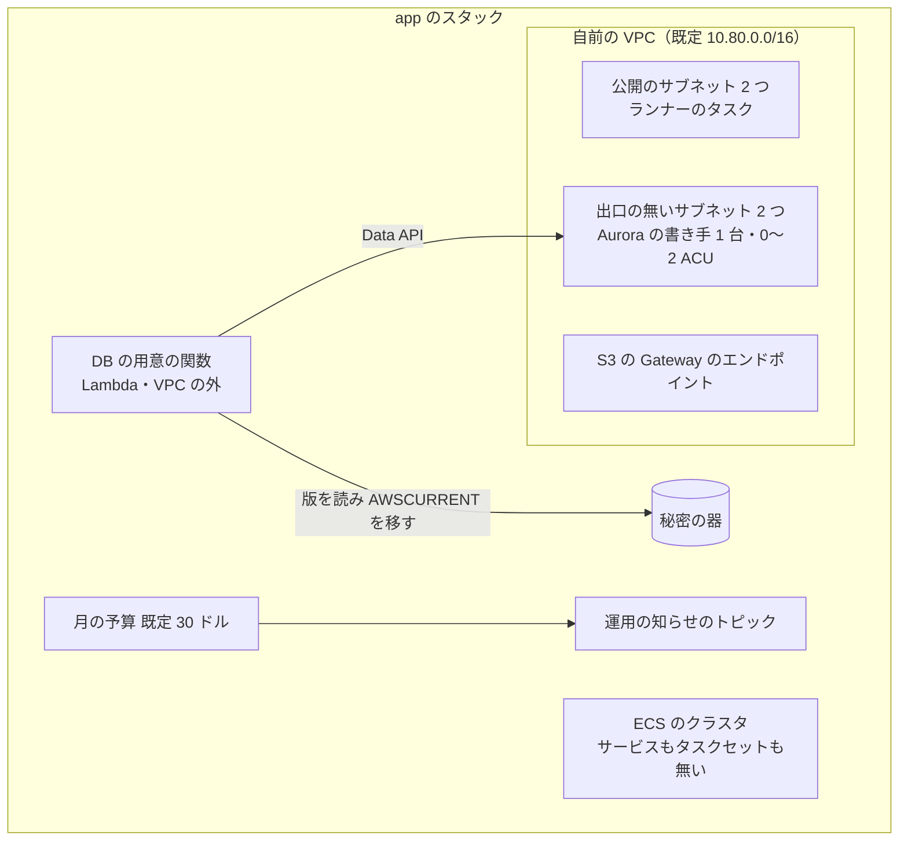

# アプリのスタックのインフラ: ネットワーク・進行表の DB・ECS のクラスタ・費用の見張り・足りない設定

## 概要

アプリのスタック（`app`）は、利用者プール・画面の配信・API・利用者の表に加えて、次の資源を持つ。どれも常駐する計算と NAT を持たず、使わない間の費用を 0 に近づける。

- 自前の VPC（2 つの AZ に公開のサブネットと出口の無いサブネット。NAT は置かない）
- 進行表の DB（Aurora Serverless v2 の PostgreSQL。最小 0 ACU・書き手 1 台・Data API を有効）
- ECS のクラスタ（サービスとタスクセットを作らない）と、ランナーのタスクが使う役割・ログの群
- DB の用意の関数（VPC の外の Lambda。中身は [DB の用意の関数](db-prep-function.md)）
- 費用の見張り（AWS Budgets の月の予算と、運用の知らせの SNS のトピック）

設置のコマンドの `diff` は、出力の最後に「足りない設定」の欄を出す。資源はすべて同じスタックにあり、`diff` の確認の値と要約値で縛られる。

この文書は nd-factory 自体の開発（このリポジトリ）の話で、nd-factory の製品が動く場所を扱う。

## 用語

語の意味は [用語集](../glossary.md) に従う（進行表の DB・形の正本・資格情報の差し替えなど）。この文書で本文に出すコードの名前は次のとおりである。

| 本文の語 | コードの名前 | 置き場 |
| --- | --- | --- |
| ネットワーク | `Network` | `infra/lib/network.ts` |
| 進行表の DB | `ProgressDb` | `infra/lib/progress-db.ts` |
| ECS のクラスタ | `TaskPlatform` | `infra/lib/tasks.ts` |
| DB の用意の関数の資源 | `DbPrepFunction` | `infra/lib/db-prep-function.ts` |
| 費用の見張り | `CostWatch` | `infra/lib/cost-watch.ts` |
| インフラの設定の値と既定 | `infraValues`・`INFRA_DEFAULTS` | `packages/contracts/src/settings.ts` |
| 足りない設定の一覧 | `MISSING_CHECKS`・`collectMissingSettings`・`printMissingSettings` | `infra/setup/missing-settings.ts` |
| スタックの決まりの検査 | `stackRuleViolations`・`hourlyCostResources` | `infra/test/support.ts` |

## コンテキスト

用語集のプラットフォーム（`platform`）のコンテキストに属する。コンテキストマップは [全体の設計](../design/overview.md) のとおりで、この仕様は集約を足さない。

## 構成要素と責務

| 構成要素 | 責務 |
| --- | --- |
| ネットワーク | VPC・4 つのサブネット・S3 の Gateway のエンドポイント・タスクの SG・Aurora の SG |
| 進行表の DB | Aurora のクラスタ（Data API を有効）・書き手・クラスタのパラメータの群・管理の役割の秘密の器 |
| ECS のクラスタ | ECS のクラスタ・タスクの実行の役割・許可の文を持たないタスクの役割・ログの群。ランナーのタスクの定義が使う値を公開する |
| DB の用意の関数の資源 | Lambda とその役割の権限（[DB の用意の関数のデータ・設定](db-prep-function.md#データ設定)） |
| 費用の見張り | 運用の知らせのトピックと宛先の購読・月の予算と 3 つの知らせ |
| アプリのスタック（`AppStack`） | 5 つの部品を組み、AZ を `Fn::GetAZs` から返し、利用者の表と画面の置き場を残す設定にする |
| 形の正本 | 設定のファイルの 5 つのキー・既定の値 |
| 設置のコマンド | `diff` の最後に足りない設定の一覧を出す |
| スタックのテスト | スタックの 8 つの決まりと Aurora の許しを合成の出力に照らす |

## 背景

ホステッドのレーンと進行表の DB の用意は、ネットワーク・進行表の DB・ECS のクラスタが無いと動かない。費用の見張りが無いと、自分で設置した人が使わない月の費用の増えに気づけない。構成は次の理由で決まっている。

| 決めたこと | 理由 |
| --- | --- |
| NAT と Interface 型のエンドポイントを置かず、タスクは公開のサブネットで公開 IP を付けて外へ出る。受け入れは空 | 時間で費用が掛かる資源を持たない（MVV の Value 6） |
| 資源をすべてアプリのスタックへ置く | 承認する人が 1 つの差分と確認の値で読める（Value 8） |
| AZ は `Fn::GetAZs` の先頭の 2 つを反映の時に選ぶ | 合成で AZ の lookup を走らせず、資格情報なしで合成でき、設置先の値が `cdk.context.json` に残らない |
| VPC の CIDR の既定は `10.80.0.0/16` | AWS の既定の VPC（`172.31.0.0/16`）と、手元のネットワークに多い `10.0.0.0/16`・`192.168.0.0/16` を避ける |
| 最大 ACU の既定は 2 | 進行表は NDF と DBOS の小さい表で、2 ACU（約 4 GiB）で 5 人のチームの並行の 2 本を受けられると置く。1 ACU は再開の直後の負荷で詰まりやすい |
| 予算の既定は月 30 ドル | [全体の設計の費用の見込み](../design/platform.md#見込み) の 5 人のチームの月 18.0 ドルに、見込みの外れの余裕を足した額 |
| 予算は既定でタグ `app-prefix`・`app-env` で絞る | 同じアカウントのほかの資源の費用で知らせが鳴らないようにする。タグを有効にできない設置先は `budget.scope: account` を選ぶ |
| 進行表の DB・表・画面の置き場は、スタックを消しても残す | 承認と判断の跡と進行表を失わない |

資源ごとの形の正は [プラットフォームの文書のインフラ](../design/platform.md#インフラ) と [費用](../design/platform.md#費用) にあり、この文書はその実装の値を持つ。

## 対象範囲

含む:

- 上の 5 つの部品と、`AppStack` への組み込み（AZ・利用者の表の PITR・残す設定）
- 設定のファイルの 5 つのキー（`network.vpc_cidr`・`progress_db.max_acu`・`budget.monthly_usd`・`budget.scope`・`ops.notify_emails`）
- `diff` の足りない設定の一覧の 4 種類の照らし
- スタックの決まりの検査（8 つの決まりと Aurora の許し）

含まない（ほかの課題が作る）:

- ランナーのタスクの定義・イメージ・自前の ECR と push（#6）
- DB の用意の関数を呼ぶ API と見回り、終わりの記録の口の本番の実装（#6）
- サービスの表の列と索引（#2）

## 仕様

### 集約

集約は足さない。進行表の DB の状態の列はプロジェクトの集約（[データの文書のテーブル定義](../design/data.md#テーブル定義)）にあり、この仕様の資源は値を持たない。

### 常に成り立つ条件

| # | 条件 | 縛るもの |
| --- | --- | --- |
| I11 | ランナーのタスクの役割は許可の文を持たない（レーンのコンテナは AWS の権限を持たない） | スタックの決まりの検査の `task_role_statement` |
| — | NAT・ECS のサービスとタスクセット・VPC の中の Lambda・タスクの SG の受け入れの規則が 1 件も無い | スタックの決まりの検査 |
| — | Aurora のクラスタは最小 0 ACU | 同上の `aurora_min` |
| — | 表・バケット・クラスタと、それらが参照で辿れる資源は、スタックを消しても置き換えが起きても残る | 同上の `deletable` |
| — | 表は PITR を持つ | 同上の `pitr` |
| — | 合成は資格情報なしで通り、AZ の lookup を求めない | `AppStack.availabilityZones` と CI の `synth` |

I10（プロジェクトごとに別のデータベースと役割）は [DB の用意の関数](db-prep-function.md#常に成り立つ条件) が守る。

### ネットワーク

| 項目 | 値 |
| --- | --- |
| VPC | 名前 `<prefix>-<environment>-vpc`。CIDR は `network.vpc_cidr`。AZ は 2 つ。NAT 0 個。既定の SG の規則を外す |
| サブネット | 各 AZ に公開と出口の無いものを 1 つずつ（計 4 つ）。接頭辞の長さは VPC の長さ +2（既定は /18）で等しく切る。公開のサブネットは公開 IP を自動で割り当てない（`RunTask` がタスクごとに付ける） |
| エンドポイント | S3 の Gateway 型だけ |
| タスクの SG | 名前 `<prefix>-<environment>-task-sg`。受け入れの規則を持たない。行きは 443 の任意と、Aurora の SG への 5432 だけ |
| Aurora の SG | 名前 `<prefix>-<environment>-db-sg`。受け入れはタスクの SG からの 5432 だけ。行きの規則を持たない |
| 残す設定 | VPC・出口の無い 2 つのサブネット・Aurora の SG は残す（残したクラスタが使う間は消せず、スタックの削除が止まるため） |

`AppStack` は `availabilityZones` を上書きし、`Fn::Select(0, Fn::GetAZs(""))` と `Fn::Select(1, Fn::GetAZs(""))` を返す。`Fn::GetAZs` は、既定の VPC の既定のサブネットが一部の AZ にだけあると、その AZ だけを返す。そのため設置先は「`Fn::GetAZs` が 2 つ以上の AZ を返す」ことを前提にし、`diff` の足りない設定の一覧で照らす。

### 進行表の DB

| 項目 | 値 |
| --- | --- |
| クラスタ | 識別子 `<prefix>-<environment>-progress-db`。Aurora PostgreSQL 16.13。出口の無いサブネットと Aurora の SG に置く |
| 書き手 | Serverless v2 の 1 台。読み手は置かない |
| 容量 | 最小 0 ACU・最大 `progress_db.max_acu`（既定 2）・接続 0 本で 300 秒経つと一時停止 |
| Data API | 有効 |
| 保護 | 保存の暗号化・削除の保護・残す設定 |
| 管理の役割 | 利用者 `nd_admin`。パスワードは CDK が作り、秘密の器 `<prefix>/<environment>/progress-db-admin` に置く。器は残す設定で、合成の出力には動的な参照だけが載る |
| ログ | CloudWatch Logs へ書き出さない |

クラスタのパラメータの群（残す設定）は次の値を持つ。

| パラメータ | 値 | 理由 |
| --- | --- | --- |
| `rds.force_ssl` | `1` | TLS でない接続を断る（Aurora PostgreSQL 16 は既定が 0） |
| `log_parameter_max_length` | `0` | 文のログに引数の値を書かない。DB の用意の関数は役割のパスワードの検証子を引数で渡し、送る前にこの値を読んで照らす |
| `log_parameter_max_length_on_error` | `0` | 失敗の文のログに引数の値を書かない |
| `rds.restrict_password_commands` | `1` | パスワードを変える文を `rds_password` の役割に限り、プロジェクトの役割が自分のパスワードを変えられないようにする。静的なパラメータで、既にあるクラスタは書き込みのインスタンスを再起動するまで効かない（手順は [設置の手順の「進行表の DB のパスワードの変更の禁止」](../operations/setup.md#進行表の-db-のパスワードの変更の禁止)） |

サブネットのグループは、クラスタが自ら作る子のまま残す設定にする。別の構成子に作り替えると論理 ID が変わり、固定の識別子を持つ既設のクラスタが置き換えを求められて更新が止まるためである。

### ECS のクラスタ

| 項目 | 値 |
| --- | --- |
| クラスタ | 名前 `<prefix>-<environment>-runner`。自前の VPC を渡す（渡さなければクラスタが NAT つきの VPC を作る）。Container Insights を付けない |
| ログの群 | 名前 `<prefix>-<environment>-runner`。30 日で消す。スタックを消せば群も消す |
| タスクの実行の役割 | `ecr:GetAuthorizationToken` と、名前が `<prefix>-<environment>-` で始まるリポジトリからのイメージの取得、ログの群への書き込みだけ |
| タスクの役割 | 許可の文を持たない。説明の文字列を印にし、スタックの決まりの検査がこの役割を見つける |
| 信頼 | 2 つの役割とも、このアカウントの ECS のタスク（`aws:SourceAccount` と `aws:SourceArn` の条件）だけが引き受けられる |

ランナーのタスクの定義は、次の公開の値と定数を使う。

| 名前 | 中身 |
| --- | --- |
| `cluster`・`executionRole`・`taskRole`・`logGroup`・`publicSubnets`・`taskSecurityGroup` | タスクの定義と `RunTask` に渡す値 |
| `RUNNER_TASK_SIZE` | ランナーの既定の大きさ。1 vCPU（1024）・2 GB（2048 MiB） |
| `RUN_TASK_PROPAGATE_TAGS` | `"TASK_DEFINITION"`。`RunTask` の `propagateTags` に必ず渡す。`RunTask` は既定でタスクの定義のタグを写さず、渡さなければ Fargate の費用がタグ `app-prefix`・`app-env` を持たず、タグで絞る予算に数えられない |

### 費用の見張り

| 項目 | 値 |
| --- | --- |
| 運用の知らせのトピック | 名前 `<prefix>-<environment>-ops`。KMS で暗号化しない（暗号化すると AWS Budgets に鍵の許しが別に要る） |
| 購読 | `ops.notify_emails` の宛先ごとにメールの購読。空なら作らない |
| トピックの方針 | 別の資源で作り、`budgets.amazonaws.com` に `SNS:Publish` を許す。条件は `aws:SourceAccount` がこのアカウント、`aws:SourceArn` がこのアカウントの予算 |
| 予算 | 名前 `<prefix>-<environment>-budget`。月・費用・USD。額は `budget.monthly_usd`（既定 30） |
| 数える範囲 | `budget.scope` が `tags` なら、タグ `user:app-prefix` が接頭辞と等しく、かつ `user:app-env` が環境の名前と等しい費用だけ。`account` なら絞らない |
| 知らせ | 実績 80%・実績 100%・見込み 100% の 3 つ。どれもトピックへ送る |
| 作る順 | 予算はトピックの方針に依る（`DependsOn`）。AWS Budgets は発行を許されていないトピックを無効と扱うため、初回の反映でも方針の後に予算を作る |

タグで絞る予算は、コスト配分タグ `app-prefix`・`app-env` が有効になるまで費用を 0 と数え、知らせは鳴らない。有効にできるのは組織に入っていないアカウントと組織の管理のアカウントだけで、組織のメンバーのアカウントは権限を足しても有効にできない。

### アプリのスタックの残す設定

| 資源 | 設定 |
| --- | --- |
| 利用者の表 | PITR を有効にし、残す設定にする |
| 画面の置き場のバケット | 残す設定にする |

スタックを消した後に同じ接頭辞と環境の名前で作り直す手順は [設置の手順の「アプリのスタックを消した後に作り直す」](../operations/setup.md#アプリのスタックを消した後に作り直す) にある。

### 足りない設定の一覧

`diff` は確認の値と `deploy` の打ち方を出した後に、照らしの配列 `MISSING_CHECKS` を順に打ち、結果を「足りない設定」の欄に出す。足りない設定があっても終了コードは変えない（反映はでき、直すかは設置する人が決める）。AWS は読むだけで書かない。

| 照らし | 行が出るとき | 読むもの |
| --- | --- | --- |
| Google のクライアントの ID | `login.google.client_id` が無い | 設定のファイル |
| コスト配分タグ | `budget.scope` が `tags` で、タグ `app-prefix`・`app-env` のどれかが `Active` でない。または状態を読めない | `ListCostAllocationTags`。行の中身を分けるために `DescribeOrganization` |
| 運用の知らせの宛先 | `ops.notify_emails` が無いか空 | 設定のファイル |
| `Fn::GetAZs` が返す AZ の数 | 2 未満。または読めない | `DescribeSubnets`（既定のサブネット）。既定のサブネットが無ければ `DescribeAvailabilityZones` の使える AZ の数 |

- 出力は、0 件なら「足りない設定: 無し」の 1 行、1 件以上なら「足りない設定:」の見出しと 1 件 1 行
- コスト配分タグの行は、有効にする先を組織の読みで分ける。組織に入っていなければこのアカウントの請求の画面、組織のメンバーなら組織の管理のアカウント（ID を読めればそれを示す）、読めなければ両方を示す。一覧にキーがまだ無い（`Missing`）タグは、タグの付いた資源を作るか一覧への反映（最大 24 時間）を待ってから有効にすることを示す。どの行も、有効にできなければ `budget.scope` を `account` にすることを添える
- AZ の行は、既定の VPC の別の AZ に既定のサブネットを作るコマンド（`diff` に渡した profile とリージョンを入れる）か、既定のサブネットをすべて消すことを示す
- 1 つの照らしが投げても、ほかの照らしは続け、その照らしを「<照らしの名前> を確かめられない（<例外の名前>: <文>）」の 1 行にする
- ほかの課題は、`MISSING_CHECKS` へ照らしを足すだけで行を増やせる

行の文言と直し方、`diff` の profile に要る読み取りの許しは [設置の手順の「足りない設定」](../operations/setup.md#足りない設定) が正である。

### スタックの決まりの検査

`stackRuleViolations` は合成の出力を次の 8 つの決まりに照らし、破れた資源を返す。

| 決まり | 破れとして返すもの |
| --- | --- |
| `nat` | `AWS::EC2::NatGateway` |
| `task_ingress` | タスクの SG（グループの名前が `-task-sg` で終わる）の `SecurityGroupIngress`、またはタスクの SG を指す `AWS::EC2::SecurityGroupIngress` |
| `lambda_in_vpc` | `VpcConfig` を持つ `AWS::Lambda::Function` |
| `ecs_service` | `AWS::ECS::Service`・`AWS::ECS::TaskSet` |
| `task_role_statement` | タスクの役割（印の説明を持つ役割と、タスクの定義の `TaskRoleArn` が指す役割）の `Policies`・`ManagedPolicyArns`、またはその役割へ付く `AWS::IAM::Policy`・`AWS::IAM::ManagedPolicy` |
| `aurora_min` | `ServerlessV2ScalingConfiguration.MinCapacity` が 0 でない `AWS::RDS::DBCluster` |
| `deletable` | 表・バケット・Aurora のクラスタと書き手、およびそれらが参照（`Ref`・`Fn::GetAtt`）で辿れる資源のうち、`DeletionPolicy` か `UpdateReplacePolicy` が `Retain` でないもの |
| `pitr` | PITR が有効でない表（グローバルテーブルはすべてのレプリカで有効なときだけ有効とする） |

「時間で費用が掛かる資源」の検査（`hourlyCostResources`）は Aurora を数えるが、最小 0 ACU・自動の一時停止 300 秒・Serverless v2（`db.serverless`）の書き手 1 台・読み手なしのクラスタとその書き手だけは数えない。

## データ・設定

### 設定のファイルのキー

形の正本 `packages/contracts/src/settings.ts` にある。どれも任意で、無ければ `INFRA_DEFAULTS` の既定を使う（`infraValues`）。キーの説明の正は [設定のファイル](../operations/settings.md#キー) にある。

| キー | 形 | 既定 | 読む構成要素 |
| --- | --- | --- | --- |
| `network.vpc_cidr` | IPv4 の CIDR。接頭辞の長さ 16〜20。ホストの部分は 0 | `10.80.0.0/16` | ネットワーク |
| `progress_db.max_acu` | 数。1〜16、0.5 刻み | `2` | 進行表の DB |
| `budget.monthly_usd` | 整数。1〜100,000 | `30` | 費用の見張り |
| `budget.scope` | `tags` か `account` | `tags` | 費用の見張り・足りない設定の一覧 |
| `ops.notify_emails` | メールの配列。0〜10 件 | 空（購読を作らない） | 費用の見張り・足りない設定の一覧 |

### ほかの課題が足すキー

次のキーは名前・形・既定をこの仕様で決めてあり、読む構成要素を作る課題が、その構成要素と同じ変更で形の正本へ足す（読み手の無いキーを先に足さない）。

| キー | 形 | 既定 | 読む構成要素 | 足す課題 |
| --- | --- | --- | --- | --- |
| `limits.max_concurrent_lanes` | 整数。1〜1,000 | `20` | 使える量の判定 | #29 |
| `progress_db.rotation_retry_limit` | 整数。1〜10 | `3` | 見回り（差し替えの呼び直しの上限） | #6 |
| `retention.records_days` | 整数。30〜3,650 | `365` | 承認資料の本文と操作の記録の期限 | #8・#11 |

### 資源の名前

名前は設定の接頭辞と環境の名前から作る（`infra/lib/naming.ts` の `appResourceNames`）。

| 資源 | 名前 |
| --- | --- |
| VPC・タスクの SG・Aurora の SG | `<prefix>-<environment>-vpc`・`-task-sg`・`-db-sg` |
| ECS のクラスタとそのログの群 | `<prefix>-<environment>-runner` |
| 進行表の DB のクラスタ | `<prefix>-<environment>-progress-db` |
| 管理の役割の秘密の器 | `<prefix>/<environment>/progress-db-admin` |
| プロジェクトの秘密の器の頭 | `<prefix>/<environment>/progress-db/` |
| DB の用意の関数とそのログの群 | `<prefix>-<environment>-db-prep` |
| 運用の知らせのトピック・予算 | `<prefix>-<environment>-ops`・`<prefix>-<environment>-budget` |
| ランナーのイメージのリポジトリ（作るのは #6） | `<prefix>-<environment>-*` の形 |

すべての資源にタグ `app-prefix`（接頭辞）と `app-env`（環境の名前）が付く。

## 外部連携

| 相手 | 連携 |
| --- | --- |
| CloudFormation | 設置のコマンドの `deploy` か反映のパイプラインがアプリのスタックを反映する。`cdk deploy` を設置のコマンドの外で打たない |
| Cost Explorer・Organizations・EC2 | `diff` が足りない設定の一覧のために読む（書かない） |
| AWS Budgets | 予算の知らせを運用の知らせのトピックへ発行する |
| ランナーのタスクの定義と `RunTask`（#6） | ECS のクラスタの公開の値・`RUNNER_TASK_SIZE`・`RUN_TASK_PROPAGATE_TAGS` を使う。#6 は API の関数の役割に `ecs:TagResource` を許す |
| DB の用意の関数を呼ぶ側（#6） | `AppStack` の `dbPrep` を通じて、呼ぶ権限と終わりの記録の口の DynamoDB の権限を足す（[DB の用意の関数の外部連携](db-prep-function.md#外部連携)） |

## エラー処理

| 起きること | 扱い |
| --- | --- |
| 設定のファイルのキーが形に合わない・未知のキー | `diff` が 1 件 1 行で示して止まる（終了コードは [設置の手順の終了コード](../operations/setup.md#終了コード)） |
| `Fn::GetAZs` が 1 つの AZ しか返さない設置先 | 合成と CI は通り、反映の時にネットワークを作れずに止まる。CloudFormation が前の状態へ戻し、状態を持つ資源は壊れない。`diff` の一覧が反映の前に示す |
| 足りない設定の照らしで AWS を読めない | 「確かめられない」の 1 行と次の操作を出して続ける。終了コードは変えない |
| 残した資源と同じ名前で作り直す | 作成が失敗して CloudFormation が戻す。残った資源を消す手順は [設置の手順](../operations/setup.md#アプリのスタックを消した後に作り直す) にある |

## セキュリティ

- タスクの役割は許可の文を持たず、タスクの SG は受け入れを持たない（I11）
- 進行表の DB への接続は TLS に限る（`rds.force_ssl`）。DB は出口の無いサブネットにあり、受け入れはタスクの SG からの 5432 だけ
- 管理の役割のパスワードは秘密の器に置き、合成の出力には動的な参照だけが載る
- 例とテストの値は作り物（アカウント `123456789012`・リージョン `us-west-2`・接頭辞 `acme`・メール `ops@example.com`）だけを使う

## 運用

- 日々の設置と反映、足りない設定の直し方、進行表の DB の設定の守り、スタックを消した後の作り直しは [設置の手順](../operations/setup.md) にある
- 運用する環境の `app` は反映のパイプラインだけで反映する。戻しの予行は、運用する環境と別の `environment` の値で設置のコマンドから立てた環境（予行の環境）で行う。予行では、変えるときも戻すときも、そのときのコードと設定で `diff --stack app` を打ち、今の予行のスタックとの差分を人が読んで承認してから、そのとき出た確認の値で `deploy` する。前に保存した合成の結果を、今のスタックとの差分を読まずに反映し直すことはしない（反映は差分を見て承認した範囲だけ）

反映した後に、次の確かめを行う。値はリポジトリと課題に書かず、比と時間と回数と判定だけを残す。確認の値・端末の出力・画面の写しは課題に載せない（確認の値にはアカウントとリージョンが、端末の出力には profile の名前も入る）。M1・M2 は運用する環境で読むだけで反映しない。M4・M5 は予行の環境で行う。

| # | 確かめること | 手順 | 合格の目安 |
| --- | --- | --- | --- |
| M1 | 接続の無い間の一時停止 | 反映の後 3 日、CloudWatch の `ServerlessDatabaseCapacity` を期間 5 分・統計 `Maximum` で読み、0 ACU を超えた時間の合計と区間の数を数える。区間ごとに RDS のイベントと `DatabaseConnections` に照らして理由を決める（下の「M1 の数え方と判定」） | 0 ACU を超えた区間がすべて「保守による再開（基準内）」で、どの区間も 60 分以内に再停止した |
| M2 | 単価の効き | 利用者が、#13 の案内に書いた列（使わない月・1 人のチーム・5 人のチーム）と費目（EventBridge Scheduler・DynamoDB の PITR・DynamoDB のストリーム）ごとの課金の対象の月の量（無料の枠を引いた後）に、設置したリージョンの単価を手元で掛け、列ごとに 3 つの費目の額を足して判定する（下の「M2 の判定と返し方」） | 3 つの列すべてに判定（0.10 ドル以上・0.10 ドル未満・判定できない）を書く。単価・単価の比・額・増加率・リージョンの名前は書かない |
| M4 | 戻しの予行 | (0) 変更の前に、予行の環境の利用者の表へ作り物の目印の項目を 1 件置く。(1) 状態を持つ資源に触れない小さな変更（運用の知らせのトピックの表示名など）で `diff --stack app` を打ち、人が対象のスタックと差分を確かめ、状態を持つ資源に変更が無いと承認したら、そのとき出た確認の値で `deploy` する。(2) 変更の前のコードで `diff --stack app` を打ち直し、今のスタックから戻す差分を人が読んで承認してから、そのとき出た確認の値で `deploy` する。(0) の後・(1) の後・(2) の後の 3 回、Aurora のクラスタの識別子とリソースの ID、利用者の表の項目の数、目印の項目 1 件を同じコマンドで読み比べる。止める合図が出たら、そこで止めて (2) へ進まない（下の「M4 の目印の項目と接続先」「M4 で止めるとき」） | 3 回とも、クラスタの識別子とリソースの ID が同じで、項目の数と目印の項目が一致する。結果には一致したかどうかと、各差分を承認したかどうかと日付だけを書く |
| M5 | 予算と運用の知らせ | (0) 予算を変える前に、知らせを出せて受け取れる環境かを確かめる。1 つでも満たさなければ (1) へ進まず「保留」とする。(1) 予算を 1 ドルにした設定で `diff` を打ち、今の予行のスタックとの差分を人が読んで承認してから、そのとき出た確認の値で `deploy` し、知らせが届いたかを判定する。(2) 判定が決まったら、予算をもとの額に戻した設定で `diff` を打ち直し、今の予行のスタックから戻す差分を人が読んで承認してから、そのとき出た確認の値で `deploy` する（下の「M5 の合否の決め方」） | 通知の条件を満たした後、待つ上限までに予算の知らせが宛先に届く。結果には判定と、条件を確かめた日付と、各差分を承認したかどうかと日付だけを書き、費用の額は書かない |

確認の値の違う `deploy` が止まることは、予行の環境で一致しない値を渡して試さない。検査に不具合があると、承認と結び付かない合成の結果が反映されるためである。この確かめは `infra/test/nd-setup.test.ts` の `runDeploy` のテスト（置き場とアカウントが同じでも、確認の値だけが違えば 7 で、AWS へ書かない）が受け持つ。

進行表の DB へ接続して確かめる項目（再開の待ち・カタログの分け方・Data API の振る舞い・ACU の平均など）は #44 が受ける。

### M1 の数え方と判定

- 区間の数え方: `ServerlessDatabaseCapacity` の `Maximum` が 0 を超えた 5 分の枠を「起きていた枠」とし、続いた起きていた枠を 1 つの区間とする。区間の長さは枠の数 × 5 分で、時間の合計は区間の長さの和である。データの点が無い枠は「欠けた枠」とし、0 ACU として数えない。欠けた枠をはさむ前後の起きていた枠は別の区間とする
- RDS のイベントと重なるとは、クラスタかインスタンスの RDS のイベント（保守の適用・保守による再開）の時刻が、区間の最初の枠の始まりの 5 分前から最初の枠の終わりまでの 10 分の間にあることを言う
- `DatabaseConnections` は期間 5 分・統計 `Maximum` で、区間の中の起きていた枠だけを読む。起きていた枠にデータの点が無ければ、その枠の接続は「確かめられない」とし、0 とみなさない
- 区間の長さの基準は 60 分（12 枠）とする。保守の後に一時停止へ戻るまでの少なくとも 20 分に、一時停止までの 300 秒と枠の端数を足した 30 分の 2 倍で、見込みの前提と比べるための運用上の基準である（障害の判定ではない）
- 再停止したとは、区間の後に 0 ACU へ戻ったことを言う。区間が観測の終わりまで続くときは、観測の終わりから 24 時間（追跡の期間）まで同じ読み方で読み続ける。3 日の時間の合計と区間の数には追跡の期間の枠を入れない。観測の終わりをまたいだ区間の合否は、追跡の期間の中で最初の 0 ACU の枠より前の起きていた枠まで合わせて判定する。その前に欠けた枠があれば、その区間は「原因不明」とする
- 区間ごとの理由は、次の上から順に当てはめ、最初に当たったものにする
  1. 保守のほかの稼働: 区間の中に `DatabaseConnections` が 0 を超えた枠がある
  2. 原因不明: RDS のイベントと重ならない・接続を確かめられない枠がある・RDS のイベントの保持の期間（14 日）を過ぎて照らせなかった・追跡の期間の欠けた枠のために再停止を確かめられない
  3. 止まらない稼働: RDS のイベントと重なり、接続はすべての枠で 0 だが、追跡の期間の終わりまで欠けた枠なく起きていた枠が続いた
  4. 保守による再開（基準超過）: RDS のイベントと重なり、接続はすべての枠で 0 で、再停止したが、区間の長さが 60 分を超えた
  5. 保守による再開（基準内）: RDS のイベントと重なり、接続はすべての枠で 0 で、再停止し、区間の長さが 60 分以内である
- M1 の判定は、次の上から順に当てはめる
  1. 不合格: 保守のほかの稼働・止まらない稼働・保守による再開（基準超過）の区間が 1 つでもある（欠けた枠や原因不明の区間が同時にあっても不合格）
  2. 保留: 欠けた枠か原因不明の区間がある
  3. 合格: 上のどちらにも当たらない
- 結果には、区間ごとの理由の数と、観測した 3 日の始まりの日付を書く。基準を超えたかどうかと再停止したかどうかは区間ごとに別の欄で書く。RDS のイベントの識別子は書かない
- 読む期限: RDS のイベントは 14 日で読めなくなる。観測した 3 日の始まりから 14 日以内に、`ServerlessDatabaseCapacity`・`DatabaseConnections`・RDS のイベントの 3 つを読んで区間ごとの理由を決める
- 代わりの観測の期間: 反映の後 3 日の観測が「保留」になったときだけ、読む日の前日までの続いた 3 日で読み直してよい。始まりが読む日から 14 日以内で、その期間とその前の 1 日にアプリのスタックの反映が無い期間にする。「不合格」で確定したときは読み直さない。代わりの期間を使ったことと、その始まりの日付を結果に書く

### M2 の判定と返し方

- M2 の対象は EventBridge Scheduler・DynamoDB の PITR・DynamoDB のストリームの 3 つの費目だけで、Aurora の計算は入れない。無料の枠は、アカウントの枠がすべて残っているとして引く
- 課金の対象の月の量は、AI が公開の情報とスタックの定義だけから出して #13 の案内に書く。量を置けない費目は「置けない」と書く。単価を掛けるのは設置したリージョンの単価を読む利用者だけで、掛け算は手元で行う
- 列ごとの判定は次の 3 つのどれかにする
  - 0.10 ドル以上: 月の量を置けた費目だけで、効きが 0.10 ドル以上になった
  - 0.10 ドル未満: すべての費目の月の量を置けて、効きが 0.10 ドル未満になった
  - 判定できない: 月の量を置けない費目があり、置けた費目だけでは 0.10 ドルに届かない。置けなかった費目の名前を添える
- 公開のコメントに書くのは、実施日・列ごとの判定・「判定できない」の列の置けなかった費目の名前の 3 つだけである。設置したリージョンでの M2 の読みは [全体の設計の費用の見込み](../design/platform.md#見込み) の表の額に使わず、「読み方」に列ごとの判定だけを書く

### M4 の目印の項目と接続先

- 目印の項目は、(0) で予行の環境の利用者の表へ AWS CLI の `aws dynamodb put-item` で 1 件だけ書く。設置のコマンドにはデータを書く経路が無いため、この書き込みだけを設置のコマンドの外で行う（スタックの反映ではない）。`pk` と `sk` はどちらも `M4-REHEARSAL-MARKER` のように予行の目印と分かる文字列にし、ほかの属性は `note`（文字列 `rehearsal`）と `run`（予行の目印の値）の 2 つだけにする。`run` には、予行を始めるたびに新しく決める値（例: `m4-<実施日>-<手元で作った乱数 8 文字>`）を入れ、手元の記録に残す。前の予行の目印と今回の目印を、この値で見分けるためである。実在の利用者のメールアドレス・名前・ID は書かない。`--condition-expression 'attribute_not_exists(pk)'` を付けて 1 回だけ書き、条件で失敗したら鍵を変えずに止めて、その項目が何かを確かめる
- M4 で打つ `aws` のコマンドは、どれも `--profile <予行の profile> --region <予行のリージョン>` を付けて打ち、既定の profile とリージョン（環境変数 `AWS_PROFILE`・`AWS_REGION` を含む）に頼らない。運用する環境の表には書かない
- 照合に使う予行のアカウント・リージョン・スタックの名前は、今回の profile で打ったコマンドの出力でなく、予行の環境を立てたときの記録から取る。アカウントとリージョンはそのときに `deploy` へ渡した確認の値の 2 つ目と 3 つ目、スタックの名前はそのときの設定の `prefix` と `environment` から `<prefix>-<environment>-app`、利用者の表の名前は `<prefix>-<environment>-accounts` とする。記録が無いか、記録に `prefix` と `environment`（またはスタックの名前）が無いか、記録と次の照らしの値が 1 つでも違うときは、`put-item`・`delete-item`・`deploy` のどれも打たずに止め、M4 を「保留」（接続先を確かめられない）とする
- `deploy` の前には毎回、今回の `diff` の出力が記録と同じ予行のスタックだけを対象にしていることを照らす。確認の値の 2 つ目と 3 つ目が記録のアカウントとリージョンと同じ・4 つ目（スタックの一覧）が `app` だけ・「作る資源の名前」の欄のアプリのスタックの名前と利用者の表の名前が記録から決めた名前と同じ、の 3 つで、1 つでも違えば `deploy` を打たずに止める。`--stack` を省くと、設定に `pipeline` があるときはパイプラインのスタックも対象になるため、M4 の `diff` はどれも `--stack app` を付ける
- `put-item` と `delete-item` の直前には毎回、`aws sts get-caller-identity --query Account` が記録のアカウントと同じこと、`--region` が記録のリージョンと同じこと、記録から決めたスタックの名前で `aws cloudformation list-stack-resources` が返す `AWS::DynamoDB::Table` の物理 ID に利用者の表の名前があることを確かめる
- 照合の 3 つは、3 回とも同じコマンドで読む
  - Aurora のクラスタの識別子とリソースの ID: `aws cloudformation list-stack-resources` が返す `AWS::RDS::DBCluster` の物理 ID をクラスタの識別子とし、`aws rds describe-db-clusters --db-cluster-identifier <クラスタの識別子> --query 'DBClusters[0].DbClusterResourceId'` でリソースの ID を読む
  - 項目の数: `aws dynamodb scan --select COUNT --consistent-read`
  - 目印の項目: `aws dynamodb get-item --consistent-read` で同じ鍵を読み、`note` が `rehearsal` で、`run` が今回の予行の目印の値のままかを確かめる
- 3 回目の照合の後、目印の項目を消す（予行の環境をすぐ片付けるなら残してもよい）。消すのはデータの削除なので、人の承認を取る工程として行う。人が、対象の表の名前が記録から決めた予行の利用者の表であることと、対象の鍵と `run` の値が今回の目印のものであることを確かめて承認してから、`aws dynamodb delete-item` に `--condition-expression 'note = :note AND #run = :run'`（`:note` は `rehearsal`、`:run` は今回の目印の値）を付けて、同じ鍵の 1 件だけを消す。条件で失敗したら、消さずに止めてその項目が何かを確かめる。表のほかの項目は消さない。結果には、削除を承認したかどうかと日付だけを書く

### M4 で止めるとき

- 止める合図は次の 3 つである。出たら予行をそこで止め、残りの工程を行わない。証跡をそろえるために (2) の戻しへ進まない
  - クラスタの識別子かリソースの ID が変わった（資源が置き換わった）
  - 利用者の表の項目の数か、目印の項目 1 件が、変更の前と一致しない
  - (1) か (2) の `diff` に、状態を持つ資源の置き換えか削除が出た（このときは `deploy` せずに止める）
- 合図が反映の後に出て止めたときは、障害として運用の責任者（運用する環境を反映した利用者）へ引き継ぐ。運用の責任者が影響と戻し方を確かめるまで、予行の環境へ `deploy` も `put-item`・`delete-item` も打たない。スタックの直しは新しい課題にし、予行はその課題が直した後に (0) からやり直す
- 止めたときは、結果に、行った工程（(0) と各回の照合の結果と日付、(1)・(2) の差分の確認・承認したかどうか・反映の結果と日付）・止めた理由（どの合図か）・行わなかった工程を書く。数・識別子・差分の中身は書かない
- 戻しの予行を 1 回行った証跡にするのは、(2) の戻しの `deploy` まで実際に行った予行だけである

  | 止めた時点 | 結果 | 証跡にするか |
  | --- | --- | --- |
  | (2) の `deploy` の後の照合で不一致が出た | 不合格 | する（戻しを行い、状態が保たれなかったと分かった） |
  | (1) の `deploy` の後の照合で不一致が出た | 不合格 | しない。スタックの直しを新しい課題にし、直した後に予行し直す |
  | (2) の `diff` に状態を持つ資源の置き換えか削除が出た | 不合格 | しない。扱いは上の行と同じ |
  | (1) の `diff` に状態を持つ資源の置き換えか削除が出た | 保留 | しない。別の小さな変更を選んで (1) からやり直す |
  | 合図と関係なく止めた（時間切れ・`diff` や `deploy` の失敗など） | 保留 | しない。理由を添え、下のやり直しの順に従う |

- やり直しの順は、予行の環境の状態が変わっていないと確かめられたときだけ使う
  1. 反映を始めた可能性がある（(1) か (2) の `deploy` が失敗した・途中か後に端末が時間切れになった・終わりを見届けられなかった）ときは、`aws cloudformation describe-stacks --query 'Stacks[0].StackStatus'` が `_IN_PROGRESS` で終わらない状態になるまで待ち、照合の 3 つを読み直して (0) の後の値と比べる。`_IN_PROGRESS` のまま止まらない・`_FAILED` で終わる・値を読めない・一致しない、のどれかなら運用の責任者へ引き継ぐ
  2. 前回の予行で (1) の `deploy` を打っていたときは、変更の前のコードと設定で `diff --stack app` を打ち（接続先の照らしも行う）、スタックが変更の前と後のどちらにあるかを判定する。差分が無ければ 3 へ進む。予行の小さな変更を戻す差分だけがあれば、状態を持つ資源の置き換えか削除が無いことを確かめ、人が差分を承認してから、そのとき出た確認の値で `deploy` して戻し、照合の 3 つが (0) の後の値と一致したら 3 へ進む（この戻しは証跡にしない）。それ以外の差分か、状態を持つ資源の置き換えか削除が出たら、`deploy` せずに運用の責任者へ引き継ぐ
  3. 接続先を確かめてから `get-item --consistent-read` で目印の鍵を読む。項目があり、属性が `pk`・`sk`・`note`（`rehearsal`）・`run` だけで、`run` が手元の記録にある前回の予行の目印の値と同じなら、前回の目印として消す。消す前に、通常の片付けと同じく人が対象の表・鍵・`run` の値を確かめて承認し、`delete-item` に同じ条件（`:run` は前回の目印の値）を付けて消す。それ以外の属性があるか、`note` が違うか、`run` が記録に無い値のときは、消さずに止めてその項目が何かを確かめる
  4. (0) から始め、今回の目印を書いた後に読んだ値を照合の基準にする。前回の予行で読んだ値は基準に使わない

### M5 の合否の決め方

- このスタックの予算の知らせは、実際の費用が予算の 80%・100% を超えたときと、予測が 100% を超えたときの 3 つである（`infra/lib/cost-watch.ts`）。実際の費用の知らせは予算の期間（1 か月）ごとに閾値に初めて達したときに 1 回だけ送られるため、判定には実際の費用の 80% の知らせ（対象の知らせ）だけを使う
- 予算を変える前の確認: 次の 3 つを確かめ、1 つでも満たさなければ (1) へ進まず「保留」とし、理由を添える
  1. 予算が費用を数えられる。`budget.scope` が `tags` なら、今の予行の設定で打った `diff` の足りない設定の欄に「コスト配分タグが有効でない」と「コスト配分タグが有効かを確かめられない」の行が無い（`account` なら要らない）
  2. 同じ欄に「運用の知らせの宛先が空」の行が無い
  3. `aws sns list-subscriptions-by-topic` の結果に、`ops.notify_emails` の宛先で `SubscriptionArn` が `PendingConfirmation` でない購読が 1 件以上ある（トピックの ARN は結果に書かない）
- 今の期間に対象の知らせが送られていないことの確認: `NotificationState` が `OK` であること・受信箱にメールが無いこと・期間の初日に `OK` だったことは、未送信の根拠にしない。次の 2 つがどちらも成り立つ予行用の予算で試す
  - 予算を含む予行のスタックの `CreationTime`（`aws cloudformation describe-stacks`）が、今月の 1 日の 0 時（UTC）より後である
  - 予算の画面の今の期間の実際の費用が、(1) の前の時点で、もとの予算の額の 80% 未満である
  - あわせて、CloudWatch の `AWS/SNS` の `NumberOfMessagesPublished`（運用の知らせのトピック・統計 `Sum`）を今月の 1 日の 0 時（UTC）から今まで読み、0 であることを確かめる。0 でも未送信の根拠にはせず、上の 2 つと食い違わないかを見るためだけに使う
  - 確かめられないとき（スタックが今の期間より前に作られた・作った時期を読めない・実際の費用が既に 80% 以上・集計が 1 以上・集計を読めない）は、(1) へ進まず「保留」とする。続けるときは予行の環境を設置のコマンドで立て直してやり直す
- (1) の `deploy` から下の待つ上限までが同じ月に収まることを確かめる。収まらなければ次の月に入ってから試す
- (1) の `deploy` の後の判定
  1. 待つ上限は (1) の `deploy` から 24 時間とする（AWS Budgets は費用のデータを 1 日に最大 3 回更新する）
  2. 予算の最後の更新の時刻が (1) より後で、実際の費用が 0.80 ドルを超え、対象の知らせの `NotificationState` が `ALARM` に変わったら、送る条件が試験の間に初めて成り立ったと判定する。その後、(1) から上限までに対象の知らせのメールが宛先に届けば「合格」とする。予測の知らせ・100% の知らせ・試験の前に届いたメールは使わない
  3. 送る条件が成り立ったのに、上限までに対象の知らせのメールが届かなければ「不合格」（配信の失敗）とする
  4. 上限までに、最後の更新が (1) より後になる・実際の費用が 0.80 ドルを超える・`ALARM` に変わる、の 1 つでも成り立たなければ「保留」とする
- どの判定でも、判定が決まったら (2) で予算を戻す

## テスト観点

テストは CI の `check`（lint・型検査・生成物の差・単体テストとスタックのテスト）と `synth` で走る。

| 観点 | 確かめること |
| --- | --- |
| I11 | 合成の出力のタスクの役割に、インラインとマネージドのどちらの許可の文も無い。文を 1 つ足すと落ちる |
| スタックの決まり | 今の `AppStack` で 8 つの決まりの破れが 0 件。決まりごとに違反を 1 つ入れた合成の出力で、その決まりだけが当たる |
| Aurora の許し | 最小 0・一時停止 300 秒・書き手 1 台のクラスタを数えない。最小を 0.5 にする・一時停止を外す・読み手を足すと数える |
| 資源の置き場 | ネットワーク・進行表の DB・ECS のクラスタ・DB の用意の関数・予算が `app` のスタックの合成の出力にある（`diff` の確認の値は、このスタックを含む合成の結果の要約値から作る） |
| ネットワーク | 2 つの AZ に公開と出口の無いサブネットが 1 つずつで NAT が無い。サブネットの AZ が `Fn::GetAZs` を引き、合成が AZ の lookup を求めない。`subnetMask` は `/16` で 18、`/20` で 22 |
| 進行表の DB | 最小 0・最大 2（16 まで受ける）・一時停止 300 秒・書き手 1 台・Data API が有効。パラメータの群の 4 つの値。クラスタ・秘密の器・パラメータの群・サブネットのグループが残る設定で、サブネットのグループの論理 ID がクラスタの子のまま |
| 費用の見張り | 予算の額・3 つの知らせ・2 つのタグの両方での絞り。予算がトピックの方針に依る。トピックに KMS の鍵が無い。宛先 0 件で購読 0 件。`account` で絞りが無い |
| 設定のキー | 5 つのキーの既定と境界（CIDR の接頭辞 16 と 20 は通り 15 と 21 は落ちる・ホストの部分が 0 でない CIDR は落ちる・ACU の 1 と 16 は通り 0.5・16.5・1.25 は落ちる・予算の 1 は通り 0 は落ちる・範囲は `tags`・`account` のほかは落ちる）・未知のキー・メールでない宛先 |
| 足りない設定の一覧 | 出力の最後に欄が出て、4 種類が当たる入力でそれぞれ 1 行。タグの行の有効にする先と、読めないときの次の操作が組織の読みの 3 通りで変わる。`budget.scope` が `account` ならタグの行が出ない。0 件で「無し」。AZ の数 2 で行が出ず 1 で出る。照らしが投げると「確かめられない」の 1 行。足りない設定があっても終了コード 0 |
| AZ の数の読み | 既定のサブネットが 3 つの AZ にあれば 3。1 つの AZ にだけあれば、使える AZ が 3 つでも 1。既定のサブネットが無ければ使える AZ の数 |

## 関連リンク

- [DB の用意の関数](db-prep-function.md)
- [プラットフォームの文書のインフラ](../design/platform.md#インフラ)・[費用](../design/platform.md#費用)・[反映と設置](../design/platform.md#反映と設置)
- [データの文書の進行表の DB](../design/data.md#進行テーブルの-db)
- [設置の手順](../operations/setup.md)・[設定のファイル](../operations/settings.md)
- [用語集](../glossary.md)
