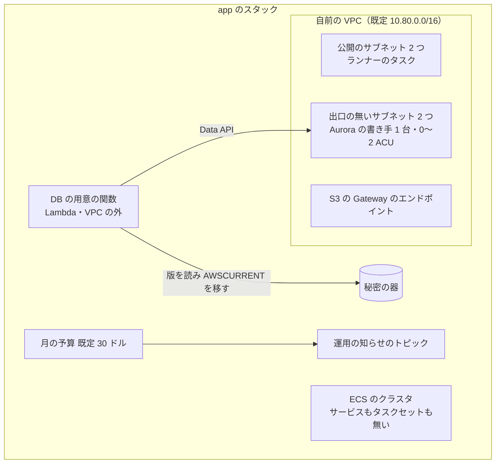

# アプリのスタックのインフラ: ネットワーク・進行表の DB・ECS のクラスタ・費用の見張り・足りない設定

## 概要

アプリのスタック（`app`）は、利用者プール・画面の配信・API・利用者の表に加えて、次の資源を持つ。どれも常駐する計算と NAT を持たず、使わない間の費用を 0 に近づける。

- 自前の VPC（2 つの AZ に公開のサブネットと出口の無いサブネット。NAT は置かない）
- 進行表の DB（Aurora Serverless v2 の PostgreSQL。最小 0 ACU・書き手 1 台・Data API を有効）
- ECS のクラスタ（サービスとタスクセットを作らない）と、ランナーのタスクが使う役割・ログの群
- DB の用意の関数（VPC の外の Lambda。中身は [DB の用意の関数](db-prep-function.md)）
- 費用の見張り（AWS Budgets の月の予算と、運用の知らせの SNS のトピック）

設置のコマンドの `diff` は、出力の最後に「足りない設定」の欄を出す。資源はすべて同じスタックにあり、`diff` の確認の値と要約値で縛られる。

この文書は nd-factory 自体の開発（このリポジトリ）の話で、nd-factory の製品が動く場所を扱う。

## 用語

語の意味は [用語集](../glossary.md) に従う（進行表の DB・形の正本・資格情報の差し替えなど）。この文書で本文に出すコードの名前は次のとおりである。

| 本文の語 | コードの名前 | 置き場 |
| --- | --- | --- |
| ネットワーク | `Network` | `infra/lib/network.ts` |
| 進行表の DB | `ProgressDb` | `infra/lib/progress-db.ts` |
| ECS のクラスタ | `TaskPlatform` | `infra/lib/tasks.ts` |
| DB の用意の関数の資源 | `DbPrepFunction` | `infra/lib/db-prep-function.ts` |
| 費用の見張り | `CostWatch` | `infra/lib/cost-watch.ts` |
| インフラの設定の値と既定 | `infraValues`・`INFRA_DEFAULTS` | `packages/contracts/src/settings.ts` |
| 足りない設定の一覧 | `MISSING_CHECKS`・`collectMissingSettings`・`printMissingSettings` | `infra/setup/missing-settings.ts` |
| スタックの決まりの検査 | `stackRuleViolations`・`hourlyCostResources` | `infra/test/support.ts` |

## コンテキスト

用語集のプラットフォーム（`platform`）のコンテキストに属する。コンテキストマップは [全体の設計](../design/overview.md) のとおりで、この仕様は集約を足さない。

## 構成要素と責務

| 構成要素 | 責務 |
| --- | --- |
| ネットワーク | VPC・4 つのサブネット・S3 の Gateway のエンドポイント・タスクの SG・Aurora の SG |
| 進行表の DB | Aurora のクラスタ（Data API を有効）・書き手・クラスタのパラメータの群・管理の役割の秘密の器 |
| ECS のクラスタ | ECS のクラスタ・タスクの実行の役割・許可の文を持たないタスクの役割・ログの群。ランナーのタスクの定義が使う値を公開する |
| DB の用意の関数の資源 | Lambda とその役割の権限（[DB の用意の関数のデータ・設定](db-prep-function.md#データ設定)） |
| 費用の見張り | 運用の知らせのトピックと宛先の購読・月の予算と 3 つの知らせ |
| アプリのスタック（`AppStack`） | 5 つの部品を組み、AZ を `Fn::GetAZs` から返し、利用者の表と画面の置き場を残す設定にする |
| 形の正本 | 設定のファイルの 5 つのキー・既定の値 |
| 設置のコマンド | `diff` の最後に足りない設定の一覧を出す |
| スタックのテスト | スタックの 8 つの決まりと Aurora の許しを合成の出力に照らす |

## 背景

ホステッドのレーンと進行表の DB の用意は、ネットワーク・進行表の DB・ECS のクラスタが無いと動かない。費用の見張りが無いと、自分で設置した人が使わない月の費用の増えに気づけない。構成は次の理由で決まっている。

| 決めたこと | 理由 |
| --- | --- |
| NAT と Interface 型のエンドポイントを置かず、タスクは公開のサブネットで公開 IP を付けて外へ出る。受け入れは空 | 時間で費用が掛かる資源を持たない（MVV の Value 6） |
| 資源をすべてアプリのスタックへ置く | 承認する人が 1 つの差分と確認の値で読める（Value 8） |
| AZ は `Fn::GetAZs` の先頭の 2 つを反映の時に選ぶ | 合成で AZ の lookup を走らせず、資格情報なしで合成でき、設置先の値が `cdk.context.json` に残らない |
| VPC の CIDR の既定は `10.80.0.0/16` | AWS の既定の VPC（`172.31.0.0/16`）と、手元のネットワークに多い `10.0.0.0/16`・`192.168.0.0/16` を避ける |
| 最大 ACU の既定は 2 | 進行表は NDF と DBOS の小さい表で、2 ACU（約 4 GiB）で 5 人のチームの並行の 2 本を受けられると置く。1 ACU は再開の直後の負荷で詰まりやすい |
| 予算の既定は月 30 ドル | [全体の設計の費用の見込み](../design/platform.md#見込み) の 5 人のチームの月 18.0 ドルに、見込みの外れの余裕を足した額 |
| 予算は既定でタグ `app-prefix`・`app-env` で絞る | 同じアカウントのほかの資源の費用で知らせが鳴らないようにする。タグを有効にできない設置先は `budget.scope: account` を選ぶ |
| 進行表の DB・表・画面の置き場は、スタックを消しても残す | 承認と判断の跡と進行表を失わない |

資源ごとの形の正は [プラットフォームの文書のインフラ](../design/platform.md#インフラ) と [費用](../design/platform.md#費用) にあり、この文書はその実装の値を持つ。

## 対象範囲

含む:

- 上の 5 つの部品と、`AppStack` への組み込み（AZ・利用者の表の PITR・残す設定）
- 設定のファイルの 5 つのキー（`network.vpc_cidr`・`progress_db.max_acu`・`budget.monthly_usd`・`budget.scope`・`ops.notify_emails`）
- `diff` の足りない設定の一覧の 4 種類の照らし
- スタックの決まりの検査（8 つの決まりと Aurora の許し）

含まない（ほかの課題が作る）:

- ランナーのタスクの定義・イメージ・自前の ECR と push（#6）
- DB の用意の関数を呼ぶ API と見回り、終わりの記録の口の本番の実装（#6）
- サービスの表の列と索引（#2）

## 仕様

### 集約

集約は足さない。進行表の DB の状態の列はプロジェクトの集約（[データの文書のテーブル定義](../design/data.md#テーブル定義)）にあり、この仕様の資源は値を持たない。

### 常に成り立つ条件

| # | 条件 | 縛るもの |
| --- | --- | --- |
| I11 | ランナーのタスクの役割は許可の文を持たない（レーンのコンテナは AWS の権限を持たない） | スタックの決まりの検査の `task_role_statement` |
| — | NAT・ECS のサービスとタスクセット・VPC の中の Lambda・タスクの SG の受け入れの規則が 1 件も無い | スタックの決まりの検査 |
| — | Aurora のクラスタは最小 0 ACU | 同上の `aurora_min` |
| — | 表・バケット・クラスタと、それらが参照で辿れる資源は、スタックを消しても置き換えが起きても残る | 同上の `deletable` |
| — | 表は PITR を持つ | 同上の `pitr` |
| — | 合成は資格情報なしで通り、AZ の lookup を求めない | `AppStack.availabilityZones` と CI の `synth` |

I10（プロジェクトごとに別のデータベースと役割）は [DB の用意の関数](db-prep-function.md#常に成り立つ条件) が守る。

### ネットワーク

| 項目 | 値 |
| --- | --- |
| VPC | 名前 `<prefix>-<environment>-vpc`。CIDR は `network.vpc_cidr`。AZ は 2 つ。NAT 0 個。既定の SG の規則を外す |
| サブネット | 各 AZ に公開と出口の無いものを 1 つずつ（計 4 つ）。接頭辞の長さは VPC の長さ +2（既定は /18）で等しく切る。公開のサブネットは公開 IP を自動で割り当てない（`RunTask` がタスクごとに付ける） |
| エンドポイント | S3 の Gateway 型だけ |
| タスクの SG | 名前 `<prefix>-<environment>-task-sg`。受け入れの規則を持たない。行きは 443 の任意と、Aurora の SG への 5432 だけ |
| Aurora の SG | 名前 `<prefix>-<environment>-db-sg`。受け入れはタスクの SG からの 5432 だけ。行きの規則を持たない |
| 残す設定 | VPC・出口の無い 2 つのサブネット・Aurora の SG は残す（残したクラスタが使う間は消せず、スタックの削除が止まるため） |

`AppStack` は `availabilityZones` を上書きし、`Fn::Select(0, Fn::GetAZs(""))` と `Fn::Select(1, Fn::GetAZs(""))` を返す。`Fn::GetAZs` は、既定の VPC の既定のサブネットが一部の AZ にだけあると、その AZ だけを返す。そのため設置先は「`Fn::GetAZs` が 2 つ以上の AZ を返す」ことを前提にし、`diff` の足りない設定の一覧で照らす。

### 進行表の DB

| 項目 | 値 |
| --- | --- |
| クラスタ | 識別子 `<prefix>-<environment>-progress-db`。Aurora PostgreSQL 16.13。出口の無いサブネットと Aurora の SG に置く |
| 書き手 | Serverless v2 の 1 台。読み手は置かない |
| 容量 | 最小 0 ACU・最大 `progress_db.max_acu`（既定 2）・接続 0 本で 300 秒経つと一時停止 |
| Data API | 有効 |
| 保護 | 保存の暗号化・削除の保護・残す設定 |
| 管理の役割 | 利用者 `nd_admin`。パスワードは CDK が作り、秘密の器 `<prefix>/<environment>/progress-db-admin` に置く。器は残す設定で、合成の出力には動的な参照だけが載る |
| ログ | CloudWatch Logs へ書き出さない |

クラスタのパラメータの群（残す設定）は次の値を持つ。

| パラメータ | 値 | 理由 |
| --- | --- | --- |
| `rds.force_ssl` | `1` | TLS でない接続を断る（Aurora PostgreSQL 16 は既定が 0） |
| `log_parameter_max_length` | `0` | 文のログに引数の値を書かない。DB の用意の関数は役割のパスワードの検証子を引数で渡し、送る前にこの値を読んで照らす |
| `log_parameter_max_length_on_error` | `0` | 失敗の文のログに引数の値を書かない |
| `rds.restrict_password_commands` | `1` | パスワードを変える文を `rds_password` の役割に限り、プロジェクトの役割が自分のパスワードを変えられないようにする。静的なパラメータで、既にあるクラスタは書き込みのインスタンスを再起動するまで効かない（手順は [設置の手順の「進行表の DB のパスワードの変更の禁止」](../operations/setup.md#進行表の-db-のパスワードの変更の禁止)） |

サブネットのグループは、クラスタが自ら作る子のまま残す設定にする。別の構成子に作り替えると論理 ID が変わり、固定の識別子を持つ既設のクラスタが置き換えを求められて更新が止まるためである。

### ECS のクラスタ

| 項目 | 値 |
| --- | --- |
| クラスタ | 名前 `<prefix>-<environment>-runner`。自前の VPC を渡す（渡さなければクラスタが NAT つきの VPC を作る）。Container Insights を付けない |
| ログの群 | 名前 `<prefix>-<environment>-runner`。30 日で消す。スタックを消せば群も消す |
| タスクの実行の役割 | `ecr:GetAuthorizationToken` と、名前が `<prefix>-<environment>-` で始まるリポジトリからのイメージの取得、ログの群への書き込みだけ |
| タスクの役割 | 許可の文を持たない。説明の文字列を印にし、スタックの決まりの検査がこの役割を見つける |
| 信頼 | 2 つの役割とも、このアカウントの ECS のタスク（`aws:SourceAccount` と `aws:SourceArn` の条件）だけが引き受けられる |

ランナーのタスクの定義は、次の公開の値と定数を使う。

| 名前 | 中身 |
| --- | --- |
| `cluster`・`executionRole`・`taskRole`・`logGroup`・`publicSubnets`・`taskSecurityGroup` | タスクの定義と `RunTask` に渡す値 |
| `RUNNER_TASK_SIZE` | ランナーの既定の大きさ。1 vCPU（1024）・2 GB（2048 MiB） |
| `RUN_TASK_PROPAGATE_TAGS` | `"TASK_DEFINITION"`。`RunTask` の `propagateTags` に必ず渡す。`RunTask` は既定でタスクの定義のタグを写さず、渡さなければ Fargate の費用がタグ `app-prefix`・`app-env` を持たず、タグで絞る予算に数えられない |

### 費用の見張り

| 項目 | 値 |
| --- | --- |
| 運用の知らせのトピック | 名前 `<prefix>-<environment>-ops`。KMS で暗号化しない（暗号化すると AWS Budgets に鍵の許しが別に要る） |
| 購読 | `ops.notify_emails` の宛先ごとにメールの購読。空なら作らない |
| トピックの方針 | 別の資源で作り、`budgets.amazonaws.com` に `SNS:Publish` を許す。条件は `aws:SourceAccount` がこのアカウント、`aws:SourceArn` がこのアカウントの予算 |
| 予算 | 名前 `<prefix>-<environment>-budget`。月・費用・USD。額は `budget.monthly_usd`（既定 30） |
| 数える範囲 | `budget.scope` が `tags` なら、タグ `user:app-prefix` が接頭辞と等しく、かつ `user:app-env` が環境の名前と等しい費用だけ。`account` なら絞らない |
| 知らせ | 実績 80%・実績 100%・見込み 100% の 3 つ。どれもトピックへ送る |
| 作る順 | 予算はトピックの方針に依る（`DependsOn`）。AWS Budgets は発行を許されていないトピックを無効と扱うため、初回の反映でも方針の後に予算を作る |

タグで絞る予算は、コスト配分タグ `app-prefix`・`app-env` が有効になるまで費用を 0 と数え、知らせは鳴らない。有効にできるのは組織に入っていないアカウントと組織の管理のアカウントだけで、組織のメンバーのアカウントは権限を足しても有効にできない。

### アプリのスタックの残す設定

| 資源 | 設定 |
| --- | --- |
| 利用者の表 | PITR を有効にし、残す設定にする |
| 画面の置き場のバケット | 残す設定にする |

スタックを消した後に同じ接頭辞と環境の名前で作り直す手順は [設置の手順の「アプリのスタックを消した後に作り直す」](../operations/setup.md#アプリのスタックを消した後に作り直す) にある。

### 足りない設定の一覧

`diff` は確認の値と `deploy` の打ち方を出した後に、照らしの配列 `MISSING_CHECKS` を順に打ち、結果を「足りない設定」の欄に出す。足りない設定があっても終了コードは変えない（反映はでき、直すかは設置する人が決める）。AWS は読むだけで書かない。

| 照らし | 行が出るとき | 読むもの |
| --- | --- | --- |
| Google のクライアントの ID | `login.google.client_id` が無い | 設定のファイル |
| コスト配分タグ | `budget.scope` が `tags` で、タグ `app-prefix`・`app-env` のどれかが `Active` でない。または状態を読めない | `ListCostAllocationTags`。行の中身を分けるために `DescribeOrganization` |
| 運用の知らせの宛先 | `ops.notify_emails` が無いか空 | 設定のファイル |
| `Fn::GetAZs` が返す AZ の数 | 2 未満。または読めない | `DescribeSubnets`（既定のサブネット）。既定のサブネットが無ければ `DescribeAvailabilityZones` の使える AZ の数 |

- 出力は、0 件なら「足りない設定: 無し」の 1 行、1 件以上なら「足りない設定:」の見出しと 1 件 1 行
- コスト配分タグの行は、有効にする先を組織の読みで分ける。組織に入っていなければこのアカウントの請求の画面、組織のメンバーなら組織の管理のアカウント（ID を読めればそれを示す）、読めなければ両方を示す。一覧にキーがまだ無い（`Missing`）タグは、タグの付いた資源を作るか一覧への反映（最大 24 時間）を待ってから有効にすることを示す。どの行も、有効にできなければ `budget.scope` を `account` にすることを添える
- AZ の行は、既定の VPC の別の AZ に既定のサブネットを作るコマンド（`diff` に渡した profile とリージョンを入れる）か、既定のサブネットをすべて消すことを示す
- 1 つの照らしが投げても、ほかの照らしは続け、その照らしを「<照らしの名前> を確かめられない（<例外の名前>: <文>）」の 1 行にする
- ほかの課題は、`MISSING_CHECKS` へ照らしを足すだけで行を増やせる

行の文言と直し方、`diff` の profile に要る読み取りの許しは [設置の手順の「足りない設定」](../operations/setup.md#足りない設定) が正である。

### スタックの決まりの検査

`stackRuleViolations` は合成の出力を次の 8 つの決まりに照らし、破れた資源を返す。

| 決まり | 破れとして返すもの |
| --- | --- |
| `nat` | `AWS::EC2::NatGateway` |
| `task_ingress` | タスクの SG（グループの名前が `-task-sg` で終わる）の `SecurityGroupIngress`、またはタスクの SG を指す `AWS::EC2::SecurityGroupIngress` |
| `lambda_in_vpc` | `VpcConfig` を持つ `AWS::Lambda::Function` |
| `ecs_service` | `AWS::ECS::Service`・`AWS::ECS::TaskSet` |
| `task_role_statement` | タスクの役割（印の説明を持つ役割と、タスクの定義の `TaskRoleArn` が指す役割）の `Policies`・`ManagedPolicyArns`、またはその役割へ付く `AWS::IAM::Policy`・`AWS::IAM::ManagedPolicy` |
| `aurora_min` | `ServerlessV2ScalingConfiguration.MinCapacity` が 0 でない `AWS::RDS::DBCluster` |
| `deletable` | 表・バケット・Aurora のクラスタと書き手、およびそれらが参照（`Ref`・`Fn::GetAtt`）で辿れる資源のうち、`DeletionPolicy` か `UpdateReplacePolicy` が `Retain` でないもの |
| `pitr` | PITR が有効でない表（グローバルテーブルはすべてのレプリカで有効なときだけ有効とする） |

「時間で費用が掛かる資源」の検査（`hourlyCostResources`）は Aurora を数えるが、最小 0 ACU・自動の一時停止 300 秒・Serverless v2（`db.serverless`）の書き手 1 台・読み手なしのクラスタとその書き手だけは数えない。

## データ・設定

### 設定のファイルのキー

形の正本 `packages/contracts/src/settings.ts` にある。どれも任意で、無ければ `INFRA_DEFAULTS` の既定を使う（`infraValues`）。キーの説明の正は [設定のファイル](../operations/settings.md#キー) にある。

| キー | 形 | 既定 | 読む構成要素 |
| --- | --- | --- | --- |
| `network.vpc_cidr` | IPv4 の CIDR。接頭辞の長さ 16〜20。ホストの部分は 0 | `10.80.0.0/16` | ネットワーク |
| `progress_db.max_acu` | 数。1〜16、0.5 刻み | `2` | 進行表の DB |
| `budget.monthly_usd` | 整数。1〜100,000 | `30` | 費用の見張り |
| `budget.scope` | `tags` か `account` | `tags` | 費用の見張り・足りない設定の一覧 |
| `ops.notify_emails` | メールの配列。0〜10 件 | 空（購読を作らない） | 費用の見張り・足りない設定の一覧 |

### ほかの課題が足すキー

次のキーは名前・形・既定をこの仕様で決めてあり、読む構成要素を作る課題が、その構成要素と同じ変更で形の正本へ足す（読み手の無いキーを先に足さない）。

| キー | 形 | 既定 | 読む構成要素 | 足す課題 |
| --- | --- | --- | --- | --- |
| `limits.max_concurrent_lanes` | 整数。1〜1,000 | `20` | 使える量の判定 | #29 |
| `progress_db.rotation_retry_limit` | 整数。1〜10 | `3` | 見回り（差し替えの呼び直しの上限） | #6 |
| `retention.records_days` | 整数。30〜3,650 | `365` | 承認資料の本文と操作の記録の期限 | #8・#11 |

### 資源の名前

名前は設定の接頭辞と環境の名前から作る（`infra/lib/naming.ts` の `appResourceNames`）。

| 資源 | 名前 |
| --- | --- |
| VPC・タスクの SG・Aurora の SG | `<prefix>-<environment>-vpc`・`-task-sg`・`-db-sg` |
| ECS のクラスタとそのログの群 | `<prefix>-<environment>-runner` |
| 進行表の DB のクラスタ | `<prefix>-<environment>-progress-db` |
| 管理の役割の秘密の器 | `<prefix>/<environment>/progress-db-admin` |
| プロジェクトの秘密の器の頭 | `<prefix>/<environment>/progress-db/` |
| DB の用意の関数とそのログの群 | `<prefix>-<environment>-db-prep` |
| 運用の知らせのトピック・予算 | `<prefix>-<environment>-ops`・`<prefix>-<environment>-budget` |
| ランナーのイメージのリポジトリ（作るのは #6） | `<prefix>-<environment>-*` の形 |

すべての資源にタグ `app-prefix`（接頭辞）と `app-env`（環境の名前）が付く。

## 外部連携

| 相手 | 連携 |
| --- | --- |
| CloudFormation | 設置のコマンドの `deploy` か反映のパイプラインがアプリのスタックを反映する。`cdk deploy` を設置のコマンドの外で打たない |
| Cost Explorer・Organizations・EC2 | `diff` が足りない設定の一覧のために読む（書かない） |
| AWS Budgets | 予算の知らせを運用の知らせのトピックへ発行する |
| ランナーのタスクの定義と `RunTask`（#6） | ECS のクラスタの公開の値・`RUNNER_TASK_SIZE`・`RUN_TASK_PROPAGATE_TAGS` を使う。#6 は API の関数の役割に `ecs:TagResource` を許す |
| DB の用意の関数を呼ぶ側（#6） | `AppStack` の `dbPrep` を通じて、呼ぶ権限と終わりの記録の口の DynamoDB の権限を足す（[DB の用意の関数の外部連携](db-prep-function.md#外部連携)） |

## エラー処理

| 起きること | 扱い |
| --- | --- |
| 設定のファイルのキーが形に合わない・未知のキー | `diff` が 1 件 1 行で示して止まる（終了コードは [設置の手順の終了コード](../operations/setup.md#終了コード)） |
| `Fn::GetAZs` が 1 つの AZ しか返さない設置先 | 合成と CI は通り、反映の時にネットワークを作れずに止まる。CloudFormation が前の状態へ戻し、状態を持つ資源は壊れない。`diff` の一覧が反映の前に示す |
| 足りない設定の照らしで AWS を読めない | 「確かめられない」の 1 行と次の操作を出して続ける。終了コードは変えない |
| 残した資源と同じ名前で作り直す | 作成が失敗して CloudFormation が戻す。残った資源を消す手順は [設置の手順](../operations/setup.md#アプリのスタックを消した後に作り直す) にある |

## セキュリティ

- タスクの役割は許可の文を持たず、タスクの SG は受け入れを持たない（I11）
- 進行表の DB への接続は TLS に限る（`rds.force_ssl`）。DB は出口の無いサブネットにあり、受け入れはタスクの SG からの 5432 だけ
- 管理の役割のパスワードは秘密の器に置き、合成の出力には動的な参照だけが載る
- 例とテストの値は作り物（アカウント `123456789012`・リージョン `us-west-2`・接頭辞 `acme`・メール `ops@example.com`）だけを使う

## 運用

- 日々の設置と反映、足りない設定の直し方、進行表の DB の設定の守り、スタックを消した後の作り直しは [設置の手順](../operations/setup.md) にある
- 運用する環境の `app` は反映のパイプラインだけで反映する。設置のコマンドで前の合成の結果を反映し直す戻しの予行は、運用する環境と別の `environment` の値で設置のコマンドから立てた環境（予行の環境）で行う

反映した後に、次の確かめを行う。値はリポジトリと課題に書かず、比と時間と回数だけを残す。

| # | 確かめること | 手順 | 合格の目安 |
| --- | --- | --- | --- |
| M1 | 接続の無い間の一時停止 | 反映の後 3 日、CloudWatch の `ServerlessDatabaseCapacity` を 5 分の粒度で読み、0 でない時間の合計と起きた回数を数える | 0 でない時間が保守の起き上がり（1 回 20 分程度）だけ |
| M2 | 単価 | EventBridge Scheduler・DynamoDB の PITR とストリームの単価を、設置したリージョンで読む | 見込みの額への効きを [全体の設計の費用の見込み](../design/platform.md#見込み) に書く |
| M4 | 戻しの予行 | 予行の環境に状態を持つ資源に触れない小さな変更（運用の知らせのトピックの表示名など）を反映した後、保存した前の合成の結果を `deploy` で反映し直す。前後で Aurora のクラスタの識別子とリソースの ID、利用者の表の項目の数と作り物の目印の項目 1 件を読み比べる | クラスタの識別子とリソースの ID が同じ・利用者の表の項目が残る・確認の値の違う `deploy` が止まる |
| M5 | 予算と運用の知らせ | 予行の環境で予算を 1 ドルにした設定で `diff`・`deploy` し、知らせのメールが届くことを読んだ後に戻す | 宛先に届く |

進行表の DB へ接続して確かめる項目（再開の待ち・カタログの分け方・Data API の振る舞い・ACU の平均など）は #44 が受ける。

## テスト観点

テストは CI の `check`（lint・型検査・生成物の差・単体テストとスタックのテスト）と `synth` で走る。

| 観点 | 確かめること |
| --- | --- |
| I11 | 合成の出力のタスクの役割に、インラインとマネージドのどちらの許可の文も無い。文を 1 つ足すと落ちる |
| スタックの決まり | 今の `AppStack` で 8 つの決まりの破れが 0 件。決まりごとに違反を 1 つ入れた合成の出力で、その決まりだけが当たる |
| Aurora の許し | 最小 0・一時停止 300 秒・書き手 1 台のクラスタを数えない。最小を 0.5 にする・一時停止を外す・読み手を足すと数える |
| 資源の置き場 | ネットワーク・進行表の DB・ECS のクラスタ・DB の用意の関数・予算が `app` のスタックの合成の出力にある（`diff` の確認の値は、このスタックを含む合成の結果の要約値から作る） |
| ネットワーク | 2 つの AZ に公開と出口の無いサブネットが 1 つずつで NAT が無い。サブネットの AZ が `Fn::GetAZs` を引き、合成が AZ の lookup を求めない。`subnetMask` は `/16` で 18、`/20` で 22 |
| 進行表の DB | 最小 0・最大 2（16 まで受ける）・一時停止 300 秒・書き手 1 台・Data API が有効。パラメータの群の 4 つの値。クラスタ・秘密の器・パラメータの群・サブネットのグループが残る設定で、サブネットのグループの論理 ID がクラスタの子のまま |
| 費用の見張り | 予算の額・3 つの知らせ・2 つのタグの両方での絞り。予算がトピックの方針に依る。トピックに KMS の鍵が無い。宛先 0 件で購読 0 件。`account` で絞りが無い |
| 設定のキー | 5 つのキーの既定と境界（CIDR の接頭辞 16 と 20 は通り 15 と 21 は落ちる・ホストの部分が 0 でない CIDR は落ちる・ACU の 1 と 16 は通り 0.5・16.5・1.25 は落ちる・予算の 1 は通り 0 は落ちる・範囲は `tags`・`account` のほかは落ちる）・未知のキー・メールでない宛先 |
| 足りない設定の一覧 | 出力の最後に欄が出て、4 種類が当たる入力でそれぞれ 1 行。タグの行の有効にする先と、読めないときの次の操作が組織の読みの 3 通りで変わる。`budget.scope` が `account` ならタグの行が出ない。0 件で「無し」。AZ の数 2 で行が出ず 1 で出る。照らしが投げると「確かめられない」の 1 行。足りない設定があっても終了コード 0 |
| AZ の数の読み | 既定のサブネットが 3 つの AZ にあれば 3。1 つの AZ にだけあれば、使える AZ が 3 つでも 1。既定のサブネットが無ければ使える AZ の数 |

## 関連リンク

- [DB の用意の関数](db-prep-function.md)
- [プラットフォームの文書のインフラ](../design/platform.md#インフラ)・[費用](../design/platform.md#費用)・[反映と設置](../design/platform.md#反映と設置)
- [データの文書の進行表の DB](../design/data.md#進行表の-db)
- [設置の手順](../operations/setup.md)・[設定のファイル](../operations/settings.md)
- [用語集](../glossary.md)
