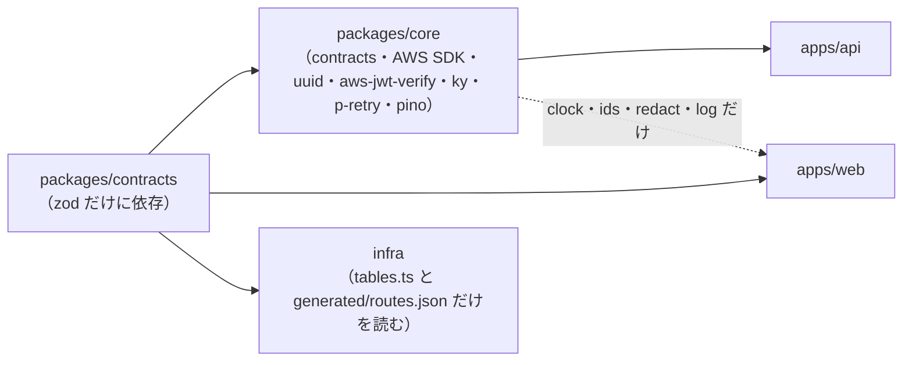
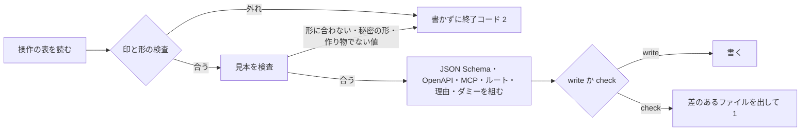
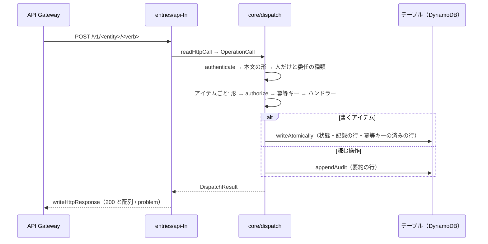

# スキーマの正本と横断の部品

## 概要

画面・API・MCP のツールが同じ操作を同じ形で扱い、どの入口から来た要求も同じ認可の判定と操作の記録を通るようにする仕組みである。次の 4 つでできている。

- **スキーマの正本**（`packages/contracts/`）: 操作の一覧の全行を 1 つの操作の表に持つ。そこから JSON Schema・OpenAPI・MCP のツールの定義・HTTP のルートの登録・理由のコードの一覧・画面のダミーデータを `npm run generate` で作る。値の形（UTC の日時・通貨つきの金額・ID）と、サービスのテーブルの行の形もここにある
- **横断の部品**（`packages/core/`）: 時計・ID・ログと伏せ字・外部の呼び出し・条件付き書き込み・冪等キー・認証・認可の判定・使える量の判定・操作の記録・HTTP の振り分けを 1 か所に置く。`apps/` の実行時のコードは、この部品を通してだけ時計・ID・ログ・外部の呼び出し・条件付き書き込みを使う
- **API の起点**（`apps/api/src/entries/`）: HTTP の振り分けの起点（`api-fn`）と、テーブルの移行（`migrate`）・版の数え（`census`）の起点。どれもまだアプリのスタックに入っていない
- **CDK の部品**（`infra/lib/`）: テーブルの仕様からテーブルと索引を作る `ServiceTable` と、ルートの登録から HTTP のルートを作る `ApiRoutes`。これもアプリのスタックには入れていない

操作ごとのアイテムの形・ハンドラー・理由のコードは、操作を受け持つ課題が後から足す。今の操作の表は全行が「形の未定」で、受け持つ課題の番号だけを持つ。

## 用語

語の意味は [用語集](../glossary.md) に従う（スキーマの正本・サービスのテーブル・委任・席など）。用語集に無い語のうち、この文書で使うものは次のとおりである。

| 語 | 意味 |
| --- | --- |
| 印 | 操作の定義の属性のうち、全体の設計の [操作の一覧](../design/api.md#操作の一覧) が値を決めているもの（入口・機能・読むか書くか・人だけか・委任の種類・全部か無か・冪等キー・受け持つ課題） |
| 形の未定 | 操作の表に印だけがあり、アイテムと結果の形を受け持つ課題がまだ書いていない状態。`pendingShape("#<番号>")` で表す |
| 行の世代 | 行を作るたびに入れる UUID v4（列 `incarnation`）。消して同じ鍵で作り直した行を見分ける |
| 読み手の見る形 | 保存してある行を、行の版の読み手（`readRow`）が今の版の形へそろえ、補い・直しを当てた後の行 |

本文に出すコードの名前と置き場は次のとおりである。

| 本文の語 | コードの名前 | 置き場 |
| --- | --- | --- |
| 値の形 | `utcDateTime`・`calendarMonth`・`money`・`currencyCode`・`languageTag`・`timeZone`・`githubRepo`・`githubIssueRef`・`itemsArray` | `packages/contracts/src/values.ts` |
| ID の形・token の形 | `ID_KINDS`・`idOf`・`delegationToken`・`machineToken` | `src/ids.ts`・`src/tokens.ts` |
| 理由のコードの共通の集まり | `REQUEST_REASONS`・`ITEM_REASONS`・`ReasonDef` | `src/reasons.ts` |
| 操作の定義の枠 | `defineOperation`・`pendingShape`・`isPending`・`okItem`・`okList`・`itemFailure`・`resultSchemaOf`・`itemReasonsOf` | `src/operation.ts` |
| 操作の表 | `OPERATIONS`・`operationByName`・`operationByRoute` | `src/operations/` |
| データのファイル | `RETRY_POLICIES`・`SECRET_SHAPES`・`NDF_CONTRACTS`・`PLANS` | `src/data.ts`・`data/*.json` |
| NDF の契約の値 | `ndfContractSet`・`ndfAnswerWord` | `src/ndf.ts` |
| 生成 | `generateArtifacts`・`build*`・`checkExamples`・`fakeExamples` | `scripts/generate.ts`・`scripts/artifacts.ts` |
| 操作を呼ぶ口 | `createOperationClient`・`httpTransport`・`createDummyTransport` | `src/client.ts` |
| 行の形・テーブルの仕様 | 行ごとの zod・`TABLES`・`TableSpec` | `src/rows/*.ts`・`src/tables.ts` |
| 行の版の読み手と書き手 | `rowCodec`・`readRow`・`writeRow`・`rowReplaceOf`・`repairIdentity` | `src/row-codec.ts` |
| 横断の部品 | 下の「横断の部品」の表 | `packages/core/src/` |
| HTTP の振り分けの起点 | `createApiHandler`・`handler` | `apps/api/src/entries/api-fn.ts` |
| テーブルの移行・版の数え | `migrateTable`・`createMigrateHandler`・`countRowVersions`・`createCensusHandler` | `apps/api/src/entries/migrate.ts`・`census.ts` |
| CDK の部品 | `ServiceTable`・`ApiRoutes` | `infra/lib/service-table.ts`・`api-routes.ts` |

## コンテキスト

用語集のプラットフォーム（`platform`）のコンテキストに属する。業務の規則を持たず、呼び出しの規約・値の形・判定と記録の順だけを持つ。利用者とチーム・プロジェクト・実行・人の判断と通知・委任・使える量の各コンテキストは、この上に操作の形・ハンドラー・`ScopeReader` の中身を足す。

依存の向きは次の一方向である。

- `packages/contracts` と `packages/core` は `apps/*` を import しない
- `apps/web` が使ってよい `core` のモジュールは `clock`・`ids`・`redact`・`log` の 4 つで、この 4 つは `node:` の組み込みと AWS SDK を import しない
- `packages/contracts` は zod だけに依存する。SHA-256 も自前の `src/sha256.ts`（依存なし）で持ち、`node:crypto` を読まない

## 構成要素と責務

| 構成要素 | 責務 |
| --- | --- |
| 値の形と ID | 国や地域で読み違えない値（UTC の日時・通貨つきの金額・言語・時刻帯）と ID・token の形を 1 か所に置く |
| 操作の表 | 操作の一覧の全行を印つきで持ち、名前とルートで引ける |
| データのファイル | 再試行の方針・秘密の形・受ける NDF の契約の組・料金プランの既定の行を形で検証して出す |
| NDF の契約の使い方 | nd-factory が使う NDF のインタフェースの決まりを固定の点の契約から生成して持ち、呼び出しの判定と区間の報告の読み取りを出す。契約の照合（`npm run ndf-contract`）とランナーが同じものを使う |
| 生成 | 操作の表から生成物を作り、見本を検査し、生成物の古さを `check` で落とす |
| 操作を呼ぶ口 | 画面・e2e・API のテストが、操作の名前で型を引いて操作を呼ぶ。ダミーデータも同じ口で返す |
| 行の形とテーブルの仕様 | サービスのテーブルの行ごとの列と、10 のテーブルの鍵・索引・TTL |
| 行の版の読み手と書き手 | 今と 1 つ前の版の行を読み、書き手の版で書く |
| 横断の部品 | 上の「概要」の部品。関数の仕様と異常系は全体の [詳細設計](../design/detail.md) にあり、この文書は置き場と、この仕組みで足したものを書く |
| HTTP の振り分けの起点 | `readHttpCall` → `dispatch` → `writeHttpResponse` を通す Lambda の起点 |
| 骨組みの関数 | 反映済みの `PUT /v1/users`。応答は変えずに、中を横断の部品へ移した |
| テーブルの移行と版の数え | 保存の形が読み手の見る形と違う行を書き直す。行の版ごとの件数を数える |
| CDK の部品 | テーブルと索引、HTTP のルートの資源を作る（スタックへ入れるのは、そのテーブルとルートを最初に使う課題） |

## 背景

| 決めたこと | 理由 |
| --- | --- |
| 操作の一覧の全行を先に印つきで登録し、アイテムの形は受け持つ課題が「形の未定」を置き換える | 形のある操作だけを登録すると、機能（F1〜F20）と MCP のツールと HTTP のルートの対応の検査が受け持つ課題ごとに崩れる。アイテムの形を受け持つ課題が書く決まり（[api.md の決定 56](../design/api.md#決定-56-アイテムの形と理由のコードを-2-か所に持たないためスキーマの正本の操作の定義だけに置き全体の設計には決まりと受け持つ子を書く)）も変えない |
| 生成物は `packages/contracts/generated/` の JSON にまとめ、型は生成しない | 型は操作の表から `z.infer` で出るため、型の宣言のファイルは 2 つ目の正本になる。読み手ごとに書き出すと `check` の対象が散り、依存の向きにも反する |
| 見本は結果の zod から `zod-schema-faker` で作り、種を操作の名前で固定する | 定義から作れる値を手で写さない。同じ版と同じ種で同じ値になり、`check` の差にならない |
| 値の形を JSON Schema で表せる zod の機能（正規表現・長さ・列挙・整数）だけで書き、`refine` と `transform` を使わない | zod と生成した JSON Schema の合否を食い違わせない。往復のテストが食い違いを落とす |
| 時刻帯と言語は正規表現で縛り、時刻帯の名前が実在するかは利用者の設定を書くハンドラーが `Intl.supportedValuesOf("timeZone")` で検査する | `Intl` を呼ぶ `refine` は JSON Schema に出せない。名前の列挙を生成物に持つと、Node の ICU の版の更新のたびに差が出る |
| 横断の部品はモジュールごとに 1 ファイルにし、`package.json` の `exports` でモジュールごとに出す。全部を出す `index.ts` は置かない | 画面がブラウザーで動かないモジュール（AWS SDK を読む `outbound` など）を import できないようにし、依存の向きの検査をエントリポイントの単位で行えるようにする |
| MCP の受け口の 5 つの関数（`readMcpCall`・`createMcpHandler`・`createMcpServer`・`serveMcp`・`writeMcpResponse`）と MCP の SDK は #11 が `packages/core/src/dispatch/mcp.ts` に置く | SDK を使う課題より先に依存を入れない。この仕組みは MCP のツールの定義の生成と、`dispatch` を MCP の入口からも呼べる形までを持つ |
| テーブルの仕様はスキーマの正本に置き、テーブルの資源はそのテーブルを最初に書く課題が `ServiceTable` で作る | 使われないテーブルを先に反映しない。部品と仕様が 1 つのため、名前・PITR・残す設定は課題の間で食い違わない |
| 受ける NDF の契約の組を `data/ndf-contracts.json` の集合で持つ | `ndf-pin.json` は `ndf_ref` の 1 か所に限る決まり（AGENTS.md）がある。1 つの対の定数にすると、2 つの組を並べる移り目に形を変えることになる |
| 骨組みの `PUT /v1/users` は今の関数のまま残し、中だけを横断の部品へ移す。新しい起点 `api-fn` は反映しない | 操作の表に無いルートを振り分けに持ち込まない。`api-fn` をアプリのスタックへ入れて `PUT /v1/users` を消すのは #4 が `sessions.create` と一緒に行う |
| 再試行の方針は呼び出しの種類ごとのライブラリの設定の形にし、待ちの計算はライブラリの組み込みに任せる | 待ちの計算を持たないライブラリへ渡せない値（基準の待ちなど）を持たない。どの値が効くかをデータから読めるようにする |
| 3 つの索引は候補を出すだけにし、認可と確定前の検査はテーブルの本体を強整合で読む | 索引（GSI）は結果整合で、席を外した直後や割り当てを移した直後に古い行を返しうる。足したばかりの席が 1 回見えないことは許し、外した席が見えることは許さない（Value 9） |
| テーブルに持つ状態と種類の値は英小文字の識別子にし、画面の文言は翻訳のファイルが識別子から作る | 画面の文言を言語ごとに翻訳のファイルで持つ決まり（Value 5）と、連携するシステムが値を比べる場面に合わせる |
| 画面向けには、操作の表の型で縛った呼び出しの口とダミーの送信部品だけを置き、React の状態の層は画面の基盤（#12）に任せる | OpenAPI から口と型を生成すると、`z.infer` の型と生成した型の 2 通りができる。React のフックを置くと、スキーマの正本の依存を zod だけにする決まりに反する |
| OpenAPI は `zod-openapi`、Cognito の公開鍵の控えは `aws-jwt-verify` の組み込み、HTTP の呼び出しは `ky`、AWS の呼び出しは SDK の再試行の設定、トランザクションの衝突は `p-retry`、ログは `pino` で作る | 広く使われ保守が活発な既存の部品があれば自前の実装を避ける（MVV の Value 15）。全体の設計（api.md の決定 48・55、detail.md の関数の表と再利用の表）も同じ内容に直してある |
| 冪等キー・条件付き書き込み・伏せ字・UUIDv7 は自前（UUIDv7 は `uuid`）のまま | `@aws-lambda-powertools/idempotency` は記録を状態と同じトランザクションに入れられず、アイテムごとの鍵も持たない。`electrodb`・`dynamodb-toolbox` は独自のスキーマの言葉が zod と 2 つ目の正本になる。鍵の名前と値の形の両方で伏せる候補は無い。`uuidv7` は注入した時計での単調性の扱いが合わない |

行の書き手の決まりの理由は、下の「行の書き手の決まり」の表にまとめた。

## 対象範囲

含む:

- 値の形・ID の接頭辞と ID の形・token の形・理由のコードの共通の集まり
- 操作の表の枠と、全体の設計の操作の一覧の全行の印
- 操作の表からの生成（JSON Schema・OpenAPI・MCP のツールの定義・HTTP のルートの登録・理由のコードの一覧・ダミーデータ・形の未定の一覧）と、生成物の古さの検査
- データのファイル（再試行の方針・秘密の形・受ける NDF の契約の組・料金プランの既定の行）と NDF の答えの語
- 画面とテストが操作を呼ぶ口と、ダミーの送信部品
- 横断の部品（MCP の受け口の 5 つの関数を除く）
- HTTP の振り分けの起点と、骨組みの `PUT /v1/users` の中の移し
- サービスのテーブルの行の形・10 のテーブルの仕様・3 つの索引、`ServiceTable` と `ApiRoutes` の部品
- 行の版の読み手と書き手、テーブルの移行と版の数えの関数

含まない:

- 操作ごとのアイテムの形・ハンドラー・操作ごとの理由のコード（操作の一覧の受け持つ課題）
- MCP の受け口の関数と MCP の SDK（#11）
- `api-fn` をアプリのスタックへ入れること、テーブルとルートの反映（テーブルを最初に書く課題と #4）
- テーブルの移行と版の数えの Lambda の資源と起こし方（最初にスキーマの版を上げる課題。今の行はどれも版 1 で、移すものが無い）
- 境界・対応・依存の向き・漏れの検査そのもの（#1。下の「外部連携」）
- 料金プランの値の集合（#29）
- `issue_requests.create` をオーガナイザー専用の委任だけに許す制限（I24）の印。#10 が操作を中身ごと作るときに足す

## 仕様

### 集約

この仕組みは集約を足さない。サービスのテーブルの行の列は、全体の設計の集約（[データの ER 図](../design/data.md#er-図)）の属性を列へ下ろしたもので、集約の境界と持ち主は変えない。

### 常に成り立つ条件

| # | 守り方 |
| --- | --- |
| I2（判定の部品） | `authorize` は見えないアイテムを、存在しないときと同じ 404 `not_found` で返し、見えないアイテムでは役割の 403 を返さない。索引の値だけで通さず、対象のプロジェクトの行を強整合で読む |
| I9 | `dispatch` は状態の書き込み・アイテムの記録の行・冪等キーの済みの行を 1 つの `writeAtomically` で確定する。記録を書けなければ 503 で値を返さない。記録の行は `auditItem` が許した鍵だけを写し、`redact` を通す。記録のテーブルへの置き換えと削除は `writeAtomically` が拒み、テーブルの移行も記録の行を書き直さない |
| I12 | `readHttpCall` は配列でない本文を 400 `body_not_array` で拒む。`defineOperation` は結果を配列の要素の封筒でない形にした操作を、モジュールの読み込みで落とす |
| I15 | 日時は `utcDateTime`、金額は `money` だけで受ける。時刻帯の無い日時と通貨の無い金額は検証で落ちる |
| 行の形 | どの行も `schema_version` を持ち、作った後に書き換える行の種類はどれも `version` と行の世代を持つ。記録のテーブルを除くどの行も行の世代を持つ |
| 書き込み | 行の列の一部だけを書き換える更新（`SET`・`REMOVE`・`ADD`）は作らない。どの書き換えも、読んだ行から作った行全体を書き手の版で置き換える |

### 値の形と ID

| 値 | 形 |
| --- | --- |
| UTC の日時（`utcDateTime`） | RFC 3339 の UTC の日時のうち、実在する日付と範囲の中の時刻だけ。小数は 3 桁まで、末尾は大文字の `Z`。月ごとの日の数とうるう年（4 で割れる年。100 で割れて 400 で割れない年を除く）を正規表現の `UTC_DATE_TIME` で書く。うるう秒の `60` は通さない（この製品の日時は時計と DynamoDB の値から作り、`60` を出さない） |
| 暦の月（`calendarMonth`） | `{ month: "YYYY-MM", time_zone }` |
| 金額（`money`） | `{ amount_minor: 0 以上の整数, currency: 英大文字 3 字（ISO 4217） }` |
| 言語（`languageTag`） | BCP 47 の言語・文字・地域の部分だけ（`ja`・`pt-BR`・`zh-Hant-TW`・`es-419`） |
| 時刻帯（`timeZone`） | `UTC` か `<大文字で始まる地域>/<場所>`。`JST`・`+09:00`・`asia/tokyo` は通さない |
| GitHub の参照 | `githubRepo` は `<owner>/<repo>`、`githubIssueRef` はその後に `#<1 以上の整数>` |
| 要求の本文（`itemsArray`） | 1 個以上、既定で `MAX_ITEMS`（100）個までの配列 |
| ID（`idOf`） | `<接頭辞>_<UUIDv7>`。接頭辞は `ID_KINDS`（`usr`・`team`・`inv`・`prj`・`repo`・`trf`・`spr`・`lane`・`apr`・`qst`・`ntc`・`dst`・`dlg`・`mch`・`key`・`aud`）。UUID は小文字で、版の数字 7 と変種 `8`〜`b` だけを通す |
| token | 委任は `ndfd_<usr の ID>.<dlg の ID>.<43 字>`、手元のマシンは `ndfm_<team の ID>.<mch の ID>.<43 字>`（43 字は base64url の文字） |

理由のコードは `ReasonDef`（`code`・HTTP の状態 `status`・起きうる操作の条件 `when`）の 1 組で持つ。理由のコードと HTTP の状態の対応はこの `status` だけが持ち、別の対応の表を持たない。

| 集まり | 中身 |
| --- | --- |
| 要求全体（`REQUEST_REASONS`） | `body_not_json`・`body_not_array`・`body_empty`・`too_many_items`・`duplicate_item`・`cursor_invalid`・`unauthorized`・`human_only`・`scope_insufficient`・`unavailable`・`audit_unavailable`・`too_many_requests` |
| どの操作のアイテムにも出うる（`ITEM_REASONS`） | `item_invalid`（400・常に）・`not_found`（404・常に）・`role_insufficient`（403・常に）・`human_only`（403・人だけの操作のうちアイテムごとに決まるもの）・`version_mismatch`（409・書く操作）・`state_mismatch`（409・書く操作）・`idempotency_key_reused`（422・冪等キーを持つ操作）・`in_progress`（409・冪等キーを持つ操作）・`not_applied`（409・全部か無かの操作） |

### 操作の表

操作の定義（`OperationDef`）の項目は次の順で宣言し、生成物の JSON の鍵の順もこれに従う。

| 順 | 項目 | 中身 | 既定 |
| --- | --- | --- | --- |
| 1 | `name` | 入口が `user` なら `<entity>.<verb>`、ほかは `<入口>.<entity>.<verb>`（例 `runner.events.create`） | — |
| 2 | `entity`・`verb` | 名前から分ける | — |
| 3 | `endpoint` | 入口。`user`・`runner`・`machine` | `user` |
| 4 | `route` | 入口 `user` は `/v1/<entity>/<verb>`、ほかは `/v1/<入口>/<entity>/<verb>`（`defineOperation` が作る） | — |
| 5 | `features` | 機能 `F1`〜`F20` の配列。I14 の対応の検査が読む | 入口 `user` は 1 つ以上、ほかは空 |
| 6 | `access` | `read`・`write` | — |
| 7 | `humanOnly` | `always`・`per_item`・`never` | `never` |
| 8 | `mcpRead` | 人だけの操作の、依頼と材料の読み出しに使う MCP のツールの操作の名前 | `null` |
| 9 | `delegationKind` | `read`・`run`・`manage` | 入口 `user` で人だけでなければ必須、ほかは `null` |
| 10 | `ownerOnly` | 席の役割が `owner` だけの操作か | 偽 |
| 11 | `allOrNothing` | `{ maxItems }`。全部か無かの操作の上限 | `null` |
| 12 | `idempotencyKey` | 冪等キーを持つか | 偽 |
| 13 | `onceOnly` | 1 回だけ返す値の、成功の結果の中の場所（`item.token` の形）。冪等キーの 2 回目はこの場所だけを `null` にする | `[]` |
| 14 | `item`・`result` | zod か `PendingShape`。`result` は `okItem`・`okList` が作る成功の封筒 | — |
| 15 | `reasons` | 操作ごとの理由のコード（`ITEM_REASONS` と同じコードは書けない） | `[]` |
| 16 | `auditKeys` | 記録の行に写すアイテムの鍵の名前 | `[]` |
| 17 | `order` | 一覧の並びの説明（`list` だけ） | `null` |
| 18 | `examples` | `{ normal?, edge?, empty? }`。書いた場面だけ、生成した見本を上書きする | `null` |
| 19 | `description_en` | 英語の説明 | `"<verb> <entity>"` |
| 20 | `owner` | 受け持つ課題 `#<番号>` | — |

`defineOperation` は、次のどれかに当たる定義をモジュールの読み込みで例外にする（`check` の型検査とテストが先に落とす）。

- 名前の形が入口と合わない
- 読む操作が冪等キーか全部か無かを持つ
- `humanOnly` が `always` で `mcpRead` が無い、または `never` で `mcpRead` がある
- `onceOnly` の場所が成功の結果に無い・`null` を受けない・冪等キーの無い操作に書いてある
- `result` が成功の封筒の決まりを外れる。決まりは、`ok` を `z.literal(true)` で持つ `z.strictObject` であること、`list` は `ok`・`items`（配列）・`next_cursor`（文字列か `null`）を省けない項目で持つこと、ほかの動詞は `ok`・`item`（オブジェクトか、オブジェクトだけの和）を持つこと、入口 `user` はこのほかのキーを持たないこと、どの封筒も失敗のキー（`status`・`reason`・`fields`）を持たないこと

アイテムの結果の zod は `resultSchemaOf(op)` で、`ok` を判別の鍵にした成功の封筒と失敗の和である。失敗の側は `itemFailure(itemReasonsOf(op))` で、理由ごとに `status` と `reason` を `z.literal` で縛ったオブジェクトを `reason` で判別する和にしたものである。`itemReasonsOf(op)` は、`ITEM_REASONS` のうちその操作に当たるもの（`when` で決まる）に `op.reasons` を続けた配列で、結果の形・`generated/reasons.json`・失敗のダミーはどれもこれから作る。型は `ItemOf<"<操作>">`・`ResultOf<"<操作>">`（`z.infer`）で引く。形の未定の操作に `resultSchemaOf` を呼ぶと投げ、その操作の `ResultOf` は失敗の側だけになる（成功の側の `ResultShapeOf` が `PendingShape` を外して `never` になる）。`ReasonsOf<Op>` は `readonly [ReasonDef, ...ReasonDef[]]` で、`ITEM_REASONS` の 3 つの常に入る理由があるため空にならない。型の上では理由を `ReasonDef` に広げるため、`ResultOf` の失敗の側は `{ ok: false; status; reason: string; fields? }` になり、理由ごとの `status` と `reason` の組は実行時の zod の和が縛る。型引数は、操作ごとの理由をリテラルで残す形へ後で絞っても呼び手の書き方が変わらないように置いている。

`OPERATIONS` は全体の設計の操作の一覧の表の順（F1〜F20 の表の上から、続けてランナー・手元のマシン）に並べ、名前とルートの重なりを読み込みで例外にする。今の生成物（`generated/routes.json`）では、操作は 90（入口 `user` 77・`runner` 10・`machine` 3）で、どれも形の未定である。DB の用意のタスクのルートは持たない（DB セットアップ関数は HTTP のルートを持たず非同期で呼ばれる。[DB セットアップ関数](db-prep-function.md)）。

全部か無かの上限は、要素 1 つの書き込みの件数と、主体が人の書く操作のトランザクションに入る要求元の照合の 2 件（[人の書き込みの要求元の照合](../design/data.md#人の書き込みの要求元の照らし)）から決めた値で、受け持つ課題（#5）が件数を決めたら直す。

| 操作 | 上限 | 内訳 |
| --- | --- | --- |
| `projects.create` | 19 | プロジェクト・主リポジトリ・割り当て・記録の行・冪等キーの済みの行の 5 件。(100 − 2) ÷ 5 の切り捨て |
| `repositories.add` | 24 | リポジトリの行・プロジェクトの行の照合・記録の行・冪等キーの済みの行の 4 件。(100 − 2) ÷ 4 の切り捨て |

要求ごとの記録の要約の行は、この 100 件に数えない。要約は状態の `writeAtomically` に入れず、確定の後に `appendAudit` で別に 1 行書く（アイテムの記録の行が状態と同じトランザクションにあるため、I9 は要約なしで満たされる）。要約を書けないときは次のとおりにする。

| 場面 | 返すもの | 状態 | 送り直し |
| --- | --- | --- | --- |
| 書く操作で、確定の後に要約を書けない | 要求全体の 503 `audit_unavailable` | 確定のまま | 冪等キーを持つ操作は、同じキーで送り直すと済みの行から前の結果が返り、要約がもう 1 度書かれる。持たない操作は、版か状態が変わっているため 409 `version_mismatch`・`state_mismatch` になり、呼び手は読み直してから送り直す |
| 1 回だけ返す値（委任の token・登録の token）を発行する `delegations.create`・`machines.create` で、確定の後に要約を書けない | 要求全体の 503 `audit_unavailable`（token を返さない） | 確定のまま（資格情報の行は有効） | 同じキーで送り直すと、token は `null`、資格情報の ID は値のまま返る。画面は「成功で token が `null`」を受けたら、その ID を取り消して新しい冪等キーで発行し直し、そのことを人に示す。API の側では自動で取り消さない（取り消しは人の操作として記録に残すため） |
| 読む操作で要約を書けない | 要求全体の 503 `audit_unavailable` | 書いていない | そのまま送り直せる |

### データのファイル

`src/data.ts` は `data/*.json` をモジュールの読み込みで形の検証にかけ、形が違えば例外を投げる（データの誤りを `check` で落とす）。

| データ | 中身 |
| --- | --- |
| 受ける NDF の契約の組（`data/ndf-contracts.json`） | `{"accepted": [{"version": 16, "sha256": "c50ef840a72ab71a15023a46a37d050c36ec3aae6d1be6092b7f9dc7f3c0a726"}]}`（固定の点 `ndf--v11.0.36` の `version.json` の最後の行）。空でない・版は 1 以上の整数・sha256 は 64 桁の小文字の 16 進・同じ版か同じ sha256 が 2 つ無い。版の大小で選ばず、ランナーは対が集合にあるかだけを見る |
| NDF の答えの語（`ndfAnswerWord`） | `approved`・`rejected`・`request_changes`・`retry`・`finish`・`cancel`（出所は NDF の固定の点の `C/facts/answers.json`） |
| 再試行の方針（`data/retry-policies.json`） | 7 つの方針。名前ごとに種類を 1 つに固定し、取り違えを読み込みで拒む（下の表） |
| 秘密の形（`data/secret-shapes.json`） | 鍵の名前に含む語（`authorization`・`token`・`secret`・`password`・`credentials`・`private_key`・`dsn`）と、値の形（`ndfd_`・`ndfm_` の接頭辞・JWT・`ghs_`・`ghp_`・`gho_`・`github_pat_`・秘密鍵の PEM・利用者と合言葉を含む接続の URL・AWS の一時の鍵）。`redact`・生成の見本の検査・漏れの検査が同じデータを読む |
| 料金プラン（`data/plans.json`） | 「上限なし」の 1 行（`unlimited`。置き場 `hosted`・`machine`、推論 `managed`・`byok`、同時の数と月の上限は `null`）。値の集合と量は #29 |

| 方針の種類 | 方針の名前 | 渡す先と項目 |
| --- | --- | --- |
| `aws` | `dynamodb`・`aws-control` | AWS SDK。`retry_mode`（`standard`）・`max_attempts`・`request_timeout_ms` |
| `transaction` | `dynamodb-transaction` | `p-retry`。`retries`・`min_ms`・`max_ms`（`min_ms <= max_ms`） |
| `http` | `http-github`・`http-notify`・`runner-to-api` | `ky`。`limit`・`timeout_ms`・`total_timeout_ms`・`backoff_limit_ms`・`max_retry_after_ms`（`timeout_ms <= total_timeout_ms`） |
| `jwks` | `http-idp-keys` | `aws-jwt-verify` の鍵の取り手。`response_timeout_ms` |

`retry_mode` を `standard` にするのは、`adaptive` が実行環境ごとに送る速さを絞り、短く生きる Lambda では絞りの学びが残らないためである。値を変えるのは、反映した環境のログ（再試行の `warn` の行）で使い切りか待ちすぎが見えた後で、変えるのはデータの 1 か所だけにする。

### NDF の契約の使い方

`@nd-factory/contracts/ndf-contract-use` の `ndfContractUse` は、nd-factory が NDF の契約（`plugins/ndf/contracts/`）のうち使う部分だけを持つ書き出しである。型とデータの形は、データを読まない `@nd-factory/contracts/ndf-contract-use-schema` に置く。照合の CLI と生成のコマンドはこちらから形を読み、手で書くデータと生成のデータが食い違っていても起動できる。

| 置き場 | 中身 | 作り方 |
| --- | --- | --- |
| `data/ndf-contract-use.json` | 使うインタフェースの id（実行の文書の「使うインタフェース」の 11 行）・Skill の前置き（`ndf:`）・インタフェースと実行の場（`hosted`・`local`）ごとの渡す環境変数・`set_by` が `service` でない名前（`GH_TOKEN`・`NDF_STATE_HOME` の `user`）・読むファイルごとの翻訳が読む項目 | 手で書く |
| `src/ndf-contract-use-schema.ts` の `REPORT_ITEMS` | 区間の報告からランナーが読む項目の名前。読み取りの戻り値の `items` の型をここから作る | 手で書く |
| `data/ndf-contract-use.generated.json` | 生成の元にした固定の点のコミット（`commit`）・使うインタフェースの行（`kind`・`target`・`lead`・`args`・`env`・`files`）・その行の `files` が指す読むファイルの `path`・区間の報告の形（`shape.values` のキーの並び・`shape.required`・`shape.material`） | `npm run ndf-contract:sync` が `ndf-pin.json` の固定の点の契約から書く。手で直さない |

`ndfContractUse` はモジュールの読み込みで 2 つのデータを形で検証し、使うインタフェースの id が手で書くデータと生成のデータで同じか、手で書く読むファイルと渡す環境変数のインタフェースが生成のデータにあるかを確かめる。食い違えば `DataFileError` を投げ、`check` が落ちる。受ける組（`acceptedVersions`）は `NDF_CONTRACTS.accepted` をそのまま持つ。

| 関数 | 振る舞い |
| --- | --- |
| `judgeCall` | 使うインタフェースへの呼び出しだけを判定し、ほかのインタフェースは偽。呼び出しの環境変数がすべて行の `env` にあることを求める。`skill`・`report`・`command` は引数の全体が `args` のどれかに全体で一致、`block` は任意の `lead`・`/` + 前置き + `target` + 空白の後の引数が `args` に全体で一致、`hook` は `target` と同じ、`file` は読むファイルの `path`（`<名前>` は `/` を含まない 1 文字以上）に一致、`spec` は `target` + `/` の配下のファイル。読めない正規表現には一致しないとみなし、例外を投げない |
| `readReport` | 最後の `- 結果:` の行の値を結果とし、その後ろの `- <項目>: <値>` を後勝ちで読む。結果の値ごとの要る項目（`always` と、`prefix`・`equals` の条件に当たった `need`）が無い・空・`無し` なら誤り。材料は `本文` か `https://` で始まる URL を空白で区切った並びで、`本文` なら結果の行より前の文書の直下にある最後の `## 判断の材料` の見出し（GFM の構文木で決める。コードブロック・HTML のブロック・引用・リストの中の行は見出しにしない）の節を、次のレベル 1 か 2 の見出しの前まで返す。誤りの一覧はコード（`result_line_missing`・`result_value_unknown`・`item_missing`・`material_form_invalid`・`material_heading_missing`）と項目の名前だけを持ち、報告の中の値を持たない |

GFM の解析器（`mdast-util-from-markdown`・`mdast-util-gfm`・`micromark-extension-gfm`）に依るのは `src/ndf-contract-use.ts` だけで、依存の規則 `contracts-ndf-contract-use-depends-on-parser-only` がほかへの依存を落とす。

### 生成物

`npm run generate` は操作の表を読み、次の流れで `packages/contracts/generated/` に書く。`generate:check`（CI の `check` に含む）は、書く代わりに差のあるファイルを出して終了コード 1 で落ちる。

| ファイル | 中身 | 読み手 |
| --- | --- | --- |
| `operations.schema.json` | draft 2020-12。`$defs` に操作ごとの `<操作>.item`（入力のモード）と `<操作>.result`（出力のモード）。形の未定は `{"not": {}}`。各形の `$ref` は、生成物の中でその形を置いた場所を根にした参照へ付け替え、再帰する形も解ける | 往復のテスト・MCP のツールの形 |
| `openapi.json` | `zod-openapi` が組む OpenAPI 3.1.1。入口 `user` の操作の `POST` だけで、要求は `itemsArray(item)`、応答 200 は結果の配列、`default` は problem。`components.schemas` は `.meta({ id })` の名前で出し、再帰しない形は `operations.schema.json` の同じ名前の `$defs` と一致する | 連携するシステム |
| `mcp-tools.json` | 人だけでない入口 `user` の操作のツールの定義（名前・説明・入力・出力・注記）。今は 45 件 | #11 の `createMcpHandler`・#1 の対応の検査 |
| `routes.json` | 操作ごとの `{method: "POST", path, operation, endpoint}`。GitHub の Webhook は載せない（I12 の外で、#5 が足す） | `ApiRoutes`・#1 の対応の検査 |
| `reasons.json` | `{"request": […], "item": […], "operations": {"<操作>": […]}}`。`operations` の値は `itemReasonsOf(op)` の `code` と `status` | 画面の翻訳のファイルの鍵の検査（#12） |
| `dummy/<操作>.json`・`dummy/index.json` | 操作ごとの `normal`・`empty`・`edge`・`failures` と、操作の名前からファイルへの対応。形の未定の操作は作らない（今は `index.json` だけ） | 画面のダミーの送信部品（#12・#28） |
| `pending.json` | 形の未定の操作と受け持つ課題 | 計画 |

MCP のツールの入力の形はアイテムの形を持たず、`{"items": {"type": "array", "minItems": 1, "maxItems": <MAX_ITEMS か allOrNothing.maxItems>}}` を必須に持つオブジェクトである。出力の形は結果の配列の JSON Schema で、MCP の仕様 2026-07-28 版が `structuredContent` に配列を許すことに合わせている。注記は `readOnlyHint`（`access` が `read`）・`idempotentHint`（冪等キーを持つ）・`destructiveHint`（動詞が `delete`・`remove`・`cancel`・`revoke`）である。

ダミーデータの中身は次のとおりである。

| 場面 | 作り方 |
| --- | --- |
| `normal`（3 件）・`edge`（上の端と下の端の 2 件） | `examples` があればそれを、無ければ `fakeExamples` が結果の zod から `zod-schema-faker`（`zod-schema-faker/v4`）で作る。種は操作の名前の SHA-256 の頭 8 桁。端の値は、文字列・配列・数を形の上限と下限へ寄せ、省ける項目を置く（上）・省く（下）。倍数の制約がある数は範囲の内側で端に最も近い倍数を選ぶ。メール・アカウント ID・接頭辞の形は、生成の前に形の木を写して作り物の値（`ops@example.com`・`123456789012`・`acme`）の literal へ置き換える（`zod-schema-faker` の上書きはメールに届かないため）。再帰する形の深い層も同じく置き換える |
| `empty`（アイテム 1 個に返す結果 1 件） | `examples.empty` があれば動詞によらずそれ（`null` なら空の場面を持たない）。無ければ `list` は `{"ok": true, "items": [], "next_cursor": null}`、`get` は 404 `not_found` の失敗、ほかは `null`。`ok`・`items`・`next_cursor` のほかに必須の項目を持つ `list` は、空の一覧での値を生成で決めず、`examples.empty` を必須にする |
| `failures` | `itemReasonsOf(op)` の理由ごとに 1 件。どれも `resultSchemaOf` の zod を通る |

`checkExamples` は見本（`normal`・`edge`・`null` でない `empty`）を次で検査し、問題が 1 つでもあれば `generateArtifacts` が書かずに終了コード 2 で止まる。検査は文字列と数の値に加えて、オブジェクトのキーも見る。診断は操作の名前・場面と位置・違反の種類だけを持ち、当たった値を含めない（標準エラーに出て CI のログに残るため）。

- 結果の zod を通らない
- 秘密の形の値に当たる
- 12 桁の数で `123456789012` でない
- `@` を含む値で、ドメインが `example.com` でない

`generated/dummy/` の直下の `.json` で、どの操作にも当たらないファイル（古いダミー）は、`check` で差に数え、`write` で消す。

### 画面とテストが操作を呼ぶ口

`src/client.ts` は zod と `operations/` だけを import し、React・DOM・`node:` の組み込みを import しない。画面（React 19 の TSX）・e2e・API のテストが同じ口を使う。React のフックの包みと、取得のキャッシュの層・Service Worker のダミーを採るかは画面の基盤（#12）が決める。

| 関数 | 振る舞い |
| --- | --- |
| `createOperationClient(transport)` | `call(name, items)` がアイテムの配列（1 個以上。型は `ItemOf<N>`）を送り、応答を結果の zod で検証して `{ ok: true; results }`（要求と同じ数・同じ順）を返す。要求全体の誤りは `{ ok: false; status; reason }` で、HTTP の状態が 200 でなく、本文が problem の形（`type: "about:blank"`・`status`・`reason`）で、本文の `status` が HTTP の状態と同じで、組が `REQUEST_REASONS` にあるときだけ受ける。ほかの非 200 の応答と、結果の zod に合わない応答は `{ ok: false; status: 0; reason: "response_invalid" }` を返す。例外は投げない |
| `httpTransport({ baseUrl, fetch, token })` | `POST <baseUrl>/v1/<entity>/<verb>` に `Authorization: Bearer` と JSON の本文で送る |
| `createDummyTransport(dummies, scenario)` | 生成したダミーから、要求の各アイテムに結果を 1 件ずつ組み、`{ status: 200, body: <要求と同じ件数・同じ順の配列> }` を返す。場面は呼ぶたびに `scenario()` で読む。`i` 番目の結果は、`normal`・`slow` で `normal[i % 件数]`（待ちは画面の基盤が足す）、`empty` で `empty`（`null` なら `normal` と同じ）、`error` で `failures[i % 件数]`、`notFound` で 404 `not_found`。ダミーの無い操作（形の未定）・`normal` が 0 件・`error` で `failures` が 0 件のときは要求全体の 503 `unavailable` |

場面の値（`normal`・`empty`・`error`・`slow`・`notFound`）は [画面のダミーデータで作り切る段](../design/screens.md#ダミーデータで作り切る段) の値である。

### 横断の部品

関数の仕様・異常系・処理の手順・並行と排他・ログは全体の [詳細設計](../design/detail.md#関数の仕様) のとおりである。置き場と、この仕組みで足した関数は次のとおりである。

| モジュール | ファイル | `exports` | 関数 |
| --- | --- | --- | --- |
| clock | `src/clock.ts` | `./clock` | `createClock` |
| ids | `src/ids.ts` | `./ids` | `newId`・`parseId` |
| redact | `src/redact.ts` | `./redact` | `redact` |
| log | `src/log.ts` | `./log` | `createLogger` |
| retry | `src/retry.ts` | `./retry` | `classifyFailure`（共通の再試行の関数は持たない。分類は呼び手が 409・404・503 を決めるために使う） |
| outbound | `src/outbound.ts` | `./outbound` | `callHttp`（`ky`）・`awsClient`（SDK の再試行の設定） |
| idempotency | `src/idempotency.ts` | `./idempotency` | `claimIdempotency`・`settleIdempotency` |
| db | `src/db.ts` | `./db` | `createDb`（`Db` のポートを DynamoDB の文書のクライアントで満たす。`scan` を含む） |
| conditional-write | `src/conditional-write.ts` | `./conditional-write` | `putIfAbsent`・`replaceIfVersion`・`deleteIfVersion`・`replaceIfUnchanged`・`writeAtomically` |
| auth | `src/auth/authenticate.ts`・`tokens.ts` | `./auth` | `authenticate`（Cognito の公開鍵の控えは `aws-jwt-verify` の組み込みの `SimpleJwksCache`・`SimplePenaltyBox` を既定のまま使う） |
| authorize | `src/authorize.ts` | `./authorize` | `visibleProjectIds`・`authorize` |
| usage-limit | `src/usage-limit.ts` | `./usage-limit` | `judgeUsage`・`usageAddItem` |
| audit | `src/audit.ts` | `./audit` | `auditItem`・`appendAudit` |
| dispatch | `src/dispatch/types.ts`・`http.ts`・`dispatch.ts` | `./dispatch` | `readHttpCall`・`dispatch`・`writeHttpResponse` |

ログは `pino` が書く（Node では標準出力、ブラウザーでは `pino` のブラウザー版に渡した `write`）。`console.log` を直に使わない。`pino` の鍵のパスの伏せ字は使わず、鍵の名前と値の形の伏せ字は自前の `redact` だけが持つ（同じ規則を 2 か所に置かない）。

この仕組みで足した振る舞いは次のとおりである。

| 関数 | 振る舞い |
| --- | --- |
| `claimIdempotency`・`settleIdempotency` | 冪等キーの行は `version` を持つ。`claimIdempotency` は新しく借りたときに借りの行を返し、借り直しは読んだ `version` を条件に `replaceIfVersion` で行全体を書く。`settleIdempotency` は借りの行から済みの行全体を組み、借りの行の `version` と行の世代を条件にする。指紋の照合は借りの期限の照合より先に行い、中身の違う送り直しは借りの状態と期限によらず `reused` にする（24 時間を過ぎてテーブルの期限による削除を待つ行だけは、無い行と同じに借り直す） |
| `usageAddItem` | 強整合で読んだ月間利用量の行に費用を足した行全体を組む。行が無ければ `putIfAbsent`、あれば読んだ `version` で `replaceIfVersion` で、どちらも `onConflict: "rebuild"`。通貨が違えば書き込みを組まずに `state_mismatch` |
| `ConflictRule` | `version_mismatch`・`state_mismatch`・`return_existing`・`rebuild`・`fail`。`rebuild` は、サーバーが読んだ行から作る書き換え（月間利用量の加算と、利用者の行の `login_count` の足し引き）が外れたときに組み直す扱いで、`writeAtomically` は訳さずに外れた件と一緒に返す |
| `dispatch` の組み直し | 確定が `{ ok: false }` で、外れた件がどれも `rebuild` のハンドラーの書き込み（要求元の照合・記録の行・冪等キーの済みの行は外れていない）なら、その件を返したアイテムのハンドラーを、借りた冪等キーのまま呼び直して組み直す。1 つのトランザクションの組み直しは `DISPATCH_REBUILD_LIMIT`（3）回までで、各回の前に残り時間を `DISPATCH_RESERVE_MS`（1500 ミリ秒）と比べる。使い切ったら `warn`（操作の名前と回数だけ）と要求全体の 503 `unavailable`。テーブルが拒んだ理由があれば、組み直さずに今のとおり投げる |
| `dispatch` の手放し | 全部か無かで確定しなかったときの冪等キーの手放しは、借りの行の `version` と行の世代を条件にした `deleteIfVersion` で消す（手放しや期限の後に同じキーで借り直した行を消さない） |
| `dispatch` の形の未定 | 操作が形の未定か、ハンドラーの表に無ければ、要求全体の 503 `unavailable` とログの `error`（操作の名前だけ）を返し、記録の要約の行を 1 件書く |
| `ScopeReader` | 中身は表の持ち主の課題が `apps/api/src/modules/` に書く（`seatsOf` は #4、`laneOf` は #6、`isHumanOnlyItem` は #8、`projectsOfTeams`・`projectOfTarget`・`transferTargetOf` は #5）。`seatsOf` は `user-seats` の索引で候補を読み、候補ごとに席の行を強整合で読み直して在る席だけを返す。`projectsOfTeams` は `team-projects` の索引で候補を読み、プロジェクトの行を強整合で読み直して `current_team_id` が席のチームのものだけを返す。`authorize` はアイテムごとに `projectOfTarget` が強整合で読んだプロジェクトの行で判定する |
| `authenticate` の委任 | 委任の認証（秘密の部分の一致・期限の内・取り消されていない）に成功し、委任した人が今の席を持つときだけ、委任の使った時刻の行を書く（席が無くても認証は成功のまま）。行が無ければ `putIfAbsent`、`last_used_at` が `DELEGATION_TOUCH_MS` より前なら `replaceIfVersion` で、どちらも読んだ委任の行の `version` と行の世代の照合と同じ `writeAtomically` で確定する |

#### 横断の部品の型

型の項目は次の順で宣言する。値と既定は全体の [詳細設計の内部のデータと定数](../design/detail.md#内部のデータと定数) のとおりである。

| 型 | 置き場 | 項目の並び |
| --- | --- | --- |
| `Clock` | `clock.ts` | `now()`・`iso()`・`epochMs()` |
| `Logger` | `log.ts` | `info`・`warn`・`error`・`child` |
| `LogContext` | `log.ts` | `request_id`・`fn`・`endpoint?` |
| `RetryPolicy` | contracts の `data.ts` | 判別の鍵 `kind` を先頭に、上の「データのファイル」の種類ごとの項目 |
| `OutboundRequest` | `outbound.ts` | `method`・`url`・`headers`・`body`・`idempotent`・`peer`（`github`・`idp`・`push`・`slack`・`api`） |
| `OutboundResult` | `outbound.ts` | `status`・`headers`・`body`・`class` |
| `TransactItem` | `conditional-write.ts` | `table`・`op`（`put`・`update`・`delete`・`check`）・`key`・`item?`・`update?`・`condition`・`onConflict` |
| `WriteOutcome` | `conditional-write.ts` | `{ ok: true }` か `{ ok: false; failed: { index; onConflict }[] }` |
| `Db` | `db.ts` | `get(table, key, consistent)`・`query`・`queryIndex`・`scan(table, { limit, startKey, consistent })`・`transactWrite`・`update` |
| `TableNames` | `db.ts` | テーブルの用途から実際のテーブルの名前への対応。値は起点が環境変数から渡す |
| `Principal` | `auth/authenticate.ts` | 判別の鍵 `kind` を先頭に。`human`（`userId`・`cognitoSub`・`sessionId`・`boundAuthTime`・`authTime`）・`newcomer`（`login`。`sessions.create` だけに渡る）・`delegation`（`userId`・`delegationId`・`scope`・`clientName`）・`runner`（`laneId`・`projectId`・`generation`）・`machine`（`teamId`・`machineId`）・`github`・`db_prep`（`projectId`・`prepId`）・`patrol` |
| `InboundRequest` | `auth/authenticate.ts` | `endpoint`（受けたルートの接頭辞で決まる）・`operation`（受けたルートを操作の表で引いた名前。表に無いルートは `authenticate` の前に 404。本文やヘッダーから採らない）・`path`・`headers`・`rawBody`（GitHub の HMAC に使う受けたままのバイト列） |
| `AuthResult` | `auth/authenticate.ts` | `{ ok: true; principal; sessionRevokedAt }` か `{ ok: false; reason: "unauthorized" \| "session_ended" \| "unavailable" }`。`session_ended` は署名・claim・期限を通した人の token のセッションが断たれているとき（取り消しの行がある・Cognito の主体の対応の行が無い（`sessions.create` を除く）・`auth_time` が対応の行の `bound_auth_time` より前）。`newcomer` を返すのは `operation` が `sessions.create` のときだけ。`sessionRevokedAt` は `operation` が `sessions.delete` で取り消しの行があったときだけその `revoked_at` |
| `ScopeReader` | `authorize.ts` | `seatsOf`・`projectsOfTeams`・`projectOfTarget`・`laneOf`・`transferTargetOf`・`isHumanOnlyItem` |
| `ItemAuthz` | `authorize.ts` | `{decision: "allow", projectId, role}` か `{decision: "deny", status: 404 \| 403, reason}` |
| `AuditEntry` | `audit.ts` | `auditId`・`requestId`・`at`・`actor`・`channel`・`operation`・`targetIds`・`projectId`・`result`・`itemIndex`。`actor` は主体の種類と当たる ID だけを持つ。`newcomer` は `{kind: "newcomer"}` にし、`sessions.create` の初回で利用者を作ったアイテムと要約は `{kind: "human", userId: <作った利用者の ID>}` に入れ替える |
| `OperationCall` | `dispatch/types.ts` | `endpoint`・`channel`・`operation`・`token`・`principal?`・`items`・`requestId`・`mcpClientName?`・`remainingMs` |
| `DispatchDeps` | `dispatch/types.ts` | `operations`・`handlers`・`scope`・`auth`・`db`・`clock`・`log` |
| `Handler` | `dispatch/types.ts` | `(item, ctx: { principal; authz; clock; db }) => Promise<{ result; writes: TransactItem[] }>` |

人の認証は、Cognito の `sub` で Cognito の主体の対応の行を強整合で読み、行があって token の `auth_time` が行の `bound_auth_time` 以後なら人として通す。ログインのつなぎ方と外し方の流れは、全体の設計の [データの文書の Cognito の主体の対応の行](../design/data.md#cognito-の主体の対応の行) と [詳細設計](../design/detail.md#関数の仕様) にある。

### HTTP の振り分け

順は全体の [詳細設計の処理の手順](../design/detail.md#処理の手順) のとおりで、この仕組みは形の未定の操作とハンドラーの無い操作の扱いと、組み直しを足した。

入口が `user` でない操作を入口 `user` のルートで引くこと（またはその逆）は、`readHttpCall` が入口ごとにルートの表で引くため起きない。起きたら 405 を返す。

### API の起点と骨組みの関数

| 関数 | 置き場 | 振る舞い |
| --- | --- | --- |
| `createApiHandler(deps)` | `apps/api/src/entries/api-fn.ts` | `readHttpCall` → `dispatch` → `writeHttpResponse` を通す。どの応答も `Cache-Control: no-store` を持ち、500 を返さない。`context.getRemainingTimeInMillis()` を `OperationCall.remainingMs` に渡す |
| `handler` | 同上 | 実行環境ごとに 1 回、時計・`awsClient`・`createDb`・ログ・ハンドラーの表（今は空）を組む |
| `createHandler(deps)`・`handler` | `apps/api/src/users-handler.ts` | 骨組みの `PUT /v1/users`。応答の形・状態・ログの項目は変えていない。依存は `db`（テーブルの名前から `Db` を得る）・`table`・`clock`（`Clock`）・`log`（要求ごとの `Logger`）で、既定の依存を `createClock`・`awsClient`・`createDb`・`createLogger` で組む。503 のログの操作の名前と失敗の名前は `describeStoreFailure` が分ける |
| `ensureUser(db, table, sub, clock)` | `apps/api/src/user-store.ts` | `putIfAbsent` と `writeAtomically` で利用者の行を作り、条件が外れたら強整合で読み直す。テーブルの失敗は `StoreError` |

`MAX_ITEMS` は 100 である。骨組みのルートの `src/users-api.ts` の上限 10 はそのまま残し、#4 が消す。

### サービスのテーブル

共通の列（`pk`・`sk`・`schema_version`・`version`・`incarnation`）は [データの共通の列](../design/data.md#共通のカラム) のとおりである。全体の設計が列を決めた行（プロジェクト・割り当て・レーン・承認の依頼・答えの `ndf_event_seqs`・操作の記録）も、そのまま行の形へ写してある。

テーブルの仕様（`TableSpec`）の項目は `purpose`・`suffix`（`db-users` ほか）・`partitionKey`（`pk`）・`sortKey`（`sk` か `null`）・`ttlAttribute`（`expire_at` か `null`）・`indexes`・`rows` の順である。`rows` は `{name, skPattern, codec}` の配列で、ソートキーを上から正規表現に当て、最初に当たったもので行の種類を決める。鍵の列（`pk`・`sk`）は行の種類ごとの `keyOf` だけが行の列から組み、書き手は鍵を手で組まない。

`ServiceTable` は仕様から `TableV2`（要求の数の課金・PITR・`RemovalPolicy.RETAIN`・TTL・索引）を作る。スタックへ入れるのは、そのテーブルを最初に書く課題である。

| 課題 | スタックへ入れるテーブル |
| --- | --- |
| #4 | `db-users`・`db-teams`・`db-audit`・`db-idempotency` |
| #5 | `db-projects` |
| #6 | `db-sprints`・`db-events` |
| #8 | `db-decisions`・`db-notices` |
| #29 | `db-usage` |

`ApiRoutes` は `routes.json` のうち、渡した入口のルートを `POST` で登録する。ルートが重なれば合成が投げる。

列の書き方の決まりは次のとおりである。

| 決まり | 中身 |
| --- | --- |
| 列の名前 | 英小文字と `_`。ID は `<種類>_id`、日時は `<出来事>_at`、真偽は形容の語（`is_` を付けない） |
| 状態と種類の識別子 | スプリント: `running`（動いている）・`finished`（終わった）・`stopped`（止まった）・`canceled`（取り消した）。承認の依頼と問い: `waiting`・`answered`・`canceled`。答えの送達: `pending`（未渡し）・`delivering`（渡し中）・`delivered`（届いた）・`failed`（失敗）。区間の結果: `done`（完了）・`needs_decision`（判断が要る）・`failed`（できなかった）。手元のマシン: `pending`（登録待ち）・`online`・`offline`。席の役割: `owner`・`member`。IdP: `google`・`github`。通知先: `web_push`・`slack`。量: `compute`・`inference`・`byok_inference`・`machine_time`。通知の種類: `approval`・`question`・`sprint_finished`・`sprint_stopped`・`cap_reached` |
| TTL の列 | `expire_at`（UNIX の秒の 10 桁の整数）。どの書き手も期限のミリ秒を `expireAtSeconds(ms)`（`rows/common.ts`）で秒にして書く（DynamoDB の TTL は秒で読み、ミリ秒の値は遠い先と見て消さない）。TTL を有効にするテーブルは `users`・`projects`・`idempotency`・`audit` の 4 つ |
| TTL を持つ行 | 冪等キー（作成から 24 時間）・渡した GitHub の token の記録（token の期限）・操作の記録（`AUDIT_RETENTION_DAYS` 日）・ログインをつなぐ流れ（`open` は作成から `LOGIN_LINK_TTL_MS`、`verified` は交換から 24 時間、`used` は確定から 24 時間。確定を受け付ける期限は別の列 `expires_at`）・セッションの取り消し（`revoked_at` から `SESSION_REVOKED_KEEP_MS`） |
| 冪等キーのテーブル | ソートキーを持たない |
| 答えの ID | 答えのアイテムの `idempotency_key`（UUID）をそのまま使い、接頭辞を足さない |
| 区間の ID | `<レーンの ID>#SEG#<連番>`。連番はレーンの中で 1 から上げる |
| 費用の記録の鍵の時刻 | 区間の終わりの事象の時刻（ランナーが区間ごとに 1 回決めて送り、送り直しでも変えない）。同じ区間の送り直しは同じソートキーになり、`putIfAbsent` が 2 回目を足さない。要求を受けた時刻や時計の値を使わない（月間利用量に 2 回足すため） |
| 渡した GitHub の token の記録の連番 | 記録を足したときのプロジェクトの行の `gh_token_generation` |
| 招待の置き場 | `db-teams` の `TEAM#<チーム>` / `INVITE#<招待>` |

行ごとの列は次のとおりである（`?` は無くてよい列）。

| 行（テーブル / ソートキー） | 列 | 書き方 |
| --- | --- | --- |
| 利用者（`db-users` / `USER`） | `user_id`・`login_count`（結んだログインの数、1 以上）・`display_name`（0〜32 字）・`language?`・`time_zone?`・`created_at` | 上書き。`login_count` の足し引きは `rebuild` で組み直し、最後のログインかの判定（2 未満なら 409）は読み直した値で行う |
| ログインの組（`db-users` / `LOGIN#<IdP>#<主体>`） | `user_id`・`idp`・`subject`・`cognito_sub`・`bound_auth_time`・`linked_at` | 上書き（ログインの付け替えで `cognito_sub` と `bound_auth_time` を書き換える）。`logins.delete` はアイテムが持つ `bound_auth_time` と照合し、違えば 409 `version_mismatch` |
| IdP の主体の一意の行 | 全体の設計の `user_id` に `idp`・`subject`・`cognito_sub`・`bound_auth_time` を足す | 上書き（付け替えのときだけ） |
| Cognito の主体の対応の行（`db-users` / `COGNITO`） | `cognito_sub`・`cognito_username`・`idp`・`subject`・`user_id`・`bound_auth_time` | 作ると消すだけ。行があることが結んでいることである |
| ログインをつなぐ流れ（`db-users` / `LINK#<流れの ID>`） | `link_id`・`state`（`open`・`verified`・`used`）・`created_at`・`user_id`・`session_sub`・`session_id`・`session_bound_auth_time`・`idp`・`code_verifier?`（`open` の間だけ）・`candidate_*?`（`verified` の間）・`exchange_idempotency_key?`・`exchange_fingerprint?`・`account_label?`・`used_idempotency_key?`・`linked_idp?`・`linked_subject?`・`expires_at`・`expire_at` | 上書き（`open` で作り、`verified`・`used` へ書き換える） |
| セッションの取り消し（`db-users` / 区切り `COGNITO#`・並び `REVOKED#<origin_jti>`） | `cognito_sub`・`session_id`・`revoked_at`・`expire_at` | 作るだけ（`version` を持たない） |
| 委任（`db-users` / `DELEGATION#<委任>`） | `delegation_id`・`user_id`・`client_name`（1〜64 字）・`scope_project_ids`（1 以上）・`scope_kind`・`secret_sha256`・`expires_at`・`created_at`・`revoked_at?` | 上書き。状態は `expires_at`・`revoked_at` から導く |
| 委任の使った時刻（`db-users` / `DELEGATION_USED#<委任>`） | `delegation_id`・`user_id`・`last_used_at` | 上書き（上の「横断の部品」の `authenticate` の委任）。委任の行と同じ長さ残し、テーブルの期限を持たない |
| チーム（`db-teams` / `TEAM`） | `team_id`・`name`（1〜100 字）・`plan`・`currency`・`monthly_cap?`（`money`）・`default_place`・`default_inference`・`created_at` | 上書き |
| 席（`db-teams` / `SEAT#<利用者>`） | `team_id`・`user_id`・`role`・`added_at` | 上書き |
| 招待（`db-teams` / `INVITE#<招待>`） | `invitation_id`・`team_id`・`role`・`created_by`・`created_at`・`expires_at`・`accepted_by?`・`accepted_at?`・`withdrawn_at?` | 上書き。状態は時刻の列から導く。招く相手の指定の仕方は #4 が列を足す |
| 手元のマシン（`db-teams` / `MACHINE#<マシン>`） | `machine_id`・`team_id`・`name`（1〜64 字）・`token_sha256`・`token_expires_at`・`last_heartbeat_at?`・`lane_capacity?`（1〜16）・`created_at`・`revoked_at?` | 上書き。状態は `last_heartbeat_at` が無ければ `pending`、600 秒以内なら `online`、それより前なら `offline` |
| 月間利用量（`db-teams` / `USAGE#<UTC の年月>`） | `team_id`・`month`・`used_amount_minor`・`used_currency` | 上書き（`usageAddItem`）。金額を 2 列に分けるのは、1 つの更新の式で行の作成と加算を書けないためで、2 列はどちらも必ず持つ |
| リポジトリ（`db-projects` / `REPO#<リポジトリ>`） | `repo_id`・`project_id`・`github_repo`・`installation_id`・`primary`・`added_at` | 上書き |
| 渡した GitHub の token の記録（`db-projects` / `GHTOKEN#<期限>#<レーン>#<連番>`） | `project_id`・`lane_id`・`generation`・`expires_at`・`expire_at` | 追記だけ |
| スプリント（`db-sprints` / `SPRINT#<スプリント>`） | `sprint_id`・`project_id`・`title`（1〜200 字）・`issues`（1〜20）・`place`・`inference`・`state`・`started_by`・`started_at`・`ended_at?`・`end_reason?` | 上書き |
| 区間（`db-sprints` / `…#LANE#<レーン>#SEG#<連番>`） | `project_id`・`sprint_id`・`lane_id`・`seq`・`started_at`・`ended_at?`・`result?`・`category?`・`failure_reason?`（`result_line_missing`・`result_value_unknown`・`segment_crashed`・`segment_timeout`） | 上書き |
| 進捗の事象（`db-events` / `SEQ#<連番>`） | `project_id`・`lane_id`・`seq`・`generation`・`kind`・`occurred_at`・`body`（`redact` を通す） | 追記だけ |
| 問い（`db-decisions` / `QUESTION#<問い>`） | `question_id`・`project_id`・`sprint_id`・`lane_id`・`category`・`human_only`・`state`・`body`・`options?`・`recommended?`・`ndf_gate_id?`・`machine_id?`・`answer_id?`・`delivery?`・`waiting_since?` | 上書き |
| 答え（`db-decisions` / `APPROVAL#<依頼>#ANSWER#<答え>`・`QUESTION#<問い>#ANSWER#<答え>`） | `answer_id`・`project_id`・`parent_id`・`word`・`reason?`（0〜2,000 字）・`notes?`（0〜10,000 字）・`drop_issues?`・`material_digest?`・`head_sha?`・`answered_by`・`answered_at`・`claimed_generation?`・`ndf_event_seqs?` | 上書き。作った後は `claimed_generation` と `ndf_event_seqs` を空のときに 1 回だけ書き足し、確定した列を書き換えない（I5） |
| 通知（`db-notices` / `NOTICE#<時刻>#<ID>`） | `notice_id`・`user_id`・`project_id`・`kind`・`target_id`・`occurred_at`・`read_at?`・`deliveries`（通知先の ID から `{state, attempts}` への対応） | 上書き。既読と送達はどちらも読んだ行から作った行全体を `replaceIfVersion` で書き、外れたら読み直して 1 回やり直す |
| 通知先（`db-notices` / `DEST#<通知先>`） | `destination_id`・`user_id`・`kind`・`team_id?`・`secret_name`・`fingerprint`・`last4`・`state`（`active`・`invalid`・`failed`）・`created_at` | 上書き |
| 費用の記録（`db-usage` / `COST#<時刻>#<区間の ID>`） | `project_id`・`sprint_id`・`lane_id`・`segment_id`・`kind`・`quantity`・`amount`（`money`）・`occurred_at` | 追記だけ |
| 冪等キー（`db-idempotency`） | `principal_key`・`operation`・`key`・`fingerprint`・`state`（`leased`・`settled`）・`owner_request_id`・`lease_until`・`result?`・`expire_at` | 上書き（借りから済みへの書き換えと借り直し） |

持ち込みのキー（`model_keys.*`）と GitHub App の導入（`github_installations.*`）の行は、#6 と #5 が置き場と列を決める。

索引は次の 3 つで、どれも結果整合で、候補を出すだけに使う。索引の鍵は元の行の列そのもので、索引のための写しの列を持たない。

| 索引 | テーブル | パーティションキー / ソートキー | 写す列 | 載る行 | 使う所 | 無いと何が起きるか |
| --- | --- | --- | --- | --- | --- | --- |
| `user-seats` | `db-teams` | `user_id` / `team_id` | `role` | `user_id` の列を持つ行（`db-teams` では席の行だけが持つ） | `ScopeReader.seatsOf` | 利用者から席を引くのに `db-teams` の全体の走査が要る |
| `team-projects` | `db-projects` | `current_team_id` / `project_id` | `name`・`current_assign_id` | `current_team_id` のあるプロジェクトの行（閉じると列を消して外れる） | `projectsOfTeams`・`projects.list` | チームからプロジェクトを引くのに全体の走査が要る |
| `waiting` | `db-decisions` | `project_id` / `waiting_since` | `sprint_id`・`lane_id`・`gate?`・`category?` | `waiting_since` のある依頼と問い（答えるか取り消すと列を消す） | `approvals.list`・`questions.list`・`waiting_counts.get` | 答えた行の数だけ読む量が増え続ける |

### 行の版の読み手と書き手

行の種類ごとの `RowCodec` は、読み手が受ける 2 つの版（`latest` と、あれば `previous`）と、書き手が出す版（`writeVersion`）を分けて持つ。こうすると、次の版を読めるが前の版だけを書く状態（版上げの 1 段目）と、2 段目の後に書き手だけを戻した状態を、同じ値で表せる。

| 関数 | 振る舞い |
| --- | --- |
| `rowCodec(spec)` | `latest`・`previous`（`upgrade`・`downgrade` を持つ）・`writeVersion`・`downgradable`・`repair`・`narrow`・`keyOf` をまとめる。`previous.version` は `latest.version - 1`、`writeVersion` はどちらかの版、`downgradable` が偽なら `writeVersion` は `latest.version`、`narrow` があれば `downgradable` は真。外れればモジュールの読み込みで投げる。`downgradable` の既定は `previous` があれば真 |
| `readRow(codec, raw)` | (1) `schema_version` の版の形で読む。(2) 通らず `repair` があれば、写しを直して読み直す。(3) 前の版なら `upgrade` で今の形にする。(4) `narrow` があれば通す。戻り値は `{ ok: true; row; from; stored }` か `{ ok: false; reason: "version_unsupported" \| "shape_invalid" }`。`stored` は保存してあった `schema_version`・`version`・`incarnation` の値そのもの（列が無ければ `absent`）で、書き手と移行は条件に `stored`、書く値に `row` を使う。2 つの版の外は `version_unsupported` |
| `writeRow(codec, row)` | `writeVersion` の形の行（`pk`・`sk`・`schema_version` を含む）を返す。前の版で書くときは `downgrade` を通す。`downgradable` の間は、`upgrade(downgrade(行))` が元の行に戻らない行を書かずに投げる（書き手を前の版へ戻せる間に、前の版で表せない値を書かない） |
| `rowReplaceOf(codec, raw, row)` | 読んだ行を `row` へ書き換える行全体（`writeRow` の戻り値から `version` と行の世代を外したもの）。鍵が読んだ行と違えば `key_mismatch`、`downgradable` の間に読んだ前の版の行が `upgrade` で値を失うなら `value_lost`、読んだ行が前の版の形を通らず `repair` でも直らなければ `previous_shape_invalid` で投げる |
| `repairIdentity({ version })` | `version` か行の世代の列が無い古い行に、行の世代を鍵から決まる値（`sha256` で作り、読むたびに同じ）で、`version` を 1 で補う。ほかの列は変えない。補った列は `stored` では `absent` のままで、書き手の条件は `attribute_not_exists` になる |

元の行に戻るかの比べは列を中身まで比べ、DynamoDB の集合を表す `Set` は要素まで、バイナリは中身のバイトまで比べる。変換の関数には `structuredClone` で写した値を渡す。`SharedArrayBuffer` を持つ値は写しが独立しないため、写さずに投げる（`readRow` は `shape_invalid`）。例外の `RowCodecError` は固定の符号 `code`（`codec_invalid`・`shared_buffer`・`row_invalid`・`downgrade_invalid`・`previous_shape_invalid`・`value_lost`・`key_mismatch`）を持つ。`message` は Zod の検証の位置（鍵の値を含みうる）を載せるため、ログへは `code` だけを載せる。

### 行の書き手の決まり

どの行の書き込みもこの決まりに従う。

| 書き込み | 組み方 | 条件 | `version` |
| --- | --- | --- | --- |
| 行を作る | `writeRow` の戻り値を `putIfAbsent` | 行が無い | 上書きの行は 1。記録のテーブルを除くどの行にも、`putIfAbsent` が新しい行の世代（UUID v4）を入れ、戻り値の `item` に載せる |
| 行を書き換える | 読んだ行を `readRow` で今の形にし、書き換えた行を `rowReplaceOf` で行全体にし、`replaceIfVersion`（`Put`） | `attribute_exists(pk)` と、`stored` の `version` と行の世代（値なら一致、`absent` なら列が無いこと）と、操作ごとの `extra` | 読み手の見る形の値に 1 足す |
| 行を消す | `deleteIfVersion` | 書き換えと同じ | — |
| テーブルの移行が書き直す | `rowReplaceOf` の戻り値に読み手の見る形の `version` と行の世代を足し、`replaceIfUnchanged`（`Put`） | `attribute_exists(pk)` と、保存してあった `schema_version`・`version`・行の世代 | 保つ |

`attribute_exists(pk)` を必ず入れるのは、`repair` が `version` と行の世代を両方補った行で、読んだ後に行が消えたときに、古い中身を `Put` で作り直さないためである。置き換えで書き手の行に無い列は消え、それが索引の鍵なら、その行は索引から外れる。記録のテーブルを指す置き換えは `checkAuditAppendOnly` が投げる。状態の遷移の条件と持ち主の条件はハンドラーが読んだ行で判定し、確定の条件は読んだ `version` で足りる（読んだ後に別の書き換えが確定すれば `version` が変わる）。

決まりの理由は次のとおりである（コードのコメントは「行の書き手の決定 N」としてこの表を指す）。

| # | 決めたこと | 理由 |
| --- | --- | --- |
| 1 | 書き換えは読んだ行から作った行全体の置き換えにする | 移行に先を越された書き換えが、前の版の列を残さない |
| 2 | 書き換える行の種類はどれも `version` を持つ（招待・区間・ログインの組・ログインをつなぐ流れ・委任の使った時刻・答え・冪等キーを含む） | 同じ版の中の書き換えを、移行と書き手が見つけられる |
| 3 | 移行は保存の形が読み手の見る形と違う行を書き直し、条件が外れたら読み直す | 移行が書き手と並んでも取りこぼさない |
| 4 | 拒んだ行の直しと前の版へ戻す前の書き換えは、行を手で書かずに読み手の関数（`repair`・`narrow`）として反映し、移行で書き直す | 直しをレビューとテストに通す |
| 5 | 月間利用量の加算は、読んで足した行全体を置き換える | 版の違う行でも加算を誤らない |
| 6 | 組み直しは `writeAtomically` に置かず、`dispatch` が `rebuild` の件だけを 3 回まで行う | 組み直しの終わりと誤りの優先を 1 か所で決める |
| 7 | 冪等キーの借り直しと確定は、読んだ・書いた `version` を条件に行全体を置き換え、中身の違う送り直しは借りの状態によらず 422 のままにする | 移行と並んでも誤らない |
| 8 | 書き換える行は行の世代を持ち、書き換え・削除・移行の条件にする | `version` は作り直すと 1 に戻り、`version` を持たない行も期限で消えた後に同じ鍵で作り直されうる（セッションの取り消しの行は、取り消しから 31 日で消えた後も、`exp` から 30 日まで受ける後発の token で作り直されうる） |
| 9 | テーブルの移行は記録のテーブルの行を書き直さない | 操作の記録の追記だけの約束（I9）を崩さない |
| 10 | 委任の最後に使った時刻を、委任の行と別の行に置く | 使うたびに委任の行の `version` が上がり、取り消しの書き換えが外れ続けるのを防ぐ |

### テーブルの移行と版の数え

`migrateTable({ purpose, cursor }, deps)` は、保存の形が読み手の見る形と違う行を、書き手の版の行へ書き直す。何度走らせても結果は同じである。

1. `db.scan` で `MIGRATE_PAGE_SIZE`（100）行を強整合で 1 ページ読む
2. 行ごとに次を行う。取りかかる前に残り時間が `MIGRATE_RESERVE_MS`（10 秒）以下なら、`{ done: false, cursor: <最後に処理を終えた行の鍵> }` を返す
   - 記録のテーブルなら書かない。保存の形が読み手の見る形と違う行は拒んだ行（`append_only`）にする
   - `skPattern` で行の種類を決める。どれにも当たらない行は拒んだ行（`row_kind_unknown`）にする。`writeVersion` が `latest.version` でない行の種類の行は書かない
   - `readRow` と `rowReplaceOf` で書く行を作り、読んだ行と列の中身まで同じなら書かない
   - 違えば `replaceIfUnchanged` を `writeAtomically` で 1 件だけ確定し、`rewritten` を 1 足す。条件が外れたら強整合で読み直し、無ければ `skipped` を 1 足し、あればやり直す。3 回外れたら拒んだ行（`contended`）にする。`unavailable` は投げる
   - `readRow` が `ok: false` を返した行と、`rowReplaceOf` が `RowCodecError` を投げた行は、書かずに拒んだ行にする（例外を Lambda の外へ出すと、再試行 0 回のため後ろの行が移されない）
   - 拒んだ行は `refused` と `refusedByReason` の理由の欄に 1 足し、行の種類の名前・理由の符号・`migrate_id` だけを `migrate_refused` として `error` で出す。例外の文と鍵の値は出さない
3. ページの最後まで終えたら、続きが無ければ `{ done: true, cursor: null }`、あれば次のページへ進む

返した `cursor` を次の呼び出しへ渡すと、その鍵の次の行から読む。`createMigrateHandler` は、終わっていなければ続きの位置と `refused`・`refusedByReason` の合計を、受け取った `migrate_id` と一緒に持って自分を非同期で起こし直す。起動の値は `{ purpose, migrate_id, cursor, refused, refusedByReason }` で、運用者が起こすときは起こすごとに新しい UUID v4 の `migrate_id`・`cursor: null`・`refused: 0`・`refusedByReason: {}` を渡す。`migrate_id` が UUID v4 でなければ移さずに `error` を出す。ログは呼ぶごとに `migrate_page`、終わったら `migrate_done`（`refused` が 1 以上なら `error` の水準）を出す。

`countRowVersions({ purpose, cursor }, deps)` は書き込まずに、行の種類と保存してある `schema_version` の値ごとに行を数える（`readRow`・`repair`・`narrow` を通さず、記録のテーブルも数える）。欄は 1 以上の整数ならその数、列が無ければ `absent`、ほかは `invalid` で、どの行の種類にも当たらない行は `counts.row_kind_unknown` に数える（例 `{ item: { "1": 1, "2": 2, absent: 1, invalid: 2 }, row_kind_unknown: { "1": 1 } }`）。`createCensusHandler` は `{ purpose, census_id, started_at, cursor, counts }` で起こし直しを続け、最初の起動で `started_at` を決めて `census_start` を、終わったら `census_done` を出す。ログには行の種類の名前・版・件数だけを出し、鍵と列の値を出さない。

| 同時に走りうる処理 | 排他の取り方 |
| --- | --- |
| 移行と、同じ行を書く API の要求 | 移行は保存してあった 3 つの列を条件に `version` を保って置き換え、書き手は読んだ `version` と行の世代を条件に `version` を上げて置き換える。どちらが先でも、後の側は外れて読み直す |
| 移行と、前の版で書く書き手 | 値は上の条件で失わない。走査の取りこぼしを作らないため、移行を起こすのは前の版で書く書き手が走り終えた後に限り、書き手を前の版へ戻すのは移行を止めた後に限る（下の「運用」） |
| 2 つの移行の起動 | 排他を取らない。後の側は外れて読み直し、同じ形のため書かない。起動ごとの `migrate_id` で完了のログを見分ける |
| 直す前のコードの移行と、`repair`・`narrow` を足した後の移行 | 条件では見分けられないため、直しの反映の前に移行を止めて終わりを待つ |
| 数えと、書き手・移行 | 排他を取らない（数えは書かない）。版 N を書く書き手を先に無くすため、走査の間に版 N の行は増えない |
| 移行と、消して同じ鍵で作り直す書き手（冪等キーの手放しと借り直し・ログインの外しと結び直し・セッションの取り消しの行の作り直し） | 移行の条件に保存してあった行の世代を入れ、作り直した行で外れて読み直す |

## データ・設定

| 値 | 置き場 | 値 |
| --- | --- | --- |
| `MAX_ITEMS` | `packages/contracts/src/values.ts` | 100 |
| `IDEMPOTENCY_TTL_SECONDS` | `src/operation.ts` | 86400 |
| `DISPATCH_RESERVE_MS`・`DISPATCH_REBUILD_LIMIT` | `packages/core/src/dispatch/dispatch.ts` | 1500 ミリ秒・3 回 |
| `MIGRATE_RESERVE_MS`・`MIGRATE_PAGE_SIZE`・1 行の書き込みの試しの上限 | `apps/api/src/entries/migrate.ts` | 10000 ミリ秒・100 行・3 回 |
| データのファイル | `packages/contracts/data/` | 上の「データのファイル」 |
| 生成物 | `packages/contracts/generated/` | 手で直さない。`npm run generate` で作り直してコミットする |
| テーブルの実際の名前 | 起点の環境変数 | `TableNames` へ渡す。テーブルの名前の接頭辞と環境は、テーブルを入れる課題が設定のファイルから渡す |

依存のライブラリと版は次のとおりである。

| パッケージ | 実行時の依存 | 開発の依存 |
| --- | --- | --- |
| `packages/contracts` | `zod` | `ajv`（draft 2020-12 の検証）・`zod-openapi`・`zod-schema-faker`・`@faker-js/faker`・`randexp` |
| `packages/core` | `@nd-factory/contracts`・`uuid` 14.0.3・`aws-jwt-verify` 5.2.1・`ky` 2.2.0・`p-retry` 9.0.0・`pino` 10.4.0・`@aws-sdk/client-dynamodb`・`@aws-sdk/lib-dynamodb`（`apps/api` と同じ版） | — |

`zod-schema-faker` の版を上げると見本の値が変わるため、生成物を作り直すコミットが要る。

## 外部連携

| 相手 | 向き | 中身 |
| --- | --- | --- |
| 画面（#12・#28） | 生成物を読む | `ItemOf`・`ResultOf` の型、`createOperationClient`、`generated/dummy/`、`generated/reasons.json` |
| MCP の受け口（#11） | 生成物を読む | `generated/mcp-tools.json`。#11 は受け口の 5 つの関数を `packages/core/src/dispatch/mcp.ts` に置き、`dispatch` を呼ぶ |
| 検査（#1） | 生成物とデータを読む | 操作の一覧と画面と MCP の対応・ルートの登録の検査（`mcp-tools.json`・`routes.json`・`OPERATIONS` の `features`）、境界の検査（`packages/core` の `exports` と、画面が import してよい `clock`・`ids`・`redact`・`log`）、漏れの検査（`data/secret-shapes.json`）。形の往復のテストは CI の `check` で走り、#1 は必須のチェックに `check` が載っていることを CI の定義のテストで見る。骨組みの `PUT /v1/users` は操作の表に無いため、#4 が消すまで、ルートの登録の検査で #4 の印つきで外す |
| ランナー（#6） | データを読む | `NDF_CONTRACTS`・`ndfAnswerWord`・`ndfContractUse`（呼び出しの判定と区間の報告の読み取り） |
| NDF の契約の照合（`npm run ndf-contract`） | 書き出しを読む | 作業の木の `ndfContractUse` を固定の点と先端の契約に照らす。書き出しが無ければ契約を取得せずに `fail: no-contract-use <固定の点>` と終了コード 1 |
| CDK | 仕様と生成物を読む | `ServiceTable` が `TABLES` を、`ApiRoutes` が `routes.json` を読む |
| Cognito | 呼ぶ | `authenticate` が `aws-jwt-verify` で access token を検証する。公開鍵の取得のタイムアウトは `http-idp-keys` の `response_timeout_ms` |
| DynamoDB | 呼ぶ | `createDb` と `writeAtomically`（`TransactWriteCommand`）。再試行は SDK の設定、トランザクションの衝突と書き込みの呼びすぎによる取り消しだけを `p-retry` で繰り返す（SDK はトランザクションの取り消しを繰り返さない） |

## エラー処理

| 場面 | 振る舞い |
| --- | --- |
| 操作の定義の誤り | `defineOperation`・`OPERATIONS` がモジュールの読み込みで投げ、`check` が落ちる |
| データのファイルの誤り | `data.ts` が読み込みで投げる |
| 見本の誤り | `generateArtifacts` が書かずに終了コード 2。診断に当たった値を含めない |
| 生成物が古い | `generate:check` が差のあるファイルを出して終了コード 1 |
| 配列でない本文 | 要求全体の 400 `body_not_array` |
| 形の未定・ハンドラーの無い操作 | 要求全体の 503 `unavailable` とログの `error` |
| 記録の書き込みの失敗 | 要求全体の 503 `audit_unavailable`。状態も書かない（アイテムの記録の行）か、確定のまま値を返さない（要約） |
| 組み直しの使い切り | 要求全体の 503 `unavailable` と `warn` |
| 起点の例外 | `createApiHandler` は 500 を返さず、ハンドラーの例外は 503 |
| 応答が結果の形に合わない | `createOperationClient` が `response_invalid` を返し、例外を投げない |
| 移行で読めない・書けない行 | 拒んだ行として数えて続け、`migrate_refused` を出す。`unavailable` は投げて、起こし直しの前の `cursor` から再び走る |

## セキュリティ

- ログと操作の記録に秘密と個人情報の値を残さない。秘密の形は `data/secret-shapes.json` の 1 か所にあり、`redact`・生成の見本の検査・漏れの検査が同じデータを読む
- 生成物と見本は作り物の値（アカウント `123456789012`・接頭辞 `acme`・メール `ops@example.com`）だけを持ち、生成が検査する
- `authorize` は見えないアイテムを存在しないときと同じ答えで返し、索引の値だけで通さない
- Cognito の公開鍵の控えは組み込みのため期限を持たず、IdP が外した鍵を、実行環境が生きている間は受けうる。知らない `kid` では取り直すため、鍵の差し替えには付いていける
- `RowCodecError` の `message`・移行のログ・数えのログに、鍵の値と列の値を載せない
- CI は AWS の資格情報を持たない。生成と往復のテストは Node だけで動き、テーブルとルートの部品は合成の出力のテストで確かめる

## 運用

- 形を変えるときは `packages/contracts/` を直し、`npm run generate` で生成物を作り直して同じ変更でコミットする
- NDF の固定の点を変える PR は、`data/ndf-contracts.json` も同じ PR で直し、`npm run ndf-contract:sync` で `data/ndf-contract-use.generated.json` を作り直してコミットする（打ち忘れは照合の 6 項目目が、生成の固定の点と `ndf-pin.json` の違いとして落とす）
- 使うインタフェースを足す・外すときは、`data/ndf-contract-use.json` を直して `npm run ndf-contract:sync` を打ち、単体テストの 11 の id のリストも同じ変更で直す
- 再試行の値は、反映した環境のログで使い切りか待ちすぎが見えたときに、`data/retry-policies.json` の 1 か所だけを直す

### 行の版を上げる手順

最初にスキーマの版を上げる課題は、`migrate` と `census` の Lambda の資源と起こし方を足す。`migrate` の権限はそのテーブルの読みと書きだけ、`census` は読みだけで、非同期の起動の設定は `MaximumEventAgeInSeconds` 60・`MaximumRetryAttempts` 0 にする。

1. **1 段目の反映**: 次の版の zod を `latest` に、今の版を `previous` に移し、`upgrade` と `downgrade` を足す。どちらも値を失わず往復できるようにする。`writeVersion` は今の版のままにする（読み手は両方を読み、書き手は前の版だけを書く）。この反映は今の `previous` の読み手を外すため、その版について手順 5 を通した行の種類でだけ出す
2. **2 段目の反映**: `writeVersion` を次の版へ上げ、`migrate` の Lambda を足す。反映から API の Lambda のタイムアウトより長く待った後に、新しい `migrate_id` で移行を 1 回起こす。進む条件は、記録のテーブルでなければその `migrate_id` の `migrate_done` の `refused` が 0、記録のテーブルなら `refusedByReason` の `append_only` のほかの欄がどれも 0 で、かつ手順 5 の数えで対象の行の種類の前の版・`absent`・`invalid` と `row_kind_unknown` がどれも 0 であること。満たさなければ次で直す
   - 直す前に、テーブルのオンデマンドのバックアップを取る
   - 同じ `migrate_id` の `migrate_refused` から当たる行の種類を決め、運用者の手元で強整合で読んで `readRow` と `rowReplaceOf` に通して形を確かめる（鍵の値をログへ出さない）
   - 理由の符号ごとに、行を手で書き換えずにコードの反映で直す。前の版として正しい値を読めないなら `previous.schema`・`upgrade`・`downgrade` を、行の値そのものが誤りなら `repair` を、`row_invalid` なら `upgrade` か `repair` を、`downgrade_invalid` なら `downgrade` を直す。次の版より新しい行（`version_unsupported`）は反映の食い違いのため、移行を進めずに反映を確かめる
   - 新しい `migrate_id` と `cursor: null` で起こし直し、進む条件を確かめる
3. **2 段目を戻すとき**: 次の 2 回の反映で戻し、1 回にまとめない。(a) `migrate` の Lambda の予約の同時実行を 0 にし、Lambda のタイムアウトと 60 秒の長いほうを待ち、`ConcurrentExecutions` が 0 であることを確かめる。(b) `writeVersion` だけを前の版へ戻す（足した `narrow` は残す）
4. **戻さないと決めたとき**: 次の版だけの列を使う機能を、その行の種類の `downgradable` を偽にして出す。この後に前の版へ戻すには、(a) 移行を止めて待ち、次の版だけの値を作る機能を止め、`narrow` を足して `downgradable` を真に戻し、予約の同時実行の 0 を外す反映を 1 回で出す。(b) 新しい `migrate_id` で移行を起こす。(c) その `migrate_id` の `migrate_done` の `refused` が 0 であることを確かめてから、手順 3 で戻す
5. **版の読み手を外す前の確認**: ある版（N）の読み手を外す反映は、次を通した後だけ出す。(a) その行の種類の `writeVersion` が N でない反映が終わり、API の Lambda のタイムアウトより長く待つ。(b) `census` を新しい `census_id` と `cursor: null` で起こし、`started_at` が (a) の後の `census_done` だけを採って、版 N・`absent`・`invalid` の件数が 0 であることを確かめる。(c) 外す反映まで (a) の状態を保つ

どの手順の判定にも、その手順で起こした `migrate_id`（`census_id`）を持つ完了のログだけを採る。完了のログが出ないときは、新しい ID と `cursor: null` で起こし直す。

## テスト観点

テストは CI の `check`（lint・型検査・生成物の差・単体テスト）と `synth` で走る。

| 観点 | 落ちるべき壊し方 |
| --- | --- |
| 生成物が操作の表と一致する | 操作の定義を変えて `generate` を打たずに `check` を打つ。消えた操作のダミーのファイルが残る |
| 見本の検査 | 通貨の無い金額・`ghs_` の値・作り物でないメール・12 桁の別の数（レコードのキーも）・形に合わない空の結果・`examples.empty` の無い、必須の項目を足した `list` で問題が出ない。診断に当たった値が入る |
| 形の往復 | 操作ごとの見本と反例（時刻帯の無い日時・通貨の無い金額・接頭辞の違う ID・配列でない本文・追加の項目）を、zod と生成した JSON Schema（Ajv の `Ajv2020`）の両方に通し、合否が食い違う。入口 `user` の操作は OpenAPI の `components.schemas` とも比べる。`refine` を使う形を足すと食い違いを検出する。比べた件数が 0 なら落ちる。今は本番の操作が形の未定のため、`test/fixtures/operations.ts` のテスト用の 2 つの操作（`fixture_notes.create`・`fixture_notes.list`）を本番と同じ生成に通して比べ、子が形を入れた後も残す |
| I2（判定の部品） | 割り当ての外の主体のアイテムが 404 以外になる・見えないアイテムで役割の 403 が返る・索引に残った外した席でプロジェクトが見える |
| I9 | 記録のテーブルへの更新か削除が書ける・本文の秘密の形の値が記録の行かログに残る・記録の書き込みの失敗で操作が成功を返す |
| I12 | 配列でない本文で 400 以外が返る |
| I15 | `2026-11-17T03:04:05+09:00`・`{"amount_minor": 1}` が検証を通る。1896〜2104 年の毎日について、`utcDateTime` の合否と `Date.UTC` の実在が食い違う |
| 値の形 | `JST`・`+09:00`・`ja_JP`・版 4 の UUID・小数 4 桁の日時・`2026-02-29` が通る |
| 操作の定義 | 読む操作の冪等キー・人だけの操作の読み出しのツールの欠け・名前の形の違い・`ok: true` と `reason` を同時に持つ値が通る。名前かルートが重なる。`OPERATIONS` の名前・ルート・機能・人だけかが `docs/design/api.md` の操作の一覧と食い違う（テストは一覧の表を読んで照合し、写しを持たない） |
| 受ける契約の組 | 空・重なり・63 桁・大文字の 16 進・版 0 がデータの形を通る |
| 再試行の方針 | 鍵の欠け・負の数・名前と種類の取り違え・`min_ms > max_ms`・`timeout_ms > total_timeout_ms` が読み込みを通る |
| 操作を呼ぶ口 | 結果の形に合わない応答や problem の形でない非 200 で例外が出るか成功になる。ダミーの送信部品が要求と違う件数を返す・形の未定の操作で 503 以外を返す |
| 組み直し | 外れた件がどれも `rebuild` のときに組み直さない・4 回目を打つ・`version_mismatch` の件や要求元の照合と一緒に外れたときに組み直す |
| 行の形 | `schema_version` の無い行・上書きの行で `version` の無い行・時刻帯の無い日時・通貨の無い金額が行の形を通る |
| テーブルの仕様 | 10 のテーブルと 3 つの索引が上の表と食い違う。行の種類の鍵が自分の `skPattern` に当たらないか、上の別の種類に当たる（改行・`#`・空白を含む列でも） |
| 行の版 | 2 つ前の版の行を読める。1 段目・2 段目・書き手を戻した状態で、読む形か書く版が違う。`downgradable` の間に前の版で表せない値を書ける |
| テーブルの移行 | 移行を 2 回走らせると行が変わる。前の版の行が今の版にならない・`version` が変わる・保存の形が同じ行を書く。消した列の索引に行が残る。拒んだ行で例外が外へ出る・ログに鍵の値が出る |
| 条件付き書き込み | 作り直した行を前の行の世代で書き換えるか消せる。消えた行を `Put` で作り直す。記録のテーブルを指す置き換えが通る |
| 骨組みの関数 | `PUT /v1/users` の応答・ログの形が変わる |
| 起点 | 偽の操作とハンドラーで 200 と配列・`no-store` にならない。配列でない本文で 400 以外、ハンドラーの例外で 503 以外 |
| CDK の部品 | 合成の出力の索引の鍵・PITR・`Retain`・TTL・ルートの数が仕様と食い違う。ソートキーの無い `db-idempotency` を作れない |
| 境界 | `apps/` の実行時のコードに `new Date()`・`console.log`・`fetch`・`new DynamoDBClient` が残る（検査そのものは #1） |

## 関連リンク

- 全体の設計: [不変条件](../design/overview.md#不変条件)・[呼び出しの規約](../design/api.md#呼び出しの規約)・[値の形](../design/api.md#値の形)・[操作の一覧](../design/api.md#操作の一覧)・[スキーマの正本](../design/api.md#スキーマの正本)
- 全体の詳細設計: [関数の仕様](../design/detail.md#関数の仕様)・[処理の手順](../design/detail.md#処理の手順)・[並行と排他](../design/detail.md#並行と排他)
- データ: [テーブルとキー](../design/data.md#テーブルとキー)・[共通のカラム](../design/data.md#共通のカラム)・[Cognito の主体の対応の行](../design/data.md#cognito-の主体の対応の行)
- プラットフォーム: [言語と書き方の決まり](../design/platform.md#言語と書き方の決まり)・[横断の部品の保存先の基準](../design/platform.md#横断の部品の保存先の基準)
- 画面: [ダミーデータで作り切る段](../design/screens.md#ダミーデータで作り切る段)
- 関連する確定仕様: [DB セットアップ関数](db-prep-function.md)・[アプリのスタックのインフラ](app-stack-infrastructure.md)
- 課題: 形の正本と横断の部品（ https://github.com/devbasex/nd-factory/issues/2 ）・実装をまとめた PR（ https://github.com/devbasex/nd-factory/pull/149 ）
