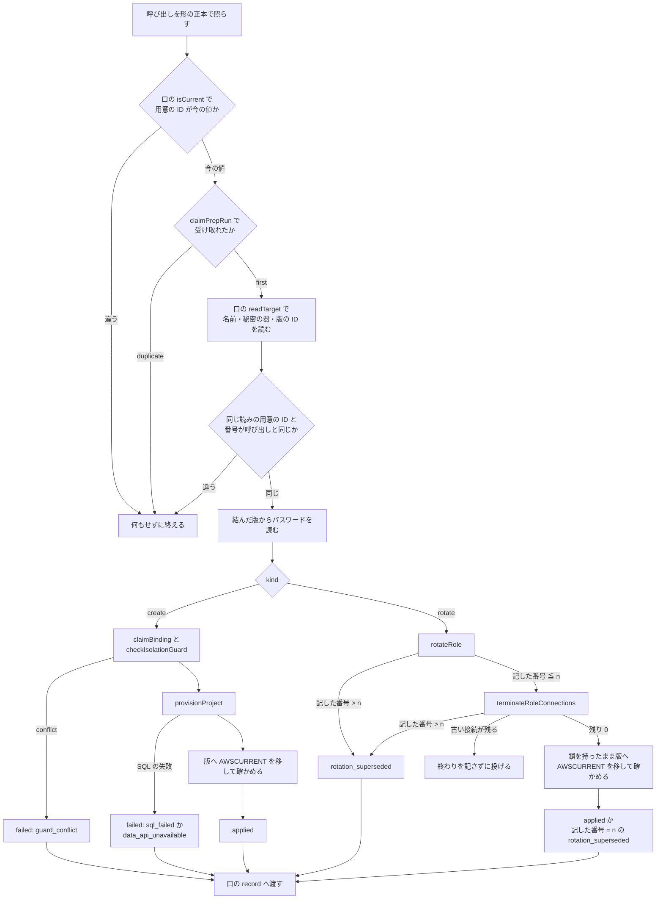

# DB の用意の関数

## 概要

DB の用意の関数は、進行表の DB にプロジェクトごとのデータベースと役割を作り（作成）、役割のパスワードを替える（差し替え）Lambda である。VPC の外で動き、RDS Data API の HTTPS の端点から SQL を打つ。HTTP の経路を持たず、API と見回りが非同期の `Invoke`（`InvocationType: Event`）で呼ぶ。

関数は呼び出しが今の用意であることを読み直してから SQL を打ち、別のプロジェクトのデータベースか役割と重なると何も書かずに止まる（I10）。SQL を終えたら、プロジェクトの秘密の器の結んだ版へ `AWSCURRENT` を移し、関数の中から終わりの記録の口を呼んで結果を記す。

順序の正は [データの文書の進行表の DB](../design/data.md#進行表の-db)（用意の手順・パスワードの版・用意と差し替えの順・差し替えの番号）にあり、この文書は関数の実装の振る舞いと値を持つ。資源の置き場は [アプリのスタックのインフラ](app-stack-infrastructure.md) にある。

## 用語

語の意味は [用語集](../glossary.md) に従う（進行表の DB・資格情報の差し替えなど）。この文書で本文に出すコードの名前は次のとおりである。

| 本文の語 | コードの名前 | 置き場 |
| --- | --- | --- |
| 呼び出しの値・終わりの結果 | `dbPrepInvocation`・`dbPrepOutcome` | `packages/contracts/src/db-prep.ts` |
| 時間の値・環境変数の名前 | `DB_PREP_TIMING`・`DB_PREP_ENV` | 同上 |
| 関数の本体 | `createDbPrepHandler` | `apps/api/src/db-prep/handler.ts` |
| 終わりの記録の口 | `PrepCompletionPort` | 同上 |
| 起点 | `handler` | `apps/api/src/entries/db-prep.ts` |
| SQL を打つ口と Data API の実装 | `SqlExecutor`・`createDataApiExecutor`・`createRdsDataClient` | `apps/api/src/db-prep/sql-executor.ts` |
| 受け取り（重複の配信の除き） | `claimPrepRun` | `apps/api/src/db-prep/prep-run.ts` |
| 結び付きと I10 の守りと用意の手順 | `claimBinding`・`checkIsolationGuard`・`provisionProject` | `apps/api/src/db-prep/provision.ts` |
| 差し替えと古い接続の切り | `rotateRole`・`terminateRoleConnections` | `apps/api/src/db-prep/rotate.ts` |
| 役割のパスワードの書き方 | `prepareRolePassword`・`scramVerifier` | `apps/api/src/db-prep/role-password.ts`・`scram.ts` |
| 秘密の器の版 | `readVersionPassword`・`promoteVersion` | `apps/api/src/db-prep/secret-version.ts` |
| 関数の資源 | `DbPrepFunction` | `infra/lib/db-prep-function.ts` |

本文の「境の時刻」は、差し替えで切る古い接続を決める時刻（`nd_prep.rotation_seq` の `old_conn_cutoff`）をいう。

## コンテキスト

用語集のプラットフォーム（`platform`）のコンテキストに属する。関数はプロジェクトの集約を直に書かず、プロジェクトのモジュールの操作（終わりの記録の口）を呼んで終わりを記す（[API の文書の「ランナー・手元のマシンの HTTP の経路」](../design/api.md#ランナー手元のマシンの-http-の経路) の DB の用意の関数の段）。

依存の向きは `packages/contracts` ← `apps/api` の一方向である。`apps/api/src/db-prep/` は `packages/contracts` だけに依り、`modules/` を import しない。`db-prep/` を import するのは起点だけである。資源（`infra/lib/db-prep-function.ts`）は起点のパスを `NodejsFunction` に渡すだけで、コードを import しない。

## 構成要素と責務

| 構成要素 | 責務 |
| --- | --- |
| 起点 | 環境変数を読み、本番の依存（Data API の実装・秘密の器の読みと移し・ロガー・終わりの記録の口）を実行環境ごとに 1 回組む |
| 関数の本体 | 呼び出しを照らし、用意の ID を読み直し、重複の配信を除き、作成か差し替えを打ち、版を移し、結果を口へ渡す |
| 受け取り | 同じ用意の ID の配信のうち 1 つだけに SQL と終わりの記録を許す |
| 結び付きと I10 の守り | 作る前に、プロジェクトと 2 つの名前の対応を記して照らし、権限の結び付きを照らす |
| 用意の手順 | [データの文書の用意の手順](../design/data.md#用意の手順) の 1〜6 |
| 差し替え | 番号を照らしてパスワードを書き、境の時刻より前に始まった接続を切る |
| パスワードの書き方 | 平文を SCRAM-SHA-256 の検証子に変え、ログの設定を照らしてから、文の本文に載せずに書く |
| 秘密の器の版 | 結んだ版からパスワードを読み、その版へ `AWSCURRENT` を移して確かめる |
| SQL を打つ口 | 本番は Data API、CI のテストは `pg` で、同じ手順を打つ |

## 背景

| 決めたこと | 理由 |
| --- | --- |
| VPC の外の Lambda から Data API で打つ | タスク・イメージ・引き換えの token・タスクの停止を読む手順が要らず、動く部品が減る。NAT もインタフェースのエンドポイントも要らない（MVV の Value 15・16） |
| 非同期の呼び出しの自動の再試行は 0 回、待ち行列の最大の年齢は 60 秒。やり直しは見回りだけが新しい用意の ID で行う | 古い呼び出しが後から動いて、新しい用意と同じデータベースと役割を変えないようにする（[全体の設計の決定 96](../design/platform.md#決定の記録)） |
| SQL の最初に用意の ID を DB の表へ一意に記し、記せた配信だけが進む | 非同期の呼び出しは再試行 0 回でも同じ呼び出しを 2 回以上届けうる。片方の失敗がもう片方の動いている間に用意を「無い」へ戻さないようにする |
| パスワードを SCRAM-SHA-256 の検証子にし、検証子も文の本文に載せない | `CREATE ROLE`・`ALTER ROLE` の `PASSWORD` は引数を束縛できず、失敗した文は既定でサーバーのログに書かれる。検証子も認証に使う秘密である |
| SQL の手順を `SqlExecutor` の裏に置く | 本番の Data API と CI の PostgreSQL で同じ手順を照らせる。Data API が使えなくなったときも、手順とテストをそのまま別の実行の場所へ移せる |
| 差し替えの版の移しを、差し替えの排他の鎖を持ったまま打つ | 鎖を放してから移すと、重なった古い番号の呼び出しが新しい版から古い版へ戻しうる |

## 対象範囲

含む: 起点・関数の本体と SQL の手順・形の正本の呼び出しと結果と時間の値・関数の資源（Lambda と役割の権限）・CI の PostgreSQL のテスト。

含まない（#6 が作る）: 関数を呼ぶ API と見回り（呼ぶ権限 `lambda:InvokeFunction` を含む）・終わりの記録の口の本番の実装と、それが要る DynamoDB の権限の付与。口をつなぐまで、起点は呼ばれたら投げる口（`UNWIRED_COMPLETION`）を渡す。口の `isCurrent` が投げるため、関数は SQL の前に止まり、終わりは記さない。

## 仕様

### 集約と DB の側の表

集約は足さない。関数が読み書きするのは管理のデータベース（`postgres`）の `nd_prep` スキーマの 3 つの表だけで、列と書き方は [データの文書の差し替えの番号](../design/data.md#差し替えの番号) が正である。

| 表 | 使う関数 |
| --- | --- |
| `nd_prep.prep_runs`（用意の ID の受け取り） | `claimPrepRun` |
| `nd_prep.bindings`（プロジェクトと名前の結び付き） | `claimBinding` |
| `nd_prep.rotation_seq`（差し替えの番号と境の時刻） | `rotateRole`・`terminateRoleConnections` |

スキーマと表が無ければ、使う関数が作る。表の有無はまず鎖なしで見て、無ければスキーマの排他の鎖（`pg_advisory_xact_lock(hashtext('nd-prep:schema'))`）を取ってから、カタログの表をその文の時点で読み直し、まだ無ければ作って `PUBLIC` から権限を外す。読み直しに `to_regclass` を使わないのは、名前をカタログの控えで引き、鎖を待つ間に別の配信が作った表を見落とすためである。

### 常に成り立つ条件

| # | 条件 | 守り方 |
| --- | --- | --- |
| I10 | 進行表の DB は、プロジェクトごとに別のデータベースとログインの役割を持つ | 作る前に `claimBinding` と `checkIsolationGuard` で照らし、外れれば何も書かずに `guard_conflict` |
| — | 呼び出しと結果・ログ・例外の文に、パスワード・URL・管理の値・データベースと役割の名前・SQL の文を載せない | 形の正本の strict な形・決まった形のログ・例外の名前と SQLSTATE だけを出す作り |
| — | 役割のパスワードの平文は SQL の文にも引数にも載らず、検証子は文の本文に載らない | `prepareRolePassword` |
| — | 終わりを記すのは、結んだ版に `AWSCURRENT` が付いたと確かめた後だけ（`failed` と、記した番号 > n の `rotation_superseded` は移さずに記す） | `createDbPrepHandler` の順 |
| — | 差し替えで古い接続が残ったときは、`failed` を含めて終わりを記さない（I17。保留を残し、見回りの呼び直しに任せる） | `terminateRoleConnections` の残りの数 |
| — | 前の呼び出しが DB へ働きうる最も遅い時刻（待ち行列の最大の年齢＋関数の時間切れ＋Data API の長い方）は、作成の時間切れと差し替えの期限より短い（540 秒 < 900 秒） | `DB_PREP_TIMING` の単体テスト |

### 呼び出しと終わりの結果

| 形 | 向き | 項目 |
| --- | --- | --- |
| `dbPrepInvocation` | API と見回り → 関数 | `prep_id`（英数字と `_`・`-` で 1〜128 文字）・`project_id`（`prj_` と UUIDv7）・`kind`（`create` か `rotate`）・`rotation_seq`（`rotate` だけ。1 以上の整数）。ほかの項目は誤り |
| `dbPrepOutcome` | 関数 → 終わりの記録の口 | `result` が `applied`・`rotation_superseded`（`recorded_seq` に DB に記してあった番号）・`failed`（`reason`） |

| `reason` | 起きたこと |
| --- | --- |
| `data_api_unavailable` | 受け取りの後の段で、Data API の再開の待ちが再試行の後も続いた |
| `guard_conflict` | データベースか役割が、別のプロジェクトの結び付きに記されていた、または別の役割・別のデータベースへ結ばれていた（I10） |
| `sql_failed` | ほかの SQL の失敗 |

### 関数の本体の流れ

- `readTarget` は、`isCurrent` の後に別の呼び出しが用意を進めて行が次の版を結んだ場合に、その版を読まずに終えるため、同じ読みの用意の ID と差し替えの番号を照らす
- 口が返したデータベースと役割の名前は、SQL を打つ前に形（`PROGRESS_DB_IDENT_SHAPE`。`^[a-z][a-z0-9_]{7,62}$`）を照らし、外れれば投げる
- パスワードは口が返した版の ID で `GetSecretValue` に `VersionId` を渡して読む（ラベルの `AWSPENDING` では読まない）。値は URL で、そのパスワードの部分を取り出す
- 名前と番号を照らす値は `SqlExecutor` の引数で渡す。識別子は `pg` の `escapeIdentifier` で組む

### 作成

`claimBinding` は 1 つのトランザクションで結び付きの排他の鎖（`hashtext('nd-prep:bindings')`）を取り、`nd_prep.bindings` をプロジェクトの ID・データベースの名前・役割の名前のどれかで引く。

| 当たる行 | データベースか役割 | 結果 |
| --- | --- | --- |
| 無い | どちらも無い | `bound`（行を足す） |
| 無い | どちらかが既にある | `conflict`（結び付きの無い資源） |
| 1 つで、3 つの値がすべて同じ | — | `retry`（途中で止まった作成の打ち直し） |
| 1 つで値のどれかが違う、または 2 つ以上 | — | `conflict` |

`checkIsolationGuard` は、データベースか役割が渡されたもの以外へ実効の `CONNECT` で結ばれていれば `conflict` を返す（2 つ目の守り）。実効の `CONNECT` は、ACL の受け手（`datacl` が空なら既定の ACL）か持ち主に属することで読む。

- 役割の側: 渡された役割がほかのデータベース（接続を許さないものも含む）へ持てば数える。渡された役割が superuser なら数える。`PUBLIC` は数えない
- データベースの側: 管理の役割・渡された役割・superuser のほかで実効の `CONNECT` を持つ役割（渡された役割に属する別のログインを含む）を数える。`PUBLIC` は接続を許すデータベースのときだけ数える。接続を許さないデータベースの `PUBLIC` を数えないのは、用意の手順の 2 の後・3 の前に止まった作成を同じ結び付きで打ち直せるようにするためで、その間は誰も接続できない

`provisionProject` は [用意の手順](../design/data.md#用意の手順) の 1〜6 を打つ。関数の実装で決めている値は次のとおりである。

- 2 の `CREATE DATABASE` はトランザクションの外で打ち、4 はプロジェクトのデータベースを選んで打つ
- 1・3・4 の `REVOKE` は取り消す権限が無いと警告だけで終わるため、それぞれの後に `PUBLIC` の権限を読み直し、残れば投げる
- 1 と 5 の接続の切りは `pg_terminate_backend(pid, 0)` を送って読み直す。期限は既定 15,000 ミリ秒、読み直しの間隔は既定 500 ミリ秒。毎回まず起動の途中の接続（データベースの鎖を持ち、まだ `pg_stat_activity` に載らない接続）を読み、次に切る相手の残りを読み、どちらも 0 のときだけ終える。期限を過ぎても残れば投げる
- 6 は役割が無ければ `CREATE ROLE … WITH LOGIN PASSWORD`、あれば `ALTER ROLE … WITH LOGIN PASSWORD` で書き、スキーマの前に `GRANT <役割> TO CURRENT_USER WITH SET TRUE, INHERIT FALSE` を打つ（superuser でない管理の役割がスキーマの持ち主をその役割にするため）
- どの失敗も役割に接続を与える前に投げる。何度打っても、最後に渡したパスワードで同じ結果になる

### 差し替え

`rotateRole` は 1 つのトランザクションで次を打つ。

1. 役割ごとの差し替えの鎖（`hashtext('nd-rotate:' || 役割)`）を取る
2. `rds.restrict_password_commands` の実効値を読み、`off` か読めない値なら何も書かずに投げる（Aurora の外の値の無い場合は通す）
3. 記した番号と n を比べる。記した番号 > n なら `superseded_greater`、= n なら `superseded_equal` で何も書かない
4. 小さければ、パスワードと番号 n と書いた時刻を書き、境の時刻を空にする（`applied`）

`terminateRoleConnections` は、`rotateRole` の確定の後に別のトランザクションで同じ鎖を取り、次を打つ。

1. 記した番号が n より大きければ何も切らずに `superseded_greater`。境の時刻が空なら `clock_timestamp()` を記す（記されていれば記し直さない）
2. 統計の写しを捨て（`pg_stat_clear_snapshot()`。トランザクションの中の `pg_stat_activity` は最初の読みの写しを返し続けるため、読む直前ごとに打つ）、その役割で境の時刻より前に始まった接続へ 1 つの文で `pg_terminate_backend(pid, 0)` を送る
3. 起動の途中の接続（仮想の取引番号の鎖を持ち、まだ `pg_stat_activity` に載らない `pid`）を読む。最初の読みの集まりを追う接続とし、以後は載ったか終わったものを外す（後から起動した接続は新しい検証子を読むため足さない）
4. 載った古い接続の数と追う接続の数の両方が 0 なら、鎖を持ったまま版の移しを打ってから確定し、残り 0 を返す。そうでなければ待って 2 から繰り返す。上限を過ぎていれば 2 つの数の和を残りとして返す（上限を過ぎていても読みを 1 回打ってから決める）

| 値 | 既定 | 意味 |
| --- | --- | --- |
| 期限 | 15,000 ミリ秒 | 切り始めから。追う接続が無く、減ったことも無ければこれが上限 |
| 読み直しの間隔 | 500 ミリ秒 | 期限までの残りと小さい方を待つ |
| 認証の時間切れによる延長 | `authentication_timeout` ＋ 2,000 ミリ秒 | 追う接続が残る間だけ、切り始めからここまで延ばす（サーバーの設定を初めて要るときに読む） |
| 減った後の余裕 | 2,000 ミリ秒 | 追う接続が減った読みの後に 0 になったら、その読みからここまで延ばす |
| 延長の上限 | 120,000 ミリ秒 | 延ばした所と余裕の終わりを、切り始めからこの時間で切り詰める |

起動の途中の接続は役割が分からないため、今の接続の権限で除かず、載るか終わるまで追う。認証の後にデータベースの鎖を待ち続ける接続（ほかのプロジェクトのものも含む）は上限で残りに数え、失敗の側へ倒す（保留を残し、呼び直しに任せる）。

境の時刻より後に始まった接続は切らない。同じ番号 n の呼び直しが先に終わりを記して保留が下り、新しいパスワードでレーンが接続を始めた後に、遅れた前の呼び出しが切りに来ても、新しい接続は切られない。

### 役割のパスワードの書き方

`scramVerifier` は平文を RFC 7677 の SCRAM-SHA-256 の検証子（`SCRAM-SHA-256$<回数>:<塩>$<StoredKey>:<ServerKey>`。塩 16 バイト・回数 4096）に変える。`node:crypto` だけで組む。印字できる ASCII でないパスワードは投げる（PostgreSQL の SASLprep を持たないため。API が作るパスワードは base64url の文字だけ）。

`prepareRolePassword` は、呼ぶ側のトランザクションの中で次の 3 つを打つ。

1. 次の設定を読み、外れていれば検証子を送らずに「検証子を送らずに止めた: <理由>」を投げる

   | 設定 | 送ってよい値 | 関数の扱い |
   | --- | --- | --- |
   | `log_parameter_max_length` | `0` | 読むだけ（クラスタのパラメータで置く） |
   | `log_parameter_max_length_on_error` | `0` | トランザクションの中だけで `0` に置く |
   | `debug_print_plan`・`debug_print_parse`・`debug_print_rewritten` | `off` | トランザクションの中だけで `off` に置く |
   | `pg_stat_statements.track` と `track_utility` | `track` が入れ子の文を追う値（`none`・`top` のほか。`all` など）で、かつ `track_utility` が有効、の組み合わせでない | 読むだけ |
   | `auto_explain.log_min_duration` | 無いか `-1` | 読むだけ |
   | `pgaudit.log_parameter` | 無いか偽 | 読むだけ |
   | `pgaudit.log` | 無いか、pgAudit と同じ読み方で `role` が効かない（読めない並びは止める） | 読むだけ |
   | `rds.restrict_password_commands` | 無いか `off`。`on` なら管理の役割が `rds_password` の役割を持つ | 読むだけ |

2. 検証子を引数で渡し、トランザクションの中だけの設定（`nd_prep.role_verifier`）に置く
3. `DO` の中で設定から読み、`format` で組んだ `CREATE ROLE`・`ALTER ROLE` を `EXECUTE` で打ち、設定を空へ戻す。`EXECUTE` の文の失敗は受けて、SQLSTATE を残したまま決まった文の誤りに替えて投げ直す（PL/pgSQL は失敗の文脈に打った文の本文を載せるため）

`DO` の本文に載るのは役割の名前と決まった文だけである。トランザクションの外では打たない（Data API はトランザクションの外の文ごとに接続を変えうるため、設定が次の文に届かない）。

### 秘密の器の版の移し

`promoteVersion` は次の順で結んだ版へ `AWSCURRENT` を移す。

1. 最初の読みの前に、移しと読み直しまでを収める期限（既定 20,000 ミリ秒）を決める
2. `DescribeSecret` で版に `AWSCURRENT` が付いていれば何もしない
3. 付いていなければ `UpdateSecretVersionStage`（`MoveToVersionId` に版、`RemoveFromVersionId` に今 `AWSCURRENT` の付く版）を 1 回だけ打つ
4. 読みは結果整合のため、移しを打ち直さずに、250 ミリ秒から倍にして 2,000 ミリ秒までの間を置いて、期限まで `DescribeSecret` を読み直す

どの送信も送る前に期限までの残りを読み、残りが無ければ送らずに投げる。送るときは残りの時間で打ち切る信号を渡す。期限は、差し替えの鎖を持つトランザクションの無通信の巻き戻し（Data API の 3 分）と関数の時間切れ（5 分）より十分短く、鎖が外れた後に移しを送らない。

### SQL を打つ口

`SqlExecutor` は `execute`（`transactionId` が無ければ自動の確定）・`begin`・`commit`・`rollback` を持つ。`database` で `postgres` かプロジェクトのデータベースを選ぶ。

Data API の実装（`createDataApiExecutor`）:

- `ExecuteStatement` に `includeResultMetadata: true`・`continueAfterTimeout: false` を渡す（45 秒で終わらない文は Data API が取り消し、PostgreSQL の DDL は巻き戻る）。行は `records` と `columnMetadata` から組む
- 再開の待ち（`DatabaseResumingException`）だけを、トランザクションの外の `execute` と `begin` で繰り返す。既定は 12 回・間隔 5,000 ミリ秒・期限 60,000 ミリ秒（`p-retry` の固定の間隔）。期限は試行の関数の始めでも照らす。尽きたら `DataApiUnavailableError` を投げる
- トランザクションの中の文と `commit`・`rollback` は繰り返さない。中の文が失敗したら呼ぶ側が巻き戻して失敗にする
- 繰り返すのは、再開の待ちの時は文が DB で打たれていないと推測するからである。推測が外れても、用意の手順は何度打っても同じ結果になる作りのため、その回が `sql_failed` で終わり、次の開始か呼び直しが続ける
- クライアントは `createRdsDataClient` で作ったものだけを受ける。`createRdsDataClient` は SDK の自動の再試行を止め（`maxAttempts: 1`・常に打ち直さない凍った戦略）、作った後に戦略と回数と `config` を差し替えられなくする。SDK が文や `commit` を打ち直すと、初回が確定して応答だけが失われたときに確定したかが分からなくなるためである。受ける設定は `region`・`credentials`・`endpoint`・`requestHandler` だけ
- 起点は送りの時間切れを 60,000 ミリ秒にする（Data API の 45 秒より長くし、SDK が先に時間切れを返さない）

2 つの実装の違いと、同じ手順を照らす前提の守り方:

| 違い | 守り方 |
| --- | --- |
| Data API の応答は 1 MiB まで。文の長さの上限は確かめていない | 手順の文はどれも 4 KiB 未満で、返す行は数行に限る（一覧を読む文は `count(*)` か `LIMIT`） |
| Data API の値の型（整数は `longValue` など）と `pg` の型の変換が違う | 読む列は SQL の側で `::int`・`::text`・`::boolean` に型を決め、時刻は読まずに SQL の中で比べる。`int` を受ける関数へ渡す整数は `CAST(… AS int)` にする |
| Data API は接続の池を使い回す | `pg_stat_clear_snapshot()` と `pg_terminate_backend` は 1 つのトランザクションの中だけで打つ。切る相手はプロジェクトの役割の接続だけ |

## データ・設定

### 時間の値

`DB_PREP_TIMING` が時間の値の正で、読み手は値を写さずにこの定数を参照する。

| 名前 | 値（秒） | 読み手 |
| --- | --- | --- |
| `maxEventAgeSeconds` | 60 | 関数の資源（待ち行列の最大の年齢） |
| `functionTimeoutSeconds` | 300 | 関数の資源（時間切れ） |
| `dataApiCallSeconds` | 45 | Data API が決める値（1 つの呼び出しの文の取り消し） |
| `dataApiTxIdleSeconds` | 180 | Data API が決める値（無通信のトランザクションの巻き戻し） |
| `prepDeadlineSeconds` | 900 | 見回りと API（作成の時間切れと差し替えの期限。#6） |
| `patrolIntervalSeconds` | 300 | 見回りのスケジュール（#6） |

差し替えの呼び直しの上限は 3 回で、設定のキー `progress_db.rotation_retry_limit` として見回りを作る課題が足す（[アプリのスタックのインフラのほかの課題が足すキー](app-stack-infrastructure.md#ほかの課題が足すキー)）。

### 関数の資源

| 項目 | 値 |
| --- | --- |
| 名前 | `<prefix>-<environment>-db-prep` |
| 実行の場所 | Node 24・ARM64・256 MB・VPC の外 |
| 時間切れ | `functionTimeoutSeconds` |
| 非同期の呼び出し | 自動の再試行 0 回・最大の年齢 `maxEventAgeSeconds` |
| ログ | 自前のログの群 `<prefix>-<environment>-db-prep`。30 日で消す |
| 束ね | SDK を含めて束ねる（実行環境の SDK の版に頼らない） |
| 環境変数 | `DB_PREP_CLUSTER_ARN`（クラスタの ARN）・`DB_PREP_ADMIN_SECRET_ARN`（管理の役割の秘密の器の ARN）・`DB_PREP_SECRET_PREFIX`（`<prefix>/<environment>/progress-db/`）。名前は `DB_PREP_ENV` が正 |

役割の権限は次の 3 つの文だけである。

| 操作 | 資源 |
| --- | --- |
| `rds-data:ExecuteStatement`・`BeginTransaction`・`CommitTransaction`・`RollbackTransaction` | 進行表の DB のクラスタ |
| `secretsmanager:GetSecretValue` | 管理の役割の秘密の器 |
| `secretsmanager:GetSecretValue`・`DescribeSecret`・`UpdateSecretVersionStage` | `<prefix>/<environment>/progress-db/*` の秘密の器 |

## 外部連携

| 相手 | 連携 |
| --- | --- |
| 呼ぶ側（API と見回り。#6） | 用意の ID と新しい版の ID を条件つきの書き込みで置き、勝ったときだけ秘密の器のその版へパスワードの URL を入れてから、`dbPrepInvocation` を `Invoke`（`InvocationType: Event`）で渡す（[データの文書のパスワードの版](../design/data.md#パスワードの版)）。呼ぶ権限は `DbPrepFunction` の公開の値 `fn` に #6 が許す |
| 終わりの記録の口（`PrepCompletionPort`。実装は #6） | 下の表 |
| RDS Data API | 管理の役割の秘密の器を渡して SQL を打つ |
| Secrets Manager | プロジェクトの秘密の器の結んだ版を読み、`AWSCURRENT` を移す |

| 口の操作 | 中身 |
| --- | --- |
| `isCurrent(projectId, prepId)` | プロジェクトの表をプロジェクトの ID の主キーで強い整合で読み、その行の用意の ID が渡した値と同じかを返す |
| `readTarget(projectId)` | 同じ読み方の 1 回の読みで、データベースと役割と秘密の器の名前・結んだ版の ID を、同じ行の用意の ID と差し替えの番号（差し替えをまだしていない行は `null`）と一緒に返す |
| `record(inv, outcome, secretVersion)` | 用意の ID・差し替えの番号・版の ID が今の値と合うときだけ書く条件つきの書き込み。合わなければ書かずに `mismatch` を返す |

口の 3 つの操作は、プロジェクトのモジュールの 3 つの処理（[API の文書](../design/api.md#ランナー手元のマシンの-http-の経路) の DB の用意の関数の処理）で作り、認可の判定と操作の記録の書き手を通す。口が要る DynamoDB の権限は、口をつなぐ同じ変更で `AppStack` から `DbPrepFunction.grantCompletionAccess` を呼んで足す。許すのは、プロジェクトの表の ARN への `dynamodb:GetItem`・`UpdateItem`・`ConditionCheckItem` と、操作の記録の表の ARN への `dynamodb:PutItem` だけで、索引の ARN・`Query`・`Scan`・`DeleteItem`・ほかの表は許さない。

## エラー処理

| 条件 | 結果 |
| --- | --- |
| 呼び出しが `dbPrepInvocation` に合わない | 口を呼ばずに終える。ログに形の誤りだけを出す |
| `isCurrent` が偽 | SQL を打たず、`record` も呼ばずに終える |
| `claimPrepRun` が `duplicate` | 何もせずに終える（ログの `result` は `duplicate_delivery`） |
| `claimPrepRun` が投げる（再開の待ちが尽きた・確定の応答が届かない） | 受け取れたかが分からないため、`failed` を含めて終わりを記さずに投げる。もう一方の配信が受け取っていればそれが続け、どちらも受け取っていなければ見回りが期限の後に扱う |
| `readTarget` の用意の ID か番号が呼び出しと合わない | パスワードを読まず、SQL・移し・`record` を呼ばずに終える（ログの `result` は `not_current`） |
| 作成で `conflict` | 何も書かずに `failed`・`guard_conflict` |
| 受け取りの後の段で再開の待ちが尽きた | `failed`・`data_api_unavailable` |
| ほかの SQL の失敗 | `failed`・`sql_failed` |
| 差し替えで `superseded_greater` | 接続を切らず、移さずに `rotation_superseded`（記した番号） |
| 差し替えで古い接続が残った | 移しも `record` も呼ばずに投げる（段 `terminate`） |
| `isCurrent`・`readTarget`・パスワードの読み・移し・`record` が投げる | 終わりを記さずに投げる。差し替えで移しが投げたら、古い接続を切るトランザクションを巻き戻す |
| `record` が `mismatch` | 書かれずに終える。ログに出す |

投げるときは `DbPrepFunctionError`（止まった段と元の例外の名前だけを持つ）を投げる。止まる段は `is_current`・`claim`・`read_target`・`read_password`・`terminate`・`promote`・`record` のどれかである。自動の再試行は 0 回で、作成なら見回りが期限の後に「無い」へ戻して次の開始が同じ名前で打ち直し、差し替えなら見回りが同じ番号 n で呼び直す。版を移した後に記せずに落ちても、呼び直しは同じ版を読み、移し済みを読み直してから記す。

## セキュリティ

- ログは `pino` の 1 行の JSON を標準出力（関数のログの群）へ出す。項目は用意の ID・種類・結果・理由のコード・所要時間・口の結果・段・例外の名前・SQLSTATE だけで、メッセージは定数にして値を埋め込まない。例外はそのまま渡さず、名前とコードだけを取り出す
- 2 つ目の守りとして、`redact` で `password`・`url`・`secret`・`SecretString`・`database`・`role`・`sql`・`err`・`message`・`stack`（と 1 段下の同じキー）を外す
- パスワードの平文は SQL の文にも引数にも載せず、検証子は文の本文に載せない。Aurora のサーバーのログに残るのは、検証子を持たない `DO` の本文と決まった文の誤りだけである。`ProgressDb` はサーバーのログを CloudWatch Logs へ書き出さない
- 関数が読める秘密の器は、管理の役割の器と `<prefix>/<environment>/progress-db/` の頭だけである

## 運用

- 進行表の DB のログと監査の設定（上の「役割のパスワードの書き方」の表）をスタックの外で外すと、次の用意か差し替えで止まる（[設置の手順の「進行表の DB のログと監査の設定」](../operations/setup.md#進行表の-db-のログと監査の設定)）
- 既にあるクラスタで `rds.restrict_password_commands` を効かせるには、書き込みのインスタンスの再起動が要る（[設置の手順の「進行表の DB のパスワードの変更の禁止」](../operations/setup.md#進行表の-db-のパスワードの変更の禁止)）
- Data API で用意の手順の文が打てること・接続を残さないこと・再開の待ちの振る舞い・カタログの分け方が Aurora で外せることは、反映した環境で #44 が確かめる（[全体の設計の未確認のまま残ること](../design/platform.md#未確認のまま残ること)）

## テスト観点

DB のテストは CI の `check` のジョブで、PostgreSQL 16 のサービスコンテナ（イメージは要約値で固定）に `SqlExecutor` の `pg` の実装で打つ。

| 環境変数 | 意味 |
| --- | --- |
| `ND_TEST_PG_URL` | テストの PostgreSQL への接続の値。無いとき、`CI` が真なら DB のテストは落ち、手元では飛ばす |
| `ND_TEST_PG_DISPOSABLE_CLUSTER` | `1` と完全に一致するときだけ、クラスタ全体の権限を変えるテスト（`provision.test.ts` の PostgreSQL の組）を打つ |
| `ND_TEST_PG_AUTH_TIMEOUT_URL` | `authentication_timeout=3s` で起こした別のコンテナ。認証の時間切れのテストだけが使い、設定を変えずに読んで確かめる |

| 観点 | 確かめること |
| --- | --- |
| I10 | 2 つのプロジェクトを作り、A の役割で A へ接続でき、B・`postgres`・`template1` へ接続できず、カタログから B の名前を読めない。既にある別のプロジェクトのデータベースか役割を渡すと `guard_conflict`。A の作成を最後の `GRANT` の前で止め、B が A の名前の片方を渡すと `conflict`、A の打ち直しは `retry` で通る |
| 用意の手順 | superuser でない管理の役割で初回の作成と作り直しが通る。同じ値で 2 回打っても同じ結果。`REVOKE` が警告だけで終わると投げる。ほかのデータベースに `PUBLIC` の `CONNECT` が戻っていると、外して繋いだままの接続を切り、何も作らずに投げ、打ち直しが通る |
| 受け取り | 同じ用意の ID の 2 回目は `duplicate`。2 つの接続から同時に打つとちょうど 1 つが `first`。8 日前の行は消え、6 日前の行は残る。表の無い間に別の接続が鎖を持っても、作られた表を見落とさない |
| 重複の配信 | 同じ作成の呼び出しを 2 つ同時に打つと、`CREATE DATABASE` と `CREATE ROLE` を打つのが 1 つだけで、`record` は 1 回だけ `applied` で呼ばれる。受け取りの段の失敗と確定の応答の失敗では `record` も用意の SQL も呼ばれない |
| 差し替え | 記した番号 < n で書き、= n と > n で書かない。2 つを同時に打つと番号の大きい方が残る。書く前に開いた接続を切り、残り 0 を返す（写しを捨てないと落ちる）。順序の逆転で、境の時刻より後に開いた接続が切られない。起動の途中の接続を上限まで追い、残れば残りに数える |
| 版の移し | 番号 1 の移しを止めている間に番号 2 を始めると、番号 2 は鎖を待ち、最後に `AWSCURRENT` が付くのは番号 2 の版で、DB のパスワードと合う。移した直後の読みが前のラベルを返しても移しを打ち直さない。期限を過ぎると移しを送らずに投げる |
| 関数の本体 | エラー処理の表の各行。`record` は移しの後にだけ呼ばれ、`failed` では移さない。古い接続が残ると `record` を呼ばずに投げる |
| パスワード | 検証子が設定の文の引数にだけ現れ、どの文の本文にも無い。平文はどの文と引数にも現れない。PostgreSQL のコンテナのログに平文が現れない。`scramVerifier` は PostgreSQL が作った検証子と同じ塩と回数で同じ値を返し、作った役割へ平文で接続できる。照らしの設定のどれかが外れると送らずに止める |
| Data API の実装 | SDK のクライアントを差し替えて、`ExecuteStatement` への値・再開の待ちの 12 回と期限・トランザクションの中で繰り返さないこと・`createRdsDataClient` で作らないクライアントを受けないこと・作った後に戦略を差し替えられず 503 でも 1 回だけ送ることを照らす |
| ログ | ログの全行に、作り物のパスワード・URL・データベースと役割の名前が部分の文字列として現れない（それらを `message` に含む例外を投げさせても同じ） |
| 時間の値 | `maxEventAgeSeconds + functionTimeoutSeconds + max(dataApiCallSeconds, dataApiTxIdleSeconds) < prepDeadlineSeconds`（540 < 900）で、差が見回りの間隔以上。合成の出力の関数の `Timeout` と `MaximumEventAgeInSeconds` が定数と同じ |
| 関数の資源 | `VpcConfig` を持たない・自動の再試行 0 回・役割の文が上の 3 つだけで DynamoDB の文を持たない。`grantCompletionAccess` は 2 つの表の ARN だけへ 4 つの操作を足す |

## 関連リンク

- [アプリのスタックのインフラ](app-stack-infrastructure.md)
- [データの文書の進行表の DB](../design/data.md#進行表の-db)（[用意の手順](../design/data.md#用意の手順)・[パスワードの版](../design/data.md#パスワードの版)・[用意と差し替えの順](../design/data.md#用意と差し替えの順)・[差し替えの番号](../design/data.md#差し替えの番号)）
- [全体の設計の不変条件](../design/overview.md#不変条件)（I10・I17・I18・I22）
- [プラットフォームの文書の決定の記録](../design/platform.md#決定の記録)（決定 83・90・95・96）
- [設置の手順](../operations/setup.md)
- [用語集](../glossary.md)
