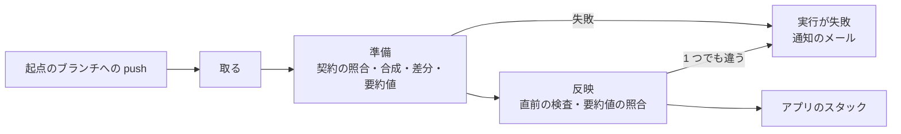

# 反映のパイプライン: push から人を待たずに反映し、反映の直前の検査と権限で中身を限る

## 概要

反映のパイプラインは、起点のブランチへの push を受けて、アプリのスタックを AWS へ反映する。人の承認の段は持たず、人が差分を読むのは反映の後である（持ち主の決定、2026-11-25、[#164](https://github.com/devbasex/nd-factory/issues/164)）。起点のブランチへのマージは、その前にリリース承認ゲートで持ち主の承認を受ける（[承認を受ける操作](#承認を受ける操作)）。実行ごとの承認の代わりに、次の仕組みで反映する中身を限る。

- 起点のブランチを、レビュー必須の保護があるブランチに限る
- 準備の段で NDF の契約を照合し、食い違えば反映へ進まない
- 反映の段が `cdk deploy` の直前に検査を打ち、1 つでも満たさなければ反映しない
- アプリの反映は、設置ごとのアプリ専用の bootstrap と権限の境界で、AWS の側の権限も限る

この規則は商用利用の開始前の運用に当てる。商用利用を宣言した本番へは、このパイプラインでは反映しない。

この文書は仕組みと理由を定める。運用担当者が打つ手順の正本は [pipeline-approval.md](../operations/pipeline-approval.md) である。

## 用語

語の意味は [用語集](../glossary.md) に従う。用語集に無い語のうち、この文書で使うものは次のとおりである。

| 語 | 意味 |
| --- | --- |
| 設置 | 設定のファイルの `prefix` と `environment` の組で決まる 1 組の資源 |
| 起点のブランチ | 設定の `pipeline.repository` と `pipeline.branch` が指すブランチ |
| NDF の契約の照合 | このリポジトリの NDF の使い方が、NDF の公開する契約と食い違わないかを調べる検査（[仕様](ndf-contract-use.md)） |
| 段階 | 承認や一部の問いへの回答を人に限るか（`human`）、AI の委任にも許すか（`ai`）。規則は [API の文書の人の確定の段階](../design/api.md#人の確定の段階) |
| 宣言した本番 | 設定の `launch_declared` が真で、`environment_kind` が `production` の設置 |
| 宣言の記録 | 商用利用を宣言した事実を残す SSM のパラメーター `/<prefix>/<environment>/launch-declared` |
| 運用担当者 | 運用する環境の AWS で操作する権限を持つ人 |
| 持ち主 | nd-factory のプロジェクトの持ち主。自分で設置した環境の承認は、自分で設置する人が兼ねる |
| 運用の記録 | 公開できない実際の値（ARN・アカウント ID・実行の ID など）を残す、リポジトリの外の非公開の保管先 |

## コンテキスト

用語集のプラットフォーム（`platform`）のコンテキストに属する。このリポジトリ自体の開発の話で、nd-factory の製品を動かす AWS への反映を扱う。集約は足さない。

## 構成要素と責務

| 構成要素 | 置き場 | 責務 |
| --- | --- | --- |
| パイプラインのスタック | `infra/lib/pipeline-stack.ts`（`PipelineStack`） | 段・権限・push のトリガー・失敗の通知・設定のパラメーターを作り、準備と反映の手順を持つ |
| 反映の直前の検査 | `infra/lib/deploy-guard.ts` | `cdk deploy` の前の検査を順に打ち、1 つでも満たさなければ非 0 で終わる |
| 合成の結果の検査 | `infra/lib/assembly-check.ts` | 合成の結果の形、変換の有無、段階の値、IAM のロールを調べる |
| 段階の判定 | `infra/lib/confirmation-stage.ts` | 設定の値と宣言の記録から、段階と反映を拒むかを決める |
| bootstrap のテンプレート | `infra/lib/app-bootstrap-template.ts` | CDK の標準のテンプレートに、設置ごとの制約を当てる |
| qualifier の衝突の判定 | `infra/lib/bootstrap-collision.ts` | アプリ専用の bootstrap の qualifier を別の設置が使っていないかを判定する |
| bootstrap の準備のコマンド | `infra/bin/app-bootstrap.ts`（`npm run app-bootstrap`） | 衝突の確認と、テンプレートの書き出し。bootstrap 自体は打たない |
| 合成のエントリポイント | `infra/bin/app.ts` | パイプラインのある設置のアプリのスタックを、専用の qualifier と権限の境界で合成する |
| 資源の名前 | `infra/lib/naming.ts` | パイプラインと bootstrap の資源の名前と ARN を作る |

検査の 3 つのモジュール（`deploy-guard.ts`・`assembly-check.ts`・`confirmation-stage.ts`）は `node:` の組み込みと AWS CLI だけを使う。反映の段に `node_modules` が無いためである。

## 背景

- 以前のパイプラインは人の承認の段を持ち、push が続くと古い実行が承認の段にとどまって反映が止まった。持ち主が承認を不要と決めた
- 承認する人が読んで確かめていた NDF の契約の照合は、準備の段の自動の検査にした（[実行の文書](../design/execution.md)の決定 79）。人の目に頼る確認を、毎回走る検査に置き換え、パイプラインに GitHub の token を持たせない
- 反映の段の検査は、起点のブランチから変えられない場所（パイプラインのスタック）に置く。合成するのは起点のブランチのコードなので、準備の側の確認はブランチの変更だけで通せる
- 承認を拒む IAM の方針は、承認の段が無く効く対象が無いので持たない。前の版で付けた方針を外す手順だけが [手順書](../operations/pipeline-approval.md#承認の段を持っていた版から上げるとき) に残る
- パイプラインのスタック自身は、設置のコマンド（`--stack pipeline`）でだけ反映する。push だけで反映のロールの権限を広げられないようにするためである

## 対象範囲

- 対象は、設定のファイルに `pipeline` がある設置の反映である。運用する環境と、自分で設置してパイプラインを併設する環境が当たる
- 対象外
  - 設置のコマンドだけで使う設置（`pipeline` が無い）。既定の bootstrap のまま `diff` と `deploy --confirm` で反映する（[setup.md](../operations/setup.md)）
  - 商用利用を宣言した本番の反映の承認方式。未定で、持ち主が別の設計で決める
  - 段階を決める 2 つのキーの設定のスキーマ、合成の環境変数 `ND_CONFIRMATION_STAGE`、API の認可への接続、宣言の記録の作成、設置のコマンドが直接の反映を止める検査（[#181](https://github.com/devbasex/nd-factory/issues/181)）。今の設定のスキーマは 2 つのキーを受け付けない

## 仕様

### 常に成り立つ条件

- パイプラインの段は、取る（`Source`）→ 準備（`Prepare`）→ 反映（`Deploy`）の 3 つだけで、人の承認を待たない
- 反映するのは、起点のブランチへの push のトリガーで始まった実行だけである
- 反映するのは、準備が作った合成の結果と同じ要約値のものだけである
- 反映するのは、準備が読んだ版と値の設定がそのまま残っているときだけである
- 宣言した本番、宣言の記録がある設置、記録の有無を読めない設置へは反映しない
- パイプラインが反映するのは、アプリのスタック `<prefix>-<environment>-app` だけである
- 反映の直前の検査は、起点のブランチの変更からは変えられない
- アプリのスタックの IAM のロールは、すべて権限の境界を持ち、AWS のサービスだけを信頼する

### 段とトリガー

- パイプラインは V2 で、実行の扱いは `SUPERSEDED` である
- 取る段は GitHub との接続を使う。ソースのアクションの変更の検知は使わず（`triggerOnPush: false`）、起点のブランチだけを含む push のトリガーを持つ。このトリガーで始まった実行だけが、反映の段の検査を通る始まり方（`WebhookV2`）になる
- トリガーのブランチの一覧は glob として読まれるので、`pipeline.branch` は英数字と `.` `_` `-` `/` だけに限る
- 反映の段の入力は準備の出力だけで、合成し直さない

### 準備の段

1. SSM のパラメーター `/<prefix>/<environment>/settings` の版を読み、その版を指定して値を読む。版と、値の SHA-256 を出力の変数 `SETTINGS_VERSION`・`SETTINGS_SHA256` にする
2. `npm ci` の後、`mkdir -p infra/approval` で出力先を作り、`npm run ndf-contract -- --summary infra/approval/ndf-contract.md` を打つ。ほかの命令とつながないので、非 0 なら後の命令は打たれない
3. 画面をビルドし、アプリのスタックだけを合成して、差分を `approval/diff.txt` に残す
4. 要約値（`ASSEMBLY_DIGEST`）、コミット、スタックの一覧を出力の変数にする

| 照合の結果 | 終了コード | 準備 |
| --- | --- | --- |
| 固定の点（`ndf-pin.json` の NDF のコミット）の契約と食い違う、使い方の書き出しが無い | 1 | 止める |
| 固定の点の契約を読めない、固定の点や書き出しを読めない、要約を書けない | 2 | 止める |
| NDF のデフォルトブランチの先端の契約とだけ食い違う、先端だけを読めない | 0 | 反映へ進む |

準備が引き受けられるロールは、アプリ専用の bootstrap の lookup のロールだけである。

### 反映の直前の検査

反映の段は、検査 → 要約値の数え直しと `EXPECTED_DIGEST` との比較 → `cdk deploy` の順に打つ。`cdk deploy` には `--no-previous-parameters` を付け、前の反映のパラメーターの値を引き継がず、検査したテンプレートの既定の値で反映する（アプリ専用の bootstrap へ切り替える前からあるスタックは、旧い版のパラメーターの名前を持つため）。検査のコードは、パイプラインのスタックの合成のときに束ね、gzip と base64 にしてビルドの手順へ埋め込む。S3 のアセットにすると、反映のプロジェクトのロールに読み取りの権限が要るためである。

検査は次の順に打ち、最初の失敗で止まる。

| 順 | 関数 | 満たす条件 |
| --- | --- | --- |
| 1 | `checkTrigger` | 自分の実行の `trigger.triggerType` が `WebhookV2` |
| 2 | `checkSettings` | 設定のパラメーターの版と値の SHA-256 が準備と同じで、値が JSON として読める |
| 3 | `refusalReason` | 下の「段階の判定と反映を拒む条件」に当たらない |
| 4 | `checkAssembly` | 合成の結果が、許した形のアプリのスタックだけ |
| 5 | `checkTemplateTransforms`・`checkTemplateStage`・`checkTemplateRoles` | テンプレートの違反が 0 件 |
| 6 | `checkExecutionRole`・`checkPolicyDocuments`・`checkSimulations` | 実行のロール、方針の本文、実効の権限が期待のとおり |
| 7 | `checkBootstrapVersion` | アプリ専用の bootstrap の版が、合成の結果の求める版以上 |
| 8 | `checkTemplateObject` | S3 のテンプレートの中身が、検査したファイルと同じ |

#### 合成の結果の形

| 対象 | 条件 |
| --- | --- |
| 成果物の種類 | `aws:cloudformation:stack`・`cdk:asset-manifest`・`cdk:tree`・`cdk:feature-flag-report` だけ |
| スタック | 1 つだけで、名前がアプリのスタック。アセットのマニフェストは、そのスタックが依存するものだけ |
| スタックのロール | 実行のロールと反映のロールがアプリ専用の qualifier のもの |
| アセット | コンテナのイメージのアセットは無い。ファイルのアセットの元は `path` と `packaging` だけ（外部のコマンドを実行する `executable` を拒む）。パスは合成の結果の中の相対パスで、`..` とリンクを含まない。置き先はアプリ専用のバケット |
| テンプレート | `stackTemplateAssetObjectUrl` が、アプリ専用のバケットの `<テンプレートの SHA-256>.json` で、アセットの置き先と同じ。ほかのアセットのキーは `.json` で終わらない |

#### テンプレートの中身

- 変換（`Transform`・`Fn::Transform`）があれば拒む。変換の後の中身を検査が読めないためである
- 段階の値は、API の関数の環境変数 `ND_CONFIRMATION_STAGE` で見る。対象は、API Gateway の統合の呼び出し先と、`REQUEST` の Lambda オーソライザーの関数である
  - 呼び出し先を関数に結び付けられないとき、統合の呼び出し先の関数が 1 つも無いときは違反にする
  - 期待が `ai` なら、対象の関数のすべてに値 `ai` が要る。期待が `human` なら、未設定も許す
  - テンプレートのどこにあっても、期待と違う `ND_CONFIRMATION_STAGE` は違反にする
- IAM のロールは、すべて権限の境界 `<prefix>-<environment>-app-boundary` を持ち、信頼する主体が AWS のサービスだけである。IAM のユーザー・グループ・アクセスキー・グループへの追加は拒む

#### 実行のロール、方針の本文、実効の権限

- 実行のロールに付く管理ポリシーは、アプリ専用の実行の方針 1 つだけで、インラインポリシーは無い
- 実行の方針と権限の境界の、今のデフォルトのバージョンの本文の要約値が、パイプラインのスタックが持つ値と同じである。同じ ARN のままバージョンを差し替えると権限を広げられるためである。キーの順の違いは同じ本文とする
- `iam:SimulatePrincipalPolicy` の判定が、次の表のとおりである

| 対象のロール | 操作と資源 | 期待 |
| --- | --- | --- |
| 反映のロール | `cloudformation:UpdateStack`・`CreateChangeSet`（`cloudformation:RoleArn` に専用の実行のロール）、`ExecuteChangeSet`（値を渡さない）、`DeleteStack`（値を渡す・渡さない）を、アプリのスタックに | 許可 |
| 反映のロール | `UpdateStack`・`CreateChangeSet` を、`cloudformation:RoleArn` の値を渡さずに | 拒否 |
| 反映のロール | 上の操作を、パイプラインのスタックと、作り物の名前の別の設置のスタック 2 つに | 拒否 |
| 反映のロール | `iam:PassRole` を、既定の qualifier と別の qualifier の実行のロールに | 拒否 |
| 実行のロール | パイプラインのスタックの更新、反映のプロジェクトのロールとパイプラインのスタックのロールの信頼と方針の変更、パイプラインの定義の変更 | 拒否 |
| 実行のロール | 設定のパラメーターの書き込み、宣言の記録の書き込みと削除 | 拒否 |
| 実行のロール | 境界を指定しないロールの作成、ロールの境界の削除、実行の方針と境界の新しいバージョンの作成 | 拒否 |

失敗の理由には操作と検査のケースを出し、ロールの名前と ARN は出さない。

#### bootstrap の版とテンプレートのオブジェクト

- bootstrap の版は、反映のロールを引き受けて `/cdk-bootstrap/<qualifier>/version` を読む
- `cdk deploy` は、同じキーのオブジェクトが S3 にあるとアップロードを省き、その中身を CloudFormation に渡す。そこで、ファイルの公開のロールを引き受けて中身を読み、検査したファイルと比べる。オブジェクトが無いときだけ、置いてから読み直す
- 引き受けた資格情報は、子プロセスの環境変数にだけ渡す

### 段階の判定と反映を拒む条件

| 設定の値 | 段階 | 反映 |
| --- | --- | --- |
| 宣言した本番 | `human` | 拒む |
| 2 つのキーが有効（宣言した本番を除く） | `ai` | 宣言の記録が無ければ通す |
| どちらかのキーが欠落か不正 | `human` | 宣言の記録が無ければ通す |

- 宣言の記録がある（現在の値によらない）か、`ParameterNotFound` 以外の理由で読めないときは拒む
- 設定のパラメーターそのものを読めないときは拒む
- 判定の規則の文章の正本は [API の文書](../design/api.md#人の確定の段階)、機械が読む正本は `packages/contracts/test/fixtures/confirmation-stage-cases.json` である。合成の側（#181）も同じ表を読む

今の設定のスキーマは 2 つのキーを受け付けないので、期待する段階は `human` になり、宣言の記録が無ければ反映は通る。

### 起点のブランチの前提

このリポジトリの検証環境では、この節と「承認を受ける操作」の前の段落を、[手順書の「このリポジトリの検証環境で外す条件」](../operations/pipeline-approval.md#このリポジトリの検証環境で外す条件)で読み替える（[全体の設計の決定 158](../design/platform.md#決定の記録)）。起点のブランチは `develop` で、起点へのマージにリリースの承認は取らず、リリースの承認は `main` へのマージの前に取る。次の条件のうち、レビューの承認と、AI の主体の権限の制限は求めない。

パイプラインは GitHub の保護を自分では調べない（token を持たせないため）。運用担当者が、次を満たすことを確かめる。満たさない間は反映の段への入口の遷移を止める。確かめ方・確かめる時期・遷移を戻す条件は [手順書](../operations/pipeline-approval.md#起点のブランチの保護と反映を始められる主体) にある。

- 起点のブランチが存在し、Pull Request と 1 件以上のレビューの承認が必須で、差分を変えるコミットで承認が失効し、作成・削除・強制 push による付け替えができず、人を含めて誰も迂回できない
- 保護を編集できる主体は、持ち主が承認した管理主体だけである
- 信頼する基点から先端までの変更が、すべてレビューを通っている
- AI の主体（引き受けられるロールと委任の経路を含む）は、実行の手動の開始、反映の段への遷移の再開、反映の段のやり直し、反映のプロジェクトの直の起動と変更、反映用のロールの引き受けができない
- AI の主体は、設定と宣言の記録のパラメーターを、直にも CloudFormation の経路でも書けない

### アプリ専用の bootstrap

パイプラインのある設置は、アプリのスタックに、設置ごとのアプリ専用の qualifier の bootstrap を使う。人の `--stack pipeline` とパイプラインのスタックの合成は、既定の qualifier（`hnb659fds`）のままである。

- qualifier は `nd` と `<prefix>/<environment>` の SHA-256 の先頭 8 桁（10 文字）である。同じアカウントとリージョンの設置どうしでも共有しない
- アプリのスタックの合成は、すべての IAM のロールに権限の境界を付ける
- アプリ専用の qualifier の値と名前の資源を、反映のロール・公開のロール・lookup のロール・実行のロール・アセットのバケットのすべてで使う

打つ版の CDK の標準のテンプレートに、次の制約を当てる。標準のテンプレートの文が知っている形でないとき、結果が `TemplateBody` の上限の 51,200 バイトを超えるときは、書き出さずに失敗する。

| 対象 | 制約 |
| --- | --- |
| 反映・ファイルの公開・イメージの公開のロールの信頼ポリシー | 引き受けられるのは、反映のプロジェクトのロールと、`--direct-role` で渡したロールだけ。ほかのアカウントは信頼しない |
| 反映のロールの CloudFormation の書き込み | 対象はこの設置のアプリのスタックだけ。操作は `CreateChangeSet`・`DeleteChangeSet`・`ExecuteChangeSet`・`CreateStack`・`UpdateStack`・`RollbackStack`・`ContinueUpdateRollback`・`DeleteStack`・`UpdateTerminationProtection`。スタックの再構成は持たない |
| 同ロールの作成・更新・変更セットの作成 | `cloudformation:RoleArn` がアプリ専用の実行のロールのときだけ |
| 同ロールの `iam:PassRole` | アプリ専用の実行のロールだけ |
| lookup のロール | `ReadOnlyAccess` を外し、アプリのスタックの状態とテンプレート、bootstrap の版の読み取りだけを足す。準備の段は起点のブランチのコードを実行するので、利用者のデータを読ませない |
| アセットのバケット | ファイルの公開のロール以外の書き込みと削除を拒否する |
| 実行の方針 `<prefix>-<environment>-app-cfn-exec` | 下の「実行の方針と権限の境界」 |
| 権限の境界 `<prefix>-<environment>-app-boundary` | 同上 |

CloudFormation は、スタックに関連付いた実行のロールを後の更新でも使う。そのため、実行のロールの方針だけでなく、反映のロールが操作できるスタックも限る。

#### 実行の方針と権限の境界

- 実行の方針の許可は、アプリのスタックの資源の型ごとの定数（`EXECUTION_ALLOW`）から作る。管理ポリシーの上限（6,144 文字）に収めるため、この設置の名前で始まる資源は、サービスの操作をまとめて許す
- ロールを作る・方針を付ける操作は、権限の境界を指定した場合だけ許し、対象はアプリのスタックのロールだけである。`iam:PassRole` の渡し先は Lambda と ECS のタスクだけである
- 拒否するのは、パイプラインのスタック・パイプライン・反映のプロジェクト・パイプラインのロール・境界と実行の方針の変更、ロールの境界の削除、2 つのパラメーターの書き込みと削除である
- 権限の境界は、アプリのロールが使う操作を、この設置の資源に限って許す。IAM の書き込みは持たず、2 つのパラメーターの書き込みと削除を明示して拒否する
- アプリに新しい権限が要る変更は、境界の更新（bootstrap の更新）を先に行う。境界を外す操作は拒否されるので、境界を初めて付ける反映が失敗すると、巻き戻しも失敗しうる

#### 別の設置の資源をタグで限る

実行の方針と権限の境界は、名前で限れる資源を `<prefix>-<environment>-` の名前で限る。名前で限れない資源は、アプリのスタックが付けるタグ `app-prefix`・`app-env` で限る。

| 資源 | 限り方 |
| --- | --- |
| Cognito のユーザープールと CloudFront のディストリビューション | この設置のタグが付いた資源だけを許可する |
| ディストリビューションの作成とタグ付け | 資源の ARN を指定できないので、この設置のタグを付ける要求だけを許可する |
| すべての資源 | 別の設置のタグが付いた資源への操作を拒否する。権限の境界にも同じ拒否を置く |
| アプリのロールのキャッシュ無効化の要求と状態の取得 | この設置のタグが付いたディストリビューションにだけ許可する |
| SNS の購読の操作 | この設置の運用のトピックだけを許可する |

次の資源は、この設置に限れない。起点のブランチのコミットが別の資源の ID を書くと、変更や削除ができる。持ち主がリリース承認ゲートで承認していない間は、[手順書](../operations/pipeline-approval.md#別の設置の資源への拒否の確認)のとおり遷移を戻さない。

| 残るリスク | 限れない理由 |
| --- | --- |
| タグの無い EC2 と API Gateway の資源（ほかの用途の資源、別の設置の既定の SG・ルートテーブル・ネットワーク ACL）の変更と削除 | タグの無い資源は拒否の条件に当たらない。EC2 を許可の条件で限ると、作成の途中のタグの付き方で反映が失敗しうる |
| 別の設置の API の子の資源の追加と変更、`/tags/` を通した API のタグの書き換え | 子の資源が親のタグを引き継ぐかを確かめていない。`/tags/` の資源にはタグの条件を指定できない |
| 別の設置の CloudFront の origin access control の変更と削除 | タグを持てない |
| 別の設置の Lambda のレイヤーのバージョンの発行と削除 | タグの条件を指定できず、名前は CloudFormation が付ける |
| タグの無いディストリビューションに、この設置のタグを付けて操作の対象にする | 作る時点のタグ付けは、要求のタグだけで許可する |

#### qualifier の衝突の確認

qualifier は 8 桁に縮めた値なので、違う設置が同じ値になりうる（作り物の値の `acme-58885/dev` と `acme-91474/dev` はどちらも `nd09bda190`）。bootstrap を作る前と更新する前に、毎回確かめる。成功にするのは次の 2 つの場合だけで、ほかの場合と読み取りの失敗は拒む。

| 場合 | `/cdk-bootstrap/<qualifier>/version` | この設置の名前の bootstrap のスタック |
| --- | --- | --- |
| 新しく作る | 無い | 無い |
| この設置のものを更新する | 有無を問わない | `CREATE_COMPLETE` か `UPDATE_COMPLETE` で、qualifier と 2 つのタグがこの設置の値 |

### 人の確定の段階を変える経路

段階を決める設定を変える経路は、運用担当者が打つ設置のコマンド（`--stack pipeline`）だけである。起点のブランチのレビューは段階の変更の認可にならない。段階は合成のときに取り込み、API は動いている間にパラメーターを読まない。

反映の段が版を比べるので、書き換える前に準備した実行は反映されない。書き換えの手順は [手順書](../operations/pipeline-approval.md#設定を書き換える手順) にある。設置のコマンドによる直接の反映の扱いと、商用利用の開始の条件は [API の文書](../design/api.md#人の確定の段階) が定める。

## データ・設定

### 設定のファイルのキー

| キー | 中身 |
| --- | --- |
| `pipeline.repository` | 起点のリポジトリ（`<組織>/<名前>`） |
| `pipeline.branch` | 起点のブランチ。英数字と `.` `_` `-` `/` だけ |
| `pipeline.notify_emails` | 実行の失敗の通知の宛先 |

### 資源の名前

| 資源 | 名前 |
| --- | --- |
| パイプライン | `<prefix>-<environment>-pipeline` |
| 準備と反映のプロジェクト | `<prefix>-<environment>-prepare`・`<prefix>-<environment>-deploy` |
| 反映のプロジェクトのロール | `<prefix>-<environment>-deploy-<region>`（bootstrap の信頼ポリシーが指すので固定） |
| アプリ専用の bootstrap のスタック | `<prefix>-<environment>-bootstrap` |
| 設定のパラメーター | `/<prefix>/<environment>/settings` |
| 宣言の記録 | `/<prefix>/<environment>/launch-declared` |

### 反映の段が受ける値

| 値 | 持ち方 |
| --- | --- |
| `EXPECTED_DIGEST`・`SETTINGS_VERSION`・`SETTINGS_SHA256` | 反映のアクションの環境変数（準備の出力の変数） |
| `PIPELINE_EXECUTION_ID` | 反映のアクションの環境変数（`#{codepipeline.PipelineExecutionId}`） |
| `ND_GUARD_CONFIG` | 反映のプロジェクトの環境変数。検査に使う名前と ARN、承認した 2 つの方針の本文の要約値（型 `GuardConfig`） |

### 反映のプロジェクトのロールの権限

- アプリ専用の反映・ファイルの公開・イメージの公開・実行のロールの引き受け
- 設定と宣言の記録の 2 つのパラメーターの読み取り
- このパイプラインの実行の読み取り
- アプリ専用の実行と反映のロールの IAM の読み取りとシミュレーション
- 実行の方針と権限の境界の本文の読み取り
- CDK が付ける成果物とログの権限

## 外部連携

| 相手 | 使い方 |
| --- | --- |
| GitHub（CodeConnections の接続） | 起点のブランチの push のトリガーと、ソースの取得。接続は作った後に人が有効にする |
| NDF のリポジトリ（公開） | 準備の段が `git` で契約を読む。認証は持たない |
| CDK の CLI | 反映の段が、最上位の `package.json` と同じ版を入れて打つ |
| SNS | 実行の失敗を、宛先のメールへ知らせる |

## エラー処理

| 失敗 | 振る舞い |
| --- | --- |
| 準備の失敗（契約の食い違い、設定を読めない、合成の失敗） | 反映の段へ進まず、失敗の通知が届く。NDF のリポジトリを読めなかっただけなら、直った後に段をやり直す |
| 反映の直前の検査の失敗 | `反映しない: <理由>` を記録に出して終了コード 1。アプリのスタックは変わらない |
| 要約値の違い | 反映せずに失敗する |
| 反映の途中の CloudFormation の失敗 | 前の状態へ戻り、失敗の通知が届く |
| 手動で始めた実行、パイプラインを作ったときの最初の実行 | 反映の段で失敗する（想定どおり） |

反映を進め直す経路は、失敗した段のやり直しと、新しい Pull Request を起点のブランチへマージすることの 2 つだけである。

## セキュリティ

- 秘密の値は増やさない。パイプラインは GitHub の token を持たない
- 反映の段の記録には、設定の値・資格情報・AWS CLI の応答の全文を出さない
- bootstrap のテンプレートはアカウントの値を持つので、コマンドはリポジトリ（登録済みの worktree を含む）の中への書き出しと、既にあるファイルの上書きを拒む
- 次は、この仕組みでは防げない
  - 起点のブランチの保護を後から緩めても、パイプラインは気付かない
  - API が `ND_CONFIRMATION_STAGE` を読まなくなる変更や、人に限る判定を外す変更は、値の検査では見つからない。段階 `ai` の設置はテストとレビューで守り、宣言した本番は承認を待たない反映そのものを拒む

## 運用

手順の正本は [pipeline-approval.md](../operations/pipeline-approval.md)・[settings.md](../operations/settings.md)・[setup.md](../operations/setup.md) である。

### 承認を受ける操作

起点のブランチのレビューを通した変更の通常の反映は、実行ごとの承認を待たない。承認を待たないのは、起点のブランチへのマージの後の、パイプラインの個々の実行である。このリポジトリの検証環境の起点は `develop` で、`develop` へのマージはリリースの承認を取らない。本番のリリースに当たる `main` へのマージは、その前にリリース承認ゲートで持ち主の承認を受ける（[全体の設計の決定 142・158](../design/platform.md#決定の記録)、[main へのマージの前の確認](../operations/pipeline-approval.md#main-へのマージの前の確認)）。次の操作は、人の承認を受けてから打つ。承認した範囲に含まれない操作は打たず、人へ戻す。

| # | 操作 | 承認の時点 |
| --- | --- | --- |
| A1 | パイプラインのスタックの権限の変更、アプリ専用の bootstrap の作成と版を上げる操作 | 合成したテンプレートの権限の差分と、打つコマンドと実行の方針を、リリース承認ゲートで持ち主が見る |
| A2 | 前の版で付けた承認を拒む方針を、IAM の主体と許可セットから外す | 外す対象の一覧を、リリース承認ゲートで持ち主が承認する |
| A3 | スタックの外の IAM の変更（拒否の追加、境界の移行、方針の追加のバージョンの削除） | 打つ前に人へ戻し、持ち主が承認する。承認まで反映の段への遷移を止める |
| A4 | 反映の段への入口の遷移の停止と再開、待つ実行の停止、失敗した段のやり直し | [手順書の表](../operations/pipeline-approval.md#打ってよい状態の変更)の場面と条件だけを打つ。`--abandon` と手動の実行の開始は打たない |
| A5 | `AGENTS.md` と開発の指針の Skill の反映の指示の書き換え | 持ち主が承認する |
| A6 | 起点のブランチの保護か迂回できる主体の変更、起点（`pipeline.repository`・`pipeline.branch`）の変更 | 変える前に人へ戻し、持ち主が承認する |

### 未確認のまま残ること

AWS の上の実際の操作では、次を確かめていない（テストは偽の応答と合成の結果で行う）。

| 項目 | 確かめ方と、違ったときの扱い |
| --- | --- |
| 起点のブランチへの push で始まった実行の始まり方が `WebhookV2` になる | 最初の実行の記録で見る。違えばすべての反映が失敗する（反映は止まる側に倒れる） |
| 実行の方針と権限の境界のタグの条件で、反映とキャッシュ無効化が通る | 最初の反映で見る。権限の不足なら方針か境界を直し、承認を受け直す |
| 別の設置のタグが付いた資源への操作が拒まれる | 最初の反映の成功では分からない。IAM のポリシーシミュレーターは手で渡したタグで判定するので代わりにならない |
| 準備の CodeBuild の環境で、契約の照合が NDF のリポジトリを読める | 最初の実行の記録で見る |
| 前の版の方針を CloudFormation が消せる | パイプラインのスタックの更新が `UPDATE_COMPLETE` で終わり、方針が消えたことを見る |

## テスト観点

テストは CI の `check` で走る。AWS は呼ばず、作り物の値を使う。

| 観点 | テストのファイル |
| --- | --- |
| 段が 3 つで承認の段が無い、実行の扱い、push のトリガー、失敗の通知、承認を拒む方針が無い、反映と準備のロールの権限 | `infra/test/pipeline-stack.test.ts` |
| 準備の手順の順序と照合の失敗が打ち消されないこと、反映の手順の順序、手順の長さが BuildSpec の上限に収まる、束ねた検査が `node:` だけを読む | `infra/test/pipeline-stack.test.ts` |
| 始まり方、設定の版と値、実行のロール、方針の本文、実効の権限の各ケース、bootstrap の版、テンプレートのオブジェクト | `infra/test/deploy-guard.test.ts` |
| 実際のアプリのスタックの合成を受け入れ、形・段階の値・変換・IAM のロールの違反を拒む | `infra/test/assembly-check.test.ts` |
| 段階の判定と反映を拒む条件の表の全行 | `infra/test/confirmation-stage.test.ts` |
| テンプレートの制約、実行の方針と境界が合成したアプリのスタックの型と操作を覆う、文字数とバイト数の上限 | `infra/test/app-bootstrap-template.test.ts` |
| qualifier の衝突の判定、コマンドの引数と終了コード、リポジトリの中への書き出しの拒否 | `infra/test/bootstrap-collision.test.ts` |
| パイプラインの有無で qualifier と権限の境界が分かれる | `infra/test/app.test.ts` |
| `pipeline.branch` に使える文字 | `packages/contracts/test/settings.test.ts` |

## 関連リンク

- [反映のパイプラインの手順](../operations/pipeline-approval.md)
- [設置の手順](../operations/setup.md)・[設定のファイル](../operations/settings.md)
- [プラットフォームの文書の反映と設置](../design/platform.md#反映と設置)
- [API の文書の人の確定の段階](../design/api.md#人の確定の段階)
- [NDF の契約の使い方と照合](ndf-contract-use.md)
- 課題: https://github.com/devbasex/nd-factory/issues/164 ・実装の PR: https://github.com/devbasex/nd-factory/pull/190
- 設計のレビューで対応していない指摘: https://github.com/devbasex/nd-factory/issues/187
- 段階の実装: https://github.com/devbasex/nd-factory/issues/181
