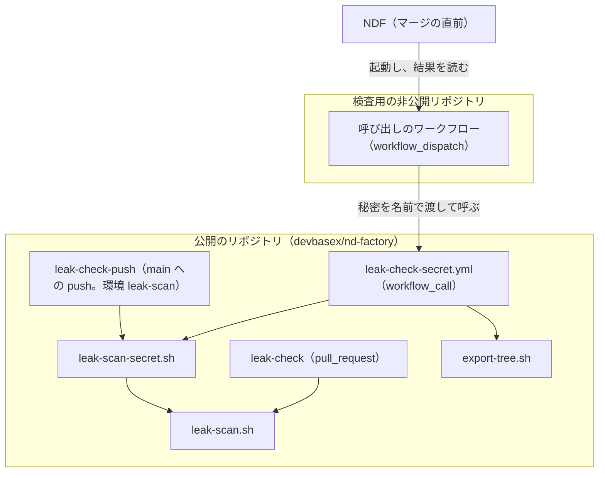
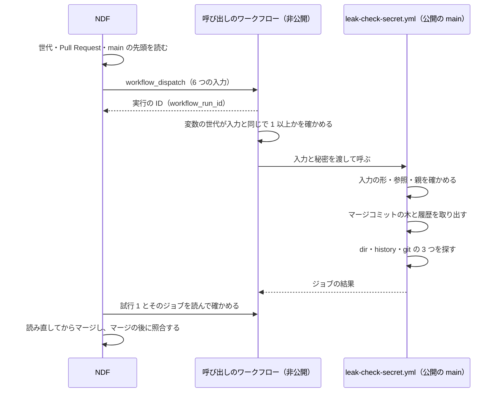

# 漏れの検査: 実際の値の規則での Pull Request の探しと main への push の探し

## 概要

漏れの検査は、gitleaks でリポジトリの今の木と履歴のコミットを探し、秘密の値とインフラの実際の値（運用する環境の名前・profile の名前など）がリポジトリに入るのを止める仕組みである。探しには 3 種類の規則を使う。

| 規則 | 中身 | 置き場所 |
| --- | --- | --- |
| 既定の規則 | gitleaks の既定の規則 | `tools/checks/gitleaks-default.toml` |
| nd-factory の規則 | アカウント ID・ARN・端点など、公開してよい形の規則 | `.gitleaks.toml` |
| 実際の値の規則（`nd-real-value`） | 実際の値の正規表現。リポジトリに置かず、秘密 `LEAK_CHECK_PATTERN` から受けて設定に重ねる | 検査用の非公開リポジトリの秘密と、公開のリポジトリの環境 `leak-scan` の秘密 |

gitleaks の 1 回の探し方（飛ばされるファイルの探し直し、履歴を読み終えたことの確かめ、アーカイブの展開、失敗の行）は [漏れの検査の 1 回の探しの仕様](./leak-scan.md) にある。

探しは、どこで動くかで次の 3 つに分かれる。

| 探し | 動く所と起動 | 使う規則 | 結果が見える人 |
| --- | --- | --- | --- |
| Pull Request の探し（`leak-check`） | 公開のリポジトリの `pull_request` の実行 | 既定の規則と nd-factory の規則だけ。秘密を受けない | 誰でも。必須のチェックである |
| 非公開の検査（`leak-check-secret`） | 検査用の非公開リポジトリの実行。NDF（このリポジトリの Pull Request をマージするツール）がマージの直前に起動する | 3 種類すべて。秘密は必須で、空なら落ちる | 非公開リポジトリに読み取りの権限を持つ人と NDF だけ |
| main への push の探し（`leak-check-push`） | 公開のリポジトリの main への `push` の実行。環境 `leak-scan` を持つ | 3 種類すべて。実際の値の規則の当たりは件数だけを出す | 誰でも。必須のチェックではない |

## 用語

語の意味は [用語集](../glossary.md) に従う。用語集に無い語のうち、この文書で使うものは次のとおりである。

| 語 | 意味 |
| --- | --- |
| 実際の値の正規表現 | 運用する環境の名前などの実際の値に当たる正規表現。秘密 `LEAK_CHECK_PATTERN` に置く |
| 検査用の非公開リポジトリ | 持ち主が作り、呼び出しのワークフローと秘密 `LEAK_CHECK_PATTERN` を置く非公開のリポジトリ。名前は公開のリポジトリに書かない |
| 検査のコードのコミット | 非公開の検査がスクリプトと設定を取る、公開のリポジトリの main の先頭のコミット。探す対象の Pull Request のコミットではない |
| マージコミット | GitHub が作る Pull Request のマージの結果（`refs/pull/<番号>/merge`）。最初の親が base の先頭、2 つ目の親が head である |
| 分岐点 | base の SHA と head の SHA の `git merge-base` |
| 設定の世代 | 非公開リポジトリの変数 `LEAK_CHECK_GENERATION` の正の整数。持ち主が秘密か呼び出しのワークフローを変えるたびに上げる。`0` は切り替え中を表す |
| 取り出した木・取り出した履歴 | `export-tree.sh` が、Git に保存された内容のまま作業ツリーの外へ書いたマージコミットの木と、分岐点から head までの差の項目 |

本文に出すコードの名前と置き場は次のとおりである。

| 本文の語 | コードの名前 | 置き場 |
| --- | --- | --- |
| Pull Request の探し・main への push の探し | ジョブ `leak-check`・`leak-check-push` | `.github/workflows/ci.yml` |
| 再利用できる漏れの検査のワークフロー | ジョブ `leak-check-secret`（`workflow_call`） | `.github/workflows/leak-check-secret.yml` |
| 呼び出しのワークフローの見本 | ジョブ `generation`・`scan`（`workflow_dispatch`） | `docs/operations/leak-check-caller.yml` |
| 秘密を使う探しのスクリプト | `leak-scan-secret.sh` | `tools/checks/` |
| 木の取り出しのスクリプト | `export-tree.sh` | `tools/checks/` |
| gitleaks を置くスクリプト | `install-gitleaks.sh` | `tools/checks/` |
| 今の木と履歴の探しのスクリプト | `leak-scan.sh` | `tools/checks/` |
| 検査の本体 | `main`・`gitleaks`・`tree`・`history`・`relay`・`copyrepo`・`archive`・`model` の Python のモジュール | `tools/checks/leak_scan/` |
| CI の定義のテスト | `triggerViolations`・`secretWorkflowViolations`・`callerViolations`・`leakJobViolations`・`actorConditions`・`patternSecretReaders` ほか | `tools/test/ci-definition.test.ts` |
| 漏れの検査の結合のテスト | `secretScan`・`exportTree`・`mergeRepo` ほか | `tools/test/leak-scan.integration.test.ts` |

## 構成要素と責務

| 要素 | 責務 |
| --- | --- |
| `leak-check`（`ci.yml`） | Pull Request の実行だけで動く（`if: github.event_name == 'pull_request'`）。環境と秘密を持たない。`leak-scan.sh` を、今の木（`dir`）と分岐点から head まで（`git --range`）について、既定の規則と `.gitleaks.toml` で 2 回ずつ打つ。続けて、漏れの検査の結合のテスト（`npm run test:integration -- leak-scan`）を打つ |
| `leak-check-push`（`ci.yml`） | main への push の実行だけで動く（`if: github.event_name == 'push'`）。`environment: leak-scan` を持ち、環境の秘密 `LEAK_CHECK_PATTERN` と変数 `LEAK_CHECK_REQUIRE_PATTERN` を受ける。`leak-scan-secret.sh dir --count-only` と `leak-scan-secret.sh git --count-only` を、前が失敗しても後を打つ形で打つ。`setup-node` と `npm ci` を持たず、依存を入れない |
| `leak-check-secret.yml` | `workflow_call` だけで起動する。入力の形を確かめ、公開のリポジトリを検査のコードのコミットでチェックアウトし、Pull Request の head とマージコミットを git の参照として取り込んで確かめ、マージコミットの木と分岐点から head までの履歴を取り出して、秘密を重ねた設定で探す |
| 呼び出しのワークフローの見本（`leak-check-caller.yml`） | 持ち主が非公開リポジトリの `.github/workflows/` に写す正本。公開のリポジトリの `.github/workflows/` の外に置くので、公開のリポジトリでは動かない。設定の世代を確かめてから、`devbasex/nd-factory/.github/workflows/leak-check-secret.yml@main` を、6 つの入力と秘密を名前で渡して呼ぶ |
| `leak-scan-secret.sh` | 秘密の正規表現から重ねた設定を組み、規則ごとに `leak-scan.sh` を打ち、`nd-real-value` の件数の行を出す。重ねた規則の名前と設定を組む処理を持つのは、このスクリプトだけである |
| `export-tree.sh` | コミットの木か、範囲の各コミットの差の項目を、属性による加工なしで空のディレクトリへ書き、元の木か元の履歴と照らす |
| `install-gitleaks.sh` | gitleaks の版と要約値（SHA-256）を持つ、このリポジトリで唯一の場所。3 つのジョブ（`leak-check`・`leak-check-push`・`leak-check-secret`）は、どれもこのスクリプトを 1 行で呼ぶ |
| `leak-scan.sh` | 引数と前提を確かめて `leak_scan/main.py` を起こす。探す木の根に `.gitleaksignore` があれば終了コード 2 で落ちる |
| `leak_scan/` | 1 回の探しの本体（Python の標準ライブラリだけ）。gitleaks を打ち、読まれなかった対象を探し直し、当たりを規則・ファイル・行・コミットだけで出す。`--paths` を渡さなければ、ファイルを名前の順の通し番号 `file-<番号>` で出す。流れは [1 回の探しの仕様](./leak-scan.md) |
| CI の定義のテスト | ワークフローごとの起動の許可、`leak-check-secret.yml` と見本の形、`leak-check` と `leak-check-push` の分け方を、定義から読んで落とす |
| NDF のマージの前の非公開の検査 | このリポジトリの外（devbasex/ai-plugins）の機能。「外部連携」に受け入れの条件を書く |

依存の向きは、ワークフロー → `leak-scan-secret.sh` → `leak-scan.sh` → `leak_scan/` → gitleaks と設定のファイル、の一方向である。`export-tree.sh` を呼ぶのは `leak-check-secret.yml` だけで、`leak-scan-secret.sh` は渡された木を探すだけである。

## 背景

漏れの検査は、サービス自身の token と、資源の名前の一部に `example.com` を含む実在し得る端点も止める。後者を部分一致の許可で通さないよう、許可は名前の全体に当てる（ https://github.com/devbasex/nd-factory/issues/98 ）。

公開のリポジトリで、実際の値の正規表現を Pull Request の側の実行（`pull_request`）で使うと、次の 3 つが起きる。

- fork の Pull Request は秘密を受けないので、途中のコミットにだけ入れて後で消した実際の値が探されない。マージの方法は squash なので、途中のコミットは main への push でも探されない（ https://github.com/devbasex/nd-factory/issues/96 ）
- 同じリポジトリのブランチの Pull Request では、秘密を書いた設定のファイルを、Pull Request のチェックアウトのスクリプトが読める（同じ課題）
- Dependabot の Pull Request は Dependabot の秘密しか受けないので、秘密を必須にすると毎回落ちる（ https://github.com/devbasex/nd-factory/issues/101 ）

そこで、Pull Request を実際の値の規則で探す処理を、検査用の非公開リポジトリの実行へ移した。主な判断と理由は次のとおりである。

| 判断 | 理由 |
| --- | --- |
| Pull Request の探しを非公開リポジトリで動かし、結果を公開しない | 公開のリポジトリで `pull_request_target` などで探すと、外部の作者が候補の語を Pull Request に入れ、成否から正規表現に当たるかを確かめられる。件数を伏せても成否で分かる |
| NDF がマージのたびに起動し、起動した 1 回の結果だけを使う | 実行の一覧から最新の結果を選ぶと、ジョブを作る前に失敗した実行や再実行で、古い成功が選ばれうる。名前だけで照合する必須のチェックは、同じ名前のジョブを足して迂回できる |
| Pull Request の作者や起動した人で分ける条件を置かない | 非公開の検査を起動するのは NDF なので、fork・同じリポジトリのブランチ・Dependabot のどれでも同じ秘密が渡る。Dependabot の秘密に実際の値を置くと、Dependabot の Pull Request のコードから読める |
| マージコミットの木を探す | base の木と head の木を別々に探しても、合わせた後の行で初めて当たる値を見落とす |
| 履歴はパッチだけでなく、パスの名前と blob の中身も探す | gitleaks の `git` の探しはパッチを探すので、途中のコミットにだけ在ったパスの名前と、パッチに `Binary files differ` とだけ出るファイルの中身が探されない |
| `git archive` を使わず、`git cat-file blob` で取り出す | `git archive` は対象のコミットの `.gitattributes` の `export-ignore`・`export-subst` に従うので、Pull Request の作者が探す対象を変えられる |
| main への push の探しの秘密は、使えるブランチを main だけにした環境 `leak-scan` に置く | Pull Request の側の実行は Pull Request のマージの参照で動くので、ワークフローを書き換えて環境を指しても秘密を受けられない |
| main への push の探しは、実際の値の規則の当たりを件数だけで出す | 公開の記録に場所を出すと、公開の main のどの行が実際の値かが分かる |
| 止めるのは NDF が行うマージだけにし、ブランチの保護とルールセットは作らない | 非公開の検査の結果は公開のリポジトリのチェックにならないので、ルールセットから参照できない。main には今もブランチの保護が無い |

## 対象範囲

含む:

- 公開のリポジトリの `leak-check`・`leak-check-push`・`leak-check-secret.yml` と、4 本のスクリプトと検査の本体 `leak_scan/`
- 呼び出しのワークフローの見本と、その形を縛る CI の定義のテスト
- NDF が非公開の検査の結果を受け入れる条件（外部連携の契約）

含まない:

- NDF の側の実装（devbasex/ai-plugins）と、非公開の検査を有効にする `.ndf/project.json` の項目。どちらも、このリポジトリにはまだ無い。有効にするまで、実際の値の規則での Pull Request の探しはマージを止めない
- 持ち主が GitHub の設定で行う操作の手順。[CI の検査の秘密と持ち主の操作](../operations/ci-checks.md) にある
- Dependabot の有効化（このリポジトリに `.github/dependabot.yml` は無い）

## 仕様

### 集約

この仕組みが持つ状態は、持ち主が GitHub に登録する秘密と変数だけである。リポジトリの中のデータは持たない。非公開の検査の 1 回の実行は、6 つの入力（Pull Request の番号・head の SHA・base の SHA・マージコミットの SHA・検査のコードのコミット・設定の世代）で決まり、その組がジョブの表示名に入る。

この仕組みのイベントは次の順である。Pull Request にコミットが積まれると、今の木と、分岐点から head までの各コミットで足した・変えたファイルを探し、当たりを規則・ファイル・行・コミットで出す。中身を探せなかったファイルがあるか、gitleaks の報告を読めなければ、失敗で終える。

### 常に成り立つ条件

- 実際の値の正規表現を受けるのは、`leak-check-push` の手順「今の木と履歴のコミットを探す」と、`leak-check-secret.yml` の手順「秘密の規則を重ねて探す」の 2 つだけである。Pull Request の側の `leak-check` は秘密も環境も持たない
- 秘密を受けて動くコードは、公開のリポジトリの検査のコードのコミット（main の先頭）のスクリプトと設定だけである。Pull Request のコミットは git の参照として取り込み、取り出した木は読むだけで動かさない。探しに使う設定は、検査のコードのチェックアウトにある `.gitleaks.toml` と `gitleaks-default.toml` を絶対パスで渡し、取り出した木の中の設定は読まない
- 非公開の検査は秘密を必須にする（`LEAK_CHECK_REQUIRE_PATTERN: "1"` を固定で渡す）。秘密が空なら、Pull Request の出所によらず終了コード 1 で落ちる
- 非公開の検査のジョブと手順は `if:` と `continue-on-error` を持たない。入力の検査・取り込み・SHA の一致・取り出し・探しのどこで失敗しても、終了コード 0 以外で終える
- 記録に、実際の値の正規表現と当たった値を出さない。`--details` を渡さない限り、ファイルの名前も出さない（ファイルの名前も実際の値を含み得るため）。`export-tree.sh` の失敗の知らせにもパスを出さない
- `leak-check-push` の公開の記録のうち、秘密の値によって変わるのは、`nd-real-value` の件数の行と、`nd-real-value` の探しが失敗したときの固定の行と、ジョブの成否だけである
- gitleaks の版と要約値を持つのは `install-gitleaks.sh` だけで、どのワークフローも持たない
- ワークフローと見本の `permissions` は `contents: read` だけである。AWS の資格情報を持たない

### 非公開の検査の流れ

`leak-check-secret.yml` のジョブ `leak-check-secret` は、`ubuntu-24.04` で 20 分を上限に、次の手順を順に動かす。

| 手順 | すること |
| --- | --- |
| 入力の形を確かめる | `pr_number` と `generation` は `^[1-9][0-9]*$`、4 つの SHA（`head_sha`・`base_sha`・`merge_sha`・`code_sha`）は `^[0-9a-f]{40}$` に合うかを確かめる。入力は `env:` で受け、`run:` の中に `${{ inputs.* }}` を書かない |
| チェックアウト | `actions/checkout` を SHA で固定し、`repository: devbasex/nd-factory`・`ref: ${{ inputs.code_sha }}`・`fetch-depth: 0`・`persist-credentials: false` で打つ |
| gitleaks を固定の版と要約値で置く | `tools/checks/install-gitleaks.sh "$RUNNER_TEMP/gitleaks"` の 1 行だけ |
| Pull Request の参照を取り込んで確かめる | `refs/pull/<番号>/head` と `refs/pull/<番号>/merge` を `refs/ndf-scan/head`・`refs/ndf-scan/merge` へ取り込む。2 つが入力の head と merge の SHA と同じで、マージコミットの親がちょうど 2 つで順に入力の base と head であり、分岐点を求められることを確かめる |
| マージコミットの木と履歴の項目を取り出す | `export-tree.sh "$MERGE_SHA" "$RUNNER_TEMP/merge-tree"` と、`export-tree.sh --history <分岐点> "$HEAD_SHA" "$RUNNER_TEMP/history"` を打つ |
| 秘密の規則を重ねて探す | 分岐点を同じ入力から求め直し、`leak-scan-secret.sh dir "$RUNNER_TEMP/merge-tree"`・`leak-scan-secret.sh history "$RUNNER_TEMP/history"`・`leak-scan-secret.sh git --range "<分岐点>..$HEAD_SHA"` を、前が失敗しても後を打つ形で打つ |

ジョブの表示名は `leak-check-secret (#<番号> head <head の SHA> / base <base の SHA> / merge <マージコミットの SHA> / code <検査のコードのコミット> / gen <世代>)` である。手順の間で値を渡すのに `GITHUB_ENV`・`GITHUB_OUTPUT` を使わず、分岐点は同じ入力から求め直す。`concurrency` は置かない。

呼び出しのワークフローの見本は、ジョブ `generation` で変数 `LEAK_CHECK_GENERATION` が `^[1-9][0-9]*$` に合い入力の世代と同じかを確かめ、外れれば `::error::設定の世代が入力と違うか、切り替え中` で落ちる。ジョブ `scan` は `needs: generation` を持ち、秘密を `secrets: inherit` ではなく名前で渡す。

### 1 回の探し（`leak-scan.sh` と `leak_scan/`）

使い方は `leak-scan.sh <dir|git> <設定> [--range <範囲>] [--report <ファイル>] [--paths]` で、終了コードは、0 が当たり無し、1 が当たりか探しの失敗、2 が引数の誤りである。中身を探せなかった対象があれば、当たりが無くても 1 で終える。道具の版、今の木と履歴の探し方、対象外のパス、アーカイブの扱い、失敗の行は [1 回の探しの仕様](./leak-scan.md) にある。

### 作り物の値の許可と token の規則（`.gitleaks.toml`）

- `nd-delegation-token`・`nd-machine-token` は、`ndfd_`・`ndfm_` の後に 3 つの部分を `.` でつないだ形で、3 つ目が base64url の 32 字以上のものに当てる。許可を持たない
- `nd-aws-endpoint` は、サービス名と DNS の接尾辞（`amazonaws.com` など）を、大文字と小文字を区別せずに当てる。DNS の名前は大文字と小文字を区別しないためである。許可は書かれたとおりの表記に当てるので、大文字を混ぜた端点は、許す形に合わなければ当たる
- S3 の置き場と端点の許可は、名前の全体に当てる。実在し得る名前を通さないためで、`acme`・`example.com`・`EXAMPLE` を含むだけの名前は許さない。`acme` は作り物の接頭辞だが、置き場の名前と Cognito のドメインは誰でも作れる
- 予約済みのドメイン `example.com` を含む名前も許さない。置き場の名前は誰でも付けられるためである
- アカウント ID の 2 規則が取り出すのは 12 桁の数だけなので、部分一致の許可のままでも値の全体との一致になる

| 許す形 | 対象 |
| --- | --- |
| `amzn-s3-demo-` の後が小文字と数字だけの名前 | S3 の置き場の ARN と端点 |
| 置き換え記号（`<名前>`・`${名前}`）と区切り（`.`・`-`）だけの名前 | 置き場の ARN と端点 |
| `EXAMPLE` と数字だけの名前 | CloudFront の端点 |
| `<prefix>-<environment>-login` か、`cognito` を含む名前（リージョンは置き換え記号か `us-west-2`） | Cognito の端点 |
| アカウントの欄が `123456789012` で、資源の欄が置き換え記号の例か、`.gitleaks.toml` の一覧にある ARN | ARN |
| main の履歴に残る旧い作り物の値と、それを足したコミットの組 | 当てた規則 |

- `amzn-s3-demo-` の後ろに `-`・`.` を許さないのは、S3 のアクセスポイントの別名（`…-s3alias`）が置き場の名前の代わりに使え、実在し得るためである
- `cognito` を含む名前は AWS が Cognito のドメインに受け付けないので、この許可が効くことを確かめるテストでだけ使う。設置できる設定を使う `infra/test/` は、端点の文字列をソースに書かず、ドメインの名前の定数から組み立てる
- 旧い値の許可は、`commits` と `regexes` を `condition = "AND"` で並べる。今の木と新しいコミットでは当たる
- AWS の資源の ID の規則は許可を持たない。16 進の中に `123456789012` が並ぶ実在の ID を通さないためである

新しい作り物の名前は上の形にするか、許可を理由とともに足す。CloudFront と Cognito の例の元になる表記を変えるときは、許可を外せるかを確かめ、main の履歴に残る値は値とコミットの組の許可へ移す。

### 秘密を使う探しのスクリプト（`leak-scan-secret.sh`）

使い方は `leak-scan-secret.sh <dir|history|git> [<木>] [--range <範囲>] [--count-only] [--details]` である。秘密を環境変数 `LEAK_CHECK_PATTERN` で、必須の指定を `LEAK_CHECK_REQUIRE_PATTERN`（`1` で必須）で受ける。秘密は読んだらすぐ環境から消し、`leak-scan.sh` と gitleaks に渡さない。

| 対象 | 探すもの |
| --- | --- |
| `dir [<木>]` | `<木>` のディレクトリ（省けば今のディレクトリ） |
| `history <木>` | `export-tree.sh --history` の出力先の `paths/` と、`layers/` と `binary-text/` の各層を、1 つずつ別の木の根として探す。根ごとに `leak-scan-secret: 履歴 <paths か layers/<番号> か binary-text/<番号>> を探す` の行を出す |
| `git` | 今のディレクトリのリポジトリの履歴。`--range` を渡せばその範囲、渡さなければ到達できるすべてのコミット |

1 つの木の根に対する探しの回数と設定は、指定で決まる。

| 指定 | 探し方 | 使う所 |
| --- | --- | --- |
| 指定なし | 既定の規則と、`.gitleaks.toml` を `[extend] path` で読んで `nd-real-value` を足した設定の 2 回。どちらも `leak-scan.sh` の出力をそのまま出す | 非公開の検査と手元 |
| `--count-only` | 既定の規則・`.gitleaks.toml`・`nd-real-value` だけの設定の 3 回。3 回目は `leak-scan.sh` の標準出力と標準エラーをすべて捨て、報告の JSON から件数だけを数える | `leak-check-push` |
| `--details` | 指定なしと同じ 2 回で、`leak-scan.sh` に `--paths` を渡して実際のファイルの名前を出す。`--count-only` と同時には受けない | 手元で当たりのファイルを特定するときだけ |

- 秘密があれば、当たりが 0 件でも `leak-scan-secret: nd-real-value: <件数> 件` の行を必ず 1 つ出す。`history` では、すべての根の件数を合わせて 1 行にする
- 秘密が空で必須でなければ、`leak-scan-secret: 秘密 LEAK_CHECK_PATTERN が空なので .gitleaks.toml だけで探す` の行を出し、実際の値の規則を使わずに進む。件数の行は出さない
- `--count-only` の 3 回目が、当たりのほかの理由（読み飛ばし・報告を読めない・探し終えたことを確かめられないなど）で 0 以外を返したときは、`leak-scan-secret: nd-real-value の探しが失敗した。…` の固定の行を出す。`leak-scan.sh` は当たりと読み飛ばしが同時に起きても 1 を返すので、件数と終了コードだけでは見分けられないためである
- 終了コードは、すべての探しのうち悪い方である（どれかが 2 なら 2、どれかが 1 なら 1、すべて 0 なら 0）

### 木の取り出しのスクリプト（`export-tree.sh`）

今のディレクトリの git のリポジトリを読み、次の 4 つの使い方を持つ。書く 2 つの使い方の出力先は、無いか空のディレクトリである（無ければ作る）。

| 使い方 | すること |
| --- | --- |
| `export-tree.sh <コミット> <出力先>` | `git ls-tree -r -z --full-tree` の項目ごとに、`git cat-file blob` の中身を元のパスに書き、続けて照らす |
| `export-tree.sh --history <分岐点> <head> <出力先>` | `git rev-list <分岐点>..<head>` の各コミットについて、`git diff-tree -r -z --raw --no-renames --root -m` で親との差の項目を読み、下の 3 種類のファイルを書き、続けて照らす |
| `export-tree.sh --verify <コミット> <出力先>` | 書いてある木を照らすだけ |
| `export-tree.sh --verify-history <分岐点> <head> <出力先>` | 書いてある履歴を照らすだけ |

木の書き方:

- モード `100644`・`100755` の項目は中身をそのまま書く。`120000`（シンボリックリンク）は、リンク先の文字列を中身とする普通のファイルとして書き、木の外を指すリンクを作らない。`160000`（サブモジュール）は書かない。ほかのモードは失敗とする
- 書いたファイルはモード `0644` で、実行の権限を持たない
- `.gitattributes` を読まず、`git archive`・`git checkout`・`--filters`・`--textconv` を使わない

履歴の出力先の 3 種類のファイル:

| ファイル | 中身 |
| --- | --- |
| `paths/<通し番号>` | 差の項目のパスのバイト列。足した・変えた・消した・種類を変えたのどれも、読んだ順に 1 から番号を振る |
| `layers/<層の番号>/<元のパス>` | 差の後の側の blob（モード `100644`・`100755`・`120000`）の中身。元のパスと blob の組ごとに 1 回だけ書く。サブモジュールと消した項目は `paths/` にだけ入る |
| `binary-text/<層の番号>/<元のパス>` | `layers/` の同じファイルが NUL を含むとき、タブと印字できるバイト（`0x20`〜`0x7e` と `0x80` 以上）の外を改行に替えた中身（`LC_ALL=C tr -c '\11\40-\176\200-\377' '\n'`） |

層は、同じパスを 2 つ持たず、あるパスとその親のディレクトリに当たるパスを同時に持たないディレクトリである。組は読んだ順に、置ける最も小さい番号の層に置く。中身を元のパスに置くので、パスや拡張子を条件にする gitleaks の規則と許可が、マージコミットの木の探しと同じく効く。圧縮されたファイル（zip・gzip など）の中は開かない。

照らし方:

- 木: `git ls-tree` を打ち直して期待する項目を求め、普通のファイルの数と、各ファイルの `git hash-object --no-filters` の値が項目と一致し、普通のファイルとディレクトリのほかの物が無いことを確かめる
- 履歴: `git rev-list` と `git diff-tree` を打ち直して期待する項目を、書く処理とは別に求める。`paths/` の数と各ファイルの中身、組ごとに blob の値が合う層がちょうど 1 つあることと `layers/` のファイルの数、`binary-text/` の中身と数、3 つのディレクトリのほかに項目が無いことを確かめる

パスが空か、`/` で始まるか、`/` で区切った部分に空・`.`・`..` があるか、部分のどれかが大文字と小文字を区別せずに `.git` と同じなら、失敗とする（`check_path`）。

### gitleaks を置くスクリプト（`install-gitleaks.sh`）

`install-gitleaks.sh <置く先>` は、固定の版の `linux_x64` の配布の資産を取り、要約値を `sha256sum --check --strict` で確かめてから `gitleaks` だけを取り出す。続けて、同じ版の既定の設定のファイル（`config/gitleaks.toml`）を取り、要約値を確かめて `<置く先>/gitleaks.default.toml` に置く。環境変数 `GITHUB_PATH` が空でなければ、置く先の絶対パスをそのファイルに足す。手元では `GITHUB_PATH` を空にして打つ。gitleaks を上げるときは、このスクリプトの定数 `GITLEAKS_VERSION`・`GITLEAKS_SHA256`・`GITLEAKS_CONFIG_SHA256` だけを直す。

## データ・設定

| 置き場所 | 名前 | 種類 | 読む所 |
| --- | --- | --- | --- |
| 検査用の非公開リポジトリ | `LEAK_CHECK_PATTERN` | Actions の秘密 | 呼び出しのワークフロー → `leak-check-secret.yml` |
| 検査用の非公開リポジトリ | `LEAK_CHECK_GENERATION` | Actions の変数 | 呼び出しのワークフローのジョブ `generation` と NDF |
| 公開のリポジトリの環境 `leak-scan`（使えるブランチは main だけ） | `LEAK_CHECK_PATTERN` | 環境の秘密 | `leak-check-push` |
| 環境 `leak-scan` か公開のリポジトリ | `LEAK_CHECK_REQUIRE_PATTERN` | 変数 | `leak-check-push`。`1` なら秘密が空のときに落ちる |

- 公開のリポジトリの Actions の秘密と Dependabot の秘密には、`LEAK_CHECK_PATTERN` を置かない
- 秘密の値は `'''` と改行を含められない（TOML の文字列に `'''` で埋め込むため）
- 登録の手順と値の決め方は [CI の検査の秘密と持ち主の操作](../operations/ci-checks.md) の「秘密と変数の登録」にある

| 定数 | 値 | 置き場 |
| --- | --- | --- |
| 重ねた規則の名前 | `nd-real-value` | `tools/checks/leak-scan-secret.sh` |
| 目印の規則の名前 | `leak-scan-marker` | `tools/checks/leak_scan/model.py` |
| 展開の合計の上限・入れ子の上限 | 1 GiB・5 段 | `tools/checks/leak_scan/archive.py` |
| gitleaks の版 | `8.30.1` | `tools/checks/install-gitleaks.sh` |
| 取り出した木と履歴の置き場所 | `$RUNNER_TEMP/merge-tree`・`$RUNNER_TEMP/history` | `.github/workflows/leak-check-secret.yml` |
| 取り込む参照の名前 | `refs/ndf-scan/head`・`refs/ndf-scan/merge` | 同上 |

## 外部連携

### GitHub Actions

- 非公開リポジトリの呼び出しのワークフローは、公開のリポジトリの再利用できるワークフローを `@main` で呼ぶ。実行は呼んだ側のリポジトリのものになり、記録は非公開リポジトリにだけ残る。`@main` は同じ名前のタグがあればタグに解決される
- NDF は、ワークフローの起動の API（`POST /repos/{owner}/{repo}/actions/workflows/{workflow_id}/dispatches`）を、実行の ID を返す指定で呼ぶ。API のバージョン `2022-11-28` では本文に `return_run_details: true` を入れる

### NDF が非公開の検査の結果を受け入れる条件

NDF の側の機能はこのリポジトリの外にあり、まだ入っていない。このリポジトリのワークフローは、NDF が次の条件で結果を受け入れることを前提に作ってある。

1. 非公開リポジトリの変数 `LEAK_CHECK_GENERATION` を読む。`0` か空か読めなければ、マージせずに人へ戻す。世代を読んだ時から時間の上限（NDF の設定で持つ値）以内にマージの API の呼び出しを終え、過ぎたらマージしない
2. Pull Request の番号・head の SHA・base のブランチと先頭の SHA・マージコミットの SHA（`merge_commit_sha`）と、公開のリポジトリの main の先頭の SHA を読む。`mergeable` が `null` の間は読み直して待ち、真にならなければマージしない
3. 呼び出しのワークフローを、非公開リポジトリの既定のブランチで、6 つの入力を渡して起動し、応答の `workflow_run_id` を控える。実行の ID が返らなければマージしない。前の実行の成功は、同じ head に対するものでも使わない
4. 控えた実行の試行 1 だけを読む（`GET .../actions/runs/{run_id}/attempts/1` と `.../attempts/1/jobs`）。試行 1 の `conclusion` が `success` で、`referenced_workflows` に `devbasex/nd-factory/.github/workflows/leak-check-secret.yml@main` の項目がちょうど 1 つあってその `sha` が検査のコードのコミットと同じで、表示名が 6 つの入力から組んだ名前で終わるジョブがちょうど 1 つあり、すべてのジョブの `conclusion` が `success` のときだけ受け入れる
5. マージの直前に読み直し、次の 3 つを確かめる（3 つ目はマージ先が main の場合だけ）。どれかが外れるか、確かめられなければ、マージせずに人へ戻す
   - 世代・head の SHA・base のブランチと先頭の SHA が、手順 1・2 と同じである
   - 非公開の検査が、今の main と同じ検査のコードで動いたといえる。公開のリポジトリの main の先頭の SHA を読み直し、比較の API（`GET /repos/{owner}/{repo}/compare/{検査のコードのコミット}...{読み直した main の先頭の SHA}`）で次のすべてを満たすときだけ、そうみなす
     - API の呼び出しが成功し、応答に `status` と `files` がある
     - `status` が `identical` か `ahead` である。つまり、検査のコードのコミットが今の main の先頭と同じか、その祖先である。`diverged` と `behind` では、`files` に当たりが無くてもマージしない。比較の API の `files` は、2 つのコミットの共通の祖先から今の main の先頭までの差分なので、検査のコードのコミットの側だけにある変更が現れないためである
     - `files` が 300 件に届いていない
     - `files` のすべての項目で、`filename` と `previous_filename` のどちらも、下の「秘密を受けて動くコードと設定の一覧」に当たらない。これで、一覧のファイルの追加・変更・削除と、一覧の内外へ向かう改名のどれも見つかる
   - マージ先が main の場合は、比較の API に渡した main の先頭の SHA が、手順 2 で読んで検査に渡した base の SHA と同じである。base の先頭と main の先頭は別々に読むので、2 回の読み取りの間に main が進むことがある。進んだ変更が一覧のファイルを含まなければ、上の 2 つはどちらも通る。そのままマージすると、非公開の検査を受けていないマージ結果が公開の main に入る
6. head の SHA を `sha` に渡してマージの API を呼ぶ。呼ぶ前に結果不明の記録を永続化し、応答を失っても呼び直さない。同じ Pull Request のマージの要求を送れるのは記録を作った 1 つの実行だけにする
7. マージの後に、マージ先のブランチが記録の base のブランチと同じで、マージでできたコミットの最初の親が記録の base の先頭の SHA と同じで、世代が変わっていないことを確かめる。外れれば人へ戻す。マージは取り消せないので、読み直しの後の base の変更はマージの後の検出までしか扱えない

人へ戻す知らせは、NDF の非公開の記録と持ち主への非公開の通知にだけ出し、公開の Pull Request・コメント・チェックには何も書かない。非公開リポジトリの実行の URL も書かない。外れ方の分類（未完了・ジョブを作る前の失敗・版の食い違い・探しの失敗）も、当たりの有無の手がかりになるので公開しない。

#### 秘密を受けて動くコードと設定の一覧

非公開の検査の結果は、次のコードと設定で決まる。上の手順 5 の照合と、[CI の検査の秘密と持ち主の操作](../operations/ci-checks.md) の手元で読んで確かめる手順は、この一覧を対象にする。秘密を受けて動くコードか設定を足すときは、この一覧と NDF の照合の対象に足す。

| 対象 | 当たり方 |
| --- | --- |
| `.github/workflows/leak-check-secret.yml` | パスが同じ |
| `tools/checks/export-tree.sh` | パスが同じ |
| `tools/checks/leak-scan-secret.sh` | パスが同じ |
| `tools/checks/leak-scan.sh` | パスが同じ |
| `tools/checks/install-gitleaks.sh` | パスが同じ |
| `tools/checks/leak_scan/`（検査の本体の Python のモジュール） | パスがこの接頭辞で始まる。今は無いモジュールも当たる |
| `.gitleaks.toml` | パスが同じ |
| `tools/checks/gitleaks-default.toml` | パスが同じ |

検査を必須にするかは、NDF の利用者の設定（非公開リポジトリの名前を持つ所。リポジトリの外）と、公開のリポジトリの main の先頭の `.ndf/project.json` だけで決める。Pull Request の head とマージ先のブランチの `.ndf/project.json` は読まない。

## エラー処理

| 失敗 | 検出する所 | 出力 | 終了コード |
| --- | --- | --- | --- |
| 入力の形の誤り | `leak-check-secret.yml` の最初の手順 | `::error::入力 <名前> の形が違う` | 1 |
| Pull Request の参照を取れない | 参照を取り込む手順 | `::error::Pull Request の参照を取り込めない` | 1 |
| 参照が入力の SHA と違う（起動の後の push・base の前進） | 同上 | `::error::refs/pull/<番号>/head が入力の head の SHA と違う`（merge も同じ形） | 1 |
| マージコミットの親が入力の base と head でない | 同上 | `::error::マージコミットの親が入力の base と head でない` | 1 |
| 分岐点を求められない | 同上 | `::error::base と head の分岐点を求められない` | 1 |
| 設定の世代が違うか切り替え中 | 呼び出しのワークフローのジョブ `generation` | `::error::設定の世代が入力と違うか、切り替え中` | 1（`scan` は動かない） |
| 必須なのに秘密が空 | `leak-scan-secret.sh` | `leak-scan-secret: 秘密 LEAK_CHECK_PATTERN が無い（必須にしている）` | 1 |
| 秘密に `'''` か改行がある | 同上 | `leak-scan-secret: 秘密 LEAK_CHECK_PATTERN に ''' と改行を含めない` | 1 |
| チェックアウトのパスに `"`・`\`・改行がある | 同上 | `leak-scan-secret: チェックアウトのパスを設定に書けない` | 2 |
| `nd-real-value` の件数を読めない | 同上 | `leak-scan-secret: nd-real-value の件数を読めない` | 1 |
| `leak-scan-secret.sh` の引数の誤り・木が無い | 同上 | 使い方の 1 行か `leak-scan-secret: 探す木のディレクトリが無い` | 2 |
| 出力先が空のディレクトリでない・コミットか範囲を読めない | `export-tree.sh` | `export-tree: 出力先が空のディレクトリでない`・`export-tree: コミットを読めない`・`export-tree: 履歴の範囲を読めない` | 2 |
| 取り出せない項目・書けない | 同上 | `export-tree: 木に取り出せない項目がある（<番号> 番目）`・`木を書き出せない（<番号> 番目）`・`履歴の項目を書き出せない（<番号> 番目）` | 1 |
| 元の木か元の履歴と食い違う | 同上 | `export-tree: 取り出した木が元の木と一致しない`・`取り出した履歴が元の履歴と一致しない` | 1 |
| 探す木の根に `.gitleaksignore` がある | `leak-scan.sh` | `leak-scan.sh` の誤りの行 | 2 |
| `python3` が無い・道具の版が足りない・想定外の例外 | `leak-scan.sh`・`leak_scan/main.py` | 探しの種類の失敗の行と、理由の行 | 1 |
| 読まれなかった対象を探せない・履歴を読み終えたことを確かめられない | `leak_scan/` | [1 回の探しの仕様](./leak-scan.md) の「出力と失敗の行」 | 1 |

- `export-tree.sh` は、頭の確かめの後、コマンドとシェルの診断（パスを含み得る）を作業のディレクトリの一時のファイルへ向け直し、読まずに消す。固定の知らせだけを元の標準エラーへ出す。固定の知らせを出さずに止まったときは `export-tree: 途中で失敗した（診断はパスを含み得るので伏せた）` を出す
- 失敗した実行の後始末は無い。NDF は次のマージの試みで、今の値で起動し直す

## セキュリティ

- 実際の値の正規表現を受ける実行は、非公開リポジトリの実行と、main への push の実行だけである。Pull Request の側の実行は、ワークフローを書き換えても、非公開リポジトリの秘密も環境 `leak-scan` の秘密も読めない
- 非公開の検査の成否・件数・当たりの場所は、非公開リポジトリの記録にだけ出る。外部の作者が公開の場所から分かるのは、Pull Request がマージされたかどうかだけである
- 残る経路は次のとおりで、持ち主が見張る（[CI の検査の秘密と持ち主の操作](../operations/ci-checks.md) の「残る経路と持ち主が見張る点」）
  - main に直に push できる人は、main の上のワークフローかスクリプトを書き換えて、環境 `leak-scan` の秘密を読めるか、次の非公開の検査で非公開リポジトリの秘密を外へ送れる。main にはブランチの保護が無い
  - 公開のリポジトリに `main` という名前のタグを作れる人は、`@main` の解決をタグへ向けられる。NDF は `referenced_workflows` の SHA で結果を退けるが、秘密が渡ることは止められない
  - 非公開リポジトリに書き込みの権限を持つ人は、呼び出しのワークフローを書き換えて秘密を読める
  - GitHub の画面からのマージは、非公開の検査を通らない
- CI の定義のテストは、ワークフローの起動の許可を一覧で持つ。`leak-check-secret.yml` は `workflow_call`、見本は `workflow_dispatch`、ほかのワークフローは `push`・`pull_request`・`schedule`・`workflow_dispatch` だけを許し、`pull_request_target`・`workflow_run` などを足すと落ちる
- 同じテストは、`leak-check-secret.yml` が SHA で固定した `actions/checkout` のほかの動作を使うこと、許したコマンド（`git`・3 本のスクリプト・`echo`・`exit`・`[[`）のほかを `run:` で動かすこと、`git archive`・`tar`・`--details`・`setup-node`・`npm`・`npx` を使うこと、`GITHUB_ENV`・`GITHUB_OUTPUT`・`GITHUB_PATH` に書くことを落とす。漏れの検査のワークフローと見本に `github.actor`・`github.triggering_actor`・`dependabot` の条件があることも落とす

## 運用

持ち主の操作は [CI の検査の秘密と持ち主の操作](../operations/ci-checks.md) にある。次の節がこの仕組みに当たる。

| 操作 | 節 |
| --- | --- |
| 非公開リポジトリの用意・秘密と変数の登録 | 「秘密と変数の登録」 |
| NDF の認証に与える権限 | 「NDF の認証の権限」 |
| 秘密か呼び出しのワークフローを変えるときの世代の切り替え | 「秘密を変える手順」 |
| 非公開の検査を有効にするまでの順序と、手で起動して確かめる手順 | 「導入の順序」 |
| 当たりのファイルを手元で特定する（`export-tree.sh` と `leak-scan-secret.sh --details`） | 「当たりの場所を手元で引く」 |
| 見本を変えたときの写し直し | 「見本の写し直し」 |

- `leak-check-push` は依存を入れないので、main への push では漏れの検査の結合のテストを打たない。結合のテストは Pull Request の `leak-check` が打つ
- 環境 `leak-scan` の秘密を変えるときは、世代の切り替えは要らない。main への push の探しは push のたびに今の秘密で動き、マージを決めないためである
- 非公開の検査は、取り出した木・`paths/`・履歴の各層・`git` の範囲のそれぞれで `leak-scan.sh` を 2 回打つ。`layers/` の層の数を n、`binary-text/` の層の数を m とすると、1 回の実行で 2 ×（3 + n + m）回になる。探し直す対象があれば、`leak-scan.sh` の 1 回につき gitleaks をもう 1 回打つ。同じパスを何度も変えた Pull Request ほど時間が延びる

## テスト観点

1 回の探しの観点（探し直し・読み終えたことの確かめ・アーカイブ・道具の版）は [1 回の探しの仕様](./leak-scan.md) にある。

| 観点 | 縛るテスト |
| --- | --- |
| 途中のコミットで足して後で消した、実際の値の規則にだけ当たる値を、`git --range <分岐点>..<head>` で当てる | 結合のテスト |
| 委任の token と登録の token が、今の木と途中のコミットの両方で当たる | 結合のテスト |
| 値とコミットの組の許可は、並べたコミットの外では効かない | 結合のテスト |
| 名前の一部に許可の文字列を含む端点・置き場・ARN が当たり、許す形の例は当たらない | 結合のテスト |
| サービス名と DNS の接尾辞に大文字を混ぜた端点が当たる | 結合のテスト |
| 途中のコミットにだけ在った、作り物の値を名前に含むパス（ファイルとディレクトリ）と、NUL を含むファイルの中の値を、`history` で当てる。パスの当たりはマージコミットの木と `git --range` だけでは当たらない | 結合のテスト |
| 履歴の中身にも、パスで当てる既定の規則（拡張子 `.p12` など）と名前で外すファイル（拡張子 `.png` など）の探し直しが、木の探しと同じく効く | 結合のテスト |
| 同じパスを 3 つのコミットで変えると 3 つの層に分かれ、同じ元のパスと blob の組は 1 回だけ書かれる。ファイル `a` をディレクトリ `a/` に変えると別の層に入る | 結合のテスト |
| `.gitattributes` の `export-ignore`・`export-subst`・`text eol=crlf`・`ident` があっても、取り出した木のファイルの数と中身が blob と同じになる。`export-ignore` を付けたファイルの値も当たる | 結合のテスト |
| base と head を合わせた後の木でだけ当たる値を、マージコミットの木の探しで当てる（base と head を別々に探すと当たらない） | 結合のテスト |
| 取り出した木か履歴を 1 か所だけ壊すと、`--verify` と `--verify-history` が 1 で落ちる。シンボリックリンクが木の外を指さず、`..`・`.git` の部分を持つ項目で落ちる | 結合のテスト |
| `--count-only` で、`nd-real-value` の当たりをほかの規則の当たりと同じ行に置いても別のファイルに置いても、件数が同じなら出力が同じになる。0 件でも件数の行が出る | 結合のテスト |
| 出力と失敗の知らせに、作り物の正規表現・当たった値・作り物の値を含むパスが現れない。`--details` を渡したときだけファイルの名前が出る | 結合のテスト |
| 秘密が空で必須なら 1、空で必須でなければ空のときの行が出る。`'''` か改行を含む秘密で 1 | 結合のテスト |
| ワークフローごとの起動の許可、`leak-check-secret.yml` と見本の形（チェックアウトの `repository` と `ref`、入力の形の検査、親の確かめ、表示名の 6 つの値、3 つの探しの呼び出し、許したコマンドだけ、`if:` と `continue-on-error` が無い、`permissions` が `contents: read` だけ） | CI の定義のテスト |
| `leak-check` が秘密・環境・必須の変数を持たず、`leak-check-push` が `environment: leak-scan` と必須の変数を持って `--count-only` で `dir` と範囲なしの `git` を呼ぶ。秘密を読むジョブが `leak-check-push` と `leak-check-secret` の 2 つだけ | CI の定義のテスト |
| gitleaks を置く 3 つのジョブが `install-gitleaks.sh` を 1 行で呼び、どのワークフローも `GITLEAKS_` の名前と配布の資産の URL を持たない | CI の定義のテスト |
| 必須のチェックの宣言と、Pull Request で起動するジョブの集合が、`leak-check-push` を除いて一致する | CI の定義のテスト |
| ワークフローの点検（zizmor）が当たり無しで通る | CI の `workflow-audit` |

次は、このリポジトリのテストでは縛れず、検証用のリポジトリか NDF の側で確かめる。非公開リポジトリの記録が権限の無い利用者から見えないこと、非公開リポジトリから公開のリポジトリの再利用できるワークフローを呼べること、環境 `leak-scan` の秘密を Pull Request の側の実行が受けられないこと、squash でできるコミットの木がマージコミットの木と同じであること、試行 1 の `referenced_workflows` が実際に解決された SHA を返すこと、NDF が「外部連携」の条件を外れた結果でマージしないこと。

## 関連リンク

- [漏れの検査の 1 回の探しの仕様](./leak-scan.md)
- [CI の検査の秘密と持ち主の操作](../operations/ci-checks.md)
- [呼び出しのワークフローの見本](../operations/leak-check-caller.yml)
- [プラットフォームの設計の決定 92](../design/platform.md)
- fork の Pull Request の途中のコミットを実際の値の規則で探せない課題: https://github.com/devbasex/nd-factory/issues/96
- Dependabot の Pull Request の `leak-check` が秘密を受けずに落ちる課題: https://github.com/devbasex/nd-factory/issues/101
- 実装の Pull Request: https://github.com/devbasex/nd-factory/pull/156
- 1 回の探しと許可を直した課題と Pull Request: https://github.com/devbasex/nd-factory/issues/98 、 https://github.com/devbasex/nd-factory/pull/185
