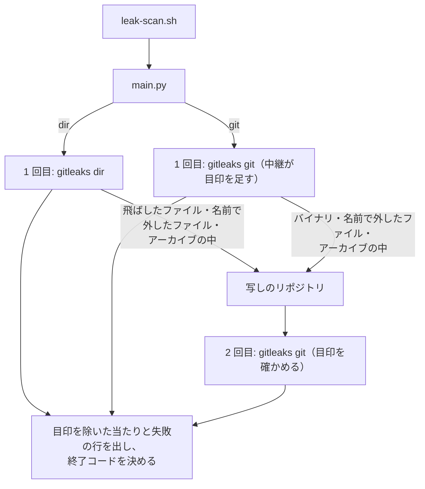

# 漏れの検査の 1 回の探し（`leak-scan.sh` と `leak_scan/`）

## 概要

`leak-scan.sh` は、gitleaks の 1 回の探しを打つスクリプトである。Pull Request の探し、main への push の探し、非公開の検査は、どれもこのスクリプトを通して gitleaks を打つ（3 つの探しと秘密の扱いは [漏れの検査の仕様](./leak-check.md)）。

gitleaks は、一部のファイルを中身を読まずに飛ばすか、名前だけで外す。アーカイブと圧縮ファイルの中は展開しない。履歴のパッチを読む部品は、途中で読むのをやめても誤りを返さないことがある。`leak-scan.sh` はこれらを一時の Git のリポジトリで探し直すか、読み終えたことを確かめる。確かめられなければ、当たりが 0 件でも終了コード 1 で終える。

## 用語

語の意味は [用語集](../glossary.md) に従う。用語集に無い語のうち、この文書で使うものは次のとおりである。

| 語 | 意味 |
| --- | --- |
| 全体の許可 | gitleaks の設定の global allowlist（`[allowlist]`）。この許可に当たって検査されないことを「外す」と呼ぶ |
| 1 回目・2 回目 | 元の木か元の履歴をそのまま探す gitleaks の起動と、探し直す対象を写しのリポジトリに置いて探す起動 |
| 写し・写しのリポジトリ | 探し直すファイルを複製したものと、それを置く一時の Git のリポジトリ |
| 目印 | 各ファイルの差分の末尾に足し、専用の規則 `leak-scan-marker` で当てる行。当たらなければ、gitleaks がそのファイルを読み終えたと言えない |
| 中継 | gitleaks が打つ `git log -p` の出力に目印を足す `git` の起動スクリプト（`relay.py`） |
| 失敗の印 | 失敗の条件に当たったことを覚えておく値。警告か誤り・飛ばしたファイル・履歴の 3 種類 |

## 構成要素と責務

| 要素 | 責務 |
| --- | --- |
| `tools/checks/leak-scan.sh` | 引数と前提を確かめて、本体を `python3 -I -B` で起こす |
| `leak_scan/main.py` | 今の木と履歴の流れを組み、出力と終了コードを決める |
| `leak_scan/history.py` | 履歴の探す対象の一覧、読み終えたことの確かめ、当たりのコミットへの帰属 |
| `leak_scan/tree.py` | 今の木で探し直す対象の収集と、対象外のパスの判定 |
| `leak_scan/archive.py` | アーカイブと圧縮ファイルの見分けと、上限つきの展開 |
| `leak_scan/copyrepo.py` | 写しのリポジトリ、2 回目の探し、中継の設置 |
| `leak_scan/gitleaks.py` | gitleaks の起動、記録と報告の読み取り、一時の設定の生成 |
| `leak_scan/relay.py` | gitleaks が起こす別のプロセス。目印を足し、写しの探しではコミットの行を元のコミットに書き換える |
| `leak_scan/model.py` | 受け渡す型と固定の行 |
| `tools/test/leak-scan.integration.test.ts` | 実物の gitleaks を打つ結合テスト |

本体は Python の標準ライブラリだけを使う。依存の向きは `main.py` → `history.py` → `tree.py` → `archive.py`・`copyrepo.py` → `gitleaks.py` → `model.py` の一方向で、`relay.py` はほかのモジュールを読み込まない。`-B` は、探す木の中に `__pycache__` を作らないためである。

## 仕様

### 呼び方と終了コード

`leak-scan.sh <dir|git> <設定> [--range <範囲>] [--report <ファイル>] [--paths]`。今のディレクトリが探す木の根である。

| 指定 | 意味 |
| --- | --- |
| `dir` | 今の木を探す |
| `git` | 履歴を探す。`--range` を渡せばその範囲、渡さなければ `HEAD` から到達できるすべてのコミット |
| `<設定>` | 必ず渡す。省くと gitleaks が探す木の根の設定を読み、既定の規則が抜けるためである |
| `--report` | 当たりを JSON で書く先。項目は `RuleID`・`File`・`StartLine`・`EndLine`・`Commit` だけである |
| `--paths` | 実際のファイルの名前と、gitleaks の記録の INF・WRN・ERR・FTL の段の行を出す。手元で当たりの場所を引くときだけ渡す |

終了コードは、0 が当たり無し、1 が当たりか探しの失敗、2 が引数の誤り（探す木の根の `.gitleaksignore` と、読めない範囲を含む）である。

起動時に道具の版を確かめ、足りなければ gitleaks を打たずに、探しの種類の固定の行と理由の行を出して 1 で終える。

| 道具 | 最低の版 | 確かめる探し | 要る理由 |
| --- | --- | --- | --- |
| `python3` | 3.11 | `dir` と `git` | 本体が `tomllib` を読み込む |
| `git` | 2.40 | `git` | 履歴の探しが `git check-attr --source` を使う |

### 常に成り立つ条件

- 終了コードと件数は、目印を除いた当たりと失敗の印だけから決める。gitleaks の終了コードと件数の行は、当たりの有無の判断に使わない（目印も当たりとして数えるためである）
- 失敗の条件に当たっても途中で止めず、取れた当たりをすべて出してから失敗の行を出す
- 探す対象のうち 1 つでも中身を探せないか、読み終えたことを確かめられなければ、0 で終えない
- `--paths` を渡さなければ、出力にファイルの名前を出さず、名前の順の通し番号 `file-<番号>` に替える。当たった値・`Email`・`Match` は、`--paths` を渡しても出さない
- gitleaks の記録は当たった値を含むので、一時ディレクトリに受けて、DBG・TRC の段の行を出さない。一時ディレクトリは、例外とシグナル（`SIGINT`・`SIGTERM`・`SIGHUP`）で終えるときも消す
- 写しの操作は、元のリポジトリのインデックス・参照・作業ツリーに書き込まない
- 値の行の `gitleaks:allow`、`.gitleaksignore`、前の報告では当たりを外せない

### gitleaks の打ち方

1 回目も 2 回目も、記録の段を trace にし、`--redact=100`・`--ignore-gitleaks-allow`・空の `--gitleaks-ignore-path` を渡す。報告と記録は実行ごとに別のファイルに受ける。`git` の探しの `--log-opts` は `-m --text --no-textconv --no-ext-diff --no-renames` で、1 回目は範囲があれば後ろに足し、2 回目は `--all` を足す。`--text` などは、Git がバイナリとしたファイルと `-diff` 属性のファイルの足した行も読ませるためである。

### 今の木の探し（`dir`）

1. 渡された設定で木を探す
2. 記録の飛ばした行を下の表で分け、探し直す対象を集める
3. 対象外でないすべての普通のファイルを中身で見分け、アーカイブと圧縮ファイルを展開する（シンボリックリンクはたどらない）
4. 対象を写しのリポジトリに置いて 2 回目を打つ。探し直す対象が無ければ打たない
5. 2 回目の当たりは元のパスと元の行の番号で出し、`Commit` を空にする。このためコミットを条件にする許可は今の木の探し直しでは効かない

| 1 回目の記録の飛ばした行（DBG・TRC の段） | 扱い |
| --- | --- |
| `skipping binary file`（先頭のバイトの種類）・`skipping archive: exceeds max archive depth`（名前でアーカイブと見なした） | 探し直す |
| `skipping file: global allowlist` | 対象外のパスのほかは探し直す |
| `skipping directory: global allowlist` | 配下の普通のファイルを列挙し、対象外のパスのほかを探し直す |
| 設定のファイル自身・規則の許可・空のファイル・シンボリックリンク・`skipping finding` | 対象外。中身を読んだか、読む中身が無い |
| 上のどれでもない `skipping` の行 | 失敗。gitleaks の版を上げて文言が増えたときに通さない |

`path` を読めないか、木の中の普通のファイルを指さない対象は、失敗の印を立てて除き、残りを探し直す。大きさ 0 のファイルは写しにしない。

### 対象外のパス

名前で外したファイルを探し直すときに除くのは、次の表のパスだけである。

| 対象外 | 理由 |
| --- | --- |
| 渡された設定のファイル | gitleaks も自分の設定のファイルは探さない |
| `node_modules`・`bower_components` という名前のディレクトリの下の、Git が追跡していないファイル | 取り込んだ依存で、リポジトリに入らない。追跡の有無を使うのは、木の根が Git の作業ツリーの最上位のときの `dir` だけである。ほかの場合（取り出した木・履歴）は除かない |
| `.git` | Git の管理の情報である |

`vendor` は対象外にしない。その下には自分で書いたファイルを置けるためである。

### 名前で外したファイルの探し直し

2 回目の設定は、渡された設定から作る。`useDefault = true` の設定では、gitleaks の既定の設定のファイル（gitleaks の実行ファイルの隣の `gitleaks.default.toml`）から全体の許可の `paths` だけを除いた写しを読ませる。そのため `.bin`・`.pdf`・画像・`package-lock.json` なども元のパスのまま探され、規則と規則単位の許可は元のパスで評価される。`useDefault` の無い設定はそのまま読ませる。既定の設定のファイルが無いか、除く `paths` がちょうど 1 つ見つからなければ、失敗にする。どちらの設定にも目印の規則を足す。

### 写しのリポジトリと 2 回目の確かめ

- 対象ごとに、そのファイル 1 つだけを持つ親の無いコミットを作り、`refs/leak-scan/<番号>` に置く。1 つのコミットにまとめないのは、同じパスになる対象（同じパスの複数の版、同じ名前の項目を持つ zip）の一方が上書きされないためである
- 写しは元のパスに置く。パスを条件にする規則と許可が、同じように効く
- 作者のメールアドレスは `<番号>@leak-scan.invalid` で、当たりの `Email` から対象を引く
- 写しの操作と 2 回目の gitleaks は、`git rev-parse --local-env-vars` の変数を外し、利用者とシステムの Git の設定を読まない環境で打つ。Git のフックから呼ばれても元のリポジトリに書き込まない

2 回目は次をすべて満たさなければ、失敗の印を立てる。取れた当たりは出す。

- 終了コードが 0 か 1 で、報告が JSON の配列として読める
- WRN・ERR・FTL の行（件数の行を除く）、`command aborted`、対象外でない飛ばしの行が無い
- すべての当たりが、対象の番号・写しのパス・コミットで対応表と一致する
- すべての対象番号に目印の当たりがある

### 履歴の探し（`git`）

#### 探す対象

対象の 1 件は（コミット、親、パス）の組で、パッチの表示に頼らず `git rev-list --parents` と親ごとの `git diff-tree --raw` で決める。親に対して足した・変えた・種類を変えたファイルを対象にし、新しい側がサブモジュールの項目と設定のファイル自身を除く。マージのコミットは親ごとに別の対象である。

#### 読み終えたことの確かめ

gitleaks は、内部の `git log` が失敗しても当たりが無ければ 0 で終え、パッチを読む部品は読めない差分で黙って読むのをやめる。そこで次の 2 つを確かめる。

1. 記録に `command aborted` の行が無い
2. すべての対象が中継の一覧にあり、目印がコミット・パス・親の 3 つで一致して当たる。空のファイルとモードだけの変更は、足した行が無いので確かめない

目印の行は `leak-scan-marker-<実行ごとの 32 字の 16 進>-<親のハッシュか none>-end` で、末尾の `end` だけを伏せるので、報告の `Match` に親が残る。中継は、`git log -p` の呼び出しにだけ働き、利用者の Git の設定で見出しの形と色が変わらないようにする。読めない形の出力では 0 以外で終え、gitleaks が `command aborted` を記録する。渡された設定のファイルが木の中にあれば、その差分を除く。

目印が当たらない対象は、記録に同じコミットと同じパスの `skipping file: global allowlist` があれば、名前で外したファイルとして探し直す。ほかは失敗にする。

#### blob の全体と、アーカイブの中の探し

| 対象 | 写しに置くもの | 出す当たり |
| --- | --- | --- |
| 名前で外したファイル | 変更後と変更前の blob の全体 | そのコミットで新しく成立した当たり |
| バイナリ（Git が行を数えられない・そのコミットの属性が `-diff`・NUL を含む） | 同上 | 同上。足した行の探しの当たりと合わせる |
| アーカイブと圧縮ファイル | 変更後の blob を展開した中のファイル | すべて |

blob の全体も探すのは、前からある行と足した行にまたがる秘密（複数行の鍵など）が、足した行の探しでは当たらないためである。テキストのファイルの複数行の秘密は、この対象ではない。

変更後の blob の当たりは、次の表の上から順に判定する。

| 当たり | 扱い |
| --- | --- |
| パスだけで当てる規則の当たり（行の番号 0） | 残す |
| そのコミットがその親に対して足した行と 1 行でも重なる | 残す |
| 重ならず、変更前の blob に同じ当たり（同じ規則で、行の中身が同じ）が無い | 残す |
| 重ならず、変更前の blob に同じ当たりがある | 除く |

- 行の削除だけで成立した秘密は残り、旧い値の残るファイルの別の行を変えたコミットは当たらない
- 変更前の blob の当たりは比べるためだけに使い、出力しない。変更前の blob を読めないか、写しの探しが確かめを満たさなければ、変更後の当たりを除かずに出して失敗にする
- 足した行の探しと blob の全体の探しで（規則、コミット、パス、開始の行、終了の行）が同じ当たりは、多い方の件数にする
- 変更後の blob の写しでは、中継がコミットの行を元のコミットに書き換えるので、コミットを条件にする許可が効き、報告のコミットも元のままになる。変更前の blob の写しは書き換えない

### アーカイブと圧縮ファイル

名前ではなく中身で見分ける。展開するのは zip・tar（旧形式の v7 を含む）・gzip・bzip2・xz で、中身はファイルに書かない。前に別のデータを持つ zip（自己展開形式など）は、末尾のディレクトリ情報で見分ける。次は失敗にする。

- 壊れている・途中で切れている・暗号化されている
- 7z・rar・zstd・lz4・compress と、`zipfile` が読めない圧縮の方式
- 末尾のディレクトリ情報を失った zip（中身にメンバーの先頭がある）
- 名前が `.br` で終わり、NUL の無い UTF-8 のテキストでないもの
- 絶対パスか `..` を含むメンバー名
- 入れ子が 5 段を超える、展開の合計が上限を超える

展開の上限は、読みながら固定の大きさで確かめる。tar の拡張ヘッダーと長い名前にも掛ける。ディレクトリ・tar のリンク・空のメンバーは探さない。

| パス | 形 | 使う所 |
| --- | --- | --- |
| 評価のパス | `<アーカイブのパス>/<中のパス>`。圧縮ファイルは、同じディレクトリの、拡張子を除いた名前 | 写しのパス。規則と許可が見る |
| 報告のパス | `<アーカイブのパス>!<中のパス>` | 当たりの出力と `--report` |

アーカイブのファイル自身も、バイト列として探す。

### 出力と失敗の行

当たりの行は `leak-scan: 当たり <規則> <ファイル>:<行> [<コミット>]`、件数の行は `leak-scan: 当たり <n> 件` である。パスだけで当てる規則の当たりは行の番号が 0 で、対象ごとに 1 件にする。当たりが無くても、次の行を出したら 1 で終える。行はファイルの名前を含まない。

| 行 | 出るとき |
| --- | --- |
| `leak-scan: gitleaks の報告を読めない（終了コード <n>）` | 1 回目の報告が無いか、JSON の配列でない |
| `leak-scan: gitleaks が警告か誤りを出した…` | 1 回目の記録に WRN・ERR・FTL の行（件数の行を除く）がある |
| `leak-scan: gitleaks が中身を読まずに飛ばしたファイルを探せなかった` | 今の木の探し直しができない（分けられない飛ばしの行、読めないファイル、展開の失敗、2 回目の確かめの失敗） |
| `leak-scan: 履歴を最後まで探し終えたことを確かめられなかった` | 目印の欠け、内部の `git log` の失敗、blob を読めない、履歴の写しの探しか展開の失敗 |

想定外の例外は、探しの種類の固定の行と例外の型名を出して 1 で終える。traceback は `--paths` のときだけ出す。

## データ・設定

| 名前 | 値 | 置き場 |
| --- | --- | --- |
| 目印の規則の名前 | `leak-scan-marker` | `leak_scan/model.py` |
| 既定の設定のファイル名 | `gitleaks.default.toml` | `leak_scan/gitleaks.py` と `install-gitleaks.sh` |
| 展開の合計の上限 | 1 GiB（1 回の実行の合計） | `leak_scan/archive.py` |
| 上限を小さくする環境変数 | `LEAK_SCAN_EXPAND_LIMIT`（大きくはできない） | 同上 |
| 入れ子の上限 | 5 段 | 同上 |

手元で打つときは、`install-gitleaks.sh` で gitleaks と既定の設定のファイルを同じディレクトリに置く。

## 背景

サービスの token、途中のコミットのバイナリにだけある秘密、`example.com` を含む実在し得る端点が、必須のチェックを通る状態だった（ https://github.com/devbasex/nd-factory/issues/98 ）。token と端点は設定で扱う（[漏れの検査の仕様](./leak-check.md) の「作り物の値の許可と token の規則」）。探し方の主な判断は次のとおりである。

| 判断 | 理由 |
| --- | --- |
| 履歴の探す対象をパッチと別に決め、読み終えたことを目印で確かめる | パッチを読むだけでは、gitleaks が途中で読むのをやめても分からない。内部の Git は 0 で終える |
| 目印は中継で足し、コミットを作り直さない | 作り直すとハッシュが変わり、コミットを条件にする許可が効かない |
| 飛ばしたファイルは、写しのコミットにして `gitleaks git` で読み直す | テキストのパッチの足した行は、ファイルの種類も名前も確かめずに探される。パスを保てるので規則と許可も効く |
| 名前で外したファイルも探し直し、既定の規則はリポジトリに写さない | 名前が `.bin` などのファイルの認証情報を止める。規則を写すと版を上げるたびに手で直すことになる |
| 探せない対象は、当たりの有無によらず固定の行で失敗にする | 読んでいないものを当たり無しとして通さない |
| 展開は gitleaks の `--max-archive-depth` を使わず、Python の標準ライブラリで行う | gitleaks の展開は名前で見分け、中身を読めなくても記録を出さずに 0 で終えることがある |

## 運用

- 飛ばしたときの記録の文言と、既定の設定の全体の許可の書き方は、gitleaks の版に依存する。版を上げて変わると、実物の gitleaks を使う結合テストか、失敗の行で分かる
- 誤検知は、当てた規則の許可を理由とともに足す（[CI の検査の秘密と持ち主の操作](../operations/ci-checks.md) の「正当な当たりを規則単位で外す」）。名前で外していたファイルの許可は、元のパスで `tools/checks/gitleaks-default.toml` に書ける
- 探す時間は、足したバイナリの大きさ、名前を変えたファイル、探し直す対象の数に応じて延びる

## テスト観点

どれも `tools/test/leak-scan.integration.test.ts` が実物の gitleaks で確かめる。失敗の経路は、偽の `gitleaks` と偽の `git` で起こす。当てる値は実行中に乱数から作る。

| 観点 |
| --- |
| NUL を含むファイル・ELF の頭・RTF の頭・名前に `.br` を含むファイルの値が、今の木で元のパスと行で当たる |
| 途中のコミットで足して消した、NUL を含むファイル・ELF の頭のファイル・`-diff` を付けたファイルの値が当たる。属性はそのコミットのものを読む |
| 名前で外すファイル（`.bin`・画像・lock のファイル）、追跡している依存のディレクトリ、`vendor` の下の値が木と履歴で当たる。追跡していない依存のディレクトリは当てない。外れたディレクトリの読めないファイルは失敗にする |
| パスだけの規則、ファイル名を条件にする規則、規則単位のパスの許可が、探し直しでも元のパスに効く |
| 旧い値の残るファイルの別の行を変えるコミットは当たらない。行の追加か削除で成立した秘密と、途中の版にだけある値は当たる |
| コミットを条件にする許可が、履歴の写しの探しでは元のコミットに効き、今の木の探し直しでは効かない |
| 同じ行の 2 つの秘密は 2 件、2 つの探しが当てた 1 つの秘密は 1 件になる |
| 呼び出し元の `GIT_DIR` などがあっても、元のリポジトリに書き込まない |
| 2 回目の終了コード・報告・記録・対応表・目印のどれかが外れると、当たりが無くても 1 で固定の行を出し、ファイルの名前を出さない |
| 目印の欠け、内部の `git log` の失敗、blob を読めないこと、別のコミットの除外の行で、履歴の固定の行を出す。マージのコミットは親ごとに確かめる |
| 空白と日本語の名前、名前の変更、モードだけの変更、空のファイル、サブモジュールの置き換え、利用者の Git の色と見出しの設定があっても、秘密の無い範囲は 0 になる。目印は出力と報告に出ない |
| zip・gzip・tar・入れ子の中の秘密が、木と履歴で `<アーカイブ>!<中のパス>` で当たる。秘密の無いアーカイブと、名前だけがアーカイブのテキストは 0 になる |
| 壊れた・暗号化した・展開できない形式のアーカイブと、展開の上限（メンバー 1 つ・合計・tar の拡張ヘッダー・長い名前）の超過は 1 になる |
| `--paths` を渡しても、当たった値と trace の行を出さない |
| `python3` と `git` の版が足りないか無ければ、探しの固定の行で 1 になる |

## 関連リンク

- [漏れの検査の仕様](./leak-check.md)
- [CI の検査の秘密と持ち主の操作](../operations/ci-checks.md)
- 課題: https://github.com/devbasex/nd-factory/issues/98
- 実装の Pull Request: https://github.com/devbasex/nd-factory/pull/185
