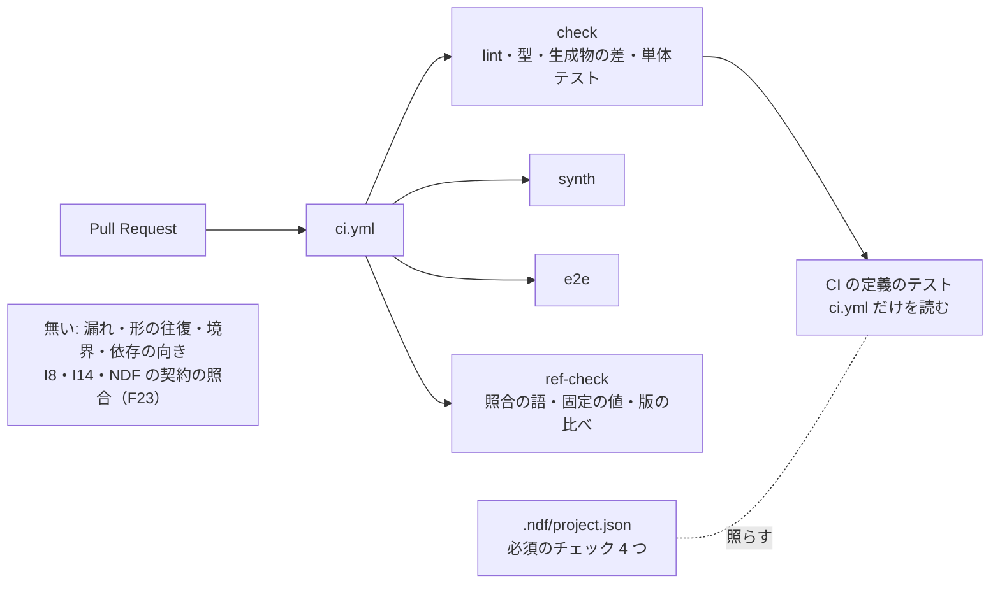
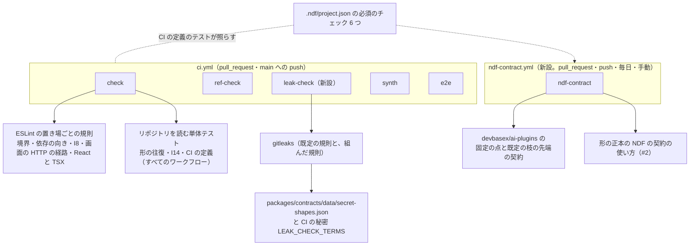

# 検査: 値の漏れと設計の決まりの破れと NDF の契約の食い違いを、Pull Request ごとと定期の CI で落とす（#1）

全体の設計が「検査が落とす」と決めた決まり（実際の値と秘密を置かない・横断の部品（時計・ID・ログと伏せ字・外部の呼び出しなどを 1 か所にまとめた `packages/core` の部品）を 1 か所に置く・依存の向き・使える量の判定は 1 か所・画面の操作はすべて API と MCP にもある・NDF の契約に載るものだけでやり取りする）のうち、今の CI が落とせるのは参照の検査と CI の定義のテストだけである。構文で見つかる破れは ESLint の組み込みの規則を置き場ごとに設定して今の `check` で落とし、形の往復と I14 の対応はリポジトリを読む単体テストで、漏れは gitleaks で、NDF の契約の照合は資格情報を持たない新しいジョブで落とす。自前で作る部分は、既存のツールで置き換えられるかを調べて残したものだけにする（MVV 版 2 の Value 15）。形の正本（型や OpenAPI などを生成する元になる `packages/contracts` の zod の定義と操作の表）の側（操作の表・生成物・受ける契約の組（nd-factory が受け入れる NDF の契約の版と中身の sha256 の対の集まり））は #2 が作り、この設計は検査がそこから何を読むかと、#2 へ渡す欠けを決める。比べた案は「決定の記録」に、候補の調べは「外部の調査」にある。

## 今の姿

何が起きたか・目的・受け入れ条件は要求仕様（[issue-1-requirements.md](./issue-1-requirements.md)、正は #1 の本文）にある。この文書は「どう解くか」と「なぜその解き方か」だけを書く。図の「照合の語」は、参照の検査が探す作り直す前の旧いリポジトリや組織の名前で、CI の秘密で受ける（下の表の参照の検査の行と「用語」）。

検査の置き場と落とすものは全体の設計が決めてある（[プラットフォームの検査](../docs/design/platform.md#検査)・[API と MCP の照らす検査（I14）](../docs/design/api.md#照らす検査i14)・[実行の契約の照合の定期の検査](../docs/design/execution.md#契約の照合の定期の検査)・[詳細設計のファイル配置](../docs/design/detail.md#クラスと関数の構造)）。設計に要る今の構造は次のとおり。

| 今あるもの | 中身 |
| --- | --- |
| 参照の検査（`tools/ref-check/src/ref-check.ts`） | `git grep` で追跡しているファイルをすべて読む。照合の語（作り直す前の旧いリポジトリの名前や組織の名前など、参照の検査が残っていないかを探す語）は CI の秘密 `REF_CHECK_TERMS` から受け、当たりは「種類・ファイル・行」だけを出し、語を出さない。語を必須にするのは変数で有効にした正本のリポジトリの中の実行だけ |
| CI の定義のテスト（`tools/test/ci-definition.test.ts`） | `ci.yml` のジョブの名前の集合と `.ndf/project.json` の `ci.required_checks` を照らし、`ci.yml` の中の AWS の資格情報の語を落とす |
| ESLint（`eslint.config.js`、`check` の中の `npm run lint`） | 推奨の規則と型の import の規則だけ。置き場ごとの規則は無い |
| 骨組みのコード | `apps/api/src/users-handler.ts` が AWS SDK のクライアントを直に作り、引数なしの `new Date()` と `console.log` を使う。`apps/web/src/main.ts` が `window.fetch` を、`apps/web/src/users-client.ts` が `/v1/users` を直に書く。`infra/lib/app-stack.ts` が API Gateway の経路 `/v1/users` を `addRoutes` に手で書く。#2 が横断の部品と生成した経路の登録へ移す（#2 の本文の「骨組みのコードから引き継ぐ形」）、#4 が `PUT /v1/users` を置き換える |
| 照らす相手 | 操作の表・生成した MCP の道具の一覧と HTTP の経路の登録・横断の部品（`packages/core`）・料金プランの値・受ける契約の組は、まだ無い（#2・#29）。形の正本は、型・JSON Schema・OpenAPI・MCP の道具の一覧などを生成する元になる zod の定義と操作の表を置く `packages/contracts` である。横断の部品は、時計・ID・ログと伏せ字・外部の呼び出し・再試行・認可の判定などを 1 か所にまとめ、`apps/` が直に使わずに通す `packages/core` の部品である |
| NDF の契約 | #41 の設計（PR #42、承認待ち）で、固定の点は ndf v11.0.12、置き場は `plugins/ndf/contracts/`、受ける組（nd-factory が受け入れる契約の版と、その版の契約の中身の sha256 の対の集まり）は `{版 8, ed8b0365…}`、F23 が予告として読む先は ai-plugins の既定の枝の先端になる（#41 の決定 104・107・108） |

## 文脈と制約

- CI は AWS の資格情報を持たない（Value 8、`AGENTS.md`）。足すワークフローも `permissions: contents: read` だけで動く
- 照合の語と実際の値はリポジトリに置かない。当たりの出力にも値を出さない。CI の記録は公開される（Value 7）
- 依存の向きの決まりで、`tools` が import してよいのは `packages/contracts` だけで、ほかの置き場は文字として読む（[詳細設計の依存の表](../docs/design/detail.md#クラスと関数の構造)）。検査はランナーや横断の部品のコードを import できない
- 境界の検査の対象は `apps/` の 5 つの置き場の実行時のコードで、`packages/core`・`infra/`・`tools/` は外す（プラットフォームの決定 91）
- 照らす相手がまだ無い検査は、相手が無いことで落とさずに通り、わざと違反を入れた入力で落ちることをテストで示す（要求の前提 2）
- 全体の設計で決めた「落とすもの」の集合は変えない（要求の前提 1）。#41 の決定が承認で変われば、この設計の F23 の節を直す
- #2（K2）の設計が同時に進む。形の往復と、検査が読む形の正本のデータは、両方の課題の境目に当たる（実行計画の変更重複）
- `ndf_ref` を読む行に大小の比べの記号を置くと参照の検査が落ちる。この文書も追跡するファイルとして読まれる
- MVV 版 2（PR #54。利用者が承認し、main へのマージ待ち）の開発の目標 Value 10〜16 と、画面を React 19 と TSX で組む決定 140 の改め（PR #53。同じくマージ待ち）に従う。どちらかの内容が承認と違ってマージされたら、この設計を直す

## 解き方の全体像

- 構文で見つかる破れ（横断の部品の外での直の利用・依存の向きに反する import・料金プランの値の判定の外での import と名前の比べ・画面の HTTP の経路の直書き・API の振り分けと API Gateway の定義への HTTP の経路の手書き・画面の外での React の import と TSX のファイル）は、`eslint.config.js` が `tools/checks/` の規則の組を置き場ごとに読み込み、今の `check` が落とす
- 形の往復と I14 の対応は、形の正本と生成物を読む単体テスト（`tools/test/`）が落とす。I15（日時は時刻帯つきの UTC で、金額は `amount_minor` と `currency` の組で受ける）と I12（利用者向けの操作の要求と応答は配列で、1 件も配列の 1 要素として扱う）の形もここで照らす（どちらも [API と MCP の文書](../docs/design/api.md) の不変条件）
- 漏れの検査は新しいジョブ `leak-check` が、gitleaks の既定の規則と、秘密の形のデータと CI の秘密の実際の値から組んだ規則で、`docs/` を含む追跡しているファイルと、Pull Request の途中のコミットを探す
- NDF の契約の照合は新しいワークフローのジョブ `ndf-contract` が、固定の点を変えた Pull Request・main への push・毎日 1 回・手動で照らし、ほかの Pull Request では照らさずに通る
- 必須のチェックは 6 つ（`check`・`synth`・`e2e`・`ref-check`・`leak-check`・`ndf-contract`）になり、CI の定義のテストがすべてのワークフローを読んで宣言との食い違いと資格情報の語を落とす

## 構成要素

| 要素 | 責務 | 走るジョブ |
| --- | --- | --- |
| 規則の組（`tools/checks/src/lint-rules.ts`、新設） | 境界・依存の向き・I8・画面の HTTP の経路の直書き・画面の外の React と TSX を、ESLint の組み込みの規則（`no-restricted-imports`・`no-restricted-syntax`・`no-restricted-globals`・`no-restricted-properties`）の設定として置き場ごとに組む。期限つきの控え（下の決定 5）を外す置き場として持つ | `check` |
| 漏れの検査（`tools/checks/src/leak-check.ts`、新設） | gitleaks（LIB1）の設定を秘密の形のデータと CI の秘密から実行の時に組んで起こし、報告を外しで絞って、「規則・ファイル・行」だけを出す。探す処理そのものは gitleaks が持つ | `leak-check` |
| 秘密の形のデータ（`packages/contracts/data/secret-shapes.json` と形 `packages/contracts/src/secret-shapes.ts`、新設） | 値の形（私有鍵の頭・token の頭）と、漏れの検査が使うインフラの値の形（アカウント ID・ARN・資源の ID・端点）と、作り物の値の一覧を持つ。#2 の伏せ字も同じファイルを読む | — |
| 形の往復の検査（`tools/checks/src/round-trip.ts`、新設） | 操作ごとの見本とその変形を、zod の形・生成した JSON Schema・OpenAPI の要素の形・MCP の道具の入力の形の 4 つで検証し、結果が食い違う組を返す。I15 と I12 の形も照らす | `check`（単体テスト） |
| I14 の対応の検査（`tools/checks/src/operation-coverage.ts`、新設） | 操作の表・MCP の道具の一覧・HTTP の経路の登録・画面が呼ぶ操作の名前・機能 F1〜F20 を突き合わせ、欠けと余りを返す | `check`（単体テスト） |
| NDF の契約の照合（`tools/checks/src/ndf-contract-check.ts`、新設） | 固定の点と既定の枝の先端の契約を取り、形の正本の NDF の契約の使い方（#2）と照らす。固定の点の食い違いで失敗し、先端だけの食い違いは要約に並べる | `ndf-contract` |
| CI の定義のテスト（`tools/test/ci-definition.test.ts`、変更） | `.github/workflows/` のすべてのワークフローを `yaml`（LIB12）で解いて読み、Pull Request で走るジョブの集合と必須のチェックの宣言の一致・資格情報の語の無さ・足したジョブの権限を照らす | `check` |
| 参照の検査（`tools/ref-check`、変えない） | 追跡しているファイルをすべて読むため、足すワークフローも今のまま対象に入る。テストだけを足す | `ref-check` |

## 自前で作る部分と既存のツール

検査ごとに、自前で作る部分を広く使われる既存のツールで置き換えられるかを調べた（MVV 版 2 の Value 15。候補は「外部の調査」の表）。置き換えたのは漏れの検査の探す処理と、CI の定義のテストのワークフローの読み方の 2 つである。

| 検査・部品 | 使う既存のツール | 比べて使わなかったもの | 自前で残す部分と理由 |
| --- | --- | --- | --- |
| 漏れの検査 | gitleaks の CLI（LIB1。決定 3） | 自前の正規表現の走査・secretlint（LIB3）・trufflehog（LIB2）・GitHub の secret scanning（PRD1） | 設定を形の正本のデータと CI の秘密から組む包み・外しの件数の照らし・パスの伏せ字。gitleaks は nd-factory の作り物の値と外しの件数の決まりを知らないため |
| 境界・依存の向き・I8・画面の HTTP の経路・React と TSX | ESLint の組み込みの規則（LIB5・LIB7。決定 1） | dependency-cruiser（LIB4）・eslint-plugin-boundaries（LIB6）・eslint-plugin-import-x（LIB10） | 規則の組の設定と控え。規則そのものは ESLint が持つ |
| 形の往復 | ajv（LIB8）・zod の `z.toJSONSchema`（LIB9。決定 8） | fast-check と zod-fast-check（LIB13） | 見本を崩す 4 種類の変形と、4 つの形の結果の比べ。zod 4 から値を作る保守された部品が無いため |
| I14 の対応 | TypeScript の構文木（このリポジトリが既に使う `typescript`） | — | 操作の表と画面・MCP・経路・機能の突き合わせ。nd-factory の操作の表の形に固有の照らしで、置き換えられる道具の候補を挙げられなかった（「外部の調査」の確かめられなかったこと） |
| NDF の契約の照合（F23） | git（取得）・形の正本の判定（#2） | — | 契約のファイルと形の正本のデータの照らし。NDF の契約の形に固有の照らしで、置き換えられる道具の候補を挙げられなかった（同上） |
| CI の定義のテスト | `yaml`（LIB12。決定 10） | actionlint・zizmor（LIB14） | 必須のチェックの宣言とジョブの集合の一致・資格情報の語・`permissions` の照らし。全体の設計が決めた照らしで、actionlint と zizmor は持たない |

knip（LIB11）は使っていないファイル・書き出し・依存を見つけ、Value 13 の「使わなくなったコードを残さない」に効く。zizmor はワークフローの危うい書き方を見つける。どちらも全体の設計の検査の表に無い検査を足すことになり、この課題で足すと決め直しに当たるので、全体の設計に足すかを決める課題として #57 に起票した。

### 開発の目標との照らし

MVV 版 2 の Value 10〜16 と、この設計の決定を照らした。食い違ったのは 2 つで、どちらも直した。漏れの検査を自前の正規表現の走査で作っていたこと（Value 15）は、gitleaks で探す形に変えた（決定 3）。CI の定義のテストの行の読み方（Value 15・16）は、YAML の解析器で読む形に変えた（決定 10）。Value 15 の照らしの全体は上の「自前で作る部分と既存のツール」にある。

決定の根拠の行は、版 1 で引いた Value の番号を版 2 の同じ番号のまま引く。版 2 は Value 1〜9 の番号と文を保ち（語の言い換え 2 か所（「UX の土台」を「画面の基盤」、Value 5 の「土台」を「作り」）だけで、意味は変わらない。PR #54 の `.ndf/mvv.md` の差分で確かめた）、開発の目標の Value 10〜16 を後ろに足しただけなので、番号は書き換えずに版の表示だけを 2 にし、版 2 で足した Value 13・15・16 を当たる決定に足した。

| Value | 照らした結果 |
| --- | --- |
| 10 正しいデータ構造 | 秘密の形・作り物の値は `secret-shapes.json` の 1 か所に置き、gitleaks の設定と伏せ字はそこから組む。控えと外しは「何を・なぜ・いつまで」だけを持ち、値を写さない |
| 11 責務の分かれた設計 | 検査の判定は入出力を引数で受ける関数に置き、git・gitleaks・ネットワークの取得は CLI の端の関数に寄せる。NDF の取得は URL を引数で差し替え、テストはネットワークを使わない |
| 12 リファクタリングを続ける | 構造を変える骨組み（#2・#4）が控えを消す形にし、直した後に控えが残るとテストが落ちる（決定 5） |
| 13 重複と冗長を作らない | 形の照らしは形の正本と生成物から読み、写しを持たない。gitleaks の版と要約値はワークフローの 1 か所だけに書く。必須のチェックは宣言と GitHub の保護の 2 か所に残る（GitHub の保護は資格情報なしに読めない。「影響と危険」） |
| 14 モダンな開発の手順 | 検査ごとに先に落ちるテストを書く（テスト設計）。依存を自動で新しく保つ仕組み（Dependabot）は #14 の対象範囲にある |
| 16 前の形に縛られない | 今の CI の定義のテストの行の読み方を出発点にせず、解析器で読む形へ変えた（決定 10） |

## #2 との境目

形の往復は 2 つの課題が分けて持つ（#1 の本文の起票者の推定 6）。#2 が形の正本と生成を持ち、#1 は生成物を読んで照らす側だけを持つ。

| 事柄 | #2 が持つ | #1 が持つ |
| --- | --- | --- |
| 生成 | 型・JSON Schema・OpenAPI・MCP の道具の一覧・HTTP の経路の登録・ダミーデータの生成と、生成物が古いと `check` が落ちること | — |
| 往復 | — | 生成物の間で検証の結果が同じであること（決定 8）。I15・I12 の形の照らし |
| 操作の表の項目 | 項目の型と名前 | 読む項目（名前・エンティティ・読むか書くか・人だけか・HTTP の経路・機能・見本・要素と結果の形） |
| 画面の呼び出し | 生成した呼び出しの形 | 画面が呼ぶ操作の名前を静的に読み、表と照らす（I14） |
| 秘密の形のデータ | 鍵の名前の形を足し、伏せ字が読む | ファイルと形を作り、値の形とインフラの値の形を埋める（決定 9） |
| NDF の契約の使い方 | 受ける組・使う口・渡す環境変数・読むファイルと項目・区間の報告から読む項目のデータと、呼び出しの判定 | データと判定を契約と照らす（決定 7） |

#2 へ渡す欠け（#2 の詳細設計が持つ。#1 の実装の最初のタスクで #2 の本文へ追記する）:

| # | 欠け | なぜ要るか |
| --- | --- | --- |
| K2-1 | 操作の定義に機能（F1〜F20 の配列）を持たせる。全体の設計の操作の一覧の「機能」の列にあたる | I14 の「機能の対応」を照らす |
| K2-2 | 画面が操作を呼ぶ形は、静的に操作の名前を読める形にする（生成した関数の名前が操作の名前から決まるか、呼び出しの第 1 引数が操作の名前の文字列の定数） | I14 の「画面と操作の対応」を照らす |
| K2-3 | 操作の表・生成した JSON Schema と OpenAPI・MCP の道具の一覧・HTTP の経路の登録を、`packages/contracts` の書き出し（export）から読めるようにし、利用者向けの操作と機械向けの経路（ランナー・手元のマシン・DB の用意のタスク）を分けて読めるようにする。`apps/api` の振り分けと `infra/` の API Gateway の定義は、HTTP の経路をこの登録の書き出しからだけ読む | 検査は `packages/contracts` だけを import する。I14 の画面と MCP の照らしは利用者向けの操作だけを数える。手書きの経路は規則の組 `routes.generated` が落とすので、生成した登録を照らせば両方の実際の登録を照らしたことになる |
| K2-4 | 日時の項目の名前を `_at` で終え、金額は `amount_minor` と `currency` の組にする（全体の設計の値の形） | I15 の形の照らしが名前で項目を見分ける |
| K2-5 | 形の正本の要素と結果の形に、JSON Schema に表せない制約（変換・独自の検査）を使わない | 形の往復が食い違いとして落とす |
| K2-6 | NDF の契約の使い方のデータと呼び出しの判定を `packages/contracts` に置く（決定 7。受ける組を置くことは実行計画で #2 にある） | F23 が照らす相手 |

#29 へ渡す欠け: 料金プランの名前を形の正本の閉じた語の集まりとして、料金プランの値を `packages/contracts/data/` のデータとして置き、値を読む書き出しを 1 つにする（I8 の検査がその書き出しの import を判定の外で落とし、名前を画面で落とす）。#6 へ渡す欠け: ランナーは NDF を起こす前に形の正本の呼び出しの判定を通す（決定 7）。

## 決定の記録

決定の番号はこの文書の中の番号で、全体の設計の決定の番号（`docs/design/decisions.md` の置き場）とは別である。

### 決定 1: 構文で見つかる破れを依存を足さずに今の CI で落とすため、境界・依存の向き・I8・画面の HTTP の経路・画面の外の React と TSX を ESLint の組み込みの規則で置き場ごとに縛る

- **質問**: 境界の検査・依存の向き・I8 の「判定の外の比べ」・画面の HTTP の経路の直書きと、プラットフォームの言語と書き方の決まり（決定 140）の「画面は React 19 の部品を TSX で書き、画面の外のコードは TSX と React を import しない」を、どの道具で落とすか
- **選んだ案**: ESLint の組み込みの 4 つの規則を、`tools/checks/src/lint-rules.ts` が置き場（`files` の glob）ごとの設定として組み、`eslint.config.js` が読み込む。型だけの import は `@typescript-eslint/no-restricted-imports` の `allowTypeImports` で許す。縛る置き場の設定は行の中の無効化の注釈（`eslint-disable`）を受けない（`linterOptions.noInlineConfig`）。画面の置き場（`apps/web/src`）の組は `*.ts` と `*.tsx` の両方に掛け、JSX の属性の値と本文も文字列として照らす。画面の外では `react`・`react-dom`・`@vitejs/plugin-react` の import と `*.tsx` のファイルを落とす（組 `deps.react`・`files.tsx`）。違反を入れた文字列を ESLint の API で検査する単体テストで、規則ごとに落ちることを確かめる
- 採らなかった案: dependency-cruiser で依存の向きを縛る（依存を 1 つ足し、境界と I8 は別の道具になる。依存の向きは `no-restricted-imports` の置き場ごとの設定で表せる）
- 採らなかった案: eslint-plugin-boundaries（star 約 1,000・2026-11-15 のリリースで保守は活発だが、flat config と ESLint 10 への対応を一次情報で確かめられなかった。境界の検査の「直の利用」は import でなく呼び出しの形なので、組み込みの規則が要ることは変わらず、依存の向きのためだけに 2 つ目の設定の書き方を持つことになる）
- 採らなかった案: eslint-plugin-import-x の `no-restricted-paths`（ESLint 10 を対応の範囲に持つが、置き場の間の禁止は組み込みの `no-restricted-imports` の置き場ごとの設定で同じく書け、依存と解決の設定が増える）
- 採らなかった案: TypeScript の構文木を自前で歩くスクリプト（ESLint の選び方の記法とファイルの選び方を作り直すことになる）
- **代償**: 構文の印の無い破れ（変数に入れてから呼ぶ・別名で受ける）は落とせない。行の中の無効化を受けないため、正当な例外は控えのファイル（決定 5）を直す Pull Request でしか作れない
- 作り方: ライブラリやサービスを使う
- 比べた候補: LIB4 / LIB5 / LIB6 / LIB7 / LIB10
- 根拠: Value 1・Value 7・Value 13・Value 15（MVV バージョン 2）。決定 140（プラットフォーム）

### 決定 2: 構文の印が無い「置き場の外で直に使わないもの」も落とせるよう、行ごとに印を決めて照らす

- **質問**: プラットフォームの表の「置き場の外で直に使わないもの」のうち、関数の名前で書かれていない 3 つ（自前の再試行のループ・条件式を直に組む書き込み・入口ごとの独自の認可の判定）を、検査から外すか、印を決めて照らすか
- **選んだ案**: 行ごとに印を決める。再試行は「繰り返しの文の中で外部の呼び出しの部品（`callHttp` か AWS SDK の `send`）を呼ぶこと」、条件つきの書き込みは「AWS SDK の import」と「`ConditionExpression` の鍵を持つオブジェクト」、認可の判定は「403 の数値と、認可の判定だけが返す理由のコードの文字列」を `apps/` の中で落とす。印とプラットフォームの行の対応は詳細設計の表に置く
- 採らなかった案: 3 つの行を検査から外し、レビューに任せる（全体の設計の「落とすもの」を減らすことになり、要求の前提 1 に反する）
- **代償**: 印は近似で、印を避けた書き方（再帰で繰り返す・応答を作る部品を別に作る）は通る。`apps/` の中の正当な 403（無い）や繰り返しの中の外部の呼び出し（一覧の頁送り）が出たら、控えに理由を書いて足す
- 根拠: Value 7・Value 9（MVV バージョン 2）

### 決定 3: 車輪の再発明をせず伏せ字と同じ形で探すため、漏れの検査を gitleaks で行い、規則を形の正本のデータと CI の秘密から実行の時に組む

- **質問**: 漏れの検査を既存の秘密の走査の道具で行うか、自前で作るか。全体の設計は、伏せ字（#2）と漏れの検査が同じ秘密の形のデータを読み、実際の値を CI の秘密から受け、作り物の値を外すことを求める
- **選んだ案**: 探すのは gitleaks の CLI にする。`tools/checks/src/leak-check.ts` は包みだけを持ち、gitleaks の設定（TOML）を `packages/contracts/data/secret-shapes.json` の形と作り物の値と CI の秘密の語から実行の時に組み、環境変数 `GITLEAKS_CONFIG_TOML` で渡す（設定をリポジトリにもファイルにも置かない）。データの形（伏せ字と同じ私有鍵の頭・token の頭と、インフラの値の形）はすべて規則にし、gitleaks の既定の規則（既知の提供者の token・私有鍵の頭）も重ねて残す。今の木は追跡しているファイルだけを一時のディレクトリへ写して `gitleaks dir` で、Pull Request では分岐点からのコミットを `gitleaks git` で探す。gitleaks の黙らせる仕組み（行の注釈 `gitleaks:allow` と `.gitleaksignore`）は旗と探す木の置き方で効かせず、外しは件数つきの外しだけにする。報告は標準出力からメモリで受けてどこにも書かず、`--redact=100` で伏せられない欄（ファイルのパス・コミットのメッセージ・作者）があるので、包みは規則・ファイル・行・コミットの短い SHA だけを写し、パスの中の当たりも伏せて出す。gitleaks は配布の資産を版と、ワークフローに固定した要約値で照らして取る
- 採らなかった案: 自前で作る（`git grep` と正規表現で探す。既知の提供者の token の形の網羅を自分で保守することになり、Value 15 に反する）
- 採らなかった案: gitleaks の GitHub Action（組織のリポジトリでは鍵の登録が要る。CLI は MIT で鍵が要らない）
- 採らなかった案: secretlint（Node で動き、独自の正規表現の規則と出力の伏せ字を既定で持つが、star 約 1,500 で、gitleaks（star 約 31,000、GitLab の Secret Detection も内部で使う）より使われている広さが小さい）
- 採らなかった案: trufflehog（AGPL-3.0）
- 採らなかった案: GitHub の secret scanning に任せる（既知の提供者の token の形を探す。アカウント ID・profile・環境の名前の照合と作り物の値の外しは持たない。公開のリポジトリでは無料で走るので、この検査と重ねて使える）
- **代償**: Node の外の実行ファイルに依る。CI は版と要約値を照らして取り、手元で打つ人は自分で入れる（無ければ終了コード 2）。実物の gitleaks を起こす結合のテストは `check` で走らず、ジョブ `leak-check` で走る。gitleaks の最新の版は 2026-03-21 で、その後 8 か月リリースが無い（リポジトリへの push は 2026-10 まで続く）。既定の規則が今のリポジトリのファイルに当たれば、外しに理由を書いて置く
- 作り方: ライブラリやサービスを使う
- 比べた候補: PRD1 / PRD2 / LIB1 / LIB2 / LIB3 / STD4
- 根拠: Value 7・Value 13・Value 15（MVV バージョン 2）。決定 92（プラットフォーム）

### 決定 4: 実際の値の一覧を参照の検査の語と混ぜないため、漏れの検査の語を別の CI の秘密 `LEAK_CHECK_TERMS` で受ける

- **質問**: 実際の値（アカウント・profile・環境の名前）の一覧を、参照の検査の `REF_CHECK_TERMS` に足すか、別の秘密で受けるか
- **選んだ案**: 別の CI の秘密 `LEAK_CHECK_TERMS`（JSON。種類 `accounts`・`profiles`・`environments` ごとの語の配列）で受ける。語を必須にするかの切り替えは、参照の検査と同じ形（変数 `LEAK_CHECK_REQUIRE_TERMS` を `1` にした正本のリポジトリの中の実行だけ）にする。語の無い実行は形の当たりだけを探し、照合を飛ばしたと出力する
- 採らなかった案: `REF_CHECK_TERMS` に種類を足す（参照の検査の語は旧い側の名前で、運用する環境の値とは持ち主と変える時期が違う。片方の形を変えるともう片方の検査が語の形の誤りで止まる）
- **代償**: 秘密が 1 つ増え、正本のリポジトリの持ち主が登録する（下の「人へ残す判断」）。登録されるまで、照合は飛ばされる
- 根拠: Value 7（MVV バージョン 2）

### 決定 5: 検査を足した Pull Request から main を落とさずに入れるため、骨組みの既知の当たりを課題の番号つきの控えに置き、直した後の控えを残さない

- **質問**: 境界の検査と画面の HTTP の経路の検査が、今の骨組みのコード（「今の姿」の表）に当たる。#2 は「外で直に使うと境界の検査（#1）が落ちる」を受け入れ条件に持ち、#1 の検査を待つ。どちらを先に入れるか
- **選んだ案**: 検査を先に入れ、今の当たりを `tools/checks/data/lint-exceptions.json` に「ファイル・規則・受け持つ課題（#2 か #4）・理由」で置き、その置き場だけ規則を外す。単体テストが、控えの行ごとにそのファイルが今もその規則に当たることを確かめ、当たらなくなった行（直したのに残った控え）で落ちる。控えに行を足す変更はレビューで見る
- 採らなかった案: #2 が骨組みを移すまで検査を入れない（#2 の受け入れ条件が #1 の検査を前提にしており、互いに待つ）
- 採らなかった案: #1 の Pull Request で骨組みを直す（横断の部品が無いので移す先が無く、#2 の範囲を先取りする）
- **代償**: 控えが残る間、控えたファイルは同じ規則に当たる新しい行も通る。控えはファイルの単位で、行の単位でない
- 同じ考えを I14 の画面の対応にも使う。#2 が操作の表を置いた時点では画面の多くが無く、利用者向けの操作がすべて `screen-missing` になる。画面を作る課題が別に分かれているため、画面の無い操作を `tools/checks/data/screen-pending.json` に「操作の名前・画面を作る課題の番号・理由」で置き、その操作だけを `screen-missing` から外す。単体テストが、画面から呼ばれるようになった操作の行（直したのに残った控え）と、表に無い操作の行で落ちる。表に操作を足す Pull Request は、画面を同じ Pull Request で足すか、控えに画面を作る課題を書いて足す。画面を作る課題は、自分の番号の行を消すことで画面の対応が必須になる
- 根拠: Value 7（MVV バージョン 2）

### 決定 6: 全体の設計の「いつ」を変えずに必須のチェックへ載せるため、NDF の契約の照合を別のワークフローの常に起動するジョブにし、固定の点を変えない Pull Request では照らさずに通す

- **質問**: F23 は「毎日 1 回と `ndf-pin.json` を変える Pull Request」で走り（実行の文書）、同時に必須のチェックに載る（プラットフォームの文書）。パスの絞り込みで起動を絞ると、起動しなかった Pull Request で必須のチェックが待ちのまま残る
- **選んだ案**: 新しいワークフロー `.github/workflows/ndf-contract.yml` に 1 つのジョブ `ndf-contract` を置き、`pull_request`・main への `push`・`schedule`（毎日 1 回）・`workflow_dispatch` で起動する。Pull Request では、ジョブの中で Pull Request の分岐点（基点の枝の先端と head の共通の祖先。GitHub の Pull Request の差分と同じ点）と head のコミットの `ndf-pin.json` を比べ、同じなら照らさずに成功で終える（出力に `skip: pin-unchanged` の行を出す。出力の行は詳細設計の「NDF の契約の照合」）。基点の枝の先端と比べないのは、分岐の後に main だけで固定の点が変わった場合を Pull Request 自身の変更と取り違えないためである。変えた Pull Request では、マージした結果のコミット（`pull_request` の既定の取得）で照らす。マージされる姿の固定の点と形の正本で照らすためである。push・毎日・手動では、そのコミットで固定の点と既定の枝の先端の両方を照らす
- 採らなかった案: `on.pull_request.paths` で起動を絞る（起動しなかった Pull Request で必須のチェックが待ちのまま残り、マージできない。STD1）
- 採らなかった案: すべての Pull Request で照らす（全体の設計の「いつ」を広げることになり、詳細設計で決め直さない決まりに当たる。照らす相手のコード（#2・#6）の変更は毎日の実行で知る）
- 採らなかった案: `ci.yml` に `schedule` を足す（毎日、ほかのすべてのジョブも走る）
- **代償**: 照らす相手（形の正本の NDF の契約の使い方）を変えて固定の点を変えない Pull Request は、その Pull Request では照らされず、マージした後の push か次の毎日の実行で落ちる。公開のリポジトリで 60 日活動が無いと、毎日の起動が止まる（STD2）
- 根拠: Value 8・Vision（MVV バージョン 2）

### 決定 7: 契約の見本でランナーと同じ判定を照らすため、検査は形の正本の判定とデータを呼び、自前の判定を持たない

- **質問**: 実行の文書の照らすこと (1)〜(4)（(1) NDF の契約の見本のファイル `plugins/ndf/contracts/domains/entrypoint-cases.json` の 26 件を、ランナーの呼び出しと環境変数の組み立てへ通し、見本の `valid` と同じ判定になるか。(2) `version.json` の最後の行が受ける組にあるか。(3) `env.json` の `set_by: service` の名前と口の `env` 列の名前が、ランナーが組む環境変数を含むか。(4) `ndf-files.json` の `reader: service` の行の `fields` が、翻訳が読む項目を含むか。[実行の文書](../docs/design/execution.md#契約の照合の定期の検査)）は「ランナーの組み立て」と契約を照らす。`tools` はランナーのコードを import できない（依存の向き）。検査は何と照らすか
- **選んだ案**: ランナーが打つ前に使う判定（呼び出しの口・値・環境変数の名前が受ける契約に合うか）と、NDF の契約の使い方のデータ（受ける組・使う口・渡す環境変数の名前・読むファイルと項目・区間の報告から読む項目）を、形の正本（`packages/contracts`）に置き、ランナー（#6）と検査の両方がそれを使う。形の正本に置くのは #2 で、この設計は検査が要る形を #2 へ渡す欠けとして書く（下の「#2 との境目」）。検査は見本 26 件（`entrypoint-cases.json`）をその判定へ通して `valid` と比べ、データを契約のファイルと照らす
- 採らなかった案: 検査の中に契約の判定を自前で持つ（契約を契約自身と照らすことになり、ランナーの食い違いを拾えない）
- 採らなかった案: 検査がランナーのコードを読み込む（`tools` は `packages/contracts` だけに依る決まりに反する）
- **代償**: #2 が判定とデータを置くまで、照合は 1〜6 を照らさずに `skip: no-contract-use` と出して通る（要求の前提 2）。#6 が判定を使わずに組み立てを書くと、検査は食い違いを拾えない。#6 の受け入れ条件へ「判定を通す」ことを渡す
- 根拠: Vision・Value 8（MVV バージョン 2）

### 決定 8: 生成物の間の食い違いを見本の外でも拾うため、形の往復は見本とその機械的な変形を 4 つの形で検証して比べる

- **質問**: 形の往復の「見本の値の検証が往復で同じ結果」を、どの値で確かめるか
- **選んだ案**: 操作ごとの見本（#2 が作るダミーデータ）に、機械的な変形（必須の項目を 1 つ消す・項目の型を変える・知らない項目を足す・配列を 1 件の値にする）を加え、zod の形・JSON Schema・OpenAPI の要素の形・MCP の道具の入力の形の 4 つで検証し、通るか拒むかが 1 つでも違う組を落とす。加えて、変形していない見本は、該当するすべての形で通ることを確かめ、どれか 1 つでも拒めば落とす（すべての形が見本を拒むように揃って変わると、比べだけでは食い違いが出ないため）。JSON Schema の検証は ajv の draft 2020-12 のクラスと書式の拡張で行う
- 採らなかった案: 見本だけを検証する（見本はすべて通る値なので、拒むべき値を片方だけが通す食い違いを拾えない）
- 採らなかった案: 拒む見本を操作ごとに手で書く（操作が増えるたびに書き足しが要り、書き漏れた操作は照らされない）
- 採らなかった案: fast-check で値を無作為に作る（fast-check 4 は保守が活発だが、zod から値を作る部品の `zod-fast-check` は最後のリリースが 2023-09 で、fast-check 4 と zod 4 を対応の範囲に持たない。変形は形の正本の項目を 1 つずつ崩す 4 種類だけで、無作為の値を作る道具を足すほどの量でない）
- **代償**: 開発の依存に ajv と書式の拡張を足す。zod の形に表せても JSON Schema に表せない制約（変換・独自の検査）は、変形が当たると食い違いとして出るので、#2 が形の正本の側でそうした制約を使わないことを前提にする
- 作り方: ライブラリやサービスを使う・標準に倣う
- 比べた候補: LIB8 / LIB9 / LIB13 / STD3
- 根拠: Value 2・Value 4・Value 15（MVV バージョン 2）

### 決定 9: 漏れの検査を伏せ字の部品より先に入れるため、秘密の形のデータは #1 が作り、#2 の伏せ字が同じファイルを読む

- **質問**: 伏せ字（#2）と漏れの検査（#1）が読む秘密の形のデータを、どちらの課題が作るか
- **選んだ案**: #1 が `packages/contracts/data/secret-shapes.json` と、その形 `packages/contracts/src/secret-shapes.ts`（zod）を作る。#1 が埋めるのは値の形（私有鍵の頭・token の頭）とインフラの値の形と作り物の値で、伏せ字が使う鍵の名前の形は #2 が同じファイルへ足す。token の頭と私有鍵の頭は gitleaks の既定の規則にもあるが、伏せ字は gitleaks の規則を読まないので、データから外さない（漏れの検査は両方で探し、伏せ字はデータで伏せる）。形の正規表現は、gitleaks の RE2 と伏せ字の JavaScript の正規表現の共通の部分だけで書き、`loadSecretShapes` が形ごとに照らす
- 採らなかった案: #2 が作り、#1 は待つ（漏れの検査が伏せ字の部品の設計と実装を待つ。漏れは一度入ると公開の履歴から消せない）
- 採らなかった案: 漏れの検査の形を `tools/checks/` に別に持つ（伏せ字と漏れの検査が違う形を読む。全体の設計の「同じデータを読む」に反する）
- **代償**: `packages/contracts/` の中で #1 と #2 が同じファイルを触る。#1 の実装の Pull Request が先にマージされ、#2 はその上で鍵の名前の形を足す
- 根拠: Value 7（MVV バージョン 2）

### 決定 10: ワークフローの読み違いを無くし前の形に縛られないため、CI の定義のテストはワークフローを YAML の解析器で読む

- **質問**: CI の定義のテストは今、`ci.yml` の行を正規表現で読んでジョブの名前を拾う。すべてのワークフローの起動の条件とジョブごとの `permissions` まで照らすのに、行の読み方を広げるか、YAML の解析器で読むか
- **選んだ案**: `yaml`（LIB12）で解いて読む。ジョブの名前・起動の条件・最上位とジョブの `permissions` は解いた値から取り、資格情報の語だけは鍵でも値でも当たるように元の文字列で探す。`yaml` は YAML 1.2 で読むので、最上位の `on` を真偽値と取り違えない（今の `ci.yml` で確かめた）
- 採らなかった案: 行の正規表現を広げる（字下げと書き方の違い（`on: [pull_request]` と鍵の形、`permissions: write-all` と鍵の形）ごとに読み方を足すことになり、YAML の解析を作り直す）
- 採らなかった案: actionlint・zizmor（ワークフローの書き誤りや危うい書き方を見つける道具で、必須のチェックの宣言とジョブの集合の一致は照らさない。全体の設計の検査の表に無い検査を足すことになるので、#57 に起票した）
- **代償**: 開発の依存が 1 つ増える
- 作り方: ライブラリやサービスを使う
- 比べた候補: LIB12 / LIB14
- 根拠: Value 8・Value 15・Value 16（MVV バージョン 2）

## 影響と危険

- **働く範囲**: このリポジトリの CI だけ。nd-factory を自分で設置する人の環境には何も足さない（設置のコマンドと反映のパイプラインは変えない）
- **プロジェクトごとに違うもの**: 実際の値の一覧は CI の秘密 `LEAK_CHECK_TERMS` で受け、リポジトリに置かない。fork したリポジトリは秘密を持たないので、照合を飛ばして形の当たりだけを探す
- **当たるモード**: `standard` の CI の必須のチェック。ほかのモードの工程は変えない
- **必須のチェックが増える**: 宣言（`.ndf/project.json`）と GitHub の main の保護の必須のチェックの両方に `leak-check`・`ndf-contract` を足す。保護の設定は GitHub の側の設定で、宣言と食い違うとマージが待ちのまま残るか、足した検査が必須にならない
- **同じファイルを触る別の変更**: #2 が `packages/contracts/` の別のファイルと `package.json` を触る（決定 9・「#2 との境目」）。#13 は `infra/` と `docs/design/platform.md` を触り、重ならない。#41 の実装（N11-実装）は `ndf-pin.json` を付け替える。その Pull Request が #1 の実装の後なら `ndf-contract` が照らす最初の Pull Request になり、前なら照らさない
- **壊れうる箇所**: 漏れの検査は今のリポジトリの 12 桁の数（コミットの SHA の一部・数の並び）と、gitleaks の既定の規則が汎用の形（高いエントロピーの文字列・鍵らしい名前の代入など）で拾う見本の文字列に誤って当たりうる。今の木の当たりは、実装の Pull Request で main の全体を走らせ、当たりを直すか、外し（`tools/checks/data/leak-allow.json`）に理由を書いて置く。履歴の当たりは Pull Request の分岐点からのコミットだけを探すので、main の過去のコミットには当たらない。実装の Pull Request の途中のコミットに誤った当たりが出たら、今の木と同じく外しのパスと規則の組で除く（履歴には件数を掛けない。詳細設計の「履歴の当たりと外し」）。テストの見本は、違反の文字列をリポジトリに置かないよう実行の時に組み立てる（置くと漏れの検査と参照の検査がそのテストのファイルに当たる）
- **漏れの検査の外しの粒度**: 外しは「パス・規則（gitleaks の規則の ID。データの形の `nd-<種類>-<id>` か既定の規則の ID）・今の木の当たりの件数・理由」で、値もその要約値（ハッシュなど）も書かない。要約値を置くと、桁の少ない値（12 桁のアカウント ID など）は総当たりで戻せるためである。今の木で、外したパスと規則の当たりの件数が外しの件数と違えば落とすので、外したファイルに同じ規則に当たる値を足すと落ちる。履歴では件数を照らさず、外したパスと規則の組の当たりを除く。行の番号は外しに使わない（上の行の編集で動き、外しが無駄に壊れる）。gitleaks 自身の黙らせる仕組み（`gitleaks:allow`・`.gitleaksignore`）は効かせない。**代償**: 外したファイルの当たりを、同じ件数のまま別の実際の値へ置き換えると、形の検査では通る。外したパスと規則の組に、途中のコミットで値を足して消すと、履歴でも通る。秘密の一覧（`LEAK_CHECK_TERMS`）との照合（`nd-real-*`）は外しに関わらず今の木と履歴の両方で効くので、一覧にある値は落ちる。一覧に無い値や、秘密が渡らない実行（fork・秘密の未登録）では、この置き換えは検査で見つからず、外しのあるファイルの変更はレビューで見る
- **gitleaks の版**: 版と要約値は `ci.yml` のジョブ `leak-check` の環境変数の 1 か所に置き、上げるときはその 2 つを同じ Pull Request で直す。CI は取った資産の `sha256sum` を、固定した要約値と直接比べる（実行の時に配布のチェックサムのファイルは取らない）。要約値は上げる人が、資産の `sha256sum` と配布のチェックサムのファイルの行の一致を確かめてから書く。依存を自動で新しく保つ仕組み（Dependabot）はこのリポジトリにまだ無く、#14 の対象範囲にある。gitleaks はワークフローに書いた版なので、Dependabot を入れた後も版の上げは手で行う
- **NDF の取得**: `ndf-contract` は devbasex/ai-plugins を資格情報なしで取る。GitHub が落ちていると照らす実行は失敗し、照らさない Pull Request は通る
- **#41（PR #42）の承認との順序**: この設計の F23 の節（決定 6・7、詳細設計の「NDF の契約の照合」）は、承認待ちの #41 の決定 104〜108（固定の点・契約の置き場・受ける組・区間の報告・先端を既定の枝にすること）を前提にする。PR #42 の承認で決定 104〜108 のどれかが変わったら、#1 の実装を始める前に、その結果をこの設計と詳細設計の F23 の節（NDF のリポジトリの URL と契約の置き場の定数・照らすこと 1〜6 の契約のファイル・先端の取り方）へ取り込む Pull Request を先に通す。#1 の実装は、PR #42 が承認され、F23 の節が承認された決定と合ってから始める

### 残る危険

検査を入れても、次の破れは Pull Request の時点で落とせない。どれも決まりを変えるのでなく、検査が近似であるか照らす相手が無いために残る。

| 残る危険 | 何が通るか | どこで扱うか |
| --- | --- | --- |
| 別名で受ける・変数に入れてから呼ぶ（決定 1） | 構文の印の無い呼び出し（`const f = Date.now; f()` など）は ESLint の規則に当たらない | レビュー |
| 印を避ける書き方（決定 2） | 再帰で繰り返す・応答を作る部品を別に作る・文字列を連結して経路や理由のコードを組む | レビュー。正当な例外は控えに理由を書いて足す |
| 固定の点を変えない Pull Request での NDF の契約の使い方の変更（決定 6） | 形の正本の NDF の契約の使い方だけを変えた Pull Request は、その Pull Request では照らされない | マージの後の push の実行か次の毎日の実行で落ちる |
| 漏れの検査の外しの中の置き換え（上の「漏れの検査の外しの粒度」） | 外したファイルの当たりを、同じ件数の別の実際の値へ置き換える。外したパスと規則の組に、途中のコミットで値を足して消す | 秘密の一覧との照合とレビュー |
| 照らす相手（#2・#29）がそろうまで「相手が無い」で通る検査 | 形の往復・I14（#2 の操作の表と生成物）・I8 の料金プランの値と名前（#29）・F23 の 1〜6（#2 の NDF の契約の使い方）は、相手が無い間はリポジトリへの適用を飛ばして通る。作り物の入力で落ちることはテストで示すが、実物は照らされない | #2・#29 の実装の Pull Request で相手が入った時点から照らされる。形の往復・I14・I8 は、相手を足す Pull Request の CI で検査がその相手を読むことを確かめる。F23 だけは、相手を足す #2 の Pull Request が固定の点（`ndf-pin.json`）を変えるかどうかで初めて照らす時点が変わる（決定 6）。変える場合は、その Pull Request の `ndf-contract` の実行がマージした結果のコミットで照らすので、その CI の出力で確かめる。変えない場合は、その Pull Request の出力は `skip: pin-unchanged` で照らさず、初めて照らすのはマージした後の main への push の `ndf-contract` の実行である。どちらも、出力に `checked: fixed <固定の点のコミット> 1-6` の行があり、`skip:` の行（`pin-unchanged`・`no-contract-use`）が無いことで、固定の点に対して照らすこと 1〜6 が実行されたと確かめる（出力の行は詳細設計の「NDF の契約の照合」） |
| I14 の画面の控え（決定 5） | 控えに載せた操作は、画面が無くても `screen-missing` にならない | 画面を作る課題が自分の行を消す |

### このリポジトリだけの事情

| 値 | 置く所 | 持つ Issue |
| --- | --- | --- |
| 実際の値の一覧 | CI の秘密 `LEAK_CHECK_TERMS` と変数 `LEAK_CHECK_REQUIRE_TERMS` | #1（登録は持ち主） |
| NDF のリポジトリの URL と契約の置き場 | `tools/checks/src/ndf-contract-check.ts` の出所つきの定数（外部の仕様の値） | #1 |
| 毎日の起動の時刻 | `ndf-contract.yml` の `schedule` | #1 |

## 用語

| 用語 | 意味 | 用語集への反映 |
| --- | --- | --- |
| 規則の組 | 1 つの決まり（境界の検査の 1 行・依存の向きの 1 つの置き場など）を落とす ESLint の規則の設定の集まり。ID（`boundary.clock` など）を持ち、控えはこの ID で外す | 追加（用語集の描画が #43 で止まっているため、描画が直った後の確定仕様化で足す） |
| 控え（検査の） | 検査を入れる時点で既に当たるファイルを、受け持つ課題の番号と理由つきで外す一覧。直して当たらなくなった行を残すと、テストが落とす | 同上 |
| 印（検査の） | 関数の名前で書かれていない決まりの破れを、構文で見分けるために決めた形（繰り返しの中の外部の呼び出しなど） | 同上 |
| 照合の語 | 参照の検査が探す、作り直す前の旧いリポジトリ・組織・表の名前。CI の秘密 `REF_CHECK_TERMS` で受け、リポジトリに置かない | 用語集に既にあれば足さない。無ければ同上 |
| 形の正本 | 型・JSON Schema・OpenAPI・MCP の道具の一覧・HTTP の経路の登録を生成する元になる、`packages/contracts` の zod の定義と操作の表。検査はここと生成物を読む | 全体の設計の語。用語集（`docs/glossary/glossary.json`）には無いので、描画が直った後の確定仕様化で足す |
| 横断の部品 | 時計・ID・ログと伏せ字・外部の呼び出し・再試行・条件つきの書き込み・認可の判定など、`apps/` が直に使わずに通す `packages/core` の部品。境界の検査は、これらを置き場の外で直に使うことを落とす | 全体の設計の語。用語集（`docs/glossary/glossary.json`）には無いので、描画が直った後の確定仕様化で足す |
| I12・I15 | API と MCP の文書の不変条件。I12 は利用者向けの操作の要求と応答を配列にすること、I15 は日時を時刻帯つきの UTC で、金額を `amount_minor` と `currency` の組で受けること | 全体の設計の語 |
| 受ける組 | nd-factory が受け入れる NDF の契約の、版と、その版の契約の中身の sha256 の対の集まり。F23 の照らすこと 2 が、上流の `version.json` の最後の行がこの集まりにあるかを見る | 全体の設計の語（#41） |
| 見本 26 件 | NDF の契約の `plugins/ndf/contracts/domains/entrypoint-cases.json` にある、呼び出しの口・値・環境変数の組と、それが通るか（`valid`）の 26 件 | 足さない（NDF の契約の中身） |
| C1・C7 | NDF の共通原則が定める、AI が自分で進めずに必ず人の承認を求める操作（レッドライン）。C1 は秘密（token・鍵・資格情報）に触れる操作、C7 は利用者の宣言と設定（`.ndf/` など）と指示書を書き換える操作 | 足さない（NDF の語） |

## テスト設計

| 受け入れ条件・決定 | どの振る舞いで縛るか | どう壊したら落ちるべきか |
| --- | --- | --- |
| 受け入れ条件 1（漏れ） | 漏れの検査に、実行の時に組み立てた作り物でない 12 桁・ARN・端点・私有鍵の頭・token の頭を含むファイルを持つ作業の木を渡すと、gitleaks を起こして終了コード 1 と規則・ファイル・行が出る。Pull Request の途中のコミットで足して消した値も当たる。値の行に `gitleaks:allow` を付けても、追跡している木の根か起動したディレクトリに `.gitleaksignore` を置いても、今の木と履歴の両方で当たる。データの形はすべて `RegExp` として作れ、RE2 と JavaScript の共通の部分の外の書き方を含まない | 形を 1 つでもデータから組まなくする・既定の規則を外す・分岐点からのコミットを探さない・`--ignore-gitleaks-allow` を外す・`.gitleaksignore` を探す木の根に写す・形の書き方の照らしを消すと落ちる |
| 受け入れ条件 1（形の往復） | 4 つの形のうち 1 つだけ必須の項目を外した操作の定義を渡すと、食い違った操作と変形が返る。4 つの形がそろって見本を拒む操作の定義を渡すと、見本が拒まれたことが返る | 変形を作らずに見本だけを検証する・見本が通ることを確かめずに比べだけにすると落ちる |
| 受け入れ条件 1（境界・依存の向き・I8・画面の HTTP の経路） | 規則ごとに、違反を入れた文字列を置き場のパスで ESLint にかけると、その規則の誤りが出る | 置き場の glob を外す・規則を消すと落ちる |
| 受け入れ条件 1（F23）・9 | 固定の点の見本 1 件の `valid` を判定と食い違わせた契約を渡すと終了コード 1、先端だけで食い違わせると終了コード 0 で、要約に見本の id と契約のファイルのパスが並ぶ | 先端の食い違いで失敗にする・要約に id を出さないと落ちる |
| 受け入れ条件 2 | 漏れの検査の出力と標準エラーに、渡した実際の値と当たった文字が現れない。実際の値をパスに含むファイルでも、パスの当たりと本文の当たりと読み込みの誤りのどの出力にも値が現れない。コミットのメッセージに語を含む履歴でも、出力と一時のディレクトリに語が現れない（報告をファイルに書かない）。作り物の値だけのファイルでは当たりが 0 件。語を必須にした実行で語が無ければ終了コード 2 | 当たった行の中身を出力に足す・パスを伏せずに出す・報告を一時のファイルに書くと落ちる |
| 受け入れ条件 3 | 作り物でない 12 桁を `docs/` の下のファイルに置いた作業の木で当たる | `docs/` を探す範囲から外すと落ちる |
| 受け入れ条件 4（I8） | 判定のモジュールの外で料金プランの値の書き出しを import する・画面で料金プランの名前の文字列を使うと誤りが出る。判定のモジュールの中では出ない | 判定のモジュールも対象にする・画面の名前の照らしを外すと落ちる |
| 受け入れ条件 5（I14） | 画面だけが呼ぶ操作・MCP の道具の無い人だけでない操作・対になる読み出しの無い人だけの操作・表に無い HTTP の経路・どの操作にも無い機能を、それぞれ足した表を渡すと欠けとして返る。`apps/api` と `infra/` に HTTP の経路を手で書くと規則の組 `routes.generated` の誤りが出る。画面の控えに載せた操作は `screen-missing` にならず、画面から呼ばれるようになった控えの行で落ちる | 片方向だけを照らす・手書きの経路を許す・控えの照らしを消すと落ちる |
| 受け入れ条件 6 | `apps/` の 5 つの置き場で「置き場の外で直に使わないもの」の印ごとに誤りが出て、`packages/core`・`infra/`・`tools/`・テストのファイルでは出ない | 対象の置き場を広げる・狭めると落ちる |
| 受け入れ条件 7 | `packages/core` から `apps/*`・`apps/*` どうし・`infra` から `apps/*` の import で誤りが出る。型だけの import も同じ。画面の外で `react` を import する・画面の外に `*.tsx` を置くと誤りが出て、`apps/web/src` の `*.tsx` では出ない | 置き場の 1 つの規則を外す・画面の組を `*.ts` にだけ掛けると落ちる |
| 受け入れ条件 8（旧い名前） | 照合の語（旧い名前）を含む追跡しているファイルで、参照の検査が終了コード 1 で終わる。既存の `tools/test/ref-check.test.ts` の `mainRefCheck` の「当たりがあれば 1 で、種類とファイルと行を出し語そのものは出さない」と、`findOldRefs` の「文書にだけ当たりがあれば 1 件」「リポジトリの名前は大文字小文字を問わず当たる」（`.github/workflows/ci.yml` の当たり）が縛る。#1 はこのテストを変えない | 照合の語の照らしを外す・ワークフローを読む範囲から外すと落ちる |
| 受け入れ条件 8（版の比べ） | 足すワークフローの文字列に NDF の版を読む式と大小の比べを同じ行に置くと参照の検査が当たる | 参照の検査がワークフローを読まなくなると落ちる |
| 受け入れ条件 10 | ジョブを宣言とワークフローの片方にだけ足す・どれかのワークフローに資格情報の語を足す・最上位かジョブの `permissions` に `contents: read` 以外を足すと、CI の定義のテストが落ちる | `ci.yml` だけを読む・最上位の `permissions` だけを読む・`on: [pull_request]` の書き方を読み落とすと落ちる |
| 受け入れ条件 11 | 詳細設計（[issue-1-design-detail.md](./issue-1-design-detail.md)）が、全体の設計の置き場・依存の向き・落とすものを引いて書かれ、決め直していない（cross-review が読む） | 全体の設計に無い置き場や、落とすものの増減を書くと cross-review が落とす |
| 決定 5 | 控えの行のファイルが規則に当たらなくなると単体テストが落ちる | 控えの照らしを消すと落ちる |
| 決定 6 | `ndf-pin.json` が分岐点と head で同じ Pull Request では照らさずに成功し、違えば照らす。分岐の後に基点の枝だけで `ndf-pin.json` を変えた作業の木では照らさない | 起動の判定を逆にする・基点の枝の先端と比べると落ちる |

## 設計の結果

詳細設計は [issue-1-design-detail.md](./issue-1-design-detail.md) にある（新設する関数が 2 つ以上あるため）。

| 課題 | 扱い | 統合先 | 触るファイル |
| --- | --- | --- | --- |
| #1 | 実装する | — | `eslint.config.js`、`tools/checks/src/lint-rules.ts`、`tools/checks/data/lint-exceptions.json`、`tools/checks/data/screen-pending.json`、`tools/checks/src/leak-check.ts`、`tools/checks/data/leak-allow.json`、`tools/checks/src/round-trip.ts`、`tools/checks/src/operation-coverage.ts`、`tools/checks/src/ndf-contract-check.ts`、`packages/contracts/data/secret-shapes.json`、`packages/contracts/src/secret-shapes.ts`、`packages/contracts/package.json`、`tools/test/lint-rules.test.ts`、`tools/test/leak-check.test.ts`、`tools/test/round-trip.test.ts`、`tools/test/operation-coverage.test.ts`、`tools/test/ndf-contract-check.test.ts`、`tools/test/ci-definition.test.ts`、`tools/test/ref-check.test.ts`、`tools/package.json`、`tools/tsconfig.json`、`package.json`、`package-lock.json`、`.github/workflows/ci.yml`、`.github/workflows/ndf-contract.yml`、`.ndf/project.json`、`AGENTS.md` |

## 人へ残す判断

C1 と C7 は、NDF の共通原則が「AI が自分で進めずに必ず人の承認を求める操作」として定めるレッドラインである。C1 は秘密（token・鍵・資格情報）に触れる操作、C7 は利用者の宣言と設定と指示書を書き換える操作を指す。

| 判断 | 当たるレッドライン | なぜ当たるか |
| --- | --- | --- |
| CI の秘密 `LEAK_CHECK_TERMS` に実際の値を登録し、変数 `LEAK_CHECK_REQUIRE_TERMS` を `1` にする（GitHub のリポジトリの設定。実装の Pull Request のマージの後に持ち主が行う） | C1 | 運用する環境の実際の値という秘密に触れる |
| `.ndf/project.json` の必須のチェックに `leak-check`・`ndf-contract` を足し、`AGENTS.md` の「秘密とインフラの値を置かない」に `LEAK_CHECK_TERMS` の行を足す | C7 | 利用者の設定と指示書を書き換える。実装の中でコミットし、承認ゲートで人が見る |

## 未確認のまま残ること

| 項目 | 内容 |
| --- | --- |
| 今のリポジトリの漏れの検査の当たり | 12 桁の数の当たりがどれだけ出るか。実装の Pull Request で main の全体を走らせて分かる |
| GitHub の main の保護の必須のチェックの今の値 | 宣言の 4 つと一致しているか。実装の Pull Request の前に持ち主の設定で分かる |
| 上流の `ask-journal` の `fields` | #41 の決定 106 の依頼の答えで分かる。足されたら、F23 の照らすこと (4) が読む項目に入る |

## 外部の調査

| 種類 | 調べるか | 理由 |
| --- | --- | --- |
| 標準・仕様 | 調べる | 必須のチェックと起動の条件の扱い（GitHub Actions）・JSON Schema の版・AWS の ARN の形が、検査の作りを縛る |
| 主要な製品 | 調べる | 秘密の走査は GitHub と GitLab が製品として持つ |
| ライブラリとサービス | 調べる | 秘密の走査・依存の向き・JSON Schema の検証・値の生成・YAML の解析・ワークフローの点検・使っていないコードの検出に既存の道具がある（MVV 版 2 の Value 15 の見直しで候補を足した） |

### 標準・仕様

| # | 標準・仕様 | 何を定めているか | 設計への反映 | 出典 |
| --- | --- | --- | --- | --- |
| STD1 | GitHub Actions の必須のステータスチェック | パスや枝の絞り込みでワークフローが起動しないと、必須のチェックは待ちのまま残りマージを止める。ジョブの `if` で飛ばしたジョブは成功と報告される | 決定 6（パスで絞らず、ジョブの中で照らすかを決める） | https://docs.github.com/en/pull-requests/collaborating-with-pull-requests/collaborating-on-repositories-with-code-quality-features/troubleshooting-required-status-checks（2026-11-21） |
| STD2 | GitHub Actions の `schedule` と `workflow_dispatch` | `schedule` は既定の枝の最新のコミットで走り、公開のリポジトリで 60 日活動が無いと止まる。`workflow_dispatch` で手で起こせる | 決定 6・影響と危険 | https://docs.github.com/en/actions/writing-workflows/choosing-when-your-workflow-runs/events-that-trigger-workflows（2026-11-21） |
| STD3 | JSON Schema draft 2020-12 と zod v4 の `z.toJSONSchema` | zod v4 の書き出しの既定の版は draft 2020-12。ajv はこの版に別のクラスを使う | 決定 8 | https://zod.dev/json-schema・https://ajv.js.org/json-schema.html（2026-11-21） |
| STD4 | AWS の ARN | 形は `arn:partition:service:region:account-id:resource`。パーティションは `aws`・`aws-cn`・`aws-us-gov`。資源によりリージョンとアカウントを省く。ARN そのものは秘密でないと明記 | 決定 3（ARN の形と、秘密でなくても実際の値として探す理由） | https://docs.aws.amazon.com/IAM/latest/UserGuide/reference-arns.html（2026-11-21） |
| STD5 | GitHub Actions の `permissions` と秘密の伏せ字 | `permissions` で 1 つでも指定すると、ほかは `none` になる。`::add-mask::` で値をログで伏せる | 足すワークフローは `contents: read` だけにする。検査は値を出さないので伏せ字に頼らない | https://docs.github.com/en/actions/writing-workflows/workflow-syntax-for-github-actions・https://docs.github.com/en/actions/security-for-github-actions/security-guides/using-secrets-in-github-actions（2026-11-21） |

### 主要な製品

| # | 製品 | どう解いているか | 設計への反映 | 出典 |
| --- | --- | --- | --- | --- |
| PRD1 | GitHub の secret scanning と push protection | 公開のリポジトリで無料で自動に走り、既知の提供者の token と汎用の形を探す。独自の形はリポジトリの Secret Protection を前提にする | 決定 3（重ねて使えるが、実際の値の照合と作り物の値の外しを持たない） | https://docs.github.com/en/code-security/secret-scanning/introduction/about-secret-scanning・https://docs.github.com/en/code-security/secret-scanning/introduction/about-push-protection（2026-11-21） |
| PRD2 | GitLab の Secret Detection | push の時・パイプライン・課題の本文の 3 か所で探す。パイプラインは gitleaks の規則（GitLab が保守する TOML）を使う | 決定 3（規則を道具の設定に持つ形） | https://docs.gitlab.com/user/application_security/secret_detection/pipeline/（2026-11-21） |

### ライブラリとサービス

| # | 候補 | バージョン | ライセンス | 最後のリリースの日付 | 終了のアナウンス | 要件を満たすか | 出典 |
| --- | --- | --- | --- | --- | --- | --- | --- |
| LIB1 | gitleaks（CLI）と gitleaks-action | v8.30.1・v3.0.0 | MIT・登録の判定なし | 2026-03-21・2026-05-30（リポジトリへの push は 2026-10-28） | 無し | 満たす（CLI）。採る（決定 3）。star 31,228。今の木（`dir`）と履歴の範囲（`git --log-opts`）を探せる。`--redact` で標準出力と報告の `Secret`・`Match` を伏せる。独自の規則（`regex`・`secretGroup`・`path`）と規則ごとの許可（`regexes`・`stopwords`・`paths`）を書け、`[extend] useDefault = true` で既定の規則を残す。設定は環境変数 `GITLEAKS_CONFIG_TOML` で中身ごと渡せる。配布の資産にチェックサムのファイルがある。`SECURITY.md` がある。Action は組織のリポジトリで鍵の登録が要る | `gh api repos/gitleaks/gitleaks`・`gh api repos/gitleaks/gitleaks/releases`・README・`report/finding.go`（2026-11-21）。配布の v8.30.1 を要約値で確かめて取り、環境変数で渡した設定・`--redact=100`・許可で一時の木を探して、報告に値が現れないことを確かめた（2026-11-21） |
| LIB2 | trufflehog | v3.100.0 | AGPL-3.0 | 2026-11-19 | 無し | 形の置き場は LIB1 と同じ問題を持つ | `gh api repos/trufflesecurity/trufflehog/releases/latest`（2026-11-21） |
| LIB3 | secretlint | 14.0.1 | MIT | 2026-11-16（登録簿の更新） | 無し | 満たす。Node で動き、独自の正規表現の規則（`@secretlint/secretlint-rule-pattern`）を持ち、出力の秘密を既定で伏せる。star 1,503 で LIB1 より使われている広さが小さい | `npm view secretlint`・https://registry.npmjs.org/@secretlint/secretlint-rule-pattern・`gh api repos/secretlint/secretlint`（2026-11-21） |
| LIB4 | dependency-cruiser | 18.8.0 | MIT | 2026-11-16（登録簿の更新） | 無し | 依存の向きは `forbidden` の規則で縛れる（star 7,448）。境界と I8 には別の道具が要る | `npm view dependency-cruiser`・`gh api repos/sverweij/dependency-cruiser`（2026-11-21） |
| LIB5 | ESLint の組み込みの規則（`no-restricted-imports`・`no-restricted-syntax`・`no-restricted-globals`・`no-restricted-properties`） | 10.15.0（このリポジトリが既に使う） | MIT | 2026-11-16（登録簿の更新） | 無し | import の先・構文の形・グローバルの名前・オブジェクトの性質を、設定の `files` ごとに落とせる。行の中の無効化の注釈を設定で受けなくできる | https://eslint.org/docs/latest/rules/no-restricted-imports・https://eslint.org/docs/latest/rules/no-restricted-syntax・https://eslint.org/docs/latest/rules/no-restricted-globals（2026-11-21）、`node_modules/eslint/lib/rules/no-restricted-properties.js` と `node_modules/eslint/lib/config/flat-config-schema.js` の `noInlineConfig`（2026-11-21） |
| LIB6 | eslint-plugin-boundaries | 7.4.4 | MIT | 2026-11-15 | 無し | 置き場ごとの import を `boundaries/dependencies` で縛れる（star 1,024）。`peerDependencies` は `eslint >=6.0.0` で、flat config と ESLint 10 への対応を書いた文は README に見つからなかった | https://registry.npmjs.org/eslint-plugin-boundaries・`gh api repos/javierbrea/eslint-plugin-boundaries`（2026-11-21） |
| LIB7 | typescript-eslint の `no-restricted-imports` | 8.73.0（このリポジトリが既に使う） | MIT | — | 無し | ESLint の規則に `allowTypeImports` を足す | 根の `package.json` の `typescript-eslint`（2026-11-21） |
| LIB8 | ajv | 8.20.0 | MIT | 2026-04-24（登録簿の更新） | 無し | draft 2020-12 を別のクラスで検証できる。書式（`date-time`）は書式の拡張が要る | `npm view ajv version time.modified license deprecated`・https://ajv.js.org/json-schema.html（2026-11-21） |
| LIB9 | zod | 4.6.7 | MIT | 2026-10-12（登録簿の更新） | 無し | 形の正本の正。`z.toJSONSchema` が draft 2020-12 を出す。変換などは既定で書き出せず例外にする | `npm view zod version time.modified license deprecated`・https://zod.dev/json-schema（2026-11-21） |
| LIB10 | eslint-plugin-import-x（`no-restricted-paths`） | 4.18.1 | MIT | 2026-11-09 | 無し | ESLint `^10.0.0` と flat config を対応の範囲に持つ（star 786）。置き場の間の禁止は LIB5 の置き場ごとの設定でも書ける | https://registry.npmjs.org/eslint-plugin-import-x（2026-11-21） |
| LIB11 | knip | 6.47.0 | ISC | 2026-11-20 | 無し | 使っていないファイル・書き出し・依存を見つける（star 12,699）。全体の設計の検査の表に無い検査なので、この課題では足さない | https://registry.npmjs.org/knip・`gh api repos/webpro-nl/knip`（2026-11-21） |
| LIB12 | yaml（eemeli/yaml） | 2.9.1 | ISC | 2026-09-11 | 無し | 満たす。採る（決定 10）。YAML 1.2 で読み、今の `ci.yml` の `on`・`jobs`・`permissions` を鍵の名前のまま取れた。`SECURITY.md` がある | https://registry.npmjs.org/yaml・`gh api repos/eemeli/yaml`（2026-11-21）。作業ディレクトリに 2.9.1 を入れて `ci.yml` を解いた（2026-11-21） |
| LIB13 | fast-check と zod-fast-check | 4.10.3・0.10.1 | MIT・MIT | 2026-11-18・2023-09-13 | 無し | fast-check は保守が活発（star 5,296）。zod から値を作る zod-fast-check は `peerDependencies` が `fast-check <4.0.0`・`zod ^3.18.0` で、今の fast-check 4 と zod 4 を範囲に持たない | https://registry.npmjs.org/fast-check・https://registry.npmjs.org/zod-fast-check・`gh api repos/dubzzz/fast-check`（2026-11-21） |
| LIB14 | actionlint・zizmor | v1.7.12・v1.32.0 | MIT・MIT | 2026-03-30・2026-11-02 | 無し | ワークフローを点検する道具（star 4,421・7,102）。何を見つけるかの一次情報は取れなかった。どちらも必須のチェックの宣言とジョブの集合の一致は持たない（CI の定義のテストの照らしを置き換えない） | `gh api repos/rhysd/actionlint`・`gh api repos/zizmorcore/zizmor`（2026-11-21） |

### 確かめられなかったこと

| 対象 | 試した手段 | 結果と理由 |
| --- | --- | --- |
| trufflehog の許可の一覧と出力の伏せ字の設定 | 試していない | 上限。trufflehog は AGPL-3.0 の理由で退けたので、この結果に依らない |
| npm の週のダウンロード数（secretlint・eslint-plugin-boundaries・eslint-plugin-import-x・dependency-cruiser・knip・yaml・fast-check） | `https://api.npmjs.org/downloads/point/last-week/<名前>` | 取得の制限（`error code: 1015`）で拒まれた。使われている広さは GitHub の star 数で比べた |
| eslint-plugin-import-x の `no-restricted-paths` と dependency-cruiser の型だけの import の扱い | 試していない | 上限。どちらも採らず、LIB5 で書けることを確かめたので、この結果に依らない |
| actionlint・zizmor が見つけるもの | 試していない | 上限。#57 で調べる |
| `gitleaks dir` が git の追跡しているファイルだけに絞るか | README | 書かれていない。包みが追跡しているファイルだけを一時のディレクトリへ写すので、この結果に依らない |
| I14 の対応（操作の表と画面・MCP・経路の突き合わせ）と NDF の契約の照合をする既存の道具 | 試していない | nd-factory の操作の表と NDF の契約の形に固有の照らしで、調べる候補を挙げられなかった。道具が無いとは確かめていない |
| eslint-plugin-boundaries の ESLint 10 での動作 | `npm view eslint-plugin-boundaries peerDependencies`（`eslint >=6.0.0`） | 範囲の宣言だけで、実際の動作は確かめていない（上限） |
| 公開のリポジトリでの GitHub の独自の形と push protection の費用 | secret scanning・push protection・独自の形の 3 つの頁 | どの頁も公開のリポジトリの費用を書いていない。無料かは確かめていない |
| `ajv/dist/2020` の読み込みの経路 | ajv の JSON Schema の頁 | 取得した範囲にコードの例が無い。実装の最初のタスクで読み込んで確かめる |

調べた量: 候補 23 件・取得の試み 74 回（初めの調べで 32 回、MVV 版 2 の Value 15 の見直しで 42 回）。種類ごとの候補の上限（6 件）を、ライブラリとサービスで超えた。Value 15 の見直しで、自前で作る部分ごとに比べる候補を足したためである。
