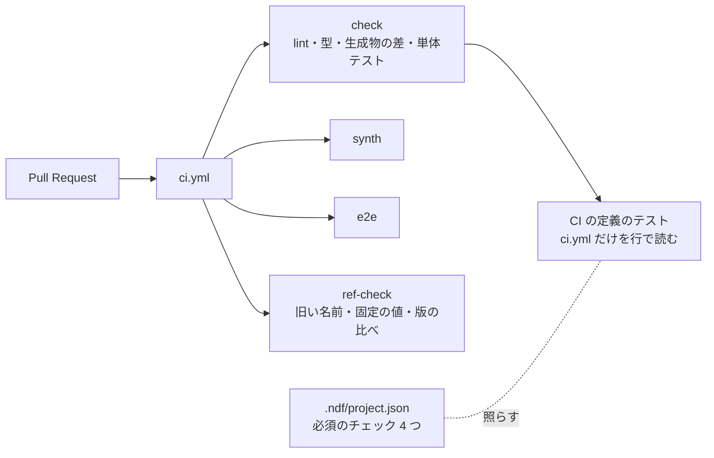
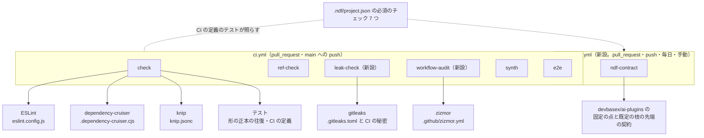

# このリポジトリの CI: 値の漏れ・設計の決まりの破れ・NDF の契約の食い違いを、既存のツールの設定で Pull Request ごとに落とす（#1）

この設計は nd-factory 自体の開発（全体の設計の入口の区別の A）の、このリポジトリ（devbasex/nd-factory）の CI を決める。利用者のプロジェクトへ検査を提供する機能ではない（B の品質の確かめは NDF が担い、nd-factory は検査を持たない）。実装を終えると、このリポジトリへの Pull Request は、実際のインフラの値か秘密を含む・横断の部品を `apps/` で直に使う・置き場の間の依存の向きに反する・使っていないコードや依存を残す・ワークフローに広すぎる権限を足す・形の正本と生成物が食い違う・固定した NDF の契約と食い違う、のどれかで必須のチェックに落ちる。守り方はほとんどが既存のツール（gitleaks・ESLint・dependency-cruiser・knip・zizmor）の設定で、自前で書くのは NDF の契約の照合と形の正本の往復のテストだけである。比べた案は「決定の記録」に、候補の調べは「外部の調査」にある。

## 今の姿

何が起きたか・目的・受け入れ条件は要求仕様（[issue-1-requirements.md](./issue-1-requirements.md)、正は #1 の本文）にある。この文書は「どう解くか」と「なぜその解き方か」だけを書く。

全体の設計は、検査で落とす決まりを [プラットフォームの検査](../docs/design/platform.md#検査)・[API と MCP の照らす検査（I14）](../docs/design/api.md#照らす検査i14)・[実行の契約の照合の定期の検査](../docs/design/execution.md#契約の照合の定期の検査) に決めている。今の CI が落とせるのは、そのうち参照の検査（旧いリポジトリの名前・NDF の固定の値の置き方・NDF の版の比べ）と、CI の定義のテスト（`ci.yml` のジョブと必須のチェックの宣言の一致・AWS の資格情報の語）だけである。

骨組みのコードは、足す検査に今も当たる。`apps/api/src/users-handler.ts`・`apps/api/src/user-store.ts` が AWS SDK を直に使い、引数なしの `new Date()` と `console.log` を使う。`apps/web/src/main.ts` が `fetch` を、`apps/web/src/users-client.ts` と `infra/lib/app-stack.ts` が `/v1/users` を直に書く。#2 が横断の部品（`packages/core`）へ移し、#4 が `PUT /v1/users` を置き換える。

## 文脈と制約

- CI は AWS の資格情報を持たない（Value 8）。足すジョブも `permissions: contents: read` だけで動く
- 実際の値と照合の語はリポジトリと CI の記録に置かない。リポジトリは公開されている（Value 7）
- 検査の置き場の `tools` が import してよいのは `packages/contracts` だけで、ほかの置き場は文字として読む（[詳細設計の依存の表](../docs/design/detail.md#クラスと関数の構造)）
- 照らす相手（操作の表・生成物・横断の部品・料金プランの値・NDF の契約の使い方）は #2・#29 が作り、まだ無い。相手が無い検査は、相手が無いことで落とさずに通り、わざと違反を入れた入力で落ちることをテストで示す（要求の前提 2）
- 作り方と部品は既存の広く使われるものを選び（Value 15）、長く保ちやすい方を選ぶ（Value 17）。nd-factory に固有の仕組みと語を検査に持ち込まない
- 落とすものの集合を変えるときは、全体の設計を同じ設計 PR の中で直す（要求の前提 1）
- `ndf_ref` を読む行に大小の比べの記号を置くと参照の検査が落ちる。この文書も追跡するファイルとして読まれる

## 解き方の全体像

守るものごとに、どのツールのどの設定で守るかを決める。

| 守るもの | 落とすもの | ツールと設定 | ジョブ |
| --- | --- | --- | --- |
| Value 7（値を置かない） | 作り物でない AWS のアカウント ID・ARN・資源の ID・端点、既知の提供者の token と私有鍵、CI の秘密に置いた実際の値（アカウント・profile・環境の名前）。今の木と履歴の両方（Pull Request の途中のコミットと、main への push で到達できるすべてのコミット） | gitleaks。既定の規則で 1 回、nd-factory の規則と作り物の値の許可を持つ `.gitleaks.toml`（既定を読まない）で 1 回探す。実際の値の規則はジョブが CI の秘密から重ねる（決定 3） | `leak-check`（新設） |
| 横断の部品を 1 か所に（プラットフォームの決定 91） | `apps/` の実行時のコードでの `Date.now`・引数なしの `new Date()`・乱数からの ID・`console`・`fetch`・AWS SDK の import・`ConditionExpression` を組む書き込み | ESLint の組み込みの規則を `eslint.config.js` で置き場ごとに（決定 1） | `check` |
| I8（使える量の判定は 1 か所） | 判定のモジュールの外での料金プランの値の import（解決したファイルで照らす）・画面での料金プランの名前の文字列 | 値の import は dependency-cruiser（決定 2）、名前の文字列は ESLint（決定 1） | `check` |
| I14（画面の操作は API と MCP にもある） | 画面と `apps/api`・`infra` での HTTP の経路の直書き。生成した呼び出しのうち画面が使わないもの。MCP の道具と人だけでない操作の食い違い・人だけの操作の読み出しの欠け・どの操作にも無い機能 | 経路の直書きは ESLint、使わない呼び出しは knip、残りは形の正本の往復のテスト（決定 8） | `check` |
| 依存の向き（全体の設計の詳細設計の依存の表）と決定 140（画面の外は React と TSX を使わない） | `packages/contracts` → `packages/core` → `apps/*` の一方向に反する依存・`apps/*` どうし・`infra` から `apps/*`・画面の外の React の import（型だけの import を含む）。画面の外の `*.tsx` | dependency-cruiser の `.dependency-cruiser.cjs`（決定 2）。`*.tsx` の置き場は ESLint（決定 1） | `check` |
| Value 13（使わないものを残さない） | 使っていないファイル・書き出し・依存 | knip の `knip.jsonc`（決定 4） | `check` |
| Value 8（CI は資格情報を持たない） | ワークフローの広すぎる権限・資格情報の持ち出し・固定していない動作の参照など。AWS の資格情報の語・必須のチェックの宣言とジョブの食い違い | zizmor の `.github/zizmor.yml` と、CI の定義のテスト（`yaml` で読む）（決定 5） | `workflow-audit`（新設）・`check` |
| Value 2・Value 4（形の正本から作る） | 型・JSON Schema・OpenAPI・MCP の道具の形の間で、見本の値の検証の結果が違う。I12（配列）・I15（UTC の日時・通貨つきの金額）の形の破れ | 自前のテスト（ajv と zod）（決定 8） | `check` |
| F23（NDF の契約の食い違いを反映の前に知る） | 固定の点の NDF の契約と、形の正本の呼び出しの判定と NDF の契約の使い方の食い違い。既定の枝の先端の食い違いは要約に並べるだけ | 自前の照合（`tools/checks/src/ndf-contract-check.ts`）（決定 6・7） | `ndf-contract`（新設。別のワークフロー） |

- 必須のチェックは 7 つ（`check`・`synth`・`e2e`・`ref-check`・`leak-check`・`workflow-audit`・`ndf-contract`）になる
- 骨組みのコードの今の当たりは、各ツールの標準の除外の書き方に課題の番号を添えて外し、直した後に除外が残るとツールが落とす（決定 9）
- 全体の設計のうち、ツールの設定で表せない 2 つ（自前の再試行のループ・入口ごとの独自の認可の判定）は検査で落とさず、ほかの守りで守る。全体の設計をこの PR で直した（決定 10）

## #2 との境目

形の正本と生成は #2 が持ち、#1 は生成物を読んで照らす側だけを持つ。#2 の詳細設計へ渡す欠け（#1 の実装の最初のタスクで #2 の本文へ追記する）:

| # | 欠け | なぜ要るか |
| --- | --- | --- |
| K2-1 | 操作の定義に機能（F1〜F20 の配列）を持たせる（全体の設計の操作の一覧の「機能」の列） | 往復のテストが「どの操作にも無い機能」を落とす |
| K2-2 | 画面が呼ぶ生成した呼び出しは、利用者向けの操作ごとに 1 つの書き出しにする。画面は `/v1/` の経路を書かず、この書き出しだけを呼ぶ。生成先は `apps/web/src/generated/` で、画面はそこを相対のパスで import する（`packages/contracts` の `exports` に載せない。入口にした書き出しを knip が既定で照らさないため）。生成した呼び出しも画面の src として ESLint の経路の直書きの規則を受けるので、経路を `/v1/...` の文字として書き出さず、K2-3 の経路の登録の書き出しを import して読む。生成した呼び出しのテストは書いてよいが、画面の入口から呼ばない書き出しはテストが import していても使われないものとして落ちる（`npm run knip` が `apps/web` を production のモードでも照らす）。画面がまだ無い操作は、操作の定義の項目（画面を作る課題の番号）で示し、生成がその書き出しに JSDoc の `@screenPending` を付ける。画面がまだ一つも無い段階や、画面から参照の無い生成したファイルでも保留中の操作だけなら通るよう、生成を置く Pull Request で `knip.jsonc` の `apps/web` の `entry` に `src/generated/**/*.ts!` を足す（生成したファイルを production の入口にし、使われないファイルとして数えない。`includeEntryExports` で書き出しは照らし続ける。生成先が空のうちは knip が当たらない入口として誤りにするので、生成先と同じ Pull Request で足す） | 画面が使わない操作を knip が使われない書き出しとして落とし（`@screenPending` は knip の標準の `tags` で外す）、表に無い操作の呼び出しは型の検査が落とす。生成先があるのに `entry` の行が無いと `knip-config.test.ts` が落ちる |
| K2-3 | 操作の表・JSON Schema・OpenAPI・MCP の道具の一覧・HTTP の経路の登録を `packages/contracts` の書き出しから読め、利用者向けの操作と機械向けの経路を分けて読める。`apps/api` の振り分けと `infra/` の API Gateway の定義と、`apps/web/src/generated/` の生成した呼び出し（K2-2）は、経路をこの登録からだけ読む | 往復のテストと ESLint の経路の直書きの規則 |
| K2-4 | 日時の項目の名前を `_at` で終え、金額は `amount_minor` と `currency` の組にする | I15 の形を名前で見分ける |
| K2-5 | 要素と結果の形に、JSON Schema に表せない制約（変換・独自の検査）を使わない | 往復のテストが食い違いとして落とす |
| K2-6 | NDF の契約の使い方のデータ（受ける組・使う口・渡す環境変数・読むファイルと項目・区間の報告から読む値と項目）と、ランナーが NDF を起こす前に通す呼び出しの判定と、区間の報告の読み取りの関数を `packages/contracts` に置く。置いた Pull Request で照合の定数 `CONTRACT_USE_REQUIRED` を真にする | F23 の照らす相手（決定 7）。真にした後は、書き出しが消えると照合が失敗する |

#29 へ渡す欠け: 料金プランの名前を形の正本の閉じた語の集まりとして、料金プランの値を `packages/contracts/data/plans.json` のデータとして置き、両方を書き出し `@nd-factory/contracts/plans`（`packages/contracts/package.json` の `exports` の `./plans` から `./src/plans.ts`）の 1 つで出し、同じ Pull Request で `eslint.config.js` の `PLAN_EXPORT_REQUIRED` を真にする（以後、名前の書き出しが読めないと lint が失敗する）。別の名前や置き場を採るときは、同じ Pull Request で `.dependency-cruiser.cjs` の `PLAN_VALUE_FILES` と `eslint.config.js` の `PLAN_EXPORT`・`tools/test/deps-config.test.ts` の作り物の木を実際の配置に合わせる。`deps-config.test.ts` は `eslint.config.js` が書き出す `PLAN_EXPORT` から `exports` の鍵を読むので、ESLint と同じ書き出しを辿る（合わせないと、名前に `plan` を含む `packages/contracts` のファイルか、その鍵の行き先が実際に読み込む値のファイルが規則の外にあることで `deps-config.test.ts` が落ちる。`PLAN_EXPORT_REQUIRED` を真にした後は、鍵が `exports` に無いことでも落ちる）。#6 へ渡す欠け: ランナーは NDF を起こす前に形の正本の呼び出しの判定を通し、区間の報告を形の正本の読み取りの関数で読み、組み立てた呼び出しが判定に通ることと拒まれた呼び出しで NDF を起こさないことをテストで示す（決定 7）。

## 決定の記録

決定の番号はこの文書の中の番号で、全体の設計の決定の番号とは別である。

### 決定 1: 横断の部品の外での直の利用・I8・経路の直書き・画面の外の TSX を、依存を足さずに今の lint で落とすため、ESLint の組み込みの規則を置き場ごとに設定する

- **質問**: 関数・グローバル・import・文字列の形で見分けられる破れを、どの道具で落とすか
- **選んだ案**: `eslint.config.js` に置き場（`files` の glob）ごとの塊を足し、組み込みの `no-restricted-properties`・`no-restricted-syntax`・`no-restricted-globals`・`no-restricted-imports`（型だけの import を許す箇所は typescript-eslint の同じ名前の規則）で落とす。対象と落とすものは詳細設計の表に置く。画面の規則は `*.ts` と `*.tsx` の両方に掛け、`apps/web` の外の `*.tsx` は 1 ファイル 1 件の誤りにする。違反を入れた文字列を ESLint の API で検査するテストで、塊ごとに落ちることを確かめる
- 採らなかった案: 構文木を自前で歩く検査（ESLint が持つ記法とファイルの選び方を作り直すことになる。Value 15）
- **代償**: 別名で受ける・変数に入れてから呼ぶ書き方は落とせない（レビューで見る）
- 作り方: ライブラリやサービスを使う
- 比べた候補: LIB5 / LIB7
- 根拠: Value 1・Value 7・Value 15（MVV バージョン 2）。決定 91・決定 140（プラットフォーム）

### 決定 2: 置き場の間の依存の向きを実際に解決したファイルで照らすため、dependency-cruiser を使う

- **質問**: 依存の向き（型だけの import を含む）と画面の外の React の import を、どの道具で落とすか
- **選んだ案**: dependency-cruiser の `.dependency-cruiser.cjs` に `forbidden` の規則を置き場ごとに書き、`check` のジョブで `npm run deps-check` として走らせる。`tsPreCompilationDeps` で型だけの import も数え、workspaces の名前（`@nd-factory/*`）も相対のパスも、解決した先のファイルの置き場で照らす
- 採らなかった案: ESLint の `no-restricted-imports` の置き場ごとの設定（import の文字列の形で照らすので、workspaces の名前と相対のパスと再書き出しの経路ごとに形を書き足すことになり、書き漏れが通る）
- 採らなかった案: eslint-plugin-boundaries（flat config と ESLint 10 への対応を一次情報で確かめられなかった。star 約 1,000 で dependency-cruiser（約 7,400）より使われている広さが小さい）
- 採らなかった案: eslint-plugin-import-x の `no-restricted-paths`（ESLint 10 に対応するが、置き場の間の規則の表し方が dependency-cruiser より限られ、依存と解決の設定が lint の側に増える）
- **代償**: 開発の依存が 1 つ増え、`check` のジョブの時間が少し延びる（このリポジトリの 97 のモジュールで数秒）
- 作り方: ライブラリやサービスを使う
- 比べた候補: LIB4 / LIB5 / LIB6 / LIB10
- 根拠: Value 11・Value 15・Value 17（MVV バージョン 2）

### 決定 3: 漏れの検査を広く使われる道具に任せるため、gitleaks を使い、規則と作り物の値の許可をリポジトリの `.gitleaks.toml` に、実際の値の規則を CI の秘密から重ねる

- **質問**: 実際の値と秘密の混入を、どの道具で、どの規則で探すか
- **選んだ案**: gitleaks の CLI を版と要約値で固定して取り、`leak-check` のジョブで、今の木（`gitleaks dir`）と履歴（`gitleaks git --log-opts`。マージのコミットの差分を含めるため `-m` を付ける。Pull Request では分岐点から head までのコミット、main への push では到達できるすべてのコミット。fork の Pull Request は秘密を受けず実際の値の規則で探せないので、通常のマージで main に入ったそのコミットを push の時に探す）を、既定の規則（`[extend] useDefault = true` だけを持つ `tools/checks/gitleaks-default.toml`）と `.gitleaks.toml` のそれぞれで探す（2 回）。設定は毎回明示する（省くと gitleaks は探す木の根の `.gitleaks.toml` を読み、既定の規則が抜ける）。`.gitleaks.toml` は既定を読まない（`useDefault` を持たない。既定の設定の全体の許可（`package-lock.json` や画像の拡張子のパス）が nd-factory の規則にも効かないように）。`.gitleaks.toml` は AWS のアカウント ID・ARN（アカウントの欄の無い S3 の ARN を含む）・資源の ID・端点の規則と、作り物の値（`123456789012`・`acme`・`example.com`・印 `EXAMPLE`・置き場所の記号）の許可を、規則ごとの `[[rules.allowlists]]` で持つ（許可は規則の秘密の部分に掛け、リージョンは秘密に含めないので `us-west-2` では外さない）（最上位の `targetRules` は `[extend] path` で読まれると効かない）。実際の値（アカウント・profile・環境の名前）は CI の秘密 `LEAK_CHECK_PATTERN`（正規表現）から、ジョブの手順が一時の設定（`.gitleaks.toml` を `[extend] path` で読み、規則を 1 つ足す）を組んで重ねる。出力は当たりの規則・ファイル・行・コミットだけにする（gitleaks の詳しい出力は、伏せた値の外の行の残りとコミットの本文を出すので使わない）。gitleaks の除外（値の行の `gitleaks:allow`・`.gitleaksignore`・前の報告）は効かなくする。すべての実行を 1 つのスクリプト（`tools/checks/leak-scan.sh`）で打ち、`--ignore-gitleaks-allow` と空の除外の置き場を渡し、引数で外せない探す木の根の `.gitleaksignore` が在れば探さずに失敗する（設計 PR #49 の承認で決めた）。正当な当たりは、当てた規則の `[[rules.allowlists]]` に理由を添えて足す（`nd-*` の規則は `.gitleaks.toml`、既定の規則は `tools/checks/gitleaks-default.toml` にその規則の id の `[[rules]]` を置く）
- 採らなかった案: 自前の正規表現の走査（既知の提供者の token の形を自分で保守することになる。Value 15）
- 採らなかった案: secretlint（Node で動くが、star 約 1,500 で gitleaks（約 31,000。GitLab の Secret Detection も内部で使う）より使われている広さが小さい）
- 採らなかった案: trufflehog（AGPL-3.0）
- 採らなかった案: 伏せ字（#2）と同じ秘密の形のデータから gitleaks の設定を生成する（前の全体の設計の「伏せ字と漏れの検査が同じものを読む」。生成の仕組みを足すことになるうえ、token の形は gitleaks の既定の規則が上流で保守されるので、こちらが堅い。伏せ字は実行の時のログの値を鍵の名前で伏せる別の役割で、形の正本のデータを読む。プラットフォームの文書をこの PR で直した）
- 採らなかった案: GitHub の secret scanning に任せる（実際の値の照合と作り物の値の許可を持たない。公開のリポジトリでは無料で走るので、重ねて使える）
- **代償**: Node の外の実行ファイルに依る。版と要約値の上げは手で行う。値の行の注と除外のファイルでは当たりを外せず、外すには当てた規則の設定（`.gitleaks.toml` か `tools/checks/gitleaks-default.toml`）の許可を足す（その変更はレビューで見る）。CI の秘密は、参照の検査の秘密と同じく、同じリポジトリの枝からの Pull Request の実行にだけ渡る（その Pull Request はワークフローを書き換えられるので、秘密を読める人は書き込みの権限を持つ人に限られる）。gitleaks の報告のファイルの名前は伏せないので、実際の値を名前に含むファイルを足すと、その名前が CI の記録に出る（ファイルの名前に環境の名前を書かない決まりは `AGENTS.md` にある）
- 作り方: ライブラリやサービスを使う
- 比べた候補: PRD1 / PRD2 / LIB1 / LIB2 / LIB3 / STD4
- 根拠: Value 7・Value 15・Value 17（MVV バージョン 2）。決定 92（プラットフォーム）

### 決定 4: 使わなくなったコード・書き出し・依存を残さないため、knip を使う

- **質問**: Value 13 の「使わなくなったコードを残さない」を、どう守るか
- **選んだ案**: knip を `check` のジョブで `npm run knip` として走らせる。設定 `knip.jsonc` はワークスペースごとの入口（Lambda の起点・画面の起点・設置のコマンド・検査の CLI・設定のファイル）だけを持ち、設定の手掛かり（使われない除外・当たらない入口）を誤りにする（`treatConfigHintsAsErrors`）。生成した画面の呼び出しの使われない書き出しも、ここで落ちる（K2-2）
- 採らなかった案: 検査を足さない（前の全体の設計。使わないコードは AI が開発を続けるほど増え、レビューでは拾いにくい）
- **代償**: 入口を誤ると、使っているものを使っていないと出す。入口は `knip.jsonc` に保つ。今の当たり（使われない開発の依存 1 件・使われない書き出し 4 件）は、検査を足す Pull Request で直すか、knip の標準の除外（`ignoreDependencies` など）に理由を添えて外す
- 作り方: ライブラリやサービスを使う
- 比べた候補: LIB11
- 根拠: Value 13・Value 15（MVV バージョン 2）

### 決定 5: ワークフローの危うい書き方を既存の点検で落とし、nd-factory の決まりだけを自前のテストで照らすため、zizmor を使い、CI の定義のテストを YAML の解析器で読む

- **質問**: ワークフローの権限・資格情報・動作の参照の誤りと、nd-factory の決まり（必須のチェックの宣言とジョブの一致・AWS の資格情報の語）を、どう照らすか
- **選んだ案**: zizmor を版と要約値で固定して取り、新しいジョブ `workflow-audit` で `.github/workflows/` をネットワークなしの点検で探す。設定は `.github/zizmor.yml`。今の CI の定義のテスト（`tools/test/ci-definition.test.ts`）は残し、`yaml` で解いてすべてのワークフローを読むように変える。照らすのは、Pull Request で起動するジョブの集合と必須のチェックの宣言の一致・AWS の資格情報の語・`permissions` を `contents: read` だけにすることである
- 採らなかった案: CI の定義のテストをやめて zizmor だけにする（zizmor は必須のチェックの宣言との一致と、AWS の資格情報を持たない決まりを照らさない）
- 採らなかった案: actionlint（ワークフローの書き誤りを見つけるが、権限と資格情報の持ち出しの点検は zizmor が持つ）
- 採らなかった案: CI の定義のテストを今の行の正規表現のまま広げる（字下げと書き方ごとに読み方を足すことになる。Value 16）
- **代償**: 実行ファイルの依存がもう 1 つ増え、必須のチェックが 1 つ増える
- 作り方: ライブラリやサービスを使う・自前で作る（CI の定義のテスト）
- 比べた候補: LIB12 / LIB14
- 根拠: Value 8・Value 15・Value 16（MVV バージョン 2）

### 決定 6: 形の正本と NDF の契約の食い違いをマージの前に知るため、NDF の契約の照合はどの起動でも固定の点と既定の枝の先端の両方を照らす

- **質問**: F23 をいつ照らすか。前の全体の設計は「毎日 1 回と `ndf-pin.json` を変える Pull Request」だが、照らす相手の形の正本（呼び出しの判定と NDF の契約の使い方）は、固定の点を変えない Pull Request でも変わる。照らしは必須のチェックにも載る
- **選んだ案**: 新しいワークフロー `.github/workflows/ndf-contract.yml` のジョブ `ndf-contract` を、`pull_request`・main への `push`・`schedule`（毎日 1 回）・`workflow_dispatch` で起動する。どの起動でも、固定の点の契約と形の正本を照らして食い違いで失敗し、既定の枝の先端の契約も照らして食い違いを要約に並べる（失敗にしない）。起動ごとの分岐を持たない。反映のパイプラインは GitHub の検査を待たないので、反映の承認で、承認する人が反映するコミットの `ndf-contract` の成功と `checked: fixed` の行を確かめる（`docs/operations/pipeline-approval.md` の 1 行）。実行の文書の「契約の照合の定期の検査」の「いつ」の行と決定 79 を、この PR で同じ形に直した
- 採らなかった案: 毎日 1 回と `ndf-pin.json` を変える Pull Request だけで照らす（前の全体の設計の結論。必須のチェックに載せると、ほかの Pull Request では照らさずに通す分岐が要り、形の正本だけを変えた Pull Request の食い違いがマージの後まで分からない）
- 採らなかった案: `on.pull_request.paths` で起動を絞る（起動しなかった Pull Request で必須のチェックが待ちのまま残る。STD1）
- 採らなかった案: 先端を固定の点を変えた Pull Request だけで照らす（知らせの回数は減るが、起動ごとの分岐が要る。先端の食い違いは失敗にしないので、毎回出ても Pull Request は止まらない）
- **代償**: すべての Pull Request の CI が devbasex/ai-plugins の取得に依る。GitHub が落ちていると失敗し、打ち直しで通る。公開のリポジトリで 60 日活動が無いと毎日の起動が止まる（STD2）
- 根拠: Value 8・Value 17・Vision（MVV バージョン 2）

### 決定 7: 契約の見本でランナーと同じ判定を照らすため、NDF の契約の照合は形の正本の判定とデータを呼び、自前の判定を持たない

- **質問**: 実行の文書の照らすこと (1)〜(5) は「ランナーの組み立て」と契約を照らす。検査（`tools`）はランナーのコードを import できない。何と照らすか
- **選んだ案**: ランナーが NDF を起こす前に通す呼び出しの判定と、NDF の契約の使い方のデータを形の正本（`packages/contracts`）に置き（K2-6）、ランナー（#6）と照合の両方がそれを使う。照合は契約の見本をその判定へ通して見本の判定と比べ、データを契約のファイルと照らす
- 採らなかった案: 照合の中に契約の判定を自前で持つ（契約を契約自身と照らすことになり、ランナーの食い違いを拾えない）
- 採らなかった案: 照合がランナーのコードを読み込む（`tools` は `packages/contracts` だけに依る決まりに反する）
- **代償**: #2 が判定とデータを置くまで（定数 `CONTRACT_USE_REQUIRED` が偽の間）、照合は 1〜6 を照らさずに `skip: no-contract-use` で通る。ランナーが判定を通すことは #6 のテストが縛る
- 作り方: 自前で作る
- 比べた候補: 無し（NDF の契約の形に固有の照らしで、調べる候補を挙げられなかった）
- 根拠: Vision・Value 8（MVV バージョン 2）

### 決定 8: 生成物の間の食い違いと I14 の表の欠けを形の正本の側で落とすため、往復のテストを 1 つ自前で書く

- **質問**: 形の往復と、I14 のうち既存のツールで表せない照らし（MCP の道具と操作の表・人だけの操作の読み出し・機能の対応）を、どう落とすか
- **選んだ案**: `tools/test/contracts-round-trip.test.ts` を 1 つ書く。操作ごとの見本と機械的な変形（見本にある項目を 1 つずつ消す・型を変える・知らない項目を足す・配列を 1 件の値にする）を、zod の形・JSON Schema・OpenAPI の要素の形（受け口 `user` の操作だけ）・MCP の道具の入力の包みと dispatch の要素の検査で検証し（JSON Schema は ajv の draft 2020-12）、通るか拒むかが違う組と、見本が通らない形を落とす。同じテストで、MCP の道具の名前と人だけでない操作の一致・人だけの操作の `mcpRead` が指す読み出しが実在し MCP の道具として公開されること・F1〜F20 がどれかの操作の機能にあること・I12 と I15 の形を照らし、合成した API Gateway の経路と HTTP の経路の登録を期限付きの除外の表を引いて比べる（設計 PR #49 の承認で足した。詳細設計の照らすこと 8）。画面と操作の対応は、生成した呼び出しの使われない書き出し（knip）と型の検査で、経路の直書きは ESLint で落とすので、このテストは持たない
- 採らなかった案: 画面と操作の対応を構文木で読む自前の検査（生成した呼び出しを操作ごとの書き出しにすれば、knip と型の検査で同じことを落とせる）
- 採らなかった案: fast-check で値を無作為に作る（zod から値を作る部品 `zod-fast-check` は最後のリリースが 2023-09 で、zod 4 と fast-check 4 を対応の範囲に持たない）
- **代償**: #2 が操作の表を置くまで、テストは作り物の表でだけ落ちることを示し、リポジトリの表は照らさない
- 作り方: ライブラリやサービスを使う・自前で作る（変形と比べ）
- 比べた候補: LIB8 / LIB9 / LIB13 / STD3
- 根拠: Value 2・Value 4・Value 15（MVV バージョン 2）

### 決定 9: 検査を入れる時点の既知の当たりを独自の一覧を持たずに外すため、各ツールの標準の除外の書き方に課題の番号を添え、使われなくなった除外をツールに落とさせる

- **質問**: 骨組みのコード（「今の姿」）が足す検査に当たる。#2 は「外で直に使うと境界の検査が落ちる」を受け入れ条件に持ち、#1 の検査を待つ。当たりをどう外すか
- **選んだ案**: 検査を先に入れ、当たる行に各ツールの標準の除外を書き、理由に課題の番号を添える。ESLint は `// eslint-disable-next-line <規則> -- #2 が横断の部品へ移す` の形で、`linterOptions.reportUnusedDisableDirectives: "error"` で使われなくなった注釈を誤りにする。dependency-cruiser と knip は設定の標準の除外の欄に理由を添え、knip は使われない除外を誤りにする。gitleaks は今の木の当たりが 0 件なので除外を置かない
- 採らなかった案: 課題の番号つきの控えのファイルを独自に持ち、自前のテストで照らす（前の設計。ツールが持つ除外の仕組みを作り直し、読み手に独自の語と仕組みを覚えさせる）
- 採らなかった案: #2 が骨組みを移すまで検査を入れない（#2 の受け入れ条件が #1 の検査を前提にし、互いに待つ）
- **代償**: 除外の注釈が骨組みのコードの中に入り、#2・#4 がコードを移すときに消す。注釈を書けば新しい違反も外せるので、除外を足す変更はレビューで見る
- 根拠: Value 12・Value 13・Value 15（MVV バージョン 2）

### 決定 10: 落とすものを道具の設定で表せる範囲に保つため、構文で見分けられない 2 つを検査から外し、ほかの守りで守る

- **質問**: プラットフォームの表の「置き場の外で直に使わないもの」のうち、自前の再試行のループと入口ごとの独自の認可の判定は、関数や import の名前で書けない。印を決めて近似で照らすか、検査から外すか
- **選んだ案**: 検査から外す。再試行は、外部の呼び出し（`fetch`・AWS SDK）を横断の部品の外で禁じる規則（決定 1）で、外部の呼び出しが必ず再試行を持つ部品を通ることで守る。認可の判定は、振り分けが操作ごとに認可の判定を通すこと（#2 の I2 のテスト）で守る。プラットフォームの文書の「設計の決まりを縛る検査」の境界の検査の行に、照らす範囲と外した 2 つの守り方を書いた
- 採らなかった案: 印を決めて近似で照らす（前の設計。繰り返しの中の外部の呼び出し・403 の数値などの近似は、当たる正当なコードと当たらない誤りの両方を生み、独自の語と規則を持ち込む）
- **代償**: 部品を通したうえで自前に繰り返す書き方と、ハンドラーの中の独自の判定は検査で落ちず、レビューで見る
- 根拠: Value 12・Value 13・Value 17（MVV バージョン 2）

## 影響と危険

- **働く範囲**: このリポジトリの CI だけ（A）。利用者のプロジェクト（B）にも、自分で設置する人の環境にも何も足さない
- **プロジェクトごとに違うもの**: 実際の値の正規表現は CI の秘密 `LEAK_CHECK_PATTERN` で受け、リポジトリに置かない。fork は秘密を持たないので、`.gitleaks.toml` の規則だけで探す
- **当たるモード**: `standard` の CI の必須のチェック
- **必須のチェックが増える**: 宣言（`.ndf/project.json`）と GitHub の main の保護の必須のチェックの両方に `leak-check`・`workflow-audit`・`ndf-contract` を足す。食い違うとマージが待ちのまま残るか、足した検査が必須にならない
- **同じファイルを触る別の変更**: #2 は `packages/contracts/` と骨組みのコード（除外の注釈を消す）を触る。#13 は `infra/` を触り、`infra/lib/app-stack.ts` の経路の直書きに除外の注釈が入る
- **照らす相手が無い間**: 往復のテスト・I8 の規則（#29 の書き出し）・NDF の契約の照合の 1〜5（#2 の書き出し）は、相手が無い間はリポジトリを照らさずに通る。#2・#29 の Pull Request の CI で、相手を読んだことを出力で確かめる（詳細設計の各節）
- **外部の取得**: `leak-check`・`workflow-audit` は GitHub の配布から実行ファイルを、`ndf-contract` は devbasex/ai-plugins を、資格情報なしで取る。GitHub が落ちていると失敗し、打ち直しで通る

### このリポジトリだけの事情

| 値 | 置く所 | 持つ Issue |
| --- | --- | --- |
| 実際の値の正規表現 | CI の秘密 `LEAK_CHECK_PATTERN` と、必須にするかの変数 `LEAK_CHECK_REQUIRE_PATTERN` | #1（登録は持ち主） |
| gitleaks と zizmor の版と要約値 | `ci.yml` の各ジョブの環境変数 | #1 |
| NDF のリポジトリの URL と契約の置き場 | `tools/checks/src/ndf-contract-check.ts` の出所つきの定数 | #1 |

## テスト設計

| 受け入れ条件・決定 | どの振る舞いで縛るか | どう壊したら落ちるべきか |
| --- | --- | --- |
| 受け入れ条件 1・2・3（漏れ） | 実行の時に生成した架空の値（許可の値に合わず検出の規則に合う 12 桁・ARN・端点・token と、実際の値の規則に合う語。実在の値と有効な token は使わない）を含むファイルを `docs/` の下に置いた一時の木を、`.gitleaks.toml` と重ねた設定で gitleaks に探させると当たり、報告と標準出力に値が現れない（1 つの行に別の規則の値を並べても、行の残りとコミットの本文が現れない）。隣り合う 12 桁を 1 文字の区切りで並べるとそれぞれ当たり、文書の区切り（`<…>`・`{…}`）に接した実際の名前は置き場所の記号として許されない。作り物の値だけのファイルでは当たらない。作り物の値は重ねた設定でも当たらない。途中のコミットで足して消した値と、マージのコミットの競合の解消でだけ足して後で消した値が履歴の探しで当たる。根に `.gitleaks.toml` が在っても既定の規則の設定で架空の token が当たる。今の木と履歴の探しのそれぞれで、値の行に `gitleaks:allow` だけを付けた値は対象の規則の当たりとして報告され、根に `.gitleaksignore` を置いた木は探さずに名前を示して失敗する（別のケース） | 規則か許可を外す・許可を `targetRules` に移す・`--redact` を外す・`--verbose` を足す・境界で区切りを消費する・記号の 1 文字で許す・履歴を探さない・`-m` を外す・既定の規則の設定を省く・`--ignore-gitleaks-allow` を外す・根の `.gitleaksignore` の照らしを外すと落ちる |
| 受け入れ条件 1・6（横断の部品の外での直の利用） | 規則ごとに、違反を入れた文字列を `apps/` の置き場のパスで ESLint にかけると誤りが出て、`packages/core`・`infra/`・`tools/`・テストのパスでは出ない | 置き場の glob を外す・規則を消すと落ちる |
| 受け入れ条件 1・4（I8） | 判定のモジュールの外で料金プランの値の書き出しを import する・画面で料金プランの名前の文字列を使うと誤りが出る | 判定のモジュールも対象にする・画面の規則を外すと落ちる |
| 受け入れ条件 1・5（I14） | 画面・`apps/api`・`infra` に `/v1/` の文字列を書くと ESLint の誤り、生成した呼び出しを画面が使わないと knip の当たり、表の MCP の道具・人だけの操作の読み出し・機能の欠けを足した作り物の表で往復のテストが落ちる。合成した経路と経路の登録が除外の表を引いて食い違う作り物の組と、除外の行が要らなくなった組でも落ちる | どれかの照らしを外すと落ちる |
| 受け入れ条件 1・7（依存の向き） | 一時の木に `packages/core` から `apps/*`・`apps/*` どうし・`infra` から `apps/*`・画面の外から `react` の import（型だけを含む）を置くと dependency-cruiser が誤りを出す。`apps/web` の外の `*.tsx` で ESLint の誤りが出る | 置き場の規則を 1 つ外す・型だけの import を数えなくすると落ちる |
| 受け入れ条件 1（形の往復） | 4 つの形のうち 1 つだけ必須の項目を外した作り物の操作で食い違いが返り、4 つがそろって見本を拒む操作で見本が拒まれたことが返る | 変形を作らない・見本が通ることを確かめないと落ちる |
| 受け入れ条件 1・9（F23） | 固定の点の見本 1 件の判定を食い違わせた契約で終了コード 1、先端だけで食い違わせると終了コード 0 で要約に見本の id と契約のファイルのパスが並ぶ。どの起動でも固定の点を照らす | 先端の食い違いで失敗にする・Pull Request で照らさないと落ちる |
| 受け入れ条件 8 | 照合の語を含むファイルで参照の検査が当たる（今の `tools/test/ref-check.test.ts`）。足すワークフローに NDF の版を読む式と比べを同じ行に置くと当たる | 参照の検査がワークフローを読まなくなると落ちる |
| 受け入れ条件 10 | ジョブを宣言とワークフローの片方にだけ足す・どれかのワークフローに AWS の資格情報の語を足す・`permissions` に `contents: read` 以外を足すと CI の定義のテストが落ちる | `ci.yml` だけを読むと落ちる |
| 受け入れ条件 12（knip） | 使われない書き出し・依存・ファイルを足した一時の木で knip が当たる。使われない除外を設定に置くと誤りになる | 設定の手掛かりを誤りにしないと落ちる |
| 受け入れ条件 13（zizmor） | ジョブの `permissions` に書き込みを足す・`persist-credentials: false` を外す・動作を枝の名前で参照したワークフローを一時の木に置くと zizmor が当たる | 対象を `ci.yml` だけにすると落ちる |
| 受け入れ条件 14・決定 9 | 除外の注釈を残したまま違反を直すと ESLint が使われない注釈の誤りを出す | `reportUnusedDisableDirectives` を外すと落ちる |
| 受け入れ条件 11 | 詳細設計が、全体の設計の置き場・依存の向き・落とすものを引いて書かれ、変えたものは全体の設計を同じ PR で直している（cross-review が読む） | 全体の設計と食い違う書き方が残ると cross-review が落とす |

詳細設計は [issue-1-design-detail.md](./issue-1-design-detail.md) にある（新設する関数が 2 つ以上あるため）。

## 設計の結果

| 課題 | 扱い | 統合先 | 触るファイル |
| --- | --- | --- | --- |
| #1 | 実装する | — | `eslint.config.js`、`.dependency-cruiser.cjs`（新設）、`.gitleaks.toml`（新設）、`knip.jsonc`（新設）、`.github/zizmor.yml`（新設）、`.github/workflows/ci.yml`、`.github/workflows/ndf-contract.yml`（新設）、`tools/checks/src/ndf-contract-check.ts`（新設）、`tools/checks/leak-scan.sh`（新設）、`tools/test/ndf-contract-check.test.ts`（新設）、`tools/test/contracts-round-trip.test.ts`（新設）、`tools/test/lint-config.test.ts`（新設）、`tools/test/deps-config.test.ts`（新設）、`tools/test/knip-config.test.ts`（新設）、`tools/test/leak-scan.integration.test.ts`（新設）、`tools/test/workflow-audit.integration.test.ts`（新設）、`tools/test/ci-definition.test.ts`、`tools/test/ref-check.test.ts`、`apps/api/src/users-handler.ts`、`apps/api/src/user-store.ts`、`apps/web/src/main.ts`、`apps/web/src/users-client.ts`、`infra/lib/app-stack.ts`、`tools/package.json`、`tools/tsconfig.json`、`package.json`、`package-lock.json`、`vitest.config.ts`、`.ndf/project.json`、`AGENTS.md` |

## 人へ残す判断

C1 と C7 は、NDF の共通原則が「AI が自分で進めずに必ず人の承認を求める操作」として定めるレッドラインである。

| 判断 | 当たるレッドライン | なぜ当たるか |
| --- | --- | --- |
| CI の秘密 `LEAK_CHECK_PATTERN` に実際の値の正規表現を登録し、変数 `LEAK_CHECK_REQUIRE_PATTERN` を `1` にする（実装のマージの後に持ち主が GitHub の設定で行う） | C1 | 運用する環境の実際の値という秘密に触れる |
| `.ndf/project.json` の必須のチェックに 3 つを足し、`AGENTS.md` の「秘密とインフラの値を置かない」に `LEAK_CHECK_PATTERN` の行を足す | C7 | 利用者の設定と指示書を書き換える。実装の中でコミットし、承認ゲートで人が見る |

## 未確認のまま残ること

| 項目 | 内容 |
| --- | --- |
| zizmor の今のワークフローの当たり | 実装（2026-11-21）で `leak-check`・`workflow-audit` を足した `ci.yml` に v1.32.0 を `--offline --config .github/zizmor.yml` で打ち、当たり 0 件（既定の `regular` の見方。`auditor` の見方で抑える 8 件は、ジョブの名前の無い `anonymous-definition` 6 件と、専用の環境の外で秘密を読む `secrets-outside-env` 2 件（`ref-check`・`leak-check`）） |
| dependency-cruiser の今のリポジトリの当たり | 規則を全部書いた設定での当たり。実装の Pull Request で分かる（試しの規則では 0 件） |
| GitHub の main の保護の必須のチェックの今の値 | 宣言の 4 つと一致しているか。実装の Pull Request の前に持ち主の設定で分かる |
| 上流の `ask-journal` の `fields` | #41 の決定 106 の依頼の答えで分かる。足されたら NDF の契約の照合の (4) が読む項目に入る |

## 外部の調査

| 種類 | 調べるか | 理由 |
| --- | --- | --- |
| 標準・仕様 | 調べる | 必須のチェックと起動の条件の扱い（GitHub Actions）・JSON Schema の版・AWS の ARN の形が、検査の作りを縛る |
| 主要な製品 | 調べる | 秘密の走査は GitHub と GitLab が製品として持つ |
| ライブラリとサービス | 調べる | 秘密の走査・依存の向き・JSON Schema の検証・値の生成・YAML の解析・ワークフローの点検・使っていないコードの検出に既存の道具がある（MVV 版 2 の Value 15） |

### 標準・仕様

| # | 標準・仕様 | 何を定めているか | 設計への反映 | 出典 |
| --- | --- | --- | --- | --- |
| STD1 | GitHub Actions の必須のステータスチェック | パスや枝の絞り込みでワークフローが起動しないと、必須のチェックは待ちのまま残りマージを止める。ジョブの `if` で飛ばしたジョブは成功と報告される | 決定 6（パスで絞らず、ジョブの中で照らすかを決める） | https://docs.github.com/en/pull-requests/collaborating-with-pull-requests/collaborating-on-repositories-with-code-quality-features/troubleshooting-required-status-checks（2026-11-21） |
| STD2 | GitHub Actions の `schedule` と `workflow_dispatch` | `schedule` は既定の枝の最新のコミットで走り、公開のリポジトリで 60 日活動が無いと止まる。`workflow_dispatch` で手で起こせる | 決定 6（`schedule` で毎日、`workflow_dispatch` で手動の起動をする） | https://docs.github.com/en/actions/writing-workflows/choosing-when-your-workflow-runs/events-that-trigger-workflows（2026-11-21） |
| STD3 | JSON Schema draft 2020-12 と zod v4 の `z.toJSONSchema` | zod v4 の書き出しの既定の版は draft 2020-12。ajv はこの版に別のクラスを使う | 決定 8 | https://zod.dev/json-schema・https://ajv.js.org/json-schema.html（2026-11-21） |
| STD4 | AWS の ARN | 形は `arn:partition:service:region:account-id:resource`。パーティションは `aws`・`aws-cn`・`aws-us-gov`。資源によりリージョンとアカウントを省く。ARN そのものは秘密でないと明記 | 決定 3（ARN の形と、秘密でなくても実際の値として探す理由） | https://docs.aws.amazon.com/IAM/latest/UserGuide/reference-arns.html（2026-11-21） |
| STD5 | GitHub Actions の `permissions` と秘密の伏せ字 | `permissions` で 1 つでも指定すると、ほかは `none` になる。`::add-mask::` で値をログで伏せる | 足すワークフローは `contents: read` だけにする。検査は値を出さないので伏せ字に頼らない | https://docs.github.com/en/actions/writing-workflows/workflow-syntax-for-github-actions・https://docs.github.com/en/actions/security-for-github-actions/security-guides/using-secrets-in-github-actions（2026-11-21） |

### 主要な製品

| # | 製品 | どう解いているか | 設計への反映 | 出典 |
| --- | --- | --- | --- | --- |
| PRD1 | GitHub の secret scanning と push protection | 公開のリポジトリで無料で自動に走り、既知の提供者の token と汎用の形を探す。独自の形はリポジトリの Secret Protection を前提にする | 決定 3（重ねて使えるが、実際の値の照合と作り物の値の外しを持たない） | https://docs.github.com/en/code-security/secret-scanning/introduction/about-secret-scanning・https://docs.github.com/en/code-security/secret-scanning/introduction/about-push-protection（2026-11-21） |
| PRD2 | GitLab の Secret Detection | push の時・パイプライン・課題の本文の 3 か所で探す。パイプラインは gitleaks の規則（GitLab が保守する TOML）を使う | 決定 3（規則を gitleaks の設定に持つ形） | https://docs.gitlab.com/user/application_security/secret_detection/pipeline/（2026-11-21） |

### ライブラリとサービス

| # | 候補 | バージョン | ライセンス | 最後のリリースの日付 | 終了のアナウンス | 要件を満たすか | 出典 |
| --- | --- | --- | --- | --- | --- | --- | --- |
| LIB1 | gitleaks（CLI）と gitleaks-action | v8.30.1・v3.0.0 | MIT・登録の判定なし | 2026-03-21・2026-05-30（リポジトリへの push は 2026-10-28） | 無し | 満たす（CLI）。採る（決定 3）。star 31,228。今の木（`dir`）と履歴の範囲（`git --log-opts`）を探せる。`--redact` で標準出力と報告の秘密を伏せる。リポジトリの `.gitleaks.toml` に独自の規則と許可を書け、`[extend] useDefault = true` で既定の規則を残し、`[extend] path` で別の設定を重ねられる。配布の資産がある。Action は組織のリポジトリで鍵の登録が要る | `gh api repos/gitleaks/gitleaks`・README（2026-11-21）。配布の v8.30.1 を要約値で確かめて取り、許可と `--redact=100` で一時の木を探して報告に値が現れないこと、このリポジトリの今の木を既定の規則で探して当たりが 0 件であることを確かめた（2026-11-21） |
| LIB2 | trufflehog | v3.100.0 | AGPL-3.0 | 2026-11-19 | 無し | 形の置き場は LIB1 と同じ問題を持つ | `gh api repos/trufflesecurity/trufflehog/releases/latest`（2026-11-21） |
| LIB3 | secretlint | 14.0.1 | MIT | 2026-11-16（登録簿の更新） | 無し | 満たす。Node で動き、独自の正規表現の規則と出力の伏せ字を持つ。star 1,503 で LIB1 より使われている広さが小さい | `npm view secretlint`・`gh api repos/secretlint/secretlint`（2026-11-21） |
| LIB4 | dependency-cruiser | 18.8.0 | MIT | 2026-11-16（登録簿の更新。push は 2026-11-18） | 無し | 満たす。採る（決定 2）。star 7,448。置き場ごとの禁じる依存を `forbidden` の規則（`from`・`to` の `path`・`pathNot`）で書き、実際に解決したファイルの間の依存を照らす。`tsPreCompilationDeps` で型だけの import も依存として数える。`engines.node` は `^22\|\|^24\|\|>=26` | `npm view dependency-cruiser`・`gh api repos/sverweij/dependency-cruiser`（2026-11-21）。作業ディレクトリに 18.8.0 と typescript 6.0.3 を入れ、このリポジトリで `apps/web` から `apps/api` への型だけの import を足したファイルを照らして、規則の誤りが 1 件出ることを確かめた（2026-11-21） |
| LIB5 | ESLint の組み込みの規則（`no-restricted-imports`・`no-restricted-syntax`・`no-restricted-globals`・`no-restricted-properties`）と `linterOptions.reportUnusedDisableDirectives` | 10.15.0（このリポジトリが既に使う） | MIT | 2026-11-16（登録簿の更新） | 無し | 満たす。採る（決定 1）。グローバルの名前・オブジェクトの性質・構文の形・import の先を、設定の `files` ごとに落とせる。使われなくなった `eslint-disable` の注釈を誤りにできる | https://eslint.org/docs/latest/rules/no-restricted-imports・https://eslint.org/docs/latest/rules/no-restricted-syntax・https://eslint.org/docs/latest/rules/no-restricted-globals（2026-11-21）、`node_modules/eslint/lib/rules/no-restricted-properties.js`・`node_modules/eslint/lib/config/flat-config-schema.js`（2026-11-21） |
| LIB6 | eslint-plugin-boundaries | 7.4.4 | MIT | 2026-11-15 | 無し | 置き場ごとの import を `boundaries/dependencies` で縛れる（star 1,024）。`peerDependencies` は `eslint >=6.0.0` で、flat config と ESLint 10 への対応を書いた文は README に見つからなかった | https://registry.npmjs.org/eslint-plugin-boundaries・`gh api repos/javierbrea/eslint-plugin-boundaries`（2026-11-21） |
| LIB7 | typescript-eslint の `no-restricted-imports` | 8.73.0（このリポジトリが既に使う） | MIT | — | 無し | ESLint の規則に `allowTypeImports` を足す | 根の `package.json` の `typescript-eslint`（2026-11-21） |
| LIB8 | ajv | 8.20.0 | MIT | 2026-04-24（登録簿の更新） | 無し | draft 2020-12 を別のクラスで検証できる。書式（`date-time`）は書式の拡張が要る | `npm view ajv version time.modified license deprecated`・https://ajv.js.org/json-schema.html（2026-11-21） |
| LIB9 | zod | 4.6.7 | MIT | 2026-10-12（登録簿の更新） | 無し | 形の正本の正。`z.toJSONSchema` が draft 2020-12 を出す。変換などは既定で書き出せず例外にする | `npm view zod version time.modified license deprecated`・https://zod.dev/json-schema（2026-11-21） |
| LIB10 | eslint-plugin-import-x（`no-restricted-paths`） | 4.18.1 | MIT | 2026-11-09 | 無し | ESLint `^10.0.0` と flat config を対応の範囲に持つ（star 786）。置き場の間の禁止は LIB5 の置き場ごとの設定でも書ける | https://registry.npmjs.org/eslint-plugin-import-x（2026-11-21） |
| LIB11 | knip | 6.47.0 | ISC | 2026-11-20 | 無し | 満たす。採る（決定 4）。使っていないファイル・書き出し・依存を見つける（star 12,699）。npm のワークスペースを設定なしで扱う。設定の手掛かり（使われない除外など）を誤りにできる（`treatConfigHintsAsErrors`） | https://registry.npmjs.org/knip・`gh api repos/webpro-nl/knip`・knip の文書（2026-11-21）。作業ディレクトリに 6.47.0 を入れ、このリポジトリを設定なしで照らして、使われない開発の依存 1 件と使われない書き出し 4 件が出ることを確かめた（2026-11-21） |
| LIB12 | yaml（eemeli/yaml） | 2.9.1 | ISC | 2026-09-11 | 無し | 満たす。採る（決定 5）。YAML 1.2 で読み、今の `ci.yml` の `on`・`jobs`・`permissions` を鍵の名前のまま取れた。`SECURITY.md` がある | https://registry.npmjs.org/yaml・`gh api repos/eemeli/yaml`（2026-11-21）。作業ディレクトリに 2.9.1 を入れて `ci.yml` を解いた（2026-11-21） |
| LIB13 | fast-check と zod-fast-check | 4.10.3・0.10.1 | MIT・MIT | 2026-11-18・2023-09-13 | 無し | fast-check は保守が活発（star 5,296）。zod から値を作る zod-fast-check は `peerDependencies` が `fast-check <4.0.0`・`zod ^3.18.0` で、今の fast-check 4 と zod 4 を範囲に持たない | https://registry.npmjs.org/fast-check・https://registry.npmjs.org/zod-fast-check・`gh api repos/dubzzz/fast-check`（2026-11-21） |
| LIB14 | actionlint・zizmor | v1.7.12・v1.32.0 | MIT・MIT | 2026-03-30・2026-11-02 | 無し | zizmor を採る（決定 5）。zizmor はワークフローの静的な点検で、広すぎる権限（`excessive-permissions`）・資格情報の持ち出し（`artipacked`）・固定していない動作の参照（`unpinned-uses`）・テンプレートの注入などの点検を持ち、点検ごとにネットワークなしで動くかが文書にある（採る理由の 3 つの点検が `--offline` で動くことを、実装で v1.32.0 を打って確かめた。「確かめられなかったこと」の zizmor の行）。配布の資産に linux の実行ファイルがある（star 7,102）。actionlint（star 4,421）は採らない。どちらも必須のチェックの宣言とジョブの集合の一致は持たない | `gh api repos/rhysd/actionlint`・`gh api repos/zizmorcore/zizmor`・zizmor の README と `docs/audits.md`・`gh api repos/zizmorcore/zizmor/releases/latest`（2026-11-21） |

### 確かめられなかったこと

| 対象 | 試した手段 | 結果と理由 |
| --- | --- | --- |
| trufflehog の許可の一覧と出力の伏せ字の設定 | 試していない | 上限。trufflehog は AGPL-3.0 の理由で退けたので、この結果に依らない |
| npm の週のダウンロード数（secretlint・eslint-plugin-boundaries・eslint-plugin-import-x・dependency-cruiser・knip・yaml・fast-check） | `https://api.npmjs.org/downloads/point/last-week/<名前>` | 取得の制限（`error code: 1015`）で拒まれた。使われている広さは GitHub の star 数で比べた |
| eslint-plugin-import-x の `no-restricted-paths` の仕様 | 試していない | 上限。採らないので、この結果に依らない。dependency-cruiser の型だけの import の扱いは実物で確かめた（LIB4） |
| zizmor の `--offline` で効く点検・明示した `--config` で自動の探索が止まるか・行の中の例外の注釈 | zizmor の README と `docs/audits.md` を読んだ。実装（2026-11-21）で v1.32.0 を一時の木に打った（`-v` の予定の出力と、壊したワークフロー） | 確かめた。`--offline` で `excessive-permissions`・`artipacked`・`unpinned-uses` は動き、外れるのは GitHub の API の token を要する 5 つ（`impostor-commit`・`ref-confusion`・`known-vulnerable-actions`・`stale-action-refs`・`ref-version-mismatch`）だけで、決定 5 は変えない。`excessive-permissions` は `write-all` と、2 つ以上のジョブに掛かるワークフロー全体の書き込みの権限に当たり、1 つのジョブの `contents: write` のような絞った書き込みには当たらない（それは CI の定義のテストが落とす）。`unpinned-uses` は既定ですべての動作を SHA での固定に限り、`.github/zizmor.yml` にも明示した。`--config` を渡すと `.github/zizmor.yml` の自動の探索は止まる。行の中の `# zizmor: ignore[<点検>]` は効き、`--no-ignores` で効かなくできる（ジョブは `--no-ignores` を付け、gitleaks の `gitleaks:allow` と揃える）。`workflow-audit.integration.test.ts` が `ci.yml` の点検の手順の引数で縛る |
| knip の入口のファイルの書き出しの扱い（`includeEntryExports`） | knip の文書の「Configuring Project Files」（https://knip.dev/guides/configuring-project-files）を cross-review の指摘（2026-11-21）が出典に挙げた。この設計の中では取得していない | 生成した画面の呼び出しを入口でないファイルに置けば効く。実装の最初のタスクで確かめ、受け入れ条件 12 のテストで縛る |
| zizmor の配布の資産の要約値のファイル | `gh api repos/zizmorcore/zizmor/releases/latest` の資産の一覧。実装（2026-11-21）で v1.32.0 の資産を取った | 一覧に要約値のファイルは無い（資産ごとの `digest` の欄はある）。`zizmor-x86_64-unknown-linux-gnu.tar.gz` を取って `sha256sum` で求めた値（`bb110cc7…957b`）を `ci.yml` の `ZIZMOR_SHA256` に固定し、資産の一覧の `digest` と一致することを確かめた（ジョブは配布元の値と比べない） |
| `gitleaks dir` が git の追跡しているファイルだけに絞るか | README | 書かれていない。`leak-check` のジョブは依存を入れる前（取得の直後）に探すので、追跡していないファイルは木に無い |
| 形の正本の往復と NDF の契約の照合をする既存の道具 | 試していない | nd-factory の操作の表と NDF の契約の形に固有の照らしで、調べる候補を挙げられなかった。道具が無いとは確かめていない |
| eslint-plugin-boundaries の ESLint 10 での動作 | `npm view eslint-plugin-boundaries peerDependencies`（`eslint >=6.0.0`） | 範囲の宣言だけで、実際の動作は確かめていない（上限） |
| 公開のリポジトリでの GitHub の独自の形と push protection の費用 | secret scanning・push protection・独自の形の 3 つの頁 | どの頁も公開のリポジトリの費用を書いていない。無料かは確かめていない |
| `ajv/dist/2020` の読み込みの経路 | ajv の JSON Schema の頁 | 取得した範囲にコードの例が無い。実装の最初のタスクで読み込んで確かめる |

調べた量: 候補 23 件・取得の試み 80 回（初めの調べで 32 回、MVV 版 2 の Value 15 の見直しで 42 回、組み直しで 6 回）。種類ごとの候補の上限（6 件）を、ライブラリとサービスで超えた。Value 15 の見直しで、自前で作る部分ごとに比べる候補を足したためである。
