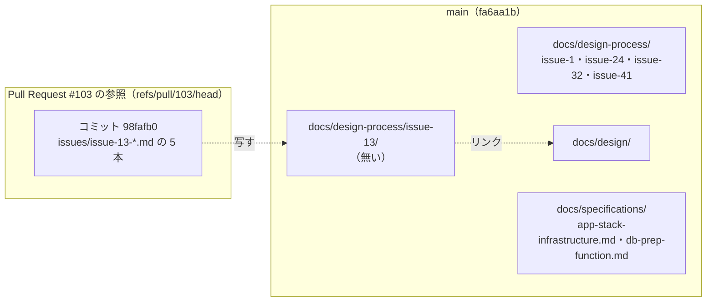
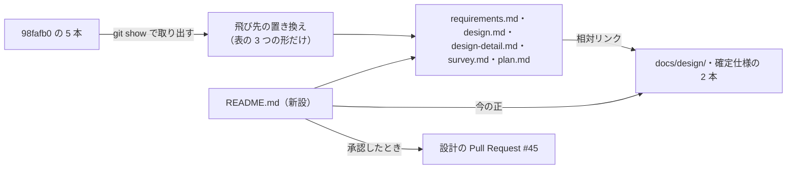

# 設計の経緯: インフラの課題（#13）の設計の記録を、ほかの課題と同じ置き場で main から読める（#104）

インフラの課題（#13）の設計の記録（要求のコピー・設計書・詳細設計書・外部の調査・実装計画）は、削除したスプリントのブランチのコミットにだけあり、main から読めない（要求は [issue-104-requirements.md](./issue-104-requirements.md)）。実装を終えて確定仕様にする直前のコミット `98fafb0` の 5 本を `docs/design-process/issue-13/` へ写し、ほかの課題と同じ形の README を足す。写した 5 本は、リンクの飛び先だけを機械的な置き換えで移した先に合わせる。採らなかった案は「決定の記録」に、外部の調査を省いた理由は末尾の「外部の調査」にある。

## 今の姿

何が起きたか・目的・受け入れ条件は要求仕様（[issue-104-requirements.md](./issue-104-requirements.md)、正は [#104](https://github.com/devbasex/nd-factory/issues/104) の本文）にある。この文書は「どう解くか」と「なぜその解き方か」だけを書く。

図の点線が、この変更で足す位置である。設計に要る今の構造は次のとおりである。

- 写す元の 5 本は、`git fetch origin refs/pull/103/head` で取れるコミット `98fafb0` にある（2026-11-24 に取得した）

  | 元（`98fafb0`） | 行数 | 相対リンクを含む行 |
  | --- | --- | --- |
  | `issues/issue-13-requirements.md` | 201 | 0（リンクはどれも `https://` で始まる） |
  | `issues/issue-13-design.md` | 501 | 有る |
  | `issues/issue-13-design-detail.md` | 420 | 有る |
  | `issues/issue-13-design-survey.md` | 49 | 有る |
  | `issues/issue-13-plan.md` | 69 | 有る |

- 5 本の相対リンクの飛び先は、次の 3 つの形だけである（`git show 98fafb0:<元> | grep -o '\]([^)]*)' | grep -v '](http'` で 5 本を読んだ結果）
  - `../docs/design/<名前>.md`（`api.md`・`data.md`・`detail.md`・`platform.md`）
  - `../docs/operations/settings.md`
  - `./issue-13-<名前>.md`（`design.md`・`design-detail.md`・`design-survey.md`・`requirements.md`）
- 飛び先のファイルは、どれも今の main に在る
  - `docs/design/api.md`・`data.md`・`detail.md`・`platform.md`
  - `docs/operations/settings.md`
- ほかの課題の記録のリンクは、次の形で指す（`docs/design-process/issue-1/` と `issue-32/` のリンクを数えた結果）
  - 同じ記録の中のファイル: `design.md` のように名前だけ
  - 全体の設計: `../../design/<名前>.md`
- README の形の手本は [docs/design-process/issue-1/README.md](../docs/design-process/issue-1/README.md) である。何の記録か・今の正の保存先・文書の一覧・移した後に直したこと・関わる Pull Request を持つ

## 文脈と制約

- 記録の中身は書き換えない。違ってよい行は、リンクを含む行だけである（受け入れ条件 2）
- 見出しへの飛び先（`#…`）は記録の時点のものとして残し、今の見出しに合わせない（要求の「含まない」）
- 用語集で使わないと決めた語の言い換えはしない。`docs/design-process/` は禁止語の検査から外してある（`.ndf/glossary.json` の `check.banned.exclude`）
- 変更は `docs/design-process/issue-13/` の 6 本だけにし、`docs/design/` と `docs/specifications/` を変えない（受け入れ条件 8）
- 記録は公開のリポジトリに載る。写す 5 本は Pull Request #103 の漏れの検査（`leak-check`）を通った文書である。それでも、写した後に `leak-check` と参照の検査（`ref-check`）を通す（受け入れ条件 7）

## 解き方の全体像

- `docs/design-process/issue-13/` に、写した 5 本と README の 6 本が並ぶ
- 写した 5 本は、元と比べてリンクの飛び先の文字だけが違う。移した先から、全体の設計のファイルと、同じ記録の中のほかのファイルを開ける
- README は次のことを書く
  - 記録の時点（`98fafb0`）と、承認したときのものが設計の Pull Request #45 にあること
  - 記録を後から追わない（記録の時点のまま残し、今の設計に合わせて直さない）ことと、今の正の保存先と食い違えば正の側が勝つこと
  - 5 本の中身と、関わる Pull Request
- #13 の判断を引き継ぐ課題（接続する実測の [#44](https://github.com/devbasex/nd-factory/issues/44)、ランナーの [#6](https://github.com/devbasex/nd-factory/issues/6)）の設計を書く人が、ほかの課題と同じ置き場で経緯を読める

## 決定の記録

### 決定 1: 中身を変えないことを差分で示せるよう、リンクの飛び先だけを決まった表で置き換える

- **質問**: 写した 5 本のリンクを、どの範囲でどう直すか
- **選んだ案**: Markdown のリンクの `](…)` の中の飛び先だけを、次の表の前方一致で置き換える。リンクの文字（`[…]` の中）・`#` から後ろの見出しへの飛び先・`https://` で始まる飛び先は変えない

  | 置き換える前の飛び先の頭 | 置き換えた後 |
  | --- | --- |
  | `../docs/design/` | `../../design/` |
  | `../docs/operations/` | `../../operations/` |
  | `./issue-13-requirements.md` | `requirements.md` |
  | `./issue-13-design.md` | `design.md` |
  | `./issue-13-design-detail.md` | `design-detail.md` |
  | `./issue-13-design-survey.md` | `survey.md` |
  | `./issue-13-plan.md` | `plan.md` |

- 採らなかった案: リンクの文字も新しいファイルの名前に合わせる（リンクの文字は本文の一部で、記録の中身を変えることになる。元の名前と新しい名前の対応は README の文書の一覧に書く）
- 採らなかった案: 飛び先を GitHub の絶対の URL にする（ブランチの名前に縛られ、ほかの課題の記録の相対リンクの形とそろわない）
- 採らなかった案: 手で 1 本ずつ直す（直し漏れとリンク以外の文字の書き換えを、差分を読むまで見つけられない）
- **代償**: リンクの文字に元のファイルの名前（`issue-13-design-detail.md` など）が残り、文字と飛び先の名前が食い違うリンクがある
- 根拠: Value 10「同じ事実を 2 か所に持たない。履歴を残す事実は追記だけで持ち」（MVV バージョン 3）

### 決定 2: ほかの課題の記録と同じ読み方にするため、README を #1 の記録の README と同じ並びで書く

- **質問**: README の並びと中身を、どの記録の README に合わせるか
- **選んだ案**: [docs/design-process/issue-1/README.md](../docs/design-process/issue-1/README.md) と同じ並びにする。並びは、H1・何の記録かと今の正の段落・文書の一覧の表・移した後に直したことの段落・関わる Pull Request の表である。今の正の段落には、記録の時点が `98fafb0`（実装を終えて確定仕様にする直前）であることと、承認したときのものが設計の Pull Request #45 にあることを足す。移した後に直したことの段落には、リンクの飛び先を決定 1 の表で置き換えたことと、`issue-13-design-survey.md` を `survey.md` にしたように、ファイルの名前から `issue-13-` などを外したことだけを書く。中身の文は直していないことも書く。関わる Pull Request の表は、設計の #45、実装の単位の 8 本（#70・#72・#74・#77・#81・#83・#90・#97）、main へ取り込んだ #103 の 10 行にする
- 採らなかった案: 起票の本文が挙げた #41 の記録の README に合わせる（#41 の記録は実装計画を持たず、写す 5 本の一覧の形にならない。#1 の記録は実装計画を含み、同じ 5 本の形である）
- 採らなかった案: README に、承認したとき（`166b2f2`）から `98fafb0` までに直した点の一覧を書く（記録の中身を README へ写すことになり、同じ事実を 2 か所に持つ。差分は `git diff 166b2f2 98fafb0` と Pull Request #45 で読める）
- **代償**: #41 の記録の README とは並びが少し違う
- 根拠: Value 10「同じ事実を 2 か所に持たない」・Value 13「同じ規則・定数・処理は 1 か所に置き」（MVV バージョン 3）

## 影響と危険

- **働く範囲**: このリポジトリの `docs/design-process/issue-13/` の 6 本だけ。コード・設定・全体の設計・確定仕様は変えない
- **プロジェクトごとに違うもの**: 無い（このリポジトリの設計の経緯の文書だけを足す）
- **当たるモード**: `standard`。#104 の本文の「進行」の欄の「モード」に書かれている。設計だけの Pull Request をレビューしてマージしてから、実装へ進む進め方である
- **受け入れ条件 8 の範囲**: 要求の検証手段の `origin/main...HEAD` では、#104 の変更だけを取り出せない。スプリントの Pull Request は、`issues/` のファイルと、同じスプリントの #13（`docs/design/platform.md`・確定仕様）と #105（`docs/design/platform.md`）の変更も含むためである。そこで、#104 の実装は 1 つのコミットにまとめ、そのコミットと親のコミットを比べて範囲を確かめる（「テスト設計」）。要求の検証手段をこの比べ方にそろえる直しは、要求の工程へ返す
- **写した後の検査**: 参照の検査（`ref-check`）が探す照合の語（旧い側の名前）は、CI の秘密 `REF_CHECK_TERMS` から受ける。語はリポジトリに書かない決まり（AGENTS.md）のため、手元では読めない。Pull Request #103 の時点から語が増えていれば、写した記録が当たりうる。当たったときは、次のとおりにする
  - Pull Request には、CI の `ref-check` の出力にある検査の種類・ファイルのパス・行の番号だけを書く。照合の語と、当たった行の本文は書かない
  - 記録の中身は直さない（中身を直すと受け入れ条件 2 を破る）
  - 作業をそこで止め、公開できる形で記録を残す方法の判断を、リポジトリの管理者に求める
- **行数**: 写す設計書は 501 行で、文書の分量の基準（500 行）を 1 行超える。記録は書き直さないため、そのまま写す
- **壊れうる箇所**: 置き換えの表の前方一致が、リンクの外の本文（コードブロックの中のパスなど）に当たると、リンクを含まない行が変わり受け入れ条件 2 を破る。置き換えは `](` の直後だけに当てる

## テスト設計

| 受け入れ条件・不変条件 | どの振る舞いで縛るか | どう壊したら落ちるべきか |
| --- | --- | --- |
| 1. 6 本がある | `docs/design-process/issue-13/` の `requirements.md`・`design.md`・`design-detail.md`・`survey.md`・`plan.md`・`README.md` がどれも在る | 1 本でも欠ける・名前が違う（`design-survey.md` のまま）と落ちる |
| 2. 5 本の違う行がリンクを含む行だけ | 5 本ごとに、`git show 98fafb0:<元>` へ決定 1 の表の置き換えだけを `](` の直後に当てて期待のファイルを作る。期待のファイルと移した先を全文で比べ、違いが 0 である。`requirements.md` は置き換えが無く、元と同じである | リンクの無い行を 1 文字でも変える・リンクと同じ行の説明の文を変える・リンクの文字を変える・`#` から後ろを変えると落ちる |
| 3. 相対リンクの指す先のファイルが在る | 6 本から `](` で始まる `https://` でないリンクを抜き、`#` より前のパスを各ファイルのディレクトリから `test -e` で引いて、在らないものが 0 件 | 置き換えの表の 1 行を欠く・`../../` を `../` にすると落ちる |
| 4. README が記録の時点と承認したときのものの在りかを書く | README に `98fafb0` と、実装を終えて確定仕様にする直前であることと、設計の Pull Request #45 がある | どれかを書かないと落ちる |
| 5. README が追わないことと今の正と勝つ側を書く | README に、記録を後から追わないこと、`docs/design/`・`app-stack-infrastructure.md`・`db-prep-function.md` へのリンク、食い違えば正の側が勝つことがある | 確定仕様の 1 本を欠く・勝つ側を書かないと落ちる |
| 6. README が 5 本の中身と関わる Pull Request を表で書く | 文書の一覧の表に 5 本の行が、関わる Pull Request の表に #45・単位の 8 本・#103 の行がある | 1 本・1 行でも欠けると落ちる |
| 7. CI の `check`・`ref-check`・`leak-check` が通る | スプリントの Pull Request の CI のジョブ | 漏れの検査や参照の検査に当たる値を記録に足すと落ちる |
| 8. 変更が `docs/design-process/issue-13/` の中だけ | #104 の実装をまとめたコミットを `<C>` として、`git diff --name-only <C>^ <C>` が 6 本だけを返す | `docs/design/` か `docs/specifications/` を 1 行でも変えると落ちる |

## 設計の結果

| 課題 | 扱い | 統合先 | 触るファイル |
| --- | --- | --- | --- |
| #104 | 実装する | — | `docs/design-process/issue-13/README.md`（新設）、`docs/design-process/issue-13/requirements.md`（新設）、`docs/design-process/issue-13/design.md`（新設）、`docs/design-process/issue-13/design-detail.md`（新設）、`docs/design-process/issue-13/survey.md`（新設）、`docs/design-process/issue-13/plan.md`（新設） |

## 外部の調査

省く: 記録の置き場・ファイルの名前・README の形は、このリポジトリのほかの課題の記録（`docs/design-process/issue-1/` など）の取り決めだけで決まる。外部の判断が要らない
