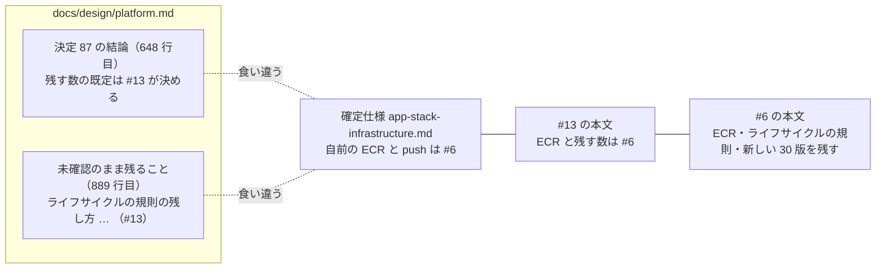
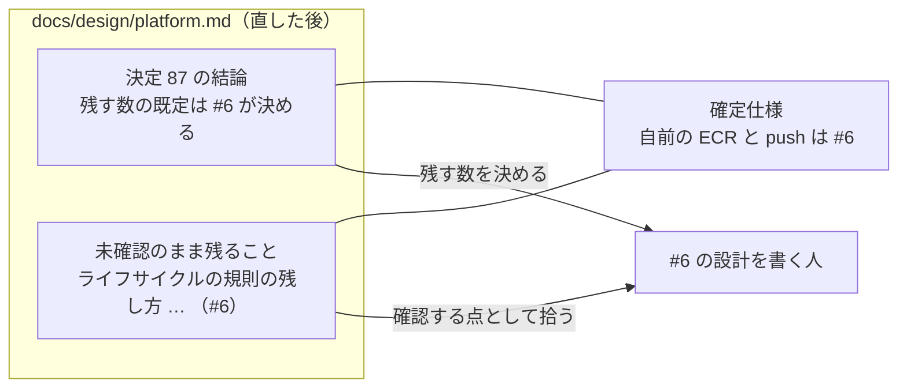

# 全体の設計: ECR のライフサイクルの規則の確認と残す数の既定を、ECR を作るランナーの課題の受け持ちにそろえる（#105）

プラットフォームの文書（`docs/design/platform.md`）の 2 か所が、ECR の 2 つの事柄を、ECR を作らないインフラの課題（#13）の受け持ちとしている（要求は [issue-105-requirements.md](./issue-105-requirements.md)）。2 つは、ライフサイクルの規則の確認と、残すバージョンの数の既定である。この 2 か所の課題の番号だけを、ECR を作るランナーの課題（#6）へ直し、ほかの文は変えない。採らなかった案は「決定の記録」に、外部の調査を省いた理由は末尾の「外部の調査」にある。

## 今の姿

何が起きたか・目的・受け入れ条件は要求仕様（[issue-105-requirements.md](./issue-105-requirements.md)、正は [#105](https://github.com/devbasex/nd-factory/issues/105) の本文）にある。この文書は「どう解くか」と「なぜその解き方か」だけを書く。

図の点線の 2 か所が、この変更で直す位置である。

- 自前の ECR とイメージの push は、ランナーの課題（[#6](https://github.com/devbasex/nd-factory/issues/6)）が作る。これを決めているのは次の 2 か所である
  - 確定仕様 [app-stack-infrastructure.md](../docs/specifications/app-stack-infrastructure.md) の「対象範囲」
  - インフラの課題（[#13](https://github.com/devbasex/nd-factory/issues/13)）の本文の「要求から変えたこと」（2026-11-21）
- プラットフォームの文書のうち、ECR かライフサイクルの規則を #13 の受け持ちとする行は、次の 2 行だけである。2026-11-24 の main（`fa6aa1b`）で `grep -nE 'ECR|ライフサイクル' docs/design/*.md | grep '#13'` を打った結果である
  - 648 行目: 決定 87 の結論の「（残す数の既定は #13 が決める）」
  - 889 行目: 「未確認のまま残ること」の表の「ECR のライフサイクルの規則の残し方」の行の、確認する手段の列の末尾の「（#13）」
- 同じ表のほかの #13 の行（875 行目の Aurora の一時停止など）は、#13 のアプリのスタックが持つ資源の確認で、受け持ちは合っている

## 文脈と制約

- 直すのは課題の番号だけで、決定 87 と LIB85 の中身（ダイジェストで引く・ライフサイクルの規則で古いバージョンを消す・戻せる数より多めに残す）は変えない
- 変更はこの 2 行だけにする（受け入れ条件 5）。行の位置と前後の文は変えない
- #6 の本文と受け入れ条件は変えない。この確認を #6 の受け入れ条件に足すかは、#6 の要求を書く工程が決める（要求の「含まない」）
- `docs/design/` は用語集の禁止語の検査の対象である（`.ndf/glossary.json` の `check.banned.paths`）。直す 2 行は数字だけを替えるため、禁止語を足さない

## 解き方の全体像

- プラットフォームの文書・確定仕様・#13 の本文の 3 か所が、ECR とライフサイクルの規則を #6 の受け持ちとしてそろう
- #6 の設計を書く人は、「未確認のまま残ること」の表から、ライフサイクルの規則の確認を自分の課題の点として拾える
- 決定 87 の結論から、残す数の既定を #6 で決めることが読める
- `docs/design/` の中で、ECR かライフサイクルの規則を #13 の受け持ちとする行は 0 件になる

## 決定の記録

### 決定 1: 受け持ちの食い違いを同じ形で残さないため、決定 87 の結論の課題の番号も同じ変更で直す

- **質問**: 起票の本文が挙げた「未確認のまま残ること」の表の 1 行だけを直すか、同じ形で #13 を指す決定 87 の結論の文も直すか
- **選んだ案**: 2 か所とも、課題の番号を #13 から #6 へ直す（要求の起票者の推定 S3 の扱いのとおり、受け入れ条件 3 に含めた）
- 採らなかった案: 表の 1 行だけを直す（決定 87 の結論が「残す数の既定は #13 が決める」のまま残り、#6 の設計を書く人が残す数を #13 で決めた値と読む）
- 採らなかった案: 決定 87 の結論から課題の番号の括弧を消す（どの課題が残す数を決めるかが文書から読めなくなり、#6 の設計を書く人が拾えない）
- **代償**: 起票の本文より直す行が 1 つ増え、設計承認ゲートで増えた行を読む手間が増える
- 根拠: Value 10「同じ事実を 2 か所に持たない」（MVV バージョン 3）

### 決定 2: 文書の正しさを保つため、直す単位を課題の番号の文字だけにする

- **質問**: 番号を直すときに、同じ文の言い回し（「確認する手段」の文、決定 87 の他の文）も今の書き方に合わせて直すか
- **選んだ案**: 2 行とも、`#13` の 3 文字を `#6` に替えるだけにし、ほかの文字は変えない
- 採らなかった案: 番号と一緒に同じ行の言い回しを直す（受け入れ条件 2・3 が「ほかの部分は変わらない」と求め、決定 87 の中身の変更は要求の「含まない」に当たる）
- **代償**: 同じ行に読みにくい言い回しがあっても、この変更では残る
- 根拠: Value 10「同じ事実を 2 か所に持たない」（MVV バージョン 3）

## 影響と危険

- **働く範囲**: このリポジトリの全体の設計（`docs/design/platform.md`）の 2 行だけ。コード・設定・確定仕様・ほかの課題の本文は変えない
- **プロジェクトごとに違うもの**: 無い（設計の文書の課題の番号だけを直す）
- **当たるモード**: `standard`。#105 の本文の「進行」の欄の「モード」に書かれている。設計だけの Pull Request をレビューしてマージしてから、実装へ進む進め方である
- **同じファイルを触る別の変更と順序**: #105 を先に取り込み、#13 の実装はその後に始める。#13 は利用者から手動の確認の結果が返るまで始められず、#105 は待つものが無いためである
  - 同じスプリントの #13 の設計（[issue-13-design.md](./issue-13-design.md)）も `docs/design/platform.md` を直す。直すのは「見込み」と、「未確認のまま残ること」の表の 875 行目である
  - 行が違うため内容は重ならないが、同じファイルを触る実装は同時に進めない（「設計の結果」の触るファイルに同じパスを書く）
  - #13 が 875 行目の行を消すと、889 行目の位置が動く。そのため、テストは行の番号ではなく行の文で引く
- **受け入れ条件 5 の範囲**: スプリントの Pull Request を `origin/main...HEAD` で比べると、#105 の変更だけを取り出せない。スプリントの Pull Request は #13 と #104 の変更と `issues/` のファイルも含み、#13 も同じ `platform.md` を直すためである。そこで、#105 の実装は 1 つのコミットにまとめ、そのコミットと親のコミットを比べて範囲を確かめる（「テスト設計」）。要求の検証手段も、この比べ方にそろえた
- **壊れうる箇所**: 決定 87 の結論の文は 1 行が長く、番号のほかの文字を変えると受け入れ条件 3 を破る。差分の行が `#13` → `#6` だけであることを差分の単語の単位で読む

## テスト設計

| 受け入れ条件・不変条件 | どの振る舞いで縛るか | どう壊したら落ちるべきか |
| --- | --- | --- |
| 1. 表の行が #6 を指し、#13 を指さない | `grep -n "ECR のライフサイクルの規則の残し方" docs/design/platform.md` が 1 件で、その行の末尾が `（#6） \|` である | 行の番号を `#13` のまま残す・`#6` と `#13` を併記する・行を消すと落ちる |
| 2. 同じ行のほかの文が変わらない | #105 の実装をまとめたコミットで、その行の差分が `#13` → `#6` の 1 語だけである（`git diff --word-diff` で読む） | 「確認すること」か「確認する手段」の文を 1 文字でも変えると落ちる |
| 3. 決定 87 の結論が「残す数の既定は #6 が決める」と書く | `grep -c "残す数の既定は #6 が決める" docs/design/platform.md` が 1 で、`grep -c "残す数の既定は #13 が決める"` が 0。差分は `#13` → `#6` の 1 語だけである | 番号を直さない・括弧ごと消す・文のほかの部分を変えると落ちる |
| 4. `docs/design/` の中で ECR かライフサイクルの規則を #13 の受け持ちとする行が 0 件 | `grep -nE 'ECR\|ライフサイクル' docs/design/*.md \| grep '#13'` が 0 件 | 2 行のどちらかを直し忘れると落ちる |
| 5. 変更がこの 2 行だけ | #105 の実装をまとめたコミットを `<C>` として、`git diff --stat <C>^ <C>` が `docs/design/platform.md` の 2 行の追加と 2 行の削除だけを返す（`issues/` のファイルは数えない） | ほかの行やファイルを変えると落ちる |
| 6. CI の `check`・`ref-check`・`leak-check` が通る | スプリントの Pull Request の CI のジョブ | 漏れの検査や参照の検査に当たる値を足すと落ちる |

## 設計の結果

| 課題 | 扱い | 統合先 | 触るファイル |
| --- | --- | --- | --- |
| #105 | 実装する | — | `docs/design/platform.md` |

## 外部の調査

省く: 設計の文書の課題の番号を、確定仕様と課題の本文が既に決めた受け持ちに合わせて直す文言の修正で、外部の判断が要らない
