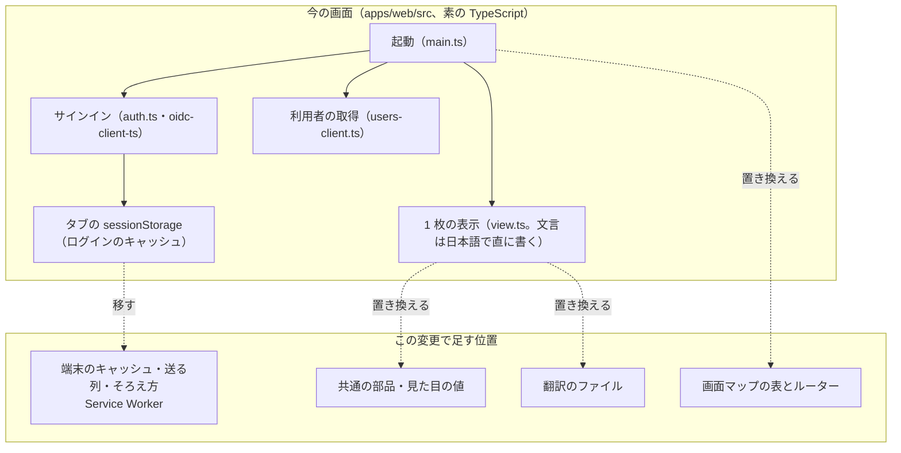
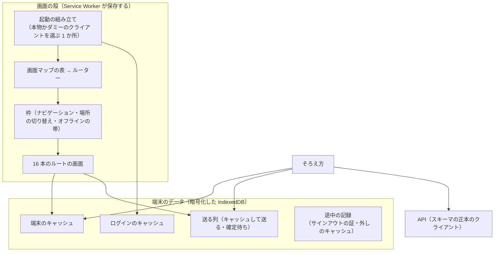
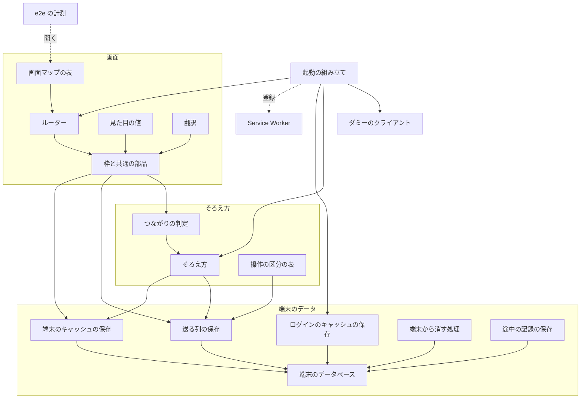
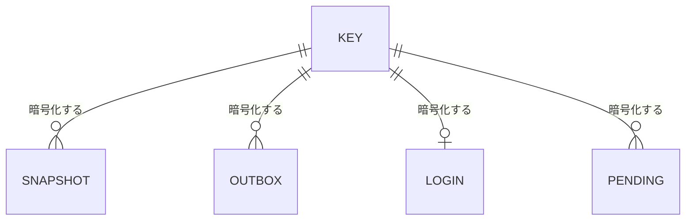
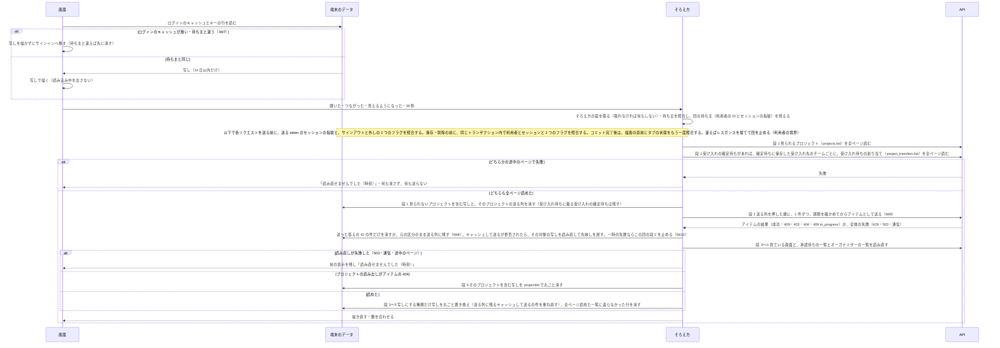

# 画面の基盤: どの端末でも、つながらなくても、同じ画面マップと部品で画面を使える（#12）

今の画面は、サインインした利用者の ID を出す 1 枚だけで、機能の画面（#28）が乗る画面マップ・共通の部品・端末の幅・オフライン・国際化の仕組みが無い（要求は [issue-12-requirements.md](./issue-12-requirements.md)）。画面の文書（[screens.md](../docs/design/screens.md)）が決めた形をそのまま実装へ下ろし、画面マップを 1 つの表としてコードに持ち、その表からルーター・e2e・操作の対応の検査を作る。端末に置くものはすべて、暗号化した 1 つの IndexedDB にまとめる。ルーターと IndexedDB の包みは広く使われているライブラリを使い、Service Worker は画面の文書の決定 28 のとおり自前で書く。採らなかった案は「決定の記録」に、調べた候補は末尾の「外部の調査」にある。

## 今の姿

何が起きたか・目的・受け入れ条件は要求仕様（[issue-12-requirements.md](./issue-12-requirements.md)、正は [#12](https://github.com/devbasex/nd-factory/issues/12) の本文）にある。この文書は「どう解くか」と「なぜその解き方か」だけを書く。

設計に要る今の構造は次のとおりである。

- 画面は React を使っていない。`apps/web/package.json` の実行の時の依存は `@nd-factory/contracts` と `oidc-client-ts` だけである。React と TSX はこの課題で入れる（[プラットフォームの文書の言語と書き方の決まり](../docs/design/platform.md#言語と書き方の決まり)）
- サインインは `oidc-client-ts` の既定の保存先を使い、ログインのキャッシュがタブの `sessionStorage` にある。401 を受けたときの印（`nd.reauth`）も `sessionStorage` に置く
- API のクライアントは、スキーマの正本に既にある。`packages/contracts/src/client.ts` に、操作を呼ぶ口（`createOperationClient`）がある。本物の送信（`httpTransport`）とダミーの送信（`createDummyTransport`）も同じファイルにある。ただし操作の表の 90 の操作は、2026-11-25 の時点ですべて形が未定である（`packages/contracts/generated/pending.json` の 90 行）。ダミーデータも 90 件すべてが空である（`generated/dummy/index.json` の値が `null`）。形は機能ごとの子の課題が決める
- 画面のモック（`docs/design/mock/`）は、オーガナイザーの画面だけが新しい画面マップで、ほかは作り直す前の画面のままである
- CDN が画面の HTTP のルートへ `index.html` を返す書き換え（プラットフォームの文書の決定 141）は、`infra/lib/` にまだ無い。`grep -rn 'cloudfront.Function' infra/lib` の当たりは 0 件である。今の配信は `/` だけが画面を返す。書き換えは [#177](https://github.com/devbasex/nd-factory/issues/177) が作る

## 文脈と制約

- 画面の文書の決定 20〜39・120 と、全体の設計の I4 は決め直さない（要求の前提 3）。この設計は、それらをどのファイルとライブラリで実現するかだけを決める
- スキーマの正本（#2）の API のクライアントの型とダミーデータを受ける。操作の形が決まる前の基盤は、テストで組んだ操作の表（`createOperationClient` の第 2 引数）と作り物の値で作る。本物の形は機能の画面（#28）がつなぐ（要求の前提 1）
- 1 つのスプリントで閉じる大きさにする（要求の前提 2）。機能の画面の中身は作らず、16 本の HTTP のルートには題と 5 つの状態だけを持つ仮の画面を置く
- 画面の外のコードは React と TSX を読まない。`packages/core/` の画面が使うモジュールは `node:` の組み込みを読まない（`AGENTS.md`）
- サインインとサインアウトは、API と Cognito を呼ぶ段とタブ間の排他を [#4](https://github.com/devbasex/nd-factory/issues/4) が持ち、端末のデータを置く段と消す段をこの課題が持つ。分担は次の表のとおりで、#12 の書き込みと削除の処理は #4 が持つ排他の下でだけ呼ばれる。表の「サインインの確定」と「取り直せないログインのキャッシュ」の行は、#4 の設計が受けるまで、その経路の実装を終えたと判定しない（下の「壊れうる箇所」）

| 担うこと | 持つ課題 | 中身 |
| --- | --- | --- |
| API と Cognito を呼ぶ段 | #4 | `sessions.create`・`sessions.delete`・RevokeToken（refresh token の取り消し）・Cognito のログアウトのエンドポイント |
| `userStore` の `set` をメモリに留める | #12 | `oidc-client-ts` はサインインのコールバックで `_buildUser` の中から `storeUser` を呼び、コールバックが戻る前に `userStore` へ書く（[oidc-client-ts 3.5.0 の `_buildUser`](https://github.com/authts/oidc-client-ts/blob/v3.5.0/src/UserManager.ts#L495-L518)）。refresh token での取り直しの後も、同じく `storeUser` を呼ぶ。そこで `userStore` に渡す保存は、どちらの場合も `set` を受けたらメモリに留めるだけで、IndexedDB へ書かない（決定 4）。セッションの指紋が同じかどうかでも分けない。このためサインインのコールバックが戻った時点では、端末のログインのキャッシュも持ち主も変わっていない。IndexedDB へ書くのは、下の「サインインの確定」と「取り直しの結果の保存」の 2 つの関数だけである |
| サインインの確定 | #4 が呼び、#12 が書く | #4 は、サインインの錠を持ったまま `sessions.create` の成功を受け、画面の文書の「実行の排他と照合」の (1)〜(3) を照合し直した後にだけ、#12 の「ログインを確定する」関数を呼ぶ。#12 はその中で、持ち主が違えばデータベースを消して新しいキーと持ち主を作り（下の「利用者の境界」）、メモリに留めた交換の結果から「ログイン」の行を作って書く。`sessions.create` が失敗したか照合が外れたら、#4 は #12 の「留めた結果を捨てる」関数を呼び、端末のデータに触れない |
| 取り直しの結果の保存 | #4 が呼び、#12 が書く | #4 は、refresh token での取り直しを送る前に、対象のセッションの指紋（端末の「ログイン」の行の `fingerprint`）を覚え、取り直しが成功したら、その指紋を渡して #12 の「取り直しの結果を書く」関数を呼ぶ。#12 は、メモリに留めた結果のセッションの指紋が、渡された指紋とも、今の「ログイン」の行の指紋とも同じことを確かめる。あわせて、行の `userId` がキーの行の `ownerUserId` と同じことと、サインアウトの途中のフラグもログインの外しの途中のフラグも無いことを確かめる。すべて合うときだけ、1 つの `readwrite` のトランザクションで行の項目を書き直す。1 つでも合わなければ、留めた結果を捨てて行に触れない。この関数は持ち主を切り替えず、行を新しく作らない。認可コードの交換の結果をこの関数で書くことはない |
| 取り直せないログインのキャッシュ | #4 が見つけ、#12 が消す | #12 は、`invalid_grant` を受けたセッションの行だけを消し、ほかのタブで入り直した新しいセッションの行は消さない。#4 は、取り直しを送る前に覚えた対象のセッションの指紋（上の「取り直しの結果の保存」と同じ値）を持っておく。取り直しを Cognito が `invalid_grant` で拒んだら、#4 は錠を取り、その指紋を渡して #12 の「ログインの行を消す」関数を呼んでから、サインインの画面へ移す。#12 は 1 つの `readwrite` のトランザクションの中で、今の「ログイン」の行の `fingerprint` が渡された指紋と同じことを確かめ、同じときだけ行を消す。違うか行が無ければ、何も消さずに「消さなかった」を返す。このとき #4 はサインインの画面へ移さない。旧セッションの token を持つタブの扱いは、画面の文書の「ほかのタブへの通知」に従う。この関数は「ログイン」の行だけを消し、キー・持ち主・写し・送る列は残す。期限を過ぎた「ログイン」の行は、起動のときに #12 が消す（データ構造の「ログイン」の行） |
| サインアウト中の状態の記録 | #4 | 画面の文書の「サインアウトの途中のフラグ」を `localStorage` に置き、段を進める |
| タブ間の排他 | #4 | Web Locks API（`navigator.locks.request`）でアプリの名前の 1 つの錠を取り、サインアウトの段とサインインの流れを同時に 1 つのタブでだけ打つ。画面の文書の「実行の排他と照合」 |
| メモリの access token の破棄と、ほかのタブへの通知 | #4 | access token をメモリから捨てる。`BroadcastChannel` と `storage` の事象で、ほかのタブに「サインアウトを始めた」を知らせる |
| サインアウトの証と外しのキャッシュの置き場 | 中身と使い方は #4、置き場と暗号化は #12 | 画面の文書の「サインアウトの証」（3. で送る access token とセッションの指紋）と「外しのキャッシュ」（`logins.delete` のアイテム）を、#12 が「途中の記録」の保存先（データ構造）に、ログインのキャッシュと同じキーで暗号化して置く。#12 は読む・置く・消す関数を出し、#4 だけが錠を持ったまま呼ぶ。消すのは、#4 が外しの照合を終えたときと、サインアウトの 5. のデータベースの削除である |
| 端末のデータを消す段 | #12 | 送る列を捨てる段（画面の文書の「サインアウトで消す」の 2.）と、データベースとキーを消す段（同じく 5.）。#4 が錠を持ったまま呼ぶ。5. は、このタブの接続を閉じてから `indexedDB.deleteDatabase` を呼び、`success` を受けたときだけ成功を呼び出し元へ返す。`blocked` の間は「ほかの接続が残っている」と呼び出し元へ知らせて待ち、`error` なら失敗を返す。3 秒を過ぎたときの案内とやり直しは #4 が出す |
| メモリの写しと鍵の参照の破棄と、ほかのタブの接続 | #12 | 端末のデータベースは、どのタブでも開くたびに接続へ `versionchange` の扱い手を付け、受けたらすぐ `close()` し、復号した写しと鍵の参照をメモリから捨てる。#4 の通知を受けたタブも、#12 の同じ破棄の関数を呼ぶ。これで、通知を受けられなかったタブの接続も 5. の削除を止めない |
- Web Push の購読と送信は #8 が持つ。この課題は Service Worker のファイルと登録を持ち、#8 がそこへ `push` の扱いを足す
- 例・テスト・ダミーデータには作り物の値だけを使う。CI は AWS の資格情報を持たない

## 解き方の全体像

- 画面マップの 16 本の HTTP のルートを 1 つの表としてコードに持ち、ルーター・ナビゲーション・e2e・操作の対応の検査がその表を読む
- 画面は共通の部品だけで組み、色や寸法は見た目の値の JSON から作った CSS の変数で引き、文言は翻訳のファイルのキーで引く。幅による形の違いは CSS だけが持つ
- 端末に置くものは 3 つで、どれも 1 件ごとに暗号化する。API のレスポンスのうち画面の文書の決定 29 が保存すると決めた種類と、画面の文書が端末に置くと決めた画面の状態（最後に開いたプロジェクト・最後に開いた会話・畳む節の開閉）だけを端末のキャッシュへ置き、まだ送れていない操作を送る列へ、refresh token をログインのキャッシュへ置く。保存する種類は下の「写しにする種類の表」に限り、表に無い画面（操作の記録・メンバー・費用・課題候補など）のレスポンスは書かない。Service Worker は画面の殻と画面の設定の値だけを保存する
- つながったとき・開いたとき・画面が見えるようになったときに、そろえ方が 5 つの段（画面の文書の [つながったときのそろえ方](../docs/design/screens.md#つながったときのそろえ方)）を通し、確定待ちはサーバーの答えを受けてから確定と出す
- 起動の組み立てが、`vite` の mode `dummy` のときだけダミーのクライアントを読み込む。本番の成果物にダミーが無いことをビルドの検査が確認する

## ドメインモデル

### コンテキスト

| コンテキスト | 何の語が 1 つの意味に決まるか |
| --- | --- |
| プラットフォーム（`platform`） | 端末のキャッシュ・ログインのキャッシュ・送る列・キャッシュして送る・確定待ち・つながってから押す・画面の殻 |
| 人の判断（`judgment`） | 承認の依頼・問い・承認資料。確定はサーバーが持つ |

関係は「公開された言語」である。画面はスキーマの正本の操作の形だけでサーバーとやり取りする。API のリクエストの本文はアイテムの配列で、レスポンスは同じ順のアイテムの結果（成功か、状態の数と理由のコード）の配列である（[API の文書の本文は配列](../docs/design/api.md#本文は配列)）。送る列の 1 件は、このリクエストの本文に入るアイテム 1 件に当たる。確定待ちの照合（I4）はサーバーの答えにだけ従い、確定かどうかは送ったアイテムの結果で決める。

### 集約

どの集約も端末の中だけにあり、サーバーの集約を書き換えない。

| 集約 | オーナー（書き換えてよいもの） | 根 | エンティティ | 値オブジェクト |
| --- | --- | --- | --- | --- |
| 端末のキャッシュ | 端末のキャッシュの保存 | 写しの 1 件（1 つのスプリント・1 つの承認の依頼など） | — | 種類・対象の ID・含むプロジェクトの ID の集合・受け取った時刻・暗号文と初期化ベクトル（IV） |
| 送る列 | 送る列の保存 | 送るアイテムの 1 件（リクエストの本文の配列に入るアイテム 1 件） | — | 区分（キャッシュして送る・確定待ち）・操作の名前・対象の ID・操作の入力・答えの ID（冪等キー）・照合の値（確定待ちだけ。読んだときの `version`、`approvals.answer` では加えて `material_digest`）・押した時刻・送った時刻・期限（確定待ちだけ） |
| ログインのキャッシュ | ログインのキャッシュの保存 | 1 件 | — | 利用者の ID・セッションの指紋・refresh token の期限・暗号文と初期化ベクトル（IV） |
| 途中の記録 | 途中の記録の保存（#4 だけが呼ぶ） | サインアウトの証の 1 件と、外しのキャッシュの 1 件 | — | 種類・セッションの指紋・暗号文と初期化ベクトル（IV） |

写しを読み直しで書き換えるのはそろえ方だけで、画面は端末のキャッシュの保存を通して読む。送る列へ足すのは画面の操作、送って消すのはそろえ方だけである。

### 不変条件

| # | 集約 | 条件 | 破れたときの扱い |
| --- | --- | --- | --- |
| I4 | 送る列（確定待ち） | 確定待ちは、つながっていない端末では送らず、確定と出さない。確定と出すのは、サーバーが今の状態と押した時点のバージョンを照合し、送ったアイテムの結果が成功（`ok` が真）だったときだけである（全体の設計の I4。照合はサーバーが行う）。HTTP の状態が 200 でも、アイテムの結果が失敗なら確定と出さない | アイテムの結果の 409（`version_mismatch`・`state_mismatch`）・403・404 は食い違いとして出し、入力した文を残す。409 `in_progress` は食い違いにせず、確定待ちのまま送り直す（処理の流れの「段 2 の結果の適用」） |
| IW1 | 端末のキャッシュ・送る列・ログインのキャッシュ・途中の記録 | API のレスポンス・送る操作・refresh token・サインアウトの証・外しのキャッシュは、取り出せない AES-GCM のキーで 1 件ごとに暗号化して IndexedDB に置く。Service Worker の保存先（Cache Storage）に API のレスポンスを置かない | 下の「復号できないとき」の表のとおり、保存先ごとに扱う |
| IW2 | 端末のキャッシュ | 受け取ってから 14 日を過ぎた写しは画面に出さない | 読むときに除き、開いたときに消す |
| IW9 | 送る列（確定待ち） | 押してから 24 時間を過ぎた確定待ちは送らない（画面の文書の決定 32） | そろえ方が各アイテムを送る直前に期限を比べ、過ぎていれば送らずに消し、「期限が過ぎたため送りませんでした。もう一度操作してください」を対象ごとに出す |
| IW10 | ログインのキャッシュ | refresh token の期限（サインインしてから 30 日。画面の文書の決定 31）を過ぎたログインのキャッシュと、取り直しを Cognito が `invalid_grant` で拒んだログインのキャッシュを残さない | 起動のときに期限を比べて「ログイン」の行だけを消す。`invalid_grant` では #4 が #12 の関数で同じ行を消す。このとき #12 は、#4 が取り直しを送る前に覚えたセッションの指紋が今の行の指紋と同じときだけ消す。どちらも写しと送る列は消さず、サインインの画面へ移す |
| IW11 | 端末のキャッシュ | 写しにするのは、下の「写しにする種類の表」の種類だけである。表は、画面の文書の決定 29 の範囲の種類と、画面の文書が端末のキャッシュに置くと決めた 3 つの画面の状態（最後に開いたプロジェクト・最後に開いた会話・畳む節の開閉）を持つ | 表に無い種類を書こうとしたら、端末のキャッシュの保存が書かずに捨てる（単体テストで、表に無い種類の書き込みが残らないことを確認する） |
| IW12 | 送る列 | 送る列は押した順に送る。先に押した件が一時の失敗で送れていない間は、後から押した件を送らない | 一時の失敗を受けたら、その回の段 2 を止め、残りの件を次の回へ回す |
| IW3 | 送る列 | 同じ対象への確定待ちは 1 つだけである | 後から押した方で置き換える |
| IW4 | 送る列 | 「つながってから押す」の操作は、つながっていない端末で送る列に入らない | 押せない状態で「つながると使えます」を出す |
| IW5 | 端末のキャッシュ・送る列 | 見られるプロジェクトの一覧（`projects.list`）と、確定待ちの受け入れに要る受け入れ待ちの割り当ての一覧（`project_transfers.list`）を、どちらも全ページ読み終える前に、プロジェクトの写しと送る列を消さず、送る列を送らない | 途中で失敗したら何も消さず送らず、30 秒後に段 1 からやり直す |
| IW6 | 4 つすべて | サインアウトの後に、端末のキャッシュ・送る列・ログインのキャッシュ・途中の記録・キーが端末に残らない | データベースを丸ごと消し、消し終えるまで次へ進まない |
| IW7 | 4 つすべて | 端末のデータは、データベースの持ち主として記した 1 人の利用者のものだけである。ログインのキャッシュの利用者が持ち主と違うときは、写しを描かず、送る列を送らない | 写しと送る列とキーを消してから、新しい利用者のログインのキャッシュを置く。下の「利用者の境界」 |
| IW8 | 送る列 | 送った結果で消すのは、送ったときと同じ答えの ID の 1 件だけである。送っている間に同じ対象へ新しい答えが保存されたら、新しい答えを残す | 結果を受けたときに答えの ID で引き直し、無ければ何もしない |

復号できないときの扱いは、保存先ごとに次のとおりである。キーが無いときは、どの保存先も「復号できない」と同じに扱う。画面の文書の [暗号化](../docs/design/screens.md#暗号化) の「読めないとき」（写しをすべて消し、オンラインなら読み直す）を、送る列とログインのキャッシュへ広げたものである。

| 保存先 | 扱い | 利用者に出すこと |
| --- | --- | --- |
| 写し | 写しをすべて消す。オンラインなら読み直し、オフラインなら空の状態を出す | 出さない（読み直して描く） |
| 送る列 | 復号できない件は送らない。平文の列（`kind`・`targetKey`・`projectId`）で件数と対象の種類を数えてから消す | 「送れなかった操作が N 件あります。もう一度操作してください」を、オフラインの帯の位置に、利用者が閉じるまで出す |
| ログインのキャッシュ | 保存した認証情報の利用を止め、ログインのキャッシュを消し、サインインの画面へ移す | サインインの画面に「もう一度サインインしてください」を出す |
| 途中の記録 | 消さずに、読めないことを #4 へ返す。#4 は画面の文書のとおり、証が読めないときは次の token の候補へ進み、外しのキャッシュが読めないときは外しの結果を確認できないとして扱う | #4 が画面の文書の告知を出す |

### ドメインイベント

番号は要求の「ドメインイベント」を引き継ぐ。

| # | イベント | 発生元 | 受け手 |
| --- | --- | --- | --- |
| E1 | サインインし、`sessions.create` の成功の後に、ログインのキャッシュを暗号化して置いた | ログインのキャッシュの保存（#4 が `sessions.create` の成功の後に「ログインを確定する」関数を呼ぶ） | 起動の組み立て（API のクライアントへ token を渡す） |
| E2 | API のレスポンスを受け、端末のキャッシュへ置いた | そろえ方 | 画面（表示を差し替える） |
| E3 | つながっていない端末で、端末のキャッシュから描いた | 画面 | オフラインの帯（最後に受け取った時刻を出す） |
| E4 | 確定待ちを押し、答えの ID を作った | 画面の操作 | 送る列・確定待ちのバッジ・オフラインの帯 |
| E5 | つながり、そろえ方の段 1〜5 を通した | そろえ方 | 画面・ナビゲーションの数・Web アプリのアイコンの数 |
| E6 | サーバーが確定待ちを照合し、確定か食い違いを返した | そろえ方（API の答え） | 送る列（消す）・操作の結果の表示 |
| E7 | 14 日を過ぎた写しを捨てた | 端末のキャッシュの保存 | 画面（空の状態を出す） |
| E8 | サインアウトし、端末のキャッシュとログインのキャッシュを消した | 端末から消す処理（#4 のサインアウトの段から呼ぶ） | 画面（サインインへ移る）・ほかのタブ |

## 構成要素

| 要素 | 責務 |
| --- | --- |
| 起動の組み立て | 画面の設定の値を読み、本物かダミーの API のクライアントを 1 か所で選び、各要素へ渡す。Service Worker を登録する |
| 画面マップの表 | 16 本の HTTP のルート（R1〜R16）と、画面ではない 3 つの戻り先を持つ。戻り先は、サインインの戻り（R2 の `/` で受ける認可コードと `state` の検索の値）・`/me/logins/return`・`/signed-out` である。ルートごとに群・題のキー・オフラインで読めるかを持つ。読む書く操作は手で書かず、画面の文書の「画面一覧」から作った生成物を引く（決定 6） |
| ルーター | 画面マップの表から React Router のルートを作る。表に無い path は履歴を置き換えて `/` へ移す |
| 枠と共通の部品 | 画面の文書の「共通の部品」を `apps/web/src/ui/` に 1 ファイル 1 部品で置く。部品の一覧（カタログ）を持つ |
| 見た目の値 | Design Tokens Format の JSON（`tokens.json`・`tokens.dark.json`）と、そこから作った CSS の変数 |
| 翻訳 | 翻訳のファイル・言語の一覧・キーの引き当て・日時と数と金額の出し方 |
| 端末のデータベース | IndexedDB の 1 つのデータベースと、キー・暗号化・復号 |
| 端末のキャッシュの保存 | 写しの読み書き・写しにする種類の表に無い種類を書かない・14 日の除外・プロジェクト単位の削除（含むプロジェクトの ID の集合で引く） |
| 送る列の保存 | キャッシュして送る・確定待ちの読み書き・同じ対象の置き換え・24 時間の期限 |
| 操作の区分の表 | 書き込みの操作ごとの 3 つの区分（キャッシュして送る・確定待ち・つながってから押す） |
| つながりの判定 | つながっているかを画面へ出す。ダミーの mode では、ダミーのモジュールが渡す判定に替わり、検索の値 `connection` に従う（`connection` を読むコードはダミーのモジュールの中だけに置く） |
| そろえ方 | 段 1〜5 を通す。30 秒ごとの読み直しと、開いた・つながった・見えるようになったときの起動 |
| ログインのキャッシュの保存 | `oidc-client-ts` の `userStore` に渡す保存。`set` はどの場合もメモリに留めるだけである。IndexedDB へは、#4 が呼ぶ 2 つの関数だけが書く。認可コードの交換の結果は「ログインを確定する」関数が、refresh token での取り直しの結果は「取り直しの結果を書く」関数が書く（決定 4）。決まった項目だけを暗号化して置き、期限を過ぎた行を起動のときに消す |
| 途中の記録の保存 | サインアウトの証と外しのキャッシュを、暗号化して置く・読む・消す。#4 だけが錠を持ったまま呼ぶ |
| 端末から消す処理 | 送る列を捨て、データベースとキーを消す（サインアウトの 2. と 5.）。#4 がサインアウトの段から呼ぶ |
| Service Worker | 画面の殻を保存し、画面へのナビゲーションには保存した `index.html` を返す。画面の設定の値は読めなければ保存した値を返す。API と `/signed-out` を保存から返さない。登録とバージョンの切り替えも自前で持つ（決定 2） |
| ダミーのクライアント | スキーマの正本のダミーの送信を、検索の値 `scenario` で切り替える。mode `dummy` のときだけ読み込む |
| e2e の計測 | 3 つの幅・手数とページの数・回線の絞り・押せる要素の大きさを数える共通の準備。この課題は仕組みを作り、仮の画面で確かめる。実際の操作の場面は機能の画面（#28）がこの準備で書く（テスト設計の 3） |

## データ構造

データベースは IndexedDB の 1 つ（名前は利用者ごとに分けない）で、5 つの保存先を持つ。名前を分けない代わりに、キーの行に持ち主の利用者の ID を持ち、持ち主のほかの利用者に写しと送る列を使わせない（IW7、下の「利用者の境界」）。暗号文の中身はサーバーのレスポンスと送る操作の写しで、写しは読み直しで丸ごと置き換える（画面の文書の決定 33。サーバーが正で、端末で書き換えた値を持たないため、過去の写しを残さない）。ただし、送る列にまだ残っている「キャッシュして送る」の件は、置き換えた写しへ重ね直す（処理の流れの「段 3〜5 の送る列の重ね直し」）。

| 保存先 | 列 | 型 | 空の値の扱い | 意味 |
| --- | --- | --- | --- | --- |
| キー | `id`・`key` | 文字列・`CryptoKey` | 許さない | 固定の 1 件（`main`）。AES-GCM 256 ビット、`extractable` は偽 |
| キー | `ownerUserId` | 文字列 | 許さない | データベースの持ち主の利用者の ID（スキーマの正本の利用者の ID）。キーを作るときに、サインインした利用者の ID を入れる |
| 写し | `id` | 文字列 | 許さない | 種類と対象の ID をつないだ値。同じ対象は 1 件 |
| 写し | `kind`・`receivedAt` | 文字列・数（UTC のミリ秒） | 許さない | 索引に使う平文。`kind` は下の「写しにする種類の表」の名前 |
| 写し | `projectIds` | 文字列の配列 | 空の配列を許す | 写しの中身が含むプロジェクトの ID の集合。複数の値の索引（`multiEntry`）を張る。1 つのプロジェクトの写しは 1 件、承認待ちの一覧やオーガナイザーの一覧のようにプロジェクトをまたぐ写しは、行に現れるプロジェクトの ID をすべて入れる。空の配列はプロジェクトに属さない写し（場所の一覧・自分の設定・畳む節の開閉）を指す |
| 送る列 | `answerId` | 文字列 | 許さない | 押したときに画面が作る答えの ID。冪等キーに使う |
| 送る列 | `targetKey`・`kind`・`pressedAt`・`projectId` | 文字列・文字列・数・文字列 | `projectId` だけ許す | 同じ対象の置き換えと 24 時間の期限と、プロジェクト単位の削除に使う平文。`targetKey` は操作の名前と対象の ID をつないだ値。`kind` は「キャッシュして送る」か「確定待ち」。`pressedAt` は押したときの端末の時刻 |
| 送る列 | `sentAt` | 数（UTC のミリ秒） | 許す | そろえ方がその件を初めて送る直前に書く時刻。空なら一度も送っていない。会話の項目の取り下げで、送信の件を端末で消してよいかの判断に使う（処理の流れの、会話の項目の取り下げを押したときの扱いの表） |
| ログイン | `storeKey`・`userId` | 文字列 | 許さない | `oidc-client-ts` が渡す保存のキーと、利用者の ID |
| ログイン | `fingerprint` | 文字列 | 許さない | セッションの指紋（画面の文書の「サインアウトの途中のフラグ」と同じ、`sub` と `origin_jti` をつないだ SHA-256）。サインインを確定するときに、交換で得た token から求めて置く。照合はこの値で行い、access token を保存しない |
| ログイン | `refreshExpiresAt` | 数（UTC のミリ秒） | 許さない | refresh token の期限。サインインを確定した時刻に 30 日（[API の文書の token の有効期間](../docs/design/api.md#token-の有効期間)）を足した値。取り直しで新しい refresh token を受けたときだけ書き直す（IW10） |
| 途中の記録 | `id` | 文字列 | 許さない | `signout-proof`（サインアウトの証）か `unlink-item`（外しのキャッシュ）の固定の 2 種類。それぞれ 1 件まで。「ログイン」の行とは保存先を分け、取り違えない |
| 途中の記録 | `fingerprint` | 文字列 | 許さない | 記録を作ったセッションの指紋。#4 がサインアウトのフラグか外しのフラグの指紋と照らす |
| 写し・ログイン・途中の記録 | `iv`・`data` | バイト列 | 許さない | 12 バイトの初期化ベクトル（IV）と暗号文。中身は、写しはレスポンス、ログインは下の「ログインの行に置く項目」、途中の記録は証の access token か `logins.delete` のアイテム |
| 送る列 | `iv`・`data` | バイト列 | 許さない | 12 バイトの初期化ベクトル（IV）と暗号文。中身は次の段落の送るアイテム 1 件 |

ログインの行には、`oidc-client-ts` の利用者の値（`User`）を直列化したもの全体を置かない。`User.toStorageString()` は access token と ID token も含める（[oidc-client-ts 3.5.0 の `User`](https://github.com/authts/oidc-client-ts/blob/v3.5.0/src/User.ts#L99-L109)）。しかし、画面の文書の決定 31 は access token をメモリだけに置くと決めている。そこで、ログインのキャッシュの保存は、`userStore` の `set` で受けた値から次の項目だけを取り出して暗号化する。`get` は、この項目から access token の無い利用者の値を組んで返す。開いたときは、この refresh token で access token を取り直す。

| ログインの行に置く項目 | 中身 | 置く理由 |
| --- | --- | --- |
| `refresh_token` | refresh token | 開いたときに access token を取り直す（決定 31） |
| `profile` の `sub` | Cognito の利用者の識別子 | 取り直した token が同じ利用者のものかを照らす |
| `scope`・`token_type` | 交換の結果の値 | `oidc-client-ts` が取り直しの要求を組む |

access token・ID token・`expires_at` は置かない。例外は、画面の文書が置くと決めたサインアウトの証の access token だけで、これは「途中の記録」に置く。

送る列の 1 件には、API のリクエストの本文の配列に入るアイテム 1 件を、対象の ID・操作の入力・冪等キー・必要な照合の値とともに保存する。配列全体を 1 件として保存しない。同じ対象の置き換え（IW3）と、送った結果との対応（IW8）を、アイテム 1 件の単位で行うためである。送るときは、操作のスキーマが定めるアイテムの形に組んで渡す。

| 暗号文の中の項目 | 中身 | 例（`approvals.answer`） |
| --- | --- | --- |
| `operation` | 操作の名前 | `approvals.answer` |
| `targetId` | 対象の ID | 承認の依頼の ID |
| `input` | 操作の入力（利用者が押した答えと入力した文） | 答えの語・`reason` |
| `idempotencyKey` | 答えの ID。アイテムの `idempotency_key` に入れる | 押したときに画面が作る UUID |
| `check` | 照合の値（確定待ちだけ）。読んだ値をそのまま持ち、再接続の後もその値を送る | 依頼の `version`（整数）と、承認資料の `material_digest`（SHA-256 の値の文字列） |
| `transfer` | 割り当ての受け入れ（`project_transfers.accept`）の確定待ちだけが持つ。押した時点の受け入れ先のチームの ID（`teamId`）と、受け入れる移行の ID（`transferId`）。押した後に利用者が別のチームへ切り替えても変えない | —（`project_transfers.accept` の例: 押したときに開いていたチーム R9 の ID と、行の移行の ID） |

### 写しにする種類の表

写しにする種類は、画面の文書の [端末に保存するもの](../docs/design/screens.md#端末に保存するもの)（決定 29）の行と、画面の文書が端末のキャッシュに置くと決めた 3 つの画面の状態だけで、`apps/web/src/offline/snapshot-kinds.ts` の 1 か所に表として持つ。端末のキャッシュの保存は、この表に無い種類の書き込みを受けない（IW11）。そろえ方の段 3 の「見ている画面の読み直し」は、どの画面でも読み直して画面に出すが、写しを置き換えるのはこの表にある種類だけである。

| 種類 | 画面の文書の行 | 含むプロジェクトの ID の集合 |
| --- | --- | --- |
| オーガナイザーの一覧・会話 | オーガナイザーの一覧と会話 | 一覧は行に現れるすべてのプロジェクト。会話はそのプロジェクト |
| 承認待ちの一覧・待ちの数 | 承認待ちの一覧の中身 | 行と数に現れるすべてのプロジェクト |
| スプリントの一覧・詳細 | スプリントの一覧・スプリントの詳細 | そのプロジェクト |
| 承認の依頼と承認資料・問い | 承認の依頼と承認資料・問い | そのプロジェクト |
| 通知 | 通知 | 行に現れるすべてのプロジェクト |
| 自分の設定・場所の一覧 | 自分の設定・場所の一覧 | 空（場所の一覧はチームとプロジェクトの名前だけを持ち、段 1 で `projects.list` の結果で丸ごと置き換える） |
| 画面の状態: 最後に開いたプロジェクト | 「チームとプロジェクトの切り替え」の「今の場所のキャッシュ」（ナビゲーションの「スプリント」「始める」の行き先） | そのプロジェクト。段 1 でそのプロジェクトが見られなくなれば、ほかの写しと一緒に消える（画面の文書の「キャッシュのプロジェクトが一覧に無くなったらキャッシュを消す」） |
| 画面の状態: 最後に開いた会話 | R2 の「最後に開いた会話」 | その会話のプロジェクト。消えたら R2 は一覧を出す |
| 画面の状態: 畳む節の開閉 | 「共通の部品」の畳む節（操作の 3 つの区分の「畳む節の開閉（端末だけ）」） | 空 |

上の表のうち、最後の 3 行は API のレスポンスでなく、画面の文書が端末のキャッシュ（暗号化）に置くと決めた画面の状態である。画面の文書の「端末に保存するもの」（決定 29）の表には無いが、同じ文書の上の各節が端末のキャッシュに置くと決めているため、写しと同じ保存先に同じ暗号化で置く。暗号文の中身は、プロジェクトの ID・会話の ID・節の名前と開閉だけである。写しの `id` の対象の ID には、固定の名前（`last-project`・`last-conversation`）か節の名前を入れる。`receivedAt` には最後に書いた時刻を入れ、ほかの写しと同じく 14 日を過ぎたら除く（IW2。除いた後は、その状態を置いていないときと同じに扱う。たとえば R2 は一覧を出し、節は既定の開閉で出す）。畳む節の開閉は端末だけの操作で、送る列に入れずサーバーへ送らない。

表に無いもの（操作の記録・チームのメンバー一覧・使える量と費用・実行の場所・委任の一覧・通知先・課題候補・プロジェクトとチームの設定）は、つながっているときだけ読み、写しにしない。

| 機能 | キー | 写し | 送る列 | ログイン | 途中の記録 |
| --- | --- | --- | --- | --- | --- |
| 画面を描く | R | R | R | — | — |
| 操作を押す | R | C・U（キャッシュして送るの先映し） | C・U | — | — |
| そろえ方 | R | C・U・D | R・D | — | — |
| サインインを確定する（#4 が `sessions.create` の成功の後に呼ぶ） | C・R（持ち主が違えば先に D） | D（持ち主が違うとき） | D（持ち主が違うとき） | C | D（持ち主が違うとき） |
| token を取り直す（#4 が成功の後に「取り直しの結果を書く」関数を呼ぶ） | R | — | — | R・U（指紋が合うときだけ。`invalid_grant` なら、送る前に覚えた指紋が合うときだけ D） | — |
| 起動の照合 | R | — | — | R・D（期限を過ぎた行） | — |
| サインアウトと外しの記録（#4） | R | — | — | R | C・R・D |
| サインアウトで消す | D | D | D | D | D |

- 移行: 骨組みの `sessionStorage` のログインのキャッシュは移さず、起動のときに読まずに消す（決定 4）
- 版の上げ: データベースは版の番号を持つ。版を上げるときは、写しは読み直せるため移さずに消す。送る列は、まだ送れていない利用者の操作のため、黙って消さない。版を上げる変更が送る列の形を変えないなら、送る列をそのまま移す。形を変えるなら、その変更で古い形から新しい形へ移す処理を書く。移せない件は、上の「復号できないとき」の送る列と同じく、件数を数えてから消し、「送れなかった操作が N 件あります。もう一度操作してください」を利用者が閉じるまで画面に出す。利用者に消すかどうかを選ばせない（古い版の画面はもう動かず、選んでも送れないため）
- 検査の手段: 平文で読めないこと・Cache Storage に API のレスポンスが無いことを、単体テストと e2e で確認する（テスト設計の受け入れ条件 13）

### 利用者の境界

同じブラウザーで別の利用者がサインインしても、前の利用者の写しを見せず、前の利用者の送る列を新しい利用者で送らない（IW7）。画面の文書の「別の利用者がサインインしたときも、前の利用者の写しと鍵を消してから始める」（[サインアウトで消す](../docs/design/screens.md#サインアウトで消す) の末尾）を、次の 4 か所で守る。

| 時機 | 照合 | 合わないとき |
| --- | --- | --- |
| 起動して写しを描く前 | ログインのキャッシュがあり、その `userId` がキーの行の `ownerUserId` と同じ | 写しを描かず、送る列を送らない。ログインのキャッシュが無ければサインインの画面へ移す。持ち主と違えば、写しと送る列とキーを消してサインインの画面へ移す |
| サインインを確定するとき（#4 が `sessions.create` の成功と照合の後に、サインインの錠を持ったまま「ログインを確定する」関数を呼ぶ） | 新しい利用者の ID がキーの行の `ownerUserId` と同じ | データベースを丸ごと消してから、新しいキーと持ち主を作り、ログインのキャッシュを置く。前の利用者の送る列は送らず、件数も新しい利用者に出さない。`sessions.create` の前と、`sessions.create` が失敗したときは、この照合も削除も行わない（交換の結果はメモリに留めたまま捨てる）ため、サーバーがサインインを拒んだ利用者が前の利用者のデータを消すことはない |
| そろえ方の各リクエストを送る前（段 1〜4 の読み出しと、段 2 の送る列の送信のすべて） | サインアウトの途中のフラグも、ログインの外しの途中のフラグ（画面の文書の「今のログインを外した後」）も無い。送るリクエストに実際に付ける access token のセッションの指紋が、回の持ち主（下の段落）のセッションの指紋・ログインのキャッシュのセッションの指紋・このタブのメモリのセッションの指紋のすべてと同じ。ログインのキャッシュの `userId` が `ownerUserId` と回の持ち主の利用者の ID と同じ | 送らずにこの回を止め、このタブのメモリの access token・写し・鍵の参照を捨てて、起動のときと同じ照合からやり直す。同じ利用者が別のタブで入り直した場合も、セッションの指紋が替わるためここで止まる。旧セッションの回は続けず、送る列の件は残して、新しいセッションの回が段 1 から送る |
| そろえ方のレスポンスを反映する前（写しの置き換え・写しと送る列の削除・画面の描き直し） | サインアウトの途中のフラグも、ログインの外しの途中のフラグも無い。この回の持ち主が、キーの行の `ownerUserId`・ログインのキャッシュの `userId` とセッションの指紋・このタブのメモリの利用者の ID とセッションの指紋のすべてと同じ | レスポンスを捨て、端末のデータに書かず、描き直さない。この回を止め、次の回で起動のときと同じ照合からやり直す |

そろえ方は、別の利用者や旧セッションのレスポンスを書き込まないよう、回の初めに持ち主を覚え、各リクエストを送る前と、レスポンスを反映する直前に照合し直す。照合が要るのは、そろえ方の錠がサインインの錠と別で、`versionchange` で接続を閉じても、送り終えたリクエストのレスポンスは後から届くためである。

- 回の持ち主: 錠を取った直後、最初のリクエストを送る前に、利用者の ID と、このタブのメモリにある access token のセッションの指紋（画面の文書の [サインアウトの途中のフラグ](../docs/design/screens.md#サインアウトで消す) と同じ、`sub` と `origin_jti` をつないだ SHA-256）を、この回のメモリに覚える
- 照合と書き込み: 復号と暗号化と SHA-256 の計算はトランザクションの外で済ませ、書き込みのトランザクションの中では IndexedDB のリクエストと同期の比較だけを行う。IndexedDB のトランザクションは、保留中のリクエストが無いままイベントループに戻ると終わるため、中で Web Crypto の完了を待つと後の書き込みと削除が失敗する（[idb のトランザクションの寿命](https://github.com/jakearchibald/idb#transaction-lifetime)）。手順は次の 3 つである。
  1. `readonly` のトランザクションで、キーの行とログインの行を読む。読んだログインの行の `iv` を覚える（`iv` は暗号化のたびに新しい乱数のため、行が書き換われば変わる）
  2. トランザクションの外で、ログインの行の `fingerprint`（セッションの指紋）と `userId` を回の持ち主と照合する。合えば、書き込む写しを暗号化しておく
  3. キー・ログイン・写し・送る列の 4 つの保存先を範囲にした 1 つの `readwrite` のトランザクションで、キーの行の `ownerUserId` とログインの行の `userId` と `iv` が手順 1 で読んだ値と同じこと、`localStorage` にサインアウトの途中のフラグもログインの外しの途中のフラグも無いことを確かめてから、写しと送る列を書き込み・削除する。ログインの行は同じセッションの token の取り直しでも書き換わるため、`iv` が違えば中身によらずトランザクションを中止（`abort`）し、レスポンスを捨てて回を止める。消さなかった送る列の件は残り、次の回で同じ冪等キーで送り直すため、2 重に確定しない
- トランザクションの途中で持ち主は替わらない: 別の利用者のサインインはデータベースを `indexedDB.deleteDatabase` で消してから持ち主を作る。削除は、このタブの接続が閉じ、走っているトランザクションが終わるまで待つ
- サインアウトとの順序: サインアウトを始めるタブは、フラグを `localStorage` に置いてから、`BroadcastChannel` で通知し、データベースを消す（画面の文書の [サインアウトで消す](../docs/design/screens.md#サインアウトで消す)）。そろえ方は、通知の受け取りを待たず、書き込みのトランザクションの中（手順 3）と描く直前の 2 か所でフラグを読む。フラグを読んだ後・コミットの前にサインアウトが始まった場合は、書いた写しをサインアウトがデータベースごと消し、描く直前の照合で描かない
- ログインの外しとの順序: 画面の文書は、今のログインを外している間（ログインの外しの途中のフラグがある間）は通常の操作を止める。外しのフラグはほかのタブに写しを捨てさせないが、そろえ方は、回の初め・各リクエストの前・書き込みのトランザクションの中（手順 3）・描く直前の 4 か所で外しのフラグを読み、あれば送らず書かずに回を止める。送る列の件は消さずに残す。外しが確定せずサインインのまま終われば、外しのフラグが消えた後の回が段 1 から送る。外しが確定すればサインアウトへ移り、送る列はサインアウトの 2. で捨てる
- 接続を閉じた後: `versionchange` で接続を閉じたタブは、その回の残りのレスポンスをすべて捨てる。回の途中でデータベースを開き直さない（開き直すのは次の回の起動の照合だけである）
- 画面の描き直し: 書き込んだトランザクションの完了を受けた後、描く直前に、サインアウトの途中のフラグとログインの外しの途中のフラグが無いことと、このタブのメモリの利用者の ID とセッションの指紋が回の持ち主と同じことを確かめる。確かめてから描き終えるまでの間に `await` を挟まない。違えば描かない

同じ利用者が新しいセッションでサインインし直した場合は、写しと送る列を新しいセッションへ引き継ぐ。ただし、旧セッションで始まった回は続けない。上の 3 行目の照合でセッションの指紋が合わずに止まり、このタブは画面の文書の「ほかのタブへの通知」のとおり古い access token と写しをメモリから捨てる。送る列の件は、新しいセッションで始めた回が段 1 から送る。新しいセッションを成り立たせる条件は、画面の文書の [実行の排他と照合](../docs/design/screens.md#サインアウトで消す) に従い、この課題は変えない。つまり、サインインのコールバックで `sessions.create` を送れるのは、ログインのキャッシュが無いときか、キャッシュのセッションの指紋が送る token の指紋と同じとき（同じサインインの送り直し）だけである。冪等キーの 1 回目の結果は、同じ利用者ならセッションが違っても共有されるため（[API の文書の冪等キー](../docs/design/api.md#冪等キー)）、入り直した後に送り直しても 2 重に確定しない。前のセッションで受けたレスポンスは、上の 4 行目の照合でセッションの指紋が合わずに捨てる。捨てても送る列の件は残り、次の回で新しいセッションの token で送られる。セッションの指紋でのタブの照合は、画面の文書の「ほかのタブへの通知」のとおり #4 が持つ。

refresh token で取り直せなくなった利用者がサインインし直せるよう、使えなくなったログインのキャッシュは「ログイン」の行だけを先に消す（IW10）。画面の文書の照合は、ログインのキャッシュがあれば、その指紋が新しい token と同じときだけ `sessions.create` を送る。行が残ったままだと、新しいサインインの token は指紋が違うため送れず、利用者はサインインを終えられない。消す時機と、その後の扱いは次のとおりである。

| 時機 | 消すもの | 残すもの | その後 |
| --- | --- | --- | --- |
| 起動のときに `refreshExpiresAt` を過ぎていた | 「ログイン」の行 | キー・持ち主・写し・送る列 | サインインの画面へ移す |
| 取り直しを Cognito が `invalid_grant` で拒んだ（#4 が見つけて #12 の関数を呼ぶ） | 「ログイン」の行。取り直しを送る前に覚えたセッションの指紋が、今の行の指紋と同じときだけ消す | 同じ | 同じ。指紋が違えば（ほかのタブで入り直した後）何も消さず、サインインの画面へ移さない |
| サインインし直した利用者が持ち主と同じ | — | 写し・送る列 | 新しいセッションの回が段 1 から送る。期限を過ぎた確定待ちは IW9 で送らない |
| サインインし直した利用者が持ち主と違う | データベースを丸ごと（サインインを確定するとき） | — | 前の利用者の送る列は送らない（IW7） |

この扱いは画面の文書の照合を変えない（行が無いときの `sessions.create` は、画面の文書が既に許している）。#4 との分担は「文脈と制約」の表の「取り直せないログインのキャッシュ」の行にある。

## 入出力のコントラクト

API の操作の形は変えない。画面の側の約束は次の 4 つである。画面ごとの項目と状態は、機能の画面（#28）が [画面ごとの項目](../docs/design/screens.md#画面ごとの項目) に沿って作る。この課題の仮の画面は、 5 つの状態（読み込み中・空・エラー・見つからない・オフライン）を共通の部品で出すだけである。

### 画面マップの表

| 項目 | 中身 |
| --- | --- |
| `id` | `R1`〜`R16`。戻り先は `return:signin`・`return:link`・`return:signout` |
| `path` | 画面の文書の [HTTP のルートの一覧](../docs/design/screens.md#http-のルートの一覧) の path（`/p/:projectId/sprints/:sprintId` の形） |
| `group` | サインインの前・主・プロジェクト・チーム・自分 |
| `titleKey` | 翻訳のキー（例: `routes.sprintDetail.title`） |
| `operations` | [画面一覧](../docs/design/screens.md#画面一覧) の「読む・書く API の操作」の名前の並び。手で書かず、画面の文書の表から作った生成物（`route-operations.generated.ts`）を引く（決定 6） |
| `offline` | 読める・読めない（同じ表の「オフライン」の列） |
| `nav` | ナビゲーションの 4 つの行き先のどれに当たるか（当たらなければ無し） |

表に無い path は、履歴を置き換えて `/` へ移す。戻り先の 3 つは表に載せて、移さずにそれぞれの処理（#4）へ検索の値ごと渡す。

### 操作の区分の表

書き込みの操作（操作の表の `access` が `write` で `endpoint` が `user`）ごとに、画面の文書の [操作の 3 つの区分](../docs/design/screens.md#操作の-3-つの区分) のどれに当たるかを持つ。確定待ちの操作は、押した時点の照合の値として、画面が読んだどの値を送る列に保存するかを一緒に持つ。照合の値は、画面が作る値ではなく、サーバーが読み出しで返した値をそのまま保存し、再接続の後もその値を送る（[API の文書のバージョンと条件付き更新](../docs/design/api.md#バージョンと条件付き更新)）。

| 操作 | 保存する照合の値 | 何が変わると 409 になるか |
| --- | --- | --- |
| `approvals.answer` | 読んだ承認の依頼の整数の `version` と、同じ承認資料の `material_digest`（承認資料の本文の SHA-256 の値。サーバーが承認資料ごとに返し、中身が変わると変わる）の両方 | 依頼の状態が変わった（待っていない）とき `version` が合わず、承認資料が変わったとき `material_digest` が合わない |
| ほかの確定待ちの操作 | 読んだ対象のエンティティの整数の `version` | 対象の状態が変わった |

### ダミーの mode の検索の値

| 検索の値 | 値 | 効き方 |
| --- | --- | --- |
| `scenario` | `normal`・`empty`・`error`・`slow`・`notFound` | ダミーのクライアントが返すサンプルを選ぶ（下の表） |
| `connection` | `online`・`offline`・`pending` | つながりの判定がその値を返す。`pending` は確定待ちが 1 件ある状態を作る |

mode `dummy` でないビルドは、この 2 つの値を読まない。

仮の画面の 5 つの状態は、仮の画面だけが読む作り物の読み出しの操作（`foundation.probe`）から作る。今の `createDummyTransport` は、ダミーデータが `null` の操作には場面によらず 503 を返し、`slow` と `normal` を同じに扱う。90 の操作のダミーデータは 2026-11-25 の時点ですべて `null` のため、本物の操作を読むと全場面が同じエラーの表示になる。そこで、ダミーのクライアント（`apps/web/src/dummy/dummy-client.ts`）は次のように組む。

- `foundation.probe` の操作の定義とダミーデータ（正常・空・失敗）を、作り物の値で `apps/web/src/dummy/` に持ち、生成したダミーデータの表へ足して `createDummyTransport` へ渡す。スキーマの正本（`packages/contracts/`）は変えない。機能の画面（#28）が本物の操作をつなぐときに、仮の画面ごと消す
- 遅延は `createDummyTransport` の外で再現する。ダミーのクライアントが送信を包み、`scenario` が `slow` のときだけ、応答を返す前に決まった時間（値は詳細設計で決める）待つ

| `scenario` | `foundation.probe` の答え | 仮の画面に出る状態 |
| --- | --- | --- |
| `normal` | 正常のサンプル（行がある） | 題と行 |
| `empty` | 空のサンプル | 空の状態 |
| `error` | 失敗のサンプル（503） | エラーの状態 |
| `notFound` | アイテムの 404 | 見つからない状態 |
| `slow` | 待った後に正常のサンプル | 待つ間は読み込み中、その後に題と行 |

### 翻訳のファイル

形・キーの決まり・言語の決め方は画面の文書の [国際化](../docs/design/screens.md#国際化) のとおりである。キーの型は `ja.json` から TypeScript の型として引き（JSON の import）、生成の段を足さない。

## 処理の流れ

起動からつながったときのそろえ方までの流れである。図は画面・端末のデータ・そろえ方・API の 4 つにまとめて描く。起動の組み立て・ルーター・部品・翻訳・Service Worker・ダミーのクライアント・e2e の計測は描かない（どれも構成要素の図にある）。確定待ちの状態の遷移は、画面の文書の [操作の 3 つの区分](../docs/design/screens.md#操作の-3-つの区分) の状態遷移図のとおりで、ここに描き直さない。段 1〜5 の中身は、画面の文書の [つながったときのそろえ方](../docs/design/screens.md#つながったときのそろえ方) の表にある。

図の各段の決まりは次のとおりである。

| 段 | 決まり |
| --- | --- |
| 起動 | 写しを描く前に、期限を過ぎたログインのキャッシュを消し（IW10）、ログインのキャッシュの利用者とデータベースの持ち主を照合する（IW7、データ構造の「利用者の境界」）。サインアウトの途中のフラグかログインの外しの途中のフラグがあれば、#4 の決まりのとおり利用者のデータを読まず、そろえ方を始めない |
| そろえ方の起動と排他 | 起動の元は、開いたとき・つながったとき・見えるようになったとき・30 秒ごとの 4 つである。同じ端末のどのタブでも、そろえ方は Web Locks（`navigator.locks.request` に `ifAvailable: true`。サインアウトの錠と別の名前）を取れたときだけ通す。取れなければ、ほかのタブかこのタブの前の回が通している最中のため、何もしない。錠はサインインと別のため、回の途中で利用者やセッションが替わりうる。各リクエストを送る前の照合は、データ構造の「利用者の境界」の 3 行目に、レスポンスを反映する前の照合は 4 行目に従う |
| 段 1 の見られないプロジェクト | `projects.list` に返らなかったプロジェクトの ID を、写しの `projectIds` の索引で引き、そのプロジェクトを 1 つでも含む写しをすべて消す。承認待ちの一覧・待ちの数・オーガナイザーの一覧・通知のようにプロジェクトをまたぐ写しも、ここで丸ごと消す（ほかのプロジェクトの行は段 3〜4 の読み直しで戻る）。段 3〜4 の読み直しが失敗しても、消した写しは戻さず、権限を失ったプロジェクトの題や待ちの数を画面に出さない（Value 9） |
| 段 1 の受け入れの扱い | 割り当ての受け入れ（`project_transfers.accept`）の確定待ちは、`projects.list` に無くても、受け入れ待ちの一覧に移行が載っていれば残す。受け入れが確定するまで、そのプロジェクトは `projects.list` に載らないためである。読む一覧は、確定待ちの `transfer` に保存した受け入れ先のチームごとの受け入れ待ちの割り当て（`project_transfers.list`）で、全ページ読み、保存した `transferId` の移行が載っているかを見る。今の画面で表示しているチームは使わない。利用者が押した後に別のチームへ切り替えても、受け入れ先は押した時点のチームのままである。受け入れ先のチームが複数あれば、チームごとに読み、どれか 1 つでも読み切れなければ段 1 の失敗と同じに扱う。載っていなければ（取り下げられた・ほかの人が受け入れた・持ち主でなくなった）、ほかの確定待ちと同じく消し、件数を出す（画面の文書の [つながったときのそろえ方](../docs/design/screens.md#つながったときのそろえ方)） |
| 段 1 の失敗 | `projects.list` か `project_transfers.list` のどちらかを読み切れなければ、写しも送る列も消さず、段 2 の送信もしない（IW5） |
| 段 2 の送る前の期限 | 確定待ちの各アイテムを送る直前に、押してから 24 時間（`pressedAt` から）を過ぎていないかを比べる。過ぎていれば送らずに送る列から消し、対象ごとに「期限が過ぎたため送りませんでした。もう一度操作してください」を出す（IW9）。期限で消した件は先頭でも後続の送信を止めない |
| 段 2 の送る順と止める条件 | 送る列を押した順（`pressedAt` の古い順）に 1 件ずつ送る。一時の失敗（下の表の「一時の失敗」）を受けたら、その件を元の区分（確定待ちかキャッシュして送る）のまま残し、この回の段 2 をそこで止めて、後の件を送らない（IW12）。後から押した件が先に確定すると、要求の「溜めた順に送る」に反するためである。成功・恒久の拒否・期限切れの件は、その件の扱いを済ませて次の件へ進む。止めた回も段 3〜4 は通す |
| 段 2 の結果の適用 | 確定かどうかは、HTTP の状態でなく、送ったアイテムの結果で決める。結果ごとの扱いは次の表のとおりである。結果を受けたら、送ったときの答えの ID で送る列を引き直し、同じ答えの ID の件だけを消すか戻す。送っている間に同じ対象へ新しい答えが保存され（IW3 で置き換わり）、答えの ID が変わっていれば、古い結果では何も消さず、新しい答えを次の回で送る（IW8） |
| 段 3〜5 の送る列の重ね直し | 送信が一時の失敗で送る列に残った変更は、読み直しだけが成功しても画面から消さない。そこで、サーバーの写しで置き換えるときは、その対象に送る列の「キャッシュして送る」の件が残っていれば、押したときに写しへ先に映したのと同じ関数で、押した順にサーバーの写しへ重ねてから書く。手順は「利用者の境界」の照合と書き込みの 3 つの手順に合わせる。手順 1 で、対象の送る列の件と答えの ID を読む。手順 2 で、復号したサーバーの写しに件を重ねてから暗号化する。手順 3 のトランザクションの中で、その対象の送る列の答えの ID の並びが手順 1 と同じことを確かめる。違えば（その間に利用者が押した・送り終えて消えた）、その対象の写しは書かずに今の写しを残し、次の回の読み直しに任せる。恒久の拒否を受けた後の読み直しも同じで、拒否された件は先に送る列から消えているため重ねず、同じ対象のほかの件だけを重ねる |
| 段 3〜5 の失敗 | 読み直しが一時の失敗（503・通信・一覧の途中のページ）なら、写しを消さず置き換えず、前の表示を残して「読み直せませんでした（時刻）」を出す |
| 段 5 のプロジェクトの 404 | プロジェクトに属する読み出しが、アイテムの 404 を返したら、表示中の 1 件だけでなく、そのプロジェクトを含む写しをすべて（`projectIds` の索引で。プロジェクトをまたぐ一覧も含む）消す。そのプロジェクトの送る列は、次の回の段 1 で扱う |
| 段 5 の返らなかった行 | 返らなかった行を消すのは、その一覧を全ページ読み終えたときだけである |

段 2 の結果は、送ったアイテムの区分（確定待ち・キャッシュして送る）によって画面に出すものが違う。確定待ちは送るまで確定と出していないため、結果を受けて初めて確定か食い違いを出す。キャッシュして送るは、押したときに写しへ先に映している（先映し）ため、成功では何も出さず、拒否されたら先映しを取り消してサーバーの状態へ戻す（画面の文書の [操作の 3 つの区分](../docs/design/screens.md#操作の-3-つの区分) の「通らなければ写しを読み直して元に戻し、理由を出す」）。どちらの区分でも、一時の失敗では送る列の件を元の区分のまま残す。結果ごとの扱いは次のとおりである（[API の文書のエラーの形](../docs/design/api.md#エラーの形)）。

| 結果 | 区分 | 確定待ちの扱い | キャッシュして送るの扱い |
| --- | --- | --- | --- |
| HTTP 200 でアイテムが `ok` | 成功 | 送る列から消し、確定と出す | 送る列から消す。先映しした表示をそのまま残し、確定の表示は出さない（写しは段 3 の読み直しで置き換わる） |
| HTTP 200 でアイテムが 409 `version_mismatch`・`state_mismatch`・403・404 | 恒久の拒否 | 食い違いとして扱う。送る列から消し、今の状態と理由を出し、入力した文を残す | 送る列から消し、その対象の写しを読み直して先映しを取り消し、理由を出す（下の段落） |
| HTTP 200 で `organizer_messages.withdraw` のアイテムが 409 `already_delivered` | 恒久の拒否 | —（キャッシュして送るの操作だけが受ける） | この理由コードは、項目が既にオーガナイザーへ渡ったときだけでなく、別のタブや委任したエージェントが先に取り下げていたときにも返る（[オーガナイザーの渡し方と取り下げ](../docs/design/organizer.md#渡し方と取り下げ) の `withdrawn_at`）。そこで理由コードだけで渡ったと決めず、送る列から消した後、その会話の写しを読み直して、表示と理由を読み直した会話の状態で決める（下の表）。どの場合も次の件へ進む |
| HTTP 200 でアイテムが 409 `in_progress` | 一時の失敗 | 同じ冪等キーの 1 回目がサーバーで途中のため、確定待ちのまま残し、次の回で同じアイテムと同じ冪等キーで送り直す（API の文書の「1 回目が途中」） | キャッシュして送るのまま残し、先映しした表示も残す。次の回で同じアイテムと同じ冪等キーで送り直す |
| リクエスト全体の 429 | 一時の失敗 | 確定待ちのまま残す。`Retry-After` があれば、その時刻まで次の回の段 2 を始めない（30 秒の読み直しより遅いときも待つ） | キャッシュして送るのまま残し、先映しした表示も残す。`Retry-After` の扱いは確定待ちと同じ |
| リクエスト全体の 503・通信の失敗 | 一時の失敗 | 確定待ちのまま残し、次の回で送り直す | キャッシュして送るのまま残し、先映しした表示も残して、次の回で送り直す。同じ回の段 3 で読み直しだけが成功しても、送る列に残る件を写しへ重ね直すため、表示は変わらない（上の「段 3〜5 の送る列の重ね直し」） |

キャッシュして送るの件が恒久の拒否を受けたら、段 3 を待たずに、その対象の写しをサーバーから読み直して置き換え、先映しした値を消す。読み直しが一時の失敗なら、先映しした値を含むその対象の写しを消し、段 3 の読み直しに任せる。先映しした値を、変更が反映されたかのように出し続けないためである。

取り下げが 409 `already_delivered` を受けたときは、読み直した会話の状態で表示と理由を次のように決める。

| 読み直した会話の状態 | 表示 | 理由 |
| --- | --- | --- |
| その項目を取り下げた項目がある（別のタブや委任が先に取り下げた） | 取り下げた表示のまま | 出さない（利用者が求めたとおりに取り下がっている） |
| 取り下げた項目が無く、項目が渡した状態（「キャッシュ中」のバッジが無い） | 取り下げていない表示に戻す | 「オーガナイザーが既に受け取ったため、取り下げられませんでした」 |
| 読み直しが一時の失敗 | 上の段落のとおり、その会話の写しを消し、段 3 の読み直しに任せる | 「取り下げの結果を確かめられませんでした。会話を読み直した後に表示します」 |

会話の項目の取り下げでは、その項目の送信（`organizer_messages.create`）が送る列に残っていても、送信を一度も送っていないのか、送ったが応答を受け取れなかったのかで扱いを分ける。後者では、サーバーが項目を受理している場合があり、端末で消すだけではサーバーに残った指示がオーガナイザーへ渡るためである。見分けるために、そろえ方は送る列の件を送る直前に、1 つの `readwrite` のトランザクションで、その件が同じ答えの ID のまま送る列にあることを確かめて送った時刻（`sentAt`）を書く。書き込みが完了してからリクエストを送り、件が無ければ送らない。利用者が取り下げを押したときの扱いは次のとおりである。

| 押したときの送信の件 | 押したときの扱い | そろえ方での扱い |
| --- | --- | --- |
| 送る列に無い（サーバーが受理済み） | 取り下げの件を送る列に足し、取り下げた表示にする | 取り下げを送る。409 `already_delivered` は上の表に従う |
| 送る列にあり `sentAt` が無い（一度も送っていない） | 1 つの `readwrite` のトランザクションで、送信の件にまだ `sentAt` が無いことを確かめてから消し、取り下げの件は足さない。確かめた時点で `sentAt` があれば、下の行の扱いにする。会話の表示から項目を消す。サーバーへは何も送らない（画面の文書の「端末のキャッシュにだけある項目は端末で消す」） | — |
| 送る列にあり `sentAt` がある（送ったが応答を受け取れていない） | 取り下げの件を、対象の項目の ID の代わりに送信の件の答えの ID を持たせて送る列に足し、取り下げた表示にする。送信の件は消さない | 送信の件は先に押したため、取り下げより先に元の冪等キーのまま送り直す。1 回目が受理されていれば、サーバーは 1 回目の結果（項目の ID）を返す（API の文書の [冪等キー](../docs/design/api.md#冪等キー)）。結果が成功なら、その項目の ID を入れた取り下げの件をトランザクションの外で暗号化し、送信の件を消すのと同じトランザクションで取り下げの件を書き換えてから、取り下げを送る。結果が恒久の拒否なら、サーバーに項目は無いため、取り下げの件も送らずに消し、送信の拒否の理由を出す。一時の失敗なら、両方を残してこの回の段 2 を止める（IW12） |

`Retry-After` は、スキーマの正本の送信の口（`Transport`）の結果に含まれない。そこで、そろえ方は `httpTransport` に渡す `fetch` を包み、429 の応答の `Retry-After` の見出しを読んで、その回の結果と一緒に受ける。スキーマの正本の `Transport` の形は変えない。

## 非機能の実現方式

| 大項目 | 要求の条件 | 実現方式 | 確認の方法 |
| --- | --- | --- | --- |
| 可用性 | つながっていない端末でも、最後に受け取ったスプリントと承認資料を端末のキャッシュから読める | 画面の殻を Service Worker が保存し、画面は端末のキャッシュから先に描く | e2e で `connection=offline` と、ブラウザーのオフラインの両方で R5・R6 を開いて中身が出る |
| 性能・拡張性 | 手数の目標の待ち時間を、4G 相当に回線を絞った e2e で測る | Chromium の DevTools Protocol の回線の絞り（`Network.emulateNetworkConditions`）を e2e の共通の準備で掛け、場面の始まりから終わりの表示までの時間を測る。絞りの値は詳細設計で決める | 待ち時間は測って記録し、合否には使わない（要求の受け入れ条件 3）。記録には掛けた絞りの設定も書き、その設定が決めた値と違えば記録の検査が落ちる（テスト設計の 3）。この課題は仮の画面と S2・S6 の端末のキャッシュからの表示を測る。スプリントの開始・承認・回答などの実際の操作は、その画面を作る #28 が同じ準備で測る |
| セキュリティ | 端末のキャッシュとログインのキャッシュは、取り出せない AES-GCM のキーで 1 件ごとに暗号化する。サインアウトで消す。例とサンプルには作り物の値だけを使う | 端末のデータベースだけが Web Crypto を呼び、ほかの要素は平文を IndexedDB へ書けない形にする。サインアウトで消す処理はデータベースを丸ごと消す | 単体テストで IndexedDB の中身を直に読み、平文が無い。サインアウトの後にデータベースが無い |
| システム環境 | スマートフォン・タブレット・PC の主なブラウザ（iOS の Safari を含む） | e2e は Chromium で 3 つの幅を通す。Safari の振る舞いは受け入れ条件 8 の実機の確認で見る | 受け入れ条件 8 の結果を詳細設計に残す |

## 決定の記録

### 決定 1: 画面マップの表から HTTP のルートを作れるよう、ルーターに React Router を使う

- **質問**: 16 本の HTTP のルートと、表に無い path の置き換えを、どの仕組みで持つか
- **選んだ案**: React Router（`react-router`）を使い、画面マップの表からルートのオブジェクトを作って `createBrowserRouter` へ渡す。表に無い path は末尾のルート（`*`）で受け、履歴を置き換えて `/` へ移す
- 採らなかった案: TanStack Router（ルートを型で定義するのが中心で、表をデータとして持ち e2e と検査が読む形と合わない。ファイルからのルートの生成を前提にした使い方が多い）
- 採らなかった案: 自前のルーター（`history` と path の照合を自分で持つことになり、戻る・進む・スクロールの扱いを作り直す）
- **代償**: 実行の時の依存が 1 つ増える。React Router の大きい版の上げ（年 1 回ほど）に追随する
- 作り方: ライブラリやサービスを使う
- 比べた候補: LIB1 / LIB2
- 根拠: Value 15「車輪の再発明をしない」・Value 1「操作を速く分かりやすく」（MVV バージョン 3）。LIB1

### 決定 2: 画面の殻だけを保存し API のレスポンスを残さないよう、Service Worker は登録・保存の規則・バージョンの切り替えを自前で書き、事前に保存するファイルの一覧は Vite のビルドの一覧と `index.html` などの名前の決まったファイルから作る

- **質問**: Service Worker と Web App Manifest を、どう作り、ビルドの成果物とそろえるか
- **選んだ案**: 画面の文書の決定 28（Service Worker の登録とバージョンの切り替えは自前の数十行で持ち、ラッパーのライブラリを足さない）に従う。Service Worker のコード（`apps/web/src/sw/service-worker.ts`）と登録（`apps/web/src/sw/register.ts`）を自分で書く。事前に保存する画面の殻のファイルの一覧は、ビルドの後の小さなスクリプト（`apps/web/scripts/build-sw.ts`）が作り、Service Worker の束に埋め込む。一覧は次の 2 つを合わせたものである。
  - Vite のビルドの一覧（`build.manifest` が出す `.vite/manifest.json`）に載る出力のファイル（各項目の `file`・`css`・`assets`）。このマニフェストはチャンクとその依存を記録するもので、ナビゲーションに返す HTML 自体は載らない（[Vite のバックエンドとの統合](https://vite.dev/guide/backend-integration.html)）
  - 名前の決まったファイル。ビルドが出した `index.html` と、`index.html` と `manifest.webmanifest` が直に参照する公開のファイル（`apps/web/public/` のアイコンなど）と、`manifest.webmanifest` 自体である。スクリプトは、`index.html` と `manifest.webmanifest` が参照するファイルが成果物に無ければ失敗して止まる

  一覧の全ファイルの中身から作った値（SHA-256）をバージョンにして、Cache Storage の名前に入れる。ファイルの名前だけから作らないのは、`index.html` のように名前の変わらないファイルだけを変えたビルドでも、バージョンを変えて新しい殻を入れるためである。`install` で新しい名前の保存先へ一覧のファイルを入れ、`activate` で古い名前の保存先を消す。オフラインで画面の URL（`/p/prj_x/approvals/apr_y` など）を直に開けるよう、画面へのナビゲーション（`request.mode` が `navigate` のリクエスト）に限って、保存した `index.html` を返す。このナビゲーションの規則から `/signed-out` を除く。API はナビゲーションでないため、この規則に当たらない。`/config.json` はつながっていれば読み、読めなければ保存した値を返す。API と `/signed-out` は保存から返さない。Web App Manifest は `apps/web/public/manifest.webmanifest` に静的なファイルとして置く
- 採らなかった案: `vite-plugin-pwa` の injectManifest の方式（成果物の一覧を作る部分は使えるが、登録とバージョンの切り替えを持つラッパーで、画面の文書の決定 28 が足さないと決めたライブラリに当たる。使うなら、先に全体の設計の決定 28 を直す PR が要る（要求の前提 3））
- 採らなかった案: 同じプラグインの generateSW の方式（上と同じ理由に加え、保存の規則を設定で書くため、API を保存しないことがコードに現れない）
- **代償**: ビルドの一覧から事前に保存するファイルを集めるスクリプトと、保存先の名前の入れ替えを自分で持つ。誤りは e2e（テスト設計の「10・決定 2 オフラインで直に開く」と「13・IW1 暗号化」）でしか見つけられない
- 作り方: 自前で作る・標準に倣う
- 比べた候補: LIB3 / STD1
- 根拠: Value 3「どこでも、つながらなくても使える」（MVV バージョン 3）。画面の文書の決定 28。STD1

### 決定 3: 暗号化を 1 か所に閉じるため、IndexedDB は idb で包み、暗号化は Web Crypto を直に呼ぶ小さな層で持つ

- **質問**: IndexedDB の読み書きと 1 件ごとの暗号化を、何で作るか
- **選んだ案**: IndexedDB は `idb` で Promise に包む。暗号化は端末のデータベースの要素だけが Web Crypto の AES-GCM を直に呼び、保存の関数は暗号文しか受けない形にする
- 採らなかった案: IndexedDB の API を直に使う（イベントの扱いとトランザクションの終わりの扱いを各所で書くことになる）
- 採らなかった案: 暗号化を各保存の要素に持たせる（暗号化を通らない書き込みの経路ができる）
- **代償**: 暗号化の層は自前で持つ。鍵の作り方・初期化ベクトルの作り方の誤りは自分たちのテストでしか見つけられない
- 作り方: ライブラリやサービスを使う・自前で作る・標準に倣う
- 比べた候補: LIB4 / STD2
- 根拠: Value 3「どこでも、つながらなくても使える」・Value 11「責務の分かれた設計にする」（MVV バージョン 3）。STD2

### 決定 4: ログインのキャッシュを暗号化した IndexedDB に置くため、oidc-client-ts の userStore を差し替え、骨組みの sessionStorage のキャッシュは読まずに消す

- **質問**: refresh token をどこからどう移すか。移した版を反映した後に、利用者にサインインし直しを求めるか（要求の「未決」の 4 行目）
- **選んだ案**: `oidc-client-ts` の `userStore` に、ログインのキャッシュの保存（`StateStore` の 4 つの関数を満たす）を渡す。ただし、`set` を受けても、そのまま IndexedDB へ書かない。`oidc-client-ts` 3.5.0 は、サインインのコールバックの中（`_buildUser`）で `storeUser` を呼び、`sessions.create` より前に `userStore` へ書くためである（[oidc-client-ts 3.5.0 の実装](https://github.com/authts/oidc-client-ts/blob/v3.5.0/src/UserManager.ts#L495-L518)）。`set` は、どの場合もこのタブのメモリに留めるだけにする。受けた値のセッションの指紋が「ログイン」の行の指紋と同じかどうかでも分けない。同じセッションのサインインのコールバックを送り直したときも指紋は同じになるため、指紋では認可コードの交換と token の取り直しを区別できないからである。IndexedDB へ書く経路は、次の 2 つの関数に分ける。どちらも #4 が呼ぶ。
  - 認可コードの交換の結果: 「ログインを確定する」関数が書く。#4 が `sessions.create` の成功と照合の後に、サインインの錠を持ったまま呼ぶ。この関数が、持ち主の照合と切り替え（データベースの削除と新しいキーの作成）を行ってから「ログイン」の行を書く（「文脈と制約」の表の「サインインの確定」）。`sessions.create` が失敗したら、#4 が「留めた結果を捨てる」関数を呼び、端末のデータは変わらない
  - refresh token での取り直しの結果: 「取り直しの結果を書く」関数が書く。#4 が取り直しの前に覚えた対象のセッションの指紋を渡して呼ぶ。この関数は、留めた結果と今の「ログイン」の行が、渡された指紋のセッションのものであることを照合してから、既にある行の項目だけを書き直す（「文脈と制約」の表の「取り直しの結果の保存」）。行が無いか、指紋が違えば、書かずに捨てる

  書く項目は、データ構造の「ログインの行に置く項目」に限り、access token と ID token を置かない（画面の文書の決定 31）。サインインの流れの状態（`stateStore`）はタブの `sessionStorage` のまま残す。起動のときに `sessionStorage` の骨組みのログインのキャッシュ（`oidc.user:` で始まるキー）を読まずに消す。移した版の最初の起動で、利用者は 1 回サインインし直す
- 採らなかった案: `sessionStorage` の値を読んで IndexedDB へ移す（タブを閉じれば消える値で、移しても救える利用者は開いたままのタブだけになり、移す処理だけが残る）
- 採らなかった案: `set` をそのまま IndexedDB へ書く（サーバーがサインインを拒んだ利用者の refresh token が端末に残り、別の利用者からの切り替えでは、拒否が分かる前に前の利用者の送る列を消す）
- 採らなかった案: `set` で受けた値の指紋が「ログイン」の行と同じなら直に書き換える（同じセッションのサインインのコールバックを送り直したときも指紋が同じになり、`sessions.create` の成功の前にログインの行を書き換える）
- 採らなかった案: `User` を直列化した値をそのまま暗号化して置く（access token がタブを閉じた後も残り、画面の文書の決定 31 に反する）
- **代償**: 移した版を反映した直後に、開いていたタブの利用者は 1 回サインインし直す。サインインの確定の順序を #4 と契約で共有し、#4 の設計がそれを受けるまでサインインの経路を終えたと判定しない
- 作り方: ライブラリやサービスを使う
- 比べた候補: LIB6
- 根拠: Value 3「どこでも、つながらなくても使える」・Value 13「重複と冗長を作らない」（MVV バージョン 3）

### 決定 5: 書き込みの操作の扱いを画面の都合で決めるため、操作の 3 つの区分は画面の側の表に持ち、全操作に区分があることをテストで確認する

- **質問**: 操作ごとの 3 つの区分を、スキーマの正本と画面のどちらに持つか
- **選んだ案**: `apps/web/src/offline/operation-classes.ts` に操作の名前と区分の表を持つ。書き込みの操作（`access` が `write`、`endpoint` が `user`）がすべて表にあり、表の名前がすべて操作の表にあることを単体テストで確認する
- 採らなかった案: 操作の表（`packages/contracts/`）に区分の列を足す（区分はつながっていない端末の画面の扱いで、API と MCP には意味が無い。MCP のツールの生成物にも出てしまう）
- **代償**: 操作を足す子は、画面の側の表にも 1 行足す。足し忘れはテストが落とす
- 根拠: Value 11「責務の分かれた設計にする」・Value 13「重複と冗長を作らない」（MVV バージョン 3）

### 決定 6: ルートと操作の対応を 1 か所に置くため、画面の文書の「画面一覧」から対応の生成物を作り、それを操作の表と両方向で照合する

- **質問**: 受け入れ条件 5 の「画面の操作とスキーマの正本の操作の一覧の対応」を、何を正本にして、何と何で照合するか
- **選んだ案**: ルートと操作の対応の正本を、承認済みの画面の文書の [画面一覧](../docs/design/screens.md#画面一覧) の表の 1 か所に置く。`npm run generate` に足すスクリプト（`apps/web/scripts/build-route-operations.ts`）が、その表の「HTTP のルート」の列の番号（`R1`〜`R16`）と「読む・書く API の操作」の列のコードの書式の名前（`` `approvals.answer` `` の形）を読み、ルートごとの操作の一覧の生成物（`apps/web/src/routes/route-operations.generated.ts`）を作ってコミットする。画面マップの表の `operations` は、手で書かずにこの生成物を引く。CI の `check` が生成物の古さを落とすため、文書で操作を足したり別のルートへ移したりすると、生成し直すまで CI が通らない。そのうえで、単体テストが次の両方向を確認する。生成物の操作の名前は、すべて操作の表にある（`endpoint` が `user`）。操作の表の `endpoint` が `user` の操作は、すべてどれかのルートにある。画面に出さないと画面の文書が決めた操作（委任から使うだけのものなど）は、理由つきの除外の一覧に置く。表の形が読めない（列の見出しが変わった・ルートの番号が 16 本そろわない）ときは、生成のスクリプトが失敗して止まる
- 採らなかった案: 画面マップの表の操作の列を、画面の文書と手でそろえる（操作の有る無しは両方向の照合で見つかるが、同じ操作を別のルートへ誤って移しても通る。ルートと操作の対応を 2 か所で直すことになり、Value 13 に反する）
- 採らなかった案: 画面のコードの表を正本にして、画面の文書の表を生成する（承認済みの設計の文書の書き方を実装の PR で変えることになる。要求の前提 3）
- **代償**: 生成のスクリプトが画面の文書の表の書式に依存する。書式を変える設計の PR は、生成のスクリプトも直す
- 根拠: Value 4「AI からも人と同じく使える」・Value 13「重複と冗長を作らない」（MVV バージョン 3）

### 決定 7: 部品の一覧と置き場を食い違わせないため、部品のカタログを 1 つのファイルに持ち、ディレクトリと両方向で照合する

- **質問**: 受け入れ条件 4 の「部品の一覧と置き場の一致」を、どう確認するか
- **選んだ案**: `apps/web/src/ui/catalog.ts` に部品の名前とファイルの名前の一覧を持ち、`apps/web/src/ui/` の部品のファイルとの一致を単体テストが両方向で確認する。部品の一覧と状態は詳細設計で決める（要求の「未決」）
- 採らなかった案: Storybook で部品の一覧を持つ（部品の数が画面の文書の表の 17 行で、一覧の確認のためだけに開発の依存と起動の手順が増える）
- **代償**: 部品を足すときはカタログにも 1 行足す
- 根拠: Value 13「重複と冗長を作らない」（MVV バージョン 3）

### 決定 8: 色や寸法の値を 1 か所に置くため、見た目の値の JSON から Style Dictionary で CSS の変数を作り、生成物をコミットする

- **質問**: Design Tokens Format の JSON（画面の文書のデザインの規約）を、どう CSS へ写すか
- **選んだ案**: Style Dictionary で `tokens.json`・`tokens.dark.json` から CSS の変数のファイルを作る。作る処理を `npm run generate` に足し、生成物をコミットする（CI の `check` が古さを落とす）
- 採らなかった案: 自前の変換の関数（Design Tokens Format の参照（`{color.base}` の形）と型ごとの書き出しを自分で持つことになる）
- **代償**: 開発の依存が 1 つ増える
- 作り方: ライブラリやサービスを使う
- 比べた候補: LIB5
- 根拠: Value 13「重複と冗長を作らない」・Value 15「車輪の再発明をしない」（MVV バージョン 3）。LIB5

### 決定 9: 待ち時間を毎回同じ条件で測れるよう、回線の絞りは Chromium の DevTools Protocol で掛け、e2e は Chromium の 3 つの幅で通す

- **質問**: 受け入れ条件 3 の「待ち時間の測り方を e2e の回線の絞りで決める」を、どの手段で行うか
- **選んだ案**: e2e の共通の準備で Chromium の DevTools Protocol の `Network.emulateNetworkConditions` を掛ける。e2e は Playwright の projects で 360・768・1280 px の 3 つの幅を持ち、手数とページの数は押した回数と移った path の数を数える共通の準備で数える
- 採らなかった案: Playwright のリクエストの差し替えで応答を遅らせる（遅れが要求の数だけ一律に足され、帯域の絞りにならない。画面の殻の大きさが待ち時間に効かない）
- **代償**: 回線の絞りは Chromium だけで効く。Safari の待ち時間は受け入れ条件 8 の実機の確認で測る
- 作り方: 標準に倣う
- 比べた候補: STD3
- 根拠: Value 1「操作を速く分かりやすく」（MVV バージョン 3）。STD3

### 決定 10: 本番の成果物にダミーを入れないため、ダミーのクライアントは起動の組み立てで mode を見て動的に読み込み、ビルドの検査は成果物の中の目印の文字列を探す

- **質問**: 受け入れ条件 17 の「本番のビルドの成果物にダミーのクライアントとダミーのフラグが無い」を、どう保つか
- **選んだ案**: 起動の組み立てが `import.meta.env.MODE === "dummy"` のときだけダミーのクライアントを動的に import する。ダミーのモジュールは目印の定数を持つ。検索の値 `scenario` と `connection` を読むコードも、ダミーのモジュールの中だけに置く。ビルドの検査（`apps/web/scripts/check-dummy-free.ts`）は、本番のビルドの成果物に目印の定数の値が無いことだけを確認する。目印は、ダミーのモジュールだけが持つ紛れない文字列（例: `nd-factory:dummy-client`）にする。検索の値の名前の `scenario` と `connection` はふつうの英単語で、英語の翻訳のファイルや取り込んだライブラリにも現れるため、探さない。検査は `npm run check` から呼ぶ
- 採らなかった案: 実行の時の設定の値でダミーを切り替える（本番の成果物にダミーのコードとサンプルが入る）
- 採らなかった案: 成果物に `scenario`・`connection` の文字列が無いことを探す（ダミーの無い正しい成果物でも、英語の文言やライブラリに現れて検査が落ちる）
- **代償**: 検査のためにビルドを 1 回走らせるので、`npm run check` が長くなる
- 根拠: Value 2「画面先行」・Value 7「公開を前提に、値を置かない」（MVV バージョン 3）

### 決定 11: 利用者がモックを承認してから設計を承認できるよう、モックの作り直しは設計の Pull Request に載せる

- **質問**: 新しい画面マップのモック（受け入れ条件 1）を、どの Pull Request で作り直すか
- **選んだ案**: 設計の Pull Request に `docs/design/mock/` の作り直しを載せる。新しいページ「画面の基盤（#12）」に、16 本の HTTP のルートを 3 つの幅で描き、旧い側の画面のページを消す。マージの後にキャンバスへ公開し直す
- 採らなかった案: 実装の最初の Pull Request で作り直す（要求の検証手段は、設計承認ゲートの前に利用者がモックを承認すると決めている）
- **代償**: 設計の Pull Request に、文書のほかにモックの HTML が載る
- 根拠: Value 2「画面先行」（MVV バージョン 3）

## 影響と危険

- **働く範囲**: このリポジトリの画面（`apps/web/`）と、見た目の値の生成を足す `npm run generate`・ダミーの検査を足す `npm run check` だけである。利用先のリポジトリでは働かない
- **プロジェクトごとに違うもの**: 無い。環境ごとの値は今と同じく画面の設定の値（`/config.json`）から受ける
- **当たるモード**: `standard`（NDF の工程の振り分けの区分）

壊れうる箇所と扱いは次のとおりである。

| 箇所 | 何が起きうるか | 扱い |
| --- | --- | --- |
| 骨組みの利用者の表示（`main.ts`・`view.ts`・`auth.ts`） | #4 も同じファイルを触る（`sessions.create` へ移す） | この課題は表示を R14 の仮の画面へ移し、`auth.ts` は `userStore` だけを変える。`sessions.create` への切り替えは #4 に残す |
| サインインし直し | 移した版の反映の直後に、開いていたタブの利用者が 1 回サインインし直す | 決定 4 の代償。refresh token（秘密）の置き場と認証の状態を変える変更（C1・C2）として、リリース承認ゲートで人が見る |
| CDN の書き換え | 書き換え（プラットフォームの文書の決定 141）が無いと、配信の環境で `/approvals` などを直に開くと画面が出ない。`vite preview` の書き換えだけで e2e を通すと、受け入れ条件 10 を満たしたと誤って判定できる | 書き換えの関数は `infra/` の変更で、[#177 画面のルートを直に開いても画面が出るよう CloudFront Function で index.html に書き換える](https://github.com/devbasex/nd-factory/issues/177) が持つ。この課題の受け入れ条件 10 は、#177 が検証用の配信環境へ反映された後に、そこで直に開く確認を通すまで満たしたとしない（テスト設計の 10） |
| 取り直せなくなったログインのキャッシュ | ログインのキャッシュが残ったまま refresh token で取り直せなくなった利用者は、画面の文書の [実行の排他と照合](../docs/design/screens.md#サインアウトで消す) の照合（キャッシュがあれば、その指紋が新しい token と同じときだけ `sessions.create` を送る）で止まり、サインインし直せず、送る列の操作も再開できない | この課題が「ログイン」の行の期限と、`invalid_grant` で行を消す関数を持つ（IW10、データ構造の「利用者の境界」の末尾の表）。`invalid_grant` を見つけて関数を呼ぶ段は #4 の流れにあるため、この経路は実装上 #4 に依存する。#4 の設計がこの分担（「文脈と制約」の表）を受け、テスト設計の「IW10 取り直せないログイン」の復旧のテストが通るまで、この経路の実装を終えたと判定しない |
| サインインの確定の分担 | `userStore` を差し替えるだけでは、`oidc-client-ts` がコールバックの中でログインのキャッシュを書き、`sessions.create` の前にログインが端末に残る | 「文脈と制約」の表の「サインインの確定」の行の契約を #4 と共有する。#4 の設計がこの契約を受けるまで、サインインの経路の実装を終えたと判定しない |
| 操作の形の未定 | 90 の操作の形が未定で、そろえ方の段 1 の `projects.list` も形が無い | そろえ方は見られるプロジェクトを読む関数を受け取る形にし、テストは作り物の操作の表で組む。本物の形は機能の子がつなぐ |
| 束（バンドル）の大きさ | React・React Router・idb が画面の殻に入る | 画面の殻は Service Worker が保存するため 2 回目以降の起動には効かない。初回の大きさは詳細設計で測って残す |
| 大きさ | 1 つのスプリントで閉じない | 機能の画面は作らず仮の画面に留める。超えると分かったら詳細設計で子を分ける（要求の前提 2） |

## 用語

| 用語 | 意味 | 用語集への反映 |
| --- | --- | --- |
| ログインのキャッシュ | サインインで受けた refresh token を含む利用者の値を、端末の IndexedDB に暗号化して置いたもの。タブを閉じても残り、サインアウトで消す | 追加（`platform`） |
| 送る列 | まだ送れていない操作（キャッシュして送る・確定待ち）を、押した順に端末の IndexedDB へ暗号化して溜めたもの | 追加（`platform`） |
| つながってから押す | 外部のサービスとのその場でのやり取りが要る操作や、その場でしか結果を受け取れない操作を、オフラインでは押せなくする扱い。取り消せない操作でも、サーバーが後から照合できるもの（承認・差し戻しなど）は確定待ちに入れ、この扱いにしない | 追加（`platform`） |
| 画面の殻 | 画面の HTML・JS・CSS・アイコン・翻訳のファイルの 1 揃い。Service Worker が保存する | 追加（`platform`） |
| 途中の記録 | サインアウトとログインの外しを、タブを閉じた後も続けるために端末の IndexedDB に暗号化して置く、サインアウトの証と外しのキャッシュ。サインアウトで消す | 追加（`platform`） |

## テスト設計

| 受け入れ条件・不変条件 | どの振る舞いで縛るか | どう壊したら落ちるべきか |
| --- | --- | --- |
| 1 モックの承認 | 設計の Pull Request で利用者がモックを読み、承認する（手動） | — |
| 2・I4 確定待ち | つながっていない端末で確定待ちを押すと送る列に入り、送信が呼ばれず、確定と出ない。送る列の件には、読んだ依頼の整数の `version` と承認資料の `material_digest` の両方があり、つながった後に送るアイテムにその値がそのまま入る。つながった後、作り物の操作の表で、HTTP 200 の本文の対象アイテムが、依頼の状態が変わった（待っていない）ことの 409 を返す場合と、承認資料が変わった（`material_digest` が違う）ことの 409 を返す場合と、403 を返す場合を別々に試し、どれも食い違いが出て確定と出ず、送る列から消える。依頼がまだ待っていて承認資料も変わっていない場合（HTTP 200 でアイテムが `ok`）は確定と出る。確定と出るのはこのときだけである | 送る列を通さず直に送るように壊す・HTTP 200 を確定として扱うように壊す・`version` か `material_digest` の片方だけを保存するように壊す |
| 3 手数と待ち時間（この課題の分） | 手数とページの数を数える e2e の共通の準備と、回線の絞りを作る。仮の画面の上に作り物の場面（上限を持つ）を置き、上限以内なら通り、上限を超えると落ちることを確かめる。待ち時間は絞った回線で測って記録し、合否に使わない。e2e の共通の準備は、待ち時間と一緒に、掛けた絞りの設定（`Network.emulateNetworkConditions` に渡した遅延と帯域）を記録に書く。記録の検査は、記録にある絞りの設定が詳細設計で決めた値と同じかを比べ、無いか違えば落ちる。S2・S6 の端末のキャッシュからの表示は、この課題の仮の画面で測る（受け入れ条件 6 と同じ計測） | 作り物の場面に 1 手足す・ページを 1 つ挟む（どちらも落ちる）・回線の絞りを外す（記録に絞りの設定が無くなり、記録の検査で落ちる。待ち時間の値そのものは比べない） |
| 3 手数と待ち時間（#28 の分） | スプリントの開始・承認・差し戻し・回答・通知から承認などの実際の操作の場面は、その画面を作る機能の画面（#28）が、この課題の共通の準備で書き、画面の文書の上限で落とす。この課題の完了の判定には入れない | — |
| 4 部品の一覧 | カタログとディレクトリの部品のファイルが一致する | 部品のファイルを 1 つ足す・カタログの行を 1 つ消す |
| 5 操作の対応 | 画面の文書の画面一覧から作った生成物が最新で、生成物の操作が操作の表にあり、`endpoint` が `user` の操作がすべてどれかのルートにある | ルートの操作の名前を 1 字変える・ルートから操作を 1 つ消す・生成物の中で操作を別のルートへ移す（生成物の古さの検査で落ちる） |
| 6 端末のキャッシュからの表示 | 写しのある状態でオフラインで R2 を開き、描き終えるまでの時間を測って残す | 写しを読む前に API を待つように壊す |
| 7 sessionStorage のログインのキャッシュ | 起動の後に `sessionStorage` に `oidc.user:` で始まるキーが無く、サインインの後もできない | `userStore` を既定に戻す |
| 8 実機の確認 | 実機で確認し、結果を詳細設計に残す（手動） | — |
| 9 詳細設計 | `issues/issue-12-design-detail.md` があり、全体の設計の決定を決め直していない（レビュー） | — |
| 10 HTTP のルート | 16 本の path を直に開くとその画面の題が出る。表に無い path は履歴を置き換えて `/` へ移る（e2e、`vite preview`）。加えて、#177 の書き換えを反映した検証用の配信環境で、CloudFront を通して R6 の URL と表に無い path を直に開き、R6 の画面の題が出ることと `/` へ移ることを確かめる（e2e の同じ場面を配信環境の URL へ向けて打つ）。この確認を通すまで受け入れ条件 10 を満たしたとしない | 表から 1 行消す・置き換えを `push` に変える・配信環境で書き換えの関数を外す |
| 10・決定 2 オフラインで直に開く | 一度開いて Service Worker と写しが入った状態で、ブラウザーをオフラインにし、R5 と R6 の URL を直に開くと、保存した `index.html` から画面が出て、写しの中身が出る。オフラインで `/signed-out` を直に開くと保存から返らない | ナビゲーションの規則を外す・`/signed-out` を規則に含める・事前に保存する一覧から `index.html` かアイコンを外す |
| 決定 2 殻のバージョン | ビルドの後の一覧に、`.vite/manifest.json` の出力のファイルと、`index.html`・`manifest.webmanifest`・その 2 つが参照するアイコンがすべてある。`index.html` だけを変えてビルドし直すと、Service Worker のバージョンと Cache Storage の名前が変わり、開き直した画面が新しい `index.html` を使う | バージョンをファイルの名前だけから作るように壊す・名前の決まったファイルを一覧に入れないように壊す |
| 11 ナビゲーション | 3 つの幅で 4 つの行き先が同じ順で、決まった帯に出る。区切りは 640 px 未満・640 px 以上 1024 px 未満・1024 px 以上で、境目の 639・640・1023・1024 px でも確かめる（639 px は下の帯、640 px と 1023 px は細い帯、1024 px は横の帯） | 幅ごとに並びを変える・帯の置き場を変える・区切りの比べを `>` と `>=` で入れ替える |
| 12 押せる要素 | 3 つの幅のすべてのルートで、押せる要素（文中のリンクを除く）の幅と高さが 44 px 以上 | ボタンの高さを 40 px にする |
| 13・IW1 暗号化 | IndexedDB の写し・送る列・ログイン・途中の記録の中身を直に読んで作り物の値の文字列が無い。ログインの行を復号しても、作り物の access token と ID token の文字列が無く、通常のサインインと token の取り直しの後も同じである。Cache Storage に API の URL の項目が無い | 暗号化を外す・Service Worker で API を保存する・`User` の直列化した値をそのまま置く |
| E1 サインインの確定 | サインインのコールバックの後、`sessions.create` を返すまでの間に IndexedDB を読むと、ログインの行も持ち主も前のままである。`sessions.create` が 401 か 403 を返すと、ログインの行は作られず、前の利用者 A の写しと送る列とキーも残る。成功したときだけ、利用者 B なら A のデータベースが消えて B のログインの行が置かれる。同じセッションのサインインのコールバックを送り直し、ログインの行と同じ指紋の結果を `set` が受けても、`sessions.create` の成功の前にはログインの行が書き換わらない。refresh token での取り直しの後に「取り直しの結果を書く」関数を呼ぶと、同じセッションの行だけが書き直る。渡した指紋が今の行と違うとき・サインアウトの途中のフラグがあるときは、行が変わらない | `userStore` の `set` をそのまま IndexedDB へ書くように壊す・`set` で指紋が同じなら直に書くように壊す・確定の前に持ち主を切り替えるように壊す・取り直しの結果を指紋の照合なしに書くように壊す |
| IW1 復号できない | 暗号文を壊した場合とキーを消した場合のそれぞれで、写しはすべて消えて読み直される。送る列の件は送られず、件数が画面に出る。ログインのキャッシュは使われず、サインインの画面へ移る | 復号できない送る列を黙って消す・ログインのキャッシュの失敗で写しだけを消す |
| IW7 利用者の境界 | 利用者 A の写しと送る列がある状態で、利用者 B のログインのキャッシュに替えると、A の写しは描かれず、A の送る列は B の token で送られず、データベースが作り直される。同じ利用者が別のタブで別のセッションにサインインし直すと、旧セッションの回はそれ以降のリクエストを送らずに止まり、送る列は新しいセッションの回が段 1 から新しい token で送る。利用者 A のそろえ方のレスポンスが、別のタブで利用者 B に替えた後に届いても、B のデータベースに書かれず、B の画面に出ない。別のタブがサインアウトの途中のフラグを置いた後、通知が届く前にレスポンスを受けても、写しに書かれず、画面に出ない。別のタブがログインの外しの途中のフラグを置いている間は、このタブのそろえ方が送る列を送らず、レスポンスを写しに書かない。外しのフラグが消えた後の回で、残っていた送る列が送られる。token の取り直しでログインの行が書き換わった回は、レスポンスを反映せず、次の回で送り直しても 2 重に確定しない | 持ち主の照合を外す・反映の前の照合を外す・各リクエストの前の指紋の照合を外す・反映の前のフラグの照合を外す・外しのフラグの照合を外す・書き込みのトランザクションの中で復号を待つ |
| 14・IW2・IW6 期限と消す | 15 日前の写しは画面に出ない。サインアウトの後にデータベースが無い（途中の記録も残らない） | 期限の比較を外す・データベースの削除を外す |
| 途中の記録 | サインアウトの証と外しのキャッシュを置き、データベースの接続を閉じて開き直す（タブを閉じた後の再開を模す）と、同じ指紋で同じ中身を読める。ログインの行の書き換えや削除では消えず、ログインの行と取り違えない。持ち主の違う利用者でサインインを確定すると消える | 途中の記録をメモリだけに置くように壊す・ログインの保存先と同じ行に置くように壊す |
| 15・IW4 3 つの区分 | オフラインで「つながってから押す」は押せず文が出る。「キャッシュして送る」は押せ、つながると溜めた順に送られる | 区分の表を見ずに押せるようにする・送る順を逆にする |
| 16 言語と時刻帯 | 言語を英語へ替えると文言が `en.json` の文になり、日時が設定の時刻帯で出る。`ja.json` と `en.json` のキーの集合が同じ | 文言を直に書く・時刻帯を渡さない・片方のファイルのキーを消す |
| 17 ダミー | 本番のビルドの成果物にダミーの目印の定数が無い。英語の翻訳のファイルに `connection` を含む文があっても検査は通る。mode `dummy` では、仮の画面が `scenario` の 5 つの値で、題と行・空・エラー・見つからない・読み込み中の後に題と行、のそれぞれ異なる状態を出す（e2e で状態の部品の見分けの値を比べる）。`connection` で画面の状態が変わる | 起動の組み立てでダミーを静的に import する・`slow` の遅延を外す・`foundation.probe` のダミーデータを `null` にする |
| IW3 同じ対象 | 同じ承認の依頼に 2 回押すと確定待ちは 1 件で、後の値が残る | 置き換えずに足すように壊す |
| IW8 結果の適用 | 1 回目の答えを送っている間に、同じ対象へ 2 回目の答えを保存する。1 回目の結果を受けても 2 回目の答えは送る列に残り、次の回で送られる。2 つのタブで同時につながったときも、そろえ方を通すのは 1 つのタブだけで、同じ件が 2 回送られない | 結果を対象の単位で消すように壊す・そろえ方の錠を外す |
| IW5 全ページ | `projects.list` の 2 ページ目の読み出しが失敗すると、どの写しも送る列も消えず、送られない。受け入れ先のチームの `project_transfers.list` にその移行が載っていれば、`projects.list` に無いプロジェクトへの受け入れの確定待ちは残り、つながった後に送られる。載っていなければ消えて件数が出る。`project_transfers.list` の 2 ページ目が失敗すると、何も消えず送られない | 1 ページ目だけで消すように壊す・受け入れの確定待ちを `projects.list` だけで消すように壊す |
| 段 1 の受け入れ先のチーム | チーム T1 で受け入れの確定待ちを押した後、利用者がチーム T2 へ切り替えてからつながると、T1 の `project_transfers.list` が読まれ、移行が載っていれば確定待ちが残って送られる。T1 と T2 の両方に受け入れの確定待ちがあると、両方のチームの一覧が読まれ、それぞれの移行で残すか消すかが決まる。T2 の一覧の 2 ページ目が失敗すると、どちらの確定待ちも消えず送られない | 今表示しているチームの一覧で照合するように壊す・最初のチームだけを読むように壊す |
| 段 1 のプロジェクトをまたぐ写し | プロジェクト P1 と P2 の行を含む承認待ちの一覧とオーガナイザーの一覧の写しがある状態で、`projects.list` が P1 を返さないと、段 1 でその 2 つの一覧の写しが消える。続く段 3〜4 の読み直しが 503 で失敗しても、P1 の承認の題と待ちの数は画面にも写しにも出ない | 写しを 1 つの `projectId` で引くように壊す・段 3〜4 の失敗で消す前の写しを戻すように壊す |
| IW11 写しにする種類 | 写しにする種類の表に無い種類（操作の記録・メンバー・費用・課題候補）のレスポンスを端末のキャッシュの保存へ渡すと、何も書かれない。段 3 で R13 を見ているときも、読み直した操作の記録は写しに入らない | 表を見ずに書くように壊す |
| 画面の状態の置き場 | プロジェクト P1 を開き、会話 C1 を開き、畳む節を閉じてから、Web アプリを開き直すと、ナビゲーションの「スプリント」が P1 へ向き、R2 が C1 を出し、節が閉じたままである。IndexedDB を直に読むと、この 3 つは写しの保存先に暗号化して置かれ、`localStorage` と `sessionStorage` に無い。`projects.list` が P1 を返さなくなると、最後に開いたプロジェクトと、P1 の会話の C1 の状態が消える | 画面の状態を `localStorage` に置くように壊す・画面の状態の種類を表から消す・`projectIds` を空にするように壊す |
| 段 3〜5 | 読み直しが 503 のとき、前の表示と写しが残り「読み直せませんでした（時刻）」が出る。プロジェクトの読み出しがアイテムの 404 のとき、表示中の 1 件だけでなくそのプロジェクトを含む写しがすべて消える | 失敗で写しを消すように壊す・404 で表示中の 1 件だけを消すように壊す |
| 段 2・IW12 結果と送る順 | 送る列に A・B・C を押した順に置く。A のアイテムが 409 `in_progress` を返すと、A は食い違いにならず確定待ちに残り、B と C はその回に送られない。次の回で A が同じ冪等キーで送られ、`ok` の後に B・C が順に送られる。リクエスト全体が 429 で `Retry-After` が 120 秒のとき、120 秒たつまで次の回の段 2 が送らない。A が 409 `state_mismatch` のときは食い違いを出して消え、B へ進む | 409 を一律に食い違いにするように壊す・一時の失敗の後も後続を送るように壊す・`Retry-After` を見ないように壊す |
| 段 2 のキャッシュして送る | オフラインで呼び名を変えると、写しに先に映って新しい呼び名が出る。つながった後、アイテムが `ok` なら送る列から消え、確定の表示は出ない。503 なら送る列にキャッシュして送るのまま残り（確定待ちに変わらない）、新しい呼び名も出たまま次の回で送られる。送信が 503 で、同じ回の段 3 の読み直しが成功して変更前の呼び名を返しても、画面にも写しにも新しい呼び名が残る。段 3 の読み直しを返すまでの間にもう一度呼び名を変えると、読み直した写しは書かれず、後から変えた呼び名が残る。アイテムが 403 なら送る列から消え、写しが読み直されてサーバーの呼び名に戻り、理由が出て、後続の件へ進む。このとき読み直しが 503 なら、先映しした呼び名は画面にも写しにも残らない | 成功で確定の表示を出すように壊す・一時の失敗で区分を確定待ちに変えるように壊す・拒否で先映しを残すように壊す・段 3 で送る列の件を重ね直さずに写しを置き換えるように壊す・手順 3 で送る列の答えの ID の並びを比べないように壊す |
| 段 2 の取り下げの `already_delivered` | 会話の項目をサーバーへ送った後、オフラインでその項目を取り下げると、取り下げた表示になる。その後ろに別の操作を置く。つながった後、取り下げのアイテムが 409 `already_delivered` を返し、読み直した会話で項目が渡した状態なら、取り下げの件は送る列から消え、項目が取り下げていない表示に戻り、「オーガナイザーが既に受け取った」理由が出る。後ろの操作はその回に送られる。読み直した会話にその項目を取り下げた項目があれば（別のタブが先に取り下げた）、409 `already_delivered` でも取り下げた表示のままで、受け取った理由は出ない。一度も送っていない送信が送る列にある間に取り下げると、送信も取り下げもサーバーへ送られずに消える。送信を送ってサーバーが受理した後に応答を失い（`sentAt` があり送る列に残る）、その後に取り下げると、つながった後に送信が同じ冪等キーで送り直されて 1 回目の項目の ID が返り、その ID で取り下げが送られ、サーバーの会話に取り下げの項目が足される | `already_delivered` を一時の失敗として扱うように壊す・取り下げの表示を戻さないように壊す・`already_delivered` で段 2 を止めるように壊す・`already_delivered` で会話の状態を見ずに取り下げていない表示に戻すように壊す・`sentAt` を見ずに送る列にあるだけで送信と取り下げを消すように壊す・`sentAt` を書き終える前にリクエストを送るように壊す |
| IW9 確定待ちの期限 | 確定待ちを押した後、端末を閉じたまま時計を 24 時間と 1 分進めてから開き、つながると、その確定待ちは送られず送る列から消え、「期限が過ぎたため送りませんでした。もう一度操作してください」が出る。23 時間 59 分なら送られる | 期限を比べずに送るように壊す・期限の比べを送る直前でなく開いたときだけにする |
| IW10 取り直せないログイン | `refreshExpiresAt` を過ぎたログインの行がある状態で起動すると、ログインの行だけが消えてサインインの画面へ移り、同じ利用者がサインインし直すと `sessions.create` が送られ、残っていた送る列が新しいセッションで送られる。取り直しが `invalid_grant` を返す場合も同じに、ログインの行だけが消え、サインインし直した後に送る列が送られる。旧セッションで取り直しを送った後、別のタブで同じ利用者が新しいセッションにサインインし直してから旧セッションの `invalid_grant` が届くと、新しいセッションのログインの行は消えず、サインインの画面へ移らない。別の利用者がサインインし直すと、前の送る列は送られずデータベースが作り直される | 期限の比較を外す・`invalid_grant` で行を消さない・行を消すときに送る列まで消す・`invalid_grant` で指紋を照合せずに行を消すように壊す |

## 設計の結果

| 課題 | 扱い | 統合先 | 触るファイル |
| --- | --- | --- | --- |
| #12 | 実装する | — | `apps/web/package.json`、`package-lock.json`、`package.json`、`apps/web/tsconfig.json`、`apps/web/vite.config.ts`、`apps/web/index.html`、`apps/web/playwright.config.ts`、`apps/web/src/main.ts`（消す）、`apps/web/src/view.ts`（消す）、`apps/web/src/main.tsx`、`apps/web/src/auth.ts`、`apps/web/src/app/compose.ts`、`apps/web/src/app/App.tsx`、`apps/web/src/routes/route-table.ts`、`apps/web/src/routes/router.tsx`、`apps/web/src/screens/`、`apps/web/src/ui/`、`apps/web/src/ui/catalog.ts`、`apps/web/src/ui/tokens.json`、`apps/web/src/ui/tokens.dark.json`、`apps/web/src/ui/tokens.generated.css`、`apps/web/src/i18n/ja.json`、`apps/web/src/i18n/en.json`、`apps/web/src/i18n/locales.ts`、`apps/web/src/i18n/translate.ts`、`apps/web/src/i18n/format.ts`、`apps/web/src/offline/db.ts`、`apps/web/src/offline/crypto.ts`、`apps/web/src/offline/cache-store.ts`、`apps/web/src/offline/outbox.ts`、`apps/web/src/offline/operation-classes.ts`、`apps/web/src/offline/connectivity.ts`、`apps/web/src/offline/sync.ts`、`apps/web/src/offline/login-store.ts`、`apps/web/src/offline/erase.ts`、`apps/web/src/sw/service-worker.ts`、`apps/web/src/sw/register.ts`、`apps/web/public/manifest.webmanifest`、`apps/web/scripts/build-sw.ts`、`apps/web/src/offline/snapshot-kinds.ts`、`apps/web/src/offline/pending-store.ts`、`apps/web/scripts/build-route-operations.ts`、`apps/web/src/routes/route-operations.generated.ts`、`apps/web/src/dummy/dummy-client.ts`、`apps/web/scripts/build-tokens.ts`、`apps/web/scripts/check-dummy-free.ts`、`apps/web/test/`、`apps/web/e2e/` |

## 未確認のまま残ること

| 項目 | 内容 |
| --- | --- |
| 実機での振る舞い | iOS の Safari での Web Push・鍵の置き場と強さ・Badging と Background Sync・ホーム画面に加えた場合と加えない場合のキャッシュ・30 日に近いログインのキャッシュから通知を開く・access token を 15 分にしたときの取り直し・RFC 8291 の細部は、実機でしか分からない。受け入れ条件 8 の実機の確認で調べ、結果を詳細設計に残す |
| 端末のキャッシュの量 | ブラウザーが IndexedDB に許す量は端末ごとに違う。量の上限は詳細設計で決め（要求の「未決」）、`navigator.storage.estimate()` の値を実機で測る |
| API をつないだ後の待ち時間 | ダミーを使って回線を絞って測った後、実 API を接続した検証用の配信環境で、同じ操作を測り直す（要求の前提 5）。検証用の配信環境は、画面を CloudFront から配信し（#177 の書き換えを含む）、設置のコマンドで設置した本物の API を呼ぶ環境で、ローカルの `vite preview` やダミーのクライアントは使わない。測り方は、手数の目標の e2e の同じ場面を、同じ回線の絞りのまま配信環境の URL へ向けて打つことと、受け入れ条件 8 の実機（iOS の Safari を含む）で同じ操作をすることの 2 つである。環境の URL などの実際の値は、この文書と記録に置かない |

## 外部の調査

| 種類 | 調べるか | 理由 |
| --- | --- | --- |
| 標準・仕様 | 調べる | Service Worker・Web Crypto と IndexedDB・回線の絞りの手段に仕様がある。画面の文書が調べた行は、その文書を出典として引く |
| 主要な製品 | 調べない | 画面の振る舞い（ナビゲーション・オフライン・区切りの幅）は、全体の設計が主要な製品を比べて決めた（[screens.md の外部の調査](../docs/design/screens.md#外部の調査) の PRD20〜PRD23）。この設計は作り方だけを決める |
| ライブラリとサービス | 調べる | ルーター・Service Worker の作り方・IndexedDB の包み・見た目の値の変換を、自前で作るかを決める |

### 標準・仕様

| # | 標準・仕様 | 何を定めているか | 設計への反映 | 出典 |
| --- | --- | --- | --- | --- |
| STD1 | Web Application Manifest と Service Workers（W3C） | Manifest の項目、`fetch` の事象と Cache の保存先、登録とバージョンの切り替え | 画面の殻だけを保存し、API を保存しない。登録と `install`・`activate` での保存先の入れ替えを自前で書く（決定 2） | [screens.md の STD20](../docs/design/screens.md#標準仕様)（2026-11-17 取得）を引く（2026-11-25） |
| STD2 | Web Cryptography API と Indexed Database API 3.0（W3C） | `extractable` が偽のキーは生の値を取り出せない。`CryptoKey` を IndexedDB に置ける。AES-GCM | 暗号化の層（決定 3） | [screens.md の STD24](../docs/design/screens.md#標準仕様)（2026-11-17 取得）を引く（2026-11-25） |
| STD3 | Chrome DevTools Protocol の Network ドメイン | `Network.emulateNetworkConditions` で遅延と上り下りの帯域を絞る | e2e の回線の絞り（決定 9） | https://chromedevtools.github.io/devtools-protocol/tot/Network/ （2026-11-25） |

### ライブラリとサービス

| # | 候補 | バージョン | ライセンス | 最後のリリースの日付 | 終了のアナウンス | 要件を満たすか | 出典 |
| --- | --- | --- | --- | --- | --- | --- | --- |
| LIB1 | `react-router` | 8.5.3 | MIT | 2026-11-24 | 無し | 満たす。React 19.2.7 以上を求める。ルートをオブジェクトで渡す使い方（Data Mode）があり、表から作れる | `npm view react-router`（2026-11-25）・ https://reactrouter.com/start/modes （2026-11-25） |
| LIB2 | `@tanstack/react-router` | 1.170.46 | MIT | 2026-10-22 | 無し | 満たすが、ルートを型で書く使い方が中心で、表をデータとして持つ形には合わない | `npm view @tanstack/react-router`（2026-11-25） |
| LIB3 | `vite-plugin-pwa` | 2.0.0 | MIT | 2026-10-03 | 無し | 機能は満たす。Vite 8 に対応し、`workbox-build` 7.4.1 を使う。injectManifest の方式で自前の Service Worker のコードに成果物の一覧を埋め込む。登録とバージョンの切り替えを持つラッパーで、画面の文書の決定 28 が足さないと決めたため採らない | `npm view vite-plugin-pwa`（2026-11-25）・ https://vite-pwa-org.netlify.app/guide/inject-manifest （2026-11-25） |
| LIB4 | `idb` | 8.0.4 | ISC | 2026-10-06 | 無し | 満たす。依存が無く、IndexedDB を Promise で包む | `npm view idb`（2026-11-25） |
| LIB5 | `style-dictionary` | 5.8.0 | Apache-2.0 | 2026-11-03 | 無し | 満たす。開発の依存だけで、見た目の値の JSON から CSS の変数を作る | `npm view style-dictionary`（2026-11-25） |
| LIB6 | `oidc-client-ts`（今の依存） | 3.5.0 | Apache-2.0 | 2026-03-13（登録簿の更新日） | 無し | 満たす。設定の `userStore` に `StateStore`（`set`・`get`・`remove`・`getAllKeys` の 4 つ）を渡せる | `npm view oidc-client-ts@3.5.0`（2026-11-25）・`node_modules/oidc-client-ts/dist/types/oidc-client-ts.d.ts` の 1436・1917 行（2026-11-25） |

### 確認できなかったこと

| 対象 | 試した手段 | 結果と理由 |
| --- | --- | --- |
| `wouter`・`fake-indexeddb`・`happy-dom`・`@testing-library/react`・`@axe-core/playwright` | `npm view`（2026-11-25） | 取得したが、種類ごとの候補の上限（6 件）を超えるため比べていない。テストの道具は実装（`tdd-cycle`）で選ぶ |
| Design Tokens Format Module の今の版 | 試していない | 未確認。形は画面の文書のデザインの規約が決めた |

調べた量: 候補 9 件・取得の試み 19 回。
