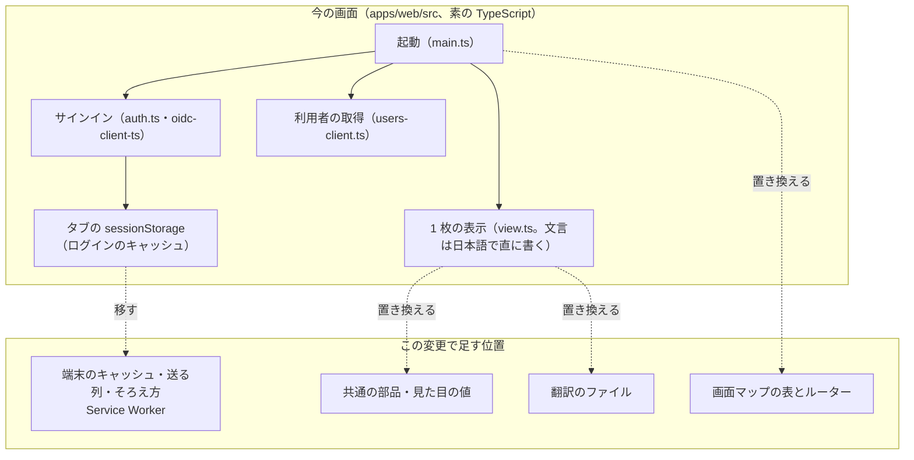
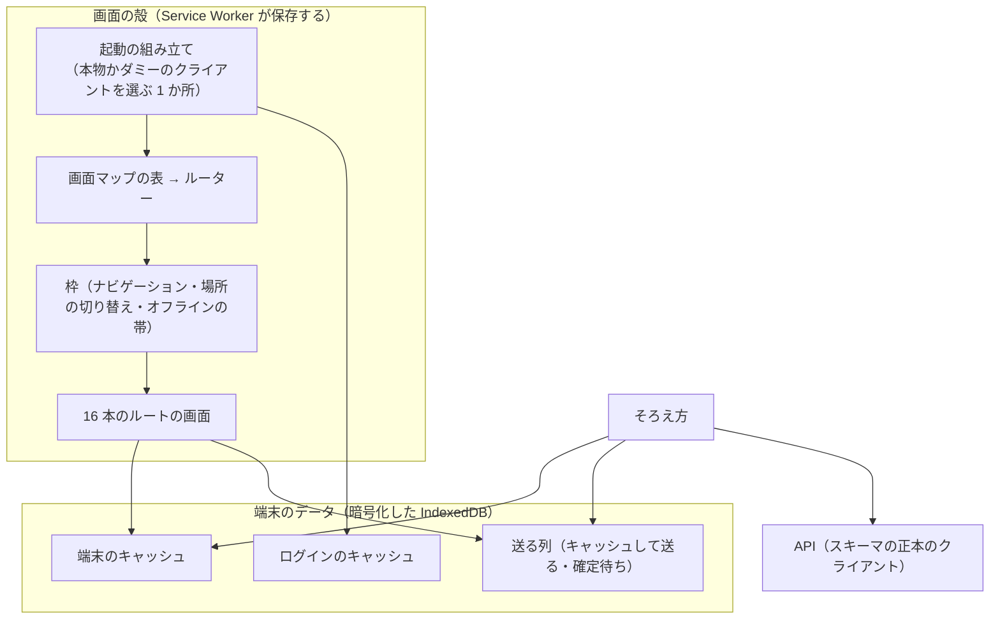
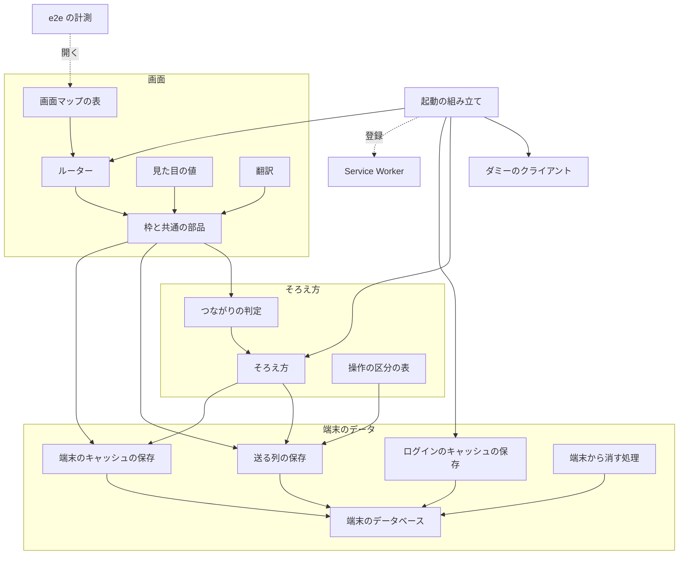
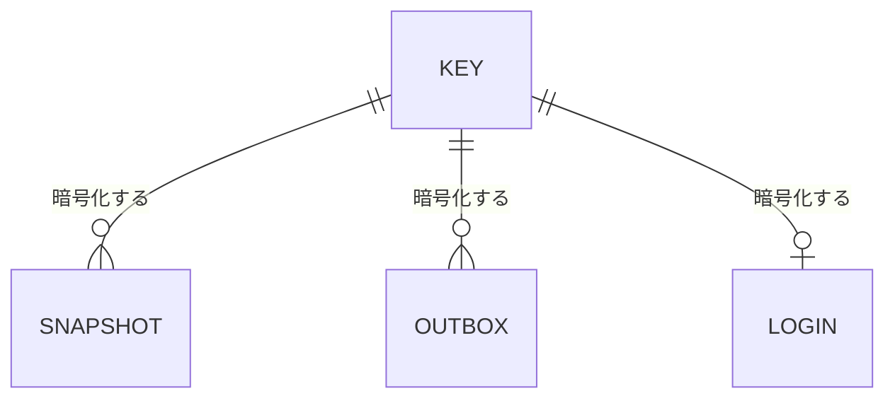
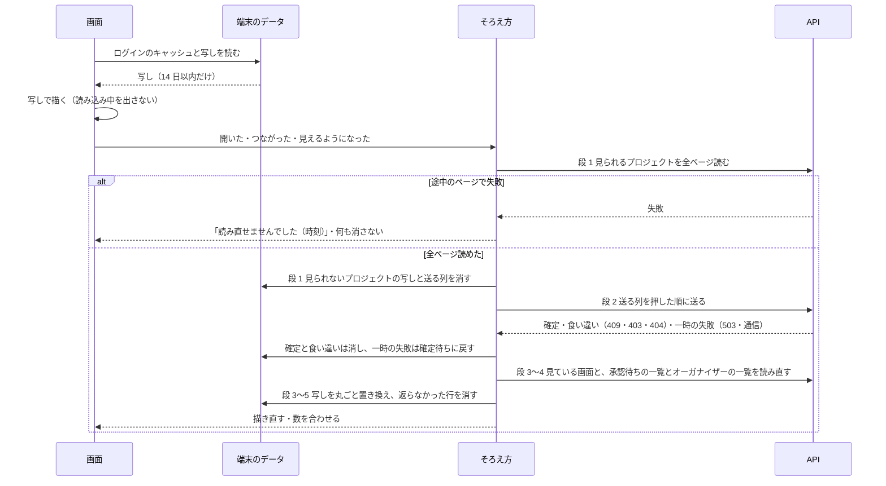

# 画面の基盤: どの端末でも、つながらなくても、同じ画面マップと部品で画面を使える（#12）

今の画面は、サインインした利用者の ID を出す 1 枚だけで、機能の画面（#28）が乗る画面マップ・共通の部品・端末の幅・オフライン・国際化の仕組みが無い（要求は [issue-12-requirements.md](./issue-12-requirements.md)）。画面の文書（[screens.md](../docs/design/screens.md)）が決めた形をそのまま実装へ下ろし、画面マップを 1 つの表としてコードに持ち、その表からルーター・e2e・操作の対応の検査を作る。端末に置くものはすべて、暗号化した 1 つの IndexedDB にまとめ、ルーター・Service Worker・IndexedDB の包みは広く使われているライブラリを使う。採らなかった案は「決定の記録」に、調べた候補は末尾の「外部の調査」にある。

## 今の姿

何が起きたか・目的・受け入れ条件は要求仕様（[issue-12-requirements.md](./issue-12-requirements.md)、正は [#12](https://github.com/devbasex/nd-factory/issues/12) の本文）にある。この文書は「どう解くか」と「なぜその解き方か」だけを書く。

設計に要る今の構造は次のとおりである。

- 画面は React を使っていない。`apps/web/package.json` の実行の時の依存は `@nd-factory/contracts` と `oidc-client-ts` だけである。React と TSX はこの課題で入れる（[プラットフォームの文書の言語と書き方の決まり](../docs/design/platform.md#言語と書き方の決まり)）
- サインインは `oidc-client-ts` の既定の保存先を使い、ログインのキャッシュがタブの `sessionStorage` にある。401 を受けたときの印（`nd.reauth`）も `sessionStorage` に置く
- API のクライアントは、スキーマの正本に既にある。`packages/contracts/src/client.ts` に、操作を呼ぶ口（`createOperationClient`）がある。本物の送信（`httpTransport`）とダミーの送信（`createDummyTransport`）も同じファイルにある。ただし操作の表の 90 の操作は、2026-11-25 の時点ですべて形が未定である（`packages/contracts/generated/pending.json` の 90 行）。ダミーデータも 90 件すべてが空である（`generated/dummy/index.json` の値が `null`）。形は機能ごとの子の課題が決める
- 画面のモック（`docs/design/mock/`）は、オーガナイザーの画面だけが新しい画面マップで、ほかは作り直す前の画面のままである
- CDN が画面の HTTP のルートへ `index.html` を返す書き換え（プラットフォームの文書の決定 141）は、`infra/lib/` にまだ無い。`grep -rn 'cloudfront.Function' infra/lib` の当たりは 0 件である。今の配信は `/` だけが画面を返す

## 文脈と制約

- 画面の文書の決定 20〜39・120 と、全体の設計の I4 は決め直さない（要求の前提 3）。この設計は、それらをどのファイルとライブラリで実現するかだけを決める
- スキーマの正本（#2）の API のクライアントの型とダミーデータを受ける。操作の形が決まる前の基盤は、テストで組んだ操作の表（`createOperationClient` の第 2 引数）と作り物の値で作る。本物の形は機能の画面（#28）がつなぐ（要求の前提 1）
- 1 つのスプリントで閉じる大きさにする（要求の前提 2）。機能の画面の中身は作らず、16 本の HTTP のルートには題と 5 つの状態だけを持つ仮の画面を置く
- 画面の外のコードは React と TSX を読まない。`packages/core/` の画面が使うモジュールは `node:` の組み込みを読まない（`AGENTS.md`）
- サインインとサインアウトのうち、API と Cognito を呼ぶ段は #4 が持つ。その段は、`sessions.create`・`sessions.delete`・RevokeToken・ログアウトのエンドポイント・サインアウトの途中のフラグと錠である。この課題は、端末から消す段（送る列を捨てる段と、データベースとキーを消す段。画面の文書の「サインアウトで消す」の 2. と 5.）と、#4 が段を差し込む口を持つ
- Web Push の購読と送信は #8 が持つ。この課題は Service Worker のファイルと登録を持ち、#8 がそこへ `push` の扱いを足す
- 例・テスト・ダミーデータには作り物の値だけを使う。CI は AWS の資格情報を持たない

## 解き方の全体像

- 画面マップの 16 本の HTTP のルートを 1 つの表としてコードに持ち、ルーター・ナビゲーション・e2e・操作の対応の検査がその表を読む
- 画面は共通の部品だけで組み、色や寸法は見た目の値の JSON から作った CSS の変数で引き、文言は翻訳のファイルのキーで引く。幅による形の違いは CSS だけが持つ
- API のレスポンスは端末のキャッシュへ、まだ送れていない操作は送る列へ、refresh token はログインのキャッシュへ、どれも 1 件ごとに暗号化して置く。Service Worker は画面の殻と画面の設定の値だけを保存する
- つながったとき・開いたとき・画面が見えるようになったときに、そろえ方が 5 つの段（画面の文書の [つながったときのそろえ方](../docs/design/screens.md#つながったときのそろえ方)）を通し、確定待ちはサーバーの答えを受けてから確定と出す
- 起動の組み立てが、`vite` の mode `dummy` のときだけダミーのクライアントを読み込む。本番の成果物にダミーが無いことをビルドの検査が確認する

## ドメインモデル

### コンテキスト

| コンテキスト | 何の語が 1 つの意味に決まるか |
| --- | --- |
| プラットフォーム（`platform`） | 端末のキャッシュ・ログインのキャッシュ・送る列・キャッシュして送る・確定待ち・つながってから押す・画面の殻 |
| 人の判断（`judgment`） | 承認の依頼・問い・承認資料。確定はサーバーが持つ |

関係は「公開された言語」である。画面はスキーマの正本の操作の形（要素の配列・理由のコード）だけでサーバーとやり取りし、確定待ちの照合（I4）はサーバーの答えにだけ従う。

### 集約

どの集約も端末の中だけにあり、サーバーの集約を書き換えない。

| 集約 | オーナー（書き換えてよいもの） | 根 | エンティティ | 値オブジェクト |
| --- | --- | --- | --- | --- |
| 端末のキャッシュ | 端末のキャッシュの保存 | 写しの 1 件（1 つのスプリント・1 つの承認の依頼など） | — | 種類・対象の ID・プロジェクトの ID・受け取った時刻・暗号文と初期化ベクトル（IV） |
| 送る列 | 送る列の保存 | 送る操作の 1 件 | — | 区分（キャッシュして送る・確定待ち）・操作の名前・要素・答えの ID（冪等キー）・押した時点のバージョン・押した時刻 |
| ログインのキャッシュ | ログインのキャッシュの保存 | 1 件 | — | 利用者の ID・暗号文と初期化ベクトル（IV） |

写しを読み直しで書き換えるのはそろえ方だけで、画面は端末のキャッシュの保存を通して読む。送る列へ足すのは画面の操作、送って消すのはそろえ方だけである。

### 不変条件

| # | 集約 | 条件 | 破れたときの扱い |
| --- | --- | --- | --- |
| I4 | 送る列（確定待ち） | 確定待ちは、つながっていない端末では送らず、確定と出さない。確定と出すのは、サーバーが今の状態と押した時点のバージョンを照合して成功を返したときだけである（全体の設計の I4。照合はサーバーが行う） | 409・403・404 は食い違いとして出し、入力した文を残す |
| IW1 | 端末のキャッシュ・送る列・ログインのキャッシュ | API のレスポンス・送る操作・refresh token は、取り出せない AES-GCM のキーで 1 件ごとに暗号化して IndexedDB に置く。Service Worker の保存先（Cache Storage）に API のレスポンスを置かない | 復号できない件があれば写しをすべて消し、オンラインなら読み直す |
| IW2 | 端末のキャッシュ | 受け取ってから 14 日を過ぎた写しは画面に出さない | 読むときに除き、開いたときに消す |
| IW3 | 送る列 | 同じ対象への確定待ちは 1 つだけである | 後から押した方で置き換える |
| IW4 | 送る列 | 「つながってから押す」の操作は、つながっていない端末で送る列に入らない | 押せない状態で「つながると使えます」を出す |
| IW5 | 端末のキャッシュ | 見られるプロジェクトの一覧を全ページ読み終える前に、プロジェクトの写しを消さない | 途中で失敗したら何も消さず、30 秒後に段 1 からやり直す |
| IW6 | 3 つすべて | サインアウトの後に、端末のキャッシュ・送る列・ログインのキャッシュ・キーが端末に残らない | データベースを丸ごと消し、消し終えるまで次へ進まない |

### ドメインイベント

番号は要求の「ドメインイベント」を引き継ぐ。

| # | イベント | 発生元 | 受け手 |
| --- | --- | --- | --- |
| E1 | サインインし、ログインのキャッシュを暗号化して置いた | ログインのキャッシュの保存（#4 のサインインの流れから呼ぶ） | 起動の組み立て（API のクライアントへ token を渡す） |
| E2 | API のレスポンスを受け、端末のキャッシュへ置いた | そろえ方 | 画面（表示を差し替える） |
| E3 | つながっていない端末で、端末のキャッシュから描いた | 画面 | オフラインの帯（最後に受け取った時刻を出す） |
| E4 | 確定待ちを押し、答えの ID を作った | 画面の操作 | 送る列・確定待ちのバッジ・オフラインの帯 |
| E5 | つながり、そろえ方の段 1〜5 を通した | そろえ方 | 画面・ナビゲーションの数・Web アプリのアイコンの数 |
| E6 | サーバーが確定待ちを照合し、確定か食い違いを返した | そろえ方（API の答え） | 送る列（消す）・操作の結果の表示 |
| E7 | 14 日を過ぎた写しを捨てた | 端末のキャッシュの保存 | 画面（空の状態を出す） |
| E8 | サインアウトし、端末のキャッシュとログインのキャッシュを消した | 端末から消す処理（#4 のサインアウトの段から呼ぶ） | 画面（サインインへ移る）・ほかのタブ |

## 構成要素

| 要素 | 責務 |
| --- | --- |
| 起動の組み立て | 画面の設定の値を読み、本物かダミーの API のクライアントを 1 か所で選び、各要素へ渡す。Service Worker を登録する |
| 画面マップの表 | 16 本の HTTP のルート（R1〜R16）と、画面ではない 3 つの戻り先を持つ。戻り先は、サインインの戻り（R2 の `/` で受ける認可コードと `state` の検索の値）・`/me/logins/return`・`/signed-out` である。ルートごとに群・題のキー・読む書く操作・オフラインで読めるかを持つ |
| ルーター | 画面マップの表から React Router のルートを作る。表に無い path は履歴を置き換えて `/` へ移す |
| 枠と共通の部品 | 画面の文書の「共通の部品」を `apps/web/src/ui/` に 1 ファイル 1 部品で置く。部品の一覧（カタログ）を持つ |
| 見た目の値 | Design Tokens Format の JSON（`tokens.json`・`tokens.dark.json`）と、そこから作った CSS の変数 |
| 翻訳 | 翻訳のファイル・言語の一覧・キーの引き当て・日時と数と金額の出し方 |
| 端末のデータベース | IndexedDB の 1 つのデータベースと、キー・暗号化・復号 |
| 端末のキャッシュの保存 | 写しの読み書き・14 日の除外・プロジェクト単位の削除 |
| 送る列の保存 | キャッシュして送る・確定待ちの読み書き・同じ対象の置き換え・24 時間の期限 |
| 操作の区分の表 | 書き込みの操作ごとの 3 つの区分（キャッシュして送る・確定待ち・つながってから押す） |
| つながりの判定 | つながっているかを画面へ出す。ダミーの mode では検索の値 `connection` に従う |
| そろえ方 | 段 1〜5 を通す。30 秒ごとの読み直しと、開いた・つながった・見えるようになったときの起動 |
| ログインのキャッシュの保存 | `oidc-client-ts` の `userStore` に渡す、暗号化した IndexedDB の保存 |
| 端末から消す処理 | 送る列を捨て、データベースとキーを消す（サインアウトの 2. と 5.）。#4 がサインアウトの段から呼ぶ |
| Service Worker | 画面の殻を保存し、画面の設定の値は読めなければ保存した値を返す。API と `/signed-out` を保存から返さない |
| ダミーのクライアント | スキーマの正本のダミーの送信を、検索の値 `scenario` で切り替える。mode `dummy` のときだけ読み込む |
| e2e の計測 | 3 つの幅・手数とページの数・回線の絞り・押せる要素の大きさを数える |

## データ構造

データベースは IndexedDB の 1 つ（名前は利用者ごとに分けない）で、4 つの保存先を持つ。暗号文の中身はサーバーのレスポンスと送る操作の写しで、写しは読み直しで丸ごと置き換える（画面の文書の決定 33。サーバーが正で、端末で書き換えた値を持たないため、過去の写しを残さない）。

| 保存先 | 列 | 型 | 空の値の扱い | 意味 |
| --- | --- | --- | --- | --- |
| キー | `id`・`key` | 文字列・`CryptoKey` | 許さない | 固定の 1 件（`main`）。AES-GCM 256 ビット、`extractable` は偽 |
| 写し | `id` | 文字列 | 許さない | 種類と対象の ID をつないだ値。同じ対象は 1 件 |
| 写し | `kind`・`projectId`・`receivedAt` | 文字列・文字列・数（UTC のミリ秒） | `projectId` だけ許す | 索引に使う平文。空はプロジェクトに属さない写し（場所の一覧・自分の設定）を指す |
| 送る列 | `answerId` | 文字列 | 許さない | 押したときに画面が作る答えの ID。冪等キーに使う |
| 送る列 | `targetKey`・`kind`・`pressedAt`・`projectId` | 文字列・文字列・数・文字列 | `projectId` だけ許す | 同じ対象の置き換えと 24 時間の期限と、プロジェクト単位の削除に使う平文。`kind` は「キャッシュして送る」か「確定待ち」 |
| ログイン | `storeKey`・`userId` | 文字列 | 許さない | `oidc-client-ts` が渡す保存のキーと、利用者の ID |
| 写し・送る列・ログイン | `iv`・`data` | バイト列 | 許さない | 12 バイトの初期化ベクトル（IV）と暗号文。中身は、写しはレスポンス、送る列は操作の名前・要素・押した時点のバージョン、ログインは `oidc-client-ts` の利用者の値（refresh token を含む） |

| 機能 | キー | 写し | 送る列 | ログイン |
| --- | --- | --- | --- | --- |
| 画面を描く | R | R | R | — |
| 操作を押す | R | C・U（キャッシュして送るの先映し） | C・U | — |
| そろえ方 | R | C・U・D | R・D | — |
| サインインする（#4） | C・R | — | — | C |
| token を取り直す | R | — | — | R・U |
| サインアウトで消す | D | D | D | D |

- 移行: 骨組みの `sessionStorage` のログインのキャッシュは移さず、起動のときに読まずに消す（決定 4）。データベースは版の番号を持ち、版が上がったら古い保存先を消して作り直す（写しは読み直せるため移さない。送る列だけは消す前に件数を出す）
- 検査の手段: 平文で読めないこと・Cache Storage に API のレスポンスが無いことを、単体テストと e2e で確認する（テスト設計の受け入れ条件 13）

## 入出力のコントラクト

API の操作の形は変えない。画面の側の約束は次の 4 つである。画面ごとの項目と状態は、機能の画面（#28）が [画面ごとの項目](../docs/design/screens.md#画面ごとの項目) に沿って作る。この課題の仮の画面は、 5 つの状態（読み込み中・空・エラー・見つからない・オフライン）を共通の部品で出すだけである。

### 画面マップの表

| 項目 | 中身 |
| --- | --- |
| `id` | `R1`〜`R16`。戻り先は `return:signin`・`return:link`・`return:signout` |
| `path` | 画面の文書の [HTTP のルートの一覧](../docs/design/screens.md#http-のルートの一覧) の path（`/p/:projectId/sprints/:sprintId` の形） |
| `group` | サインインの前・主・プロジェクト・チーム・自分 |
| `titleKey` | 翻訳のキー（例: `routes.sprintDetail.title`） |
| `operations` | [画面一覧](../docs/design/screens.md#画面一覧) の「読む・書く API の操作」の名前の並び |
| `offline` | 読める・読めない（同じ表の「オフライン」の列） |
| `nav` | ナビゲーションの 4 つの行き先のどれに当たるか（当たらなければ無し） |

表に無い path は、履歴を置き換えて `/` へ移す。戻り先の 3 つは表に載せて、移さずにそれぞれの処理（#4）へ検索の値ごと渡す。

### 操作の区分の表

書き込みの操作（操作の表の `access` が `write` で `endpoint` が `user`）ごとに、画面の文書の [操作の 3 つの区分](../docs/design/screens.md#操作の-3-つの区分) のどれに当たるかを持つ。確定待ちの操作は、押した時点のバージョンをどの値から取るか（承認資料の要約値・依頼の状態）を一緒に持つ。

### ダミーの mode の検索の値

| 検索の値 | 値 | 効き方 |
| --- | --- | --- |
| `scenario` | `normal`・`empty`・`error`・`slow`・`notFound` | ダミーのクライアントが返すサンプルを選ぶ（`createDummyTransport` の場面） |
| `connection` | `online`・`offline`・`pending` | つながりの判定がその値を返す。`pending` は確定待ちが 1 件ある状態を作る |

mode `dummy` でないビルドは、この 2 つの値を読まない。

### 翻訳のファイル

形・キーの決まり・言語の決め方は画面の文書の [国際化](../docs/design/screens.md#国際化) のとおりである。キーの型は `ja.json` から TypeScript の型として引き（JSON の import）、生成の段を足さない。

## 処理の流れ

起動からつながったときのそろえ方までの流れである。図は画面・端末のデータ・そろえ方・API の 4 つにまとめて描く。起動の組み立て・ルーター・部品・翻訳・Service Worker・ダミーのクライアント・e2e の計測は描かない（どれも構成要素の図にある）。確定待ちの状態の遷移は、画面の文書の [操作の 3 つの区分](../docs/design/screens.md#操作の-3-つの区分) の状態遷移図のとおりで、ここに描き直さない。段 1〜5 の中身は、画面の文書の [つながったときのそろえ方](../docs/design/screens.md#つながったときのそろえ方) の表にある。

## 非機能の実現方式

| 大項目 | 要求の条件 | 実現方式 | 確認の方法 |
| --- | --- | --- | --- |
| 可用性 | つながっていない端末でも、最後に受け取ったスプリントと承認資料を端末のキャッシュから読める | 画面の殻を Service Worker が保存し、画面は端末のキャッシュから先に描く | e2e で `connection=offline` と、ブラウザーのオフラインの両方で R5・R6 を開いて中身が出る |
| 性能・拡張性 | 手数の目標の待ち時間を、4G 相当に回線を絞った e2e で測る | Chromium の DevTools Protocol の回線の絞り（`Network.emulateNetworkConditions`）を e2e の共通の準備で掛け、場面の始まりから終わりの表示までの時間を測る。絞りの値は詳細設計で決める | 手数の目標の e2e が上限の時間を超えたら落ちる |
| セキュリティ | 端末のキャッシュとログインのキャッシュは、取り出せない AES-GCM のキーで 1 件ごとに暗号化する。サインアウトで消す。例とサンプルには作り物の値だけを使う | 端末のデータベースだけが Web Crypto を呼び、ほかの要素は平文を IndexedDB へ書けない形にする。サインアウトで消す処理はデータベースを丸ごと消す | 単体テストで IndexedDB の中身を直に読み、平文が無い。サインアウトの後にデータベースが無い |
| システム環境 | スマートフォン・タブレット・PC の主なブラウザ（iOS の Safari を含む） | e2e は Chromium で 3 つの幅を通す。Safari の振る舞いは受け入れ条件 8 の実機の確認で見る | 受け入れ条件 8 の結果を詳細設計に残す |

## 決定の記録

### 決定 1: 画面マップの表から HTTP のルートを作れるよう、ルーターに React Router を使う

- **質問**: 16 本の HTTP のルートと、表に無い path の置き換えを、どの仕組みで持つか
- **選んだ案**: React Router（`react-router`）を使い、画面マップの表からルートのオブジェクトを作って `createBrowserRouter` へ渡す。表に無い path は末尾のルート（`*`）で受け、履歴を置き換えて `/` へ移す
- 採らなかった案: TanStack Router（ルートを型で定義するのが中心で、表をデータとして持ち e2e と検査が読む形と合わない。ファイルからのルートの生成を前提にした使い方が多い）
- 採らなかった案: 自前のルーター（`history` と path の照合を自分で持つことになり、戻る・進む・スクロールの扱いを作り直す）
- **代償**: 実行の時の依存が 1 つ増える。React Router の大きい版の上げ（年 1 回ほど）に追随する
- 作り方: ライブラリやサービスを使う
- 比べた候補: LIB1 / LIB2
- 根拠: Value 15・Value 1（MVV バージョン 3）。LIB1

### 決定 2: 画面の殻だけを保存し API のレスポンスを残さないよう、Service Worker は vite-plugin-pwa の injectManifest で作り、保存の規則は自分で書く

- **質問**: Service Worker と Web App Manifest を、どう作り、ビルドの成果物とそろえるか
- **選んだ案**: `vite-plugin-pwa` を injectManifest の方式で使い、ビルドの成果物の一覧（画面の殻）と Manifest をプラグインに作らせる。Service Worker のコード（`apps/web/src/sw/service-worker.ts`）は自分で書く。画面の殻は保存から返す。`/config.json` はつながっていれば読み、読めなければ保存した値を返す。API と `/signed-out` は保存から返さない
- 採らなかった案: 同じプラグインの generateSW の方式（保存の規則を設定で書くため、API を保存しないことがコードに現れない。設定の 1 行の誤りで、API のレスポンスが Cache Storage に入る）
- 採らなかった案: Service Worker をすべて手で書く（ビルドのたびに変わる束のファイルの名前の一覧を、自分でビルドから集めて埋め込むことになる）
- **代償**: 開発の依存が増え、Service Worker の中に Workbox の保存の部品が入る
- 作り方: ライブラリやサービスを使う・標準に倣う
- 比べた候補: LIB3 / STD1
- 根拠: Value 3・Value 15（MVV バージョン 3）。STD1

### 決定 3: 暗号化を 1 か所に閉じるため、IndexedDB は idb で包み、暗号化は Web Crypto を直に呼ぶ小さな層で持つ

- **質問**: IndexedDB の読み書きと 1 件ごとの暗号化を、何で作るか
- **選んだ案**: IndexedDB は `idb` で Promise に包む。暗号化は端末のデータベースの要素だけが Web Crypto の AES-GCM を直に呼び、保存の関数は暗号文しか受けない形にする
- 採らなかった案: IndexedDB の API を直に使う（イベントの扱いとトランザクションの終わりの扱いを各所で書くことになる）
- 採らなかった案: 暗号化を各保存の要素に持たせる（暗号化を通らない書き込みの経路ができる）
- **代償**: 暗号化の層は自前で持つ。鍵の作り方・初期化ベクトルの作り方の誤りは自分たちのテストでしか見つけられない
- 作り方: ライブラリやサービスを使う・自前で作る・標準に倣う
- 比べた候補: LIB4 / STD2
- 根拠: Value 3・Value 11（MVV バージョン 3）。STD2

### 決定 4: ログインのキャッシュを暗号化した IndexedDB に置くため、oidc-client-ts の userStore を差し替え、骨組みの sessionStorage のキャッシュは読まずに消す

- **質問**: refresh token をどこからどう移すか。移した版を反映した後に、利用者にサインインし直しを求めるか（要求の「未決」の 4 行目）
- **選んだ案**: `oidc-client-ts` の `userStore` に、ログインのキャッシュの保存（`StateStore` の 4 つの関数を暗号化した IndexedDB で満たす）を渡す。サインインの流れの状態（`stateStore`）はタブの `sessionStorage` のまま残す。起動のときに `sessionStorage` の骨組みのログインのキャッシュ（`oidc.user:` で始まるキー）を読まずに消す。移した版の最初の起動で、利用者は 1 回サインインし直す
- 採らなかった案: `sessionStorage` の値を読んで IndexedDB へ移す（タブを閉じれば消える値で、移しても救える利用者は開いたままのタブだけになり、移す処理だけが残る）
- **代償**: 移した版を反映した直後に、開いていたタブの利用者は 1 回サインインし直す
- 作り方: ライブラリやサービスを使う
- 比べた候補: LIB6
- 根拠: Value 3・Value 13（MVV バージョン 3）

### 決定 5: 書き込みの操作の扱いを画面の都合で決めるため、操作の 3 つの区分は画面の側の表に持ち、全操作に区分があることをテストで確認する

- **質問**: 操作ごとの 3 つの区分を、スキーマの正本と画面のどちらに持つか
- **選んだ案**: `apps/web/src/offline/operation-classes.ts` に操作の名前と区分の表を持つ。書き込みの操作（`access` が `write`、`endpoint` が `user`）がすべて表にあり、表の名前がすべて操作の表にあることを単体テストで確認する
- 採らなかった案: 操作の表（`packages/contracts/`）に区分の列を足す（区分はつながっていない端末の画面の扱いで、API と MCP には意味が無い。MCP のツールの生成物にも出てしまう）
- **代償**: 操作を足す子は、画面の側の表にも 1 行足す。足し忘れはテストが落とす
- 根拠: Value 11・Value 13（MVV バージョン 3）

### 決定 6: 画面にしか無い操作と画面から呼べない操作を見つけるため、画面マップの表の操作の列と操作の表を両方向で照合する

- **質問**: 受け入れ条件 5 の「画面の操作とスキーマの正本の操作の一覧の対応」を、何と何で照合するか
- **選んだ案**: 単体テストで、次の両方向を確認する。画面マップの表の `operations` の名前は、すべて操作の表にある（`endpoint` が `user`）。操作の表の `endpoint` が `user` の操作は、すべてどれかのルートの `operations` にある。画面に出さないと画面の文書が決めた操作（委任から使うだけのものなど）は、理由つきの除外の一覧に置く
- 採らなかった案: 画面の文書の Markdown の表を読んで照合する（文書の書式の変更で検査が落ち、画面のコードとの対応にならない）
- **代償**: 画面マップの表の操作の列は、画面の文書の「画面一覧」と手でそろえる。食い違いはレビューで見る
- 根拠: Value 4（MVV バージョン 3）

### 決定 7: 部品の一覧と置き場を食い違わせないため、部品のカタログを 1 つのファイルに持ち、ディレクトリと両方向で照合する

- **質問**: 受け入れ条件 4 の「部品の一覧と置き場の一致」を、どう確認するか
- **選んだ案**: `apps/web/src/ui/catalog.ts` に部品の名前とファイルの名前の一覧を持ち、`apps/web/src/ui/` の部品のファイルとの一致を単体テストが両方向で確認する。部品の一覧と状態は詳細設計で決める（要求の「未決」）
- 採らなかった案: Storybook で部品の一覧を持つ（部品の数が画面の文書の表の 17 行で、一覧の確認のためだけに開発の依存と起動の手順が増える）
- **代償**: 部品を足すときはカタログにも 1 行足す
- 根拠: Value 13（MVV バージョン 3）

### 決定 8: 色や寸法の値を 1 か所に置くため、見た目の値の JSON から Style Dictionary で CSS の変数を作り、生成物をコミットする

- **質問**: Design Tokens Format の JSON（画面の文書のデザインの規約）を、どう CSS へ写すか
- **選んだ案**: Style Dictionary で `tokens.json`・`tokens.dark.json` から CSS の変数のファイルを作る。作る処理を `npm run generate` に足し、生成物をコミットする（CI の `check` が古さを落とす）
- 採らなかった案: 自前の変換の関数（Design Tokens Format の参照（`{color.base}` の形）と型ごとの書き出しを自分で持つことになる）
- **代償**: 開発の依存が 1 つ増える
- 作り方: ライブラリやサービスを使う
- 比べた候補: LIB5
- 根拠: Value 13・Value 15（MVV バージョン 3）。LIB5

### 決定 9: 待ち時間を毎回同じ条件で測れるよう、回線の絞りは Chromium の DevTools Protocol で掛け、e2e は Chromium の 3 つの幅で通す

- **質問**: 受け入れ条件 3 の「待ち時間の測り方を e2e の回線の絞りで決める」を、どの手段で行うか
- **選んだ案**: e2e の共通の準備で Chromium の DevTools Protocol の `Network.emulateNetworkConditions` を掛ける。e2e は Playwright の projects で 360・768・1280 px の 3 つの幅を持ち、手数とページの数は押した回数と移った path の数を数える共通の準備で数える
- 採らなかった案: Playwright のリクエストの差し替えで応答を遅らせる（遅れが要求の数だけ一律に足され、帯域の絞りにならない。画面の殻の大きさが待ち時間に効かない）
- **代償**: 回線の絞りは Chromium だけで効く。Safari の待ち時間は受け入れ条件 8 の実機の確認で測る
- 作り方: 標準に倣う
- 比べた候補: STD3
- 根拠: Value 1（MVV バージョン 3）。STD3

### 決定 10: 本番の成果物にダミーを入れないため、ダミーのクライアントは起動の組み立てで mode を見て動的に読み込み、ビルドの検査は成果物の中の目印の文字列を探す

- **質問**: 受け入れ条件 17 の「本番のビルドの成果物にダミーのクライアントとダミーのフラグが無い」を、どう保つか
- **選んだ案**: 起動の組み立てが `import.meta.env.MODE === "dummy"` のときだけダミーのクライアントを動的に import する。ダミーのモジュールは目印の定数を持つ。ビルドの検査（`apps/web/scripts/check-dummy-free.ts`）は、本番のビルドの成果物にその目印と検索の値の名前（`scenario`・`connection`）が無いことを確認する。検査は `npm run check` から呼ぶ
- 採らなかった案: 実行の時の設定の値でダミーを切り替える（本番の成果物にダミーのコードとサンプルが入る）
- **代償**: 検査のためにビルドを 1 回走らせるので、`npm run check` が長くなる
- 根拠: Value 2・Value 7（MVV バージョン 3）

### 決定 11: 利用者がモックを承認してから設計を承認できるよう、モックの作り直しは設計の Pull Request に載せる

- **質問**: 新しい画面マップのモック（受け入れ条件 1）を、どの Pull Request で作り直すか
- **選んだ案**: 設計の Pull Request に `docs/design/mock/` の作り直しを載せる。新しいページ「画面の基盤（#12）」に、16 本の HTTP のルートを 3 つの幅で描き、旧い側の画面のページを消す。マージの後にキャンバスへ公開し直す
- 採らなかった案: 実装の最初の Pull Request で作り直す（要求の検証手段は、設計承認ゲートの前に利用者がモックを承認すると決めている）
- **代償**: 設計の Pull Request に、文書のほかにモックの HTML が載る
- 根拠: Value 2（MVV バージョン 3）

## 影響と危険

- **働く範囲**: このリポジトリの画面（`apps/web/`）と、見た目の値の生成を足す `npm run generate`・ダミーの検査を足す `npm run check` だけである。利用先のリポジトリでは働かない
- **プロジェクトごとに違うもの**: 無い。環境ごとの値は今と同じく画面の設定の値（`/config.json`）から受ける
- **当たるモード**: `standard`（NDF の工程の振り分けの区分）

壊れうる箇所と扱いは次のとおりである。

| 箇所 | 何が起きうるか | 扱い |
| --- | --- | --- |
| 骨組みの利用者の表示（`main.ts`・`view.ts`・`auth.ts`） | #4 も同じファイルを触る（`sessions.create` へ移す） | この課題は表示を R14 の仮の画面へ移し、`auth.ts` は `userStore` だけを変える。`sessions.create` への切り替えは #4 に残す |
| サインインし直し | 移した版の反映の直後に、開いていたタブの利用者が 1 回サインインし直す | 決定 4 の代償。refresh token（秘密）の置き場と認証の状態を変える変更（C1・C2）として、リリース承認ゲートで人が見る |
| CDN の書き換え | 書き換え（決定 141）が無いと、本番で `/approvals` などを直に開くと画面が出ない | e2e は `vite preview` の書き換えで通す。書き換えの関数は `infra/` の変更で、この課題の範囲の外に置く（報告で起票を求める） |
| 操作の形の未定 | 90 の操作の形が未定で、そろえ方の段 1 の `projects.list` も形が無い | そろえ方は見られるプロジェクトを読む関数を受け取る形にし、テストは作り物の操作の表で組む。本物の形は機能の子がつなぐ |
| 束（バンドル）の大きさ | React・React Router・idb・Workbox の保存の部品が画面の殻に入る | 画面の殻は Service Worker が保存するため 2 回目以降の起動には効かない。初回の大きさは詳細設計で測って残す |
| 大きさ | 1 つのスプリントで閉じない | 機能の画面は作らず仮の画面に留める。超えると分かったら詳細設計で子を分ける（要求の前提 2） |

## 用語

| 用語 | 意味 | 用語集への反映 |
| --- | --- | --- |
| ログインのキャッシュ | サインインで受けた refresh token を含む利用者の値を、端末の IndexedDB に暗号化して置いたもの。タブを閉じても残り、サインアウトで消す | 追加（`platform`） |
| 送る列 | まだ送れていない操作（キャッシュして送る・確定待ち）を、押した順に端末の IndexedDB へ暗号化して溜めたもの | 追加（`platform`） |
| つながってから押す | その場で読む値が要る・取り消せない操作を、つながっていない端末では押せなくする扱い | 追加（`platform`） |
| 画面の殻 | 画面の HTML・JS・CSS・アイコン・翻訳のファイルの 1 揃い。Service Worker が保存する | 追加（`platform`） |

## テスト設計

| 受け入れ条件・不変条件 | どの振る舞いで縛るか | どう壊したら落ちるべきか |
| --- | --- | --- |
| 1 モックの承認 | 設計の Pull Request で利用者がモックを読み、承認する（手動） | — |
| 2・I4 確定待ち | つながっていない端末で確定待ちを押すと送る列に入り、送信が呼ばれず、確定と出ない。つながった後、作り物の操作の表で 409（待っていない・資料が変わった）を返すと食い違いが出て送る列から消える | 送る列を通さず直に送るように壊す・409 を確定として扱うように壊す |
| 3 手数と待ち時間 | 手数の目標の場面ごとに、押した回数・ページの数・絞った回線での待ち時間が上限以内 | 場面に 1 手足す・ページを 1 つ挟む・上限の時間を超える遅れを入れる |
| 4 部品の一覧 | カタログとディレクトリの部品のファイルが一致する | 部品のファイルを 1 つ足す・カタログの行を 1 つ消す |
| 5 操作の対応 | 画面マップの表の操作が操作の表にあり、`endpoint` が `user` の操作がすべてどれかのルートにある | ルートの操作の名前を 1 字変える・ルートから操作を 1 つ消す |
| 6 端末のキャッシュからの表示 | 写しのある状態でオフラインで R2 を開き、描き終えるまでの時間を測って残す | 写しを読む前に API を待つように壊す |
| 7 sessionStorage のログインのキャッシュ | 起動の後に `sessionStorage` に `oidc.user:` で始まるキーが無く、サインインの後もできない | `userStore` を既定に戻す |
| 8 実機の確認 | 実機で確認し、結果を詳細設計に残す（手動） | — |
| 9 詳細設計 | `issues/issue-12-design-detail.md` があり、全体の設計の決定を決め直していない（レビュー） | — |
| 10 HTTP のルート | 16 本の path を直に開くとその画面の題が出る。表に無い path は履歴を置き換えて `/` へ移る | 表から 1 行消す・置き換えを `push` に変える |
| 11 ナビゲーション | 3 つの幅で 4 つの行き先が同じ順で、決まった帯に出る | 幅ごとに並びを変える・帯の置き場を変える |
| 12 押せる要素 | 3 つの幅のすべてのルートで、押せる要素（文中のリンクを除く）の幅と高さが 44 px 以上 | ボタンの高さを 40 px にする |
| 13・IW1 暗号化 | IndexedDB の写し・送る列・ログインの中身を直に読んで作り物の値の文字列が無い。Cache Storage に API の URL の項目が無い | 暗号化を外す・Service Worker で API を保存する |
| 14・IW2・IW6 期限と消す | 15 日前の写しは画面に出ない。サインアウトの後にデータベースが無い | 期限の比較を外す・データベースの削除を外す |
| 15・IW4 3 つの区分 | オフラインで「つながってから押す」は押せず文が出る。「キャッシュして送る」は押せ、つながると溜めた順に送られる | 区分の表を見ずに押せるようにする・送る順を逆にする |
| 16 言語と時刻帯 | 言語を英語へ替えると文言が `en.json` の文になり、日時が設定の時刻帯で出る。`ja.json` と `en.json` のキーの集合が同じ | 文言を直に書く・時刻帯を渡さない・片方のファイルのキーを消す |
| 17 ダミー | 本番のビルドの成果物に目印と検索の値の名前が無い。mode `dummy` では `scenario`・`connection` で画面の状態が変わる | 起動の組み立てでダミーを静的に import する |
| IW3 同じ対象 | 同じ承認の依頼に 2 回押すと確定待ちは 1 件で、後の値が残る | 置き換えずに足すように壊す |
| IW5 全ページ | 2 ページ目の読み出しが失敗すると、どの写しも送る列も消えない | 1 ページ目だけで消すように壊す |

## 設計の結果

| 課題 | 扱い | 統合先 | 触るファイル |
| --- | --- | --- | --- |
| #12 | 実装する | — | `apps/web/package.json`、`package-lock.json`、`package.json`、`apps/web/tsconfig.json`、`apps/web/vite.config.ts`、`apps/web/index.html`、`apps/web/playwright.config.ts`、`apps/web/src/main.ts`（消す）、`apps/web/src/view.ts`（消す）、`apps/web/src/main.tsx`、`apps/web/src/auth.ts`、`apps/web/src/app/compose.ts`、`apps/web/src/app/App.tsx`、`apps/web/src/routes/route-table.ts`、`apps/web/src/routes/router.tsx`、`apps/web/src/screens/`、`apps/web/src/ui/`、`apps/web/src/ui/catalog.ts`、`apps/web/src/ui/tokens.json`、`apps/web/src/ui/tokens.dark.json`、`apps/web/src/ui/tokens.generated.css`、`apps/web/src/i18n/ja.json`、`apps/web/src/i18n/en.json`、`apps/web/src/i18n/locales.ts`、`apps/web/src/i18n/translate.ts`、`apps/web/src/i18n/format.ts`、`apps/web/src/offline/db.ts`、`apps/web/src/offline/crypto.ts`、`apps/web/src/offline/cache-store.ts`、`apps/web/src/offline/outbox.ts`、`apps/web/src/offline/operation-classes.ts`、`apps/web/src/offline/connectivity.ts`、`apps/web/src/offline/sync.ts`、`apps/web/src/offline/login-store.ts`、`apps/web/src/offline/erase.ts`、`apps/web/src/sw/service-worker.ts`、`apps/web/src/dummy/dummy-client.ts`、`apps/web/scripts/build-tokens.ts`、`apps/web/scripts/check-dummy-free.ts`、`apps/web/test/`、`apps/web/e2e/` |

## 未確認のまま残ること

| 項目 | 内容 |
| --- | --- |
| 実機での振る舞い | iOS の Safari での Web Push・鍵の置き場と強さ・Badging と Background Sync・ホーム画面に加えた場合と加えない場合のキャッシュ・30 日に近いログインのキャッシュから通知を開く・access token を 15 分にしたときの取り直し・RFC 8291 の細部は、実機でしか分からない。受け入れ条件 8 の実機の確認で調べ、結果を詳細設計に残す |
| 端末のキャッシュの量 | ブラウザーが IndexedDB に許す量は端末ごとに違う。量の上限は詳細設計で決め（要求の「未決」）、`navigator.storage.estimate()` の値を実機で測る |
| API をつないだ後の待ち時間 | ダミーで回線を絞って測った値は、API をつないだ後に骨組みの環境で測り直す（要求の前提 5） |

## 外部の調査

| 種類 | 調べるか | 理由 |
| --- | --- | --- |
| 標準・仕様 | 調べる | Service Worker・Web Crypto と IndexedDB・回線の絞りの手段に仕様がある。画面の文書が調べた行は、その文書を出典として引く |
| 主要な製品 | 調べない | 画面の振る舞い（ナビゲーション・オフライン・区切りの幅）は、全体の設計が主要な製品を比べて決めた（[screens.md の外部の調査](../docs/design/screens.md#外部の調査) の PRD20〜PRD23）。この設計は作り方だけを決める |
| ライブラリとサービス | 調べる | ルーター・Service Worker の作り方・IndexedDB の包み・見た目の値の変換を、自前で作るかを決める |

### 標準・仕様

| # | 標準・仕様 | 何を定めているか | 設計への反映 | 出典 |
| --- | --- | --- | --- | --- |
| STD1 | Web Application Manifest と Service Workers（W3C） | Manifest の項目、`fetch` の事象と Cache の保存先、登録とバージョンの切り替え | 画面の殻だけを保存し、API を保存しない（決定 2） | [screens.md の STD20](../docs/design/screens.md#標準仕様)（2026-11-17 取得）を引く（2026-11-25） |
| STD2 | Web Cryptography API と Indexed Database API 3.0（W3C） | `extractable` が偽のキーは生の値を取り出せない。`CryptoKey` を IndexedDB に置ける。AES-GCM | 暗号化の層（決定 3） | [screens.md の STD24](../docs/design/screens.md#標準仕様)（2026-11-17 取得）を引く（2026-11-25） |
| STD3 | Chrome DevTools Protocol の Network ドメイン | `Network.emulateNetworkConditions` で遅延と上り下りの帯域を絞る | e2e の回線の絞り（決定 9） | https://chromedevtools.github.io/devtools-protocol/tot/Network/ （2026-11-25） |

### ライブラリとサービス

| # | 候補 | バージョン | ライセンス | 最後のリリースの日付 | 終了のアナウンス | 要件を満たすか | 出典 |
| --- | --- | --- | --- | --- | --- | --- | --- |
| LIB1 | `react-router` | 8.5.3 | MIT | 2026-11-24 | 無し | 満たす。React 19.2.7 以上を求める。ルートをオブジェクトで渡す使い方（Data Mode）があり、表から作れる | `npm view react-router`（2026-11-25）・ https://reactrouter.com/start/modes （2026-11-25） |
| LIB2 | `@tanstack/react-router` | 1.170.46 | MIT | 2026-10-22 | 無し | 満たすが、ルートを型で書く使い方が中心で、表をデータとして持つ形には合わない | `npm view @tanstack/react-router`（2026-11-25） |
| LIB3 | `vite-plugin-pwa` | 2.0.0 | MIT | 2026-10-03 | 無し | 満たす。Vite 8 に対応し、`workbox-build` 7.4.1 を使う。injectManifest の方式で自前の Service Worker のコードに成果物の一覧を埋め込む | `npm view vite-plugin-pwa`（2026-11-25）・ https://vite-pwa-org.netlify.app/guide/inject-manifest （2026-11-25） |
| LIB4 | `idb` | 8.0.4 | ISC | 2026-10-06 | 無し | 満たす。依存が無く、IndexedDB を Promise で包む | `npm view idb`（2026-11-25） |
| LIB5 | `style-dictionary` | 5.8.0 | Apache-2.0 | 2026-11-03 | 無し | 満たす。開発の依存だけで、見た目の値の JSON から CSS の変数を作る | `npm view style-dictionary`（2026-11-25） |
| LIB6 | `oidc-client-ts`（今の依存） | 3.5.0 | Apache-2.0 | 2026-03-13（登録簿の更新日） | 無し | 満たす。設定の `userStore` に `StateStore`（`set`・`get`・`remove`・`getAllKeys` の 4 つ）を渡せる | `npm view oidc-client-ts@3.5.0`（2026-11-25）・`node_modules/oidc-client-ts/dist/types/oidc-client-ts.d.ts` の 1436・1917 行（2026-11-25） |

### 確認できなかったこと

| 対象 | 試した手段 | 結果と理由 |
| --- | --- | --- |
| `wouter`・`fake-indexeddb`・`happy-dom`・`@testing-library/react`・`@axe-core/playwright` | `npm view`（2026-11-25） | 取得したが、種類ごとの候補の上限（6 件）を超えるため比べていない。テストの道具は実装（`tdd-cycle`）で選ぶ |
| Design Tokens Format Module の今の版 | 試していない | 未確認。形は画面の文書のデザインの規約が決めた |

調べた量: 候補 9 件・取得の試み 19 回。
