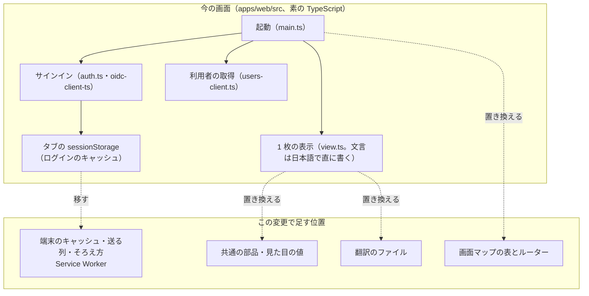
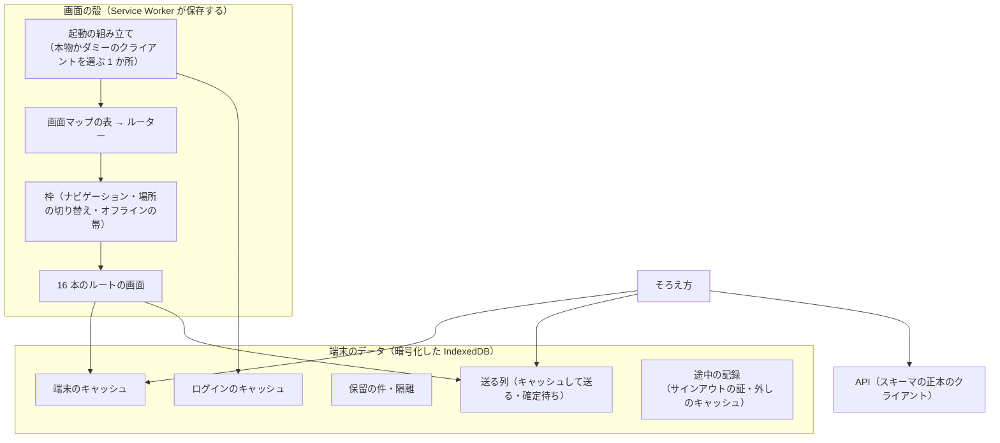
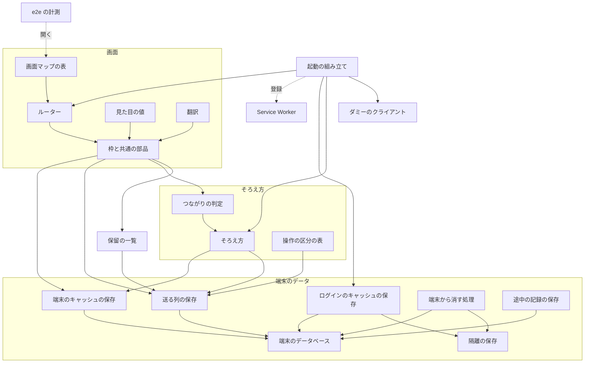
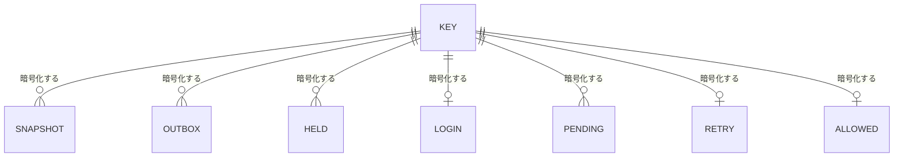
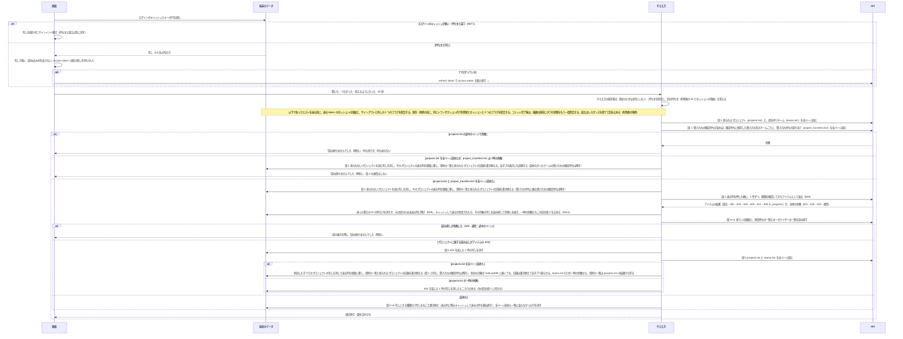

# 画面の基盤: どの端末でも、つながらなくても、同じ画面マップと部品で画面を使える（#12）

今の画面は、サインインした利用者の ID を出す 1 枚だけで、機能の画面（#28）が乗る画面マップ・共通の部品・端末の幅・オフライン・国際化の仕組みが無い（要求は [issue-12-requirements.md](./issue-12-requirements.md)）。画面の文書（[screens.md](../docs/design/screens.md)）が決めた形をそのまま実装へ下ろし、画面マップを 1 つの表としてコードに持ち、その表からルーター・e2e・操作の対応の検査を作る。端末のデータは種類ごとに保存先を分け、API のキャッシュ・未送信の操作・ログインのキャッシュなどは暗号化して IndexedDB に置く（内訳は「データ構造」の「端末の保存先」）。ルーターと IndexedDB の包みは広く使われているライブラリを使い、Service Worker は画面の文書の決定 28 のとおり自前で書く（採らなかった案は「決定の記録」、調べた候補は末尾の「外部の調査」にある）。

## 今の姿

何が起きたか・目的・受け入れ条件は要求仕様（[issue-12-requirements.md](./issue-12-requirements.md)、正は [#12](https://github.com/devbasex/nd-factory/issues/12) の本文）にある。この文書は「どう解くか」と「なぜその解き方か」だけを書く。

設計に要る今の構造は次のとおりである。

- 画面は React を使っていない。`apps/web/package.json` の実行の時の依存は `@nd-factory/contracts` と `oidc-client-ts` だけである。React と TSX はこの課題で入れる（[プラットフォームの文書の言語と書き方の決まり](../docs/design/platform.md#言語と書き方の決まり)）
- サインインは `oidc-client-ts` の既定の保存先を使い、ログインのキャッシュがタブの `sessionStorage` にある。401 を受けたときのフラグ（`nd.reauth`）も `sessionStorage` に置く
- API のクライアントは、スキーマの正本に既にある。`packages/contracts/src/client.ts` に、操作を呼ぶインターフェース（`createOperationClient`）がある。本物の送信（`httpTransport`）とダミーの送信（`createDummyTransport`）も同じファイルにある。ただし操作の表の 90 の操作は、2026-11-25 の時点ですべて形が未定である（`packages/contracts/generated/pending.json` の 90 行）。ダミーデータも 90 件すべてが空である（`generated/dummy/index.json` の値が `null`）。形は機能ごとの子の課題が決める
- 画面のモック（`docs/design/mock/`）は、オーガナイザーの画面だけが新しい画面マップで、ほかは作り直す前の画面のままである
- CDN が画面の HTTP のルートへ `index.html` を返す書き換え（プラットフォームの文書の決定 141）は、`infra/lib/` にまだ無い。`grep -rn 'cloudfront.Function' infra/lib` の当たりは 0 件である。今の配信は `/` だけが画面を返す。書き換えは [#177](https://github.com/devbasex/nd-factory/issues/177) が作る

## 文脈と制約

- この文書で使う語（写し・送る列・保留の件・隔離・錠など）の意味は、末尾の「用語」にある
- 画面の文書の決定 20〜39・120 と、全体の設計の I4 は決め直さない（要求の前提 3）。この設計は、それらをどのファイルとライブラリで実現するかだけを決める
- スキーマの正本（#2）の API のクライアントの型とダミーデータを受ける。操作の形が決まる前の基盤は、テストで組んだ操作の表（`createOperationClient` の第 2 引数）と作り物の値で作る。本物の形は機能の画面（#28）がつなぐ（要求の前提 1）
- 1 つのスプリントで閉じる大きさにする（要求の前提 2）。機能の画面の中身は作らず、16 本の HTTP のルートには題と 5 つの状態だけを持つ仮の画面を置く
- 画面の外のコードは React と TSX を読まない。`packages/core/` の画面が使うモジュールは `node:` の組み込みを読まない（`AGENTS.md`）
- サインインとサインアウトは、API と Cognito を呼ぶ段とタブ間の排他を [#4](https://github.com/devbasex/nd-factory/issues/4) が持ち、端末のデータを置く段と消す段をこの課題が持つ。分担は下の表のとおりである
  - 表のうち #4 が呼ぶ #12 の書き込みと削除の処理は、#4 が持つ排他の下でだけ呼ばれる
  - 表の「サインインの確定」と「取り直せないログインのキャッシュ」の行は、#4 の設計がこの 2 行の呼び出しを受けると明記するまで完了にしない。#12 の実装担当は、その 2 つの経路を「完了」と報告しない
  - #12 の実装完了を判定するレビュー担当は、#4 の設計で両行の呼び出し契約が確定し、サインインの確定と再サインインの結合テストが通ったことを確認してから、その経路を完了と扱う（下の「壊れうる箇所」）
- #12 と #4 の反映の順: サインインの確定の切り替え（`userStore` のメモリ化と起動の順序）は、#4 の「サインインを確定する」呼び出しと同じ Pull Request か、同じリリースで有効にする。#4 の分が入るまでは、既存のサインインの経路を変えない
  - 既存の経路とは、`oidc-client-ts` の既定の保存先（タブの `sessionStorage`）と、`signinRedirectCallback`・`getUser` で動く今の起動である。画面の組み立てを置き換える（`main.ts` を消す）変更が先に入る場合も、この経路は同じに保つ
  - 切り替えに含むのは、`userStore` の差し替え、データ構造の「ログインキャッシュ行に置く項目」の起動の順序、`sessionStorage` の骨組みのキャッシュを読まずに消すこと（決定 4）である。受け入れ条件 7 は、切り替えを有効にした後に満たしたとする
- この文書は「ログイン」だけの語を使わず、次の 3 つに分ける
  - 連携ログインは、アカウントに登録した IdP のサインイン手段で、解除には `logins.delete` を使う（画面の文書は「ログインを外す」と書く）
  - ログインのキャッシュは、端末に保存する認証情報（refresh token など）である
  - ログインキャッシュ行は、そのキャッシュを置く IndexedDB の保存レコードである
- これ以降の「連携ログインの解除」は、自分の設定（R14）で、このタブのセッションを発行した連携ログインを解除する操作を指す（画面の文書の [サインアウトで消す](../docs/design/screens.md#サインアウトで消す) の「今のログインを外した後」）
- `R1`〜`R16` は画面マップの HTTP のルートの番号である。番号と画面名の対応は、画面の文書の [HTTP のルートの一覧](../docs/design/screens.md#http-のルートの一覧) にある
- 「子」は全体の設計（[#24](https://github.com/devbasex/nd-factory/issues/24)）から切り出した子の課題を、「NDF」は nd-factory が画面から回す開発の工程の仕組み（開発の AI 向けプラグイン）を指す

| 担うこと | 持つ課題 | 中身 |
| --- | --- | --- |
| API と Cognito を呼ぶ段 | #4 | `sessions.create`・`sessions.delete`・RevokeToken（refresh token の取り消し）・Cognito のログアウトのエンドポイント |
| `userStore` の `set` をメモリに留める | #12 | 入出力のコントラクトの「`userStore` の `set` をメモリに留める」 |
| サインインの確定 | #4 が呼び、#12 が書く | 入出力のコントラクトの「サインインの確定」 |
| 取り直しの結果の保存 | #4 が呼び、#12 が書く | 入出力のコントラクトの「取り直しの結果の保存」 |
| 取り直せないログインのキャッシュ | #4 が見つけ、#12 が消す | 入出力のコントラクトの「取り直せないログインのキャッシュ」 |
| サインアウト中の状態の記録 | #4 | 画面の文書の「サインアウトの途中のフラグ」を `localStorage` に置き、段を進める |
| タブ間の排他 | #4 | Web Locks API（`navigator.locks.request`）でアプリの名前の 1 つの錠を取り、サインアウトの段とサインインの流れを同時に 1 つのタブでだけ打つ。画面の文書の「実行の排他と照合」。サインアウトの途中のフラグと連携ログインの解除の途中のフラグは、この錠を持って置く。#12 も同じ錠を取る。取るのは、API へ送る直前の照合から送信の開始までの間（処理の流れの「送信の直前の照合と token の固定」）と、利用者の取り下げで送る列の件を消すか保留に移す間（処理の流れの「取り下げと送信の開始の排他」）だけである |
| メモリの access token の破棄と、ほかのタブへの通知 | #4 | access token をメモリから捨てる。`BroadcastChannel` と `storage` のイベントで、ほかのタブに「サインアウトを始めた」を通知する |
| サインアウトの証と外しのキャッシュの保存先 | 中身と使い方は #4、保存先と暗号化は #12 | 入出力のコントラクトの「サインアウトの証と外しのキャッシュの保存先」 |
| 端末のデータを消す段 | #12 | 入出力のコントラクトの「端末のデータを消す段」 |
| メモリの写しと鍵の参照の破棄と、ほかのタブの接続 | #12 | 入出力のコントラクトの「メモリの写しと鍵の参照の破棄と、ほかのタブの接続」 |

この文書が「サインアウトの 2.」のように番号で呼ぶのは、画面の文書の [サインアウトで消す](../docs/design/screens.md#サインアウトで消す) の次の段である。番号の前に、フラグを置いた直後の「証の準備」の段がある。

| 段 | すること | 担当 |
| --- | --- | --- |
| 証の準備 | 3. で使う access token（サインアウトの証）を端末に置く | #4。保存と暗号化は #12 |
| 1. | この端末の Web Push の購読を外し、サーバーの通知先からこの端末を外す | #4（購読の仕組みは #8） |
| 2. | 利用者が破棄を確認した送る列と保留の件を捨て、ほかの件を隔離する | #4 が呼び、#12 が実行する |
| 3. | `sessions.delete` を送り、API の側でこのセッションを断つ | #4 |
| 4. | refresh token を Cognito で取り消す（RevokeToken） | #4 |
| 5. | メモリの access token を捨て、端末のデータベースとキー、`sessionStorage` のログインをつなぐ流れのキャッシュを消す | #4。データベースとキーの削除と、写しと鍵の参照の破棄は、#4 が呼び #12 が実行する |
| 6. | Cognito のログアウトのエンドポイントへ移る | #4 |
| 7. | 専用の戻り先で、Cognito のブラウザーセッションが消えたことを確かめる | #4 |

段の進み具合は、画面の文書の「サインアウトの途中のフラグ」に持つ。フラグの `api_revoke` は API の側のセッションの取り消しの結果で、値は「確定」（取り消しを確認した）か「確定できず」である。

- Web Push の購読と送信は #8 が持つ。この課題は Service Worker のファイルと登録を持ち、#8 がそこへ `push` の扱いを足す
- 例・テスト・ダミーデータには作り物の値だけを使う。CI は AWS の資格情報を持たない

## 解き方の全体像

- 画面マップの 16 本の HTTP のルートを 1 つの表としてコードに持ち、ルーター・ナビゲーション・e2e・操作の対応の検査がその表を読む
- 画面は共通の部品だけで組み、色や寸法は見た目の値の JSON から作った CSS の変数で引き、文言は翻訳のファイルのキーで引く。幅による形の違いは CSS だけが持つ
- IndexedDB に置くものは、どれも 1 件ごとに暗号化する。端末のキャッシュへ置くのは、次の 2 つだけである。API のレスポンスのうち画面の文書の決定 29 が保存すると決めた種類と、画面の文書が端末に置くと決めた画面の状態（最後に開いたプロジェクト・最後に開いた会話・畳む節の開閉）である。まだ送れていない操作は送る列へ、refresh token はログインのキャッシュへ置く。送れないと決まった件は、利用者が破棄を確認するまで保留の件として残す（「保留の件と隔離」）。サインアウトと連携ログインの解除をタブを閉じた後も続けるための値（サインアウトの証と外しのキャッシュ）は、途中の記録へ置く。保存する種類は下の「写しにする種類の表」に限り、表に無い画面（操作の記録・メンバー・費用・課題候補など）のレスポンスは書かない。Service Worker は画面の殻と画面の設定の値だけを保存する
- つながったとき・開いたとき・画面が見えるようになったときに、そろえ方が 5 つの段（画面の文書の [つながったときのそろえ方](../docs/design/screens.md#つながったときのそろえ方)）を通し、確定待ちはサーバーの答えを受けてから確定と出す
- 起動の組み立てが、`vite` の mode `dummy` のときだけダミーのクライアントを読み込む。本番の成果物にダミーが無いことをビルドの検査が確認する

そろえ方の 5 つの段は次のとおりである（決まりは「処理の流れ」の「段ごとの決まり」）。

| 段 | 何をするか |
| --- | --- |
| 段 1 | 見られるプロジェクト（`projects.list`）と席を持つチーム（`teams.list`）を全ページ読み、見られなくなったプロジェクトの写しと開いているタブの表示を消し、その送る列の件を保留に移す |
| 段 2 | 送る列を押した順に 1 件ずつ送り、結果で確定か食い違いを出す |
| 段 3 | 見ている画面を読み直し、写しを置き換える |
| 段 4 | 承認待ちの一覧とオーガナイザーの一覧を読み直し、数を合わせる |
| 段 5 | 読み直しで返らなかった行を消し、404 を返したプロジェクトは段 1 の失効の確認をやり直す |

## ドメインモデル

### コンテキスト

| コンテキスト | 何の語が 1 つの意味に決まるか |
| --- | --- |
| プラットフォーム（`platform`） | 端末のキャッシュ・ログインのキャッシュ・送る列・キャッシュして送る・確定待ち・つながってから押す・画面の殻 |
| 人の判断（`judgment`） | 承認の依頼・問い・承認資料。確定はサーバーが持つ |

2 つのコンテキストの関係は、DDD の「公開された言語」（両者が共有する、文書化された形でだけやり取りする関係）である。画面はスキーマの正本の操作の形だけでサーバーとやり取りする。API のリクエストの本文はアイテムの配列で、レスポンスは同じ順のアイテムの結果（成功か、状態の数と理由のコード）の配列である（[API の文書の本文は配列](../docs/design/api.md#本文は配列)）。送る列の 1 件は、このリクエストの本文に入るアイテム 1 件に当たる。確定待ちの照合（I4）はサーバーの答えにだけ従い、確定かどうかは送ったアイテムの結果で決める。

### 集約

どの集約も端末の中だけにあり、サーバーの集約を書き換えない。

| 集約 | オーナー（書き換えてよいもの） | 根 | エンティティ | 値オブジェクト |
| --- | --- | --- | --- | --- |
| 端末のキャッシュ | 端末のキャッシュの保存 | 写しの 1 件（1 つのスプリント・1 つの承認の依頼など） | — | 種類・対象の ID・含むプロジェクトの ID の集合・受け取った時刻・暗号文と初期化ベクトル（IV） |
| 送る列（保留の件を含む） | 送る列の保存 | 送るアイテムの 1 件（リクエストの本文の配列に入るアイテム 1 件） | — | 区分（キャッシュして送る・確定待ち）・操作の名前・対象の ID・操作の入力・答えの ID（冪等キー）・照合の値（確定待ちだけ。読んだときの `version`、`approvals.answer` では加えて `material_digest`）・押した時刻・送る順の連番・送った時刻・期限（確定待ちだけ） |
| ログインのキャッシュ | ログインのキャッシュの保存 | 1 件 | — | 利用者の ID・セッションの指紋・refresh token の期限・暗号文と初期化ベクトル（IV） |
| 隔離 | 隔離の保存 | 持ち主 1 人分の隔離（その利用者のキーと件） | 隔離した送る列の件・保留の件 | 持ち主のタグ（HMAC）・移し終えた版 |
| 途中の記録 | 途中の記録の保存（#4 だけが呼ぶ） | サインアウトの証の 1 件と、外しのキャッシュの 1 件 | — | 種類・セッションの指紋・暗号文と初期化ベクトル（IV） |

写しを読み直しで書き換えるのはそろえ方だけで、画面は端末のキャッシュの保存を通して読む。送る列へ足すのは画面の操作で、送って消すか保留に移すのはそろえ方と版の上げである。保留の件を消すのは、利用者の破棄の確認とサインアウトの確認と、取り下げの後に届いた成功の結果（「取り下げた後に届いた結果」）だけである。

### 不変条件

| # | 集約 | 条件 | 破れたときの扱い |
| --- | --- | --- | --- |
| I4 | 送る列（確定待ち） | 確定待ちは、つながっていない端末では送らず、確定と出さない。確定と出すのは、サーバーが今の状態と押した時点のバージョンを照合し、送ったアイテムの結果が成功（`ok` が真）だったときだけである（全体の設計の I4。照合はサーバーが行う）。HTTP の状態が 200 でも、アイテムの結果が失敗なら確定と出さない | アイテムの結果の 409（`version_mismatch`・`state_mismatch`・`project_transfer_in_progress`・`credential_rotation_in_progress`）と、1 回目の送信の 403・404 は食い違いとして出し、再送の 403・404 は結果未確認にする。どちらも入力した文を保留の件に残す。409 `in_progress` は食い違いにせず、確定待ちのまま送り直す（処理の流れの「段 2 の結果の適用」） |
| IW1 | 端末のキャッシュ・送る列・保留の件・隔離・ログインのキャッシュ・途中の記録・送信の待機・見られるプロジェクトの記録 | API のレスポンス・送る操作・refresh token・サインアウトの証・外しのキャッシュ・待機の期限・見られるプロジェクトの並びは、取り出せない AES-GCM のキーで 1 件ごとに暗号化して IndexedDB に置く。Service Worker の保存先（Cache Storage）に API のレスポンスを置かない | 下の「復号できないとき」の表のとおり、保存先ごとに扱う |
| IW2 | 端末のキャッシュ | 受け取ってから 14 日を過ぎた写しは画面に出さない | 読むときに除き、開いたときに消す |
| IW9 | 送る列（確定待ち） | 押してから 24 時間を過ぎた確定待ちは送らない（画面の文書の決定 32） | そろえ方が各アイテムを送る直前に期限を比べ、過ぎていれば送らずに保留に移す。利用者に出す文は、送り始めた印（`sendStarted`）で分ける。印が偽の件（一度も送っていない）は「期限が過ぎたため送りませんでした。もう一度操作してください」を対象ごとに出す。印が真の件は、前の回の送信がサーバーで確定している場合があるため、送らなかったとは出さず、「結果未確認」として対象の画面で今の状態を確かめるよう案内する（処理の流れの「段 2 の送る前の期限」） |
| IW10 | ログインのキャッシュ | refresh token の期限（サインインしてから 30 日。画面の文書の決定 31）を過ぎたログインのキャッシュと、取り直しを Cognito が `invalid_grant` で拒んだログインのキャッシュを残さない | 起動のときに期限を比べてログインキャッシュ行だけを消す。`invalid_grant` では #4 が #12 の関数で同じ行を消す。このとき #12 は、#4 が取り直しを送る前に覚えた `fingerprintTag` が今の行の `fingerprintTag` と同じときだけ消す。どちらも写しと送る列と保留の件は消さず、サインインの画面へ移す |
| IW11 | 端末のキャッシュ | 写しにするのは、下の「写しにする種類の表」の種類だけである。表は、画面の文書の決定 29 の範囲の種類と、画面の文書が端末のキャッシュに置くと決めた 3 つの画面の状態（最後に開いたプロジェクト・最後に開いた会話・畳む節の開閉）を持つ | 表に無い種類を書こうとしたら、端末のキャッシュの保存が書かずに捨てる（単体テストで、表に無い種類の書き込みが残らないことを確認する） |
| IW12 | 送る列 | 送る列は押した順に送る。先に押した件が一時の失敗で送れていない間は、後から押した件を送らない | 一時の失敗を受けたら、その回の段 2 を止め、残りの件を次の回へ回す |
| IW3 | 送る列 | 同じ対象への、まだ送り始めていない確定待ちは 1 つだけである。送り始めた確定待ち（`sendStarted` が真）は、結果を受けるまで元の冪等キーのまま残す | 後から押したとき、同じ対象の確定待ちが送り始めていなければ、後から押した方で置き換える。送り始めていれば置き換えず、後から押した方を別の件として後ろに足す（処理の流れの「段 2 の結果の適用」） |
| IW4 | 送る列 | 「つながってから押す」の操作は、つながっていない端末で送る列に入らない | 押せない状態で「つながると使えます」を出す |
| IW5 | 端末のキャッシュ・送る列 | 見られるプロジェクトの一覧（`projects.list`）と、確定待ちの受け入れに要る受け入れ待ちの割り当ての一覧（`project_transfers.list`）を、全ページ読み終える前に、送る列を送らない。`projects.list` を全ページ読み終える前は、プロジェクトの写しを消さず、送る列の件も保留に移さない | `projects.list` の途中で一時の失敗を受けたら何も消さず送らず、30 秒後に段 1 からやり直す。`project_transfers.list` だけが一時の失敗なら、失効の反映は行い（読めなかったチームの受け入れの確定待ちは残し、403・404 を確認できたチームの分は保留に移す）、送らず、30 秒後にやり直す。`project_transfers.list` がチームの 403・404 を返したら、そのチームを受け入れ先にした受け入れの確定待ちだけを保留に移し、ほかは続ける（処理の流れの「段 1 の受け入れの扱い」） |
| IW6 | 5 つすべて | サインアウトの後に、サインアウトした利用者の端末のキャッシュ・ログインのキャッシュ・途中の記録と、データベースのキーが端末に残らない。送る列と保留の件は、利用者が確認のダイアログで破棄を確認した件が残らない。確認していない件は隔離にだけ残る（IW13） | データベースを丸ごと消し、消し終えるまで次へ進まない |
| IW7 | 5 つすべて | データベースのデータは、持ち主として記した 1 人の利用者のものだけである。ログインのキャッシュの利用者が持ち主と違うときは、写しを描かず、送る列を送らない。隔離した件は、その持ち主がサインインするまで読まず、送らず、有無も件数もほかの利用者に出さない | 送る列と保留の件を隔離してから、データベースを消して作り直し、新しい利用者のログインのキャッシュを置く。下の「利用者の境界」 |
| IW13 | 送る列・保留の件・隔離 | 送る列の件と保留の件を端末が消すのは、サーバーがその件の結果を返したときと、利用者がその件を消す操作をしたとき（同じ対象の置き換え・会話の項目の取り下げ・保留の件の破棄の確認・サインアウトの確認のダイアログ）だけである。版の上げ・復号の失敗・見る権限の喪失・期限・持ち主の交代などの端末の判断では消さない。利用者がその件を消す操作には、一度も送っていない確定待ちの取り下げも含む。サーバーが拒んだ件のうち利用者の入力を残すものは、消さずに保留に移す。中断した隔離の巻き戻しで隔離の側の写しを消すのは、同じ件が元のデータベースに残るため、件を消すことに当たらない | 送れない件は保留に移し、持ち主が替わるときは隔離する（「保留の件と隔離」） |
| IW8 | 送る列 | 送った結果で消すのは、送ったときと同じ答えの ID の 1 件だけである。送っている間に同じ対象へ新しい答えが保存されたら、新しい答えを別の件として残す | 結果を受けたときに答えの ID で引き直し、送る列にも保留の件にも無ければ何もしない（保留の件にあるときは「取り下げた後に届いた結果」） |

復号できないときの扱いは、保存先ごとに次のとおりである。キーが無いときは、どの保存先も「復号できない」と同じに扱う。画面の文書の [暗号化](../docs/design/screens.md#暗号化) の「読めないとき」（写しをすべて消し、オンラインなら読み直す）を、ほかの保存先へ広げたものである。ただし、送る列と保留の件は読み直しで戻せないため、復号できなくても消さない。

| 保存先 | 扱い | 利用者に出すこと |
| --- | --- | --- |
| 写し | 写しをすべて消す。オンラインなら読み直し、オフラインなら空の状態を出す | 出さない（読み直して描く） |
| 送る列 | 復号できない件は送らず、暗号文のまま保留に移す | 保留の件として件数を出す。中身は「内容を読めません」と区分（平文の `kind`）を出し、利用者が破棄を確認したら消す。キーの行が無く持ち主を確かめられないときは、件を持ち主の分からない隔離に移して残し、どの利用者にも件数を出さない |
| 保留の件 | 消さずに残す | 同じ。「内容を読めません」と理由を出す |
| 隔離 | 戻すときに復号できない件は、元のキーの行と版と一緒に隔離に残す | 持ち主には、保留の件と合わせて件数と「内容を読めません」を出し、破棄を確認したら隔離から消す |
| ログインのキャッシュ | 保存した認証情報の利用を止め、ログインのキャッシュを消し、サインインの画面へ移す | サインインの画面に「もう一度サインインしてください」を出す |
| 途中の記録 | 消さずに、読めないことを #4 へ返す。#4 は画面の文書のとおり、証が読めないときはサインアウトの 3. で送る token の次の候補（このタブのメモリの token、サインアウトの証、ログインのキャッシュで取り直した token の順）へ進み、外しのキャッシュが読めないときは外しの結果を確認できないとして扱う | #4 が画面の文書の告知を出す |
| 送信の待機 | 行を消し、既定の待ち（60 秒）から数え直す | 出さない |
| 見られるプロジェクトの記録 | 記録を消し、同じトランザクションで写しもすべて消す（記録だけが消えて古い写しが残ると、照合せずに描くため）。どのタブも、メモリに持つプロジェクトの表示をすべて捨て、つながっていれば段 1 から読み直す。記録は段 1 が新しく作る | 出さない（読み直して描く） |

### ドメインイベント

番号は要求の「ドメインイベント」を引き継ぐ。

| # | イベント | 発生元 | 受け手 |
| --- | --- | --- | --- |
| E1 | サインインし、`sessions.create` の成功の後に、ログインのキャッシュを暗号化して置いた | ログインのキャッシュの保存（#4 が `sessions.create` の成功の後に「サインインを確定する」関数を呼ぶ） | 起動の組み立て（API のクライアントへ token を渡す） |
| E2 | API のレスポンスを受け、端末のキャッシュへ置いた | そろえ方 | 画面（表示を差し替える） |
| E3 | つながっていない端末で、端末のキャッシュから描いた | 画面 | オフラインの帯（最後に受け取った時刻を出す） |
| E4 | 確定待ちを押し、答えの ID を作った | 画面の操作 | 送る列・確定待ちのバッジ・オフラインの帯 |
| E5 | つながり、そろえ方の段 1〜5 を通した | そろえ方 | 画面・ナビゲーションの数・Web アプリのアイコンの数 |
| E6 | サーバーが確定待ちを照合し、確定か食い違いを返した | そろえ方（API の答え） | 送る列（消す）・操作の結果の表示 |
| E7 | 14 日を過ぎた写しを捨てた | 端末のキャッシュの保存 | 画面（空の状態を出す） |
| E8 | サインアウトし、端末のキャッシュとログインのキャッシュを消した | 端末から消す処理（#4 のサインアウトの段から呼ぶ） | 画面（サインインへ移る）・ほかのタブ |

## 構成要素

| 要素 | 責務 |
| --- | --- |
| 起動の組み立て | 画面の設定の値を読み、本物かダミーの API のクライアントを 1 か所で選び、各要素へ渡す。Service Worker を登録する |
| 画面マップの表 | 16 本の HTTP のルート（R1〜R16）と、画面ではない 3 つの戻り先を持つ。戻り先は、サインインの戻り（R2 の `/` で受ける認可コードと `state` のクエリパラメータ）・`/me/logins/return`・`/signed-out` である。戻り先はルートにせず、ルーターの前の振り分けで見分ける（入出力のコントラクトの「画面マップの表」）。ルートごとに群・題のキー・オフラインで読めるかを持つ。読む書く操作は手で書かず、画面の文書の「画面一覧」から作った生成物を引く（決定 6） |
| ルーター | 画面マップの表から React Router のルートを作る。表に無い path は履歴を置き換えて `/` へ移す |
| 枠と共通の部品 | 画面の文書の「共通の部品」を `apps/web/src/ui/` に 1 ファイル 1 部品で置く。部品の一覧（カタログ）を持つ |
| 見た目の値 | Design Tokens Format の JSON（`tokens.json`・`tokens.dark.json`）と、そこから作った CSS の変数 |
| 翻訳 | 翻訳のファイル・言語の一覧・キーの引き当て・日時と数と金額の出し方 |
| 端末のデータベース | IndexedDB の 1 つのデータベースと、キー・暗号化・復号 |
| 端末のキャッシュの保存 | 写しの読み書き・写しにする種類の表に無い種類を書かない・14 日の除外・プロジェクト単位の削除（含むプロジェクトの ID の集合で引く） |
| 送る列の保存 | キャッシュして送る・確定待ちの読み書き・同じ対象の置き換え・24 時間の期限・保留への移動と、保留の件の読み出しと破棄 |
| 隔離の保存 | 持ち主が替わるときと、確認していない件があるサインアウトで、送る列と保留の件を別の IndexedDB へ移し、同じ利用者がサインインしたら戻す |
| 保留の一覧 | 保留の件の件数の知らせと、中身・理由を出して破棄を確認するダイアログ（共通の部品で組む） |
| 操作の区分の表 | 書き込みの操作ごとの 3 つの区分（キャッシュして送る・確定待ち・つながってから押す） |
| つながりの判定 | つながっているかを画面へ出す。ダミーの mode では、ダミーのモジュールが渡す判定に替わり、クエリパラメータ `connection` に従う（`connection` を読むコードはダミーのモジュールの中だけに置く） |
| そろえ方 | 段 1〜5 を通す。30 秒ごとの読み直しと、開いた・つながった・見えるようになったときの起動 |
| ログインのキャッシュの保存 | `oidc-client-ts` の `userStore` に渡す保存。`set` はどの場合もメモリに留めるだけである。IndexedDB へは、#4 が呼ぶ 2 つの関数だけが書く。認可コードの交換の結果は「サインインを確定する」関数が、refresh token での取り直しの結果は「取り直しの結果を書く」関数が書く（決定 4）。決まった項目だけを暗号化して置き、期限を過ぎた行を起動のときに消す |
| 途中の記録の保存 | サインアウトの証と外しのキャッシュを、暗号化して置く・読む・消す。#4 だけが錠を持ったまま呼ぶ |
| 端末から消す処理 | 利用者が確認した件を捨て、確認していない件を隔離し、データベースとキーを消す（サインアウトの 2. と 5.）。#4 がサインアウトの段から呼ぶ |
| Service Worker | 画面の殻を保存し、画面へのナビゲーションには保存した `index.html` を、事前に保存する一覧に一致する JS・CSS などのリクエストには保存した応答を返す。画面の設定の値は読めなければ保存した値を返す。API と `/signed-out` を保存から返さない。登録とバージョンの切り替えも自前で持つ（決定 2） |
| ダミーのクライアント | スキーマの正本のダミーの送信を、クエリパラメータ `scenario` で切り替える。mode `dummy` のときだけ読み込む |
| e2e の計測 | 3 つの幅・手数とページの数・回線の絞り・押せる要素の大きさを数える共通の準備。この課題は仕組みを作り、仮の画面で確認する。実際の操作の場面は機能の画面（#28）がこの準備で書く（テスト設計の 3） |

## データ構造

### 端末の保存先

| 保存先 | 置くもの |
| --- | --- |
| 暗号化した 1 つの IndexedDB | API のキャッシュ・未送信の操作・ログインのキャッシュ・処理の再開に必要な記録 |
| 別の IndexedDB | 利用者が替わるときに残る未送信の操作（隔離） |
| Cache Storage | 画面の資産（HTML・JS・CSS など）と公開の設定 |
| `sessionStorage` | OIDC の認可フローの状態 |
| `localStorage` | サインアウトと連携ログインの解除の途中のフラグ（秘密を含まない） |

### 端末のデータベースの保存先と列

データベースは IndexedDB の 1 つ（名前は利用者ごとに分けない）で、9 つの保存先を持つ。キーと読み出しの通し番号を除く 7 つは暗号文を置く。読み出しの通し番号は番号を振るためだけに使い、行を残さない。このほかに、隔離した件だけを置く IndexedDB が 1 つある（「保留の件と隔離」）。名前を分けない代わりに、キーの行には、持ち主の利用者 ID から HMAC で生成した `ownerTag` を保存する（利用者の ID そのものは保存しない）。`ownerTag` を照合して、持ち主のほかの利用者に写しと送る列を使わせない（IW7、下の「利用者の境界」）。暗号文の中身はサーバーのレスポンスと送る操作の写しで、写しは読み直しで丸ごと置き換える（画面の文書の決定 33。サーバーが正で、端末で書き換えた値を持たないため、過去の写しを残さない）。ただし、送る列にまだ残っている「キャッシュして送る」の件は、置き換えた写しへ重ね直す（処理の流れの「段 3〜5 の送る列の重ね直し」）。

| 保存先 | 列 | 型 | 空の値の扱い | 意味 |
| --- | --- | --- | --- | --- |
| キー | `id`・`key` | 文字列・`CryptoKey` | 許さない | 固定の 1 件（`main`）。AES-GCM 256 ビット、`extractable` は偽 |
| キー | `tagKey` | `CryptoKey` | 許さない | 平文の列に対象の ID・プロジェクトの ID・答えの ID・利用者の ID・セッションの指紋を出さずに、同じ値の行を引いたり比べたりするための、HMAC-SHA-256 のキー。`extractable` は偽。`key` と同じときに作り、同じときに消す |
| キー | `ownerTag` | 文字列 | 許さない | データベースの持ち主の利用者の ID（スキーマの正本の、アプリの利用者の ID）を `tagKey` で HMAC-SHA-256 にした値（16 進）。キーを作るときに、#4 が「サインインを確定する」関数に渡した利用者の ID（`sessions.create` の成功アイテムが返す値）から作る。Cognito の `sub` からは作らない（同じ利用者でも、連携ログインごとに `sub` が違うため）。利用者の ID そのものは平文で置かない |
| キー | `migrated` | 保存先の名前ごとの版の番号 | 許さない | 版の上げで、どの保存先をどの版まで移し終えたかの記録（下の「版の上げの表」） |
| キー | `switching` | 真偽 | 許す | 持ち主の交代のために件を隔離している間だけ真（「保留の件と隔離」） |
| キー | `discardConfirmed` | サインアウトのタグと `answerTag` の並び | 許す | サインアウトの確認のダイアログで利用者が破棄を確認した件と、その確認をしたサインアウトのタグ（サインアウトの ID を `tagKey` で HMAC にした値。ID はサインアウトの途中のフラグに置くものと同じ）。タグが一致するサインアウトだけが使う（「保留の件と隔離」） |
| 写し | `id` | 文字列 | 許さない | 種類と対象の ID をつないだ値を `tagKey` で HMAC-SHA-256 にした値（16 進）。同じ対象は 1 件。対象の ID そのものは暗号文の中にだけ置く |
| 写し | `kind`・`receivedAt` | 文字列・数（UTC のミリ秒） | 許さない | 索引に使う平文。`kind` は下の「写しにする種類の表」の名前 |
| 写し | `projectTags` | 文字列の配列 | 空の配列を許す | 写しの中身が含むプロジェクトの ID の集合を、1 件ずつ `tagKey` で HMAC-SHA-256 にした値（16 進）の配列。複数の値の索引（`multiEntry`）を張る。元の ID は暗号文の中にだけ置く。1 つのプロジェクトの写しは 1 件、承認待ちの一覧やオーガナイザーの一覧・場所の一覧のようにプロジェクトをまたぐ写しは、行に現れるプロジェクトの ID すべての値を入れる。空の配列は、写しに関連付けるプロジェクトが 0 件の場合に使う。たとえば、自分の設定、畳む節の開閉、行が 0 件の承認待ちの一覧・待ちの数・オーガナイザーの一覧・通知、見られるプロジェクトが 1 件も無いときの場所の一覧（チームの名前だけを持つ）である。0 件の一覧も写しとして保存し、オフラインでは空の一覧として出す |
| 送る列 | `answerTag` | 文字列 | 許さない | 押したときに画面が作る答えの ID（冪等キー）を `tagKey` で HMAC-SHA-256 にした値（16 進）。保存先の主キーで、送った結果を受けたときに同じ答えの件を引く（IW8）。答えの ID そのものは暗号文の中にだけ置く |
| 送る列 | `targetTag`・`kind`・`projectTag` | 文字列・文字列・文字列 | `projectTag` だけ許す | 同じ対象の置き換えと、プロジェクト単位の保留への移動に使う平文の列。`projectTag` はプロジェクトの ID を `tagKey` で HMAC-SHA-256 にした値（16 進）で、プロジェクトに属さない件は空にする。元の ID は暗号文の中の `projectId` に置く。`targetTag` は操作の名前と対象の ID をつないだ値を `tagKey` で HMAC-SHA-256 にした値（16 進）で、操作の名前も対象の ID も平文に出さない。同じ対象の件が 2 件になることがあるため（IW3）、一意でない索引にする。`kind` は「キャッシュして送る」か「確定待ち」。押した時刻（`pressedAt`）と送る順の連番（`seq`）は、画面の文書が平文で持ってよいと決めた 3 つに当たらない（`pressedAt` はサーバーから受け取った時刻でなく、端末で操作した時刻である）ため、平文に置かず暗号文の中に置く |
| 保留の件 | `answerTag`・`targetTag`・`kind`・`projectTag`・`iv`・`data` | 送る列と同じ | 送る列と同じ | 送る列の行を暗号文のまま移したもの（`rejected` の件だけは、アイテムの結果を足して暗号化し直す）。主キーは `answerTag` |
| 保留の件 | `holdReason` | 文字列 | 許さない | 保留にした理由の固定の名前（「保留の件と隔離」の表）。利用者のデータを含まない |
| ログインキャッシュ行 | `id`・`userTag` | 文字列 | 許さない | `id` は固定の 1 件（`login`）。`userTag` は、アプリの利用者の ID を `tagKey` で HMAC-SHA-256 にした値（16 進）である。元の利用者の ID は、#4 が「サインインを確定する」関数に渡した `sessions.create` の成功アイテムの利用者の ID で、交換の結果の `profile.sub`（Cognito の主体）から作らない。「取り直しの結果を書く」関数は `userTag` を書き換えず、確定のときの値を保つ |
| ログインキャッシュ行 | `fingerprintTag` | 文字列 | 許さない | セッションの指紋（画面の文書の「サインアウトの途中のフラグ」と同じ、`sub` と `origin_jti` をつないだ SHA-256）を、さらに `tagKey` で HMAC-SHA-256 にした値（16 進）。サインインを確定するときに、交換で得た token から求めて置く。照合はこの値で行い、access token を保存しない。行に元の指紋は置かないため、#4 が取り直しの前に覚えて #12 の関数へ渡す値は、この保存済みのタグである |
| 途中の記録 | `id` | 文字列 | 許さない | `signout-proof`（サインアウトの証）か `unlink-item`（外しのキャッシュ）の固定の 2 種類。それぞれ 1 件まで。ログインキャッシュ行とは保存先を分け、取り違えない |
| 途中の記録 | `fingerprintTag` | 文字列 | 許さない | 記録を作ったセッションの指紋を、ログインキャッシュ行と同じく `tagKey` で HMAC にした値。#4 がサインアウトのフラグか外しのフラグの指紋と突き合わせる |
| 送信の待機 | `id` | 文字列 | 許さない | 固定の 1 件（`retry`）。暗号文の中に、リクエスト全体の 429 を受けた後に段 2 を始めてよい時刻（`retryUntil`）と、`Retry-After` が無いときの既定の待ちの今の長さ（`backoffMs`）を置く（処理の流れの「`Retry-After` と `Date` の受け取り」） |
| 見られるプロジェクトの記録 | `id` | 文字列 | 許さない | 固定の 1 件（`authz`）。暗号文の中の項目は、下の「見られるプロジェクトの記録の中身」にある |
| 読み出しの通し番号 | キーだけ（`autoIncrement` のキーの生成器が振る整数） | 数 | — | 失効の確認と読み出しの前後を比べる番号（処理の流れの「段 1 の後の表示の無効化」）。番号の振り方は、下の「読み出しの通し番号の振り方」にある |
| 7 つすべて（キーと読み出しの通し番号を除く） | `iv`・`data` | バイト列 | 許さない | 12 バイトの初期化ベクトル（IV）と暗号文。中身は、写しはレスポンスと、そのレスポンスを返した読み出しの通し番号（`fetchSeq`。処理の流れの「段 1 の後の表示の無効化」の照合に使う）、送る列と保留の件は下の「送る列の 1 件の中身」のアイテム 1 件、ログインキャッシュ行は下の「ログインキャッシュ行に置く項目」、途中の記録は証の access token か `logins.delete` のアイテム、送信の待機は上の行の値、見られるプロジェクトの記録は下の「見られるプロジェクトの記録の中身」の値 |

平文で置く列は、画面の文書の [暗号化](../docs/design/screens.md#暗号化) が平文で持ってよいと決めたもの（種類・受け取った時刻・HMAC の値・固定の名前と真偽と版の番号・初期化ベクトル）だけである。この PR で画面の文書の同じ節を改訂し、プロジェクトの ID を平文の例外から外した。画面の文書の決定を広げる例外は置かない。プロジェクトの ID、会話・承認の依頼などの対象の ID、操作の名前と入力、答えの ID、利用者の ID、セッションの指紋、押した時刻、送る順の連番、送り始めた時刻、refresh token の期限、待機の期限は、どれも暗号文の中にだけ置く（Value 3「端末に残すデータは暗号化して保存する」）。HMAC の値は取り出せない `tagKey` で作るため、端末の IndexedDB を直に読んでも、元の ID や指紋を復元できず、どの対象にどの操作を保留しているかも、どのプロジェクトのデータか、どの利用者のどのセッションかも読み取れない。ただし、同じオリジンでスクリプトを実行できる人には当たらない（決定 12 の代償）。平文の列と画面の文書の決まりの対応は次のとおりである。

| 平文の列 | 画面の文書の決まりとの対応 |
| --- | --- |
| 写しの `kind`、送る列の `kind`（区分） | 種類 |
| 保留の件の `holdReason`、キーの行の `switching` | 固定の名前と真偽。利用者のデータを含まない |
| キーの行の `discardConfirmed` | HMAC の値と、その並び |
| 写しの `receivedAt` | 受け取った時刻。送る列は、押した時刻を平文に置かない（暗号文の中の `pressedAt`） |
| 写しの `id`、送る列の `answerTag`・`targetTag`、キーの行の `ownerTag`、ログインキャッシュ行の `userTag`・`fingerprintTag`、途中の記録の `fingerprintTag`、写しの `projectTags`、送る列と保留の件の `projectTag` | HMAC の値。キーが無ければ元の値を復元できない |
| キー・ログインキャッシュ行・途中の記録・送信の待機・見られるプロジェクトの記録の `id` | 固定の名前。行を引くためのもので、利用者のデータを含まない |
| キーの行の `migrated` | 固定の名前と版の番号。保存先の名前と版の番号だけで、利用者のデータを含まない |
| `iv` | 初期化ベクトル。暗号化のたびに作る乱数で、中身を含まない |

平文の列を足すときは、この表のどの行にも当たらなければ、実装の前に画面の文書の [暗号化](../docs/design/screens.md#暗号化) を改訂する設計の PR を出し、マージされてから足す（要求の前提 3）。

タグの列を比べるときの決まりは次のとおりである。この文書で「行の `userTag` が持ち主と同じ」「行の `fingerprintTag` が指紋と同じ」のように、タグの列とメモリの値（利用者の ID・セッションの指紋）を比べると書く所は、メモリの値を同じ `tagKey` で HMAC にしてから比べることを指す。HMAC の計算は Web Crypto の非同期の呼び出しのため、トランザクションの外で済ませておき、トランザクションの中では文字列どうしを比べるだけにする（下の「利用者の境界」の「照合と書き込み」）。同じく、暗号文の中の値（送り始めた印、refresh token の期限、待機の期限など）で判断して書き換えるときは、トランザクションの外で復号して判断し、トランザクションの中では行の `iv` が復号したときと同じことを確かめてから書く。`iv` は暗号化のたびに新しい乱数のため、間にほかの処理が行を書き換えていれば `iv` が変わり、書かずにやり直す。

### 見られるプロジェクトの記録の中身

暗号文の中に次の項目を置く。段 1 と段 5 で `projects.list` を全ページ読めたときに書き換える。このほか、段 2 の送信が 403・404 を受けたときは、`denied` と `generation` だけを書き換える（「保留の件と隔離」の「送信が 403・404 を受けた対象」）。

| 項目 | 中身と更新の条件 |
| --- | --- |
| `generation` | 世代の番号（`generation`。書き換えるたびに 1 増やす整数）。 |
| `allowedProjectIds` | 最後に全ページ読めた `projects.list` が返したプロジェクトの ID の並びから、所属の食い違いのプロジェクト（`mismatchProjectIds`）を除いたもの（`allowedProjectIds`。`teams.list` を一時の失敗で読めなかった回は、前の記録の食い違いのプロジェクトを引き続き除く。`allowedProjectIds` と `mismatchProjectIds` は重ならない）。 |
| `listedSeq` | 最後に全ページ読めた `projects.list` の最後のページを受け取った後に取った読み出しの通し番号（`listedSeq`。上の表の「読み出しの通し番号」の行）。 |
| `mismatchProjectIds`・`mismatchSeq` | 所属の食い違いで外したプロジェクトの ID の並び（`mismatchProjectIds`）と、`projects.list` と `teams.list` の両方の最後のページを受け取った後に取った読み出しの通し番号（`mismatchSeq`）も置く。食い違いが無ければ並びは空である。並びから ID を除くのは、`teams.list` を全ページ読めて、`projects.list` がそのプロジェクトを返し、そのチームが `teams.list` にあった回だけである。`projects.list` が返さない回があっても除かない。`mismatchSeq` は段 1 と段 5 で記録を書くたびに取り直し、`teams.list` を一時の失敗で読めなかった回は `listedSeq` と同じ番号にする。並びが空なら `mismatchSeq` は `null` である。 |
| `allowedTeamIds`・`teamsSeq` | チーム単位の表示を照合するため、`teams.list` を全ページ読めた回に、席を持つチームの ID の並び（`allowedTeamIds`）と、`teams.list` の最後のページを受け取った後に取った読み出しの通し番号（`teamsSeq`）も置く。`teams.list` を一時の失敗で読めなかった回は、この 2 つを書き換えず、前の値を残す。 |
| `denied` | 段 2 の送信が 403・404 を受けたプロジェクトとチームの並び。1 件は、ID と、403・404 を受けて記録を書くときに取った読み出しの通し番号（`deniedSeq`）を持つ。並びにある間は、そのプロジェクトかチームの表示を保留する。足す条件と除く条件は「保留の件と隔離」の「送信が 403・404 を受けた対象」にある。 |

どのタブも、読み出しの結果を表示に採る前と描き直す前にこの記録を読み、メモリの表示を照合する（処理の流れの「段 1 の後の表示の無効化」）。

### 読み出しの通し番号の振り方

失効の確認と読み出しの前後を、端末の時計に頼らずに比べるための番号を振る。端末の時計は、利用者の設定や時刻の同期で戻ることがあり、時刻で前後を比べると、時計が戻った後に失効の前の読み出しを後のものと取り違えるためである。

番号を取るときは、1 つの `readwrite` のトランザクションで空の行を `add` し、生成器が返したキーを番号とし、同じトランザクションでその行を `delete` する。キーの生成器は行を消しても値を戻さず、同じオリジンのどのタブのトランザクションも順に処理されるため、番号はタブをまたいで重ならず、後に取った番号ほど大きい。

行を残さないため、利用者のデータも平文の列も置かない。データベースを消すと番号は 1 から振り直すが、そのときは見られるプロジェクトの記録も消えている。

### ログインキャッシュ行に置く項目

ログインキャッシュ行には、`oidc-client-ts` の利用者の値（`User`）を直列化したもの全体を置かない。`User.toStorageString()` は access token と ID token も含める（[oidc-client-ts 3.5.0 の `User`](https://github.com/authts/oidc-client-ts/blob/v3.5.0/src/User.ts#L99-L109)）。しかし、画面の文書の決定 31 は access token をメモリだけに置くと決めている。そこで、ログインキャッシュ行には下の表の項目だけを置き、次の順で保存する。`userStore` の `set` は受け取った値をメモリに留めるだけで、IndexedDB へ書かない。サインインを確定するとき、または refresh token で取り直した結果の照合に成功したときに、専用の関数（「サインインを確定する」関数か「取り直しの結果を書く」関数。決定 4）が、留めた値から表の項目だけを取り出して暗号化し、IndexedDB に書く（`refreshExpiresAt` の求め方と保ち方は表のとおり）。`get` が返す値は下の「`get` が返す値」の表のとおりである。開いたときの順序は次のとおりで、access token の取り直しを待ってから写しを描くことはしない（処理の流れの「起動」の項）。

1. ログインキャッシュ行を復号し、中の `refreshExpiresAt` が過ぎていないことと、行の `userTag` がキーの行の `ownerTag` と同じことを照合する。あわせて、中の `userId` を `tagKey` で HMAC にした値が `userTag` と同じことを確かめ、`userId` をこのタブのメモリの利用者の ID にする。違えば復号できないときと同じに扱う。access token が無いことは、サインインへ移す理由にしない
2. 照合が通れば、暗号化した写しを復号して描く。つながっていなくても描く
3. つながっているときだけ、この refresh token で access token を取り直す。つながっていなければ、つながるまで取り直しも API の呼び出しも待つ（そろえ方を始めない）。取り直しが `invalid_grant` なら、IW10 のとおり行を消してサインインへ移す

骨組みの起動（`main.ts`）は access token が無いとサインインへ移すが、この順序に置き換える。置き換える時機は「文脈と制約」の「#12 と #4 の反映の順」に従う。

`get` が返す値: `oidc-client-ts` の `getUser()` は、呼ぶたびに `userStore` の `get` で読み直す。そこで保存の実装は、`set` で留めただけの値（確定前の交換結果）と、確定済みの値（「サインインを確定する」関数か「取り直しの結果を書く」関数が書き込みに成功した値）を、メモリの別の場所に持つ。

| 時機 | `get` が返す値 |
| --- | --- |
| 起動直後（このタブのメモリに確定済みの値が無い。再読み込みの後を含む） | IndexedDB のログインキャッシュ行の項目から組んだ、access token と ID token を含まない値。行が無ければ値なし |
| 確定の前（`set` で留めただけの値がある） | 留めた値は返さない。確定済みの値があればそれを、無ければ起動直後と同じ値を返す |
| 確定の後 | このタブのメモリの確定済みの値（access token を含む） |

確定前の交換結果は、通常の読み出しに公開しない。#4 が `sessions.create` に送る token は、サインインのコールバックの戻り値から受ける。確定済みの値は、ログインキャッシュ行を消す関数と、メモリの写しと鍵の参照を破棄する関数がメモリから捨てる。

| ログインキャッシュ行に置く項目 | 中身 | 置く理由 |
| --- | --- | --- |
| `refresh_token` | refresh token | 開いた後、つながっているときに access token を取り直す（画面の文書の決定 31） |
| `userId` | アプリの利用者の ID（#4 が「サインインを確定する」関数に渡した値） | タブを閉じて開き直した後も、API の呼び出しの前の照合と、そろえ方の回の持ち主に使う。HMAC の `userTag` からは元の ID を戻せない |
| `profile` の `sub` | Cognito の利用者の識別子 | 取り直した token が同じ Cognito の主体のものかを突き合わせる。アプリの利用者の ID（行の `userTag` の元の値）とは別の値で、持ち主の照合には使わない |
| `scope`・`token_type` | 交換の結果の値 | `oidc-client-ts` が取り直しの要求を組む |
| `storeKey` | `oidc-client-ts` が `userStore` に渡す保存のキー | `get` で受けたキーと同じときだけ値を返す。行は 1 件のため、行を引くキーには使わない |
| `refreshExpiresAt` | refresh token の期限（UTC のミリ秒）。Cognito がサインインを受けた時刻（交換で得た token の `auth_time`。秒をミリ秒に直す）に 30 日を足した値 | 起動のときに期限の過ぎた行を消す（IW10）。API の文書は refresh token の有効期間をサインインから 30 日とし、ローテーション（rotation）を使わないと決めている（[API の文書の token の有効期間](../docs/design/api.md#token-の有効期間)）。そのため、`sessions.create` の後にクライアントが確定した時刻を起点にしない。確定が遅れると、Cognito の側で期限が切れた後も端末で有効に見えるためである。同じサインインの送り直しでも、access token の取り直しでも、書き直さず期限を延ばさない |

access token・ID token・`expires_at` は置かない。例外は、画面の文書が置くと決めたサインアウトの証の access token だけで、これは「途中の記録」に置く。

### 送る列の 1 件の中身

送る列の 1 件には、API のリクエストの本文の配列に入るアイテム 1 件を、対象の ID・操作の入力・冪等キー・必要な照合の値とともに保存する。配列全体を 1 件として保存しない。同じ対象の置き換え（IW3）と、送った結果との対応（IW8）を、アイテム 1 件の単位で行うためである。送るときは、操作の表が定めるアイテムの形に組んで渡し、アイテムに入れる項目（`idempotency_key` を含む）は操作の表を正本にして決める。

| 暗号文の中の項目 | 中身 | 例（`approvals.answer`） |
| --- | --- | --- |
| `operation` | 操作の名前 | `approvals.answer` |
| `targetId` | 対象の ID | 承認の依頼の ID |
| `projectId` | 対象が属するプロジェクトの ID。属さない件（自分の設定など）は空。平文の列には `projectTag` だけを置く | 承認の依頼があるプロジェクトの ID |
| `input` | 操作の入力（利用者が押した答えと入力した文） | 答えの語・`reason` |
| `idempotencyKey` | 答えの ID。どの件も持ち、送る列の中で件を引く識別子に使う。API の冪等キーとしても使うかは、操作で分かれる。操作の表（`packages/contracts/src/operations/`）で `idempotencyKey` が真の操作の件だけ、この値をアイテムの `idempotency_key` に入れる。`project_transfers.accept`・`project_transfers.delete`・`projects.close` のように `OWNER_ONLY` だけの操作のアイテムには入れない | 押したときに画面が作る UUID |
| `check` | 照合の値（確定待ちだけ）。読んだ値をそのまま持ち、再接続の後もその値を送る | 依頼の `version`（整数）と、承認資料の `material_digest`（SHA-256 の値の文字列） |
| `transfer` | 割り当ての受け入れ（`project_transfers.accept`）の確定待ちだけが持つ。押した時点の受け入れ先のチームの ID（`teamId`）と、受け入れる割り当ての移行の ID（`transferId`。意味は「段 1 の受け入れの扱い」）。押した後に利用者が別のチームへ切り替えても変えない | —（`project_transfers.accept` の例: 押したときにチームの画面（R9）で開いていたチームの ID と、行の移行の ID） |
| `pressedAt` | 押したときの端末の時刻（UTC のミリ秒）。24 時間の期限の判定（IW9）にだけ使い、送る順には使わない。平文の列に置かない | 1764000000000 |
| `seq` | 送る順の連番（整数）。送る順はこの値で決める。端末の時計に頼らず、どのタブで押しても重ならない（下の段落） | 42 |
| `sendStarted` | 送り始めた印（真偽）。そろえ方がその件を初めて送る直前に真にする。偽なら一度も送っていない | 真 |
| `sentAt` | 送り始めた時刻（UTC のミリ秒）か、空。`sendStarted` を偽から真にする 1 回目の書き込みでだけ、その回で受けた最後の API のレスポンスの `Date` の値（API の時刻）を入れる。端末の時計は使わない。`Date` を 1 度も読めていなければ空にし、空のまま送る。送り直すときは書き換えず、空なら空のまま保つ。冪等キーの保持期間は 1 回目に送った時刻から数えるため、送り直しのたびに書き換えると期限が延び、保持期間を過ぎたキーで送り直してしまう。空の件は、応答を失ったときに冪等キーの保持期間の内かを判断できないため、自動では送り直さない（処理の流れの「段 2 の送り直しと冪等キーの保持期間」） | 1764030000000 |

`seq` は、押して件を保存する直前に、データ構造の「読み出しの通し番号」と同じ生成器（同じ保存先）から取る。専用の `readwrite` のトランザクションで空の行を `add` して返ったキーを番号とし、同じトランザクションで行を `delete` する。暗号化は Web Crypto の非同期の呼び出しで、トランザクションの中では待てないため、番号を取った後にトランザクションの外で件を暗号化し、別のトランザクションで書く。生成器はタブをまたいで重ならず、端末の時計が戻っても後に取った番号ほど大きいため、別タブから同じミリ秒に押した件と、時計が戻った後に押した件の順が決まる。同じ対象の置き換え（IW3）で置き換える件も、新しい番号を取り直す。

採番と保存は別のトランザクションのため、番号を取る前から件の保存のトランザクションが完了するまで、Web Locks の 1 つの錠（名前は固定の `nd-outbox`）を `exclusive` で持つ。そろえ方も、送る列を読むとき（「段 2 の送る順と止める条件」）にこの錠を取る。これで、後から押した件の番号が先に押した件の保存より先に取られることが無く、そろえ方が読んだ送る列に、番号の小さい未保存の件が残らない。暗号化か保存に失敗しても錠は放す。この錠を持つ間は、ネットワークを待たない。

`sendStarted` と `sentAt` を分けて持つのは、時刻が分からなくても「送ったかもしれない」ことを失わないためである。時刻が無いことを「一度も送っていない」と取り違えると、応答を失った送信を未送信として端末で消し、サーバーに残った操作を利用者が知らないままになる。送り始めた印は、会話の項目の取り下げと、同じ対象の確定待ちの置き換え（IW3）で、端末で消してよい件かの判断に使う。

### 写しにする種類の表

写しにする種類は、画面の文書の [端末に保存するもの](../docs/design/screens.md#端末に保存するもの)（決定 29）の行と、画面の文書が端末のキャッシュに置くと決めた 3 つの画面の状態だけである。この種類を `apps/web/src/offline/snapshot-kinds.ts` の 1 か所に表として持つ。端末のキャッシュの保存は、この表に無い種類の書き込みを受けない（IW11）。そろえ方の段 3 の「見ている画面の読み直し」は、どの画面でも読み直して画面に出すが、写しを置き換えるのはこの表にある種類だけである。

| 種類 | 画面の文書の行 | 含むプロジェクトの ID の集合 |
| --- | --- | --- |
| オーガナイザーの一覧・会話 | オーガナイザーの一覧と会話 | 一覧は行に現れるすべてのプロジェクト。会話はそのプロジェクト |
| 承認待ちの一覧・待ちの数 | 承認待ちの一覧の中身 | 行と数に現れるすべてのプロジェクト |
| スプリントの一覧・詳細 | スプリントの一覧・スプリントの詳細 | そのプロジェクト |
| 承認の依頼と承認資料・問い | 承認の依頼と承認資料・問い | そのプロジェクト |
| 通知 | 通知 | 行に現れるすべてのプロジェクト |
| 場所の一覧 | 場所の一覧 | 一覧に載るすべてのプロジェクト。場所の一覧はチームとプロジェクトの名前を持つため、プロジェクトが 1 件でも載れば空にしない。空にすると段 1 の削除の索引で見つからず、見られなくなったプロジェクトの名前が端末と場所の切り替えのメニューに残る。中身と作り方は表の下の段落にある |
| 自分の設定 | 自分の設定 | 空 |
| 画面の状態: 最後に開いたプロジェクト | 「チームとプロジェクトの切り替え」の「今の場所のキャッシュ」（ナビゲーションの「スプリント」「始める」の行き先） | そのプロジェクト。段 1 でそのプロジェクトが見られなくなれば、ほかの写しと一緒に消える（画面の文書の「キャッシュのプロジェクトが一覧に無くなったらキャッシュを消す」） |
| 画面の状態: 最後に開いた会話 | R2 の「最後に開いた会話」 | その会話のプロジェクト。消えたら R2 は一覧を出す |
| 画面の状態: 畳む節の開閉 | 「共通の部品」の畳む節（操作の 3 つの区分の「畳む節の開閉（端末だけ）」） | 空 |

場所の一覧は、利用者が席を持つチームと、それぞれのチームで見られるプロジェクトの一覧である。チームは `teams.list`、プロジェクトは `projects.list` から作る（画面の文書の [画面一覧](../docs/design/screens.md#画面一覧) の R2 の行）。`projects.list` だけで作ると、席はあっても見られるプロジェクトが 0 件のチームが一覧に載らず、利用者はそのチームへメニューから切り替えられない。そこで、プロジェクトが 0 件のチームも、プロジェクトの並びが空のチームとして一覧に入れる。見られるプロジェクトが 1 件も無ければ、`projectTags` を空にした一覧を置く。作り直すのは段 1 で、手順は次のとおりである（処理の流れの「段 1 の見られないプロジェクト」）。

- 段 1 で `projects.list` と並べて `teams.list` を全ページ読む。どちらも全ページ読めたら、`projects.list` のプロジェクトのチームが `teams.list` に無いものは、所属が食い違ったとして、そのプロジェクトを一覧にも見られる ID の集合にも入れず（処理の流れの「段 1 の見られないプロジェクト」）、見られないプロジェクトを消すのと同じトランザクションで、2 つの結果から作り直した一覧に置き換える
- `teams.list` だけを一時の失敗（503・429・通信の失敗・途中のページの失敗）で読み切れなかったときは、段 1 の失敗に数えない。この回のプロジェクトは、`projects.list` の結果から、前の回までに所属の食い違いで外して解けていないプロジェクト（処理の流れの「段 1 の見られないプロジェクト」）を除いたものにする。チームの並びは、そのプロジェクトのチームだけにする。この内容の一覧に置き換える。前の場所の一覧のチームは引き継がない。前の一覧のチームには、利用者がその後に席を失ったチームが含まれうる。チームの名前は割り当てたチームの外に見せないため（Value 9）、席を確かめられないチームを場所の切り替えのメニューと写しに残さない。そのため、見られるプロジェクトが 0 件のチームは、次に `teams.list` を全ページ読めた回まで一覧から外れ、その間はメニューから切り替えられない。次に `teams.list` を全ページ読めた回で、チームの並びを作り直し、0 件のチームも戻す

上の表のうち、最後の 3 行は API のレスポンスでなく、画面の文書が端末のキャッシュ（暗号化）に置くと決めた画面の状態である。画面の文書の「端末に保存するもの」（決定 29）の表には無いが、同じ文書の上の各節が端末のキャッシュに置くと決めているため、写しと同じ保存先に同じ暗号化で置く。暗号文の中身は、プロジェクトの ID・会話の ID・節の名前と開閉だけである。写しの `id` を作るときの対象の ID には、固定の名前（`last-project`・`last-conversation`）か節の名前を使う（`id` は HMAC の値のため、平文に名前は出ない）。`receivedAt` には最後に書いた時刻を入れ、ほかの写しと同じく 14 日を過ぎたら除く（IW2）。除いた後は、その状態を置いていないときと同じに扱う。たとえば R2 は一覧を出し、節は既定の開閉で出す。畳む節の開閉は端末だけの操作で、送る列に入れずサーバーへ送らない。

表に無いもの（操作の記録・チームのメンバー一覧・使える量と費用・実行の場所・委任の一覧・通知先・課題候補・プロジェクトとチームの設定）は、つながっているときだけ読み、写しにしない。

### 機能ごとの読み書きと移行

| 機能 | キー | 写し | 送る列 | 保留の件 | 隔離 | ログインキャッシュ行 | 途中の記録 |
| --- | --- | --- | --- | --- | --- | --- | --- |
| 画面を描く | R | R | R | R | R（戻せない件） | — | — |
| 操作を押す | R | C・U（キャッシュして送るの先映し。押したときに写しへ先に映す） | C・U | — | — | — | — |
| そろえ方 | R | C・U・D | R・D | C・U・D | — | — | — |
| 版の上げ | R・U | D | U・D（保留への移動） | C | U | U | U |
| 保留の件を破棄する | R | — | — | R・D | R・D（戻せない件） | — | — |
| サインインを確定する（#4 が `sessions.create` の成功の後に呼ぶ） | C・R（持ち主が違えば先に D） | D（持ち主が違うとき） | C（隔離から戻す）・D（持ち主が違うとき） | C（隔離から戻す）・D（持ち主が違うとき） | C（持ち主が違うとき）・R・D（戻したとき） | C | D（持ち主が違うとき） |
| token を取り直す（#4 が成功の後に「取り直しの結果を書く」関数を呼ぶ） | R | — | — | — | — | R・U（指紋が合うときだけ。`invalid_grant` なら、送る前に覚えた指紋が合うときだけ D） | — |
| 起動の照合 | R・U（残った `switching` を外す。サインアウトの ID の合わない確認の記録を捨てる） | — | R（巻き戻し） | R（巻き戻し） | R・D（中断した隔離の写し） | R・D（期限を過ぎた行） | — |
| サインアウトと外しの記録（#4） | R | — | — | — | — | R | C・R・D |
| サインアウトで消す | R・D | D | D | D | C（確認していない件） | D | D |

- 移行: 骨組みの `sessionStorage` のログインのキャッシュは移さず、起動のときに読まずに消す（決定 4）
- 版の上げ: データベースは版の番号を持つ。版を上げるときの保存先ごとの扱いと順序は、下の「版の上げの表」のとおりである
- 検査の手段: 平文で読めないこと・Cache Storage に API のレスポンスが無いことを、単体テストと e2e で確認する（テスト設計の受け入れ条件 13）

版の上げの表: 暗号文は AES-GCM のキーに結び付き、ログインキャッシュ行・持ち主・HMAC のキーとも関係するため、送る列だけを移すと、更新後に送る列を復号できず、途中だったサインアウトも再開できなくなる。そこで、キーの行を維持したうえで、起動のときの状態で順序を分ける。

- 通常の起動（途中のフラグが無い）: 表の順に移す。上の行が終わってから下の行へ進む。表のすべての行を移し終える（移せない件を表の扱いで済ませた場合を含む）までを起動の途中とし、それまでは写しを描かず、操作を受け付けず、そろえ方を始めず、サインインの確定もしない
- 全行の完了より先に保存先を使ってよいのは、次の項のサインアウトと連携ログインの解除の再開だけである
- サインアウトか連携ログインの解除の途中のフラグがある起動:
  - 先に途中の記録（表の 3）を移し、次にログインキャッシュ行（表の 2）を移してから、#4 がその処理を再開する。
  - 先行する移行は、移し終えるか、移せないと分かって下の扱いを済ませた時点で完了とする。
  - ログインキャッシュ行を移せなくてもサインインの画面へは移さず、読めないことを #4 へ返して処理を続ける（サインアウトの 4. は、画面の文書の「ログインのキャッシュが無いか読めない」の扱いになる）。
  - 残りの保存先は、サインアウトがデータベースごと消す。
  - 送る列と保留の件を処理する段（サインアウトの 2.。#4 が呼び #12 が実行する。段の一覧は「文脈と制約」）より前で中断した場合は、送る列の移行を待たずにその段を実行する。
    - 件の復号も移行もしない。
    - このサインアウトの確認の記録（`discardConfirmed` のタグがフラグの ID と一致する）にある件は消し、ほかの件は暗号文のまま隔離へ移す。隔離の書き込みの完了を受けてから、送る列と保留の件を空にし、同じトランザクションで送る列を移し終えたと記す。
    - #12 の関数がこのトランザクションの完了を返した時点で #4 に制御が戻り、#4 は 3. へ進む。
  - 連携ログインの解除がサインインのまま終わった場合は、その後に表の順で移す

版を上げる変更は、`key` と `tagKey` を作り直さない。作り直す必要があるときは版の上げでなく、送る列と保留の件を隔離してからデータベースを丸ごと消してサインインし直す変更として別に設計する（`fingerprintTag` は元の指紋が行に無く、HMAC を作り直せないため）。

| 順 | 保存先 | 互換のとき（形を変えない） | 非互換のとき（形を変える） |
| --- | --- | --- | --- |
| 1 | キーの行（`key`・`tagKey`・`ownerTag`） | そのまま維持する | 維持する。ほかのすべての保存先の読み書きが、この行に依存するため |
| 2 | ログインキャッシュ行 | そのまま維持する | 項目の形だけを移す。`userTag`・`fingerprintTag` は書き換えない。移せなければ、ログインのキャッシュの復号できない扱いにする（サインインの画面へ移す。途中のフラグがある起動では、表の上の箇条書きに従う） |
| 3 | 途中の記録（サインアウトの証・外しのキャッシュ） | そのまま維持する | 移す。途中のフラグがある起動では、この行を先に移す（表の上の箇条書き）。移せなければ、「途中の記録」の復号できない扱い（#4 が次の候補へ進むか、結果を確認できないとして扱う）を使い、サインアウトを止めない |
| 4 | 送る列 | そのまま移す | 古い形から新しい形へ移す処理を、その変更で書く。移せない件は、元の暗号文のまま保留の件に移す（理由は `unmigrated`。送り始めた印が真なら `unknown-result`）。消すのは、利用者が件数と中身を見て破棄を確認したときだけである（「保留の件と隔離」）。保留の件は移行の対象にせず、画面は版によらず読める項目（`operation`・`projectId`・`input`・`pressedAt`・`sendStarted`）を使い、「件の表示で出すもの」の条件で出す |
| 5 | 送信の待機・見られるプロジェクトの記録 | そのまま維持する | 移す。移せなければ、待機は 60 秒から数え直す。記録は消して段 1 が作り直すが、記録が無い間は照合せずに描くため、記録の削除と、写しのすべての削除と、2 つの保存先の移行の記録を、同じトランザクションで書く |
| 6 | 写し | 移さずに消す。読み直せるため | 移さずに消す。読み直せるため |

暗号文の中身を変える移行は、IndexedDB の `upgrade` のトランザクションの中では行えない（Web Crypto が非同期で、トランザクションが先に終わるため。「利用者の境界」の照合と書き込みと同じ理由）。`upgrade` では保存先の追加とインデックスの変更だけを行い、中身の移行は、開いた直後に保存先ごとに、復号して別の `readwrite` のトランザクションで書き直す。途中で閉じられた場合と、複数のタブが同時に起動した場合に、移し終えた行を古い形として処理し直さないよう、保存先ごとに次の順で移す。

1. キーの行の移行の記録（`migrated`）を読み、その版まで移し終えた保存先は飛ばす
2. 行を読み、復号・変換・暗号化をトランザクションの外で済ませる。送る列の件の復号か変換に失敗したら、その行は書き換えずに保留へ移す行として分ける
3. その保存先とキーの保存先（送る列では保留の件の保存先も）を範囲にした 1 つの `readwrite` のトランザクションで、移行の記録がまだ古いことと、行の主キーの集合と各行の `iv` が手順 2 で読んだときと同じことを確かめる。合えば、行の書き換えと削除と保留への移動と移行の記録を同じトランザクションで書く。途中で閉じても、件は送る列か保留の件のどちらかに残る。合わなければ何も書かず、手順 1 からやり直す

行を移さずに消す保存先も、削除と移行の記録を同じトランザクションで書く。データベースを新しく作るときは、すべての保存先を今の版まで移し終えたと記す。移し終えていない保存先は、読まず、行を足さない。

### 利用者の境界

同じブラウザーで別の利用者がサインインしても、前の利用者の写しを見せず、前の利用者の送る列を新しい利用者で送らない（IW7）。画面の文書の [サインアウトで消す](../docs/design/screens.md#サインアウトで消す) の末尾の決まり（別の利用者がサインインしたときは、前の利用者の写しと鍵をデータベースから消し、送る列と保留の件は隔離して残す）を、次の 5 か所で守る。

| 時機 | 照合 | 合わないとき |
| --- | --- | --- |
| 起動して写しを描く前 | ログインのキャッシュがあり、その `userTag` がキーの行の `ownerTag` と同じ | 写しを描かず、送る列を送らない。ログインのキャッシュが無ければサインインの画面へ移す。持ち主と違えば、送る列と保留の件を隔離し、データベースを消してサインインの画面へ移す |
| サインインを確定するとき（#4 が `sessions.create` の成功と照合の後に、サインインの錠を持ったまま「サインインを確定する」関数を呼ぶ） | 新しい利用者の ID を `tagKey` で HMAC にした値が、キーの行の `ownerTag` と同じ | 前の利用者の送る列と保留の件を隔離してから、データベースを丸ごと消し、新しいキーと持ち主を作り、新しい持ち主の隔離した件があれば戻してから、ログインのキャッシュを置く。前の利用者の件は送らず、有無も件数も新しい利用者に出さない。`sessions.create` の前と、`sessions.create` が失敗したときは、この照合も削除も行わない（交換の結果はメモリに留めたまま捨てる）ため、サーバーがサインインを拒んだ利用者が前の利用者のデータを消すことはない |
| そろえ方の各リクエストを送る前（段 1〜4 の読み出しと、段 2 の送る列の送信のすべて） | サインアウトの途中のフラグも、連携ログインの解除の途中のフラグ（画面の文書の「今のログインを外した後」）も無い。送るリクエストに固定した access token（処理の流れの「送信の直前の照合と token の固定」）のセッションの指紋が、回の持ち主（下の段落）のセッションの指紋・ログインのキャッシュのセッションの指紋・このタブのメモリのセッションの指紋のすべてと同じ。ログインのキャッシュの `userTag` がキーの行の `ownerTag` と同じで、回の持ち主の利用者の ID の HMAC とも同じ | 送らずにこの回を止め、このタブのメモリの access token・写し・キーの参照を捨てて、起動のときと同じ照合からやり直す。同じ利用者が別のタブで入り直した場合も、セッションの指紋が替わるためここで止まる。旧セッションの回は続けず、送る列の件は残して、新しいセッションの回が段 1 から送る |
| そろえ方のレスポンスを反映する前（写しの置き換え・写しの削除・送る列の件の削除と保留への移動・画面の描き直し） | サインアウトの途中のフラグも、連携ログインの解除の途中のフラグも無い。この回の持ち主が、キーの行の `ownerTag`・ログインのキャッシュの `userTag` と `fingerprintTag`・このタブのメモリの利用者の ID とセッションの指紋のすべてと同じ（タグの列とは HMAC にしてから比べる） | レスポンスを捨て、端末のデータに書かず、描き直さない。この回を止め、次の回で起動のときと同じ照合からやり直す |
| 画面の通常の読み書き（そろえ方の回でないリクエスト）のレスポンスを採る前（画面の状態への反映と写しへの保存） | 4 行目と同じ条件を、回の持ち主の代わりにリクエストの持ち主（処理の流れの「送信の直前の照合と token の固定」）で照合する。ほかのタブの通知を受けたかどうかに頼らず、採るたびにキーの行とログインキャッシュ行を読む | レスポンスを捨て、写しに書かず、画面に出さない。このタブのメモリの access token・写し・キーの参照を捨てて、起動のときと同じ照合からやり直す |

そろえ方は、別の利用者や旧セッションのレスポンスを書き込まないよう、回の初めに持ち主を覚え、各リクエストを送る前と、レスポンスを反映する直前に照合し直す。照合が要るのは、そろえ方の錠がサインインの錠と別で、`versionchange` で接続を閉じても、送り終えたリクエストのレスポンスは後から届くためである。

- 回の持ち主: 錠を取った直後、最初のリクエストを送る前に、利用者の ID と、このタブのメモリにある access token のセッションの指紋を、この回のメモリに覚える。セッションの指紋は、画面の文書の [サインアウトの途中のフラグ](../docs/design/screens.md#サインアウトで消す) と同じく、`sub` と `origin_jti` をつないだ SHA-256 である
- 照合と書き込み: 復号と暗号化と SHA-256 の計算はトランザクションの外で済ませ、書き込みのトランザクションの中では IndexedDB のリクエストと同期の比較だけを行う。IndexedDB のトランザクションは、保留中のリクエストが無いままイベントループに戻ると終わる（[idb のトランザクションの寿命](https://github.com/jakearchibald/idb#transaction-lifetime)）。そのため、中で Web Crypto の完了を待つと後の書き込みと削除が失敗する。手順は次の 3 つである。
  1. `readonly` のトランザクションで、キーの行とログインキャッシュ行と見られるプロジェクトの記録を読む。読んだログインキャッシュ行と記録の `iv` を覚える（`iv` は暗号化のたびに新しい乱数のため、行が書き換われば変わる）
  2. トランザクションの外で、回の持ち主の利用者の ID とセッションの指紋を `tagKey` で HMAC にし、ログインキャッシュ行の `userTag`・`fingerprintTag` と照合する。記録を復号し、書き込むレスポンスを処理の流れの「段 1 の後の表示の無効化」の採る前の照合に掛ける。合えば、書き込む写しを暗号化しておく。段 1 と段 5 で記録を書き換えるときと、段 2 の 403・404 で `denied` を書くときは、新しい記録もここで暗号化しておく
  3. 1 つの `readwrite` のトランザクションで、写しと送る列を書き込み・削除する。範囲にする保存先は、キー・ログインキャッシュ行・写し・送る列・保留の件・見られるプロジェクトの記録の 6 つである。送る列の件を保留に移すときは、保留の件の追加と送る列の削除を同じトランザクションで行う。
     - **まとめてコミットするもの**: 段 1 と段 5 で `projects.list` を全ページ読めたときは、消す写しや送る列の件が IndexedDB に無くても、写しの削除・場所の一覧の置き換え・送る列の件の保留への移動・見られるプロジェクトの記録の書き換えを、この 1 つのトランザクションでまとめてコミットする。失効の対象が別のタブのメモリにしか無いとき（操作の記録など、写しにしない読み出し）も、記録を書き換えないと、そのタブが表示を照合できないためである。記録だけが書かれずに写しが消えると、ほかのタブが表示を照合できず、権限を失ったプロジェクトの表示が残るためである。記録を書き換えないときも記録を範囲に入れるのは、下の確認で記録の `iv` を比べ、手順 2 の照合の後に失効が確定していないことを確かめるためである。
     - **コミット前の確認**: 書く前に、同じトランザクションの中で次の 2 つを確認する。キーの行の `ownerTag`、ログインキャッシュ行の `userTag` と `iv`、見られるプロジェクトの記録の `iv` が、手順 1 で読んだ値と同じこと（記録が無かったときは、まだ無いこと）。`localStorage` にサインアウトの途中のフラグも連携ログインの解除の途中のフラグも無いこと。
     - **中止するとき**: ログインキャッシュ行は同じセッションの token の取り直しでも書き換わるため、ログインキャッシュ行か記録の `iv` が違えば中身によらずトランザクションを中止（`abort`）し、レスポンスを捨てて回を止める。送る列に残った件は次の回で扱う。冪等キーを受ける操作は同じキーで送り直すため 2 重に確定せず、受けない操作は「段 2 の送り直しと冪等キーの保持期間」の「冪等キーを受けない操作」に従う
- トランザクションの途中で持ち主は替わらない: 別の利用者のサインインはデータベースを `indexedDB.deleteDatabase` で消してから持ち主を作る。削除は、このタブの接続が閉じ、走っているトランザクションが終わるまで待つ
- サインアウトとの順序: サインアウトを始めるタブの順序は、画面の文書の [サインアウトで消す](../docs/design/screens.md#サインアウトで消す) のとおりである。フラグを `localStorage` に置いてから、`BroadcastChannel` で通知し、データベースを消す。そろえ方は、通知の受け取りを待たず、書き込みのトランザクションの中（手順 3）と描く直前の 2 か所でフラグを読む。フラグを読んだ後・コミットの前にサインアウトが始まった場合は、書いた写しをサインアウトがデータベースごと消し、描く直前の照合で描かない
- 連携ログインの解除との順序: 画面の文書は、今の連携ログインを解除している間（連携ログインの解除の途中のフラグがある間）は通常の操作を止める。外しのフラグは、ほかのタブに写しを捨てさせない。ただし、そろえ方は、回の初め・各リクエストの前・書き込みのトランザクションの中（手順 3）・描く直前の 4 か所で外しのフラグを読み、あれば送らず書かずに回を止める。送る列の件は消さずに残す。外しが確定せずサインインのまま終われば、外しのフラグが消えた後の回が段 1 から送る。外しが確定すればサインアウトへ移り、送る列と保留の件はサインアウトの 2. で扱う（確認した件は捨て、ほかは隔離する）
- 画面の通常の読み書き: 写しに書くかどうかによらず、画面の状態へ反映する直前に、リクエストの持ち主を現在のログインキャッシュ行と照合する。書き込みの直後に別のタブで利用者が切り替わると、通知を受けていないタブのメモリは前の利用者のままで、メモリの照合だけでは気付けないためである。順序は次のとおりである。照合が外れたときは、上の表の 5 行目の「合わないとき」に従う
  1. 写しに書くときは、上の「照合と書き込み」の 3 つの手順を、回の持ち主の代わりにリクエストの持ち主で行い、コミットの完了を受ける
  2. `readonly` のトランザクションで、キーの行とログインキャッシュ行を読み、リクエストの持ち主と照合する
  3. 読み終えた後、2 つの途中のフラグが無いことと、このタブのメモリの利用者とセッションがリクエストの持ち主と同じことを確かめる。この確認から画面の状態へ反映するまでの間に `await` を挟まない。手順 2 と 3 は `nd-authz` の錠を `shared` で持って行い、手順 2 で見られるプロジェクトの記録も読んで、手順 3 で記録との照合に掛ける（「段 1 の後の表示の無効化」）
- 接続を閉じた後: `versionchange` で接続を閉じたタブは、その回の残りのレスポンスをすべて捨てる。回の途中でデータベースを開き直さない（開き直すのは次の回の起動の照合だけである）
- そろえ方の画面の描き直し: 書き込んだトランザクションの完了を受けた後、描く直前に次の 2 つを確認する。サインアウトの途中のフラグと連携ログインの解除の途中のフラグが無いこと。このタブのメモリの利用者の ID とセッションの指紋が、回の持ち主と同じこと。確認してから描き終えるまでの間に `await` を挟まない。違えば描かない。この確認の前に `nd-authz` の錠を `shared` で取って見られるプロジェクトの記録を読み直し、描くものを記録との照合に掛けて、描き終えてから錠を放す

同じ利用者が新しいセッションでサインインし直した場合は、写しと送る列を新しいセッションへ引き継ぐ。ただし、旧セッションで始まった回は続けない。上の 3 行目の照合でセッションの指紋が合わずに止まり、このタブは画面の文書の「ほかのタブへの通知」のとおり古い access token と写しをメモリから捨てる。

送る列の件は、新しいセッションで始めた回が段 1 から送る。新しいセッションを成り立たせる条件は、画面の文書の [実行の排他と照合](../docs/design/screens.md#サインアウトで消す) に従い、この課題は変えない。つまり、サインインのコールバックで `sessions.create` を送れるのは 2 つのときだけである。1 つはログインのキャッシュが無いとき、もう 1 つはキャッシュのセッションの指紋が送る token の指紋と同じとき（同じサインインの送り直し）である。

冪等キーの 1 回目の結果は、同じ利用者ならセッションが違っても共有されるため（[API の文書の冪等キー](../docs/design/api.md#冪等キー)）、冪等キーを受ける操作は、入り直した後に送り直しても 2 重に確定しない。受けない操作は、送ったかもしれない件を「段 2 の送り直しと冪等キーの保持期間」のとおり扱う。前のセッションで受けたレスポンスは、上の 4 行目の照合でセッションの指紋が合わずに捨てる。捨てても送る列の件は残り、次の回で新しいセッションの token で送られる。セッションの指紋でのタブの照合は、画面の文書の「ほかのタブへの通知」のとおり #4 が持つ。

refresh token で取り直せなくなった利用者がサインインし直せるよう、使えなくなったログインのキャッシュはログインキャッシュ行だけを先に消す（IW10）。画面の文書の照合は、ログインのキャッシュがあれば、その指紋が新しい token と同じときだけ `sessions.create` を送る。行が残ったままだと、新しいサインインの token は指紋が違うため送れず、利用者はサインインを終えられない。消す時機と、その後の扱いは次のとおりである。

| 時機 | 消すもの | 残すもの | その後 |
| --- | --- | --- | --- |
| 起動のときに `refreshExpiresAt` を過ぎていた | ログインキャッシュ行 | キー・持ち主・写し・送る列・保留の件 | サインインの画面へ移す |
| 取り直しを Cognito が `invalid_grant` で拒んだ（#4 が見つけて #12 の関数を呼ぶ） | ログインキャッシュ行。取り直しを送る前に覚えた `fingerprintTag` が、今の行の `fingerprintTag` と同じときだけ消す | 同じ | 同じ。指紋が違えば（ほかのタブで入り直した後）何も消さず、サインインの画面へ移さない |
| サインインし直した利用者が持ち主と同じ | — | 写し・送る列・保留の件 | 新しいセッションの回が段 1 から送る。期限を過ぎた確定待ちは IW9 で送らず保留に移す |
| サインインし直した利用者が持ち主と違う | データベースを丸ごと（サインインを確定するとき） | 前の利用者の送る列と保留の件（隔離） | 前の利用者の件は送らない（IW7）。前の利用者がサインインし直したら戻す |

この扱いは画面の文書の照合を変えない（行が無いときの `sessions.create` は、画面の文書が既に許している）。#4 との分担は「文脈と制約」の表の「取り直せないログインのキャッシュ」の行にある。

### 保留の件と隔離

送る列の件は、利用者が入力した文と判断を持ち、読み直しでは戻せない。そのため、端末の判断では消さない（IW13）。削除は戻せない操作であり、NDF の共通原則の C4（必ず人の承認が要る操作）に当たる。この節の扱いで、消すかどうかを決めるのは、その件を押した利用者本人になる。

**保留の件** は、送らないと決まりサーバーから結果を受けていない件と、サーバーが拒んで利用者の入力を残す件である。拒まれた件（`rejected`）のほかは、送る列の行を暗号文のまま「保留の件」の保存先へ移す。移すのに復号は要らないため、読めない件も失わない。拒まれた件は、アイテムの結果（状態の数と理由のコード）を中身に足して暗号化し直してから移す。移動は 1 つの `readwrite` のトランザクションで行う。

| 保留にする時機 | 理由（`holdReason`） | 画面に出す文 |
| --- | --- | --- |
| 版の上げで新しい形に移せない | `unmigrated` | 画面の更新で送れなくなりました。内容を確かめて、必要ならもう一度操作してください |
| 復号できない | `unreadable` | 内容を読めないため送れません |
| 段 1・段 5 で、プロジェクトを見る権限が無くなったと確かめた | `revoked` | 見る権限が無くなったため送りませんでした |
| 受け入れ先のチームの一覧が 403・404 か、一覧に移行が無い（送り始めた印が偽） | `transfer-unavailable` | 受け入れできなくなったため送りませんでした |
| 押してから 24 時間を過ぎた（送り始めた印が偽） | `expired` | 期限が過ぎたため送りませんでした。もう一度操作してください |
| 送ったかもしれない件を、自動で送り直さないと決めた（上のどの時機でも送り始めた印が真の件と、冪等キーの保持期間を過ぎた件など）。送った件が 422 か、再送の 403・404 を受けた | `unknown-result` | 結果を確認できませんでした。対象を開いて今の状態を確かめてから、必要ならもう一度操作してください |
| サーバーが恒久の拒否を返した確定待ちと、利用者が入力した文を持つキャッシュして送る（422 と再送の 403・404 は上の行） | `rejected` | サーバーが受け付けませんでした。内容を確かめて、必要ならもう一度操作してください |

サーバーの拒否は、次のように扱う。422 と再送の 403・404 は 1 回目が確定したかを示さないため、区分や入力した文の有無によらず `unknown-result` の保留の件にする。409・400・1 回目の送信の 403 と 404 は、確定待ちと、利用者が入力した文を持つキャッシュして送るの件を `rejected` の保留の件にする。サーバーが成功を返した件と、入力した文を持たないキャッシュして送る（通知の既読など）の 409・400・1 回目の 403 と 404 は、保留にしない。操作の結果の記録（アイテムの結果を足した暗号文）の追加と送る列の削除は、送る列の行の `iv` を確かめる 1 つのトランザクションで書く。行が利用者の取り下げで保留の件に移っていたときは、保留の件に当てる（「取り下げた後に届いた結果」）。画面を閉じて開き直しても、利用者は保留の一覧で入力を読める（下の「件の表示で出すもの」の条件に合う間）。キャッシュして送るの件を保留にしたら、恒久の拒否と同じく対象の写しを読み直して先映しを取り消す。保留の件は後続の件の送信を止めない。

保留の件の扱いは次のとおりである。

| 項目 | 決まり |
| --- | --- |
| 待つ長さ | 利用者が破棄を確認するまで残す。14 日・24 時間の期限と版の上げでは消さない。端末は自動でも手動でも送り直さない（利用者は対象の画面で、今の状態を見てもう一度操作する） |
| 確認する者 | その端末で、件の持ち主としてサインインしている利用者 |
| 表示先 | 1 件でもある間、オフラインの帯の位置に「送れなかった操作が N 件あります」と「内容を確認する」を出す。N は、今のデータベースの保留の件と、サインインしている利用者が持ち主の、隔離に残る復号できない件の合計である。件数は保存先から数えるため、再読み込みや移行の中断の後も出る。「内容を確認する」は保留の一覧のダイアログを開く（画面マップの HTTP のルートは足さない）。つながっていなくても開ける |
| 一覧に出すもの | 下の「件の表示で出すもの」の表のとおり |
| 破棄 | 件ごとの「破棄する」を押し、「破棄すると元に戻せません」の確認のダイアログで確定したときだけ消す。ダイアログを閉じただけでは消さない。隔離に残る件は隔離の IndexedDB から消す |

保留の一覧・「結果未確認」・食い違いの表示は、件の中身を同じ決まりで出し分ける。割り当ての外になったプロジェクトの識別の情報を出さないためである（Value 9）。

| 件の表示で出すもの | 出す条件 |
| --- | --- |
| `holdReason` の理由の文（翻訳の固定の文。隔離に残る送る列の件は `holdReason` を持たないため出さない）、「破棄する」 | 常に出す |
| 操作の種類の名前（翻訳の文）、押した時刻 | 件を復号できた場合に出す。どちらも暗号文の中にだけあり、表示のために平文の列へ足さない |
| 「内容を読めません」、区分（平文の `kind`） | 件を復号できない場合に出す |
| 利用者が入力した文と選んだ答え | 対象を今の権限で見られると確かめられるときだけ出す |
| サーバーから受けた値に由来するもの（対象の ID・対象やプロジェクトやチームの名前・画面へのリンク・入力の中の ID と版と要約値・サーバーの今の状態・理由のコードごとの案内の文） | 同じ |

対象を見られると確かめる条件は次のとおりである。プロジェクトの対象は、暗号文の中の `projectId` が記録の `allowedProjectIds` にある。チームの対象は、チームの ID が `allowedTeamIds` にある。自分の設定は常に見られる。記録が無いか確かめられなければ、見られないとして扱う。プロジェクトかチームの ID が記録の `denied` にある間も、`allowedProjectIds`・`allowedTeamIds` にあっても見られないとして扱う。

復号できた件を見られないと扱う間、一覧には理由の文、「破棄する」、操作の種類の名前、押した時刻と、「対象を見る権限を確認できないため、内容は表示しません」を出す。利用者が入力した文には承認資料の一節やプロジェクトの名前が含まれうるためである（Value 9）。件は暗号化したまま保持し、権限を再び確認できた後は中身を出す。利用者は中身を出せない件も破棄できる。

**`human_only` の拒否と段階**

AI に任せる設定の設置（[API の文書の人の確定の段階](../docs/design/api.md#人の確定の段階) の段階 `ai`）では、サーバーは `human_only` の拒否を返さない設計とする（持ち主の決定）。この設計は次のとおりで、この決定に合わせる。

- 画面と送る列は、人のサインインのセッションの token で送り、委任の資格情報では送らない
- 送る列と保留の件は、`human_only` の拒否を前提にした理由・文・分岐を持たず、段階で扱いを変えない。上の 1 回目の 403 の `rejected` は、権限の不足などの拒否のための扱いである
- 確定待ち（`approvals.answer`・`project_transfers.accept` など）に、端末の側で確定できる主体を絞る条件を足さない。だれが確定できるかはサーバーが段階で決める
- 要求仕様の「委任からの確定を拒むことのテストは #8 が書く」は、段階が `human` の設置の振る舞いを指す。段階 `ai` の設置では拒まない

上位設計の API の文書には、段階を問わず委任を 403 `human_only` にすると書いた所が残り、「人の確定の段階」と食い違う。この PR では API の文書を変えず、[#182](https://github.com/devbasex/nd-factory/issues/182) で扱う。承認ゲートの承認を段階によらず `human_only` にするかは [#157](https://github.com/devbasex/nd-factory/issues/157) で扱う。

**送信が 403・404 を受けた対象**

段 2 の送信でアイテムの 403・404 を受けたら、利用者がその対象のプロジェクト（プロジェクトに属さない対象はチーム）を今も読めると確かめるまで、そのプロジェクトかチームの表示を保留する。`allowedProjectIds` と `allowedTeamIds` は最後に読んだ一覧の結果で、その後に利用者が権限を失っても次に読むまで変わらないためである（Value 9）。一方、403 は書き込みの権限だけが足りない場合にも返り、404 は対象の 1 件が無いだけの場合にも返る。そのため、この時点では写しも送る列の件も消さない。1 回目の送信でも再送でも、取り下げた後に届いた結果でも同じである。自分の設定は対象にしない。

**保留する表示**は、403・404 を受けた件のものに限らず、同じプロジェクトかチームの次のすべてである。

- 保留の一覧・「結果未確認」・食い違いの表示の中身（上の「件の表示で出すもの」の条件）
- 写しから作る表示と、写しにしない読み出し（操作の記録・メンバー・費用など）の結果。そのプロジェクトの行を含む、プロジェクトをまたぐ一覧も含む
- 場所の切り替えのメニューに出す、そのプロジェクトかチームの名前
- ナビゲーションの数と Web アプリのアイコンの数のうち、そのプロジェクトかチームの分

**記録する**: 403・404 を受けた件を保留にするかどうかによらず、記録の `denied` に ID と `deniedSeq` を足し、`generation` を 1 増やす。件の扱いと記録の書き換えは、次の表のとおり 1 つのトランザクションで行う。錠の持ち方と全タブへの知らせは「段 1 の後の表示の無効化」に従う。

| 403・404 を受けた件 | `denied` の更新と同じトランザクションで行うこと |
| --- | --- |
| 保留の件にする（確定待ち、入力した文を持つキャッシュして送る、再送した件） | 保留の件の追加と、送る列からの削除 |
| 取り下げで既に保留の件にある | 保留の件の更新（「取り下げた後に届いた結果」） |
| 保留にしない（入力した文を持たないキャッシュして送るの、1 回目の送信） | 送る列からの削除 |
| 送る列にも保留の件にも無い | 件は書き換えない。記録だけを書く |

**確かめ直す**: そろえ方は、記録のコミットの後、次の件を送る前に、`projects.list` と `teams.list` を全ページ読む。読んだ結果の反映は「段 5 のプロジェクトの 404」と同じ手順で行う。ただし、その手順の初めの「404 を返した 1 件の写しを消す」は行わない。結果ごとの扱いは次のとおりである。確かめ直しの後は、結果によらず段 2 の次の件へ進む（失効して保留に移った件は送らない）。

| 確かめ直しの結果 | 表示と端末のデータ |
| --- | --- |
| 対象が返り、所属の食い違いでない | `denied` から除き、全タブが保留した表示を戻す |
| 対象が返らないか、所属の食い違い（権限の喪失を確かめた） | 段 5 と同じく記録を書き換え、全タブの表示を無効化する。失効したプロジェクトの写しを消し、送る列の件を保留に移す（食い違いのプロジェクトの送る列は残す）。この読み出しより前に始めた読み出しの結果は、`listedSeq` か `teamsSeq` との照合で採らない |
| 一覧が一時の失敗 | 読めなかった一覧で確かめる対象（プロジェクトは `projects.list`、チームは `teams.list`）の保留を続け、次の回の段 1 で確かめる |

`denied` から ID を除くのは、サーバーが対象の読み取りを許可したと確かめた後だけである。プロジェクトは、段 1 か段 5（上の確かめ直しを含む）で `projects.list` を全ページ読めて、そのプロジェクトが返り、所属の食い違いでない回である。チームは、`teams.list` を全ページ読めて、そのチームが返った回である。どちらも、1 ページ目を送る前に取った読み出しの通し番号が `deniedSeq` より大きい読み出しに限る。403・404 より前に始めた読み出しの結果では除かない。そのため段 1 と段 5 は、それぞれの一覧の 1 ページ目を送る前に番号を取る。条件に合わない回は、前の `denied` を残して記録を書く。

**確認の記録の結び付け**: 確認の記録を書いた後、フラグを置く前に中断すると、記録だけが残る。後で別の理由で始まったサインアウトがその記録を使うと、本人がそのサインアウトで確認していない件が消える。そこで次の 3 つを決まりにする。

- #4 は、利用者がダイアログを受けたらサインアウトの ID（乱数）を作り、サインインの錠を持ったまま、その ID で確認の記録を書き、同じ ID をサインアウトの途中のフラグに置く
- 2. と 5. の関数（版の上げを挟んだ起動で打つ 2. を含む）は、記録のタグが、今のフラグの ID の HMAC と一致するときだけ記録を使う。一致しなければ、記録が無いのと同じに扱い、すべて隔離する
- 起動の照合は、同じ錠を持って、フラグが無いか、フラグの ID と一致しない確認の記録を捨てる

**隔離** は、データベースを消す必要があるのに、持ち主が破棄を確認していない件を残すための扱いである。画面の文書が決めたとおり、データベースは持ち主の 1 人分で、サインアウトで丸ごと消す。そこで、件とキーを別の IndexedDB（名前は固定の `nd-quarantine`）へ移す。持ち主ごとの行に、`ownerTag`・`key`・`tagKey`・移し終えた版を置き、送る列と保留の件は `ownerTag` を加えて暗号文のまま置く。`CryptoKey` は取り出せないまま構造化複製で保存できるため、キーの生の値は扱わない。ログインのキャッシュ・途中の記録・写しは移さない。

| 時機 | 扱い |
| --- | --- |
| 持ち主と違う利用者でサインインを確定する・起動のときに持ち主と違う | 送る列と保留の件があれば、すべて隔離してからデータベースを消す |
| サインアウトの 2. と 5. | このサインアウトの確認の記録（`discardConfirmed`。下の「確認の記録の結び付け」）にある件は消し、ほかの件は隔離する。一致する確認の記録が無い場合（401 `session_ended` で始まったサインアウトなど、利用者がダイアログを受けていない場合）は、すべて隔離する。ダイアログの後に別のタブが足した件も隔離する |
| 利用者のサインインを確定するときに、その利用者の隔離がある | 隔離の持ち主の行ごとに、その行の `tagKey` で利用者の ID を HMAC にし、`ownerTag` と同じ行をすべて選ぶ。件を復号して今のキーで暗号化し直し、`answerTag`・`targetTag`・`projectTag` を今の `tagKey` で作り直して、元の順に新しい送る順の番号を取って戻す。復号できない件は戻さず、暗号文・持ち主の行（`ownerTag`・`key`・`tagKey`・版）・主キー（`answerTag`）のまま隔離に残し、後の版か次のサインインの確定でもう一度試す。版が古ければ「版の上げの表」の移行を掛ける。戻し終えてからログインキャッシュ行を書く。途中で中断すると行が無いため、操作もそろえ方も始まらず、次のサインインの確定でやり直す |

戻せずに隔離に残った件も、持ち主は確認して破棄できる。サインインの後の画面は、上と同じ HMAC の照合で持ち主が自分と分かる隔離の件を数え、保留の件と同じ件数と一覧に入れる。一覧では「内容を読めません」の件として出し、利用者が破棄を確認したら隔離から消す。件の削除と、件が 1 件も無くなった持ち主の行の削除は、隔離の IndexedDB の 1 つの `readwrite` のトランザクションで行う。ほかの利用者の件は、数えず出さない（IW7）。

隔離と戻しは、サインインとサインアウトが使う錠（「文脈と制約」の表の「タブ間の排他」）を持って行う。順序は次のとおりで、どこで中断しても件はどちらかのデータベースに残る。中断で `switching` が残った場合は、起動の照合が同じ錠を持って巻き戻し（下の段落）、隔離は次の機会にやり直す。

1. 元のデータベースのキーの行に `switching` を書く。送る列と保留の件へ書くトランザクションは、キーの保存先を範囲に入れ、`switching` が無く持ち主が同じことを確かめてから書く
2. 件を隔離の側へ書き（同じ主キーは上書きし、2 回打っても増えない）、そのトランザクションの完了を受ける
3. 元のデータベースを消す。戻すときは、今のデータベースへ書き終えてから、書き終えた件だけを隔離の側から消す。持ち主の行は、その行の件が 1 件も無くなったときに消す。戻す件の `answerTag` は暗号文の中の答えの ID から作り直すため、やり直しても 2 件にならない

**中断した隔離の巻き戻し**: 手順 2 の後、手順 3 の前に中断すると、同じ操作が両方に残る。隔離の側の写しを残したまま元の操作を再開すると、元が送信の成功か本人の破棄で消えた後に写しが戻り、同じ操作が復活する。そこで、起動で `switching` が残っていたら、元のデータベースを正とする。起動の照合は、隔離の持ち主の行の `ownerTag` が元のデータベースのキーの行の `ownerTag` と同じとき、その持ち主の件のうち、元の送る列か保留の件に同じ主キー（`answerTag`）があるものを隔離の側から消す。持ち主の行は、件が 1 件も無くなったときに同じトランザクションで消す。元に無い件は、隔離の側が唯一の写しのため消さない。消すトランザクションの完了を受けてから `switching` を外す。完了するまでは元の件を送らず、破棄も受け付けない。

隔離の書き込みが失敗したら（容量の不足など）、元のデータベースを消さず、失敗を呼び出し元（#4）へ返す。持ち主の交代ではサインインを確定せず、「この端末の保存の領域が足りないため、サインインを終えられませんでした」を出す。キーの行が無く持ち主を確かめられない件は、持ち主の分からない行として隔離し、どの利用者にも出さない。

## 入出力のコントラクト

API の操作の形は変えない。画面の側の約束は次の 4 つである。#4 との間の呼び出しの約束は、末尾の「#4 との分担の契約」にまとめる。画面ごとの項目と状態は、機能の画面（#28）が [画面ごとの項目](../docs/design/screens.md#画面ごとの項目) に沿って作る。この課題の仮の画面は、 5 つの状態（読み込み中・空・エラー・見つからない・オフライン）を共通の部品で出すだけである。

### 画面マップの表

| 項目 | 中身 |
| --- | --- |
| `id` | `R1`〜`R16`。戻り先の 3 つ（`return:signin`・`return:link`・`return:signout`）も表に載せるが、ルーターはこの 3 行からルートを作らず、下の振り分けで処理へ渡す |
| `path` | 画面の文書の [HTTP のルートの一覧](../docs/design/screens.md#http-のルートの一覧) の path（`/p/:projectId/sprints/:sprintId` の形） |
| `group` | サインインの前・主・プロジェクト・チーム・自分 |
| `titleKey` | 翻訳のキー（例: `routes.sprintDetail.title`） |
| `operations` | [画面一覧](../docs/design/screens.md#画面一覧) の「読む・書く API の操作」の名前の並び。手で書かず、画面の文書の表から作った生成物（`route-operations.generated.ts`）を引く（決定 6） |
| `offline` | 読める・読めない（同じ表の「オフライン」の列） |
| `nav` | ナビゲーションの 4 つの行き先のどれに当たるか（当たらなければ無し） |

ルーターは、画面マップの表の行から作ったルートより先に、起動の振り分けで戻り先を判定する。サインインの戻りは `/` を R2 と共有するため、表の行から独立したルートを作ると、同じ path に 2 つのルートが並び、認可コードを受けても処理されない。振り分けは次の順で行う（画面の文書の [画面マップ](../docs/design/screens.md#画面マップ) の戻り先の決まり）。

1. path が `/signed-out` なら、サインアウトの完了の処理（#4）へクエリパラメータごと渡す（`return:signout`）。`/` へ移さない
2. path が `/me/logins/return` なら、ログインをつなぐ戻りの処理（#4）へクエリパラメータごと渡す（`return:link`）。`code` と `state` を通常のサインインの戻りへ渡さない
3. path が `/` で、クエリパラメータに `code` と `state` の両方があれば、通常のサインインの戻りの処理（#4。`signinRedirectCallback`）へ渡す（`return:signin`）。この処理が `state` をサインインの流れの状態（`stateStore`）と照合し、終えたら履歴を置き換えてクエリパラメータを消す
4. それ以外の `/` は、R2 を描く

表に無い path は、履歴を置き換えて `/` へ移す。1. と 2. の path はこの置き換えから除く。

### 操作の区分の表

書き込みの操作（操作の表の `access` が `write` で `endpoint` が `user`）ごとに、画面の文書の [操作の 3 つの区分](../docs/design/screens.md#操作の-3-つの区分) のどれに当たるかを持つ。確定待ちの操作は、押した時点の照合の値として、画面が読んだどの値を送る列に保存するかを一緒に持つ。冪等キーを受けないキャッシュして送るの操作は、結果が分からないときに送り直してよい種類かも持つ（処理の流れの「段 2 の送り直しと冪等キーの保持期間」）。照合の値は、画面が作る値ではなく、サーバーが読み出しで返した値をそのまま保存し、再接続の後もその値を送る（[API の文書のバージョンと条件付き更新](../docs/design/api.md#バージョンと条件付き更新)）。

| 操作 | 保存する照合の値 | 何が変わると 409 になるか |
| --- | --- | --- |
| `approvals.answer` | 読んだ承認の依頼の整数の `version` と、同じ承認資料の `material_digest`（承認資料の本文の SHA-256 の値。サーバーが承認資料ごとに返し、中身が変わると変わる）の両方 | 依頼の状態が変わった（待っていない）とき `version` が合わず、承認資料が変わったとき `material_digest` が合わない |
| ほかの確定待ちの操作 | 読んだ対象のエンティティの整数の `version` | 対象の状態が変わった |

### ダミーの mode のクエリパラメータ

| クエリパラメータ | 値 | 効き方 |
| --- | --- | --- |
| `scenario` | `normal`・`empty`・`error`・`slow`・`notFound` | ダミーのクライアントが返すサンプルを選ぶ（下の表） |
| `connection` | `online`・`offline`・`pending` | つながりの判定がその値を返す。`pending` は確定待ちが 1 件ある状態を作る |

mode `dummy` でないビルドは、この 2 つの値を読まない。

仮の画面の 5 つの状態は、API の操作を増やさず、仮の画面だけが読む表示データから作る。契約の正本（`packages/contracts/`）に仮画面用の操作とサンプルを足すと、画面の文書の決定 39（ダミーデータは正本のサンプルから作る）に対する例外が 1 組増え、ルートの検査が本来の API 契約とそろわない入力で通るためである。

今の `createDummyTransport` は、ダミーデータが `null` の操作には場面によらず 503 を返し、`slow` と `normal` を同じに扱う。90 の操作のダミーデータは 2026-11-25 の時点ですべて `null` のため、本物の操作を読むと全場面が同じエラーの表示になる。そこで、ダミーのクライアント（`apps/web/src/dummy/dummy-client.ts`）は次のように組む。

- 仮の画面の表示データ（正常・空・失敗・見つからない）を、作り物の値で `apps/web/src/dummy/` に持つ。ダミーのクライアントが `scenario` に従って選び、起動の組み立てから仮の画面へ渡す。操作の定義を足さず、`createDummyTransport` にも生成したダミーデータの表にも足さない。ルートと操作の対応の検査は、本物の操作の表だけを読む。機能の画面（#28）が本物の操作をつなぐときに、仮の画面と一緒にこの表示データを消す
- 遅延は、ダミーのクライアントが表示データを返す前に、`scenario` が `slow` のときだけ決まった時間（値は詳細設計で決める）待つ形で再現する

| `scenario` | 仮の画面へ渡す表示データ | 仮の画面に出る状態 |
| --- | --- | --- |
| `normal` | 正常のサンプル（行がある） | 題と行 |
| `empty` | 空のサンプル | 空の状態 |
| `error` | 失敗を示す表示データ | エラーの状態 |
| `notFound` | 見つからないことを示す表示データ | 見つからない状態 |
| `slow` | 待った後に正常のサンプル | 待つ間は読み込み中、その後に題と行 |

### 翻訳のファイル

形・キーの決まり・言語の決め方は画面の文書の [国際化](../docs/design/screens.md#国際化) のとおりである。キーの型は `ja.json` から TypeScript の型として引き（JSON の import）、生成の段を足さない。

### #4 との分担の契約

「文脈と制約」の表のうち、呼び出しの順と条件を持つ行の中身である。

#### `userStore` の `set` をメモリに留める

`oidc-client-ts` はサインインのコールバックで `_buildUser` の中から `storeUser` を呼び、コールバックが戻る前に `userStore` へ書く（[oidc-client-ts 3.5.0 の `_buildUser`](https://github.com/authts/oidc-client-ts/blob/v3.5.0/src/UserManager.ts#L495-L518)）。refresh token での取り直しの後も、同じく `storeUser` を呼ぶ。

そこで `userStore` に渡す保存は、どちらの場合も `set` を受けたらメモリに留めるだけで、IndexedDB へ書かない（決定 4）。セッションの指紋が同じかどうかでも分けない。このためサインインのコールバックが戻った時点では、端末のログインのキャッシュも持ち主も変わっていない。IndexedDB へ書くのは、下の「サインインの確定」と「取り直しの結果の保存」の 2 つの関数だけである。

#### サインインの確定

#4 は、サインインの錠を持ったまま `sessions.create` の成功を受け、次の 3 つの条件をすべて照合し直した後にだけ、#12 の「サインインを確定する」関数を呼ぶ（画面の文書の [実行の排他と照合](../docs/design/screens.md#サインアウトで消す) の (1)〜(3)）。(1) `localStorage` に、サインアウトの途中のフラグも、連携ログインの解除の途中のフラグも無い。(2) `sessions.create` に送った token が、このタブがこのコールバックの認可コードの交換で得たもので、その token のセッションの指紋が、このタブのメモリに持つ指紋と同じ。(3) 端末のログインのキャッシュ（ログインキャッシュ行）が無いか、あれば、その行のセッションの指紋が送った token の指紋と同じ（同じサインインの送り直し）。

#4 は、`sessions.create` の成功アイテムが返すアプリの利用者の ID（スキーマの正本の利用者の ID）を、この関数に渡す。#12 はその中で、渡された利用者の ID を持ち主と照合し、違えば前の利用者の送る列と保留の件を隔離してからデータベースを消し、新しいキーと持ち主を作る。新しい持ち主の隔離した件があれば戻す（データ構造の「利用者の境界」と「保留の件と隔離」）。そのうえで、メモリに留めた交換の結果と渡された利用者の ID からログインキャッシュ行を作って書く。

#12 は (1)〜(3) を照合しない。#4 が照合を済ませたことを前提にする。`sessions.create` が失敗したか照合が外れたら、#4 は #12 の「留めた結果を捨てる」関数を呼び、端末のデータに触れない

#### 取り直しの結果の保存

#4 は、refresh token での取り直しを送る前に、対象のログインキャッシュ行の保存済みの `fingerprintTag`（セッションの指紋を HMAC にした値。行に元の指紋は無い）を #12 の読む関数で覚え、取り直しが成功したら、そのタグを渡して #12 の「取り直しの結果を書く」関数を呼ぶ。

#12 は、メモリに留めた結果のセッションの指紋（`sub` と `origin_jti` から求める）を `tagKey` で HMAC にした値が、渡されたタグとも、今のログインキャッシュ行の `fingerprintTag` とも同じことを確認する。あわせて、行の `userTag` がキーの行の `ownerTag` と同じことと、サインアウトの途中のフラグも連携ログインの解除の途中のフラグも無いことを確認する。渡されたタグは、行の `fingerprintTag` と文字列どうしで比べる（データ構造の「タグの列を比べるときの決まり」）。

すべて合うときだけ、1 つの `readwrite` のトランザクションで行の暗号文の項目を書き直す。行の `userTag`（アプリの利用者の ID の HMAC）と、暗号文の中の `userId`・`refreshExpiresAt` は確定のときの値を保ち、書き換えない。

1 つでも合わなければ、留めた結果を捨てて行に触れない。この関数は持ち主を切り替えず、行を新しく作らない。認可コードの交換の結果をこの関数で書くことはない。

#### 取り直せないログインのキャッシュ

#12 は、`invalid_grant` を受けたセッションの行だけを消し、ほかのタブで入り直した新しいセッションの行は消さない。#4 は、取り直しを送る前に覚えた行の保存済みの `fingerprintTag`（上の「取り直しの結果の保存」と同じ値）を持っておく。取り直しを Cognito が `invalid_grant` で拒んだら、#4 は錠を取り、そのタグを渡して #12 の「ログインキャッシュ行を消す」関数を呼んでから、サインインの画面へ移す。

#12 は 1 つの `readwrite` のトランザクションの中で、今のログインキャッシュ行の `fingerprintTag` が、渡されたタグと同じことを確認し、同じときだけ行を消す。違うか行が無ければ、何も消さずに「消さなかった」を返す。このとき #4 はサインインの画面へ移さない。旧セッションの token を持つタブの扱いは、画面の文書の「ほかのタブへの通知」に従う。

この関数はログインキャッシュ行だけを消し、キー・持ち主・写し・送る列・保留の件は残す。期限を過ぎたログインキャッシュ行は、起動のときに #12 が消す（データ構造のログインキャッシュ行）。

#### サインアウトの証と外しのキャッシュの保存先

サインアウトと連携ログインの解除は、タブを閉じたり再読み込みしたりした後も、同じ値で続ける必要がある。そのため #4 が使う次の 2 つの値を、#12 が「途中の記録」の保存先（データ構造）に、ログインのキャッシュと同じキーで暗号化して置く。

1 つ目は「サインアウトの証」で、サインアウトの 3. の段（`sessions.delete` を送り、API の側でこのセッションを断つ段）で送る access token と、そのセッションの指紋である。タブを閉じた後に 3. を送り直すために置く。2 つ目は「外しのキャッシュ」で、今のセッションを発行した連携ログインを解除するときに送る元の `logins.delete` のアイテム（`idp`・`subject`・`bound_auth_time`・`idempotency_key`）である。レスポンスを失ったときに、同じアイテムと同じ冪等キーで送り直して結果を照合するために置く（画面の文書の [サインアウトで消す](../docs/design/screens.md#サインアウトで消す) の「サインアウトの証」と「今のログインを外した後」）。

#12 は読む・置く・消す関数を出し、#4 だけが錠を持ったまま呼ぶ。消すのは、#4 が外しの照合を終えたときと、サインアウトの 5. の段（端末のデータベースと鍵を消す段）である

#### 端末のデータを消す段

送る列と保留の件を片付ける段（画面の文書の「サインアウトで消す」の 2.）と、データベースとキーを消す段（同じく 5.）。#4 が錠を持ったまま呼ぶ。

2. で捨てるのは、利用者が確認のダイアログで確認した件だけで、ほかは隔離する（「保留の件と隔離」）。#4 は、利用者がダイアログを受けたら、フラグを置く前に、サインアウトの ID と確認した件を渡して #12 の「破棄の確認を記録する」関数を呼び、同じ ID をフラグに置く（錠は記録からフラグを置き終えるまで持つ）。2. と 5. の関数はフラグの ID を受け取り、ID の一致する確認の記録だけを使う（「保留の件と隔離」の「確認の記録の結び付け」）。2. と 5. の関数は、一致する確認の記録に無い件を隔離し終えていなければ失敗を返し、5. はデータベースを消さない。

5. は、このタブの接続を閉じてから `indexedDB.deleteDatabase` を呼び、`success` を受けたときだけ成功を呼び出し元へ返す。`blocked` の間は「ほかの接続が残っている」と呼び出し元へ伝えて待ち、`error` なら失敗を返す。3 秒を過ぎたときの案内とやり直しは #4 が出す。

#### メモリの写しと鍵の参照の破棄と、ほかのタブの接続

端末のデータベースは、どのタブでも開くたびに接続へ `versionchange` のハンドラーを付け、受けたらすぐ `close()` し、復号した写しとキーの参照をメモリから捨てる。#4 の通知を受けたタブも、#12 の同じ破棄の関数を呼ぶ。これで、通知を受けられなかったタブの接続も 5. の削除を止めない。

## 処理の流れ

起動からつながったときのそろえ方までの流れである。図は画面・端末のデータ・そろえ方・API の 4 つにまとめて描く。起動の組み立て・ルーター・部品・翻訳・Service Worker・ダミーのクライアント・e2e の計測は描かない（どれも構成要素の図にある）。確定待ちの状態の遷移は、画面の文書の [操作の 3 つの区分](../docs/design/screens.md#操作の-3-つの区分) の状態遷移図のとおりで、ここに描き直さない。段 1〜5 の中身は、画面の文書の [つながったときのそろえ方](../docs/design/screens.md#つながったときのそろえ方) の表にある。

### 段ごとの決まり

図の各段の決まりは次のとおりである。

#### 起動

写しを描く前に、期限を過ぎたログインのキャッシュを消し（IW10）、ログインのキャッシュの利用者とデータベースの持ち主を照合する（IW7、データ構造の「利用者の境界」）。照合が通れば、access token が無くても写しを描く。access token の取り直しは描いた後に、つながっているときだけ行い、つながっていなければ、つながるまで取り直しとそろえ方を待つ（データ構造の「ログインキャッシュ行に置く項目」）。サインアウトの途中のフラグか連携ログインの解除の途中のフラグがあれば、#4 の決まりのとおり利用者のデータを読まず、そろえ方を始めない。

#### そろえ方の起動と排他

起動の元は、開いたとき・つながったとき・見えるようになったとき・30 秒ごとの 4 つである。同じ端末のどのタブでも、そろえ方は Web Locks（`navigator.locks.request` に `ifAvailable: true`。サインアウトの錠と別の名前）を取れたときだけ通す。取れなければ、ほかのタブかこのタブの前の回が通している最中のため、何もしない。錠はサインインと別のため、回の途中で利用者やセッションが替わりうる。各リクエストを送る前の照合は、データ構造の「利用者の境界」の 3 行目に、レスポンスを反映する前の照合は 4 行目に従う。

#### 段 1 の見られないプロジェクト

**見られる ID の集合と、所属の食い違い**

見られるかどうかは、全ページ読めた `projects.list` が返したプロジェクトの ID の集合（以下、見られる ID の集合）で決める。ただし `teams.list` も全ページ読めたときは、所属の食い違いを次のように除く。`projects.list` が返したプロジェクトのうち、そのプロジェクトのチームが `teams.list` の結果に無いものは、同じ回の読み出しが所属について食い違ったとして、見られる ID の集合に入れない（迷うときは見せない方を選ぶ。Value 9）。チームの席を失った後の `teams.list` と、失う前の `projects.list` が混ざる場合が当たる。

**食い違いのプロジェクトの扱い**

除いたプロジェクト（以下、食い違いのプロジェクト）は、写し・表示・`allowedProjectIds` から、見られないプロジェクトと同じに外し、場所の一覧にも載せる対象から外す。送る列の件は保留に移さず、送る列に残す。食い違いが一時のもので、次の回で両方が一致して返れば、写しと表示は読み直しで戻り、送る列の件も残っているためである。残した件は押した順を保って残し、段 2 では押した順に処理して、食い違いのプロジェクトの件に達したら、その件と後続の件（別のプロジェクトの件も含む）を残してこの回の送信を止める。席を実際に失っていれば、次の回の `projects.list` がそのプロジェクトを返さなくなり、そのときに下の手順で送る列の件も保留に移る。

**食い違いの記録と解除**

食い違いのプロジェクトは `mismatchProjectIds` に書き、表示の照合では下の `mismatchSeq` の条件に掛ける。`teams.list` が一時の失敗のときは、新しい食い違いは調べられないが、前に確認した食い違いは解かない。除外を解くのは、`teams.list` を全ページ読めて、`projects.list` がそのプロジェクトを返し、そのチームが `teams.list` にあった回だけである。それまでは、`projects.list` が返さない回があっても ID を `mismatchProjectIds` に残す。一度消えたプロジェクトが、所属を確かめられないまま再び返っても、名前や件数を出し直さないためである（Value 9）。

`mismatchSeq` は、食い違いのプロジェクトが残る限り、記録を書く回ごとに取り直す。そのため、前の回までの読み出しの結果は、成功してメモリに残っていても捨てる。取り直した `mismatchSeq` より後に始めた読み出しが成功した結果は、記録との照合の表のとおり表示に採る（サーバーが改めて認可した結果のため）。

**IndexedDB の側の削除**

前の記録は「利用者の境界」の照合と書き込みの手順 1 で読み、手順 3 で記録の `iv` が同じことを確かめる。IndexedDB とタブのメモリの両方を、この集合と比べる。IndexedDB の側では、見られる ID の集合の各 ID を、トランザクションの外で `tagKey` で HMAC にしておく。写しの `projectTags` の索引のキーと、送る列の `projectTag` を集め、この HMAC の集合に無いものを見られないプロジェクトの値とする（受け入れの確定待ちは下の「段 1 の受け入れの扱い」のとおり残す）。見られないプロジェクトを 1 つでも含む写しは、索引で引いてすべて消す。送る列の件を保留に移すのは、`projects.list` の結果そのものに無いプロジェクトだけである。食い違いのプロジェクトの送る列は、上のとおり残す。承認待ちの一覧・待ちの数・オーガナイザーの一覧・通知のようにプロジェクトをまたぐ写しも、ここで丸ごと消す（ほかのプロジェクトの行は段 3〜4 の読み直しで戻る）。段 3〜4 の読み直しが失敗しても、消した写しは戻さず、権限を失ったプロジェクトの題や待ちの数を画面に出さない（MVV の Value 9「プロジェクトは割り当てられたチームにだけ見せる」）。

**タブのメモリの側と、同じトランザクションで書くもの**

タブのメモリの側は、IndexedDB から候補を集めても見つからない。操作の記録のように写しにしない読み出しは、別のタブのメモリにしか無いためである。そこで、そろえ方はメモリの表示の候補を集めず、見られる ID の集合を記録に書き、各タブが自分のメモリの表示をその集合と照合する（下の「段 1 の後の表示の無効化」）。同じトランザクションで、次の 2 つも書く。1 つ目は場所の一覧の写しで、`teams.list` と `projects.list` の結果から作り直した一覧に置き換える（データ構造の「写しにする種類の表」の下の段落）。場所の一覧は見られないプロジェクトの名前を含むため、上の削除でも消えるが、消えたままにすると場所の切り替えのメニューが空になるためである。

2 つ目は見られるプロジェクトの記録で、`allowedProjectIds` を見られる ID の集合に、`listedSeq` を `projects.list` の最後のページの応答を受けた後に取った読み出しの通し番号に、`mismatchProjectIds` を食い違いが解けていないプロジェクトの ID の並び（前の並びから解けたものを除き、この回の食い違いを足す）に、`mismatchSeq` を、`teams.list` を全ページ読めたときは `projects.list` と `teams.list` の両方の最後のページの応答を受けた後に取った読み出しの通し番号に、一時の失敗で読めなかったときは `listedSeq` と同じ番号にし（並びが空なら `null`）、世代の番号を 1 増やす（データ構造）。`teams.list` を全ページ読めたときは、`allowedTeamIds` を席を持つチームの ID の並びに、`teamsSeq` を `teams.list` の最後のページを受けた後に取った通し番号に置き換える。`teams.list` が一時の失敗でも、記録のほかの項目は書き換える。どちらも暗号化はトランザクションの外で済ませ、「利用者の境界」の照合と書き込みの手順 3 のトランザクションで書く。

#### 段 1 の後の表示の無効化

**表示が持つ番号**

段 1 で見られなくなったプロジェクトは、IndexedDB の写しを消して送る列を保留に移すだけでなく、開いているすべてのタブの表示からも消す。IndexedDB の行を消しても、ほかのタブに通知は届かず、ほかのタブはメモリに復号した写し・件数・画面の結果を持ち続けるためである。各タブは、メモリに持つ表示ごとに、その表示を作った読み出しの通し番号を持つ。チーム単位の結果（メンバー・費用など、プロジェクトの ID を含まない結果）は、そのチームの ID も持つ。番号は、リクエストを送る前に「読み出しの通し番号」の保存先（データ構造）から取り、取った書き込みの完了を受けてからリクエストを送る。一覧を複数ページ読むときは、1 ページ目を送る前に取った番号を使う。写しから作った表示は、写しの暗号文の `fetchSeq` を使う。

**記録との照合**

表示を残すかどうかは、記録を引いて決める（以下、記録との照合）。プロジェクトの表示は、記録の `allowedProjectIds`・`mismatchProjectIds`・`listedSeq`・`mismatchSeq` で、チーム単位の表示は、記録の `allowedTeamIds`・`teamsSeq` で決める。場合分けは、次の「段 1 の後の表示の無効化: 記録との照合の表」の行のとおりである。席を失ったチームの結果を、プロジェクトの ID だけの照合では捨てられないため、チーム単位の表示にも同じ記録で照合する。所属の食い違いのプロジェクトには、`listedSeq` でなく `mismatchSeq` を使う。`projects.list` の最後のページを受けた後でも、チームの席を失う前に始まる読み出しがありうる。その読み出しの結果が、`teams.list` で失効を確かめた後に成功で届いても、採らないためである。`mismatchSeq` は `teams.list` も読み終えた後に取るか、`listedSeq` と同じ番号にするため、`listedSeq` 以上になる（`mismatchProjectIds` が空のときは使わない）。チームの `teamsSeq` も、`teams.list` の最後のページを受けた後に取るため、席を失う前から始まった読み出しは、成功で届いても採らない。

番号はタブをまたいで重ならないため、`listedSeq` と等しい番号の読み出しは無い。`allowedProjectIds` にも `mismatchProjectIds` にも無いプロジェクトでも後の読み出しの結果を採るのは、`projects.list` を読んだ後に作られたプロジェクトや受け入れたプロジェクトを、次の段 1 まで消さないためである。`listedSeq` は最後のページの応答を受けた後に取るため、それより大きい番号の読み出しは、その応答を受けた後に送ったリクエストである。サーバーはそのリクエストを失効の後に処理するため、権限を失ったプロジェクトなら 404 になり、表示に残らない。番号を取ってから送るまでの間に `listedSeq` が取られた読み出しは、小さい番号として捨てる側に入る。この場合は権限のある表示を一度捨てることはあっても、権限を失った表示を残すことはない。番号は端末の時計を使わないため、端末の時計が補正などで戻っても、失効を確かめる前に始めた読み出しを、後に始めたものと取り違えない。

**全タブへの知らせと、捨てる表示**

そろえ方は、記録を書いたトランザクションの完了を受けたら、`BroadcastChannel` で「見られるプロジェクトの記録が新しくなった」ことを全タブへ知らせる。知らせを受けたタブ（そろえ方の錠を取れずに何もしなかったタブを含む）と、知らせたタブ自身は、記録を読んで復号し、記録との照合に通らない次の 4 つを捨てて描き直す。

- (1) 復号済みの写しのうち、照合に通らないプロジェクトを含むもの。
- (2) ナビゲーションの数・Web アプリのアイコンの数のうち、照合に通らないプロジェクトの分。
- (3) 写しにしない読み出し（操作の記録・メンバー・費用・課題候補など）で画面に持っている結果のうち、照合に通らないプロジェクトを含むものと、チーム単位の結果（メンバー・費用など）のうち照合に通らないチームのもの。今そのチームの画面を開いていれば、見つからない状態を出す。
- (4) 場所の切り替えのメニューに持っている場所の一覧。メニューは、段 1 で置き換えた場所の一覧の写しを読み直して作り直す。今そのプロジェクトの画面を開いていれば、見つからない状態を出す。

**後から届く読み出しの結果**

捨てた表示は、段 3〜4 の読み直しが失敗しても、段 2 が失敗しても戻さない。知らせの後に届いた読み出しの結果も、同じ照合に掛けてから採る。各タブは、通常の読み出しの結果を画面の状態に採る直前と、写しに書く直前（「利用者の境界」の照合と書き込みの手順 2）に、記録を読んで復号し、記録との照合に通らない結果を捨てる。プロジェクトに属する読み出しなら、見つからない状態を出す（`denied` による保留の間の出し方は、下の表の後の段落）。照合から結果を採るまでの間に `await` を挟まない。画面の状態に採るときは、記録を読む前から採り終えるまで `nd-authz` の錠を `shared` で持つ（上の「失効の反映と、表示への適用の順序」）。失効を確かめる前に始めた読み出しの応答が知らせの後に成功で届いても、番号が `listedSeq` より小さいため、画面にも写しにも入らない。

**知らせを受けられなかったタブ**

`BroadcastChannel` を受けられなかったタブのため、各タブは自分が最後に照合した記録の世代の番号をメモリに持つ。描き直すたびに、その前に記録を読んで復号し、世代の番号が進んでいれば、メモリの表示を上の (1)〜(4) と同じく照合してから描く。照合には記録だけを使い、IndexedDB に写しがあるかどうかでは決めない。写しの有る無しは、写しにしない画面（操作の記録など）では権限があっても無く、プロジェクトをまたぐ写しでは権限を失った後も残りうるため、見られるかどうかを表さない（Value 9「プロジェクトは割り当てられたチームにだけ見せる」）。記録がまだ無いとき（段 1 を一度も通していないとき）は照合せずに描く。

**失効の反映と、表示への適用の順序**

記録を読んでから画面へ反映するまでの間に失効が確定すると、古い記録で通した結果が、捨てた後の画面に戻る。そこで、2 つの順序を Web Locks の 1 つの錠（名前は固定の `nd-authz`。サインアウトの錠・そろえ方の錠とは別）で決める。

| する側 | 錠の持ち方 |
| --- | --- |
| 記録を書き換える・消す側（段 1・段 5 のトランザクション、段 2 の 403・404 で `denied` を書くトランザクション、復号できないときと版の上げの削除） | `exclusive` で取り、トランザクションの完了を受けてから放す |
| 結果や写しを画面の状態へ反映する側・描き直す側（そろえ方の描き直し、画面の通常の読み出し、知らせを受けた後の照合） | `shared` で取り、記録を読んで復号し、照合して画面の状態へ反映し終えてから放す。照合から反映までの間に `await` を挟まない |

反映する側が先に錠を取れば、失効はその反映の後にコミットされ、続く知らせと世代の番号の照合でその表示が捨てられる。失効が先なら、反映する側は新しい記録で照合する。この錠を持つ間は、ほかの錠を取らず、ネットワークを待たない。

#### 段 1 の後の表示の無効化: 記録との照合の表

見られるプロジェクトの記録が無ければ、どの表示も照合せずに描く。記録があって `allowedTeamIds` がまだ無ければ、チーム単位の表示だけを照合せずに描き、プロジェクトの表示は表の条件で照合する。それ以外の表示は、表の上の行から順に当たる行で決める。ただし `denied` の行は、`allowedTeamIds` がまだ無いときも先に当てる。`fetchSeq` は、その表示を作った読み出しの通し番号である。

| 表示の対象 | 記録での位置 | 残す条件 |
| --- | --- | --- |
| プロジェクトとチーム単位 | `denied` にある | 残さない（番号によらない。`allowedProjectIds`・`allowedTeamIds` にあっても同じ） |
| プロジェクト | `allowedProjectIds` にある | 照合不要（番号によらず残す） |
| プロジェクト | `mismatchProjectIds` にある（所属の食い違い） | `fetchSeq > mismatchSeq` の読み出しの成功だけ |
| プロジェクト | どちらにも無い | `fetchSeq > listedSeq` の読み出しの成功だけ |
| チーム単位（メンバー・費用など） | `allowedTeamIds` にある | 照合不要（番号によらず残す） |
| チーム単位 | `allowedTeamIds` に無い | `fetchSeq > teamsSeq` の読み出しの成功だけ |

`denied` の行で残さない表示は、権限の喪失を確かめたわけではないため、次のように扱う（「保留の件と隔離」の「送信が 403・404 を受けた対象」）。

- 写しは IndexedDB から消さず、画面に出さない。読み出しの結果は、画面にも写しにも採らない
- ID が `allowedProjectIds`（チームは `allowedTeamIds`）にもある間は、確かめ直しの途中として読み込み中の状態を出す。確かめ直しが一時の失敗なら、前の中身を出さずに「読み直せませんでした（時刻）」を出す。`allowedProjectIds`（`allowedTeamIds`）から外れたら、見つからない状態を出す
- 場所の切り替えのメニューは、一覧全体ではなく、そのプロジェクトかチームの項目だけを除いて出す

#### 段 1 の受け入れの扱い

**残す条件と読む一覧**

この節と「送る列の 1 件の中身」の「移行」（`transferId`・`project_transfers`）は、割り当ての移行を指す。割り当ての移行は、プロジェクトの割り当てを別のチームへ移す申し込み 1 件で、持ち主が作り（`project_transfers.create`）、移す先のチームが受け入れる（`project_transfers.accept`）。版の上げで端末のデータを移すこととは別である。

割り当ての受け入れ（`project_transfers.accept`）の確定待ちは、`projects.list` に無くても、受け入れ待ちの一覧に移行が載っていれば残す。受け入れが確定するまで、そのプロジェクトは `projects.list` に載らないためである。この条件で残すのは、一度も送っていない件（`sendStarted` が偽）だけである。送ったかもしれない件は、一覧を読まずに保留の件（`unknown-result`）に移す（「段 2 の送り直しと冪等キーの保持期間」）。読む一覧は、確定待ちの `transfer` に保存した受け入れ先のチームごとの受け入れ待ちの割り当て（`project_transfers.list`）で、全ページ読み、保存した `transferId` の移行が載っているかを見る。今の画面で表示しているチームは使わない。利用者が押した後に別のチームへ切り替えても、受け入れ先は押した時点のチームのままである。受け入れ先のチームが複数あれば、チームごとに読む。

**全ページ読めたチームと、403・404 のチーム**

チームの一覧の結果は次の 3 つに分けて扱う。全ページ読めたチームは、移行が載っているかで残すか消すかを決める。リクエストかアイテムの 403・404 を受けたチーム（利用者がそのチームの席や役割を失い、一覧を読む認可が無いと API が答えた）は、認可の喪失が確定したものとして、そのチームを受け入れ先にした受け入れの確定待ちだけを保留に移し、件数を出す。ほかのチームの確定待ちと送る列には触れず、段 1 を続ける。

**移行が載っていないとき**

全ページ読めたチームで移行が載っていなければ（取り下げられた・ほかの人が受け入れた・持ち主でなくなった）、一度も送っていない件を `transfer-unavailable` の保留の件に移し、件数を出す。送り始めた印（`sendStarted`）が真の件は、一覧の結果によらず先に `unknown-result` の保留の件に移している。受け入れが成功していれば移行は受け入れ待ちから消え、処理中なら残るため、一覧は送った結果を示さないからである。

**一時の失敗を受けたチーム**

一時の失敗（503・429・通信の失敗・途中のページの失敗）を受けたチームは、認可を失ったかどうかが分からない未確認のチームである。そのチームの受け入れの確定待ちは消さずに残し、未確認のチームが 1 つでもあれば、回全体の段 2 の送信をしない。確認できた失効（403・404 のチーム）の確定待ちの保留への移動は、同じ回に別のチームが未確認でも取り消さずに行う。確認できた失効と未確認はチームごとに別に扱い、全体で決めるのは段 2 を止めるかどうかだけである。ただし `projects.list` を全ページ読めていれば、失効の反映は「段 1 の失敗」に従い、失効したプロジェクトの写しを消し、承認の答えなど受け入れ以外の送る列の件を保留に移す（画面の文書の [つながったときのそろえ方](../docs/design/screens.md#つながったときのそろえ方)）。

#### 段 1 の失敗

`projects.list` を一時の失敗で読み切れなければ、写しを消さず、送る列の件を保留に移さず、段 2 の送信もしない（IW5）。

**`project_transfers.list` だけが一時の失敗のとき**

`projects.list` を全ページ読めていて、`project_transfers.list` だけを一時の失敗で読み切れなければ、受け入れ待ちの一覧の障害を失効の反映から切り離す。見られる ID の集合に無いプロジェクトについて、通常の段 1 と同じ手順で写しを消して送る列の件を保留に移し（食い違いのプロジェクトは写しを消すだけ）、場所の一覧と見られるプロジェクトの記録を書き換えて、全タブの表示に反映する（「段 1 の後の表示の無効化」）。受け入れの確定待ちは、一覧を読めなかったチームの分は残すか保留に移すかを決められないため、そのまま残す（403・404 を確認できたチームの分は、上のとおり保留に移す）。受け入れ以外の送る列の件（承認の答えなど）は、失効したプロジェクトのものを保留に移す。そのうえで段 2 の送信はしない。画面の文書の「何も消さない」にはこの例外があり、文書を揃えてある（[つながったときのそろえ方](../docs/design/screens.md#つながったときのそろえ方)）。別のチームの一覧の障害で、割り当てを失ったプロジェクトの題や待ちの数が読めたままになるのを防ぐためである（Value 9）。

**失敗に数えないもの**

`project_transfers.list` がチームの 403・404 を返したときは失敗に数えず、上の「段 1 の受け入れの扱い」のとおりそのチームの受け入れだけを保留に移して続ける。`teams.list` を一時の失敗で読み切れないときも失敗に数えず、場所の一覧のチームの並びを、`projects.list` が返したプロジェクトから食い違いが解けていないものを除き、残ったプロジェクトのチームだけで作る（データ構造の「写しにする種類の表」の下の段落）。

#### 段 2 の送る前の期限

確定待ちの各アイテムを送る直前に、押してから 24 時間（`pressedAt` から）を過ぎていないかを比べる。過ぎていれば送らずに保留の件に移す（IW9）。利用者にどう示すかは、送り始めた印（`sendStarted`）で決める。

印が偽の件は一度も送っていないため、`expired` として「期限が過ぎたため送りませんでした。もう一度操作してください」を出す。印が真の件は、前の回に送ったリクエストがサーバーで確定している場合がある。そこで、送らなかったとは出さず、`unknown-result` として、下の「段 2 の送り直しと冪等キーの保持期間」の (2) と同じく「結果未確認」の状態と、対象の画面へのリンクと、「結果を確認できませんでした。対象を開いて今の状態を確かめてから、必要ならもう一度操作してください」を出す。

24 時間の期限と保持期間の比べの両方に当たる件も、この印で決め、印が真なら「結果未確認」を優先する。保留に移した件は先頭でも後続の送信を止めない。

#### 段 2 の送る順と止める条件

その回で送る件は、段 1 の初めに決める。そろえ方は `nd-outbox` の錠を持って送る列を全件読み、この集合をその回の対象にする。段 1 の受け入れ先のチームは、この対象の件から選ぶ。後から足された件（同じ対象の置き換えで番号を取り直した件を含む）は、この回では送らず、次の回に回す。対象の後に足された受け入れの確定待ちは、`projects.list` にそのプロジェクトが無くても、この回では保留に移さない。

段 2 は、この回の対象を押した順（暗号文の中の `seq` の小さい順。全件を復号して並べ、`pressedAt` と端末の時計は順に使わない）に 1 件ずつ送る。一時の失敗（下の表の「一時の失敗」）を受けたら、その件を元の区分（確定待ちかキャッシュして送る）のまま残し（冪等キーを受けない操作は「段 2 の送り直しと冪等キーの保持期間」に従う）、この回の段 2 をそこで止めて、後の件を送らない（IW12）。所属の食い違いのため送信を見合わせて送る列に残しているプロジェクトの件（段 1）に達したときも同じで、その件と後続の件（別のプロジェクトの件も含む）を残してこの回の送信を止める。後から押した件が先に確定すると、要求の「溜めた順に送る」に反するためである。成功・恒久の拒否・期限切れの件は、その件の扱いを済ませて次の件へ進む。止めた回も段 3〜4 は通す。

#### 段 2 の送り直しと冪等キーの保持期間

**送り直せる条件**

API は冪等キーの 1 回目の結果を 24 時間だけ返す（[API の文書の冪等キー](../docs/design/api.md#冪等キー)）。保持期間を過ぎたキーで送り直すと、API は前の結果を返さず新しい操作として実行する。そのため、冪等キーを受ける操作の件で、送り始めた印（`sendStarted`）が真のもの（送ったが応答を受け取れていない件）は、送り直す直前に API の今の時刻を読み直し、`sentAt` との差が 23 時間未満のときだけ同じ冪等キーで送り直す。この回で前に受けた応答の `Date` は、送り直しの判断に使わない。応答を受けた後に端末がスリープし、同じ回がそのまま再開すると、古い `Date` を今の時刻と取り違え、保持期間を過ぎたキーで送り直すためである。

**冪等キーを受けない操作**

冪等キーを受けない操作（操作の表の `idempotencyKey` が偽。「送る列の 1 件の中身」の `idempotencyKey` の行）の件は、同じキーで 1 回目の結果を引けない。送り直してよいのは、次のどちらかのときだけである。

- サーバーがその件を実行していないと分かるとき: 本物の `fetch` を呼ばなかった（「会話の項目の取り下げ」の手順 4）か、API が処理の前に拒むリクエスト全体の 401・429 を受けた。401・429 でも手順 4 と同じ条件で送り始めた印を偽に戻し、送る列に残す
- 2 回実行しても結果が変わらないか、2 回目の結果で 1 回目を照合できる操作: 決まった値を書くだけのキャッシュして送る（呼び名・言語・時刻帯の変更、通知の既読）と、`organizer_messages.withdraw`（2 回目は 409 `already_delivered` を受け、会話の読み直しで確かめる）。操作の区分の表に、この種類かどうかを持つ

それ以外（`project_transfers.accept`・`project_transfers.delete`・`projects.close` などの確定待ち）は、送り始めた印が真で結果を受けていなければ、時刻の比べに入らず送り直さない。503・通信の失敗・形を確かめられないレスポンスを受けた時点で、保留の件（`unknown-result`）に移して「結果未確認」を出し、この回の段 2 を止める。応答を受ける前にタブが閉じて印が真のまま残った件は、次の回の段 1 で同じに移す。割り当ての受け入れは、受け入れ待ちの一覧に移行がまだ載っていても送り直さない。先に送ったリクエストがサーバーで処理中の場合があり、一覧に載っていることは不成立を示さないためである。最初の結果を引ける読み出しや冪等キーを操作に足すかは、操作を持つ課題 #5 が操作の表と合わせて決める。足されれば、送る項目は操作の表に従って変わる。

**時刻を読み直す手順**

手順は次のとおりである。件ごとに、送り直しの直前に `projects.list` の 1 ページ目を読み、その応答の `Date` を API の今の時刻とする。その応答を受けたときに、タブの経過時間（`performance.now()`）と端末の時刻（`Date.now()`）の両方を覚える。送り直しのリクエストを送る直前に、2 つの値のどちらで測っても応答を受けてから 60 秒未満であることを確かめ、`await` を挟まずに同じ処理の中でリクエストを送る。この確認は、「送信の直前の照合と token の固定」の手順 3 で錠を持ったまま、`fetch` を呼ぶ直前に行う。どちらかで 60 秒以上たっていれば（スリープを挟んだか、端末の時計が動いた）、時刻を読み直す。2 つを両方見るのは、スリープの間に経過時間が進まないブラウザーがあり、端末の時刻は利用者の設定で戻ることがあるためである。24 時間の保持期間に対して差の条件を 23 時間未満にして取る 1 時間の余裕は、`Date` が秒までしか無いことと、送ってからサーバーに届くまでの遅れを見込む（画面の文書の「今のログインを外した後」の照合と同じ考え方）。

**時刻を読み直せないときと、自動で送り直さないとき**

直前の読み出しが一時の失敗（503・429・通信の失敗）のときは、結果を確認できないのではなく、時刻を確かめられないだけである。その件を元の区分のまま、順序も変えずに送る列へ残し、この回の段 2 を止める（IW12）。429 は待機の期限を書き（「`Retry-After` と `Date` の受け取り」）、401 は認証の回復へ渡す（「段 2 の結果ごとの扱い」の表）。次の回で時刻を読み直す。差が 23 時間以上のとき、`sentAt` が空のとき（送り始めたときに `Date` を読めなかった）、読み出しが成功したのに `Date` を読めないときは、自動では送り直さない。なお、1 回目に送るときの `sentAt` には、この回で受けた最後の `Date` をそのまま使う。古い値なら実際に送った時刻より前になり、保持期間を短く見積もる側にずれるだけで、保持期間を過ぎたキーで送り直すことにはならないためである。

**自動で送り直さない件の示し方**

自動で送り直さない件は、保留の件に移し（`unknown-result`）、結果を確認できなかったことを利用者に示す。入力した文と答えは、利用者が破棄を確認するまで保留の件に残し、「件の表示で出すもの」の条件に合う間は保留の一覧で読める。利用者が何を確かめればよいかは操作によって違うため、示し方を次の 3 つに分ける。

- (1) 会話への送信（`organizer_messages.create`）は、会話の項目を「送れたかを確認できませんでした」の表示にし、「会話を読み直して確かめてください」と入力した文を出し、利用者がもう一度送るかを選べるようにする（入力した文は「件の表示で出すもの」の条件に合うときだけ出す）。元の項目を冪等キーなどで安全に照合できる読み出しの形は、#28 が `organizer_messages.list` の形を決めるときに足せるかを決める。足されるまでは、照合できないものとしてこの扱いにする。
- (2) 確定待ち（承認の答え・割り当ての受け入れなど）は、確定とも食い違いとも出さず、件ごとに「結果未確認」の状態で出す。出すものは、操作の対象（送る列の件の `targetId` で写しから引いた対象の名前。写しに無ければ操作の名前だけ）と、対象の画面へのリンクと、押した答えと入力した文である。対象の名前・リンク・押した答え・入力した文は、「保留の件と隔離」の「件の表示で出すもの」の条件に合うときだけ出す。文は「結果を確認できませんでした。対象を開いて今の状態を確かめてから、必要ならもう一度操作してください」とする。利用者は対象の画面を開き、読み直した今の状態（答えが確定したか、まだ待っているか）を見て、もう一度操作するかを判断する。
- (3) 会話への送信を除く「キャッシュして送る」の操作（呼び名の変更・項目の取り下げなど）は、先映しした値を確定したかのように出し続けないよう、恒久の拒否と同じく対象の写しを読み直して先映しを取り消す（「段 2 の結果ごとの扱い」の表の下の段落）。そのうえで (2) と同じく、操作の対象と「結果未確認」の状態と、「結果を確認できませんでした。今の状態を確かめてください」を出す。

#### 段 2 の結果の適用

確定かどうかは、HTTP の状態でなく、送ったアイテムの結果で決める。結果ごとの扱いは下の「段 2 の結果ごとの扱い」の表のとおりである。結果を受けたら、送ったときの答えの ID で送る列を引き直し、同じ答えの ID の件だけを消すか戻す。送り始めた件は IW3 で置き換えないため、結果は送った件に必ず当たり、元の冪等キーで照合した結果をそのまま出す。たとえば承認を送った後、応答を受ける前に利用者が差し戻しへ変えたときは、承認の件を残したまま差し戻しを別の件として後ろに足す。承認の結果が成功なら確定と出し、その後に差し戻しを送る。差し戻しが 409 `version_mismatch` を受ければ、承認が確定したことを今の状態として食い違いに出す。送る直前に件を引き直して見つからなければ（取り下げなどで消えていれば）送らない（IW8）。結果を書き込むまでの間に利用者の取り下げで保留の件に移った件は、「取り下げた後に届いた結果」に従う。

#### 段 3〜5 の送る列の重ね直し

送信が一時の失敗で送る列に残った変更は、読み直しだけが成功しても画面から消さない。そこで、サーバーの写しで置き換えるときは、その対象に送る列の「キャッシュして送る」の件が残っていれば、押したときに写しへ先に映したのと同じ関数で、押した順にサーバーの写しへ重ねてから書く。手順は「利用者の境界」の照合と書き込みの 3 つの手順に合わせる。手順 1 で、対象の送る列の件と答えの ID を読む。手順 2 で、復号したサーバーの写しに件を重ねてから暗号化する。手順 3 のトランザクションの中で、その対象の送る列の答えの ID の並びが手順 1 と同じことを確認する。違えば（その間に利用者が押した・送り終えて消えた）、その対象の写しは書かずに今の写しを残し、次の回の読み直しに任せる。恒久の拒否を受けた後の読み直しも同じで、拒否された件と保留に移した件は先に送る列から消えているため重ねず、同じ対象のほかの件だけを重ねる。

#### 段 3〜5 の失敗

読み直しが一時の失敗（503・通信・一覧の途中のページ）なら、写しを消さず置き換えず、前の表示を残して「読み直せませんでした（時刻）」を出す。ただし、段 1 で見られなくなったプロジェクトの表示は、上の「段 1 の後の表示の無効化」で捨てたままにし、前の表示として戻さない。

#### 段 5 のプロジェクトの 404

段 5 は、プロジェクトに属する読み出しがアイテムの 404 を返したときに、同じ回の中で段 1 の失効の確認をやり直す段である。API は、プロジェクト自体が見えないときも、プロジェクトの中のスプリントや承認の依頼の 1 件が無いときも、同じアイテムの 404 `not_found` を返す（[API の文書の判定の決まり](../docs/design/api.md#判定の決まり) の「見えないもの」）。そのため 404 だけではプロジェクト全体の失効と決めない。

**失効したプロジェクトの決め方**

手順は次のとおりである。まず、404 を返した 1 件の写しだけを消す。続けて同じ回の中で、段 1 と同じく `projects.list` と `teams.list` を全ページ読む。`projects.list` を全ページ読めたら、見られる ID の集合を段 1 と同じ作り方で作る（`teams.list` も全ページ読めたときは、チームが `teams.list` に無いプロジェクトを集合から外し、食い違いのプロジェクトとして扱う）。そのうえで、段 1 の見られないプロジェクトと同じ手順で、失効したプロジェクトをすべて決める。404 を返したプロジェクトに限らず、写しの索引か送る列にある HMAC の値のうち、この結果の ID を HMAC にした値に当たらないものは、すべて失効したプロジェクトの値とする。

**失効の反映**

失効したプロジェクトについては段 1 と同じく、そのプロジェクトを含む写しをすべて（`projectTags` の索引で。プロジェクトをまたぐ一覧も含む）消し、`projects.list` の結果そのものに無いプロジェクトの送る列の件を保留に移し（食い違いのプロジェクトの送る列は残す）、場所の一覧を置き換え、見られるプロジェクトの記録の `allowedProjectIds`・`listedSeq`・`mismatchProjectIds`・`mismatchSeq` を置き換え（`teams.list` を全ページ読めたときは `allowedTeamIds`・`teamsSeq` も置き換え）、世代の番号を 1 増やす（`mismatchProjectIds` と `mismatchSeq` の作り方は段 1 と同じである）。`teams.list` を一時の失敗で読めなかったときは、前の記録の食い違いを解かずに残す。残した `mismatchProjectIds` が空なら `mismatchSeq` を `null` にし、空でなければ `listedSeq` と同じ番号にする。`allowedProjectIds` は `projects.list` の結果から `mismatchProjectIds` を除いて作る。この書き換えは、「利用者の境界」の照合と書き込みの手順 3 の 1 つのトランザクションでまとめてコミットし、コミットの完了を受けてから全タブの表示を無効化する（上の「段 1 の後の表示の無効化」）。

**受け入れの確定待ちと場所の一覧**

送る列の件のうち、一度も送っていない割り当ての受け入れの確定待ちだけは保留に移さず送る列に残す。段 5 は `project_transfers.list` を読まないため、受け入れ待ちに移行が載っているかを確かめられないからで、次の回の段 1 の「段 1 の受け入れの扱い」に任せる。場所の一覧のチームの並びは、段 1 と同じく `teams.list` を全ページ読めたかどうかで決める（データ構造の「写しにする種類の表」の下の段落）。

**404 を返したプロジェクトが見られるとき**

404 を返したプロジェクトが見られる ID の集合に含まれるときは、そのプロジェクトのほかの写し（同じプロジェクトのスプリントの一覧や承認資料など）を消さない。このときも、ほかに返らなかったプロジェクトがあれば、上と同じく消す。

**記録の書き換えと、一時の失敗**

`projects.list` を全ページ読めたときは、消す写しや保留に移す送る列の件が IndexedDB に無くても、場所の一覧と記録を書き換えて全タブへ知らせる。失効の対象が別のタブのメモリにしか無い場合があるためである。`teams.list` だけが一時の失敗なら、場所の一覧は `projects.list` の結果から食い違いが解けていないプロジェクトを除いて作り、失効の反映は止めない。`projects.list` の読み直しが一時の失敗なら、404 を返した 1 件の写しを消したところで止める。ほかの写し・送る列・場所の一覧・記録には触れず、次の回の段 1 に任せる。404 を受けたタブは、その対象の画面に見つからない状態を出す。ほかのタブには知らせず、メモリの表示はそのまま残る。ほかのタブは、自分の読み直しが 404 を受けるか、次に成功した段 1・段 5 が記録を書き換えたときに表示を捨てる。段 5 のほかの、画面の通常の読み出しがアイテムの 404 を受けたときも、同じ手順で扱う。

#### 段 5 の返らなかった行

返らなかった行を消すのは、その一覧を全ページ読み終えたときだけである。

### 段 2 の結果ごとの扱い

段 2 の結果は、送ったアイテムの区分（確定待ち・キャッシュして送る）によって画面に出すものが違う。確定待ちは送るまで確定と出していないため、結果を受けて初めて確定か食い違いを出す。キャッシュして送るは、押したときに写しへ先に映している（先映し）。そのため、成功では何も出さず、拒否されたら先映しを取り消してサーバーの状態へ戻す（画面の文書の [操作の 3 つの区分](../docs/design/screens.md#操作の-3-つの区分) の「通らなければ写しを読み直して元に戻し、理由を出す」）。どちらの区分でも、一時の失敗では送る列の件を元の区分のまま残す。結果ごとの扱いは次のとおりである（[API の文書のエラーの形](../docs/design/api.md#エラーの形)）。

| 結果 | 区分 | 確定待ちの扱い | キャッシュして送るの扱い |
| --- | --- | --- | --- |
| HTTP 200 でアイテムが `ok` | 成功 | 送る列から消し、確定と出す | 送る列から消す。先映しした表示をそのまま残し、確定の表示は出さない（写しは段 3 の読み直しで置き換わる）。会話への送信は、返った項目の ID を会話の写しにも書く（「送信の成功が先に反映されていたとき」） |
| HTTP 200 で、再送した件のアイテムが 403・404 | 結果未確認 | 食い違いとも不成立とも出さない。送る列から保留の件（`unknown-result`）に移し、入力した文を残す。次の件へ進む（下の「再送の 403・404」） | 送る列から保留の件（`unknown-result`）に移し、その対象の写しを読み直して先映しを取り消す。次の件へ進む |
| HTTP 200 で `project_transfers.create` のアイテムが 409 `project_transfer_in_progress`・`credential_rotation_in_progress` | 恒久の拒否 | 送る列から保留の件（`rejected`）に移し、コードごとの案内を出す（下の「割り当ての移行の作成の 409」）。次の件へ進む | —（確定待ちの操作だけが受ける） |
| HTTP 200 でアイテムが 409 `version_mismatch`・`state_mismatch`、または 1 回目の送信の 403・404 | 恒久の拒否 | 食い違いとして扱う。送る列から保留の件（`rejected`）に移し、今の状態と理由を出し、入力した文を残す | 送る列から消し（入力した文を持つ件は `rejected` の保留の件に移す）、その対象の写しを読み直して先映しを取り消し、理由を出す（下の段落） |
| HTTP 200 で `organizer_messages.withdraw` のアイテムが 409 `already_delivered` | 恒久の拒否 | —（キャッシュして送るの操作だけが受ける） | この理由コードは、項目が既にオーガナイザーへ渡ったときだけでなく、別のタブや委任したエージェントが先に取り下げていたときにも返る（[オーガナイザーの渡し方と取り下げ](../docs/design/organizer.md#渡し方と取り下げ) の `withdrawn_at`）。そこで理由コードだけで渡ったと決めず、送る列から消した後、その会話の写しを読み直して、表示と理由を読み直した会話の状態で決める（下の表）。どの場合も次の件へ進む |
| HTTP 200 でアイテムが 400 `item_invalid` | 恒久の拒否（入力） | アイテムの形がスキーマに合わない（古い版の画面で保存した入力など）。送り直しても通らないため、送る列から保留の件（`rejected`）に移し、確定と出さない。理由（形が合わない）と入力した文を残して出し、もう一度操作するよう促す。次の件へ進む | 送る列から消し（入力した文を持つ件は `rejected` の保留の件に移す）、恒久の拒否と同じく先映しを取り消し、理由を出す。次の件へ進む |
| HTTP 200 でアイテムが 422 `idempotency_key_reused` | 恒久の拒否（入力） | 同じ冪等キーが別の中身のアイテムに使われている。1 回目が確定したかは分からないため、確定と出さず、食い違いとも決めない。送る列から保留の件（`unknown-result`）に移し、対象を読み直して今の状態を出し、「結果を確認できませんでした。今の状態を確かめてください」と入力した文を残す。次の件へ進む | 入力した文の有無によらず、送る列から保留の件（`unknown-result`）に移し、その対象の写しを読み直して先映しを取り消し、理由を出す。次の件へ進む |
| HTTP 200 でアイテムが 409 `in_progress` | 一時の失敗 | 冪等キーを受ける操作だけが受ける。同じ冪等キーの 1 回目がサーバーで途中のため、確定待ちのまま残し、次の回で同じアイテムと同じ冪等キーで送り直す（API の文書の「1 回目が途中」） | キャッシュして送るのまま残し、先映しした表示も残す。次の回で同じアイテムと同じ冪等キーで送り直す |
| リクエスト全体の 429 | 一時の失敗 | 確定待ちのまま残す（冪等キーを受けない操作は、送り始めた印を偽に戻す）。`Retry-After` を待機の期限に直してすべてのタブで共有し、その時刻まで、どのタブの回も段 2 を始めない（30 秒の読み直しより遅いときも待つ。下の「`Retry-After` と `Date` の受け取り」） | キャッシュして送るのまま残し、先映しした表示も残す。`Retry-After` の扱いは確定待ちと同じ |
| リクエスト全体の 401 | 認証の失敗 | この回の段 2 をそこで止め、件を元の区分のまま残す。レスポンスは、画面の文書の [画面ごとの項目](../docs/design/screens.md#画面ごとの項目) の 401 の共通の扱いへ、リクエストの持ち主と一緒に渡す（どちらの理由でも、サインアウトの錠を取り、リクエストのセッションが今も現行かを確かめてから分ける。`unauthorized` で token を取り直すのは、現行のときだけである）。認証が戻った後の回は、データ構造の「利用者の境界」の照合（持ち主・セッションの指紋・2 つのフラグ）を初めからやり直してから、残した件を送る。冪等キーを受ける操作は同じキーで送る。受けない操作は、401 が処理の前の拒否のため送り始めた印を偽に戻しておく。401 を恒久の拒否として件を消さない | 確定待ちと同じ |
| リクエスト全体の 503・通信の失敗 | 一時の失敗 | 冪等キーを受ける操作は確定待ちのまま残し、次の回で送り直す。受けない操作は保留の件（`unknown-result`）に移す（「冪等キーを受けない操作」） | キャッシュして送るのまま残し、先映しした表示も残して、次の回で送り直す（冪等キーを受けない操作は「冪等キーを受けない操作」の送り直せる種類に限る）。同じ回の段 3 で読み直しだけが成功しても、送る列に残る件を写しへ重ね直すため、表示は変わらない（上の「段 3〜5 の送る列の重ね直し」） |

キャッシュして送るの件が恒久の拒否を受けたら、段 3 を待たずに、その対象の写しをサーバーから読み直して置き換え、先映しした値を消す。読み直しが一時の失敗なら、先映しした値を含むその対象の写しを消し、段 3 の読み直しに任せる。先映しした値を、変更が反映されたかのように出し続けないためである。403・404 のときは、「送信が 403・404 を受けた対象」の確かめ直しを先に行い、その後に読み直す。確かめ直しが一時の失敗で保留が続くときは、読み直しが一時の失敗のときと同じく、その対象の写しを消す。

**再送の 403・404**

再送とは、送る直前に件を復号した時点で、送り始めた印（`sendStarted`）が既に真だった件の送信である。API は送り直しにも今の認可を掛け、通ったアイテムにだけ 1 回目の結果を返す（[API の文書の冪等キー](../docs/design/api.md#冪等キー)）。そのため、1 回目が確定して応答だけを失い、送り直す前に権限が変わると、確定済みの操作に 403・404 が返る。この 403・404 は 1 回目が不成立だった証にならないため、結果未確認として扱う。401 を受けた後の送り直しのように、1 回目がサーバーに拒まれていた場合も、印が真なら同じに扱う。

**割り当ての移行の作成の 409**

`project_transfers.create` が返す `project_transfer_in_progress` はプロジェクトが割り当ての移行の間であることを、`credential_rotation_in_progress` は資格情報の差し替えの保留の間であることを表す（[API の文書の入出力の変わり目](../docs/design/api.md#入出力の変わり目)）。送る列に残すと後続の送信が長く止まり、状態が解けた後に自動で割り当てを移すと、利用者が今の状態を見ないまま割り当てが変わる。そのため保留に移し、利用者がもう一度操作するかを決める。案内は次のとおりで、「件の表示で出すもの」の条件に合うときだけ出す。翻訳のキーは #28 が決める。

| コード | 案内する内容 |
| --- | --- |
| `project_transfer_in_progress` | このプロジェクトは割り当ての移行中のため、受け付けられなかった。プロジェクトの設定で移行の状態を確かめ、移行が終わるか取り下げられた後に、必要ならもう一度操作する |
| `credential_rotation_in_progress` | このプロジェクトは資格情報の差し替えが終わっていないため、受け付けられなかった。時間を置いて、必要ならもう一度操作する |

### 会話の項目の取り下げ

取り下げが 409 `already_delivered` を受けたときは、読み直した会話の中の、取り下げようとした元の項目の値で表示と理由を決める。画面の「キャッシュ中」のバッジの有無では決めない。バッジは送信待ちを離れただけの項目からも消えるため、オーガナイザーが受け取ったことを示さない。判定に使う値は、オーガナイザーの文書の [渡し方と取り下げ](../docs/design/organizer.md#渡し方と取り下げ) の、人の項目の 2 つの列である。`delivered_at` はランナー（オーガナイザーを実行する場所で動き、会話の次の項目を取りに行ってオーガナイザーの AI に渡すプログラム）へ渡したときに、`withdrawn_at` は取り下げが確定したときに書かれ、1 つの項目ではどちらか一方だけが空でなくなる。

元の項目は、取り下げのアイテムに入れた項目の ID で、読み直した会話（`organizer_messages.list`）の中から引く。会話はカーソルで古い方へ遡る一覧のため、元の項目を含むページまで読む。取り下げられた項目は、`withdrawn_at` が空でないことで見分ける。読み出しの形が `withdrawn_at` を返さない場合は、元の項目の ID を指す取り下げの項目があることで見分ける（どちらで見分けるかは、#28 が `organizer_messages.list` の形を決めるときにそろえる）。

| 読み直した元の項目の状態 | 表示 | 理由 |
| --- | --- | --- |
| `withdrawn_at` が空でない（別のタブや委任が先に取り下げた） | 取り下げた表示のまま | 出さない（利用者が求めたとおりに取り下がっている） |
| `withdrawn_at` が空で、`delivered_at` が空でない（オーガナイザーへ渡された） | 取り下げていない表示に戻す | 「オーガナイザーが既に受け取ったため、取り下げられませんでした」 |
| 結果を確認できない（読み直しが一時の失敗・元の項目を含むページまで読めない・元の項目が見つからない・2 つの列がどちらも空） | 前の節の最後の段落のとおり、その会話の写しを消し、段 3 の読み直しに任せる。オーガナイザーが受け取ったとも、取り下げたとも出さない | 「取り下げの結果を確認できませんでした。会話を読み直した後に表示します」 |

会話の項目の取り下げでは、その項目の送信（`organizer_messages.create`）が送る列に残っていても、送信を一度も送っていないのか、送ったが応答を受け取れなかったのかで扱いを分ける。後者では、サーバーが項目を受理している場合があり、端末で消すだけではサーバーに残った指示がオーガナイザーへ渡るためである。

見分けるために、そろえ方は送る列の件を送る直前に、送り始めた印を書く。手順は次のとおりである。

1. 件を復号する。送り始めた印（`sendStarted`）が既に真の件（前の回で送ったが応答を受け取れていない件）は、印も `sentAt` も書き換えない。処理の流れの「段 2 の送り直しと冪等キーの保持期間」の比べを通ったとき（冪等キーを受けない操作は、同じ節の送り直してよい種類のとき）だけ、手順 2 で書き換えずに件が同じ `answerTag` のまま送る列にあることだけを確かめ、手順 3 へ進む。印が偽の件は、印を真にし、`sentAt` に API の時刻を入れて、トランザクションの外で暗号化し直す。API の時刻は、そろえ方が包んだ `fetch`（下の「`Retry-After` と `Date` の受け取り」）がこの回で受けた最後のレスポンスの `Date` の値である。`Date` を 1 度も読めていなければ `sentAt` は空にする。印は時刻と別に持つため、時刻が分からなくても送り始めたことは残る
2. 1 つの `readwrite` のトランザクションで、その件が同じ `answerTag` のまま送る列にあり、`iv` が手順 1 で復号したときと同じことを確かめてから書き換える。件が無いか `iv` が違えば（その間に取り下げで消えたか、置き換わった）、書かずに送らない
3. 書き込みの完了を受けてからリクエストを送る
4. 送る直前の照合が外れて本物の `fetch` を呼ばなかったときは、この回の手順 2 で印を偽から真にした件に限り、印を偽に、`sentAt` を空に戻す。戻す値はトランザクションの外で暗号化する。1 つの `readwrite` のトランザクションで、件が同じ `answerTag` のまま送る列にあり、`iv` が手順 2 で書いた値と同じことを確かめてから書く。違えば何も書かない。印が真の間に同じ対象の確定待ちが後ろに足されていれば、印を戻さずに元の件を消し、後から押した方だけを残す（IW3。送っていないと分かる件の、利用者の押し直しによる置き換えである）。前の回から印が真の件は、前の送信が届いた可能性があるため戻さない。`fetch` を呼んだ後の失敗と、戻す前にタブが閉じた場合も、印は真のまま残す（送ったかもしれない側に倒す）

利用者が取り下げを押したときの扱いは次のとおりである。下の表で送る列の件を消すか保留に移す操作は、「取り下げと送信の開始の排他」の錠を持って行う。送り始めた送信の件について、取り下げの後に元の作成の操作を送り直すことはしない。最初の要求がサーバーに届いていなければ、送り直しがその項目の初めての作成になり、利用者が取り下げた指示がオーガナイザーへ渡りうるためである。

| 押したときの送信の件 | 押したときの扱い | そろえ方での扱い |
| --- | --- | --- |
| 送る列に無い（サーバーが受理済み） | 取り下げの件を送る列に足し、取り下げた表示にする | 取り下げを送る。409 `already_delivered` は上の表に従う |
| 送る列にあり、送り始めた印が偽（一度も送っていない） | 送信の件を復号して印が偽であることを見た後、1 つの `readwrite` のトランザクションで、行の `iv` が復号したときと同じことを確かめてから消し、取り下げの件は足さない。`iv` が違うときは「取り下げと送信の開始の排他」に従って読み直す。会話の表示から項目を消す。サーバーへは何も送らない（画面の文書の「端末のキャッシュにだけある項目は端末で消す」） | — |
| 送る列にあり、送り始めた印が真（送ったが応答を受け取れていない） | 送信の件を、上の行と同じく `iv` を確かめるトランザクションで送る列から保留の件（`unknown-result`）に移し、取り下げの件は足さない。作成を送り直さないため、サーバーに項目があるかどうかは端末では分からない。項目を「送れたかを確認できませんでした」の表示にし、入力した文を保留の件に残して「会話を読み直して、項目が届いていれば取り下げてください」と出す。取り下げた表示にはしない | 作成は送り直さない。送っていた作成の成功が後から届いたら、返った項目の ID で取り下げを送る（「取り下げた後に届いた結果」）。成功が届かなければ取り下げは送らない。段 3 で会話を読み直し、サーバーに項目があれば、利用者は会話の中のその項目を、上の 1 行目の扱いで取り下げられる。作成をせずに冪等キーで元の項目を引ける読み出しの形を #28 が `organizer_messages.list` に足したら、そろえ方がその形で項目を引き、あれば項目の ID で取り下げを送り、無ければ取り下げた表示にする。足されるまでは、上の扱いのまま結果未確認として利用者に示す |

### 確定待ちの取り下げ

確定待ちのバッジから取り下げたときに端末で消してよいのは、一度も送っていない件だけである。送ったことのある件は、サーバーで確定している場合があるため、結果未確認として残す。

| 押したときの件 | 扱い |
| --- | --- |
| 送り始めた印（`sendStarted`）が偽 | 行の `iv` が復号したときと同じことを確かめるトランザクションで消す |
| 送り始めた印が真（送っている最中の件、503・通信の失敗で残った件、印を書いてまだ `fetch` を呼んでいない件） | 同じ確かめで、保留の件（`unknown-result`）に移して以後は送らない。「この端末からの再送を停止しました。サーバーで確定したかは確認できていません。対象を開いて今の状態を確かめてください」を出す |

どちらの行も、下の「取り下げと送信の開始の排他」の錠を持って行う。

#### 取り下げと送信の開始の排他

取り下げた件のリクエストが、取り下げの完了より後に始まらないようにする。そのため、取り下げと `fetch` の開始を同じ錠で 1 つずつ行う。錠は、サインアウトとサインインが使う錠（「文脈と制約」の表の「タブ間の排他」）である。会話の項目の取り下げと確定待ちの取り下げに、同じ手順を使う。

- 取り下げる側: 錠を取り、件を読んで復号し、送り始めた印で扱いを決める。件を消すか保留に移すトランザクションの完了を受けてから、錠を放す
- 送る側: 同じ錠の中で、同じ答えの ID（`answerTag`）の件が送る列に残っていることを確かめてから `fetch` を呼ぶ（「送信の直前の照合と token の固定」の手順 3）。初回の送信にも送り直しにも当てる

取り下げが先に錠を取れば、送る側は件を見つけられず、送らない。送信の開始が先なら、取り下げる側は送り始めた印が真の件として扱う。

そろえ方が送り始めた印を書き換えるときは、この錠を取らない。そのため、取り下げのトランザクションは行の `iv` を確かめる。`iv` が違えば、同じ答えの ID の件を読み直す。まだ送る列にある場合は、読み直した `sendStarted` の値に従って処理する。`iv` が変わっただけでは、送り始めたと判断しない。401・429 を受けた後のように、印が偽に戻っている場合があるためである。件が送る列から保留の件に移っていれば、その件を変更しない。送る列にも保留の件にも無いとき、確定待ちの取り下げは何もしない。会話の項目の取り下げは、下の「送信の成功が先に反映されていたとき」に従う。

#### 送信の成功が先に反映されていたとき

会話の項目を取り下げている途中で、元の送信（`organizer_messages.create`）の成功が反映され、送る列の件が消えることがある。サーバーは項目を受理しているため、ここで終わると、取り下げた指示がオーガナイザーへ渡る。そこで、取り下げる側が項目の ID を引けるようにする。

- そろえ方は、作成の成功を反映するとき、送る列の件を消すのと同じトランザクションで、会話の写しの先映しした項目に、答えの ID と、成功のアイテムの `item` が返した項目の ID を書く
- 取り下げる側は、件が送る列にも保留の件にも無ければ、会話の写しから同じ答えの ID の項目を引く
- 項目の ID があれば、作成が成功したと分かる。「会話の項目の取り下げ」の「送る列に無い（サーバーが受理済み）」の行のとおり、その ID の取り下げの件を送る列に足し、取り下げた表示にする
- 項目の ID が無ければ、作成が成功したかを確かめられない（写しが読み直しで置き換わったか消えた場合や、別のタブが先に件を消した場合）。取り下げの件は足さず、取り下げた表示にもせず、「取り下げを確認できませんでした。会話を読み直して、項目が残っていれば取り下げてください」を出す

#### 取り下げた後に届いた結果

この節は、会話の項目の取り下げと確定待ちの取り下げの両方に当てる。送っていたリクエストの結果を端末に書き込む時点で、件が保留の件に移っていることがある。取り下げは、結果を受ける前にも、そろえ方が送る列の行を読んでから書き込むまでの間にも入るためである。そのため、そろえ方は結果を書き込むトランザクションの中で、同じ `answerTag` の件を送る列と保留の件の両方から引く。

| 書き込むときの件の場所 | 扱い |
| --- | --- |
| 送る列にあり、`iv` が読んだときと同じ | 「段 2 の結果ごとの扱い」の表のとおり |
| 保留の件にあり、`iv` が読んだときと同じ（取り下げは暗号文のまま移す） | 下の表のとおり |
| どちらにも無い | 件は何も書き換えない（IW8）。アイテムの 403・404 なら、記録の `denied` だけは書く（「送信が 403・404 を受けた対象」） |

保留の件に当てるときも、確定したかどうかの判定は「段 2 の結果ごとの扱い」の表に従う。取り下げた件は送る列に戻さず、送り直さない。

| 届いた結果 | 保留の件の扱い |
| --- | --- |
| 確定待ちの成功 | 保留の件を消して確定と出す |
| 会話への送信（`organizer_messages.create`）の成功 | 成功したのは元の送信で、取り下げではないため、確定と出さない。1 つのトランザクションで、保留の件を消し、返った項目の ID の取り下げの件を送る列に足して、取り下げた表示にする。取り下げは次の回で送る。409 `already_delivered` を受けたら「会話の項目の取り下げ」の表に従う |
| 再送した件のアイテムの 403・404 | `unknown-result` のまま残す。1 回目が確定したかは分からないため、食い違いと出さない |
| アイテムの 409 `version_mismatch`・`state_mismatch`・`project_transfer_in_progress`・`credential_rotation_in_progress`、1 回目の送信の 403・404、400 `item_invalid` | 理由を `rejected` に書き換えて食い違いを出す |
| 422 `idempotency_key_reused` | `unknown-result` のまま残す。1 回目が確定したかは分からないため、食い違いと出さない |
| 一時の失敗と認証の失敗（409 `in_progress`・401・429・503・通信の失敗） | `unknown-result` のまま残す |

会話への送信の成功では、そろえ方は件がどちらの場所にあっても書けるように、項目の ID を書いた会話の写しと取り下げの件の両方を、トランザクションの外で暗号化しておく。回を止める、待機の期限を書く、認証の回復へ渡すという件以外の扱いは、取り下げていない件と同じである。

### 送信の直前の照合と token の固定

照合した token と実際に送る token を同じものにし、照合と送信の開始の間にサインアウトやアカウントの切り替えが入らないようにする。`httpTransport` は呼ばれるたびに非同期の `token()` を呼ぶため、照合を `httpTransport` の外で先に済ませるだけでは、どちらも保証できない。そこで、起動の組み立てに API への送り方を 1 つだけ置き、そろえ方の段 1〜5 と画面の通常の読み書きは、すべてこれを通す。ただし、次の #4 のリクエストはこの送り方に通さない。`sessions.create`・サインアウトの 1. のサーバーの通知先の外し・3. の `sessions.delete`・外しの `logins.delete` と `users.get` である。#4 が錠を持ったまま、画面の文書の [実行の排他と照合](../docs/design/screens.md#サインアウトで消す) の手順ごとの照合をして送る。

サインアウトの 1. の通知先の外しは、#4 が次のように送る。通常の送り方に通すと、サインアウトの途中のフラグがあるため送れない。また、持っている Web Locks の錠を重ねて取ろうとすると、自分が持つ錠の解放を待ち続けて 3. へ進めなくなる。

- 送る前に、持っている錠のまま、次をすべて照合する（画面の文書の「実行の排他と照合」）。外す通知先を引く読み出しが要る場合も、同じに扱う
  - サインアウトの途中のフラグがある
  - フラグのサインアウトの ID が、サインアウトを始めたか錠を得たときに読んだ ID と同じ
  - ログインのキャッシュがある場合は、そのセッションの指紋がフラグの指紋と同じ
  - 送る token のセッションの指紋がフラグの指紋と同じ
- レスポンス（401 を含む）はサインアウトの手順の中で扱い、共通の 401 の扱いへ渡さない。外せなくても確定待ちに残さず、2. へ進む
- API の側のセッションの取り消しを確認済みの場合（フラグの `api_revoke` が「確定」）は、サーバーの通知先の外しを送らない

通常の送り方では、1 件のリクエストを次の順で送る。

1. 錠を取る前に、access token を 1 つ得て（必要な取り直しもここで済ませる）、そのセッションの指紋と、照合に使う HMAC の値を計算する
2. このリクエストだけの `httpTransport` を組む。`token` には手順 1 の token をそのまま返す関数を、`fetch` には手順 3 を行う関数を渡す。スキーマの正本の形は変えない
3. `fetch` の関数は、サインアウトとサインインが使う錠（「文脈と制約」の表の「タブ間の排他」）を取る。錠の中で、2 つの途中のフラグ、ログインキャッシュ行の `userTag` と `fingerprintTag`、このタブのメモリのセッションの指紋を読み直し、固定した token と照合する（そろえ方の回では「利用者の境界」の 3 行目の条件。回でないリクエストは、回の持ち主の代わりにこのタブのメモリの利用者とセッションを使う）。送る列の件を送るときは、同じ答えの ID（`answerTag`）の件が送る列に残っていることも、同じ錠の中で読んで確かめる（「取り下げと送信の開始の排他」）。すべて合えば本物の `fetch` を呼んで送信を始め、応答を待たずに錠を放す

錠の中では、応答も token の取り直しも待たない。応答を待つとサインアウトが止まり、取り直しは同じ錠を使う #4 の流れを呼ぶためである。照合が外れたら送らず、通信の失敗とは区別できるエラーを返す。そろえ方はその回を止め、送る列の件は消さない。本物の `fetch` を呼んでいないと分かるため、この回で `sendStarted` を偽から真にした件は印を戻す（「会話の項目の取り下げ」の手順 4）。

件が送る列に無いときは扱いが違う。取り下げなどで消されたか保留に移された件のため、送らずに次の件へ進み、回は止めない。保留の件に移っていれば、印を戻さず、そのまま残す。印を書いた後で `fetch` を呼ぶ前に取り下げた件は、実際には送っていなくても「結果未確認」になる。

サインアウトの側はフラグを同じ錠の中で置くため、送信の開始はフラグを置く前か後のどちらかに決まる。前に始まった送信は取り消さず、レスポンスを受けた側で捨てる。そろえ方の回のレスポンスは「利用者の境界」の表の 4 行目で、画面の通常の読み書きのレスポンスは 5 行目で照合する。そのため、通常の送り方は、手順 1 の token の利用者の ID とセッションの指紋（以下、リクエストの持ち主）を、レスポンスと一緒に呼び出し元へ返す。

### `Retry-After` と `Date` の受け取り

`Retry-After` と `Date` は、スキーマの正本の送信のインターフェース（`Transport`）の結果に含まれない。そこで、そろえ方は `httpTransport` に渡す `fetch` を包み、2 つのヘッダーを読む。`Date` は、状態の数によらずすべての応答から読み、読めた最後の値をその回の API の時刻としてメモリに持つ（送り始めた時刻に使う。上の「会話の項目の取り下げ」）。送り直しの保持期間の比べには、この値でなく、送り直しの直前に読み直した値を使う（処理の流れの「段 2 の送り直しと冪等キーの保持期間」）。`Retry-After` は 429 の応答から読む。スキーマの正本の `Transport` の形は変えない。

同じ包んだ `fetch` で、HTTP の状態もリクエストごとに保持する。`createOperationClient` は、200 でない応答の本文が API の Problem Details の形でないと、状態を捨てて `response_invalid`（status 0）を返すためである。API Gateway や中継は、独自の本文で 429 や 503 を返すことがある。

そこでそろえ方は、呼び出しの結果より先に、保持した HTTP の状態を見る。429 と 503 は、本文の形によらず、下の「段 2 の結果ごとの扱い」の表の「リクエスト全体の 429」「リクエスト全体の 503・通信の失敗」として扱う（段 1 と段 3〜5 の読み出しでも一時の失敗とする）。401 も、本文の形によらず認証の回復へ渡す。API の処理より手前（JWT オーソライザーなど）が返す 401 は本文が違うことがあり、一時の失敗にすると token の取り直しもサインインへの復帰も始まらないためである。`session_ended` として扱うのは、`createOperationClient` が検証して返した理由が `session_ended` のときだけである。

本文を受理できない 401 は `unauthorized` と同じに扱う。認証の回復へは、理由によらずリクエストの持ち主（「送信の直前の照合と token の固定」）を一緒に渡す。別のタブで入り直した後に旧セッションの 401 が届いても、新しいセッションの token の取り直しやサインインの画面への移動を起こさないためである。token を取り直すのは、画面の文書の 401 の共通の扱いのとおり、リクエストのセッションが現行のセッションと同じときだけである。どちらの理由でも送る列の件は消さない。429・503・401 以外の 200 でない応答が `response_invalid` になったときは、API の答えと確認できないため、件を消さず一時の失敗とする。状態は「送信の直前の照合と token の固定」でリクエストごとに組む `fetch` の関数が持つため、並行する別のリクエストの状態と取り違えない。

ブラウザーがこのヘッダーを読めるよう、API の CORS で公開する。画面と API はオリジンが違い（`infra/lib/app-stack.ts` は画面の設定の値の `api_url` に `api.apiEndpoint` を渡す）、`Retry-After` は CORS で既定に公開されるヘッダーに入らない。今のプラットフォームの文書は、`Access-Control-Expose-Headers` に `Date` だけを入れると決めている（[プラットフォームの文書の資源ごとの形](../docs/design/platform.md#資源ごとの形) の HTTP API の行）。そのため次の 2 つを行う。

- `Retry-After` を公開するヘッダーに足す変更は、承認済みのプラットフォームの文書を変えるため、この課題が先にその設計の PR を出す（要求の前提 3）。設計がマージされた後、この課題の実装が `infra/lib/app-stack.ts` の HTTP API の `corsPreflight` に `exposeHeaders`（`date` と `retry-after`）を足す。`Date` の公開はプラットフォームの文書が既に決めているが、今の `corsPreflight` には無いため、同じ変更で足す
- 実装の後、検証用の配信環境で、200 の応答から `Date` を、429 を返す場面の応答から `Retry-After` を、どちらも `fetch` で読めることを確認する（テスト設計の「段 2・IW12 結果と送る順」と「段 2 の取り下げの `already_delivered`」）。公開する前と、配信環境で読めないときは、`Retry-After` は無いものとして下の既定の待ちを使う。`Date` を読めないときは、送り始めた印だけを書いて `sentAt` を空にし、応答を失った件を自動では送り直さない（上の「段 2 の送り直しと冪等キーの保持期間」）

待機の期限は、送る列を処理するすべてのタブで共有する。そろえ方の錠を持つタブは回ごとに替わり、利用者が再読み込みすることもあるため、その回のメモリに持つだけでは次の回に引き継げない。手順は次のとおりである。

1. 429 を受けたら、`Retry-After` を待機の期限（UTC のミリ秒）に直す。期限は、比べるときと同じ端末の時刻で持つ。値が秒数なら、受けた時点の端末の時刻に秒数を足す。値が HTTP の日付なら、その日付と同じレスポンスの `Date` の値との差を待つ長さとし、受けた時点の端末の時刻に足す（`Date` が無いか読めなければ、日付をそのまま期限にする）。端末と API の時計がずれていても、待つ長さが変わらないためである。ヘッダーが無いか読めなければ、既定の待ちとして 60 秒から始め、続けて 429 を受けるたびに 2 倍にし、上限を 15 分にする
2. 期限を、端末のデータベースの「送信の待機」の保存先（データ構造）の固定の 1 件に暗号化して書く。どのタブからも読め、再読み込みの後も残るためである。既に書かれた期限より後のときだけ書き換える。既にある期限は、トランザクションの外で復号して比べ、書くトランザクションの中で `iv` が復号したときと同じことを確かめる
3. どのタブのそろえ方も、段 2 を始める前に、錠を持ったままこの期限を読んで復号し、今の時刻が期限より前なら段 2 を始めない（段 1 と段 3〜4 は通す）。期限を過ぎて段 2 の送信が成功したら、期限の行（既定の待ちの今の長さを含む）を消す

期限の行は、サインアウトの 5. でデータベースごと消える。

## 非機能の実現方式

| 大項目 | 要求の条件 | 実現方式 | 確認の方法 |
| --- | --- | --- | --- |
| 可用性 | つながっていない端末でも、最後に受け取ったスプリントと承認資料を端末のキャッシュから読める | 画面の殻を Service Worker が保存し、画面は端末のキャッシュから先に描く | e2e で `connection=offline` と、ブラウザーのオフラインの両方で R5・R6 を開いて中身が出る |
| 性能・拡張性 | 手数の目標の待ち時間を、4G 相当に回線を絞った e2e で測る | Chromium の DevTools Protocol の回線の絞り（`Network.emulateNetworkConditions`）を e2e の共通の準備で掛け、場面の始まりから終わりの表示までの時間を測る。絞りの値は詳細設計で決める | 待ち時間は測って記録し、合否には使わない（要求の受け入れ条件 3）。記録には掛けた絞りの設定も書き、その設定が決めた値と違えば記録の検査が落ちる（テスト設計の 3）。この課題は、仮の画面と、画面の文書の手数の目標の場面 S2（Web アプリを開く）・S6（オフラインで開いて読む）の端末のキャッシュからの表示を測る。スプリントの開始・承認・回答などの実際の操作は、その画面を作る #28 が同じ準備で測る |
| セキュリティ | 端末のキャッシュとログインのキャッシュは、取り出せない AES-GCM のキーで 1 件ごとに暗号化する。サインアウトで消す。例とサンプルには作り物の値だけを使う | 端末のデータベースだけが Web Crypto を呼び、ほかの要素は平文を IndexedDB へ書けない形にする。サインアウトで消す処理はデータベースを丸ごと消す | 単体テストで IndexedDB の中身を直に読み、平文が無い。サインアウトの後にデータベースが無い |
| システム環境 | スマートフォン・タブレット・PC の主なブラウザ（iOS の Safari を含む） | e2e は Chromium で 3 つの幅を通す。Safari の振る舞いは受け入れ条件 8 の実機の確認で見る | 受け入れ条件 8 の結果を詳細設計に残す |

## 決定の記録

### 決定 1: 画面マップの表から HTTP のルートを作れるよう、ルーターに React Router を使う

- **質問**: 16 本の HTTP のルートと、表に無い path の置き換えを、どの仕組みで持つか
- **選んだ案**: React Router（`react-router`）を使い、画面マップの表の R1〜R16 の行からルートのオブジェクトを作って `createBrowserRouter` へ渡す。戻り先の 3 つはルートにせず、その前の振り分けで処理へ渡す（入出力のコントラクトの「画面マップの表」）。表に無い path は末尾のルート（`*`）で受け、履歴を置き換えて `/` へ移す
- 採らなかった案: TanStack Router（ルートを型で定義するのが中心で、表をデータとして持ち e2e と検査が読む形と合わない。ファイルからのルートの生成を前提にした使い方が多い）
- 採らなかった案: 自前のルーター（`history` と path の照合を自分で持つことになり、戻る・進む・スクロールの扱いを作り直す）
- **代償**: 実行の時の依存が 1 つ増える。React Router の大きい版の上げ（年 1 回ほど）に追随する
- 作り方: ライブラリやサービスを使う
- 比べた候補: LIB1 / LIB2
- 根拠: Value 15「車輪の再発明をしない」・Value 1「操作を速く分かりやすく」（MVV バージョン 3）。LIB1

### 決定 2: 画面の殻だけを保存し API のレスポンスを残さないよう、Service Worker は登録・保存の規則・バージョンの切り替えを自前で書き、事前に保存するファイルの一覧は Vite のビルドの一覧と `index.html` などの名前の決まったファイルから作る

- **質問**: Service Worker と Web App Manifest を、どう作り、ビルドの成果物とそろえるか
- **選んだ案**: 画面の文書の決定 28（Service Worker の登録とバージョンの切り替えは自前の数十行で持ち、ラッパーのライブラリを足さない）に従う。Service Worker のコード（`apps/web/src/sw/service-worker.ts`）と登録（`apps/web/src/sw/register.ts`）を自分で書く。事前に保存する画面の殻のファイルの一覧は、ビルドの後の小さなスクリプト（`apps/web/scripts/build-sw.ts`）が作り、Service Worker のバンドルに埋め込む。一覧は次の 2 つを合わせたものである。
  - Vite のビルドの一覧（`build.manifest` が出す `.vite/manifest.json`）に載る出力のファイル（各項目の `file`・`css`・`assets`）。このマニフェストはチャンクとその依存を記録するもので、ナビゲーションに返す HTML 自体は載らない（[Vite のバックエンドとの統合](https://vite.dev/guide/backend-integration.html)）
  - 名前の決まったファイル。ビルドが出した `index.html` と `manifest.webmanifest` 自体に加え、この 2 つが直に参照する公開のファイル（`apps/web/public/` のアイコンなど）である。スクリプトは、`index.html` と `manifest.webmanifest` が参照するファイルが成果物に無ければ失敗して止まる

  一覧の全ファイルの中身から作った値（SHA-256）をバージョンにして、Cache Storage の名前に入れる。ファイルの名前だけから作らないのは、`index.html` のように名前の変わらないファイルだけを変えたビルドでも、バージョンを変えて新しい殻を入れるためである。`install` で新しい名前の保存先へ一覧のファイルを入れ、`activate` で古い名前の保存先を消す。切り替えの時点は「新旧の切り替え」（下）で決める。保存から返すリクエストは次の 2 種類である。オフラインで画面の URL（`/p/prj_x/approvals/apr_y` など）を直に開いたときに、HTML だけでなく画面を起動する JS・CSS・遅延読み込みのチャンクまで保存から読めるようにするためである。

  - ナビゲーション（`request.mode` が `navigate` のリクエスト）には、保存した `index.html` を返す。この規則から `/signed-out` を除く
  - 画面のビルドで作った JS・CSS・アイコンなどのリクエストには、事前に保存する一覧に一致する同一オリジンの URL に限り、保存済みの応答を返す。一覧に無い URL と、ほかのオリジンの URL はネットワークへ渡す

  API は別のオリジンでナビゲーションでもないため、どちらの規則にも当たらない。

  **新旧の切り替え**: 開いたままのページが、読み込んだ版のチャンクを後から取れるようにする。

  - 新しい Service Worker は `skipWaiting` を呼ばない。旧い Service Worker が制御するタブがすべて閉じるまで待ち、その後に `activate` する。それまで旧い保存先は残り、開いているタブとその間のナビゲーションは旧い版の 1 揃いを受け取る
  - `clients.claim` も呼ばない。初回の訪問のページは Service Worker の制御を受けず、チャンクを配信から取る
  - 配信の側は、反映のときに前の版の名前にハッシュを持つ資産を消さない。`infra/lib/app-stack.ts` の `BucketDeployment` を `prune: false` にする（今は既定の `true` で、反映のたびに前の版のファイルが消える）。制御を受けないページが、反映の後も自分の版のチャンクを取るためである。増えるのは配信の S3 の保管の費用だけである。代わりに初回に `clients.claim` を呼ぶ案は、ページの読み込みと `install` の間に反映が入ると保存した版がページの版と違うため採らない

  `/config.json` はつながっていれば読み、読めた値で保存を書き換え、読めなければ保存した値を返す。`/config.json` は事前に保存する一覧に入れない（環境ごとに反映のときに書かれ、ビルドの成果物に無いため）。

  そのうえで、オンラインの初回の訪問の間に有効な設定を保存するため、次の 2 つを行う。初回のページは Service Worker の制御を受ける前に設定を読むため、`fetch` の規則だけでは保存されない。(1) `install` で `/config.json` をネットワークから読み（`cache: "no-store"`）、読めれば殻と同じ保存先に入れる。読めなくても `install` は失敗させない。(2) 起動の組み立ては、設定を読めた後、`navigator.serviceWorker.ready` を待って、読めた設定の値を `MessageChannel` のポートを添えた `postMessage` で Service Worker へ渡す。Service Worker は、保存した `/config.json` が無いときだけ受けた値を書く。ページの値は `install` より前に読んだ古いものでありうるため、保存済みの値は上書きしない（保存の書き換えは、Service Worker が自分でネットワークから読んだ値でだけ行う）。保存した値があること（書いた場合は `cache.put` の完了）を確かめてから、そのポートでページへ「保存した」と応答する。`ready` は Service Worker の有効化を、`postMessage` は送ったことを示すだけで、保存の完了を示さないため、完了を示す応答を別に返す。これで、`install` の読み出しが失敗しても、初回のページが読めた値が保存される。初回の訪問の後のオフラインの試験は、この応答を待ってから回線を切る。

  API と `/signed-out` は保存から返さない。Web App Manifest は `apps/web/public/manifest.webmanifest` に静的なファイルとして置く
- 採らなかった案: `vite-plugin-pwa` の injectManifest の方式（成果物の一覧を作る部分は使えるが、登録とバージョンの切り替えを持つラッパーで、画面の文書の決定 28 が足さないと決めたライブラリに当たる。使うなら、先に全体の設計の決定 28 を直す PR が要る（要求の前提 3））
- 採らなかった案: 同じプラグインの generateSW の方式（上と同じ理由に加え、保存の規則を設定で書くため、API を保存しないことがコードに現れない）
- **代償**: ビルドの一覧から事前に保存するファイルを集めるスクリプトと、保存先の名前の入れ替えを自分で持つ。誤りは e2e（テスト設計の「10・決定 2 オフラインで直に開く」と「13・IW1 暗号化」）でしか見つけられない
- 作り方: 自前で作る・標準に倣う
- 比べた候補: LIB3 / STD1
- 根拠: Value 3「どこでも、つながらなくても使える」（MVV バージョン 3）。画面の文書の決定 28。STD1

### 決定 3: 暗号化を 1 か所に閉じるため、IndexedDB は idb で包み、暗号化は Web Crypto を直に呼ぶ小さな層で持つ

- **質問**: IndexedDB の読み書きと 1 件ごとの暗号化を、何で作るか
- **選んだ案**: IndexedDB は `idb` で Promise に包む。暗号化は端末のデータベースの要素だけが Web Crypto の AES-GCM を直に呼び、保存の関数は暗号文しか受けない形にする
- 採らなかった案: IndexedDB の API を直に使う（イベントの扱いとトランザクションの終わりの扱いを各所で書くことになる）
- 採らなかった案: 暗号化を各保存の要素に持たせる（暗号化を通らない書き込みの経路ができる）
- **代償**: 暗号化の層は自前で持つ。キーの作り方・初期化ベクトルの作り方の誤りは自分たちのテストでしか見つけられない
- 作り方: ライブラリやサービスを使う・自前で作る・標準に倣う
- 比べた候補: LIB4 / STD2
- 根拠: Value 3「どこでも、つながらなくても使える」・Value 11「責務の分かれた設計にする」（MVV バージョン 3）。STD2

### 決定 4: ログインのキャッシュを暗号化した IndexedDB に置くため、oidc-client-ts の userStore を差し替え、骨組みの sessionStorage のキャッシュは読まずに消す

- **質問**: refresh token をどこからどう移すか。移した版を反映した後に、利用者にサインインし直しを求めるか（要求の「未決」の 4 行目）
- **選んだ案**: `oidc-client-ts` の `userStore` に、ログインのキャッシュの保存（`StateStore` の 4 つの関数を満たす）を渡す。ただし、`set` を受けても、そのまま IndexedDB へ書かない。理由は `oidc-client-ts` 3.5.0 の振る舞いにある（[oidc-client-ts 3.5.0 の実装](https://github.com/authts/oidc-client-ts/blob/v3.5.0/src/UserManager.ts#L495-L518)）。サインインのコールバックの中（`_buildUser`）で `storeUser` を呼び、`sessions.create` より前に `userStore` へ書く。`set` は、どの場合もこのタブのメモリに留めるだけにする。受けた値のセッションの指紋がログインキャッシュ行の指紋と同じかどうかでも分けない。同じセッションのサインインのコールバックを送り直したときも指紋は同じになるため、指紋では認可コードの交換と token の取り直しを区別できないからである。IndexedDB へ書く経路は、次の 2 つの関数に分ける。どちらも #4 が呼ぶ。
  - 認可コードの交換の結果: 「サインインを確定する」関数が書く。#4 が `sessions.create` の成功と照合の後に、サインインの錠を持ったまま呼ぶ。この関数が、持ち主の照合と切り替え（データベースの削除と新しいキーの作成）を行ってからログインキャッシュ行を書く（「文脈と制約」の表の「サインインの確定」）。`sessions.create` が失敗したら、#4 が「留めた結果を捨てる」関数を呼び、端末のデータは変わらない
  - refresh token での取り直しの結果: 「取り直しの結果を書く」関数が書く。#4 が取り直しの前に覚えた対象のセッションの指紋を渡して呼ぶ。この関数は、留めた結果と今のログインキャッシュ行が、渡された指紋のセッションのものであることを照合してから、既にある行の項目だけを書き直す（「文脈と制約」の表の「取り直しの結果の保存」）。行が無いか、指紋が違えば、書かずに捨てる

  書く項目は、データ構造の「ログインキャッシュ行に置く項目」に限り、access token と ID token を置かない（画面の文書の決定 31）。サインインの流れの状態（`stateStore`）はタブの `sessionStorage` のまま残す。起動のときに `sessionStorage` の骨組みのログインのキャッシュ（`oidc.user:` で始まるキー）を読まずに消す。移した版の最初の起動で、利用者は 1 回サインインし直す
- 採らなかった案: `sessionStorage` の値を読んで IndexedDB へ移す（タブを閉じれば消える値で、移しても救える利用者は開いたままのタブだけになり、移す処理だけが残る）
- 採らなかった案: `set` をそのまま IndexedDB へ書く（サーバーがサインインを拒んだ利用者の refresh token が端末に残り、別の利用者からの切り替えでは、拒否が分かる前に前の利用者のデータベースを消して送る列を隔離する）
- 採らなかった案: `set` で受けた値の指紋がログインキャッシュ行と同じなら直に書き換える（同じセッションのサインインのコールバックを送り直したときも指紋が同じになり、`sessions.create` の成功の前にログインキャッシュ行を書き換える）
- 採らなかった案: `User` を直列化した値をそのまま暗号化して置く（access token がタブを閉じた後も残り、画面の文書の決定 31 に反する）
- **代償**: 移した版を反映した直後に、開いていたタブの利用者は 1 回サインインし直す。サインインの確定の順序を #4 と契約で共有し、#4 の設計がそれを受けると明記するまで、実装担当はサインインの経路を「完了」と報告せず、レビュー担当も完了と扱わない
- 作り方: ライブラリやサービスを使う
- 比べた候補: LIB6
- 根拠: Value 3「どこでも、つながらなくても使える」・Value 13「重複と冗長を作らない」（MVV バージョン 3）

### 決定 5: 書き込みの操作の扱いを画面の都合で決めるため、操作の 3 つの区分は画面の側の表に持ち、全操作に区分があることをテストで確認する

- **質問**: 操作ごとの 3 つの区分を、スキーマの正本と画面のどちらに持つか
- **選んだ案**: `apps/web/src/offline/operation-classes.ts` に操作の名前と区分の表を持つ。書き込みの操作（`access` が `write`、`endpoint` が `user`）がすべて表にあり、表の名前がすべて操作の表にあることを単体テストで確認する
- 採らなかった案: 操作の表（`packages/contracts/`）に区分の列を足す（区分はつながっていない端末の画面の扱いで、API と MCP には意味が無い。MCP のツールの生成物にも出てしまう）
- **代償**: 操作を足す子は、画面の側の表にも 1 行足す。足し忘れはテストが落とす
- 根拠: Value 11「責務の分かれた設計にする」・Value 13「重複と冗長を作らない」（MVV バージョン 3）

### 決定 6: ルートと操作の対応を 1 か所に置くため、画面の文書の「画面一覧」から対応の生成物を作り、それを操作の表と両方向で照合する

- **質問**: 受け入れ条件 5 の「画面の操作とスキーマの正本の操作の一覧の対応」を、何を正本にして、何と何で照合するか
- **選んだ案**: ルートと操作の対応の正本を、承認済みの画面の文書の [画面一覧](../docs/design/screens.md#画面一覧) の表の 1 か所に置く。生成のスクリプト（`apps/web/scripts/build-route-operations.ts`）が、その表から 2 つの列を読む。「HTTP のルート」の列の番号（`R1`〜`R16`）と、「読む・書く API の操作」の列のコードの書式の名前（`` `approvals.answer` `` の形）である。スクリプトは、ルートごとの操作の一覧の生成物（`apps/web/src/routes/route-operations.generated.ts`）を作ってコミットする。画面マップの表の `operations` は、手で書かずにこの生成物を引く。スクリプトは書き出し（`write`）と比べ（`check`）の 2 つのモードを持ち、`check` は作った中身とコミットした生成物を比べて、違えば失敗する。今のリポジトリの最上位の `package.json` の `generate:check` は `packages/contracts/` の生成物だけを比べるため、`npm run generate` にスクリプトを足すだけでは CI が古さを見ない。そこで次のようにつなぐ（決定 8 の見た目の値の生成も同じ形で並べる）。`packages/contracts/` は `apps/web` に依存させないため、画面の生成は `apps/web` の側のスクリプトとして置く。

  | コマンド | 中身 |
  | --- | --- |
  | `apps/web/package.json` の `generate` | `node scripts/build-route-operations.ts write && node scripts/build-tokens.ts write` |
  | `apps/web/package.json` の `generate:check` | `node scripts/build-route-operations.ts check && node scripts/build-tokens.ts check` |
  | 最上位の `package.json` の `generate` | 今の `node packages/contracts/scripts/generate.ts write` の後に `npm run generate -w apps/web` |
  | 最上位の `package.json` の `generate:check` | 今の `node packages/contracts/scripts/generate.ts check` の後に `npm run generate:check -w apps/web` |

  最上位の `check` は今のまま `generate:check` を呼ぶため、CI の `check` が画面の生成物の古さも落とす。文書で操作を足したり別のルートへ移したりしたとき、また生成物の中で操作を手で別のルートへ移したときも、生成し直すまで CI が通らない。

  そのうえで、単体テストが次の両方向を確認する。生成物の操作の名前は、すべて操作の表にある（`endpoint` が `user`）。操作の表の `endpoint` が `user` の操作は、すべてどれかのルートにある。画面に出さないと画面の文書が決めた操作（委任から使うだけのものなど）は、理由つきの除外の一覧に置く。表の形が読めない（列の見出しが変わった・ルートの番号が 16 本そろわない）ときは、生成のスクリプトが失敗して止まる
- 採らなかった案: 画面マップの表の操作の列を、画面の文書と手でそろえる（操作の有る無しは両方向の照合で見つかるが、同じ操作を別のルートへ誤って移しても通る。ルートと操作の対応を 2 か所で直すことになり、Value 13 に反する）
- 採らなかった案: 画面のコードの表を正本にして、画面の文書の表を生成する（承認済みの設計の文書の書き方を実装の PR で変えることになる。要求の前提 3）
- **代償**: 生成のスクリプトが画面の文書の表の書式に依存する。書式を変える設計の PR は、生成のスクリプトも直す
- 根拠: Value 4「AI からも人と同じく使える」・Value 13「重複と冗長を作らない」（MVV バージョン 3）

### 決定 7: 部品の一覧と置き場を食い違わせないため、部品のカタログを 1 つのファイルに持ち、ディレクトリと両方向で照合する

- **質問**: 受け入れ条件 4 の「部品の一覧と置き場の一致」を、どう確認するか
- **選んだ案**: `apps/web/src/ui/catalog.ts` に部品の名前とファイルの名前の一覧を持ち、`apps/web/src/ui/` の部品のファイルとの一致を単体テストが両方向で確認する。部品の一覧と状態は詳細設計で決める（要求の「未決」）
- 採らなかった案: Storybook で部品の一覧を持つ（部品の数が画面の文書の表の 17 行で、一覧の確認のためだけに開発の依存と起動の手順が増える）
- **代償**: 部品を足すときはカタログにも 1 行足す
- 根拠: Value 13「重複と冗長を作らない」（MVV バージョン 3）

### 決定 8: 色や寸法の値を 1 か所に置くため、見た目の値の JSON から Style Dictionary で CSS の変数を作り、生成物をコミットする

- **質問**: Design Tokens Format の JSON（画面の文書のデザインの規約）を、どう CSS へ変換するか
- **選んだ案**: Style Dictionary で `tokens.json`・`tokens.dark.json` から CSS の変数のファイル（`apps/web/src/ui/tokens.generated.css`）を作り、生成物をコミットする。作る処理は `apps/web/scripts/build-tokens.ts` に置き、決定 6 と同じく書き出し（`write`）と比べ（`check`）の 2 つのモードを持たせる。`write` は `apps/web` の `generate` から、`check` は `apps/web` の `generate:check` から呼び、最上位の `package.json` の `generate` と `generate:check` がそれぞれを呼ぶ（決定 6 の表）。`check` は、Style Dictionary が作った中身とコミットした生成物を比べ、違えば失敗する。これで、見た目の値の JSON を変えて生成し直さなければ、CI の `check` が落ちる
- 採らなかった案: 自前の変換の関数（Design Tokens Format の参照（`{color.base}` の形）と型ごとの書き出しを自分で持つことになる）
- **代償**: 開発の依存が 1 つ増える
- 作り方: ライブラリやサービスを使う
- 比べた候補: LIB5
- 根拠: Value 13「重複と冗長を作らない」・Value 15「車輪の再発明をしない」（MVV バージョン 3）。LIB5

### 決定 9: 待ち時間を毎回同じ条件で測れるよう、回線の絞りは Chromium の DevTools Protocol で掛け、e2e は Chromium の 3 つの幅で通す

- **質問**: 受け入れ条件 3 の「待ち時間の測り方を e2e の回線の絞りで決める」を、どの手段で行うか
- **選んだ案**: e2e の共通の準備で Chromium の DevTools Protocol の `Network.emulateNetworkConditions` を掛ける。e2e は Playwright の projects で 360・768・1280 px の 3 つの幅を持ち、手数とページの数は押した回数と移った path の数を数える共通の準備で数える
- 採らなかった案: Playwright のリクエストの差し替えで応答を遅らせる（遅れが要求の数だけ一律に足され、帯域の絞りにならない。画面の殻の大きさが待ち時間に効かない）
- **代償**: 回線の絞りは Chromium だけで効く。Safari の待ち時間は受け入れ条件 8 の実機の確認で測る
- 作り方: 標準に倣う
- 比べた候補: STD3
- 根拠: Value 1「操作を速く分かりやすく」（MVV バージョン 3）。STD3

### 決定 10: 本番の成果物にダミーを入れないため、ダミーのクライアントは起動の組み立てで mode を見て動的に読み込み、ビルドの検査は成果物に入ったモジュールの一覧・共有モジュールに残った export・最適化の後も残る目印を調べる

- **質問**: 受け入れ条件 17 の「本番のビルドの成果物にダミーのクライアントとダミーのフラグが無い」を、どう保つか
- **選んだ案**: 起動の組み立てが `import.meta.env.MODE === "dummy"` のときだけダミーのクライアントを動的に import する。クエリパラメータ `scenario` と `connection` を読むコードも、ダミーのモジュールの中だけに置く。ビルドの検査（`apps/web/scripts/check-dummy-free.ts`）は、次の 3 つを確認する。
  - 成果物に入ったモジュールの一覧に、ダミーの実装とデータが無いこと。本番のビルドで、Vite の設定に足す小さなプラグインが、`generateBundle` で各チャンクの `modules`（最適化の後に成果物へ描き出したモジュール）の ID を一覧のファイルに書く。検査は、その一覧に `apps/web/src/dummy/` の下のファイルと、`packages/contracts/generated/dummy/` の下のファイルが無いことを確認する
  - 共有モジュールのダミーの送信が成果物で使われていないこと。`createDummyTransport` は本物の送信と同じ `packages/contracts/src/client.ts` にあるため、モジュールの一覧だけでは見分けられない。また、下の目印はダミーのクライアントを組む処理（`apps/web/src/dummy/` の下）にしか置けないため、本番の経路が `client.ts` から `createDummyTransport` を直に import して呼ぶと、目印が無いまま検査を通ってしまう。そこで、上のプラグインはモジュールの ID と一緒に、各モジュールの `renderedExports`（最適化の後に成果物に残った export の名前の一覧）も書く。検査は、`packages/contracts/src/client.ts` の `renderedExports` に `createDummyTransport` が無いことを確認する。Vite 8.3.8 が使う Rolldown 1.2.19 の型の定義には、使われない export はこの一覧に入らないとある（`node_modules/rolldown/dist/shared/define-config-*.d.mts` の `RenderedModule`、2026-11-25 に確認）。ダミーのクライアントの経由と、共有モジュールからの直の import のどちらでも、`createDummyTransport` が成果物に残ればこの検査で落ちる
  - 成果物に目印の文字列が無いこと。目印は、ダミーのモジュールだけが持つ紛れない文字列（例: `nd-factory:dummy-client`）にする。未使用の定数は最適化で消えるため、目印は、ダミーのクライアントを組む処理が実行の時に使う値にする（たとえば、ダミーのクライアントが組むときに `document.documentElement.dataset` へ書く値）。こうすると、ダミーの処理が成果物に残る限り目印も残る

  検査は、配信する成果物そのものを調べるため、画面のビルドの中で走らせる。`apps/web/package.json` の `build` を `vite build && node scripts/build-sw.ts && node scripts/check-dummy-free.ts` の順にする。`build-sw.ts`（決定 2）が事前に保存する一覧を作り、Service Worker のバンドルを `apps/web/dist` に書いてから、検査がその `apps/web/dist` をそのまま調べる。これで、配信する成果物に Service Worker と事前に保存する一覧が入り、`build-sw.ts` を外すとビルドが成果物を欠いたまま通ることもない。Service Worker のバンドルも検査の対象にする。`build-sw.ts` は Service Worker を Vite のビルドの API（`build()`）でバンドルし、画面のビルドと同じプラグインを掛けて、モジュールの一覧と `renderedExports` を同じ一覧のファイルに書き足し、検査は画面のチャンクと Service Worker のバンドルの両方について、上の 3 つを確認する。検査が落ちると `npm run build:web` が失敗で終わる。反映パイプライン（`infra/lib/pipeline-stack.ts` の準備の手順）は `npm run build:web` の直後に `apps/web/dist` を使って合成するので、ダミーが残った成果物では合成へ進まない。CI の `synth` の job も同じ `npm run build:web` を打つので、PR の時点でも落ちる。`npm run check` はビルドを走らせず配信する成果物を調べられないため、検査を `npm run check` には置かない

  クエリパラメータの名前の `scenario` と `connection` はふつうの英単語で、英語の翻訳のファイルや取り込んだライブラリにも現れるため、探さない。検査そのものが効くことは、テスト設計の 17 で確かめる。ダミーが本番の成果物に入った 2 種類のビルドを、本番と同じ最適化を掛けて作り、検査が落ちることを確認する。

  1. 本番の起動経路からダミーのクライアントを静的に import し、`MODE` の分岐を通さずに初期化まで実行するように変えたビルド。モジュールの一覧の検査と目印の検査がそれぞれ落ちることを確認する。import の書き方だけを変えて呼び出しを `MODE === "dummy"` の分岐に残すと、本番のビルドでは分岐が偽と決まって最適化でダミーの実装と目印が消え得るため、混入を再現できない
  2. ダミーのディレクトリを通らずに、本番の経路が `packages/contracts/src/client.ts` の `createDummyTransport` を直に呼ぶビルド。`renderedExports` の検査が落ちることを確認する
- 採らなかった案: 実行の時の設定の値でダミーを切り替える（本番の成果物にダミーのコードとサンプルが入る）
- 採らなかった案: 成果物に `scenario`・`connection` の文字列が無いことを探す（ダミーの無い正しい成果物でも、英語の文言やライブラリに現れて検査が落ちる）
- **代償**: 画面のビルドのたびに検査が走るので、`npm run build:web` が少し長くなる
- 根拠: Value 2「画面先行」・Value 7「公開を前提に、値を置かない」（MVV バージョン 3）

### 決定 11: 利用者がモックを承認してから設計を承認できるよう、モックの作り直しは設計の Pull Request に載せる

- **質問**: 新しい画面マップのモック（受け入れ条件 1）を、どの Pull Request で作り直すか
- **選んだ案**: 設計の Pull Request に `docs/design/mock/` の作り直しを載せる。新しいページ「画面の基盤（#12）」に、16 本の HTTP のルートを 3 つの幅で描く。ページ「旧い側の画面（作り直す前）」は削除する。ページ「オーガナイザー（#140）」は参考のために残し、重なる 3 つのルート（R2・R15・R16）の承認の対象はページ「画面の基盤（#12）」とする。マージの後にキャンバスへ公開し直す
- 採らなかった案: 実装の最初の Pull Request で作り直す（要求の検証手段は、設計承認ゲートの前に利用者がモックを承認すると決めている）
- **代償**: 設計の Pull Request に、文書のほかにモックの HTML が載る
- 根拠: Value 2「画面先行」（MVV バージョン 3）

### 決定 12: 利用者が入力した操作を確認なしに失わないため、送れない件は保留にし、データベースを消すときに残る件は別の IndexedDB へ隔離する

- **質問**: 版の上げ・復号の失敗・見る権限の喪失・期限・持ち主の交代で送れなくなった件を、どう扱うか
- **選んだ案**: データ構造の「保留の件と隔離」のとおり、端末は件を消さず、押した利用者本人が破棄を確認したときだけ消す。件数と中身は本人にだけ出す。画面の文書の「つながったときのそろえ方」と「サインアウトで消す」は、この扱いに合わせて同じ設計の Pull Request で直す
- 採らなかった案: 件数だけを出して消す（入力した文を戻せない。削除は戻せない操作で、本人の確認が無い）
- 採らなかった案: 1 つのデータベースに利用者ごとのキーを並べて持つ（サインアウトはデータベースを丸ごと消すため、ほかの利用者の件も消える）
- 採らなかった案: 前の利用者の件がある端末では、別の利用者のサインインを拒む（共有の端末が使えなくなり、ほかの利用者の件があることも伝わる）
- **代償**: 前の利用者の暗号化した件とキーが、本人がサインインし直すまで共有の端末に残る。本人が戻らなければ、ブラウザーのサイトデータを消すまで残る。保存先と移動の処理と一覧のダイアログが増える
- **暗号化で守れない相手**: 同じブラウザーのプロファイルを使う人は、隔離した件を復号できる。`extractable` が偽のキーは生の値を取り出せないが、同じオリジンで実行するスクリプト（開発者ツールから打つものを含む）は、そのキーで復号できる。差し戻しの理由や会話への指示の文も読める。画面に出さないこと（IW7）と暗号化は、この相手を防がない。防げるのは、利用者ごとに OS かブラウザーのプロファイルを分ける運用である
- **保持の期限**: 隔離に期限は設けない。ログインのキャッシュと同じ 30 日で消す案は、残る期間を限れるが採らなかった。本人の確認なしに入力を消すことになり、戻せない（IW13、画面の文書の [送れない操作と別の利用者](../docs/design/screens.md#送れない操作と別の利用者)）。期限の前は、同じプロファイルを使う人が復号できる点も変わらない
- 根拠: Value 3「どこでも、つながらなくても使える」・Value 9「プロジェクトは割り当てられたチームにだけ見せる」（MVV バージョン 3）

## 影響と危険

- **働く範囲**: このリポジトリの画面（`apps/web/`）と、ルートと操作の対応と見た目の値の生成を足す `npm run generate`・`npm run generate:check`、Service Worker の組み立てとダミーの検査を足す画面のビルド（`npm run build:web`）だけである。利用先のリポジトリでは働かない
- **プロジェクトごとに違うもの**: 無い。環境ごとの値は今と同じく画面の設定の値（`/config.json`）から受ける
- **当たるモード**: `standard`（NDF が課題ごとに、どの工程を通すかを決める区分）。この課題が実施する工程は、GitHub の [#12 画面の基盤](https://github.com/devbasex/nd-factory/issues/12) の本文の末尾にある「進行」の見出しの下に、チェックボックスの一覧で載っている。設計・詳細設計から実装・コードレビュー・デプロイ・リリース後テストまでを含む。同梱の要求仕様の写し（`issues/issue-12-requirements.md`）にはこの見出しを写していないため、工程は GitHub の課題で確認する

壊れうる箇所と扱いは次のとおりである。

| 箇所 | 何が起きうるか | 扱い |
| --- | --- | --- |
| 骨組みの利用者の表示（`main.ts`・`view.ts`・`auth.ts`） | #4 も同じファイルを触る（`sessions.create` へ移す） | この課題は表示を R14 の仮の画面へ移し、`auth.ts` は `userStore` だけを変える。`sessions.create` への切り替えは #4 に残す。`userStore` の変更は #4 の呼び出しと同じ Pull Request か同じリリースで有効にする（「文脈と制約」の「#12 と #4 の反映の順」） |
| サインインし直し | 移した版の反映の直後に、開いていたタブの利用者が 1 回サインインし直す | 決定 4 の代償。refresh token（秘密）の保存先と認証の状態を変える変更として、本番へ出す前の承認（リリース承認ゲート）で人が見る。NDF の共通原則が、秘密に触れる変更（C1）と認証・認可を変える変更（C2）を、必ず人の承認が要る操作と決めているためである |
| CDN の書き換え | 書き換え（プラットフォームの文書の決定 141）が無いと、配信の環境で `/approvals` などを直に開くと画面が出ない。`vite preview` の書き換えだけで e2e を通すと、受け入れ条件 10 を満たしたと誤って判定できる | 書き換えの関数は `infra/` の変更で、[#177 画面のルートを直に開いても画面が出るよう CloudFront Function で index.html に書き換える](https://github.com/devbasex/nd-factory/issues/177) が持つ。この課題の受け入れ条件 10 は、#177 が検証用の配信環境へ反映された後に、そこで直に開く確認を通すまで満たしたとしない（テスト設計の 10） |
| 取り直せなくなったログインのキャッシュ | ログインのキャッシュが残ったまま refresh token で取り直せなくなった利用者は、画面の文書の [実行の排他と照合](../docs/design/screens.md#サインアウトで消す) の照合（キャッシュがあれば、その指紋が新しい token と同じときだけ `sessions.create` を送る）で止まり、サインインし直せず、送る列の操作も再開できない | この課題がログインキャッシュ行の期限と、`invalid_grant` で行を消す関数を持つ（IW10、データ構造の「利用者の境界」の末尾の表）。`invalid_grant` を見つけて関数を呼ぶ段は #4 の流れにあるため、この経路は実装上 #4 に依存する。#4 の設計がこの分担（「文脈と制約」の表）を受け、テスト設計の「IW10 取り直せないログイン」の復旧のテストが通ったことを、実装完了を判定するレビュー担当が確認するまで、実装担当はこの経路を「完了」と報告しない |
| サインインの確定の分担 | `userStore` を差し替えるだけでは、`oidc-client-ts` がコールバックの中でログインのキャッシュを書き、`sessions.create` の前にログインのキャッシュが端末に残る | 「文脈と制約」の表の「サインインの確定」の行の契約を #4 と共有する。#4 の設計がこの契約を受けると明記するまで、#12 の実装担当はサインインの経路を「完了」と報告せず、レビュー担当も完了と扱わない（判定の担当と条件は「文脈と制約」のとおり） |
| 送れない操作の扱い | 送れない件を端末が消すと、利用者が入力した文と判断が戻らない | 端末の判断では消さず、保留か隔離にする（決定 12・IW13）。旧い版のデータからの移行は、テスト設計の「版の上げ（旧い版のデータ）」で確認する |
| 共有の端末に残る隔離の件 | 前の利用者の暗号化した未送信の操作とキーが端末に残る | ほかの利用者の画面には有無も件数も出さない（IW7）。ただし、同じブラウザーのプロファイルを使う人は復号できる。隔離に保持の期限は無い。決定 12 の代償として設計の承認で人が見る |
| 操作の形の未定 | 90 の操作の形が未定で、そろえ方の段 1 の `projects.list` も形が無い | そろえ方は見られるプロジェクトを読む関数を受け取る形にし、テストは作り物の操作の表で組む。本物の形は機能の子がつなぐ |
| バンドルの大きさ | React・React Router・idb が画面の殻に入る | 画面の殻は Service Worker が保存するため 2 回目以降の起動には効かない。初回の大きさは詳細設計で測って残す |
| 大きさ | 1 つのスプリントで閉じない | 機能の画面は作らず仮の画面に留める。超えると分かったら詳細設計で子を分ける（要求の前提 2） |

本番へ出す前の承認（リリース承認ゲート）で人が見る項目は次のとおりである。NDF の共通原則の C1（秘密に触れる）・C2（認証・認可を変える）・C3（データの移行）・C4（データの削除）に当たる。

| 項目 | 見る中身 | この文書の書いてある場所 |
| --- | --- | --- |
| C1 | refresh token を、タブを閉じても残る暗号化した IndexedDB に置く。保持はサインインから 30 日で、サインアウトで消す | 決定 4、データ構造の「ログインキャッシュ行に置く項目」、IW10 |
| C1 | サインアウトの証の access token と、外しのキャッシュを端末に置く | データ構造の「途中の記録」の行、「文脈と制約」の表の「サインアウトの証と外しのキャッシュの保存先」 |
| C1 | 取り出せないキーと、暗号化のたびに新しい IV。隔離では持ち主のキーを別の IndexedDB に置く。同じブラウザーのプロファイルを使う人は、開発者ツールなどから隔離した件を復号できる。隔離に保持の期限は無い | データ構造の `iv` の行と平文の列の表、「保留の件と隔離」、決定 12 |
| C2 | `userStore` をメモリに留め、`sessions.create` の成功の後にだけ確定する。#4 との分担が成立するまで完了にしない | 「文脈と制約」の表の「サインインの確定」、決定 4 |
| C2 | 端末の表示を、見られるプロジェクトの記録で照合する条件 | 「段ごとの決まり」の「段 1 の後の表示の無効化」と「記録との照合の表」 |
| C3 | データベースの版の上げで、端末のデータを新しい形に移す。移せない件は保留にする | データ構造の「版の上げの表」と、その下の移行の手順 |
| C4 | 端末のデータの削除の範囲。版の上げでは写しを消し、送る列と保留の件は消さない（ほかに消すのは、版の上げの表が挙げる、移せないログインキャッシュ行・送信の待機・見られるプロジェクトの記録だけ）。持ち主の交代とサインアウトでは、本人が破棄を確認していない件を隔離してからデータベースを消す。サーバーの結果が無い保留の件と隔離の件を消すのは、本人が確認のダイアログで確定したときだけ（送る列の件の置き換えと取り下げは IW13）。隔離の最後の件を消すと、持ち主の行（キー）も同じトランザクションで消える。中断した隔離の巻き戻しで消すのは、元のデータベースに残る件の写しと、空になった持ち主の行だけ | 決定 12、データ構造の「保留の件と隔離」と「版の上げの表」 |

## 用語

| 用語 | 意味 | 用語集への反映 |
| --- | --- | --- |
| ログインのキャッシュ | サインインで受けた refresh token を含む利用者の値を、端末の IndexedDB に暗号化して置いたもの。タブを閉じても残り、サインアウトで消す | 追加（`platform`） |
| 送る列 | 未送信、または送信したが結果を確認できていない操作（キャッシュして送る・確定待ち）を、押した順に端末の IndexedDB へ暗号化して保持するキュー | 追加（`platform`） |
| 連携ログイン | アカウントに登録した IdP のサインイン手段。解除には `logins.delete` を使う。画面の文書の「ログインを外す」はこれの解除である | 追加（`identity`） |
| ログインキャッシュ行 | ログインのキャッシュを置く、端末の IndexedDB の保存レコード（1 件）。消しても連携ログインは解除されない | 追加（`platform`） |
| 写し | 端末のキャッシュに置いた API のレスポンス（または画面の状態）1 件分 | 追加（`platform`） |
| 保留の件 | 送らないと決まり、サーバーから結果を受けていない操作。利用者が破棄を確認するまで端末に暗号化して残す | 追加（`platform`） |
| 隔離 | 端末のデータベースを消すときに、持ち主が破棄を確認していない件とそのキーを別の IndexedDB へ移して残すこと。同じ利用者がサインインしたら戻す | 追加（`platform`） |
| そろえ方の回 | そろえ方 1 回分の実行。段 1〜5 をまとめて 1 回と数える。本文の「回」はこれを指す | 追加（`platform`） |
| 錠 | Web Locks API（`navigator.locks.request`）で取るロック。同じ端末のタブの間で、処理を同時に 1 つに限る | 追加（`platform`） |
| 委任 | 人が AI などに、範囲を限って操作を任せること（用語集の `identity` の「委任」） | 既存 |
| つながってから押す | 外部のサービスとのその場でのやり取りが要る操作や、その場でしか結果を受け取れない操作を、オフラインでは押せなくする扱い。取り消せない操作でも、サーバーが後から照合できるもの（承認・差し戻しなど）は確定待ちに入れ、この扱いにしない | 追加（`platform`） |
| 画面の殻 | 画面の HTML・JS・CSS・アイコン・翻訳のファイルの 1 揃い。Service Worker が保存する | 追加（`platform`） |
| 途中の記録 | サインアウトと連携ログインの解除を、タブを閉じた後も続けるために端末の IndexedDB に暗号化して置く 2 つの値。サインアウトの証（サインアウトの 3. の段で `sessions.delete` に送る access token と、そのセッションの指紋）と、外しのキャッシュ（今のセッションを発行した連携ログインを解除するときに送る元の `logins.delete` のアイテム。結果の照合と送り直しに使う）である。サインアウトで消す | 追加（`platform`） |

## テスト設計

| 受け入れ条件・不変条件 | どの振る舞いで縛るか | どう壊したら落ちるべきか |
| --- | --- | --- |
| 1 モックの承認 | 設計の Pull Request で利用者がモックを読み、承認する（手動） | — |
| 2・I4 確定待ち | つながっていない端末で確定待ちを押すと送る列に入り、送信が呼ばれず、確定と出ない。送る列の件には、読んだ依頼の整数の `version` と承認資料の `material_digest` の両方があり、つながった後に送るアイテムにその値がそのまま入る。つながった後、作り物の操作の表で、HTTP 200 の本文の対象アイテムが、依頼の状態が変わった（待っていない）ことの 409 を返す場合と、承認資料が変わった（`material_digest` が違う）ことの 409 を返す場合と、403 を返す場合を別々に試し、どれも食い違いが出て確定と出ず、送る列から `rejected` の保留の件に移る。409 の場合は、対象のプロジェクトが記録の `allowedProjectIds` にある間、再読み込みの後も、保留の一覧で入力した理由の文が読める。403 の場合の表示は、「送信の 403・404 と保留の表示」の行のとおりである。送り始めた印が真の件を送り直して 403 か 404 が返る場合は、食い違いと出さず `unknown-result` の保留の件になる。`project_transfers.create` が 409 `project_transfer_in_progress` か `credential_rotation_in_progress` を返す場合は、それぞれの案内を持つ `rejected` の保留の件になり、後続の件が送られる。依頼がまだ待っていて承認資料も変わっていない場合（HTTP 200 でアイテムが `ok`）は確定と出る。確定と出るのはこのときだけである | 送る列を通さず直に送るように壊す・HTTP 200 を確定として扱うように壊す・`version` か `material_digest` の片方だけを保存するように壊す |
| 3 手数と待ち時間（この課題の分） | 手数とページの数を数える e2e の共通の準備と、回線の絞りを作る。仮の画面の上に作り物の場面（上限を持つ）を置き、上限以内なら通り、上限を超えると落ちることを確認する。待ち時間は絞った回線で測って記録し、合否に使わない。e2e の共通の準備は、待ち時間と一緒に、掛けた絞りの設定（`Network.emulateNetworkConditions` に渡した遅延と帯域）を記録に書く。記録の検査は、記録にある絞りの設定が詳細設計で決めた値と同じかを比べ、無いか違えば落ちる。画面の文書の手数の目標の場面 S2（Web アプリを開く）・S6（オフラインで開いて読む）の端末のキャッシュからの表示は、この課題の仮の画面で測る（受け入れ条件 6 と同じ計測） | 作り物の場面に 1 手足す・ページを 1 つ挟む（どちらも落ちる）・回線の絞りを外す（記録に絞りの設定が無くなり、記録の検査で落ちる。待ち時間の値そのものは比べない） |
| 3 手数と待ち時間（#28 の分） | スプリントの開始・承認・差し戻し・回答・通知から承認などの実際の操作の場面は、その画面を作る機能の画面（#28）が、この課題の共通の準備で書き、画面の文書の上限で落とす。この課題の完了の判定には入れない | — |
| 4 部品の一覧 | カタログとディレクトリの部品のファイルが一致する | 部品のファイルを 1 つ足す・カタログの行を 1 つ消す |
| 5 操作の対応 | 画面の文書の画面一覧から作った生成物が最新で、生成物の操作が操作の表にあり、`endpoint` が `user` の操作がすべてどれかのルートにある | ルートの操作の名前を 1 字変える・ルートから操作を 1 つ消す・生成物の中で操作を別のルートへ移す（生成物の古さの検査で落ちる） |
| 6 端末のキャッシュからの表示 | 写しのある状態でオフラインで R2 を開き、描き終えるまでの時間を測って残す | 写しを読む前に API を待つように壊す |
| 起動の順序（オフライン） | 写しと期限内のログインキャッシュ行がある状態でタブを閉じ、ブラウザーを完全なオフラインにしてから R6 の URL を開くと、access token が無いままサインインへ移らずに承認資料の写しが出る。この間、token の取り直しも API の呼び出しも送られない。つながると token が取り直され、そろえ方が始まる | 起動で access token が無ければサインインへ移すように壊す・写しを描く前に取り直しを待つように壊す |
| 開き直した後の利用者の ID | サインインした後にすべてのタブを閉じ、開き直してつながると、ログインキャッシュ行の `userId` から利用者の ID が戻り、最初の API の呼び出しが送られ、残っていた送る列が再開する | 利用者の ID をメモリにだけ持つように壊す |
| 7 sessionStorage のログインのキャッシュ | 起動の後に `sessionStorage` に `oidc.user:` で始まるキーが無く、サインインの後もできない | `userStore` を既定に戻す |
| 8 実機の確認 | 実機で確認し、結果を詳細設計に残す（手動） | — |
| 9 詳細設計 | `issues/issue-12-design-detail.md` があり、全体の設計の決定を決め直していない（レビュー） | — |
| 10 HTTP のルート | 16 本の path を直に開くとその画面の題が出る。 表に無い path は履歴を置き換えて `/` へ移る（e2e、`vite preview`）。 `/` を `code` と `state` 付きで開くと、R2 を描かずにサインインの戻りの処理が呼ばれ、処理を終えた後の履歴の URL に `code` と `state` が残らない。 `code` か `state` の片方だけの `/` は R2 を描く。 `/signed-out` と `/me/logins/return` を `code` と `state` 付きで開くと、それぞれの処理が呼ばれ、サインインの戻りの処理は呼ばれない。 加えて、#177 の書き換えを反映した検証用の配信環境で、CloudFront を通して R6 の URL と表に無い path を直に開き、R6 の画面の題が出ることと `/` へ移ることを確認する（e2e の同じ場面を配信環境の URL へ向けて打つ）。 この確認を通すまで受け入れ条件 10 を満たしたとしない | 表から 1 行消す・置き換えを `push` に変える・配信環境で書き換えの関数を外す・戻り先を `/` の独立したルートとして登録する・戻り処理の後に履歴のクエリパラメータを消さない・`/signed-out` の判定をサインインの戻りより後にする |
| 10・決定 2 オフラインで直に開く | 一度開いて Service Worker と写しが入った状態で、ブラウザーをオフラインにし、R5 と R6 の URL を直に開くと、保存した `index.html` から画面が出て、写しの中身が出る。このとき、画面の JS・CSS と、R5・R6 の遅延読み込みのチャンクのリクエストが、どれも保存から返る（ネットワークの失敗が 1 件も無い）。オフラインで `/signed-out` を直に開くと保存から返らない | ナビゲーションの規則を外す・`/signed-out` を規則に含める・事前に保存する一覧から `index.html` かアイコンを外す・ナビゲーションと設定だけを保存から返し、JS・CSS のリクエストをネットワークへ渡すように壊す |
| 決定 2 初回の訪問の後のオフライン | サイトデータが空のブラウザーで、オンラインで 1 回だけ `/` を開き、Service Worker の `activate` と、ページが渡した設定を保存したという Service Worker の応答の両方を待つ。続けてブラウザーを完全なオフラインにし、R6 の URL を直に開くと、`/config.json` が保存から返り、起動が止まらずに画面が出る。`install` の `/config.json` の読み出しだけを失敗させた場合も、初回のページが渡した値で同じに開ける | `install` で `/config.json` を保存しないように壊す・ページから値を渡さないように壊す・受けた値を保存せずに応答だけを返すように壊す（`install` の読み出しを失敗させた場合に落ちる） |
| 決定 2 配信の切り替え | 旧い版のタブを開いたまま新しい版を反映し、新しい Service Worker が `install` を終えても、そのタブはまだ開いていない画面のチャンクを取得して開ける。すべてのタブを閉じて開き直すと新しい版になる。初回の訪問のページ（制御を受けない）も、反映の後に前の版のチャンクを配信から取れる（スタックのテストで `prune` が偽であることも確かめる） | `skipWaiting` を呼ぶ・`prune` を既定に戻す |
| 決定 2 設定の巻き戻し | ページが旧い設定を読んだ後に、`install` が新しい設定を保存し、その後にページの値が届いても、保存した設定は新しいまま変わらない | 受けた値で無条件に上書きする |
| 決定 2 殻のバージョン | ビルドの後の一覧に、`.vite/manifest.json` の出力のファイルと、`index.html`・`manifest.webmanifest`・その 2 つが参照するアイコンがすべてある。`index.html` だけを変えてビルドし直すと、Service Worker のバージョンと Cache Storage の名前が変わり、開き直した画面が新しい `index.html` を使う | バージョンをファイルの名前だけから作るように壊す・名前の決まったファイルを一覧に入れないように壊す |
| 11 ナビゲーション | 3 つの幅で 4 つの行き先が同じ順で、決まった帯に出る。区切りは 640 px 未満・640 px 以上 1024 px 未満・1024 px 以上で、境目の 639・640・1023・1024 px でも確認する（639 px は下の帯、640 px と 1023 px は細い帯、1024 px は横の帯） | 幅ごとに並びを変える・帯の位置を変える・区切りの比べを `>` と `>=` で入れ替える |
| 12 押せる要素 | 3 つの幅のすべてのルートで、押せる要素（文中のリンクを除く）の幅と高さが 44 px 以上 | ボタンの高さを 40 px にする |
| 13・IW1 暗号化 | IndexedDB の写し・送る列・ログインキャッシュ行・途中の記録の中身を直に読んで作り物の値の文字列が無い。ログインキャッシュ行を復号しても、作り物の access token と ID token の文字列が無く、通常のサインインと token の取り直しの後も同じである。Cache Storage に API の URL の項目が無い。作り物の対象の ID（会話・承認の依頼）・プロジェクトの ID・操作の名前が、写し・送る列・保留の件・隔離のどの平文の列と索引のキー（`id`・`targetTag`・`projectTags`・`projectTag` を含む）にも無い。作り物の利用者の ID・セッションの指紋・答えの ID・送り始めた時刻・refresh token の期限・待機の期限が、7 つの保存先のどの平文の列にも無い | 暗号化を外す・Service Worker で API を保存する・`User` の直列化した値をそのまま置く・写しの `id` か送る列の `targetTag` を対象の ID の平文で作るように壊す・キーの行に利用者の ID を平文で置くように壊す・送る列の主キーを答えの ID の平文にするように壊す・`sentAt` を平文の列に置くように壊す・プロジェクトの索引を元の ID で作るように壊す |
| `get` が返す値 | サインインのコールバックの後、確定の前に `getUser()` を呼ぶと、交換の結果の access token も refresh token も返らない（初回は値なし）。確定の後は、確定した access token を含む値が返る。取り直しの `set` の後、書き込みの前は、前の確定済みの値が返る。再読み込みの後は、行の項目から組んだ access token と ID token の無い値が返る | `set` で留めた値を `get` が返すように壊す・確定の後も行から組んだ値を返すように壊す・再読み込みの後に access token を返すように壊す |
| 確認の記録の結び付け | 確認の記録を書いた直後、フラグを置く前にタブを閉じて開き直すと、記録が捨てられ、件は送る列と保留の件に残る。記録が残った状態で ID の違うサインアウト（401 `session_ended` で始まるものを含む）を打つと、件は消えず隔離される。ID が一致するサインアウトでは確認した件だけが消える | ID を比べずに記録を使う・起動で記録を捨てない |
| 中断した隔離の巻き戻し | 隔離の側へ書いた後、元のデータベースを消す前に中断して開き直すと、隔離の側の写しが消えて `switching` が外れ、元の件は 1 件ずつ残る。その後に元の件が送信の成功か本人の破棄で消えてから持ち主を切り替えて戻っても、件は復活しない。元に無い隔離の件（以前の戻せなかった件）は残る。巻き戻しの削除を失敗させると、`switching` が残り、元の件は送られない | `switching` を外すだけにする・持ち主の隔離の件をすべて消す・巻き戻しの前に元の件を送る |
| E1 サインインの確定 | サインインのコールバックの後、`sessions.create` を返すまでの間に IndexedDB を読むと、ログインキャッシュ行も持ち主も前のままである。 `sessions.create` が 401 か 403 を返すと、ログインキャッシュ行は作られず、前の利用者 A の写しと送る列とキーも残る。 成功したときだけ、利用者 B なら A の送る列が隔離され、A のデータベースが消えて B のログインキャッシュ行が置かれる。 同じセッションのサインインのコールバックを送り直し、ログインキャッシュ行と同じ指紋の結果を `set` が受けても、`sessions.create` の成功の前にはログインキャッシュ行が書き換わらない。 refresh token での取り直しの後に「取り直しの結果を書く」関数を呼ぶと、同じセッションの行だけが書き直る。 渡した指紋が今の行と違うとき・サインアウトの途中のフラグがあるときは、行が変わらない。 ログインキャッシュ行の `userTag` とキーの行の `ownerTag` は、`sessions.create` の成功アイテムの利用者の ID の HMAC で、交換の結果の `profile.sub` の HMAC ではない。 同じアプリの利用者が、Google でサインインして送る列を残した後、`sub` の違う連携済みの GitHub の連携ログインでサインインし直すと、データベースは消えず、残した送る列が新しいセッションで送られる。 取り直しの後も `userTag` は変わらない | `userStore` の `set` をそのまま IndexedDB へ書くように壊す `set` で指紋が同じなら直に書くように壊す 持ち主に `profile.sub` を使うように壊す 確定の前に持ち主を切り替えるように壊す 取り直しの結果を指紋の照合なしに書くように壊す |
| IW1 復号できない | 暗号文を壊した場合とキーを消した場合のそれぞれで、写しはすべて消えて読み直される。送る列の件は送られず、暗号文のまま残る。暗号文を壊した場合は保留の件になって件数が出て、破棄を確認するまで消えない。キーの行を消した場合は隔離に残り、どの利用者にも件数が出ない。ログインのキャッシュは使われず、サインインの画面へ移る | 復号できない送る列を消す・件数を数えた直後に消す・ログインのキャッシュの失敗で写しだけを消す |
| 版の上げ | 版を上げて開き直しても、キーの行とログインキャッシュ行が読め、持ち主と指紋のタグが変わらない。送る列は互換なら件がそのまま残り、非互換なら移行の処理で新しい形に移る（移せない件は下の「版の上げ（旧い版のデータ）」）。サインアウトの途中（フラグと証がある）で版を上げて開き直すと、証と外しのキャッシュを復号でき、#4 が 3. の段から続けられる。このときログインキャッシュ行の移行を失敗させても、サインインの画面へ移らず、サインアウトが再開する。サインアウトの 2. より前のフラグと旧形式の送る列がある状態で版を上げて開くと、送る列を復号も移行もせず、確認の記録にある件は消し、ほかは隔離して空にし、その完了の後に 3. の `sessions.delete` が送られる。非互換の移行で、行の書き換えのトランザクションの直後にタブを閉じて開き直しても、2 つのタブで同時に起動しても、各行は 1 回だけ移り、送る列と保留の件の合計は減らない | 送る列だけ移してキーとログインキャッシュ行を移さない・途中の記録を移さずに消す・移行前の送る列を利用できないとして 2. を止める・2. の完了を待たずに 3. を送る・行の書き換えと移行の記録を別のトランザクションにする・トランザクションの中で移行の記録を確かめない |
| 版の上げで記録を移せない | 見られるプロジェクトの記録の移行を失敗させ、そのトランザクションの直後にタブを閉じて開き直しても、記録と古い写しの片方だけが残ることは無く、失効したプロジェクトの写しは描かれない | 記録の削除と写しの削除を別のトランザクションにする |
| 版の上げ（旧い版のデータ） | 前の版の形のデータベースを作り物の値で用意し、移せる件と移せない件を混ぜる。版を上げて開くと、移せる件は送る列に残り、移せない件は保留の件に残る。「送れなかった操作が N 件あります」が N を移せない件の数にして出て、一覧に入力した文が読める。再読み込み・タブの閉じ直し・移行の途中の中断の後も、件数と中身が残る。破棄のダイアログを閉じただけでは消えず、破棄を確定した件だけが消える。送り始めた印が真の件は「結果未確認」と出る。14 日と 24 時間が過ぎても消えない | 移せない件を消す・件数を数えた直後に消す・件数をメモリだけで持つ・移行の記録と保留への移動を別のトランザクションにする・確認のダイアログなしで破棄する・保留の件を期限で消す |
| IW13・保留の件 | 保留の理由の表の `rejected` を除く 6 つの時機のそれぞれで、件が送る列から保留の件に移り、サーバーへは送られず、後続の件は送られる。キャッシュして送るの件は先映しが取り消される。見る権限を失ったプロジェクトの件の一覧には、操作の種類・押した時刻・理由と「破棄する」だけが出て、入力した文・選んだ答え・プロジェクトと対象の名前・リンクは出ない。権限が戻ったと記録で確かめた後は入力した文が出る | どれか 1 つの時機で件を消すように壊す・保留の件を送る・見る権限の無いプロジェクトの対象の名前を出す |
| 送信の 403・404 と保留の表示 | 段 1 の後に権限を失わせ、段 2 で 403 を返す場合と 404 を返す場合を試す。`allowedProjectIds` に ID が残っていても、同じプロジェクトの保留の件の入力した文・選んだ答え・対象の名前・リンクが、開いているすべてのタブからすぐに消え、再読み込みの後も出ない。別のタブで開いていた同じプロジェクトの承認資料・操作の記録・場所の一覧の名前・待ちの数も、確かめ直しの `projects.list` の応答を止めている間から出ない。確かめ直しがそのプロジェクトを返さないと、写しが消え、全タブが見つからない状態になる。403・404 より前に始めた読み出しの成功が後から届いても、画面にも写しにも入らない。書き込みの権限だけを失わせて 403 を返し、確かめ直しがそのプロジェクトを返すと、写しは残ったまま表示が戻る。確かめ直しが 503 なら表示は保留のままで、後の回の `projects.list` がそのプロジェクトを返すと再び出る。403・404 より前に始めた `projects.list` の結果が後から届いても `denied` は除かれない。入力した文の無いキャッシュして送るの件（通知の既読）が 1 回目に 404 を受けると、保留の件は作られず、送る列から消え、`denied` が書かれて、同じプロジェクトの保留済みの件の入力した文が出なくなる。このとき送る列の削除の直後にタブを閉じて開き直しても出ない。チームの対象は `teams.list` で同じになる | `allowedProjectIds`・`allowedTeamIds` だけで表示を決める・403・404 を受けた件だけを隠す・保留の件の表示だけを隠して写しと読み出しの結果を出し続ける・保留の件を作るときだけ `denied` を書く・送る列の削除と `denied` の更新を別のトランザクションにする・403 で確かめ直さずに写しを消す・番号を比べずに `denied` から除く |
| 422 と、入力した文の無い操作の拒否 | 冪等キーを受け取るキャッシュして送るの操作（会話へ送る `organizer_messages.create`）の件が 422 `idempotency_key_reused` を受けると、`unknown-result` の保留の件になり、先映しが取り消され、後続の件は送られる。通知の既読（`notices.mark_read`。冪等キーを受け取らないため 422 は返らない）の件が 1 回目に 400 `item_invalid` か 404 を受けると、保留の件は作られず、送る列から消え、先映しが取り消され、後続の件は送られる | 422 の件を送る列から消すだけにする・拒まれた通知の既読を保留の件にする・通知の既読のアイテムに `idempotency_key` を入れる |
| 0 件の一覧の写し | 行が 0 件の承認待ちの一覧とオーガナイザーの一覧をオンラインで読むと、`projectTags` が空の配列の写しが保存される。オフラインで開き直すと空の一覧が出て、段 1 の後も写しは残る | `projectTags` が空の写しを保存しない・空の配列を持つ写しを段 1 で消す |
| 拒まれた件の入力 | 差し戻しの理由を持つ件が 409 の恒久の拒否を受けた直後にタブを閉じて開き直すと、`rejected` の保留の件として理由の文が読め、破棄を確認するまで消えない | 送る列から消すだけにする・保留への追加と送る列の削除を別のトランザクションにする |
| 隔離 | 利用者 A の送る列と保留の件がある状態で B がサインインを確定すると、B の画面に A の件も件数も出ず、A の件は送られず、隔離に暗号文のまま残る。B がサインアウトしても残る。A がサインインし直すと、件が押した順で戻り、冪等キーが変わらず送られる（期限を過ぎた確定待ちは保留になる）。401 `session_ended` で始まったサインアウトでは、件が隔離される。確認のダイアログを受けたサインアウトでは、ダイアログの件は消え、ダイアログの後に別のタブが足した件は隔離される。隔離の書き込みを失敗させると元のデータベースが消えない。隔離の書き込みの直後と、戻しの書き込みの直後に中断してやり直しても、件は減らず増えない | 別の利用者のサインインで消す・隔離の件数を持ち主でない利用者に出す・確認の記録が無いサインアウトで消す・隔離の書き込みの完了を待たずにデータベースを消す・戻し終える前にログインキャッシュ行を書く |
| 隔離の戻しで復号できない件 | 1 件の暗号文を壊して戻すと、ほかの件は戻り、壊れた件はキーの行と版と一緒に隔離に残って件数が出る。やり直しても増減せず、サインアウトしてサインインし直した後も、持ち主には件数と「内容を読めません」と「破棄する」が出る（操作の名前と押した時刻は出ない）。ほかの利用者には件数も出ない。破棄を確認すると隔離から消える | 復号できない件を保留の件へ移して隔離を消す |
| 取り直しの前に覚えるタグ | 取り直しの前に行の `fingerprintTag` を読んで覚え、成功の後にそのタグを渡すと行が書き直される。`invalid_grant` でそのタグを渡すと行が消える。ほかのタブで入り直した後（タグが違う）は、書かず消さない | 元の指紋を行に保存する・タグをさらに HMAC にして比べる |
| 送る列の冪等キー | 送るアイテムに `idempotency_key` が入るのは、操作の表で冪等キーを受ける操作だけである。`project_transfers.accept`・`project_transfers.delete`・`projects.close` のアイテムには入らない | 一律に入れる |
| 段 1 の受け入れ先の複数チーム（403 と 503） | チーム A の `project_transfers.list` が 403、チーム B が 503 のとき、A の受け入れの確定待ちは保留に移り、B の分は残り、段 2 の送信は回全体で止まる。B の障害が解消した次の回で B の分が照合される | 403 があっても B の障害まで A の分を残す・503 があるので A の分も移さない |
| 受け入れの結果未確認 | 受け入れを送り始めた印が真で応答を失うと、受け入れ待ちに割り当ての移行が載っていてもいなくても、保留の件（`unknown-result`）になって「結果未確認」が出て、再送されない。最初のリクエストの処理を遅らせ、一覧に移行が残る間に次の回を通しても、2 回目は送られず、食い違いは出ない。印が偽で移行が載らなければ `transfer-unavailable` の保留の件になる。`project_transfers.delete` と `projects.close` も 503 の後に再送されない。401・429 の後は送られる | 載っていないことだけで送れなかったと出す・一覧に載っていれば送り直す・冪等キーを受けない操作を 503 の後に送り直す |
| 確定待ちの取り下げ | 一度も送っていない確定待ちを取り下げると消える。承認を送った後に応答を失わせて取り下げると、`unknown-result` の保留の件になり、再送されず「結果未確認」が出る。取り下げた後に成功の応答が届くと、保留の件が消えて確定と出る。送り始めた印を書く前に取り下げが完了すると、件は消え、`fetch` は呼ばれない。印を書いた後、`fetch` の直前の照合の前に別のタブで取り下げが完了すると、初回の送信でも送り直しでも `fetch` は呼ばれず、後続の件は送られる。401・429 で印が偽に戻って `iv` が変わった件を取り下げると、保留に移さず消える。取り下げた後に 422 `idempotency_key_reused` が届くと、`unknown-result` のまま残り、食い違いは出ない | 送り始めた件を端末で消す・`fetch` の直前に件が送る列にあるかを確かめないように壊す・取り下げの側が錠を取らないように壊す・取り下げた後の 422 を `rejected` に書き換える |
| 取り下げと結果の反映の順序 | そろえ方が成功の応答を受けて送る列の行を読んだ後、書き込む前に、別のタブで取り下げる。確定待ちの承認では、保留の件が消えて確定と出て、「結果未確認」は残らない。会話への送信では、確定と出ず、保留の件が消え、返った項目の ID の取り下げの件が送る列に足されて次の回で送られる。取り下げた後に会話への送信の成功が届く順でも同じになる。会話の項目の取り下げが件を読んだ後、保留に移す前か消す前に、作成の成功を反映すると、返った項目の ID の取り下げの件が足される。同じ順で会話の写しを消しておくと、取り下げた表示にならず「取り下げを確認できませんでした」が出る | 結果の書き込みで送る列だけを引くように壊す・会話への送信の成功を確定と出すように壊す・保留の件を消すだけで取り下げの件を足さないように壊す・件が送る列に無い会話の項目の取り下げを何もせず終えるように壊す・成功の反映で項目の ID を写しに書かないように壊す |
| 送る順 | 2 つのタブから同じミリ秒に押した件が、取った連番の順に送られる。端末の時計を戻した後に押した件は、先に押した件より後に送られる。IndexedDB の送る列に `pressedAt` が平文で無い | `pressedAt` で並べる・`pressedAt` を平文の列に置く |
| 採番と保存の順 | タブ A が番号を取った後、暗号化の完了を遅らせ、その間にタブ B で別の操作を押してそろえ方を始めても、A の件が B の件より先に送られる | `nd-outbox` の錠を外す・番号を取った直後に錠を放す |
| 段 1 の後に足した件 | 段 1 の `project_transfers.list` の応答を止め、その間に別のタブで別のチームの受け入れを押す。その件は、この回では送られず保留にも移らず、次の回で受け入れ待ちの一覧を読んでから送られる | 段 2 で送る列を読み直して全件送る |
| チーム単位の表示の無効化 | `teams.list` がチーム A の席の喪失を示した後、別タブで開いていた A のメンバーと費用の表示が捨てられ、見つからない状態になる。席を失う前に始まった読み出しの成功が後から届いても採らず、`teamsSeq` より大きい番号の読み出しだけ採る | プロジェクトの ID だけで照合する |
| IW7 利用者の境界 | 利用者 A の写しと送る列がある状態で、利用者 B のログインのキャッシュに替えると、A の写しは描かれず、A の送る列は B の token で送られず、隔離されてから、データベースが作り直される。同じ利用者が別のタブで別のセッションにサインインし直すと、旧セッションの回はそれ以降のリクエストを送らずに止まり、送る列は新しいセッションの回が段 1 から新しい token で送る。利用者 A のそろえ方のレスポンスが、別のタブで利用者 B に替えた後に届いても、B のデータベースに書かれず、B の画面に出ない。別のタブがサインアウトの途中のフラグを置いた後、通知が届く前にレスポンスを受けても、写しに書かれず、画面に出ない。別のタブが連携ログインの解除の途中のフラグを置いている間は、このタブのそろえ方が送る列を送らず、レスポンスを写しに書かない。外しのフラグが消えた後の回で、残っていた送る列が送られる。token の取り直しでログインキャッシュ行が書き換わった回は、レスポンスを反映せず、次の回で送り直しても 2 重に確定しない | 持ち主の照合を外す・反映の前の照合を外す・各リクエストの前の指紋の照合を外す・反映の前のフラグの照合を外す・外しのフラグの照合を外す・書き込みのトランザクションの中で復号を待つ |
| 送信の直前の照合と token の固定 | 送る直前の照合の前後に、別のタブの操作を差し込む。 token を得た後、錠を取る前に、別のタブがサインアウトのフラグを置くか、別の利用者でサインインを確定すると、リクエストは送られず、送る列の件は消えない。 送られたリクエストの `Authorization` の token は、照合した token と同じである。 このタブが錠の中で送信を始めるまで、別のタブはフラグを置けない。 応答を返さないリクエストがあっても、サインアウトは錠を取れる。 通知を有効にしてサインアウトすると、1. の通知先の外しは #4 が錠を持ったまま送り、`sessions.delete` まで進む。 画面の通常の読み出しを利用者 A で始め、別のタブで利用者 B に替えた後に応答を返すと、通知を受けないタブでも、A の結果は画面にも写しにも出ない。 写しに保存する読み出しで、書き込みのコミットの後、画面へ反映する前に利用者 B に替えても、A の結果は画面に出ない。 段 2 で `project_transfers.accept` や `projects.close` の印を書いた後に外しのフラグを置くと、`fetch` は呼ばれず、`sendStarted` は偽に戻り、外しが成立せず終わった後の回で送られる。 前の回から印が真の件は、戻らない | `token()` を送信のときに取り直すように壊す 照合を錠の外で行うように壊す 応答を受けるまで錠を持つように壊す 通知先の外しを通常の送り方に通す・通常の読み出しの応答を持ち主の照合なしに採る・コミットの後の照合を外して画面へ反映する・`fetch` を呼ばなかった件の印を真のまま残す・前の回からの印まで戻す |
| Problem Details でない 429・503 | 本文が `{"message":"Too Many Requests"}` の 429（`Retry-After` が 120 秒）を返すと、件は送る列に残り、120 秒たつまでどのタブも段 2 を送らない。本文が HTML の 503 を返すと、件と順序が残り、後続は送られず、次の回で同じ冪等キーで送り直される。本文が `{"message":"Unauthorized"}` の 401 を返すと、件は送る列に残り、認証の回復（token の取り直し）が始まり、`session_ended` の扱いにはならない。リクエストを送った後に別のタブで入り直してから同じ 401 を返すと、旧リクエストを理由にした token の取り直しは起きず、サインインの画面へ移らずに、新しいセッションで読み直す | `createOperationClient` の結果の status だけで判断するように壊す・本文を受理できない 401 を一時の失敗にする・リクエストの持ち主を見ずに 401 で token を取り直す |
| `teams.list` の失敗と食い違いの維持 | `teams.list` がチーム T9 を返さず P9 を食い違いで外した後、次の回で `teams.list` が 503 で `projects.list` が P9 を返しても、段 1 でも段 5 でも、P9 は `allowedProjectIds` と場所の一覧に戻らず、P9 の名前と件数は出ず、P9 の送る列の件は残って送られない。`teams.list` を全ページ読めて T9 があった回に戻る。食い違いの後に始めた P9 の読み出しが成功してメモリに結果がある状態で、`teams.list` が 503 の回を通すと、その結果は捨てられる。`teams.list` が 503 の間に `projects.list` が P9 を一度返さず、次の回で再び返しても、P9 は戻らない | `teams.list` の失敗で `mismatchProjectIds` を空にするように壊す・`teams.list` の失敗の回で `mismatchSeq` を前の値のままにする・`projects.list` が返さない ID を `mismatchProjectIds` から除く |
| 14・IW2・IW6 期限と消す | 15 日前の写しは画面に出ない。サインアウトの後にデータベースが無い（途中の記録も残らない）。確認のダイアログの件数は送る列と保留の件の合計で、確認した後は隔離にも残らない | 期限の比較を外す・データベースの削除を外す |
| 途中の記録 | サインアウトの証と外しのキャッシュを置き、データベースの接続を閉じて開き直す（タブを閉じた後の再開を模す）と、同じ指紋で同じ中身を読める。ログインキャッシュ行の書き換えや削除では消えず、ログインキャッシュ行と取り違えない。持ち主の違う利用者でサインインを確定すると消える | 途中の記録をメモリだけに置くように壊す・ログインキャッシュ行と同じ保存先に置くように壊す |
| 15・IW4 3 つの区分 | オフラインで「つながってから押す」は押せず文が出る。「キャッシュして送る」は押せ、つながると溜めた順に送られる | 区分の表を見ずに押せるようにする・送る順を逆にする |
| 16 言語と時刻帯 | 言語を英語へ替えると文言が `en.json` の文になり、日時が設定の時刻帯で出る。`ja.json` と `en.json` のキーの集合が同じ | 文言を直に書く・時刻帯を渡さない・片方のファイルのキーを消す |
| 17 ダミー | 本番のビルドの成果物のモジュールの一覧に `apps/web/src/dummy/` と `packages/contracts/generated/dummy/` の下のファイルが無く、成果物にダミーの目印の文字列が無い。 本番の起動経路からダミーのクライアントを静的に import し、`MODE` の分岐を通さずに初期化まで実行するように変えた最適化済みの本番のビルドでは、モジュールの一覧の検査と目印の検査がそれぞれ落ちる。 検査が落ちると `npm run build:web` が失敗で終わる。 ダミーのディレクトリを通らずに本番の経路が `packages/contracts/src/client.ts` の `createDummyTransport` を直に呼ぶ最適化済みの本番のビルドでは、`client.ts` の `renderedExports` の検査が落ちる（どちらも検査そのものを確かめる単体テスト）。 英語の翻訳のファイルに `connection` を含む文があっても検査は通る。 mode `dummy` では、仮の画面が `scenario` の 5 つの値で、題と行・空・エラー・見つからない・読み込み中の後に題と行、のそれぞれ異なる状態を出す（e2e で状態の部品の見分けの値を比べる）。 `connection` で画面の状態が変わる | 本番の起動経路でダミーのクライアントを静的に import して初期化まで実行する・本番の経路で `client.ts` の `createDummyTransport` を直に呼ぶ・`slow` の遅延を外す・`scenario=normal` で仮画面に渡す正常の表示データを空に差し替える（正常のときに行が出ることの確認が落ちる）・Service Worker のコードからダミーのモジュールを import する（Service Worker のバンドルの検査で落ちる）・`build` から `build-sw.ts` を外す（成果物に Service Worker と事前に保存する一覧が無く、「決定 2 殻のバージョン」と「10・決定 2 オフラインで直に開く」が落ちる） |
| IW3 同じ対象 | オフラインで同じ承認の依頼に 2 回押すと確定待ちは 1 件で、後の値が残る。承認を送り始めた後に応答を失い（送り始めた印が真）、その後に同じ依頼を差し戻しへ変えると、承認の件は元の冪等キーのまま残り、差し戻しが別の件として後ろに足される。つながった後、承認が同じ冪等キーで送り直されて `ok` なら確定と出て、続く差し戻しが 409 `version_mismatch` を受けると食い違いとして出る | 送り始めていない件を置き換えずに足すように壊す・送り始めた件を無条件に置き換えるように壊す |
| IW8 結果の適用 | 1 回目の答えを送っている間に、同じ対象へ 2 回目の答えを保存する。1 回目の結果を受けても 2 回目の答えは送る列に残り、次の回で送られる。2 つのタブで同時につながったときも、そろえ方を通すのは 1 つのタブだけで、同じ件が 2 回送られない | 結果を対象の単位で消すように壊す・そろえ方の錠を外す |
| IW5 全ページ | `projects.list` の 2 ページ目の読み出しが失敗すると、どの写しも消えず、送る列の件は保留に移らず、送られない。 受け入れ先のチームの `project_transfers.list` にその移行が載っていれば、`projects.list` に無いプロジェクトへの受け入れの確定待ちは残り、つながった後に送られる。 載っていなければ保留に移って件数が出る。 `project_transfers.list` の 2 ページ目が失敗すると、`projects.list` が返さなかったプロジェクト P1 の写しとほかのタブの表示が消え、P1 の送る列が保留に移り、受け入れの確定待ちは残り、何も送られない。 `teams.list` が席を失った後のチーム T9 を返さず、`projects.list` が T9 のプロジェクト P9 を返すとき、P9 は写し・表示・`allowedProjectIds`・場所の一覧から外れ、P9 の送る列の件（オフラインで押した承認の答えなど）は消えず、段 2 でも送られない。 次の回で `teams.list` が T9 を返し、`projects.list` が T9 に属する P9 を返すと、P9 の写しと表示が戻り、保留していた件が送られる。 P9 の件の後ろに別プロジェクト P2 の件を押した順で置いておくと、P9 が食い違いの回は P9 の件で送信が止まり、P2 の件も送られず残る。 P9 の食い違いが解けた回に、P9・P2 の順で送られる。 次の回の `projects.list` が P9 を返さなければ、P9 の送る列の件が保留に移る | 1 ページ目だけで消すように壊す 受け入れの確定待ちを `projects.list` だけで保留に移すように壊す `project_transfers.list` の一時の失敗で失効の反映まで止めるように壊す チームの所属が食い違っても `projects.list` を採るように壊す 所属の食い違いで送る列の件まで保留に移すように壊す 食い違いのプロジェクトの送る列を段 2 で送るように壊す 保留中の件を飛ばして後続の別プロジェクトの件を送るように壊す |
| 段 1 の受け入れ先のチーム | チーム T1 で受け入れの確定待ちを押した後、利用者がチーム T2 へ切り替えてからつながると、T1 の `project_transfers.list` が読まれ、移行が載っていれば確定待ちが残って送られる。T1 と T2 の両方に受け入れの確定待ちがあると、両方のチームの一覧が読まれ、それぞれの移行で残すか保留に移すかが決まる。T2 の一覧の 2 ページ目が失敗すると、どちらの確定待ちも保留に移らず送られない。T2 の一覧が 403 を返すと（利用者が T2 の席を失った）、T2 の受け入れの確定待ちだけが保留に移って件数が出る。T1 の受け入れの確定待ちと、ほかのプロジェクトの承認と通知の既読はその回に送られる。T2 の一覧が 503 なら、どの確定待ちも保留に移らず、何も送られない | 今表示しているチームの一覧で照合するように壊す・最初のチームだけを読むように壊す・403 を一時の失敗として扱い全体を止めるように壊す・403 でほかのチームの確定待ちまで移すように壊す・503 で T2 の確定待ちを移すように壊す |
| 段 1 のプロジェクトをまたぐ写し | プロジェクト P1 と P2 の行を含む承認待ちの一覧とオーガナイザーの一覧の写しがある状態で、`projects.list` が P1 を返さないと、段 1 でその 2 つの一覧の写しが消える。続く段 3〜4 の読み直しが 503 で失敗しても、P1 の承認の題と待ちの数は画面にも写しにも出ない | 写しを 1 つのプロジェクトの値だけで引くように壊す・段 3〜4 の失敗で消す前の写しを戻すように壊す |
| 段 1 の食い違いのプロジェクトと別のタブ | タブ A が `projects.list` の最後のページを受けて `listedSeq` を取る。その後、利用者がチーム T9 の席を失う前に、タブ B が T9 のプロジェクト P9 の操作の記録の読み出しを始める（番号は `listedSeq` より大きい）。続いてタブ A が `teams.list`（T9 を返さない）の最後のページを受け、`mismatchSeq` を取って記録を書き、知らせる。その後にタブ B の読み出しが成功で返っても、タブ B の画面にも写しにも P9 の操作の記録は出ず、見つからない状態が出る。`mismatchSeq` を取った後に始めた P9 の読み出しは、サーバーが 404 を返す。同じ番号の並びで、食い違いでないプロジェクトの読み出しは、`listedSeq` より大きければ採られる | 食い違いのプロジェクトにも `listedSeq` だけで照合するように壊す・`mismatchSeq` を `teams.list` の最後のページを受ける前に取るように壊す |
| 失効と表示の順序 | 画面の通常の読み出しと、そろえ方の描き直しのそれぞれで、記録を読んで照合した後、画面へ反映する前に、別のタブが失効の反映を始める。失効のコミットは反映が終わるまで待ち、コミットの後には、反映した P1 の表示が捨てられている。失効が先にコミットした場合は、反映されない | `nd-authz` の錠を外す・記録の読み出しと反映の間で錠を放す |
| 段 1 の場所の一覧 | 利用者がチーム T1（プロジェクト P1 がある）とチーム T3（見られるプロジェクトが 0 件）に席を持つとき、段 1 の後の場所の切り替えのメニューに T1 と T3 が出て、T3 へ切り替えられる。IndexedDB の場所の一覧の写しを復号すると T3 がプロジェクトの並びが空のチームとして載る。T1 の P1 も見られなくなると、写しの `projectTags` は空で、T1 と T3 はメニューに残る。`teams.list` だけが 503 のときは、段 1 は止まらず送る列が送られる。このときメニューと写しには、`projects.list` が返したプロジェクトのチームだけが載り、見られるプロジェクトが 0 件の T3 は載らない。前の回の一覧にだけ載っていたチーム T4（利用者がその後に席を失った）も載らない。次の回で `teams.list` を全ページ読めると、T3 がメニューに戻る | 場所の一覧を `projects.list` だけから作るように壊す・`teams.list` の失敗で段 1 を止めるように壊す・`teams.list` の失敗で前の一覧のチームを引き継ぐように壊す |
| IW11 写しにする種類 | 写しにする種類の表に無い種類（操作の記録・メンバー・費用・課題候補）のレスポンスを端末のキャッシュの保存へ渡すと、何も書かれない。段 3 で R13 を見ているときも、読み直した操作の記録は写しに入らない | 表を見ずに書くように壊す |
| 画面の状態の保存先 | プロジェクト P1 を開き、会話 C1 を開き、畳む節を閉じてから、Web アプリを開き直すと、ナビゲーションの「スプリント」が P1 へ向き、R2 が C1 を出し、節が閉じたままである。IndexedDB を直に読むと、この 3 つは写しの保存先に暗号化して置かれ、`localStorage` と `sessionStorage` に無い。`projects.list` が P1 を返さなくなると、最後に開いたプロジェクトと、P1 の会話の C1 の状態が消える | 画面の状態を `localStorage` に置くように壊す・画面の状態の種類を表から消す・`projectIds` を空にするように壊す |
| 段 3〜5 | 読み直しが 503 のとき、前の表示と写しが残り「読み直せませんでした（時刻）」が出る。 プロジェクト P1 のスプリント S1 の読み出しがアイテムの 404 を返し、続けて読んだ `projects.list` が P1 を返すとき、S1 の写しだけが消え、P1 のスプリントの一覧と承認資料の写しは残り、オフラインでも読める。 `projects.list` が P1 を返さないとき、P1 を含む写しがすべて（プロジェクトをまたぐ一覧も）消え、見られるプロジェクトの記録の `allowedProjectIds` から P1 が外れ、ほかのタブの P1 の表示も消える。 P2 だけを含む承認資料の写しと、P2 のキャッシュして送るの件と、P2 の受け入れの確定待ちがある状態で、P1 の S1 の読み出しがアイテムの 404 を返し、続けて読んだ `projects.list` が P1 も P2 も返さないとき、同じ回のうちに P2 を含む写しが消えて P2 のキャッシュして送るの件が保留に移り、場所の一覧の写しとメニューから P1 と P2 が消え、記録の `allowedProjectIds` から両方が外れる。 P2 の受け入れの確定待ちは残り、次の回の段 1 で受け入れ待ちの一覧に照らして扱われる。 P3 の操作の記録がタブ B のメモリにしか無く、IndexedDB に P3 の写しも送る列も無い状態で、`projects.list` が P3 を返さないときも、記録の `allowedProjectIds` が書き換わり、タブ B の P3 の操作の記録が消える。 続けて `teams.list` だけが 503 でも、これらは同じに起き、場所の一覧は `projects.list` の結果から作られる | 失敗で写しを消すように壊す アイテムの 404 だけでプロジェクトの写しをすべて消すように壊す プロジェクトの失効を確かめた後も表示中の 1 件だけを消すように壊す 段 5 で 404 を返したプロジェクトだけを失効させるように壊す 段 5 で送る列の件を保留に移さずに次の回へ回すように壊す 段 5 で受け入れの確定待ちまで移すように壊す IndexedDB に失効の対象が無いと記録を書かないように壊す `teams.list` の一時の失敗で失効の反映を止めるように壊す |
| 段 1 の後のほかのタブと画面の結果 | タブ A とタブ B でプロジェクト P1 の題と承認待ちの数を出し、タブ B では P1 の操作の記録（R13。写しにしない読み出し）も開いておく。 タブ A のそろえ方が錠を取り、`projects.list` が P1 を返さないと、タブ A とタブ B のどちらの画面からも、P1 の題・承認待ちの数のうち P1 の分・操作の記録の結果が消える。 タブ B はそろえ方を通していない。 続く段 3〜4 の読み直しが 503 で失敗しても、段 2 が 503 で失敗しても、どちらのタブにも P1 の表示は戻らない。 どちらのタブの場所の切り替えのメニューにも P1 の名前が無く、IndexedDB の場所の一覧の写しを復号しても P1 が無い。 知らせを受けなかったタブ C（`BroadcastChannel` の受け取りを止めておく）でも、次に描き直すときに、見られるプロジェクトの記録の世代の番号が進んでいるため、P1 の表示とメニューの P1 が消える。 タブ C で P1 と無関係のプロジェクト P2 の操作の記録（写しが無い）を開いていれば、その表示は消えない。 IndexedDB に P1 の写しも送る列も 1 件も無く、タブ B のメモリにだけ P1 の操作の記録の結果がある状態から始めても、タブ A の段 1 の後にタブ B の画面から P1 の操作の記録が消える。 タブ B が P1 の操作の記録の読み出しを、タブ A の `projects.list` の最後のページより前に始め、その応答をタブ A の知らせの後に成功で返すと、タブ B の画面にも写しにも P1 の操作の記録は出ず、見つからない状態が出る。 タブ A の `projects.list` の最後のページの後に作ったプロジェクト P3 の画面をタブ B で開いていれば、P3 は記録の `allowedProjectIds` に無くても消えない。 番号の境界として、タブ B で `allowedProjectIds` に無いプロジェクト P4 の読み出しを、タブ A が `listedSeq` を取る直前と直後に 1 回ずつ始め、どちらも成功で返すと、直前の結果は捨てられ、直後の結果は採られる。 端末の時計を止めて、2 つの読み出しを始めた時刻と `projects.list` の最後のページを受けた時刻を同じミリ秒にしても、結果は変わらない。 `allowedProjectIds` に含まれる P2 の表示は、番号が `listedSeq` より小さくても残る。 端末の時計が戻る場合として、タブ B がオンラインで P1 の操作の記録を読んで出した後、端末の時刻を 1 時間戻してから、タブ A の段 1 で `projects.list` が P1 を返さないと、タブ B の P1 の表示は消える。 タブ B が時計を戻す前に始めた P1 の読み出しの応答を、知らせの後に成功で返しても、画面にも写しにも入らない | 知らせを送らないように壊す 知らせを受けたタブが写しだけを捨て画面の結果を残すように壊す 段 3〜4 の失敗で前の表示を戻すように壊す 場所の一覧の `projectTags` を空にするように壊す メニューを作り直さないように壊す 描き直す前の照合を、IndexedDB に写しがあるかどうかで決めるように壊す 見られないプロジェクトを IndexedDB の索引と送る列だけから集めて知らせるように壊す 読み出しの結果を採る前の照合を外すように壊す 読み出しの番号を見ずに `allowedProjectIds` だけで照合するように壊す 番号の代わりに端末の時刻で前後を比べるように壊す（時計を戻す場面で落ちる）・`allowedProjectIds` に含まれ、かつ番号が `listedSeq` より大きいときだけ残すように壊す（P2 で落ちる）・`listedSeq` を `projects.list` の最後のページを送る前に取るように壊す |
| 段 2・IW12 結果と送る順 | 送り始めた印が真の A・B・C を押した順に置いて送り直すとき、直前の `projects.list` が 503 か通信の失敗なら、A は元の区分のまま先頭に残り、B と C は送られず、「結果未確認」は出ない。 429 なら待機の期限が書かれ、401 なら認証の回復へ渡る。 成功したが `Date` が読めないときだけ、A が保留の件に移って「結果未確認」が出る。 送る列に A・B・C を押した順に置く。 A のアイテムが 409 `in_progress` を返すと、A は食い違いにならず確定待ちに残り、B と C はその回に送られない。 次の回で A が同じ冪等キーで送られ、`ok` の後に B・C が順に送られる。 リクエスト全体が 429 で `Retry-After` が 120 秒のとき、120 秒たつまで次の回の段 2 が送らない。 A が 409 `state_mismatch` のときは食い違いを出して消え、B へ進む。 A が 400 `item_invalid` か 422 `idempotency_key_reused` のときは、確定と出ずに理由と入力した文が出て送る列から消え、B と C がその回に送られる。 リクエスト全体が 401 のときは A・B・C が送る列に残り、401 の共通の扱いへ渡り、認証が戻った後の回で持ち主とセッションを照合し直してから A が同じ冪等キーで送られる。 `Retry-After` が HTTP の日付のときも、その時刻まで送らない。 タブ 1 が 429 を受けた後、待機の期限の内にタブ 2 を開いても、タブ 1 を再読み込みしても、どのタブの回も段 2 を送らない。 期限を過ぎると、どれか 1 つのタブの回が送る | 409 を一律に食い違いにするように壊す 一時の失敗の後も後続を送るように壊す `Retry-After` を見ないように壊す 400 か 422 で段 2 を止めるように壊す 401 で件を消すように壊す 待機の期限をその回のメモリだけに持つように壊す 時刻確認の 503 で件を「結果未確認」にして保留に移すように壊す |
| 段 2 のキャッシュして送る | オフラインで呼び名を変えると、写しに先に映って新しい呼び名が出る。つながった後、アイテムが `ok` なら送る列から消え、確定の表示は出ない。503 なら送る列にキャッシュして送るのまま残り（確定待ちに変わらない）、新しい呼び名も出たまま次の回で送られる。送信が 503 で、同じ回の段 3 の読み直しが成功して変更前の呼び名を返しても、画面にも写しにも新しい呼び名が残る。段 3 の読み直しを返すまでの間にもう一度呼び名を変えると、読み直した写しは書かれず、後から変えた呼び名が残る。アイテムが 403 なら送る列から消え、写しが読み直されてサーバーの呼び名に戻り、理由が出て、後続の件へ進む。このとき読み直しが 503 なら、先映しした呼び名は画面にも写しにも残らない | 成功で確定の表示を出すように壊す・一時の失敗で区分を確定待ちに変えるように壊す・拒否で先映しを残すように壊す・段 3 で送る列の件を重ね直さずに写しを置き換えるように壊す・手順 3 で送る列の答えの ID の並びを比べないように壊す |
| 段 2 の取り下げの `already_delivered` | 会話の項目をサーバーへ送った後、オフラインでその項目を取り下げると、取り下げた表示になる。 その後ろに別の操作を置く。 つながった後、取り下げのアイテムが 409 `already_delivered` を返し、読み直した会話の元の項目の `delivered_at` が空でなく `withdrawn_at` が空なら、取り下げの件は送る列から消え、項目が取り下げていない表示に戻り、「オーガナイザーが既に受け取った」理由が出る。 後ろの操作はその回に送られる。 読み直した会話の元の項目の `withdrawn_at` が空でなければ（別のタブが先に取り下げた）、409 `already_delivered` でも取り下げた表示のままで、受け取った理由は出ない。 元の項目が古いページにあり、そのページの読み出しが 503 なら、受け取ったとも取り下げたとも出さず、「取り下げの結果を確認できませんでした」が出る。 「キャッシュ中」のバッジが無いだけで `delivered_at` が空の項目では、受け取った理由は出ない。 送り始めた送信の件の `sentAt` から API の時刻で 23 時間以上たってからつながると、送信は送られずに保留の件に移り、「送れたかを確認できませんでした」と入力した文が出る。 初回の送信の前に、段 1 を含む同じ回のどの応答からも `Date` を読めないようにしておく（CORS で公開しない設定にする）。 送信の応答を失った後、送る列の件の `sendStarted` が真で `sentAt` が空であることを確かめる。 つながった後も自動では送り直されず、同じ文が出る。 送信の応答を失った件を、API の時刻で 10 時間後と 20 時間後の回に送り直し、どちらも応答を失わせても、`sentAt` は初回の時刻のまま変わらない。 初回から 23 時間以上たった回では送り直されず、同じ文が出る。 初回から API の時刻で 22 時間 30 分の回に、段 1 の応答を受けた後でそろえ方を止め、端末のスリープを模して端末の時刻を 1 時間進めてから同じ回を再開すると、送り直しの前に `projects.list` の 1 ページ目が読み直され、その `Date` が 23 時間 30 分を示すため送り直されず、同じ文が出る。 タブの経過時間だけを進めず端末の時刻だけを進めた場合も、端末の時刻を進めず経過時間だけを進めた場合も、同じく時刻が読み直される。 承認の答え（確定待ち）を送り始めた後に応答を失い、23 時間以上たってからつながると、承認は送られずに保留の件に移り、その承認の依頼の題と対象の画面へのリンク・押した答え・「結果未確認」の状態・「対象を開いて今の状態を確かめてから」の文が出て、確定とも食い違いとも出ない。 一度も送っていない送信が送る列にある間に取り下げると、送信も取り下げもサーバーへ送られずに消える。 送信を送った後に応答を失い（送り始めた印が真で送る列に残る）、その後に取り下げると、送信の件は保留の件に移り、項目は「送れたかを確認できませんでした」の表示になり、つながった後も作成は送り直されない。 最初の要求がサーバーに届かなかった場合も、届いていた場合も、作成のリクエストは 1 回だけである。 届いていた場合は、段 3 で読み直した会話にその項目が出て、利用者がその項目を取り下げると取り下げが送られる。 検証用の配信環境で、200 の応答から `Date` を読めることを確認する | `already_delivered` を一時の失敗として扱うように壊す 取り下げの表示を戻さないように壊す `already_delivered` で段 2 を止めるように壊す `already_delivered` で会話の状態を見ずに取り下げていない表示に戻すように壊す バッジの有無で渡されたかを決めるように壊す 元の項目のページを読めないときに受け取った理由を出すように壊す 保持期間を比べずに送信を送り直すように壊す この回で前に受けた応答の `Date` で保持期間を比べるように壊す 応答を受けてからの経過を経過時間と端末の時刻の片方だけで測るように壊す 送り直しのたびに `sentAt` を書き換えるように壊す 確定待ちにも会話を読み直す文だけを出すように壊す 送り始めた印を見ずに、`sentAt` が空なら一度も送っていないとして扱うように壊す 送り始めた印を書き終える前にリクエストを送るように壊す 取り下げの後に作成を送り直すように壊す |
| IW9 確定待ちの期限 | 確定待ちを押した後、端末を閉じたまま時計を 24 時間と 1 分進めてから開き、つながると、その確定待ちは送られず保留の件に移り、「期限が過ぎたため送りませんでした。もう一度操作してください」が出る。23 時間 59 分なら送られる。承認の答えを送った後に応答を失わせ（送り始めた印が真）、サーバーでは承認が確定した状態にしておく。時計を 24 時間と 1 分進めてからつながると、承認は送られずに保留の件に移り、「送りませんでした」は出ず、「結果未確認」の状態と対象の画面へのリンクと「対象を開いて今の状態を確かめてから」の文が出る | 期限を比べずに送るように壊す・期限切れの件を消す・期限の比べを送る直前でなく開いたときだけにする・送り始めた印を見ずに期限切れの件へ「送りませんでした」を出すように壊す |
| IW10 取り直せないログイン | `refreshExpiresAt` を過ぎたログインキャッシュ行がある状態で起動すると、ログインキャッシュ行だけが消えてサインインの画面へ移り、同じ利用者がサインインし直すと `sessions.create` が送られ、残っていた送る列が新しいセッションで送られる。 取り直しが `invalid_grant` を返す場合も同じに、ログインキャッシュ行だけが消え、サインインし直した後に送る列が送られる。 旧セッションで取り直しを送った後、別のタブで同じ利用者が新しいセッションにサインインし直してから旧セッションの `invalid_grant` が届くと、新しいセッションのログインキャッシュ行は消えず、サインインの画面へ移らない。 別の利用者がサインインし直すと、前の送る列は送られず隔離され、データベースが作り直される。 `refreshExpiresAt` は交換で得た token の `auth_time` に 30 日を足した値で、`sessions.create` の成功が `auth_time` から 10 分遅れても延びない。 同じサインインの送り直しと access token の取り直しの後も、値は変わらない | 期限の比較を外す・期限の起点を確定した時刻にするように壊す 取り直しで期限を書き直すように壊す `invalid_grant` で行を消さない・行を消すときに送る列まで消す・`invalid_grant` で指紋を照合せずに行を消すように壊す |

## 設計の結果

| 課題 | 扱い | 統合先 | 触るファイル |
| --- | --- | --- | --- |
| #12 | 実装する | — | `apps/web/package.json`、`package-lock.json`、`package.json`、`apps/web/tsconfig.json`、`apps/web/vite.config.ts`、`apps/web/index.html`、`apps/web/playwright.config.ts`、`apps/web/src/main.ts`（消す）、`apps/web/src/view.ts`（消す）、`apps/web/src/main.tsx`、`apps/web/src/auth.ts`、`apps/web/src/app/compose.ts`、`apps/web/src/app/App.tsx`、`apps/web/src/routes/route-table.ts`、`apps/web/src/routes/router.tsx`、`apps/web/src/screens/`、`apps/web/src/ui/`、`apps/web/src/ui/catalog.ts`、`apps/web/src/ui/tokens.json`、`apps/web/src/ui/tokens.dark.json`、`apps/web/src/ui/tokens.generated.css`、`apps/web/src/i18n/ja.json`、`apps/web/src/i18n/en.json`、`apps/web/src/i18n/locales.ts`、`apps/web/src/i18n/translate.ts`、`apps/web/src/i18n/format.ts`、`apps/web/src/offline/db.ts`、`apps/web/src/offline/crypto.ts`、`apps/web/src/offline/cache-store.ts`、`apps/web/src/offline/outbox.ts`、`apps/web/src/offline/held-store.ts`、`apps/web/src/offline/quarantine.ts`、`apps/web/src/offline/operation-classes.ts`、`apps/web/src/offline/connectivity.ts`、`apps/web/src/offline/sync.ts`、`apps/web/src/offline/login-store.ts`、`apps/web/src/offline/erase.ts`、`apps/web/src/sw/service-worker.ts`、`apps/web/src/sw/register.ts`、`apps/web/public/manifest.webmanifest`、`apps/web/scripts/build-sw.ts`、`apps/web/src/offline/snapshot-kinds.ts`、`apps/web/src/offline/pending-store.ts`、`apps/web/scripts/build-route-operations.ts`、`apps/web/src/routes/route-operations.generated.ts`、`apps/web/src/dummy/dummy-client.ts`、`apps/web/scripts/build-tokens.ts`、`apps/web/scripts/check-dummy-free.ts`、`apps/web/test/`、`apps/web/e2e/`、`docs/design/screens.md`（送れない件を消さない扱い。決定 12）、`infra/lib/app-stack.ts`（API の CORS の `exposeHeaders`。プラットフォームの文書を直す設計の PR のマージの後。配信の `BucketDeployment` の `prune: false`。決定 2）、`infra/test/` |

## 未確認のまま残ること

| 項目 | 内容 |
| --- | --- |
| 実機での振る舞い | iOS の Safari での Web Push・鍵の置き場と強さ・Badging と Background Sync・ホーム画面に加えた場合と加えない場合のキャッシュ・30 日に近いログインのキャッシュから通知を開く・access token を 15 分にしたときの取り直し・RFC 8291 の細部は、実機でしか分からない。受け入れ条件 8 の実機の確認で調べ、結果を詳細設計に残す |
| 端末のキャッシュの量 | ブラウザーが IndexedDB に許す量は端末ごとに違う。量の上限は詳細設計で決め（要求の「未決」）、`navigator.storage.estimate()` の値を実機で測る |
| API をつないだ後の待ち時間 | ダミーを使って回線を絞って測った後、実 API を接続した検証用の配信環境で、同じ操作を測り直す（要求の前提 5）。検証用の配信環境は、画面を CloudFront から配信し（#177 の書き換えを含む）、設置のコマンドで設置した本物の API を呼ぶ環境で、ローカルの `vite preview` やダミーのクライアントは使わない。測り方は、手数の目標の e2e の同じ場面を、同じ回線の絞りのまま配信環境の URL へ向けて打つことと、受け入れ条件 8 の実機（iOS の Safari を含む）で同じ操作をすることの 2 つである。環境の URL などの実際の値は、この文書と記録に置かない |

## 外部の調査

| 種類 | 調べるか | 理由 |
| --- | --- | --- |
| 標準・仕様 | 調べる | Service Worker・Web Crypto と IndexedDB・回線の絞りの手段に仕様がある。画面の文書が調べた行は、その文書を出典として引く |
| 主要な製品 | 調べない | 画面の振る舞い（ナビゲーション・オフライン・区切りの幅）は、全体の設計が主要な製品を比べて決めた（[screens.md の外部の調査](../docs/design/screens.md#外部の調査) の PRD20〜PRD23）。この設計は作り方だけを決める |
| ライブラリとサービス | 調べる | ルーター・Service Worker の作り方・IndexedDB の包み・見た目の値の変換を、自前で作るかを決める |

### 標準・仕様

| # | 標準・仕様 | 何を定めているか | 設計への反映 | 出典 |
| --- | --- | --- | --- | --- |
| STD1 | Web Application Manifest と Service Workers（W3C） | Manifest の項目、`fetch` のイベントと Cache の保存先、登録とバージョンの切り替え | 画面の殻だけを保存し、API を保存しない。登録と `install`・`activate` での保存先の入れ替えを自前で書く（決定 2） | [screens.md の STD20](../docs/design/screens.md#標準仕様)（2026-11-17 取得）を引く（2026-11-25） |
| STD2 | Web Cryptography API と Indexed Database API 3.0（W3C） | `extractable` が偽のキーは生の値を取り出せない。`CryptoKey` を IndexedDB に置ける。AES-GCM | 暗号化の層（決定 3） | [screens.md の STD24](../docs/design/screens.md#標準仕様)（2026-11-17 取得）を引く（2026-11-25） |
| STD3 | Chrome DevTools Protocol の Network ドメイン | `Network.emulateNetworkConditions` で遅延と上り下りの帯域を絞る | e2e の回線の絞り（決定 9） | https://chromedevtools.github.io/devtools-protocol/tot/Network/ （2026-11-25） |

### ライブラリとサービス

| # | 候補 | バージョン | ライセンス | 最後のリリースの日付 | 終了のアナウンス | 要件を満たすか | 出典 |
| --- | --- | --- | --- | --- | --- | --- | --- |
| LIB1 | `react-router` | 8.5.3 | MIT | 2026-11-24 | 無し | 満たす。React 19.2.7 以上を求める。ルートをオブジェクトで渡す使い方（Data Mode）があり、表から作れる | `npm view react-router`（2026-11-25）・ https://reactrouter.com/start/modes （2026-11-25） |
| LIB2 | `@tanstack/react-router` | 1.170.46 | MIT | 2026-10-22 | 無し | 満たすが、ルートを型で書く使い方が中心で、表をデータとして持つ形には合わない | `npm view @tanstack/react-router`（2026-11-25） |
| LIB3 | `vite-plugin-pwa` | 2.0.0 | MIT | 2026-10-03 | 無し | 機能は満たす。Vite 8 に対応し、`workbox-build` 7.4.1 を使う。injectManifest の方式で自前の Service Worker のコードに成果物の一覧を埋め込む。登録とバージョンの切り替えを持つラッパーで、画面の文書の決定 28 が足さないと決めたため採らない | `npm view vite-plugin-pwa`（2026-11-25）・ https://vite-pwa-org.netlify.app/guide/inject-manifest （2026-11-25） |
| LIB4 | `idb` | 8.0.4 | ISC | 2026-10-06 | 無し | 満たす。依存が無く、IndexedDB を Promise で包む | `npm view idb`（2026-11-25） |
| LIB5 | `style-dictionary` | 5.8.0 | Apache-2.0 | 2026-11-03 | 無し | 満たす。開発の依存だけで、見た目の値の JSON から CSS の変数を作る | `npm view style-dictionary`（2026-11-25） |
| LIB6 | `oidc-client-ts`（今の依存） | 3.5.0 | Apache-2.0 | 2026-03-13（登録簿の更新日） | 無し | 満たす。設定の `userStore` に `StateStore`（`set`・`get`・`remove`・`getAllKeys` の 4 つ）を渡せる | `npm view oidc-client-ts@3.5.0`（2026-11-25）・`node_modules/oidc-client-ts/dist/types/oidc-client-ts.d.ts` の 1436・1917 行（2026-11-25） |

### 確認できなかったこと

| 対象 | 試した手段 | 結果と理由 |
| --- | --- | --- |
| `wouter`・`fake-indexeddb`・`happy-dom`・`@testing-library/react`・`@axe-core/playwright` | `npm view`（2026-11-25） | 取得したが、種類ごとの候補の上限（6 件）を超えるため比べていない。テストのツールは実装の段で選ぶ |
| Design Tokens Format Module の今の版 | 試していない | 未確認。形は画面の文書のデザインの規約が決めた |

調べた量: 候補 9 件・取得の試み 19 回。
