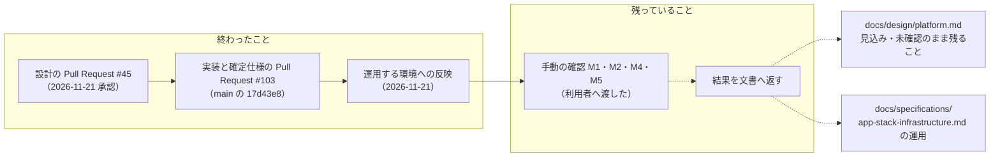
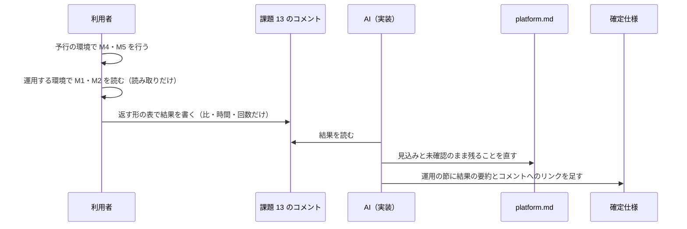

# インフラ: 反映した環境での戻しの予行と実測の結果を、全体の設計の費用の見込みと確定仕様へ返す（#13）

インフラの課題（#13）は、アプリのスタックへ自前の VPC・Aurora・ECS のクラスタ・費用の見張りを足して反映まで終えた。残っているのは、反映した環境でしか確認できない受け入れ条件 6（戻しの予行の記録）と 7（接続しない実測を費用の見込みへ返す）である（要求は [issue-13-requirements.md](./issue-13-requirements.md)）。利用者が運用する環境と予行の環境で手動の確認（M1・M2・M4・M5）を行って結果を課題へ返し、AI がその結果を、全体の設計の費用の見込みと、詳細設計を書き直した確定仕様へ書き入れる。採らなかった案は「決定の記録」に、外部の調査を省いた理由は末尾の「外部の調査」にある。

## 今の姿

何が起きたか・目的・受け入れ条件は要求仕様（[issue-13-requirements.md](./issue-13-requirements.md)、正は [#13](https://github.com/devbasex/nd-factory/issues/13) の本文）にある。この文書は「どう解くか」と「なぜその解き方か」だけを書く。

図の点線が、この変更で足す位置である。設計に要る今の構造は次のとおりである。

### 終わったことと残っていること

- 今回の完了の判定は、受け入れ条件 6 と 7 だけを対象にする。1〜5・8〜10 は、要求の「受け入れ条件の確認」の表に示した証跡（Pull Request #103 の CI と、設計の Pull Request #45）で確認済みである。要求の受け入れ条件のチェック欄は 2026-11-24 の時点ですべて未チェックのままで、確認の結果にそろえる直しは要求の工程へ返す
- 運用する環境へは 2026-11-21 に反映した（[#13 のコメント](https://github.com/devbasex/nd-factory/issues/13)）。2026-11-24 の時点で、#13 のコメントは 3 件で、結果を返したコメントは無い
- 進行表の DB へ接続する実測（再開の待ち・カタログの分け方・ACU の平均など）は #44 が受け、この課題には含まない

### 結果を返す先

- 結果を返す先は 2 つある
  - 全体の設計の費用の見込み: [platform.md の「見込み」](../docs/design/platform.md#見込み) の表と「読み方」の段落。「未確認のまま残ること」の表の「Aurora の一時停止（接続なし）」の行（875 行目。#13 の受け持ち）
  - 詳細設計: #13 の詳細設計書は Pull Request #103 で確定仕様 [app-stack-infrastructure.md](../docs/specifications/app-stack-infrastructure.md) へ書き直され、`issues/` から消えた。元の詳細設計書は、同じスプリントの #104 が記録として `docs/design-process/issue-13/design-detail.md` へ写す。その記録は後から追わない（記録の時点のまま残し、今の設計に合わせて直さない。[issue-104-design.md](./issue-104-design.md)）

### 手動の確認と行う環境

- 手動の確認の手順と合格の目安は、[#13 のコメント（2026-11-21）](https://github.com/devbasex/nd-factory/issues/13#issuecomment-7069916588) で利用者へ渡した。同じ表が確定仕様 [app-stack-infrastructure.md の「運用」](../docs/specifications/app-stack-infrastructure.md#運用) にある
- M1・M2・M4・M5 の確定仕様と利用者への案内は、結果の記入より先に直す（下の「手順の直し」の節）。直すまでに正とするものは次のとおりである
  - M4 と M5 は、確定仕様の手順が差分の承認を欠くため、下の表の手順を正とする
  - M1 は、確定仕様の合格の目安に統計値と区間の数え方が無いため、下の表と決定 2 の判定を正とする
  - M2 は、利用者への案内の「返す形」が月額に対する増加率を例に挙げ、設置したリージョンの単価を逆算できるため、下の表と決定 2 の「M2 の返し方」を正とする
- 確認を行う環境は 2 つに分かれる
  - 運用する環境: M1・M2。どちらも読み取りだけで、反映はしない
  - 予行の環境: M4・M5。運用する環境と別の `environment` の値で、設置のコマンドから立てた環境である（確定仕様の「運用」）

  | # | 受け入れ条件 | 行う環境 | 確認すること | 合格の目安（確定仕様の「運用」はこの目安へ直す） |
  | --- | --- | --- | --- | --- |
  | M4 | 6 | 予行の環境 | (0) 変更の前に、予行の環境の利用者の表へ、作り物の目印の項目を 1 件置く（下の「M4 の目印の項目」の節）。(1) 予行の環境で、状態を持つ資源に触れない小さな変更の `diff` を打つ。人が対象のスタックと差分を確かめ、状態を持つ資源に変更が無いと承認したら、そのとき出た確認の値で `deploy` する。(2) 変更の前のコードで `diff` を打ち直し、今のスタックから戻す差分を人が読んで承認してから、そのとき出た確認の値で `deploy` する。変更の前（(0) の後）・(1) の後・(2) の後の 3 回、Aurora のクラスタの識別子とリソースの ID が同じことと、利用者の表の項目の数と、目印の項目 1 件が一致することを確かめる。止める合図が出たら、そこで止めて (2) へ進まない（「影響と危険」の「M4 で止める合図が出たとき」）。確認の値の違う `deploy` が止まることは、予行の環境で試さない（下の「M4 の手順」の節） | 3 回とも、クラスタの識別子とリソースの ID が同じ・項目の数と目印の項目が一致する。結果には一致したかどうかだけを書き、数と目印の中身は書かない |
  | M1 | 7 | 運用する環境 | 反映の後 3 日の `ServerlessDatabaseCapacity`（5 分の粒度・統計は `Maximum`）が 0 ACU を超えた時間の合計と、超えた区間の数。数え方と判定は決定 2 にある | 0 ACU を超えた区間がすべて「保守による再開」で、どの区間も 60 分以内（決定 2） |
  | M2 | 7 | 運用する環境 | 利用者が、AI が案内に書いた列ごとの課金の対象の量に、設置したリージョンの単価を手元で掛け、列ごとの判定を出す（決定 2 の「M2 の判定の仕方」と「M2 の返し方」） | 3 つの列すべてに判定を書く。単価・単価の比・額・増加率は書かない |
  | M5 | 含めない | 予行の環境 | (0) 運用の知らせのトピックで、`ops.notify_emails` の宛先の購読が確認済み（`PendingConfirmation` でない）ことを確かめる。確認済みでなければ (1) へ進まず「保留」とする。(1) 予算を 1 ドルにした設定で `diff` を打ち、今の予行のスタックとの差分を人が読んで承認してから、そのとき出た確認の値で `deploy` する。その後、下の「M5 の合否の決め方」の節の手順で、知らせが届いたかを判定する。(2) 判定が決まったら、予算をもとの額に戻した設定で `diff` を打ち直し、今の予行のスタックから戻す差分を人が読んで承認してから、そのとき出た確認の値で `deploy` する | 通知の条件を満たした後、待つ上限までに予算の知らせが宛先に届く |

- M5 は受け入れ条件 6・7 の合否と別に扱う。結果は #13 のコメントと確定仕様の「運用」の結果の表に書き、届かなかったときは運用の課題として起票する。M5 の結果で #13 の完了を止めない。後から返った結果の扱いは「影響と危険」の「結果が返らないとき」にある
- M3 は、今の確認の対象に無い。番号が抜けている理由は、#13 の設計の記録からは確かめられていない

### M4 の手順

- M4 の手順は、確定仕様の「運用」の M4 の行と違う。確定仕様の行は、小さな変更の前に保存した合成の結果をそのまま `deploy` で反映し直す。設置のコマンドの `deploy` は、保存した合成の結果と確認の値が一致することだけを確かめる（[設置の手順の「deploy」](../docs/operations/setup.md#deploy-保存した合成の結果を反映する)）。そのため、小さな変更を反映した後の状態から戻す差分を、人が読まないまま反映できる。これは Value 8「反映は差分を見て承認した範囲だけ」（MVV バージョン 3）を満たさない。M5 の行も、予算を変えた後に「戻す」とだけ書き、戻すときの差分の承認を書いていない
  - 上の表のとおり、M4 も M5 も、変えるときと戻すときの両方で、`diff` の差分を人が承認してから、そのとき出た確認の値で `deploy` する。戻すときは、変更の前のコードか設定で `diff` を打ち直し、今の予行のスタックから戻す差分を出す
  - 確認の値の違う `deploy` が止まることは、予行の環境で一致しない値を渡して試さない。検査に不具合があると、承認と結び付かない合成の結果が反映されるためである。この確かめは、`infra/test/nd-setup.test.ts` の `runDeploy` のテストのうち、反映の処理を差し替えて動かす 2 件が main の CI で通っていることを証跡にする。2 件は「置き場を書き換えると 7 で、AWS へ書かない」と「別のアカウントの profile なら 7 で、AWS へ書かない」である
  - 2026-11-21 のコメントで渡した M4 の手順（保存した前の合成の結果を `deploy` で反映し直す手順）と M5 の手順（予算を 1 USD にして届くことを読んだ後に「戻す」だけの手順）は、この設計で使うのを止める。旧い M4 の手順で行った予行は、受け入れ条件 6 の証跡にしない。旧い M5 の手順で戻した結果も、M5 の結果にしない
  - 差分を承認した記録は公開のコメントに残るため、各差分（M4 の (1)・(2)、M5 の (1)・(2)）について、承認したかどうかと日付だけを書く。`diff` の確認の値にはアカウント ID とリージョンが入り、端末に出たコマンドには profile の名前も入る。そのため、確認の値・端末の出力・画面の写しは載せない

### M4 の目印の項目

- M4 の目印の項目は、利用者が (0) で、予行の環境の利用者の表へ AWS CLI の `aws dynamodb put-item` で 1 件だけ書く。設置のコマンドにはデータを書く経路が無いため、この 1 件の書き込みだけを設置のコマンドの外で行う。スタックの反映ではないので、`cdk deploy` を設置のコマンドの外で打つことには当たらない
  - 書く値は作り物だけにする。`pk` と `sk` は、どちらも `M4-REHEARSAL-MARKER` のように予行の目印と分かる文字列にし、ほかの属性は `note`（文字列 `rehearsal`）の 1 つだけにする。実在の利用者のメールアドレス・名前・ID は書かない
  - 書いてよいのは、予行の環境の利用者の表だけである。表の名前だけでは、既定の接続先にある同じ名前の別の環境の表と区別できない。そのため、M4 で打つ `aws` のコマンドは、どれも末尾に `--profile <予行の profile> --region <予行のリージョン>` を付けて打ち、既定の profile とリージョン（環境変数 `AWS_PROFILE`・`AWS_REGION` を含む）に頼らない。当たるコマンドは、`put-item`・`scan`・`get-item`・`delete-item` と、下の接続先の確認である。運用する環境の表には書かない
  - 予行のアカウントとリージョンは、予行の環境を立てたときに `deploy` へ渡した確認の値（`<要約値>:<アカウント>:<リージョン>:<スタックの一覧>`）の 2 つ目と 3 つ目から取る。控えていなければ、変更の前のコードで設置のコマンドの `diff` を打ち、出た確認の値から取る。`--region` にはこのリージョンを渡す
  - `put-item` と `delete-item` を打つ直前に、毎回次の 3 つを確かめる。1 つでも違えば書かずに止め、profile とリージョンを選び直す
    1. `aws sts get-caller-identity --query Account` の値が、確認の値のアカウントと同じである
    2. `--region` に渡すリージョンが、確認の値のリージョンと同じである
    3. `aws cloudformation list-stack-resources --stack-name <prefix>-<予行の環境>-app --query "StackResourceSummaries[?ResourceType=='AWS::DynamoDB::Table'].PhysicalResourceId"` の結果に、`--table-name` に渡す名前（`<prefix>-<予行の環境>-accounts`）がある。つまり、その表が予行のスタックの資源である
  - 既にある項目を上書きしないよう、`--condition-expression 'attribute_not_exists(pk)'` を付けて 1 回だけ書く。条件で失敗したら、同じ鍵の項目が既にあるため、鍵を変えずに止めて、その項目が何かを確かめる。前回の予行の目印が残っているときは、下のやり直しの順で扱う
  - 項目の数は `aws dynamodb scan --select COUNT --consistent-read` で読む。目印の項目は `aws dynamodb get-item --consistent-read` で同じ鍵を読んで、`note` が `rehearsal` のままかを確かめる。3 回とも同じ読み方にする
  - 3 回目の確認の後、目印の項目は `aws dynamodb delete-item` で同じ鍵の 1 件だけを消す。予行の環境をすぐ片付けるなら、消さずに残してもよい。表の中のほかの項目は消さない
  - 予行を途中で止めて同じ予行の環境でやり直すときは、前回の目印の項目が残っていることがある。残ったまま (0) を打つと、条件付きの書き込みが失敗して先へ進めない。そのため、やり直しは次の順で行う
    1. (1) の `deploy` の後に止めたときは、予行のスタックが変更の後の状態のままである。先に (2) と同じく、変更の前のコードで `diff` を打ち、戻す差分を人が承認してから、そのとき出た確認の値で `deploy` して戻す。この戻しは照合の基準が無いため、受け入れ条件 6 の証跡にしない
    2. 上の接続先の 3 つを確かめてから、`get-item --consistent-read` で目印の鍵を読む。項目が無ければ 3 へ進む。項目があり、属性が `pk`・`sk`・`note`（`rehearsal`）だけなら、前回の目印として `delete-item` で消す。それ以外の属性があるか、`note` が違うときは、目印でない項目の可能性があるため消さずに止め、その項目が何かを確かめる
    3. (0) から始める。今回の目印の項目を書いた後に、項目の数と目印の項目を読み、それを変更の前の照合の基準にする。前回の予行で読んだ値は基準に使わない

### M5 の合否の決め方

- M5 の知らせの判定は、AWS Budgets が通知の条件を評価した後に行う。予算を 1 ドルにしただけでは知らせは出ない。このスタックの予算の知らせは、実際の費用が予算の 80%・100% を超えたときと、予測が 100% を超えたときの 3 つである（`infra/lib/cost-watch.ts`）。AWS Budgets は費用のデータを 1 日に最大 3 回更新し、その後に通知の条件を評価する（[AWS Budgets による費用の管理](https://docs.aws.amazon.com/cost-management/latest/userguide/budgets-managing-costs.html)）
  - 実際の費用の知らせは、予算の期間（このスタックの予算では 1 か月）ごとに、閾値に初めて達したときに 1 回だけ送られる（[AWS Budgets の知らせの設定](https://docs.aws.amazon.com/cost-management/latest/userguide/budgets-best-practices.html#setting-budget-alerts)）。同じ期間に 80% の知らせが既に送られた予算では、予算を 1 ドルに下げても知らせは送り直されない。そのため判定には、実際の費用の 80% の知らせ（以下「対象の知らせ」）だけを使い、その知らせが試験の間に初めて閾値に達したと確かめられる期間で試す
  - 利用者は、(1) の `deploy` の前に次の 2 つを確かめる。どちらかに当たらなければ (1) へ進まず、次の予算の期間に入ってから試す
    - `aws budgets describe-notifications-for-budget --account-id <予行のアカウント> --budget-name <予算の名前>` で、対象の知らせの `NotificationState` が `OK` である（今の期間にまだ閾値に達していない）。`ALARM` なら、今の期間には送られた後である
    - (1) の `deploy` から下の待つ上限までが、同じ予算の期間（同じ月）に収まる
  - (1) の `deploy` の後、次の順に判定する
    1. 待つ上限は、(1) の `deploy` から 24 時間とする。更新はふつう前の更新から 8〜12 時間後に起きるため、24 時間あれば更新を 2 回以上はさむ
    2. 予算の画面で、最後の更新の時刻が (1) の `deploy` より後であり、予算の実際の費用が 0.80 ドル（1 ドルの 80%）を超え、対象の知らせの `NotificationState` が `ALARM` に変わったことを確かめる。これで、対象の知らせの送る条件が試験の間に初めて成り立ったと判定する。その後、対象の知らせのメールが宛先に届けば「合格」とする。合格に使えるメールは、この予算の対象の知らせ（実際の費用・80%）で、(1) の `deploy` から待つ上限までに届いたものだけである。予測の知らせや 100% の知らせ、試験の前に届いたメールは使わない
    3. 送る条件が成り立ったと確かめたのに、上限までに対象の知らせのメールが届かなければ「不合格」とする（配信の失敗）
    4. 上限までに、予算の最後の更新が (1) より後になる・実際の費用が 0.80 ドルを超える・`NotificationState` が `ALARM` に変わる、の 1 つでも成り立たなければ、送る条件の成立を確かめられていない。このときは配信の失敗とは判定せず「保留」とする。タグで絞る予算でコスト配分タグが有効でなく、費用が 0 と数えられるときも、ここに入る
  - どの判定でも、判定が決まったら (2) で予算を戻す。結果の表には、判定と、条件を確かめた日付だけを書き、費用の額は書かない

### 手順の直し

- 手順の直しは、結果の記入と切り離して先に行う。この設計をマージしたら、利用者が M1・M2・M4・M5 を行う前に、AI が次の 3 つを行う
  - #13 に新しい案内のコメントを書く。このコメントで、2026-11-21 のコメントの M4・M1・M2・M5 の行と「返す形」の表をすべて差し替える。利用者へ次を伝える
    - 旧い M4 の手順と旧い M5 の手順を止めること。旧い手順で行った結果は証跡にしないこと
    - 上の表の M1・M2・M4・M5 の手順と、M1 の判定と読む期限（決定 2）、M4 の目印の項目の置き方、M5 の知らせの判定
    - M2 で使う、列ごと・費目ごとの課金の対象の量（決定 2 の「M2 の返し方」）
    - 新しい「返す形」の表。M2 の欄の例は、旧い案内の「見込みの月額に対し +3%」をやめ、列ごとの判定だけにする
    - 結果の表には、各差分について承認したかどうかと日付だけを書き、確認の値・端末の出力・画面の写しは載せないこと
  - 2026-11-21 のコメント（[#13 のコメント](https://github.com/devbasex/nd-factory/issues/13#issuecomment-7069916588)）の先頭に、「この手順と返す形は差し替えた。新しい案内はこちら」という 1 文と、新しい案内のコメントへのリンクを足す。旧い本文は消さずに残し、読んだ人が新しい案内へ移れるようにする
  - 確定仕様の「運用」を上の表の手順へ直す Pull Request を作る。直すのは次の 5 か所で、どこから読んでも、戻す前に今のスタックとの差分を承認する手順になるようにする。この Pull Request は M1・M2・M4 の結果を待たない（「影響と危険」の「結果が返らないとき」の例外）
    - 節の冒頭の「設置のコマンドで前の合成の結果を反映し直す戻しの予行」の文。今のスタックとの `diff` を承認してから戻す予行と書き直す
    - M1 の行の手順と合格の目安。統計値・区間の数え方・60 分の上限を、決定 2 にそろえる
    - M2 の行の手順と合格の目安。利用者が課金の対象の量に単価を手元で掛け、列ごとの判定だけを返す形にする（決定 2 の「M2 の返し方」）
    - M4 の行。目印の項目の置き方を含め、上の表の手順と合格の目安にする
    - M5 の行。購読の確認と知らせの判定を含め、予算を下げるときと戻すときの両方で差分を承認する、上の表の手順にする

## 文脈と制約

- AI は AWS に触れず、反映も手動の確認も打たない。反映は利用者が打つ（リリース承認ゲートの答え「承認する（自分で反映）」と、要求の「境界」）
- 結果には、比・時間・回数・同じか違うかだけを書く（AGENTS.md の「秘密とインフラの値を置かない」）。実際の値（アカウント ID・資源の ID・ARN・端点・profile の名前・環境の名前・リージョンの名前）は書かない
- 単価の実測（M2）は設置したリージョンで読むため、リージョンの名前も単価の値も書かない。見込みの額への効きは、単価を逆算できない粒度（決定 2）で書く
- `docs/design/` は用語集の禁止語の検査の対象である（`.ndf/glossary.json` の `check.banned.paths`）。書き入れる文は用語集の語で書く
- 結果を文書へ書き入れる作業は、M1・M2・M4 のそれぞれについて、利用者から結果か保留の報告が返ってから始める。M5 の結果は待たない。確定仕様と利用者への案内の M1・M2・M4・M5 の手順の直しだけは、結果を待たずに先に行う（「影響と危険」の「結果が返らないとき」）
- 公開のコメントには、差分ごとに承認したかどうかと日付だけを書く。確認の値・端末の出力・画面の写しは載せない（確認の値にアカウント ID とリージョンが入り、コマンドに profile の名前が入る）

## 解き方の全体像

- 戻しの予行（M4）を行った記録は、#13 のコメントの結果の表と、確定仕様の「運用」の節に足す結果の要約の 2 つで読める（受け入れ条件 6）
- 全体の設計の「見込み」は、実測した一時停止と保守で起きる時間（M1）と単価の効き（M2）を踏まえた額と読み方になる（受け入れ条件 7）
- 「未確認のまま残ること」の表から、実測で分かった「Aurora の一時停止（接続なし）」の行が消え、事実は `platform.md` の中では「見込み」の読み方の 1 か所にだけ残る。確定仕様の結果の表は、確認を行った記録として持つ（決定 1）
- 合格の目安を外れた項目は、結果と外れた点を文書に書き、スタックを直す作業は新しい課題にする（決定 3）。M4 で止める合図が出たときは、そこで予行を止め、行った工程・止めた理由・行わなかった工程を記録する（「影響と危険」の「M4 で止める合図が出たとき」）

## 決定の記録

### 決定 1: 結果を今の正の文書に残すため、受け入れ条件 7 の「詳細設計」へ返す結果を確定仕様へ書く

- **質問**: 受け入れ条件 7 が結果を返す先とする「詳細設計」を、どの文書として扱うか
- **選んだ案**: 詳細設計を書き直した確定仕様 [app-stack-infrastructure.md](../docs/specifications/app-stack-infrastructure.md) の「運用」の節へ書く。確認の表の直後に、確認ごとの実施日・結果（合格 / 不合格 / 保留）・読んだもの（比・時間・回数・一致したかどうか）と、結果を返した #13 のコメントへのリンクを足す。M4・M5 の差分の承認は、差分ごとに承認したかどうかと日付だけを書き、確認の値・端末の出力・画面の写しは載せない
- 採らなかった案: #104 が写す記録の詳細設計書（`docs/design-process/issue-13/design-detail.md`）へ書く（その記録は後から追わないと README が書く。#104 の受け入れ条件 2 も中身の変更を禁じる）
- 採らなかった案: `issues/issue-13-design-detail.md` を作り直して書く（確定仕様と同じ事実を 2 か所に持ち、確定仕様にする工程でまた消える）
- **代償**: 確定仕様に、反映した環境で 1 回行った確認の結果という、振る舞いでない記録が入る
- 根拠: Value 10「同じ事実を 2 か所に持たない」（MVV バージョン 3）

### 決定 2: 実測で分かった事実を 1 か所に置くため、合格した項目の未確認の行を消して見込みの読み方へ移す

- **質問**: M1 が合格の目安を満たしたとき、「未確認のまま残ること」の表の「Aurora の一時停止（接続なし）」の行を残すか
- **選んだ案**: M1 が合格なら行を消し、実測した事実を「見込み」の「読み方」の段落に書く。合格の目安は、確定仕様の「運用」の M1 の行にある「0 ACU を超えた区間が、保守による再開（1 回 20 分程度）だけ」を、次の数え方と 60 分の上限で判定できる形にしたものである。確定仕様の M1 の行は、結果の記入より先にこの形へ直す（「今の姿」の「手順の直し」の節）
  - 書く事実: 観測した 3 日の `ServerlessDatabaseCapacity` が 0 ACU を超えた時間の合計と、保守で Aurora が再開した回数
  - 区間は次のように数える。同じデータを読めば、誰が数えても同じ時間と回数になるようにするためである
    - `ServerlessDatabaseCapacity` を、期間 5 分・統計 `Maximum` で読む。`Maximum` が 0 を超えた 5 分の枠を「起きていた枠」とする。枠の中で一時停止と再開が両方起きても、`Maximum` が 0 を超えるので起きていた枠に数える
    - 続いた起きていた枠を 1 つの区間とし、区間の長さを枠の数 × 5 分とする。時間の合計は区間の長さの和である
    - データの点が無い枠は「欠けた枠」とし、0 ACU として数えない。欠けた枠をはさむ前後の起きていた枠は、別の区間として数える
  - 区間ごとに、利用者が再開の理由を次の記録と照らして決める
    - 保守による再開: その区間の始まりが、クラスタかインスタンスの RDS のイベント（保守の適用・保守による再開）と重なる。さらに、同じ区間で CloudWatch の `DatabaseConnections`（期間 5 分・統計 `Maximum`）が 0 のままで、区間の長さが 60 分（12 枠）以内である。60 分は、確定仕様の「1 回 20 分程度」に、接続が無くなってから止まるまでの 300 秒と、5 分の枠の端数を足しても届かない上限として置く
    - 止まらない稼働: 保守のイベントと重なり、`DatabaseConnections` が 0 のままだが、区間の長さが 60 分を超えた。保守の後に一時停止へ戻らなかったことを示す
    - 保守のほかの稼働: 同じ区間で `DatabaseConnections` が 0 を超えた
    - 原因不明: 上のどれにも当たらない。RDS のイベントの保持の期間（14 日）を過ぎて照らせなかった区間もここに入れる
  - M1 の判定は、次の順に当てはめ、最初に当たったものにする
    1. 不合格: 保守のほかの稼働か止まらない稼働の区間が 1 つでもある。欠けた枠や原因不明の区間が同時にあっても不合格にする。行を残し、「内容」の列を実測した事実に書き直す
    2. 保留: 欠けた枠がある、または原因不明の区間がある。行は消さない（「影響と危険」の「結果が『保留』のとき」）
    3. 合格: 上のどちらにも当たらない。このときだけ行を消す
  - 利用者は、区間ごとの理由（保守による再開・止まらない稼働・保守のほかの稼働・原因不明）の数と、観測した 3 日の始まりの日付を結果の表に書く。RDS のイベントの識別子は書かない
  - **読む期限**: RDS のイベントは 14 日で読めなくなる（[Amazon RDS のイベントの一覧](https://docs.aws.amazon.com/AmazonRDS/latest/UserGuide/USER_ListEvents.html)）。そのため利用者は、観測した 3 日の始まりから 14 日以内に、`ServerlessDatabaseCapacity`・`DatabaseConnections`・RDS のイベントの 3 つを読み、区間ごとの理由を決める。運用する環境へ反映した 2026-11-21 から観測するなら、期限は 2026-12-04 である。`#13` へ結果を返すのは、読んだ後でよい
  - **代わりの観測の期間**: 代わりの期間へ切り替えてよいのは、反映の後 3 日の観測が、上の判定の順で「保留」になったときだけである。保守のほかの稼働か止まらない稼働の区間が 1 つでもあれば、原因不明の区間や欠けた枠が同時にあっても判定は「不合格」で確定する。このときは代わりの期間で読み直さず、不合格の結果を返す。保留になった観測は証跡にしない。代わりに、利用者が読む日の前日までの続いた 3 日を観測の期間にし、同じ数え方と判定で読み直す。代わりの期間は、始まりが読む日から 14 日以内で、その期間とその前の 1 日にアプリのスタックの反映が無いものにする（反映による再開を、保守による再開と取り違えないため）。結果の表には、代わりの期間を使ったことと、その始まりの日付を書く
- **見込みの表の額の直し方**: 見込みの表は、今の出典のとおり `us-east-1` の公開単価と、各列（使わない月・1 人のチーム・5 人のチーム）の前提の使い方で計算したままにする。この表の直しと、設置したリージョンでの M2 の判定は、別の作業として分ける
  - 表の直しは、公開単価・スタックの構成・前提の表と M1 の結果だけを根拠にし、M2 の結果を使わない。そのため、M2 が保留でも表の直しは進める
  - 列ごとの月の額の差は、次の表の月の量から無料の枠を引き、`us-east-1` の公開単価に掛けて出す。無料の枠は、今の表と同じく公開の価格のページに載る月の枠を使い、出典の表に取得日とページを足す。月の量・引いた無料の枠・算出の根拠は、実装の Pull Request の本文に費目ごとに書く
  - 無料の枠はアカウントで共有されるが、今の見込みの表は、Lambda などの行を「無料の枠の中」と書き、アカウントの枠をすべてこのスタックが使える前提で計算している。この直しも同じ前提を置き、枠がすべて残っているとして引く。同じアカウントのほかの使い方で枠が減ると額が増えることは、「読み方」の段落に前提として書く
  - 根拠を置けない費目は、月の額の計算に入れない。その費目は「未確認のまま残ること」の表に、何が分からないかを書いて残す

    | 費目 | 月の量の出し方 | 根拠 |
    | --- | --- | --- |
    | Aurora の計算（保守による再開） | M1 の 3 日間の保守による起きている時間の合計を 3 で割り、30 を掛ける。3 つの列すべてに同じ時間を足し、前提の表の 1 ACU を掛ける | M1 の結果 |
    | EventBridge Scheduler | スタックが定義する各スケジュールの月の呼び出し数（間隔から出す）を足し合わせる。その合計から、アカウントの月の無料の枠（呼び出し 1,400 万回）を引いた残りだけを課金の対象にする | 確定仕様とスタックのスケジュールの定義・[EventBridge の価格](https://aws.amazon.com/eventbridge/pricing/) |
    | DynamoDB の PITR | PITR を有効にした表ごとに、月の平均の保存量（GB）を出して足し合わせる。保存量は、表ごとの保存する項目の数 × 1 件の平均の大きさで出す。月の書き込みの数は、既にある項目の更新や削除も数えるため、保存量の根拠にしない | 確定仕様の表の定義と、前提の表から置いた表ごとの項目の数と大きさ。置けなければ未確認。[DynamoDB の課金の考え方](https://docs.aws.amazon.com/amazondynamodb/latest/developerguide/bp-understanding-billing.html) |
    | DynamoDB のストリーム | ストリームを読む側（コンシューマー）ごとに、課金の対象の `GetRecords` の回数（月）だけを数えて足し合わせる。Lambda のトリガーとして読む `GetRecords` は課金されないため数えない。残りから月の無料の枠を引く | 確定仕様のストリームを読む側の定義と、前提の表の書き込みの数。置けなければ未確認。[DynamoDB の価格](https://aws.amazon.com/dynamodb/pricing/) |

  - 列ごとに、費目ごとの差額を丸める前の値で足し合わせる。その合計の絶対値が 0.10 ドル以上の列だけ、その列で額が変わる費目の行と、その列の合計を直す。費目ごとの差額が 0.10 ドル未満でも、合計で 0.10 ドル以上なら直す
  - 費目が今の表に無いとき（Scheduler・PITR・ストリーム）は、直す列があれば行を足す。行の額は今の表と同じく小数 2 桁、合計は 0.1 ドル単位の「約」で書く
- **M2 の判定の仕方**: M2 の対象は、EventBridge Scheduler・DynamoDB の PITR・DynamoDB のストリームの 3 つの費目だけである。上の表の Aurora の行は M2 に入れない。列ごとに、3 つの費目それぞれの課金の対象の量（無料の枠を引いた後の量）に、利用者が読んだ設置したリージョンの単価を掛け、その追加の額の合計を判定する。無料の枠は、公開単価の直しと同じく、アカウントの枠がすべて残っているとして引く。設置したリージョンでの M2 の読みは、表の額に使わない。「読み方」の段落には、各列について次の 3 つのどれかだけを書く。単価・単価の比・額の差は、設置したリージョンの単価を逆算できるため書かない
  - 0.10 ドル以上: 月の量を置けた費目だけで、効きが 0.10 ドル以上になった
  - 0.10 ドル未満: すべての費目の月の量を置けて、効きが 0.10 ドル未満になった
  - 判定できない: 月の量を置けない費目があり、置けた費目だけでは 0.10 ドルに届かない。置けなかった費目の名前を添え、その費目は「未確認のまま残ること」の表に残す
  - **M2 の返し方**: 課金の対象の量と単価を突き合わせるのは、設置したリージョンの単価を読む利用者だけである。単価がリポジトリと公開のコメントに出ないよう、掛け算は利用者の手元で行い、公開のコメントには判定だけを返す。役割は次のとおりである
    - AI: 設計のマージの後の新しい案内で、3 つの列と 3 つの費目ごとに、課金の対象の月の量（無料の枠を引いた後）を書く。量は上の表の出し方と公開の情報だけから出すため、設置先の値を含まない。量を置けない費目は「置けない」と書く。同じ量は、後で実装の Pull Request の本文にも書く
    - 利用者: 案内の量に、設置したリージョンで読んだ単価を手元で掛け、列ごとに 3 つの費目の額を足して、上の 3 つの判定のどれかを決める
    - 利用者が公開のコメントに書くのは、次の 3 つだけである。単価・単価の比・費目や列の額・月額に対する増加率・リージョンの名前は書かない
      - 実施日
      - 列（使わない月・1 人のチーム・5 人のチーム）ごとの判定
      - 「判定できない」の列の、量を置けなかった費目の名前（EventBridge Scheduler・DynamoDB の PITR・DynamoDB のストリームのどれか）
    - 確定仕様の「運用」の結果の表へ写すのは、M2 の実施日・結果（合格 / 保留）・列ごとの判定・置けなかった費目の名前と、そのコメントへのリンクだけである。合格は、3 つの列すべてに判定が書かれたことを指す
  - 受け入れ条件 7 の M2 の分は、M2 の結果が返り、3 つの列すべてに上の 3 つのどれかを書き、「判定できない」の列の費目を「未確認のまま残ること」に残したときに満たす。M2 が保留（利用者が単価を読み終えていない）の間は、「読み方」に M2 の効きを書かず、条件 7 は満たさない
- 採らなかった案: 行を残して「確認した」と書き足す（分かった事実が「見込み」と「未確認のまま残ること」の 2 か所に並び、未確認でない行が表に残る）
- 採らなかった案: 見込みの表に単価の値を書く（設置したリージョンが分かり、リポジトリに置かない値になる）
- 採らなかった案: 見込みの表を設置したリージョンの単価で計算し直す（`us-east-1` の単価の表に別のリージョンの額が混ざり、差と使う量から単価を逆算できる）
- **代償**: 「未確認のまま残ること」の表から、いつ確認したかが読めなくなる。いつ確認したかは確定仕様の結果と #13 のコメントで読む
- 根拠: Value 10「同じ事実を 2 か所に持たない」・Value 7「インフラの実際の値…をリポジトリ・課題・PR・CI の記録・合成の出力に置かない」（MVV バージョン 3）

### 決定 3: 1 つの課題を 1 つのスプリントで閉じるため、合格の目安を外れた項目のスタックの直しを新しい課題にする

- **質問**: 手動の確認が合格の目安を外れたとき、スタックの直しをこの課題の中で行うか
- **選んだ案**: この課題では結果と外れた点を文書へ書くだけにし、スタックの直しは範囲外の課題として起票する（`out-of-scope`）。受け入れ条件 7 は、返した結果（保留を除く）があれば満たす。受け入れ条件 6 は、(2) の戻しの `deploy` まで実際に行った予行の記録があれば、照合が不合格でも満たす
  - M4 が不合格のときは、確定仕様の「運用」の結果に、予行を行ったことと、安全に戻せると確かめられなかったことを分けて書く。途中で止めた予行は、照合を行った回の分だけを書き、行った工程・止めた理由・行わなかった工程を添えて、不合格か保留の記録として残す。そのうち条件 6 の証跡にするのは、「影響と危険」の「M4 で止める合図が出たとき」の表で「する」とした場合（(2) の `deploy` まで行った場合）だけである。戻しの手順は、新しい課題が直して予行し直すまで、安全に戻せる手順として扱わない
- 採らなかった案: この課題の中でスタックを直す（直した後にもう一度反映して確認する必要があり、スプリントの中で閉じない。要求の前提 3 の「1 つの子は 1 つのスプリントで閉じる」に反する）
- **代償**: 外れた項目は、新しい課題が直すまで、反映した環境で目安を外れたまま動く
- 根拠: Value 17「目先の手間より、長く良い形を選ぶ」・Value 14「変更はレビューを通してから取り込む」（MVV バージョン 3）

## 影響と危険

- **働く範囲**: このリポジトリの次の 2 か所だけ
  - 全体の設計: `docs/design/platform.md` の「見込み」と「未確認のまま残ること」
  - 確定仕様: `docs/specifications/app-stack-infrastructure.md` の「運用」
  - コード・スタック・設定のファイルは変えない
- **プロジェクトごとに違うもの**: 設置したリージョンの単価と、環境ごとの実測の値。どちらもリポジトリに書かない。実測は時間と回数で、単価の効きは決定 2 の粒度で書く
- **当たるモード**: `standard`。#13 の本文の「進行」の欄の「モード」に書かれている。設計だけの Pull Request をレビューしてマージしてから、実装へ進む進め方である
- **同じファイルを触る別の変更と順序**: #105 を先に取り込み、この課題の実装は、その取り込みと利用者からの結果の受け取りの両方の後に始める。#105 は待つものが無く、この課題は M1・M2・M4 の報告が返るまで始められないためである
  - 同じスプリントの #105（[issue-105-design.md](./issue-105-design.md)）が `docs/design/platform.md` の 648 行目と 889 行目を直す。行が違うため内容は重ならないが、同じファイルを触る実装は同時に進めない
  - この課題が 875 行目の行を消すと、889 行目の位置が動く。そのため、どちらの確認も、行の番号でなく行に含まれる文で探す
- **結果が返らないとき**: 結果を書き入れる実装は、M1・M2・M4 の 3 つすべてについて、利用者から報告が返ってから始める。報告は、結果（合格・不合格）か、保留とその理由のどちらかである。報告を待つのは結果を書き入れる作業だけで、報告がまだ無い項目が 1 つでもあれば、この作業は始めない。「今の姿」の「手順の直し」の節の 3 つ（新しい案内のコメントの投稿・旧い案内へのリンクの追加・確定仕様の手順を直す Pull Request）は、報告を待たずに先に行う。利用者は新しい案内の手順と M2 の課金の対象の量を受け取ってから確認を行うため、これらを待たせると報告が返らない
  - 3 つの報告がそろった後の作業ごとの着手の条件は、次のとおりである

    | 作業 | 始める条件 | 報告に保留が含まれるとき |
    | --- | --- | --- |
    | 公開単価による見込みの表の直し（決定 2） | #105 を取り込み、3 つの報告がそろった | M2 が保留でも進める。M1 が保留なら、Aurora の計算の行は直さず、Scheduler・PITR・ストリームの行だけを直す |
    | 確定仕様の結果の表と、#13 のコメントへのリンクの記入 | 同じ | 保留の項目は、結果を「保留」と書いて理由を添える |
    | 「読み方」への M1 の実測と M2 の効きの記入 | 同じ | 保留の項目の分は書かない（下の「結果が『保留』のとき」） |
    | #13 を閉じる判定 | 上の 3 つを取り込んだ | M1・M2・M4 のどれかが保留なら閉じない。M4 が (2) の `deploy` の前に止めた不合格のときも、条件 6 を満たさないため閉じない。保留の項目の結果が返ったら、その分を書き入れる Pull Request を足してから判定し直す |

  - M5 の結果は待たない。M5 が返っていなければ、確定仕様の「運用」の結果の表に M5 を「未確認」と書き、受け入れ条件 6・7 の判定と課題の完了を進める
  - M5 を「未確認」と書いたときは、結果を書き入れる実装の Pull Request を作るエンジニア（AI）が、同じときに範囲外の課題を 1 件起票する。題は「確定仕様の M5 の結果を書き入れる」で、本文に確定仕様の「運用」の結果の表へのリンクを置く
  - M5 の結果が後から返ったら、利用者はその課題のコメントに書く。その課題を受けたエンジニアが、確定仕様の M5 の行の「未確認」を結果に直し、結果のコメントへのリンクを足す Pull Request を作る。届かなかったときは、別に運用の課題として起票する
- **結果が「保留」のとき**: 確定仕様の「運用」の結果の表には、その項目の行を結果「保留」として書く。ほかの文書の扱いと、続ける確認は項目ごとに次のとおりにする。条件 6 か 7 が満たされない間は、課題を開いておく

  | 保留の項目 | `platform.md` の扱い | 続ける確認 |
  | --- | --- | --- |
  | M1 | 「未確認のまま残ること」の「Aurora の一時停止（接続なし）」の行を消さずに残す。「読み方」に実測を書かない | 受け入れ条件 7。RDS のイベントが読めず原因不明の区間が残ったなら、決定 2 の「代わりの観測の期間」で読み直す。欠けた枠だけが理由なら、同じ条件で代わりの期間を選んで読み直す |
  | M2 | 「読み方」に M2 の効きを書かない。見込みの表の公開単価による直しは、M2 と別に進める（決定 2） | 受け入れ条件 7 |
  | M4 | 変えない | 受け入れ条件 6 |
  | M5 | 変えない | 無い（6・7 と別に扱い、#13 のコメントに保留と書く） |

- **M4 で止める合図が出たとき**: 予行をそこで止め、残りの工程を行わない。証跡を 3 回分そろえるために (2) の戻しへ進んではならない。運用の責任者（運用する環境を反映した利用者）が影響と戻し方を確かめるまで、同じ戻しの手順を使わない
  - 止める合図は次の 3 つである
    - クラスタの識別子かリソースの ID が変わった（資源が置き換わった）
    - 利用者の表の項目の数か、作り物の目印の項目 1 件が、変更の前と一致しない
    - (1) か (2) の `diff` に、状態を持つ資源の置き換えか削除が出た（このときは `deploy` せずに止める）
  - 止めたときは、#13 のコメントの M4 の結果に次の 3 つを書く。どれも一致したかどうか・承認したかどうか・日付だけで書き、数・識別子・差分の中身は書かない
    - 行った工程: 行った (0) と各回の照合について、その結果と日付を書く。(1) と (2) については、行った差分の確認、承認したかどうか、反映の結果と日付を書く
    - 止めた理由: 上の 3 つの合図のどれが出たか
    - 行わなかった工程: 止めた後に残った工程
  - 受け入れ条件 6 は「戻しの予行を 1 回行った」ことを求めるため、その証跡にするのは、(2) の戻しの `deploy` まで実際に行った予行だけである。途中で止めた予行は、結果と止めた理由を不合格か保留の記録として #13 のコメントと確定仕様の結果の表に残すが、条件 6 の完了には数えない。止めた時点ごとの扱いは次のとおりである

    | 止めた時点 | 結果 | 条件 6 の証跡にするか |
    | --- | --- | --- |
    | (2) の `deploy` の後の照合で不一致が出た | 不合格 | する。戻しを実際に行い、戻しで状態が保たれなかったことが分かったため。決定 3 のとおり書く |
    | (1) の `deploy` の後の照合で不一致が出た | 不合格 | しない。戻しを行っていないため。不合格の記録として残し、スタックの直しを新しい課題にする（決定 3）。その課題が直した後に予行し直し、(2) の `deploy` まで行った記録で条件 6 を満たす |
    | (2) の `diff` に状態を持つ資源の置き換えか削除が出た | 不合格 | しない。戻す差分を読んだだけで、戻しを行っていないため。扱いは上の行と同じ |
    | (1) の `diff` に状態を持つ資源の置き換えか削除が出た | 保留 | しない。選んだ小さな変更が状態を持つ資源に触れていただけで、何も反映していないため。別の小さな変更を選んで (1) からやり直す |
    | 合図と関係なく止めた（時間切れ・`diff` や `deploy` の失敗など） | 保留 | しない。理由を添え、同じ予行の環境で、「今の姿」の「M4 の目印の項目」の節のやり直しの順に従って (0) からやり直す |

  - 途中で止めた予行を条件 6 の完了に数える場合は、要求の変更になる。そのときは要求の工程へ返し、要求を出した人の承認を得てから扱いを変える
- **壊れうる箇所**: 結果の文に実際の値（12 桁の数字・ARN・リージョンの名前）が混じると、漏れの検査に当たるか、当たらずに公開される。要求の「検証手段」の `grep` に、リージョンの名前の形を足して確認する

## テスト設計

CI の行のほかは、自動のテストを足さない。実装の Pull Request のレビューで、直した 2 本をこの表の「どう壊したら落ちるべきか」に照らし、当たれば差し戻す。

| 受け入れ条件・不変条件 | どの振る舞いで縛るか | どう壊したら落ちるべきか |
| --- | --- | --- |
| 6. 戻しの予行を 1 回行った記録がある | #13 のコメントに M4 の結果の行（実施日・結果・3 回の一致したかどうか）があり、その行に、最初の変更の差分と今のスタックから戻す差分を、承認したかどうかと日付で書いた記録がある。証跡にするのは (2) の戻しの `deploy` まで行った予行だけである。(2) の後の照合で不一致が出て止めた予行も証跡にし、その記録は、照合と差分の承認の記録に、行った工程・止めた理由・行わなかった工程を添えたものとする。確定仕様の「運用」の節の冒頭と M4 の行が、戻す前に今のスタックとの差分を承認する手順に直っていて、「運用」の節に M4 の結果の要約とそのコメントへのリンクがある。確認の値の違う `deploy` が止まることは、`infra/test/nd-setup.test.ts` の 2 件のテストを証跡として書いている。M4 が不合格なら、予行を行ったことと安全に戻せると確かめられなかったことが分けて書かれている | 確定仕様の要約を欠く・リンクの飛び先が結果のコメントでない・差分を承認した記録が無い・節の冒頭に前の合成の結果を反映し直す戻しが残る・旧い手順（保存した前の合成の結果を反映し直す）で行った予行を証跡にする・項目の数か目印の一致を書かずに合格とする・M4 が「保留」なのに条件 6 を満たしたとする・止める合図の後に (2) へ進んだ予行を証跡にする・(2) の `deploy` の前に止めた予行（(1) の後の不一致・(2) の `diff` で止めたもの）で条件 6 を満たしたとする・途中で止めた記録に止めた理由か行わなかった工程が無い・不合格なのに戻しの手順を安全と書く・確認の値・端末の出力・画面の写しを載せると落ちる |
| 7. 接続しない実測を詳細設計と費用の見込みへ返す | 確定仕様の「運用」の節に M1・M2 の結果があり、platform.md の「見込み」の読み方に M1 の時間と回数と、各列の M2 の効き（0.10 ドル以上・0.10 ドル未満・判定できない）がある。M1 が合格なら「未確認のまま残ること」に「Aurora の一時停止（接続なし）」の行が無い | 見込みへ書かない・合格なのに未確認の行を残す・M1 が保留か不合格なのに行を消す・「判定できない」の列の費目を未確認に残さない・M1 が判定の順で不合格なのに代わりの期間の結果を証跡にする・#13 のコメントか確定仕様に、M2 の単価の値・単価の比・額・月額に対する増加率・リージョンの名前を書くと落ちる |
| 値の混入（非機能のセキュリティ） | 要求の「検証手段」の `grep -nE '(^\|[^0-9-])[0-9]{12}([^0-9-]\|$)\|arn:aws'` と、リージョンの名前の形（`[a-z]{2}-[a-z]+-[0-9]`）の検索が、直した 2 本で作り物の値（`123456789012`・`us-west-2`）と、もとから在る単価の出典の `us-east-1` のほかに当たらない | 結果の文に実際のアカウント ID・ARN・設置したリージョンの名前を書くと落ちる |
| CI | スプリントの Pull Request の CI の `check`・`ref-check`・`leak-check` が通る | 漏れの検査に当たる値を書くと落ちる |

## どこを変えるか

詳細設計はこのセクションに畳む。新しく作る関数が 0、シグネチャを変える関数が 0 のためである（変えるのは文書だけで、コード・スタック・設定のファイルは変えない）。

文書を直す作業は 2 回に分かれる。1 回目は手順の直しで、設計のマージの後、結果を待たずに行う。2 回目は結果の記入で、M1・M2・M4 の報告がそろい、#105 を取り込んだ後に行う（「影響と危険」の「結果が返らないとき」）。#13 のコメント（新しい案内・旧い案内の先頭の 1 文）はリポジトリのファイルでないため、表に載せない。

| ファイル | 変える中身 | 決定 |
| --- | --- | --- |
| `docs/specifications/app-stack-infrastructure.md` | 「運用」の節。1 回目は、節の冒頭の戻しの予行の文と、M1・M2・M4・M5 の行の手順と合格の目安を、「今の姿」の「手順の直し」の節の 5 か所のとおりに直す。2 回目は、確認の表の直後に結果の表を足す。行は確認ごとに置き、列は実施日・結果（合格 / 不合格 / 保留）・読んだもの（比・時間・回数・一致したかどうか・M2 の列ごとの判定）・結果を返した #13 のコメントへのリンクにする。M4・M5 は、差分ごとに承認したかどうかと日付を書く。M4 を途中で止めたときは、行った工程・止めた理由・行わなかった工程を添える。M5 が返っていなければ「未確認」と書く | 決定 1・決定 3 |
| `docs/design/platform.md` | 2 回目だけ直す。直すのは次の 3 か所である。 (1) 「見込み」の表: 決定 2 の「見込みの表の額の直し方」で出した差の合計が 0.10 ドル以上になる列について、額が変わる費目の行と合計を直す。表に無い費目（Scheduler・PITR・ストリーム）は、直す列があれば行を足す。出典の表には、引いた無料の枠のページと取得日を足す。M1 が保留なら Aurora の計算の行は直さない (2) 「読み方」の段落: M1 の実測（0 ACU を超えた時間の合計と保守による再開の回数）と、列ごとの M2 の効き（3 つの判定のどれか）を書き足す。無料の枠をすべてこのスタックが使える前提も書く。保留の項目の分は書かない (3) 「未確認のまま残ること」の表: M1 が合格なら「Aurora の一時停止（接続なし）」の行を消す。不合格なら行を残し、内容を実測した事実に書き直す。月の量を置けない費目と、M2 で「判定できない」となった列の費目は、行として足す。行を探すときは、行の番号でなく行に含まれる文で探す | 決定 2・決定 3 |

## 設計の結果

| 課題 | 扱い | 統合先 | 触るファイル |
| --- | --- | --- | --- |
| #13 | 実装する | — | `docs/design/platform.md`、`docs/specifications/app-stack-infrastructure.md` |

## 未確認のまま残ること

| 項目 | 内容 |
| --- | --- |
| 手動の確認の結果 | M1・M2・M4・M5 の結果は、2026-11-24 の時点で #13 に返っていない。利用者が反映した環境で確認を行い、#13 のコメントの「返す形」の表で返したときに分かる。M1 は 3 日の観測が要り、観測の始まりから 14 日以内に読む（決定 2 の「読む期限」） |
| 見込みの額が変わるか | M2 の単価の効きで見込みの合計が変わるかは、結果が返るまで分からない。変わるときに直す表の行は、結果を読んでから決める |

## 外部の調査

省く: 利用者が反映した環境で読んだ結果を、このリポジトリの文書へ書き入れる変更で、外部の判断が要らない。足した資源の作り方の調査は、設計の Pull Request #45 の外部の調査（#104 が `docs/design-process/issue-13/survey.md` へ写す）にある
