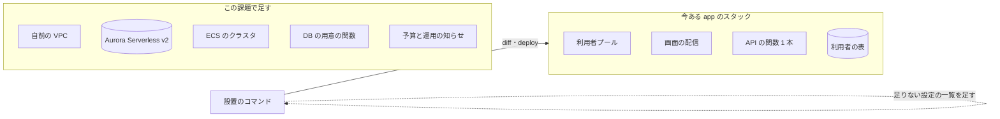
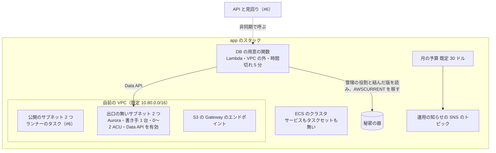
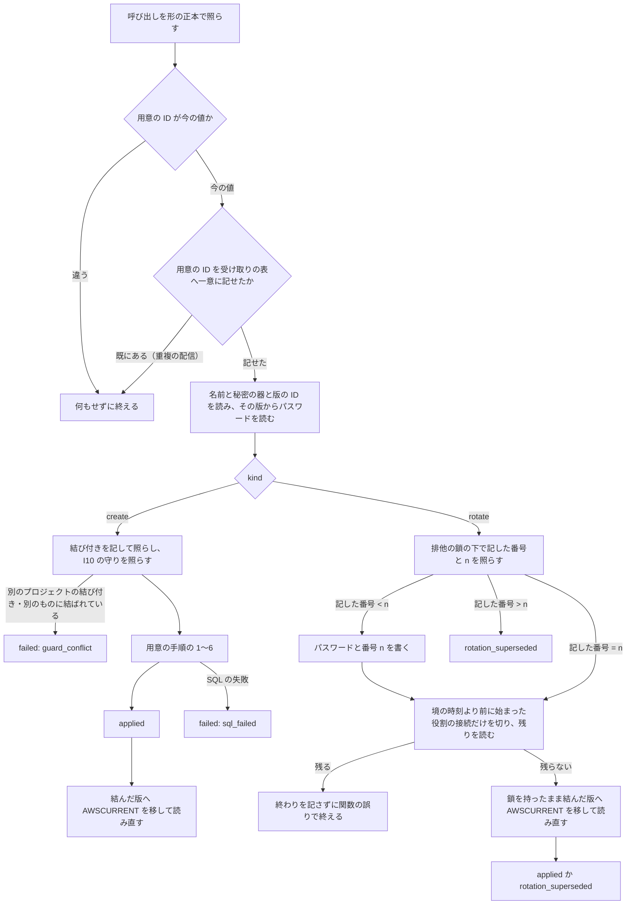

# インフラ: 常駐する計算と NAT なしで、自前の VPC・Aurora・ECS を安く立てられる（#13）

この文書は nd-factory 自体の開発の話で、nd-factory の製品が動く場所のインフラとその設置と反映を扱う（nd-factory が回す開発の話ではない）。アプリのスタックにはネットワーク・進行表の DB・ECS のクラスタ・費用の見張りが無く、ホステッドのレーン（#6）と DB の用意が動かない。この課題で、NAT を置かない自前の VPC・最小 0 ACU で Data API を有効にした Aurora・サービスを持たない ECS のクラスタ・DB の用意の関数・予算と運用の知らせを `app` のスタックへ足し、既定の値と設定のキーと実測の手順を決める。DB の用意は RDS Data API を使う VPC の外の Lambda にし（決定 15）、イメージの置き場は自前の ECR へ push してダイジェストで引く形にして（決定 1。作るのは #6）、どちらも全体の設計をこの設計 Pull Request の中で直した。採らなかった案は決定ごとに、調べた一次情報は末尾の「外部の調査」にある。

## 今の姿

何が起きたか・目的・受け入れ条件は要求仕様（[issue-13-requirements.md](./issue-13-requirements.md)、正は #13 の本文）にある。この文書は「どう解くか」と「なぜその解き方か」だけを書く。

設計に要る今の構造は次のとおりである。

| 置き場 | 今あるもの | この課題との関わり |
| --- | --- | --- |
| `infra/lib/app-stack.ts` | 利用者プール・画面の配信・API の関数・利用者の表。スタックの環境（アカウントとリージョン）を明示して合成する。API の関数は `NodejsFunction` が `apps/api/` の起点を束ねる | ネットワーク・進行表の DB・ECS のクラスタ・DB の用意の関数・予算を足す。明示した環境では AZ の lookup が走るため、AZ の受け方を決める（決定 3） |
| `infra/test/support.ts` | 「時間で費用が掛かる資源」の種類に `AWS::RDS::DBCluster`・`AWS::RDS::DBInstance` を含む | Aurora を足すと今のテストが落ちる。許しの一覧を理由つきで足す（決定 4） |
| `infra/setup/nd-setup.ts` | `diff`（合成・差分・確認の値）と `deploy`（確認の値が同じときだけ反映） | `diff` の最後に足りない設定の一覧を足す |
| `apps/api/` | 利用者の取得の処理 | DB の用意の関数の起点と SQL の手順を足す。置き場は [全体の詳細設計の受け持つ子の課題](../docs/design/detail.md#受け持つ子の課題) の「`apps/api/src/entries/db-prep.ts`・`apps/api/src/db-prep/`」のとおり |
| `packages/contracts/src/settings.ts` | 接頭辞・環境・ログイン・パイプラインのキー。未知のキーは誤り | キーを足す（決定 7） |
| 全体の設計の決定 83・87・90・95・96 | 進行表の DB への届き方（決定 83）・イメージの置き場（決定 87）・秘密の器の読み手（決定 90）・差し替えと時間切れ（決定 95・96）を決めている | 決定 15 で DB の用意を Data API の関数へ移し、決定 1 で決定 87 を直した。直す前の形を採らなかった理由は、それぞれの決定の「採らなかった案」にある |

## 文脈と制約

- 全体の設計で決めた次の 3 つは決め直さない。資源の形（[プラットフォームの文書のインフラ](../docs/design/platform.md#インフラ)）・進行表の DB の用意の順（[データの文書の進行表の DB](../docs/design/data.md#進行表の-db)）・DB の用意の関数を呼ぶ形と終わりの記し方（[API の文書の「ランナー・手元のマシンの HTTP の経路」](../docs/design/api.md#ランナー手元のマシンの-http-の経路) の、見回りと DB の用意の関数の段）である
- 全体の設計で直したのは、イメージの置き場（決定 87）と、DB の用意の Data API の関数への移し（`platform.md` の決定 83・90・95・96、`data.md`・`api.md`・`overview.md`・`detail.md`）の 2 件である。1 件目は利用者が 2026-11-21 に承認し、2 件目は利用者の方針（2026-11-21）に従ってこの設計 Pull Request の中で直した
- 並行する #41 が `docs/design/execution.md`・`overview.md` を直す。この課題が直す `overview.md` の I17・I18・I22 の行と、`execution.md` のリンクの 1 か所は #41 と重なる
- 設計の段では AWS に触れない。実測と戻しの予行は、リリース承認ゲートの承認の後に反映した環境で行う
- CI は AWS の資格情報を持たない。合成は lookup を使わずに通る
- 例とテストの値は作り物（アカウント `123456789012`・リージョン `us-west-2`・接頭辞 `acme`・環境 `test`・メール `ops@example.com`）だけを使う
- 横断の部品（`packages/core`）は #2 が作る。この課題はそこへ置かず、DB の用意の関数の中で閉じる
- DB の用意の関数を呼ぶ API の側・終わりの記録の口の実装・見回りは、plan.md の受け持ち（見回りは K8・K7）のとおり #6 が作る。この課題は呼び出しの値と終わりの結果の形と、見回りが使う値を決める

## 解き方の全体像

- ネットワーク・進行表の DB・ECS のクラスタ・DB の用意の関数・予算と運用の知らせは `app` のスタックにあり、`diff` の確認の値で縛られる。NAT・ECS のサービスは無い
- DB の用意の関数（起点は `apps/api/src/entries/db-prep.ts`）は、呼び出しの用意の ID が今の値であることを読んでから、RDS Data API でプロジェクトのデータベースと役割を作るか役割のパスワードを差し替え、別のプロジェクトのものと重なると書かずに止まる（I10）。終わりは関数の中から終わりの記録の口を呼んで記す（口の実装は #6）。SQL の手順は `SqlExecutor` のインタフェースの裏に置き、CI は PostgreSQL のサービスコンテナで同じ手順を照らす（決定 15）
- 設定のファイルはネットワークの CIDR・最大 ACU・予算・運用の知らせの宛先を受け、どれも既定を持つ。読み手のまだ無いキー（同時のレーンの数・呼び直しの上限・保存期間）は名前と形と既定だけをこの文書に決める
- 設置する人は `diff` で足りない設定（Google のクライアントの ID・タグの有効化・宛先・AZ）を読む
- イメージの置き場（自前の ECR・push・ダイジェスト）は #6 が作る。決めた値は「#6 へ渡すこと」にある

## ドメインモデル

### コンテキスト

| コンテキスト（用語集の `id`） | 何の語が 1 つの意味に決まるか |
| --- | --- |
| プラットフォーム（`platform`） | 進行表の DB の用意・差し替え・設置・イメージの置き場 |

コンテキストマップは全体の設計のとおりで変えない。DB の用意の関数はプロジェクトの集約を直に書かず、関数の中からプロジェクトのモジュールの操作（終わりの記録の口）を呼んで終わりを記す（[API の文書の「ランナー・手元のマシンの HTTP の経路」](../docs/design/api.md#ランナー手元のマシンの-http-の経路) の見回りと同じ形）。

### 集約

集約は足さない。進行表の DB の列はプロジェクトの集約（[データの文書のテーブル定義](../docs/design/data.md#テーブル定義)）にあり、この課題は値を読むだけである。DB の側の差し替えの番号の表（[差し替えの番号](../docs/design/data.md#差し替えの番号)）と、同じスキーマに置くプロジェクトと名前の結び付きの表（決定 8）・用意の ID の受け取りの表（決定 16）は DB の用意の関数だけが書く。

### 不変条件

受け持つのは全体の設計の I10・I11 で、条件は変えない。この課題で守り方を決める。

| # | 集約 | 条件 | 破れたときの扱い |
| --- | --- | --- | --- |
| I10 | プロジェクト（進行表の DB の列） | 進行表の DB は、プロジェクトごとに別のデータベースとログインの役割を持つ | DB の用意の関数が、作る前に記したプロジェクトと 2 つの名前の結び付きに外れるか、データベースか役割が別の役割・別のデータベースへ結ばれていると読んだら、何も書かずに失敗（理由 `guard_conflict`）を終わりの記録の口へ渡す |
| I11 | — | レーンのコンテナは AWS の権限を持たない | タスクの役割に許可の文を足す変更はスタックのテストが落とす |

### ドメインイベント

要求の E1〜E5 を引き継ぐ。

| # | イベント | 発生元 | 受け手 |
| --- | --- | --- | --- |
| E1 | 設置する人が `diff` で差分・確認の値・足りない設定の一覧を読んだ | 設置のコマンド | 設置する人 |
| E2 | アプリのスタックを反映した | 設置のコマンドか反映のパイプライン | AWS（CloudFormation） |
| E3 | DB の用意の関数がプロジェクトのデータベースと役割を作った | DB の用意の関数 | プロジェクトのモジュール（終わりの記録の口。実装は #6） |
| E4 | 古い版のイメージが消えた | 自前の ECR のライフサイクルの規則（#6 が作る） | 自前の ECR（新しい 30 版だけが残る） |
| E5 | 実測と戻しの予行を記録した | 運用する人（リリース後テスト） | 詳細設計と全体の設計の費用の見込み |

この課題に残した実測と戻しの予行（受け入れ条件 6・7）は E2 の後に行い、E3 を待たない。E3 を起こす、関数を呼ぶ API の側と終わりの記録の口は #6 が作るため（決定 13）、E3 を前提にする実測は #44 が受ける。要求の E5 の「順序の前提」も E2 にそろえた（#13 の本文を直し、写しを作り直した）。

## 構成要素

| 要素 | 責務 |
| --- | --- |
| ネットワーク（`infra/lib/network.ts`） | VPC・4 つのサブネット・S3 の Gateway のエンドポイント・タスクの SG・Aurora の SG |
| 進行表の DB（`infra/lib/progress-db.ts`） | Aurora Serverless v2 のクラスタ（Data API を有効）・書き手・管理の役割の秘密の器 |
| ECS のクラスタ（`infra/lib/tasks.ts`） | ECS のクラスタ・タスクの実行の役割・文を持たないタスクの役割・ログの群。ランナーのタスクの定義が使う値（クラスタ・サブネット・SG・既定の大きさ）を #6 へ渡す |
| DB の用意の関数の資源（`infra/lib/db-prep-function.ts`） | Lambda（VPC の外・Node 24・ARM64・時間切れ 5 分・自動の再試行 0 回・待ち行列の最大の年齢 60 秒）と、Data API と 2 種類の秘密の器の権限。終わりの記録の口が要る DynamoDB の権限（プロジェクトの表と操作の記録の表だけ）は、口をつなぐ #6 が `grantCompletionAccess` で足す |
| 費用の見張り（`infra/lib/cost-watch.ts`） | 運用の知らせの SNS のトピックと宛先の購読・月の予算と 3 つの知らせ |
| DB の用意の関数（`apps/api/src/entries/db-prep.ts`・`apps/api/src/db-prep/`） | 用意の ID の読み直し・用意の手順の 1〜6・差し替え・終わりの記録の口の呼び出し。I10 の守り。SQL は `SqlExecutor` の裏で打つ |
| 形の正本（`packages/contracts/`） | 設定のファイルのキー・DB の用意の関数の呼び出しの値と終わりの結果の形 |
| 設置のコマンド（`infra/setup/`） | 足りない設定の一覧（`diff` の 1 欄） |
| スタックのテスト（`infra/test/`） | 全体の設計の「スタックのテストに足す行」と、Aurora の許し |

構成要素の図は「解き方の全体像」の図である。配置は [プラットフォームの文書の配置の図](../docs/design/platform.md#配置の図) のとおりで変えない。

## 入出力のコントラクト

### 設定のファイル

形の正本 `packages/contracts/src/settings.ts` に足す。どれも任意で、無ければ既定を使う。今の設定のファイルはそのまま読める。

| キー | 形 | 既定 | 読む構成要素 | 足す課題 |
| --- | --- | --- | --- | --- |
| `network.vpc_cidr` | IPv4 の CIDR。接頭辞の長さ 16〜20 | `10.80.0.0/16` | ネットワーク | #13 |
| `progress_db.max_acu` | 数。1〜16、0.5 刻み | `2` | 進行表の DB | #13 |
| `budget.monthly_usd` | 整数。1〜100,000 | `30` | 費用の見張り | #13 |
| `budget.scope` | `tags` か `account` | `tags` | 費用の見張り・足りない設定の一覧 | #13 |
| `ops.notify_emails` | メールの配列。0〜10 件 | 空（購読を作らない） | 費用の見張り | #13 |
| `limits.max_concurrent_lanes` | 整数。1〜1,000 | `20` | 使える量の判定 | #29 |
| `progress_db.rotation_retry_limit` | 整数。1〜10 | `3` | 見回り | #6 |
| `retention.records_days` | 整数。30〜3,650 | `365` | 承認資料の本文と操作の記録の期限 | 期限を置く子（#8・#11） |

「足す課題」が #13 でないキーは、読み手の無いキーを先に足さない決まり（[settings.md](../docs/operations/settings.md)）のとおり、読む構成要素と同じ変更でその課題が足す。名前・形・既定はこの表を正にする。

### DB の用意の関数の呼び出しと終わり

呼び出しと終わりの順は [データの文書の用意と差し替えの順](../docs/design/data.md#用意と差し替えの順) のとおりで、この課題は値の項目を決めて形の正本 `packages/contracts/src/db-prep.ts` に書く。関数は HTTP の経路を持たない。

| 形 | 向き | 項目 |
| --- | --- | --- |
| `dbPrepInvocation` | API と見回り → 関数（`Invoke` の `InvocationType: Event`） | `prep_id`（用意の ID）・`project_id`・`kind`（`create` か `rotate`）・`rotation_seq`（`rotate` だけ。番号 n）。パスワード・管理の値・データベースと役割の名前を載せない |
| `dbPrepOutcome` | 関数 → 終わりの記録の口 | `result`（`applied`・`rotation_superseded`・`failed`）・`recorded_seq`（`rotation_superseded` だけ。DB に記してあった番号）・`reason`（`failed` だけ。下の表） |

関数は SQL の前に、終わりの記録の口（`PrepCompletionPort`）の `isCurrent(project_id, prep_id)` で、そのプロジェクトの行（プロジェクトの表の主キーはプロジェクトの ID で、用意の ID は行の属性）を強い整合で読み、行の用意の ID が今の値であることを照らし、違えば何もせずに終える（[全体の設計の決定 96](../docs/design/platform.md#決定の記録)）。データベースと役割の名前と秘密の器の名前は口の `readTarget(project_id)` でプロジェクトの行から強い整合で読み、同じ読みで返る行の用意の ID と差し替えの番号が呼び出しと合わなければ（`isCurrent` の後に別の呼び出しが番号 n を終え、行が次の用意の版を結んだ）、その版を読まずに何もせずに終える。新しいパスワードは、口が同じ行から返す秘密の器の版の ID（`progress_db_secret_version`）で、その版の URL から読む（ラベルの `AWSPENDING` では読まない）。SQL の結果が `applied` か記した番号 = n の `rotation_superseded` なら、関数はその版へ `AWSCURRENT` を移して読み直し（差し替えでは、古い接続を切るトランザクションの中で差し替えの鎖を持ったまま移し、重なった古い番号の呼び出しが新しい版から古い版へ戻せないようにする。移した直後の読みは結果整合で移す前を返しうるため、移しは打ち直さずに期限まで読み直す）、その後に口の `record` へ呼び出しと結果と版の ID を渡して記す。口は用意の ID・差し替えの番号・版の ID が今の値と合うときだけ書く条件つきの書き込みで、合わなければ書かずに `mismatch` を返す。秘密の器の版とサービスの表を 1 つの書き込みにできないため、この順で、保留を下ろす前に `AWSCURRENT` が結んだ版にあるようにする（[データの文書のパスワードの版](../docs/design/data.md#パスワードの版)）。口の実装（プロジェクトのモジュールの操作）は #6 が作る。

| `reason` | 起きたこと |
| --- | --- |
| `data_api_unavailable` | Data API の再開の待ち（`DatabaseResumingException`）が再試行の後も続いた |
| `guard_conflict` | データベースか役割が、別のプロジェクトの結び付きに記されていた、または別の役割・別のデータベースへ結ばれていた（I10） |
| `sql_failed` | ほかの SQL の失敗 |

役割の古い接続（境の時刻より前に始まった接続）を切った後も残っていたときは、`failed` を含めて終わりを記さずに関数の誤りで終え、保留を残して見回りの呼び直し（I22）に任せる（I17）。

パスワード・URL・管理の値は、呼び出し・結果・ログ・合成の出力に出さない。

### 設置のコマンド

| コマンド | 足すもの | 終了コード |
| --- | --- | --- |
| `npm run nd-setup -- diff …` | 出力の最後に「足りない設定」の欄（1 件 1 行。0 件なら「無し」） | 足りない設定では変えない |

`diff` は今のとおり AWS へ書かない（足りない設定の一覧は読むだけ）。

## 処理の流れ

### DB の用意の関数

順序の正本は [データの文書の用意と差し替えの順](../docs/design/data.md#用意と差し替えの順) で、ここでは関数の中の分かれだけを示す。

結果は終わりの記録の口へ渡す。用意の ID を受け取りの表へ記せた後の段で Data API の呼び出しが再開の待ちを超えたら、`failed`・`data_api_unavailable` を渡す。受け取りの段（`claimPrepRun`）で再開の待ちを超えたか、確定の応答が届かず記せたかを確かめられないときは、`failed` も記さずに関数の誤りで終え、期限の後の見回りに委ねる。同じ用意の ID のもう一方の配信が受け取って DDL を打っている間に、こちらの `failed` が作成を `無い` へ戻し、次の開始と重なるのを防ぐためである。名前・秘密の器を読めないとき・結んだ版へ `AWSCURRENT` を移せないとき・差し替えで古い接続が残ったとき・口の呼び出しが失敗したときは、終わりを記さずに関数の誤りで終え、見回りが期限の後に扱う（自動の再試行は 0 回）。版を移した後に記せずに落ちても、呼び直しは同じ版を読み、移し済みを読み直してから記す。

差し替えで切るのは「古い接続」だけである。古い接続とは、番号 n のパスワードを書いたトランザクションが確定した後に記す境の時刻より前に始まった、その役割の接続をいう。同じ番号 n の呼び直しが先に終わりを記して保留が下り、新しいパスワードでレーンが接続を始めた後に、時間切れの守り（全体の設計の決定 96）が外れて遅れた前の呼び出しが切りに来ても、新しい接続は境の時刻より後に始まっているため切られない。境の時刻は、どの呼び出しも終わりを記す前に必ず記す（切りの段で記されていなければ記す）ため、保留が下りる前に定まる（詳細設計の「並行と排他」）。境の時刻は [差し替えの番号](../docs/design/data.md#差し替えの番号) の表に足す 1 列で、読み書きするのは DB の用意の関数だけである（表の置き場・書き手・読み手は変えない）。

## 非機能の実現方式

| 大項目 | 要求の条件 | 実現方式 | 確かめ方 |
| --- | --- | --- | --- |
| 可用性 | 表とバケットと Aurora のクラスタはスタックから消しても残る | `RemovalPolicy.RETAIN` と、表の PITR・クラスタの削除の保護 | スタックのテストの行。戻しの予行 |
| 運用・保守性 | 予算の知らせと運用の知らせが宛先へ届く | 予算の 3 つの知らせを運用の知らせのトピックへ送り、宛先のメールを購読にする。タグを有効にできない設置先はアカウントの全体を数える（決定 6） | 低い額の予算で知らせを試す（実測） |
| セキュリティ | タスクは権限を持たず、外から入れない。進行表の DB への通信は TLS | タスクの役割に文を持たせず、タスクの SG の受け入れを空にする。管理の役割の秘密は器に置き、合成の出力には動的な参照だけ。クラスタは `rds.force_ssl: 1` で TLS でない接続を断る（LIB18。詳細設計の「進行表の DB」）。DB の用意の関数は Data API の HTTPS の端点で打ち、VPC に入らず Aurora の SG を通らない。関数が読める秘密の器は管理の役割の器と `<prefix>/<environment>/progress-db/` の頭だけ | スタックのテスト |
| システム環境 | 合成は資格情報なしで通る | AZ は `Fn::GetAZs` から選び、lookup を使わない（決定 3）。`Fn::GetAZs` が 2 つ以上の AZ を返す設置先を前提にし、`diff` の一覧で確かめる | CI の `synth`。前提の照らしは単体テスト |

## 決定の記録

### 決定 1: 人が承認したイメージだけを反映し古い版を確実に消すため、イメージを自前の ECR へ push してダイジェストで引く（全体の設計を直した。実装は #6）

実装は #6 が作る。DB の用意のイメージが無くなり（決定 15）、イメージを持つのはランナーだけになったため、読み手の無い資源を先に足さない。決めた値と順は「#6 へ渡すこと」にある。

- **質問**: ランナーのイメージをどこに置き、どう確認の値で縛り、古い版をどう消すか
- **選んだ案**: `app` のスタックにイメージごとの nd-factory 専用の ECR を置く。設置のコマンド（`diff` の前）と反映のパイプライン（準備のアクション）が作って push し、テンプレートはダイジェスト（`<リポジトリ>@sha256:…`）で引く。中身が変わればダイジェストが変わり、テンプレートと確認の値が変わるため、承認した中身だけが反映される（Value 8）。古い版は ECR のライフサイクルの規則で消す（決定 2）。ダイジェストは合成の入力（CDK の context で渡す一覧のファイルのパス）で受け、設定のファイルには置かない。全体の設計は [プラットフォームの文書の決定 87](../docs/design/platform.md#決定の記録) を直し、ECR の行・費用の見込みの ECR の行・設置の段の表・ランナーのイメージの前提・未確認のまま残ることを合わせた
- 採らなかった案: 直す前の全体の設計の決定 87 のとおり、イメージを CDK のアセットにする（アセットのイメージは CDK の bootstrap のアセットのリポジトリにしか置けず、自前の ECR に掛けるライフサイクルの規則（LIB85）で古い版を消せない）
- 採らなかった案: イメージを CDK のアセットのままにし、使われなくなったアセットを CDK の CLI のアセットの片付けで消す（片付けが設置する人の手の操作に依り、その機能は安定でない（`--unstable` を付けたときだけ動く）。アセットの置き場は CDK の bootstrap のリポジトリで、ほかのアプリと共有されうるため、片付けがほかのアプリのアセットにも及ぶ）
- 採らなかった案: アセットのイメージを自前の ECR へ写してライフサイクルの規則を掛ける（写す部品の依存が増え、写す元の bootstrap のリポジトリに古い版が残るため保管の費用が下がらない）
- 採らなかった案: 設定のファイルにダイジェストを書く（設置する人が手で写す手数が増え、設定のファイルが版ごとに変わる。合成の入力で渡せば `diff` が自分で作って渡せる）
- **代償**: `diff` が承認の前に ECR へ書く（push）。反映されなければ使われないが、`diff` は AWS へ書かないという今の決まりが変わる。`diff` を打つ端末と準備のアクションに Docker が要る。初めての設置では、ECR を作る反映の後にもう一度 `diff` と `deploy` を打つ
- 作り方: ライブラリやサービスを使う
- 比べた候補: LIB85 / LIB7
- 根拠: Value 8 / Value 6（MVV 版 1）。利用者の決定（2026-11-21）

### 決定 2: 戻したい版を残したまま作り込みを持たずに保管を抑えるため、ECR のライフサイクルの規則 1 つで push の新しい 30 版を残す（実装は #6）

実装は #6 が作る（決定 1 と同じ理由）。

- **質問**: ECR のライフサイクルの規則の残し方と、残す数の既定をどうするか。push は承認の前に起き、`docker build` はふつうビット単位で再現しないため、中身を変えない `diff` や準備でも毎回ダイジェストの違う版が push され、反映しない版も数に入る
- **選んだ案**: 規則は 1 つで、リポジトリごとに push の新しい 30 版を残し、それより古い版を消す（`imageCountMoreThan`。LIB7）。push は `build-<時刻>` のタグで行い、リポジトリのタグは書き換えられない（`IMMUTABLE`）設定にする。30 は、戻したい版（直前の 1〜3 版）に、反映しない `diff` と準備の push の余裕を足しても十分多い数である。`deploy` と反映のアクションは、引くイメージの在りかを確かめない
- 採らなかった案: 反映中の候補・使用中の版・戻し先に守りのタグを付け、反映した版に印のタグを付けて残す（使用中の版が数から押し出される稀な場合を防げるが、守りの付け外しと照合の仕組みが反映の前後とパイプラインに要る。保管で節約できるのは月に数十セントから数ドルで、作り込みが見合わない）
- 採らなかった案: push の前に使用中の版を押し出さないかを照らし、反映の前に引く版が残す数にあるかを確かめる（同じく稀な場合のための照らしで、ECS とパイプラインの権限と終了コードが増える）
- 採らなかった案: 最後に取得した日で残す（`sinceImagePulled`）（使わない期間が長い設置先で、使用中の版が消え、次のタスクが起動できない）
- **代償**: 30 より古い版へ戻すときは、その版のコミットで `diff` からイメージを作り直して push し直す。ビルドは再現しないため、作り直した版はダイジェストが違い、差分と確認の値が変わり、承認し直して反映する。反映しないまま 30 を超えて push すると使用中の版も消え、そのイメージのタスクの起動が失敗する（ECS の止まった理由に `CannotPullContainerError` が出る）。そのときも同じコミットで `diff` から作り直して反映すれば直る。版を多めに残す分の保管は、版の間で共有されるレイヤーが 1 度だけ数えられるなら小さいと置き、実測で確かめる
- 根拠: Value 6 / Value 1（MVV 版 1）。LIB7。利用者の決定（2026-11-21）

### 決定 3: 合成を資格情報なしで通すため、AZ を `Fn::GetAZs` から 2 つ選び、VPC の CIDR の既定を `10.80.0.0/16` にする

- **質問**: スタックが環境を明示すると AZ の lookup が走る。AZ と CIDR をどう決めるか
- **選んだ案**: `AppStack` の `availabilityZones` を `Fn::Select(0|1, Fn::GetAZs(""))` の 2 つで返す。VPC の CIDR は `network.vpc_cidr`（既定 `10.80.0.0/16`）で、4 つのサブネットを接頭辞の長さ +2（既定は /18）で等しく切る。`10.80.0.0/16` は、AWS の既定の VPC（`172.31.0.0/16`）と、手元のネットワークに多い `10.0.0.0/16`・`192.168.0.0/16` を避けた値である
- **設置の前提**: `Fn::GetAZs` は、既定の VPC の既定のサブネットが一部の AZ にだけあるとその AZ だけを返す（LIB6）。既定のサブネットが 1 つの AZ にしか無い設置先では `Fn::Select(1, …)` が反映の時に失敗する（合成と CI は通る）。そのため設置先は「`Fn::GetAZs` が 2 つ以上の AZ を返す」ことを前提にし、`diff` の足りない設定の一覧（決定 12 の (4)）で確かめる。確かめ方は、`DescribeSubnets`（`default-for-az=true`）で既定のサブネットのある AZ を読み、1 つ以上あればその数、無ければ `DescribeAvailabilityZones` の使える AZ の数を、`Fn::GetAZs` の返す数と見なす。2 未満なら、既定の VPC の別の AZ に既定のサブネットを作る（`CreateDefaultSubnet`）か、既定のサブネットをすべて消すよう一覧に出す。反映した場合も CloudFormation の戻しで前の状態へ戻り、状態を持つ資源は壊れない
- 採らなかった案: 合成の前に AZ を lookup して `cdk.context.json` に置く（CI の合成に資格情報が要り、設置する人ごとの値がリポジトリに入る）
- 採らなかった案: AZ の名前を設定のキーで受ける（多くの設置する人は既定のサブネットが全 AZ にあり、値を選ぶ材料を求めるだけ手数が増える。前提の外れは一覧で知らせれば直せる）
- 採らなかった案: CIDR を必須のキーにする（多くの設置する人は値を選ぶ材料を持たず、手数が増える）
- **代償**: AZ の名前は合成の出力に現れず、差分では読めない。CIDR の既定がほかのネットワークと重なる人はキーで変える
- 根拠: Value 8 / Value 6 / Value 1（MVV 版 1）

### 決定 4: 使わない間の計算の費用を 0 にしたまま上限を抑えるため、Aurora の最大 ACU の既定を 2 にし、最小 0・一時停止 300 秒のクラスタだけをスタックのテストで許す

- **質問**: 最大 ACU の既定をいくつにし、「時間で費用が掛かる資源」のテストと Aurora をどう両立させるか
- **選んだ案**: 最大 ACU は `progress_db.max_acu`（既定 2）。進行表は NDF と DBOS の状態の小さい表で、2 ACU（約 4 GiB）で 5 人のチームの並行の 2 本を受けられると置き、実測で確かめる。版は aws-cdk-lib が持つ PostgreSQL 16 の最新（今は 16.13。自動の一時停止は 16.3 以上）に固定する。スタックのテストの「時間で費用が掛かる資源」の許しに、最小 0 ACU・自動の一時停止 300 秒・Serverless v2 の書き手 1 台のクラスタだけを足し、どれかが外れると落とす
- 採らなかった案: 既定を 1 ACU にする（再開の直後の起動の負荷で詰まりやすく、待ちが延びる）
- 採らなかった案: 既定を 4 ACU 以上にする（起きている間の上限の費用が倍になり、見込みの使い方では要らない）
- **代償**: 起きている間の最大の費用は 1 時間 0.24 ドル（2 ACU × 0.12 ドル/ACU 時。単価はバージニア北部（`us-east-1`）の公開の単価で、[全体の設計の費用の見込み](../docs/design/platform.md#見込み) の Aurora の計算の行による。ほかのリージョンは違う）に抑えられるが、並行のレーンが多い設置では待ちが延びうる。キーで上げる
- 根拠: Value 6（MVV 版 1）。[全体の設計の LIB80](../docs/design/platform.md#ライブラリとサービス)・[費用の見込み](../docs/design/platform.md#見込み)

### 決定 5: 動く間だけの費用を見込みに合わせるため、ランナーのタスクの既定を 1 vCPU・2 GB にして #6 へ渡す

- **質問**: ランナーのタスクの大きさの既定をいくつにするか
- **選んだ案**: ランナーのタスクは 1 vCPU・2 GB（全体の設計の費用の見込みの前提）を既定として #6 へ渡し、タスクの定義は #6 が作る。x86_64・一時の保存は既定の 20 GiB
- 採らなかった案: ランナーを 0.5 vCPU にする（claude と NDF を同じコンテナで動かし、git の操作もするため遅れが待ち時間に出る）
- 採らなかった案: 大きさを設定のキーにする（読み手の無い今のうちから選ぶ材料を設置する人へ求める。要る日に #6 が足す）
- **代償**: ランナーの既定が実測で足りなければ、#6 が見込みの額とともに直す
- 根拠: Value 6 / Value 1（MVV 版 1）。LIB2

### 決定 6: 費用の増えに気づけるよう、月の予算の既定を 30 ドルにし、タグで絞って運用の知らせのトピックへ送り、タグの有効化を足りない設定に出す

- **質問**: 予算の既定の額と、何を数えるか
- **選んだ案**: 既定は 30 ドル（全体の設計の見込みの 5 人のチームの月 18.0 ドルに、見込みの外れの余裕を足した額）。予算はタグ `app-prefix`・`app-env` で絞り（`budget.scope` の既定 `tags`）、実績 80%・100%・見込み 100% で運用の知らせのトピックへ送る。ユーザーの付けたタグで絞るにはコスト配分タグの有効化が要り（LIB1）、CloudFormation では作れないため、`diff` がタグの状態を読み、有効でなければ足りない設定に出す。タグで絞る予算に Fargate の実行の費用を載せるため、#6 は `RunTask` に `propagateTags: TASK_DEFINITION` を渡す（LIB19。「#6 へ渡すこと」）。
- **組織のメンバーのアカウント**: コスト配分タグを有効にできるのは、組織の管理のアカウントと組織に入っていないアカウントだけで、メンバーのアカウントは権限を足した profile に替えても有効にできない（LIB1）。そのため足りない設定の行は、権限の不足と区別して次を 1 行で示す
  - タグが有効でない間、予算は 0 を数え続け、知らせが鳴らないこと
  - 有効にする先: 組織に入っていなければこのアカウント（請求の画面の「コスト配分タグ」で `app-prefix`・`app-env` を有効にする）。組織のメンバーなら組織の管理のアカウント（`organizations:DescribeOrganization` で読めればその ID を示し、読めなければ「組織の管理のアカウント」とだけ示す）へ有効化を頼む
  - 有効にできないときの代わり: 設定のファイルの `budget.scope` を `account` にする
- **代わりの費用の見張り**: `budget.scope` が `account` のとき、予算はタグで絞らず、設置したアカウントの費用の全体を数える（メンバーのアカウントの予算は、そのアカウントの費用を数える）。額と 3 つの知らせは変えない。nd-factory だけを置くアカウントでは見張りの効きは同じで、ほかの資源と相乗りのアカウントでは知らせが早く鳴る側へ外れる（気づき損ねない側）。`account` のときはタグの行を一覧に出さない
- 採らなかった案: アカウントの全体を既定で数える（同じアカウントのほかの資源の費用で知らせが鳴り、nd-factory の増えを見分けられない。タグを有効にできない設置先だけが選ぶ代わりにした）
- 採らなかった案: 設置のコマンドがタグを有効にする（`diff` が AWS へ書くことになり、メンバーのアカウントでは打っても通らない）
- 採らなかった案: Cost Anomaly Detection のタグの見張りで代える（タグで絞る見張りもコスト配分タグの有効化が要り、同じところで止まる）
- **代償**: タグを有効にするまで予算は 0 を数え続ける。有効になるまで最大 48 時間かかる。`account` を選んだ設置先は、nd-factory の分の増えを相乗りの費用と見分けられない
- 根拠: Value 6 / Vision（MVV 版 1）。LIB1

### 決定 7: 読み手の無いキーを先に足さないため、#13 が読むキーだけを形の正本に足し、ほかは名前と形と既定をこの文書に決める

- **質問**: #32 が #13 へ渡した 7 つのキーのうち、どれを形の正本へ足すか
- **選んだ案**: ネットワークの CIDR・最大 ACU・予算の額・予算の数える範囲（決定 6）・運用の知らせの宛先の 5 つを足す。同時のレーンの数（#29）・差し替えの呼び直しの上限（#6）・保存期間（期限を置く子）は、名前と形と既定を「入出力のコントラクト」の表に決め、読む構成要素と同じ変更で読む課題が足す
- 採らなかった案: 7 つをすべて今足す（読み手の無いキーを先に足さない決まりに反し、値を書いても効かない設定を設置する人へ見せる）
- **代償**: 3 つのキーは、読む課題が足すまで形の正本に無い
- 根拠: Value 7 / Value 1（MVV 版 1）

### 決定 8: 2 つのプロジェクトが同じデータベースか役割を使わないよう、DB の用意の関数が書く前に結び付きを照らし、CI の PostgreSQL で接続まで確かめる

- **質問**: I10 をどこで縛り、AWS に触れない CI でどう確かめるか
- **選んだ案**: DB の用意の関数は、データベースも役割も作る前に、管理のデータベースの `nd_prep` スキーマの結び付きの表（プロジェクトの ID・データベースの名前・役割の名前。それぞれ一意。[差し替えの番号](../docs/design/data.md#差し替えの番号) の表と同じく DB の用意の関数だけが読み書きする）へ、排他の鎖の下で今のプロジェクトと 2 つの名前の対応を記す。同じ対応の行が既にあれば打ち直しとして続け、プロジェクトの ID・データベース・役割のどれかが別の対応の行に記されていれば `guard_conflict` で終える。行が無いのにデータベースか役割が既にあれば、結び付きの無い資源として `guard_conflict` で終える。これで、作成の途中（最後の `GRANT` の前）で止まったプロジェクトの資源を、別のプロジェクトが片方の名前で渡しても通らない。そのうえで、データベースが既にあれば `CONNECT` を持つ役割が渡された役割と管理の役割だけであること、役割が既にあれば `CONNECT` を持つデータベースが渡されたデータベースだけであることを照らし、外れれば何も書かずに `guard_conflict` で終える。ただし接続を許さない（`ALLOW_CONNECTIONS false`）データベースでは、`PUBLIC` の `CONNECT`（作った直後の既定の ACL）を結び付きに数えない。用意の手順の 2 の後・3 の `REVOKE` の前に止まった作成を、同じ結び付きで打ち直せるようにするためで、その間は誰も接続できない。名前の無作為の生成は API（#6）が持つ。CI の `check` のジョブに PostgreSQL 16 のサービスコンテナを足し、`SqlExecutor` の `pg` の実装で用意の手順を打ち、2 つのプロジェクトを作って、A の役割から B のデータベース・`postgres`・`template1` へ接続できないこと、カタログから B の名前を読めないことを照らす
- 採らなかった案: `CONNECT` の結び付きだけで打ち直しと衝突を見分ける（最後の `GRANT` の前に止まった資源は `CONNECT` を持たず、別のプロジェクトが片方の名前を渡すと打ち直しとして通る）
- 採らなかった案: 名前の生成だけを単体テストで縛る（重なりの起こる経路が生成のほかにもあり、DB の側の権限が正しいかは縛れない）
- 採らなかった案: 接続のテストを反映した環境の実測だけにする（毎回の変更で確かめられず、壊しても CI が落ちない）
- **代償**: CI のジョブにサービスコンテナが増え、`check` が数十秒延びる。Aurora の管理の役割は superuser でないため、CI で通っても Aurora での振る舞い（手順の 4）は実測で確かめる
- 作り方: ライブラリやサービスを使う
- 比べた候補: LIB3 / LIB4
- 根拠: Value 9 / Value 7（MVV 版 1）

### 決定 9: 遅い起動を誤って止めずに失敗を拾うため、作成の時間切れと差し替えの期限を 15 分、見回りの間隔を 5 分、呼び直しの上限を 3 回にする

- **質問**: 全体の設計が値を決めていない、作成の時間切れ（I18）・差し替えの期限（I22）・見回りの間隔をいくつにするか
- **選んだ案**: 作成の時間切れと差し替えの期限は 15 分。前の呼び出しが DB へ働きうる最も遅い時刻（待ち行列の最大の年齢 60 秒＋DB の用意の関数の時間切れ 5 分＋Data API の開いたトランザクションが無通信で巻き戻るまでの 3 分 = 9 分。Data API の 1 つの呼び出しの文は 45 秒で取り消されるため 3 分に含まれる）より長いため、見回りが期限を過ぎた行を見つけた時点で、前の用意の ID の呼び出しは終わり、DB に文とトランザクションを残していない（[全体の設計の決定 96](../docs/design/platform.md#決定の記録)・LIB91）。4 つの値は形の正本の `DB_PREP_TIMING` に置き、和が期限より短いことを単体テストで、関数の値がその定数と同じことを合成のテストで照らす。そのうえで、Aurora の再開（通常は約 15 秒、停止が 24 時間を超えると 30 秒以上。[全体の設計の LIB80](../docs/design/platform.md#ライブラリとサービス)）と用意の SQL 数秒に余裕を持たせた値である。見回りの間隔は 5 分（EventBridge のスケジュール。月 8,640 回で無料の枠の中、LIB5）。呼び直しの上限は 3 回（全体の設計の既定）で、キーは `progress_db.rotation_retry_limit`。これらを読むのは見回りと API で、#6 が作る
- 採らなかった案: 時間切れを 5 分にする（9 分の上限より短く、前の呼び出しかそのトランザクションが残ったまま見回りが `無い` へ戻しうる）
- 採らなかった案: 時間切れを 10 分にする（9 分の上限との余裕が 1 分しかなく、見回りの間隔 5 分の揺れと時計のずれを吸えない）
- 採らなかった案: 見回りを 1 分ごとにする（時間切れの検出が 4 分早まるだけで、DB の用意は人の操作の待ちにならない）
- **代償**: 失敗した用意のやり直しは最大で 20 分ほど待つ
- 根拠: Value 6 / Value 1（MVV 版 1）。[全体の設計の LIB80](../docs/design/platform.md#ライブラリとサービス)

### 決定 10: 前の版へ戻せることを確かめるため、戻しの予行を「状態を持つ資源を消さない変更の前後」で行う

- **質問**: 戻しの予行で何を戻すか
- **選んだ案**: 予行は、運用する環境と別の `environment` の値で設置のコマンドから立てた自分で設置する環境（予行の環境）で行う。運用する環境の `app` は反映のパイプラインだけで反映する決まり（AGENTS.md の「反映の経路」）のため、設置のコマンドで前の合成の結果を反映し直す予行は運用する環境では打たない。予行の環境にこの課題の版を反映した後に、状態を持つ資源に触れない小さな変更（運用の知らせのトピックの表示名など）を反映し、保存した前の合成の結果を設置のコマンドで反映し直して戻す。戻した後に、Aurora のクラスタが同じもの（クラスタの識別子とリソースの ID が前後で同じ）で、利用者の表の既存の項目が残り、確認の値の照らしが通ることを記録する。プロジェクトのデータベースはこの課題では作れない（関数を呼ぶ API の側と終わりの記録の口が #6 まで無い。決定 13）ため、プロジェクトのデータベースが戻しの後も残ることは #44 の実測で確かめる
- 採らなかった案: 運用する環境で、戻しのコミットを起点のブランチへ push して反映のパイプラインで戻す（予行のために運用する環境の起点のブランチへ戻しと戻し直しの 2 つのコミットが入り、承認も 2 回増える。戻しの道筋は予行の環境で同じに確かめられる）
- 採らなかった案: この課題の前の版（ネットワークと DB の無い版）へ戻す（残す設定のクラスタが孤立し、もう一度進めると同じ名前で作れずに止まる）
- **代償**: 予行は戻しの道筋を確かめるだけで、資源を消す戻しは確かめない
- 根拠: Value 8 / Vision（MVV 版 1）

### 決定 12: 設置する人が反映の前に止まる理由を読めるよう、足りない設定の一覧に 4 種類を出す

- **質問**: `diff` の足りない設定の一覧に何を出すか
- **選んだ案**: この課題が受け持つ 4 種類を出す。(1) Google のクライアントの ID が無い（ログインを待つ。全体の設計の設置の段の表が一覧の例に挙げる今ある不足で、一覧を作るこの課題が最初の行として移す）、(2) コスト配分タグ `app-prefix`・`app-env` が有効でない・読めない（予算が数えない。有効でないときの行の中身は決定 6。読めないときは、権限の不足と組織の制限のどちらでも読み取りが失敗するため、組織の管理のアカウントを読んで次の操作を分ける。組織に入っていなければ `ce:ListCostAllocationTags` を許した profile での打ち直し、組織のメンバーなら管理のアカウントへの有効化の依頼と、頼めないときの `budget.scope: account`、組織に入っているか読めなければ両方を示す）、(3) 運用の知らせの宛先が空（知らせが届かない）、(4) `Fn::GetAZs` が返す AZ が 2 つ未満（`deploy` がネットワークを作れずに止まる。決定 3）。「ECR がまだ無い」の行は、イメージの置き場を作る #6 が足す（「#6 へ渡すこと」）。一覧の行は関数の配列で持ち、ほかの子（GitHub の App・Bedrock のリージョンなど）は行を足すだけにする
- 採らなかった案: 足りない設定で終了コードを変える（足りない設定があっても反映はでき、反映の前に直すかを設置する人が決める。plan.md の決まり）
- **代償**: タグの状態を読むには profile に `ce:ListCostAllocationTags`、AZ を読むには `ec2:DescribeSubnets`・`ec2:DescribeAvailabilityZones` が要る。読めなければ「確かめられない」と、上の (2) の次の操作を出す
- 根拠: Value 1 / Value 6（MVV 版 1）

### 決定 13: 1 つのスプリントで閉じるため、進行表の DB へ接続して確かめる実測を #44 へ分ける

- **質問**: 受け入れ条件 7 の実測のうち、Aurora へ接続する項目をこの課題のスプリントの中で確かめられるか
- **選んだ案**: 確かめられない。DB の用意の関数は API と見回りが呼び、終わりを終わりの記録の口で記すが、関数を呼ぶ API の側と終わりの記録の口は #6 が作る。接続しない項目（接続の無い間の一時停止・保守で起きる回数・単価・プロジェクトのデータベースを含まない戻しの予行）をこの課題に残し、接続する項目を新しい課題 #44（#13 と #6 の後）へ分けた。#13 の本文の受け入れ条件 7 を取り消し線つきで直した
- 採らなかった案: 関数を呼ぶ側と終わりの記録の口をこの課題で先に作る（プロジェクトの集約を持つ #6 の範囲を先に作ることになる）
- **代償**: カタログの分け方が Aurora で外せない場合に分かるのが #6 の後になる。CI の PostgreSQL のテスト（決定 8）で分け方の SQL は毎回確かめる
- 根拠: Value 6 / Value 9（MVV 版 1）。plan.md の「1 子の大きさ」

### 決定 14: 自前の実装を減らすため、自前で作る処理ごとに広く使われるライブラリとサービスを比べ、使えるものに乗り換える（MVV 版 2 の Value 15）

- **質問**: この設計が自前で作るとした処理のうち、広く使われ保守の活発な既存のライブラリ・サービス・CDK の構成部品で置き換えられるものはどれか
- **選んだ案**: 処理ごとに次の表のとおり決めた。乗り換えたのは、DB の用意そのもの（RDS Data API を使う Lambda。決定 15）・Data API の再開の待ちの再試行（`p-retry`）・DB の用意の関数のログ（`pino`）の 3 つである。比べた候補の版・ライセンス・保守の様子は「外部の調査」の LIB8〜LIB17 にある

| 処理 | 選んだもの | 比べて採らなかったもの（理由） |
| --- | --- | --- |
| SQL の手順を打つ部品 | `SqlExecutor` のインタフェースの裏に、本番は `@aws-sdk/client-rds-data`（LIB14）、CI のテストは `pg`（LIB3）。識別子と文字列の組み立ては `pg` の `escapeIdentifier`・`escapeLiteral` | `postgres`（LIB4。DDL の組み立てに利点が無い）・`pg-format`（LIB9。最後のリリースが 2022 年で保守が止まっている） |
| Data API の再開の待ち（`DatabaseResumingException`）の再試行 | `p-retry`（LIB8）。渡す値（回数・間隔・期限・繰り返さない失敗）は詳細設計の「DB の用意の関数」に決める | 自前の繰り返し（Value 15） |
| 再試行の部品のそろえ方 | 全体の設計の横断の部品の `withRetry`（[決定 91](../docs/design/platform.md#決定の記録)）とのそろえ方は #56 が受ける | — |
| DB の用意の関数のログ | `pino`（LIB10）。1 行の JSON を標準出力へ出し、出す項目を決まった形で組んで値をメッセージに埋め込まず、`redact` で伏せるキーを外す（`redact` はキーのパスだけを伏せ、文字列の中は伏せない） | AWS Lambda Powertools の Logger（LIB11。Lambda の文脈の項目を足せるが、出す項目を決まった形で組む決まりと `redact` の 2 つ目の守りは `pino` で足りる）・自前の `JSON.stringify`（Value 15。横断の部品とのそろえ方は #56） |
| 資格情報の差し替え | 今の設計のまま、DB の用意の関数が差し替える（全体の設計の決定 95） | Secrets Manager の公式のローテーションの Lambda（LIB12。Lambda を VPC に入れ、Secrets Manager の端点へ NAT か Interface 型のエンドポイントで出る必要があり、時間で費用が掛かる。予定による差し替えで、割り当ての移しを引き金に番号を照らす I17 の形を持たない） |
| 管理の役割のパスワード | 今の設計のまま、CDK が生成して自前の秘密の器 `<prefix>/<environment>/progress-db-admin` に置く | Aurora が管理するマスターユーザーのパスワード（LIB13。秘密の器の名前を選べず `rds!cluster-…` になり、器の名前を `<prefix>/<environment>/<用途>` にそろえ、読み手を関数ごとに器の名前で許す全体の設計の決定 90 と合わない。7 日ごとの差し替えでクラスタが起きる） |
| DB の用意そのもの | RDS Data API を使う Lambda（LIB14）に乗り換えた（決定 15） | ECS のタスクで動かす形（決定 15 の採らなかった案） |
| イメージを作って ECR へ push する | #6 が作る（「#6 へ渡すこと」）。部品は Docker の CLI と AWS SDK の ECR のクライアント | CDK の `DockerImageAsset`（決定 1）・`cdk-ecr-deployment`（LIB15。アセットを写すため bootstrap のリポジトリに古い版が残る）・`cdk-docker-image-deployment`（LIB16。版が 0.0 のままで、中継の ECR にアセットの仕組みで置き、ダイジェストで引く形を持たない） |
| ダイジェストを合成へ渡す | #6 が作る。CDK の context（`nd:images`。スタックは `node.tryGetContext` で読む） | 自前の環境の値（CDK に値を渡す標準の仕組みがあり、要らない） |
| スタックの決まりの検査 | `aws-cdk-lib/assertions` の `Template` で照らす今の形 | `cdk-nag`（LIB17。週の取得が 88 万回を超え保守の続く規則の集まりだが、この課題の 8 つの決まり（NAT 0 件・ECS のサービス 0 件など）は製品の決まりで、独自の規則を書く手間は変わらない） |
| 予算と知らせ | CDK の `CfnBudget`（AWS の公式の構成部品）と SNS | — |
| 足りない設定の一覧 | 自前の小さい関数の並び | 当たるライブラリが無い（設置のコマンドの出力の欄） |

- 採らなかった案: 今の設計のまま比べ直さない（Value 15 は調べた候補と選んだ理由を設計文書に書くことを求め、自前の再試行とログが残る）
- **代償**: DB の用意の関数の依存が増える（`@aws-sdk/client-rds-data`・`@aws-sdk/client-secrets-manager`・`p-retry`・`pino`・`pg`）。横断の部品（#2）が別の形を選ぶと 2 か所に分かれうるため、#56 でそろえる
- 作り方: ライブラリやサービスを使う
- 比べた候補: LIB3 / LIB4 / LIB8 / LIB9 / LIB10 / LIB11 / LIB12 / LIB13 / LIB14 / LIB15 / LIB16 / LIB17
- 根拠: Value 15 / Value 13 / Value 6（MVV 版 2）

### 決定 15: 動く部品を減らし堅牢にするため、進行表の DB の用意を ECS のタスクから RDS Data API を使う Lambda に移す（全体の設計を直した）

- **質問**: 進行表の DB の用意と差し替えを、どこで動かし、どう DB へ届かせるか
- **選んだ案**: 「DB の用意の関数」（Lambda。VPC の外・Node 24・ARM64。名前 `<prefix>-<environment>-db-prep`）にする。API が用意の ID を置いてから非同期（`InvocationType: Event`）で呼び、用意の ID・プロジェクトの ID・種類・差し替えの番号だけを渡す。関数は RDS Data API で、管理の役割の秘密の器を渡して用意の手順と差し替えの SQL を打つ（Aurora は Data API を有効にする）。プロジェクトの役割の新しいパスワードは、プロジェクトの行に結んだ秘密の器の版から関数が自分で読み、SQL を終えたらその版へ `AWSCURRENT` を移してから終わりを記す。非同期の呼び出しの自動の再試行は 0 回、待ち行列の最大の年齢は 60 秒で、やり直しは見回りだけが行う。関数は SQL の前に用意の ID が今の値であることを読み、終わりは関数の中からプロジェクトのモジュールの操作（終わりの記録の口）を呼んで記す。関数の時間切れは 5 分で、作成の時間切れと差し替えの期限（15 分。決定 9）より短い。SQL の手順は `SqlExecutor` のインタフェースの裏に置き、本番は Data API の実装、CI は `pg` の実装で同じ手順を照らす（Value 11）。全体の設計は `platform.md` の決定 83・87・90・95・96、`data.md` の進行表の DB、`api.md` の「ランナー・手元のマシンの HTTP の経路」と認証と主体、`overview.md` の I17・I18・I22、`detail.md` の置き場を直した。Data API への乗り換えを確かめる #55 の中身は、この課題で取り込んだ
- 採らなかった案: 今の ECS の DB の用意のタスクのまま（タスク・イメージ・引き換えの token・タスクの停止を確かめる手順と、それを支える見回りの分かれが要り、動く部品が多い。Data API で VPC の外から同じ SQL を打てる）
- 採らなかった案: API の関数の中で同期に打つ（再開の待ちが最大 30 秒以上かかり、スプリントの開始の応答を待たせる）
- 採らなかった案: Secrets Manager の公式のローテーションの Lambda（VPC に入れ NAT か Interface 型のエンドポイントが要る。予定の差し替えで I17 の番号の照らしを持たない）
- **代償**: Data API で用意の手順と差し替えの文が打てること・接続を残さず一時停止を妨げないこと・再開の待ちの扱いは、反映した環境の実測（#44）まで確かめられない。Data API の要求の課金が増える（用意 1 回あたり数十の文で、使い方の見込みでは月 1 セントに満たない）。DB の用意の関数が秘密の器（管理の役割とプロジェクトの役割）を読む（全体の設計の決定 90 の読み手に足した）
- 作り方: ライブラリやサービスを使う
- 比べた候補: LIB14 / LIB12 / LIB3
- 根拠: Value 15 / Value 16 / Value 6（MVV 版 2）。利用者の方針（2026-11-21。候補を比べるときは、より堅牢で長期的に良い方を選ぶ）

### 決定 16: 同じ用意の ID の重複の配信が同じデータベースを並べて作り、片方の失敗が用意を「無い」へ戻さないよう、関数が SQL の最初に用意の ID を DB の表へ一意に記し、2 つ目の配信は何もせずに終える

- **質問**: 非同期の呼び出しは再試行を 0 回にしても、同じ呼び出しを 2 回以上届けうる（[全体の設計の LIB92](../docs/design/platform.md#ライブラリとサービス)）。どちらも用意の ID の読み直しを通ると、2 つが同じデータベースを並べて作り、片方が並行の DDL の衝突を `failed` に記すと、もう片方が動いている間に `無い` へ戻り、次の開始が重なる。どう直列にするか
- **選んだ案**: 関数は用意の ID を読み直した後、ほかの SQL の前に、管理のデータベースの `nd_prep.prep_runs`（`prep_id` が主キー）へ用意の ID を `INSERT … ON CONFLICT DO NOTHING` で記す。記せた配信だけが用意か差し替え・版の移し・終わりの記録へ進み、記せなかった配信は何も書かずに終える。記せたかを確かめられなかった配信（受け取りの段で Data API の再開の待ちが尽きた・確定の応答が届かない）も、`failed` を含めて終わりを記さずに関数の誤りで終え、期限の後の見回りに委ねる。`failed` を記すと、もう一方の配信が受け取って DDL を打っている間に `無い` へ戻るためである。挿入と古い行の削除と、表が無いときの作成は、`BeginTransaction`〜`CommitTransaction` の 1 つの Data API のトランザクションで打つ（`ExecuteStatement` は 1 回に 1 文のため。1 文の CTE にまとめる形は、表を作る文を同じ文に入れられない）。表の置き場・列・書き手は [データの文書の差し替えの番号](../docs/design/data.md#差し替えの番号) にある。同じ ID の 2 つの挿入は主キーの一意の索引で直列になり、ちょうど 1 つが記せる。やり直しはいつも新しい用意の ID で起きる（作るなら次の開始、差し替えなら見回りの呼び直し）ため、記した ID を打ち直す場面は無い
- 採らなかった案: 終わりの記録の条件だけで重複を捨てる（用意の ID は 2 つの配信で同じため、`failed` と `applied` のどちらが先に書かれても通り、SQL の重なりも止まらない）
- 採らなかった案: 排他の鎖（`pg_advisory_lock`）を関数の間じゅう持つ（Data API は呼び出しごとに池の接続を使い回し、使い回す前に `DISCARD ALL` でセッションの状態を消すため、トランザクションの外ではセッションの鎖を保てない（[全体の設計の LIB91](../docs/design/platform.md#ライブラリとサービス)）。`CREATE DATABASE` はトランザクションの中で打てない）
- 採らなかった案: サービスの表に「受け取った」の印を条件つきで書く（関数の役割に表の書き込みを足し、口の外の書き込みが増える。DB の側で閉じれば SQL と同じ置き場で照らせる）
- **代償**: 受け取りの表に行が積もるため、同じトランザクションで 7 日より古い行を消す。1 つ目の配信が記した直後に落ちるか、どちらの配信も受け取りを確かめられないと、その用意の ID では何も起きず、期限（15 分）の後の見回りで扱う
- 作り方: 自前で作る（PostgreSQL の主キーの一意に乗る）
- 根拠: Value 9 / Value 16（MVV 版 2）。[全体の設計の LIB92](../docs/design/platform.md#ライブラリとサービス)

### 決定 17: 役割のパスワードを DB の側のログに残さないため、関数が SCRAM-SHA-256 の検証子を作り、平文を SQL の文に載せない

- **質問**: `CREATE ROLE … PASSWORD`・`ALTER ROLE … PASSWORD` は引数を束縛できず、パスワードは文の中の文字列になる。PostgreSQL は既定で失敗した文をサーバーのログに書くため（LIB24）、関数のログを伏せても Aurora の側に資格情報が残りうる。どう防ぐか
- **選んだ案**: 関数は秘密の器から読んだ平文を、SQL に載せる前に SCRAM-SHA-256 の検証子（RFC 7677。塩 16 バイト・回数 4096）へ変え、検証子を文字列として渡す。PostgreSQL は SCRAM の形の文字列をそのまま保存し（LIB23）、平文での接続はそのまま通る。Data API も Aurora PostgreSQL 14 以上では `scram-sha-256` だけを受けるため、方式は変わらない（[全体の設計の LIB91](../docs/design/platform.md#ライブラリとサービス)）。検証子は `node:crypto` の `pbkdf2Sync`・`createHmac`・`createHash`・`randomBytes` で組む。SCRAM の検証子は塩が無作為で、同じ平文でも作るたびに違うため、正しさは次の 2 つで CI の PostgreSQL に照らす。(1) PostgreSQL が平文から作った役割の検証子（`pg_authid.rolpassword`）から塩と回数を取り出し、同じ平文・塩・回数で自前の関数が組んだ値と文字列で比べる。(2) 自前の検証子で作った役割へ、平文のパスワードで接続が通る（差し替えの後は新しい平文で通り、古い平文で落ちる）。文がログに残っても検証子だけで、32 バイトの乱数のパスワードは検証子から求められない。検証子も認証に使う秘密のため文の本文に載せず、引数で渡す。引数の値は通常の文のログ（`log_statement` が `all`・`log_min_duration_statement` の対象）では `log_parameter_max_length`（既定 -1 で全部書く）に従って書かれるため、検証子を送る前に `log_parameter_max_length` と `log_parameter_max_length_on_error` をトランザクションの中だけで 0 にし、置けなければ検証子を送らずに止める（詳細設計の `prepareRolePassword`）
- 採らなかった案: 平文のパスワードを含む文の前に `SET LOCAL log_min_error_statement = PANIC`・`log_statement = none` を打つだけにする（クラスタのパラメータで `log_statement` を上げた設置先や、文の前の失敗では効かない。引数の値を記録しない設定は、検証子を引数で渡す文の守りとして置き、置けなければ止める）
- 採らなかった案: クラスタのパラメータの群で `log_min_error_statement` を `PANIC` にする（ランナーの NDF の失敗した文もログに残らなくなり、調べる手がかりを失う。平文を送らなければ要らない）
- 採らなかった案: 検証子の部品に `scram_sha_256`（LIB25）を使う（版が 0.0 のまま 2024 年から更新が無い。`node:crypto` の標準の関数だけで 20 行ほどで組め、正しさは CI で PostgreSQL と照らせる）
- **代償**: 自前の暗号の計算が 1 つ増える（Value 15）。パスワードに印字できない文字を受けない（PostgreSQL の SASLprep を持たないため。API が作るパスワードは base64url の文字だけ）。検証子を送る前に `log_parameter_max_length`（SUSET）を置くため、Aurora の管理の役割が置けなければ用意と差し替えが止まる（#44 で確かめる）
- 作り方: 標準に倣う・自前で作る（RFC 7677・PostgreSQL の SCRAM の形を `node:crypto` で組む）
- 比べた候補: LIB23 / LIB24 / LIB25
- 根拠: Value 7 / Value 9（MVV 版 1）

## 影響と危険

- **働く範囲**: このリポジトリの `app` のスタック・設置のコマンド・形の正本・`apps/api` の DB の用意の関数・CI の `check` のジョブ。全体の設計は `platform.md`・`data.md`・`api.md`・`overview.md`・`detail.md` と、`execution.md` のリンクの 1 か所を直した
- **プロジェクトごとに違うもの**: ネットワークの CIDR・最大 ACU・予算・運用の知らせの宛先は設定のファイルで受ける
- **当たるモード**: `standard`

| 危険 | 扱い |
| --- | --- |
| Data API で用意の手順か差し替えの文が打てない・Data API が接続を残して一時停止を妨げる | 打てることと、用意の後に一時停止へ入るまでの時間は #44 の実測で確かめる（決定 15 の代償）。打てない文があるか、一時停止を 1 時間を超えて妨げれば、2 つ目のチームのプロジェクトでホステッドのレーンを動かす前に設計へ戻す。戻す先の候補は、同じ手順を `pg` の実装で打つ ECS のタスク（決定 15 の採らなかった案）で、手順とテストは `SqlExecutor` の裏にあるためそのまま使える。2 つの実装の違い（応答の大きさ・トランザクションの中の再開の待ち・値の型・接続と統計の写し）の守り方は詳細設計の「DB の用意の関数」にある |
| 予算がタグの有効化まで 0 を数える | 足りない設定の一覧に、0 を数え続けることと有効にする先（組織のメンバーなら組織の管理のアカウント）を出す。有効にできない設置先は `budget.scope` を `account` にする（決定 6） |
| Aurora を足すと今の「時間で費用が掛かる資源」のテストが落ちる | 同じ変更で許しの一覧に理由つきで足す（決定 4） |
| 利用者の表に PITR が無い | 「PITR が無い」の行を足すと今の表が落ちるため、同じ変更で PITR を有効にする |
| 並行する #41 | `execution.md`・`overview.md` を #41 と重ねて直す。この課題が直すのは `overview.md` の I17・I18・I22 と関わる行と `execution.md` のリンクの 1 か所で、用語集の描画は触らない |
| 用語集の描画の検査が止まる | `ndf records glossary render --check` は NDF 11 の描画が作る文書（`docs/glossary/<コンテキスト>.md`）が無いため止まる。#41 と重なり、描き直しは #43 が受けるため、この課題では描画し直さない。この課題は用語集に語を足さない |
| 1 つのスプリントに収まるか | 接続する実測を #44 へ分け（決定 13）、残りは実装と反映した後の接続しない実測で収まると見積もる。一時停止の数日はリリース後テストの待ちになる |

### このリポジトリだけの事情

- 無し（作るものは自分で設置する人と運用する環境で同じに働き、運用の値はすべて設定のファイルで受ける）

## #6 へ渡すこと

イメージを持つのがランナーだけになったため、イメージの置き場とパイプラインの直しは #6 が作る。DB の用意の関数を呼ぶ側も #6 が作る。手順の細部は #6 の詳細設計が決め、ここには決めた値と順だけを置く。

| 渡すもの | 決めた値と順 |
| --- | --- |
| 自前の ECR とライフサイクルの規則 | `app` のスタックにイメージごとの nd-factory 専用の ECR を置き、規則 1 つで push の新しい 30 版を残す（決定 1・2）。規則の実測（試しの規則で版の数と消える予定を読む・版ごとの大きさを保管の見込みへ返す）も #6 が受ける |
| タグ | `build-<UTC の時刻>` で push し、リポジトリのタグは書き換え不可（`IMMUTABLE`）にする（決定 2） |
| push する時 | `diff` の前（設置のコマンド）と、反映のパイプラインの準備のアクション。`deploy` と反映のアクションは、引くイメージの在りかを確かめない |
| ダイジェストの渡し方 | 一覧のファイルを CDK の context `nd:images` で絶対のパスで渡し、タスクの定義は `<リポジトリ>@sha256:…` で引く。一覧は合成の結果の置き場に置いて要約値に入れる（決定 1） |
| 初めての設置 | ECR を作る反映の後に、新しい置き場でもう一度 `diff` と `deploy` を打つ（2 回）。足りない設定の一覧に「ECR がまだ無い」の行を足す（決定 12） |
| パイプラインの準備のアクション | 特権の CodeBuild にし、`<prefix>-<environment>-` の頭の自前のリポジトリへの push の権限を許す。反映のアクションは変えない |
| 反映の順 | パイプラインのスタックの直しを、設置のコマンドの `--stack pipeline` で先に反映してから main へ入れる。先に反映する前に前の版の合成の結果と確認の値を保存し、取り下げ・承認の取り消し・3 日のうちにマージできないときは同じ日のうちに前の版へ戻す。マージの後の最初の実行は ECR を作るまでで、同じコミットで準備を再び走らせて 2 回目を承認する |
| Docker の前提 | `diff` を打つ端末と準備のアクションに Docker が要る。無ければ `diff` が合成の前に止まる（終了コード 6） |
| `setup.md` と終了コード | 前提の表に Docker と、profile に要る ECR の許しを足す。終了コード 0・5・6 の「AWS へ書いたか」を自前の ECR への push に合わせる（`packages/contracts/data/exit-codes.json`） |
| DB の用意の関数を呼ぶ側 | 用意の ID と新しい版の ID を条件つきの書き込みで置き、勝ったときだけ秘密の器へその版の ID でパスワードを入れ、`Invoke`（`InvocationType: Event`）で `dbPrepInvocation` を渡す（[データの文書のパスワードの版](../docs/design/data.md#パスワードの版)）。負けた要求は秘密の器へ書かない。差し替えの呼び直しの前に、見回りは結んだ版が秘密の器にあるかを読み、無ければ同じ版の ID で新しいパスワードを入れる（見回りの役割に `secretsmanager:DescribeSecret`・`PutSecretValue` を `<prefix>/<environment>/progress-db/*` に許す）。#6 のテストは、同じプロジェクトの 2 つの開始を並べて、負けた方が `PutSecretValue` を呼ばないことを照らす。呼べるのは API の関数と見回りの関数だけ（`lambda:InvokeFunction` を許す） |
| 引き換えの URL の読み方 | 引き換えは、プロジェクトの行を強い整合で読んで `有る` で差し替えの保留が無いことを照らし、同じ読みで返る結んだ版の ID（`progress_db_secret_version`）を `GetSecretValue` の `VersionId` に渡して URL を読む。`AWSCURRENT` のラベルでは読まない（保留を下ろした直後のラベルの読みが前の版を返しうるため。[データの文書の進行表の DB](../docs/design/data.md#進行表の-db)） |
| 終わりの記録の口 | `PrepCompletionPort`（`isCurrent`・`readTarget`・`record`）を、プロジェクトのモジュールの 3 つの処理（`db_prep.is_current`・`db_prep.read_target`・`db_prep.record`。[API の文書の DB の用意の関数の処理](../docs/design/api.md#ランナー手元のマシンの-http-の経路)）で作り、`apps/api/src/entries/db-prep.ts` で渡す。`isCurrent(projectId, prepId)` はプロジェクトの表を `project_id` の `GetItem` で強い整合で読み、その行の用意の ID と照らす（許された `GetItem` で行を特定でき、認可もそのプロジェクトに限れる）。3 つとも認可の判定と操作の記録の書き手を通す。口をつなぐまで、#13 の版の `handler` は呼ばれたら投げる口を渡し、関数を呼ぶ側も無いため誰も呼ばない |
| 口が要る DynamoDB の権限 | 口をつなぐ同じ変更で、`AppStack` から `DbPrepFunction.grantCompletionAccess` をプロジェクトの表と操作の記録の表で呼ぶ。許すのはプロジェクトの表への `GetItem`・`UpdateItem`・`ConditionCheckItem` と、操作の記録の表への `PutItem` だけ（詳細設計の「DB の用意の関数の資源」）。`DbPrepFunction` の合成のテストの DynamoDB の期待を、`AppStack` の合成の出力で照らす形へ移す |
| 見回り | 作成の時間切れ（I18）と差し替えの呼び直し（I22）。期限 15 分・間隔 5 分・呼び直しの上限 3 回（決定 9） |
| ランナーのタスクの大きさ | 1 vCPU・2 GB・x86_64・一時の保存 20 GiB（決定 5） |
| タスクのタグの伝播 | `RunTask` に `propagateTags: TASK_DEFINITION` を渡し、API の関数の役割に `ecs:TagResource` を許す（決定 6・LIB19） |

## テスト設計

| 受け入れ条件・不変条件 | どの振る舞いで縛るか | どう壊したら落ちるべきか |
| --- | --- | --- |
| 1・I10 | DB の用意の手順で 2 つのプロジェクトを PostgreSQL に作り、A の役割で B のデータベース・`postgres`・`template1` へ接続を試み、カタログから B の名前を探す。既にある別のプロジェクトのデータベースか役割を渡すと `guard_conflict`。A の作成をデータベースと役割を作った後・最後の `GRANT` の前で止め、B が A のデータベースの名前か役割の名前の片方を渡すと `guard_conflict`、A の打ち直しは通る | 2 つに同じデータベースか役割を渡しても作れる・途中で止まった A の名前を B が片方だけ渡して通る・A から B へ接続できる・カタログから B の名前を読めると落ちる |
| 2・I11 | 合成の出力のタスクの役割（`TaskPlatform` が作り、#6 のランナーのタスクの定義が使う）に、インラインとマネージドのどちらの許可の文も無い | タスクの役割に文を 1 つ足すと落ちる |
| 3 | スタックのテストの 8 行（NAT・タスクの SG の受け入れ・VPC の中の Lambda・ECS のサービスとタスクセット・タスクの役割の文・Aurora の最小・消せる設定・PITR の欠け） | 行ごとに違反を 1 つ入れた合成の出力で、その行だけが落ちる |
| 3（Aurora の許し） | 最小 0・一時停止 300 秒・書き手 1 台のクラスタだけを許す | 最小を 0.5 にする・一時停止を外す・読み手を足すと落ちる |
| 4 | ネットワーク・進行表の DB・ECS のクラスタ・DB の用意の関数・予算が `app` のスタックの合成の出力にあり、要約値に入る | 資源を別のスタックへ移すと落ちる |
| 5 | `diff` の出力の最後に足りない設定の欄が出て、4 種類が当たる入力でそれぞれ 1 行になる。タグの行は、0 を数え続けることと有効にする先（組織のメンバーなら管理のアカウント）と `budget.scope` の代わりを含み、`budget.scope` が `account` なら出ない。既定のサブネットが 1 つの AZ にだけある入力で (4) の行が出て、既定のサブネットが無く使える AZ が 2 つ以上ある入力では出ない | 欄が出ない・終了コードが変わる・1 つの AZ の入力で行が出ないと落ちる |
| 6 | 戻しの予行の記録（手動確認） | — |
| 7 | 接続しない実測の記録（手動確認）。接続する項目は #44 | — |
| 9 | (1) 資源: 合成の出力の DB の用意の関数が `VpcConfig` を持たず、`Timeout` と `MaximumEventAgeInSeconds` が `DB_PREP_TIMING` の値で、役割が Data API の 4 つの操作だけを許し、クラスタが Data API を有効にする（`DbPrepFunction`・`ProgressDb` の合成のテスト）。(2) SQL: 用意の手順と差し替えを `SqlExecutor` の `pg` の実装で PostgreSQL のサービスコンテナに打つテスト（`provisionProject`・`rotateRole`・`terminateRoleConnections`・`claimPrepRun`）と、`createDataApiExecutor` が同じ文を `ExecuteStatement` へ渡すテスト（SDK のクライアントを差し替える）。(3) 時間の関係: `DB_PREP_TIMING` の単体テストで、待ち行列の最大の年齢＋関数の時間切れ＋Data API の無通信の巻き戻り 3 分が作成の時間切れより短い（540 < 900） | `VpcConfig` を足す・Data API を外す・`rds-data:*` に広げる・関数の時間切れか最大の年齢を定数と違う値にする・和が作成の時間切れ以上になる値にする・用意の手順の文を `ExecuteStatement` へ渡さないと落ちる。旧い条件 9（イメージ）は #6 へ移した |
| 8 | 詳細設計があり、全体の設計の直しがイメージの置き場（決定 87）と、DB の用意の Data API の関数への移し（決定 15）の 2 件だけ（設計 Pull Request の差分で `docs/design/` の変更がこの 2 件に収まることを読む） | — |
| 10 | `platform.md` の決定 87 がランナーのイメージを自前の ECR へ push してダイジェストで引く形で、ほかの行がそれに合う（設計 Pull Request のレビューで読む） | — |
| 決定 15 | 合成の出力の DB の用意の関数が VPC の外で、時間切れ 5 分・非同期の呼び出しの再試行 0 回・待ち行列の最大の年齢 60 秒。役割は Data API の 4 つの操作と 2 種類の秘密の器の読み取りだけ。クラスタは Data API を有効にする。関数の手順は `pg` の実装で I10 と差し替えを照らす | 再試行を 1 以上にする・VPC に入れる・権限を広げる・Data API を外すと落ちる |
| 設定のキー | 5 つのキーの既定・境界（CIDR の接頭辞 15 と 21・ACU の 0.5 と 16.5・予算 0・範囲の `tags` と `account` のほかの値）・未知のキー | 範囲の外を受ける・既定が変わると落ちる |

## 設計の結果

詳細設計: [issue-13-design-detail.md](./issue-13-design-detail.md)

| 課題 | 扱い | 統合先 | 触るファイル |
| --- | --- | --- | --- |
| #13 | 実装する | — | `packages/contracts/src/settings.ts`、`packages/contracts/src/db-prep.ts`（新設）、`packages/contracts/test/settings.test.ts`、`packages/contracts/test/db-prep.test.ts`（新設）、`packages/contracts/schema/settings.schema.json`、`infra/settings.example.json`、`docs/operations/settings.md`、`infra/lib/app-stack.ts`、`infra/lib/naming.ts`、`infra/lib/network.ts`（新設）、`infra/lib/progress-db.ts`（新設）、`infra/lib/tasks.ts`（新設）、`infra/lib/db-prep-function.ts`（新設）、`infra/lib/cost-watch.ts`（新設）、`infra/test/support.ts`、`infra/test/app-stack.test.ts`、`infra/test/stack-rules.test.ts`（新設）、`infra/test/db-prep-function.test.ts`（新設）、`infra/test/naming.test.ts`、`infra/setup/nd-setup.ts`、`infra/setup/missing-settings.ts`（新設）、`infra/setup/aws-reader.ts`、`infra/test/nd-setup.test.ts`、`infra/test/missing-settings.test.ts`（新設）、`apps/api/package.json`、`apps/api/src/entries/db-prep.ts`（新設）、`apps/api/src/db-prep/handler.ts`（新設）、`apps/api/src/db-prep/sql-executor.ts`（新設）、`apps/api/src/db-prep/secret-version.ts`（新設）、`apps/api/src/db-prep/prep-run.ts`（新設）、`apps/api/src/db-prep/provision.ts`（新設）、`apps/api/src/db-prep/rotate.ts`（新設）、`apps/api/test/db-prep/pg-executor.ts`（新設）、`apps/api/test/db-prep/sql-executor.test.ts`（新設）、`apps/api/test/db-prep/secret-version.test.ts`（新設）、`apps/api/test/db-prep/prep-run.test.ts`（新設）、`apps/api/test/db-prep/handler.test.ts`（新設）、`apps/api/test/db-prep/provision.test.ts`（新設）、`apps/api/test/db-prep/rotate.test.ts`（新設）、`.github/workflows/ci.yml`、`package-lock.json` |

## 未確認のまま残ること

実測の手順は [詳細設計の「実測と戻しの予行の手順」](./issue-13-design-detail.md#実測と戻しの予行の手順) にある。

| 項目 | 内容 |
| --- | --- |
| Aurora の一時停止 | 接続の無い間に一時停止に入り続けること・保守で起きる回数（骨組みの環境で数日。この課題） |
| 単価 | EventBridge のスケジュール（無料の枠の外の単価）・DynamoDB の PITR とストリーム（この課題） |
| 接続して確かめる項目 | 時間切れの後の DB への働き（関数が排他の鎖を持ったまま時間切れになった後、3 分のうちに巻き戻って鎖が外れること。決定 9）・パスワードを含む文の DB の側のログ（作り物のパスワードで `CREATE ROLE` を既にある役割へ打って失敗させ、`log_statement` を `all` にして成功させた文と合わせて、Aurora の PostgreSQL のログのファイルを `DownloadDBLogFilePortion` で読み、平文も検証子も現れないこと。管理の役割が引数の値を記録しない設定を置けること。決定 17）・戻しの後もプロジェクトのデータベースが残ること（決定 10）・再開の待ち・カタログの分け方（Aurora の管理の役割は superuser でなく、CI の PostgreSQL の結果と違いうる）・`ALTER ROLE` と排他の鎖を 1 つの Data API のトランザクションで打てること・Data API で用意の手順の文が打てて接続を残さないこと（用意の後に一時停止へ入るまでの時間）・文の長さの上限と値の型が `pg` の実装と同じに扱えること・`pg_stat_clear_snapshot()` と `pg_terminate_backend` が Data API のトランザクションの中で `pg` の実装と同じに動くこと・DBOS と PostgreSQL 16.13・ACU の平均と既定 2 ACU。関数を呼ぶ API の側と終わりの記録の口が #6 までできないため、#44 へ分けた（決定 13） |

## 外部の調査

500 行の上限に収めるため、調べた候補の表（STD・LIB の番号）は [issue-13-design-survey.md](./issue-13-design-survey.md) に分けた。決定の「比べた候補」の番号はそこを指す。
