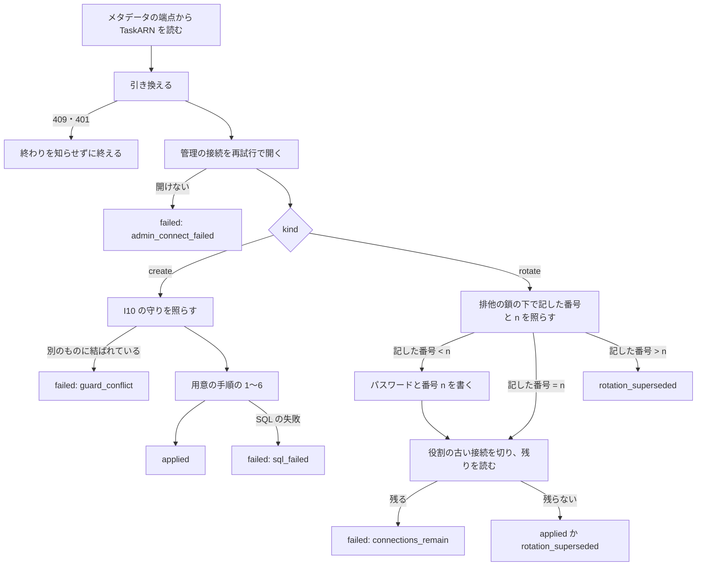
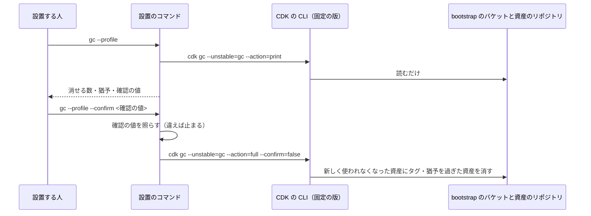

# インフラ: 常駐する計算と NAT なしで、自前の VPC・Aurora・ECS を安く立てられる（#13）

縦の切れ端のスタックには網・進行表の DB・タスクの土台・費用の見張りが無く、ホステッドのレーン（#6）と DB の用意が動かない。この課題で、NAT を置かない自前の VPC・最小 0 ACU の Aurora・サービスを持たない ECS のクラスタ・DB の用意のタスク・予算と運用の知らせを `app` のスタックへ足し、既定の値と設定のキーと実測の手順を決める。イメージの古い版は自前の ECR ではなく設置のコマンドの `cdk gc` で消すことにし、全体の設計（`docs/design/platform.md`）をこの設計 Pull Request の中で直した（決定 1）。採らなかった案は決定ごとに、調べた一次情報は末尾の「外部の調査」にある。

## 今の姿

何が起きたか・目的・受け入れ条件は要求仕様（[issue-13-requirements.md](./issue-13-requirements.md)、正は #13 の本文）にある。この文書は「どう解くか」と「なぜその解き方か」だけを書く。

```mermaid
graph LR
    subgraph 今ある app のスタック
        UP[利用者プール]
        CF[画面の配信]
        API[API の関数 1 本]
        T[(利用者の表)]
    end
    subgraph この課題で足す
        VPC[自前の VPC]
        DB[(Aurora Serverless v2)]
        ECS[ECS のクラスタと DB の用意のタスク]
        BUD[予算と運用の知らせ]
    end
    SETUP[設置のコマンド] -->|diff・deploy| 今ある app のスタック
    SETUP -.->|足りない設定の一覧・gc を足す| SETUP
```

設計に要る今の構造は次のとおりである。

| 置き場 | 今あるもの | この課題との関わり |
| --- | --- | --- |
| `infra/lib/app-stack.ts` | 利用者プール・画面の配信・API の関数・利用者の表。スタックの環境（アカウントとリージョン）を明示して合成する | 網・進行表の DB・タスクの土台・予算を足す。明示した環境では AZ の lookup が走るため、AZ の受け方を決める（決定 3） |
| `infra/test/support.ts` | 「時間で費用が掛かる資源」の種類に `AWS::RDS::DBCluster`・`AWS::RDS::DBInstance` を含む | Aurora を足すと今のテストが落ちる。許しの一覧を理由つきで足す（決定 4） |
| `infra/setup/nd-setup.ts` | `diff`（合成・差分・確認の値）と `deploy`（確認の値が同じときだけ反映） | 足りない設定の一覧と `gc` のサブコマンドを足す |
| `infra/lib/pipeline-stack.ts` | 反映のアクションの CodeBuild は特権なしで、`deploy`・`file-publishing` の役割だけを引き受ける | イメージの資産を置けない。特権と `image-publishing` を足す（決定 11） |
| `packages/contracts/src/settings.ts` | 接頭辞・環境・ログイン・パイプラインのキー。未知のキーは誤り | キーを足す（決定 7） |
| bootstrap（CDK の既定の qualifier） | 資産のイメージは `cdk-<qualifier>-container-assets-<アカウント>-<リージョン>` のリポジトリにだけ置ける。規則はタグの無いイメージを 365 日で消すだけ | 全体の設計の「ECR に規則を掛ける」が成り立たない。決定 1 で直した |

## 文脈と制約

- 全体の設計で決めた次の 3 つは決め直さない。資源の形（[土台の文書のインフラ](../docs/design/platform.md#インフラ)）・進行表の DB の用意の順（[データの文書の進行表の DB](../docs/design/data.md#進行表の-db)）・DB の用意のタスクの HTTP の経路（[API の文書](../docs/design/api.md#ランナー手元のマシンdb-の用意のタスクの-http-の経路)）である
- 全体の設計で直したのは ECR の 1 件だけで、利用者が 2026-11-21 に承認した
- 並行する #41 が `docs/design/execution.md`・`overview.md` を直す。この課題は全体の設計のうち `platform.md` だけを直す
- 設計の段では AWS に触れない。実測と戻しの予行は、リリース承認ゲートの承認の後に反映した環境で行う
- CI は AWS の資格情報を持たない。合成は lookup を使わずに通る
- 例とテストの値は作り物（アカウント `123456789012`・リージョン `us-west-2`・接頭辞 `acme`・環境 `test`・メール `ops@example.com`）だけを使う
- 横断の部品（`packages/core`）は #2 が作る。この課題はそこへ置かず、DB の用意のタスクの中で閉じる
- DB の用意のタスクの HTTP の経路の API の側の処理と見回りは、plan.md の受け持ち（見回りは K8・K7）のとおり #6 が作る。この課題は要求と応答の形と、見回りが使う値を決める

## 解き方の全体像

```mermaid
graph TD
    subgraph app のスタック
        subgraph 自前の VPC（既定 10.80.0.0/16）
            PUB[公開のサブネット 2 つ<br/>DB の用意のタスク・ランナーのタスク]
            ISO[出口の無いサブネット 2 つ<br/>Aurora・書き手 1 台・0〜2 ACU]
            S3E[S3 の Gateway のエンドポイント]
        end
        CL[ECS のクラスタ<br/>サービスもタスクセットも無い]
        TD[DB の用意のタスクの定義<br/>0.25 vCPU・512 MiB・権限の文なし]
        OPS[運用の知らせの SNS のトピック]
        BUD[月の予算 既定 30 ドル]
    end
    BS[(bootstrap の資産のリポジトリ)]
    SET[設置のコマンド<br/>diff: 足りない設定の一覧<br/>gc: 猶予 30 日で古い資産を消す]
    BUD --> OPS
    TD -.->|イメージ| BS
    SET -->|cdk gc| BS
```

- 網・進行表の DB・タスクの土台・予算と運用の知らせは `app` のスタックにあり、`diff` の確認の値で縛られる。NAT・ECS のサービス・自前の ECR は無い
- DB の用意のタスク（`apps/db-prep/`）は、引き換えた値で PostgreSQL にプロジェクトのデータベースと役割を作り、別のプロジェクトのものと重なると書かずに止まる（I10）。CI は PostgreSQL のサービスコンテナでこれを照らす
- 設定のファイルは網の CIDR・最大 ACU・予算・運用の知らせの宛先を受け、どれも既定を持つ。読み手のまだ無いキー（同時のレーンの数・起こし直しの上限・保存期間）は名前と形と既定だけをこの文書に決める
- 設置する人は `diff` で足りない設定（タグの有効化・宛先・Docker など）を読み、`gc` で使われなくなった資産を猶予の後に消す

## ドメインモデル

### コンテキスト

| コンテキスト（用語集の `id`） | 何の語が 1 つの意味に決まるか |
| --- | --- |
| 土台（`platform`） | 進行表の DB の用意・差し替え・設置・資産の片付け |

コンテキストマップは全体の設計のとおりで変えない。DB の用意のタスクはプロジェクトの集約を直に書かず、終わりの報告の HTTP の経路で API へ頼む（[#32 の設計の「集約を書き換える経路」](../docs/design-process/issue-32/design.md#集約を書き換える経路)）。

### 集約

集約は足さない。進行表の DB の列はプロジェクトの集約（[データの文書のテーブル定義](../docs/design/data.md#テーブル定義)）にあり、この課題は値を読むだけである。DB の側の差し替えの番号の表（[差し替えの番号](../docs/design/data.md#差し替えの番号)）は DB の用意のタスクだけが書く。

### 不変条件

受け持つのは全体の設計の I10・I11 で、条件は変えない。この課題で守り方を決める。

| # | 集約 | 条件 | 破れたときの扱い |
| --- | --- | --- | --- |
| I10 | プロジェクト（進行表の DB の列） | 進行表の DB は、プロジェクトごとに別のデータベースとログインの役割を持つ | DB の用意のタスクが、データベースか役割が別の役割・別のデータベースへ結ばれていると読んだら、何も書かずに失敗（理由 `guard_conflict`）で終わりを知らせる |
| I11 | — | レーンのコンテナは AWS の権限を持たない | タスクの役割に許可の文を足す変更はスタックのテストが落とす |

### ドメインイベント

要求の E1〜E5 を引き継ぐ。

| # | イベント | 発生元 | 受け手 |
| --- | --- | --- | --- |
| E1 | 設置する人が `diff` で差分・確認の値・足りない設定の一覧を読んだ | 設置のコマンド | 設置する人 |
| E2 | 縦の切れ端を反映した | 設置のコマンドか反映のパイプライン | AWS（CloudFormation） |
| E3 | DB の用意のタスクがプロジェクトのデータベースと役割を作った | DB の用意のタスク | API（終わりの報告。処理は #6） |
| E4 | 使われなくなった資産を消した | 設置のコマンドの `gc` | bootstrap のバケットと資産のリポジトリ |
| E5 | 実測と戻しの予行を記録した | 運用する人（リリース後テスト） | 詳細設計と全体の設計の費用の見込み |

## 構成要素

| 要素 | 責務 |
| --- | --- |
| 網（`infra/lib/network.ts`） | VPC・4 つのサブネット・S3 の Gateway のエンドポイント・タスクの SG・Aurora の SG |
| 進行表の DB（`infra/lib/progress-db.ts`） | Aurora Serverless v2 のクラスタ・書き手・管理の役割の秘密の器 |
| タスクの土台（`infra/lib/tasks.ts`） | ECS のクラスタ・タスクの実行の役割・DB の用意のタスクの定義とログ。ランナーのタスクの定義が使う値（クラスタ・サブネット・SG・既定の大きさ）を #6 へ渡す |
| 費用の見張り（`infra/lib/cost-watch.ts`） | 運用の知らせの SNS のトピックと宛先の購読・月の予算と 3 つの知らせ |
| DB の用意のタスク（`apps/db-prep/`） | 引き換え・用意の手順の 1〜6・差し替え・終わりの報告。I10 の守り |
| 形の正本（`packages/contracts/`） | 設定のファイルのキー・DB の用意のタスクの 2 つの HTTP の経路の要求と応答の形 |
| 設置のコマンド（`infra/setup/`） | 足りない設定の一覧（`diff` の 1 欄）・`gc` のサブコマンド |
| 反映のパイプライン（`infra/lib/pipeline-stack.ts`） | 反映のアクションを特権にし、`image-publishing` の役割を引き受けられるようにする |
| スタックのテスト（`infra/test/`） | 全体の設計の「スタックのテストに足す行」と、Aurora の許し |

構成要素の図は「解き方の全体像」の図である。配置は [土台の文書の配置の図](../docs/design/platform.md#配置の図) のとおりで変えない。

## 入出力のコントラクト

### 設定のファイル

形の正本 `packages/contracts/src/settings.ts` に足す。どれも任意で、無ければ既定を使う。今の設定のファイルはそのまま読める。

| キー | 形 | 既定 | 読む構成要素 | 足す課題 |
| --- | --- | --- | --- | --- |
| `network.vpc_cidr` | IPv4 の CIDR。接頭辞の長さ 16〜20 | `10.80.0.0/16` | 網 | #13 |
| `progress_db.max_acu` | 数。1〜16、0.5 刻み | `2` | 進行表の DB | #13 |
| `budget.monthly_usd` | 整数。1〜100,000 | `30` | 費用の見張り | #13 |
| `budget.scope` | `tags` か `account` | `tags` | 費用の見張り・足りない設定の一覧 | #13 |
| `ops.notify_emails` | メールの配列。0〜10 件 | 空（購読を作らない） | 費用の見張り | #13 |
| `limits.max_concurrent_lanes` | 整数。1〜1,000 | `20` | 使える量の判定 | #29 |
| `progress_db.rotation_retry_limit` | 整数。1〜10 | `3` | 見回り | #6 |
| `retention.records_days` | 整数。30〜3,650 | `365` | 承認資料の本文と操作の記録の期限 | 期限を置く子（#8・#11） |

「足す課題」が #13 でないキーは、読み手の無いキーを先に足さない決まり（[settings.md](../docs/operations/settings.md)）のとおり、読む構成要素と同じ変更でその課題が足す。名前・形・既定はこの表を正にする。

### DB の用意のタスクの HTTP の経路

経路・主体・順序は [API の文書](../docs/design/api.md#ランナー手元のマシンdb-の用意のタスクの-http-の経路) のとおりで、この課題は要素の項目を決めて形の正本 `packages/contracts/src/db-prep-api.ts` に書く。本文は配列で、要素は 1 個である（I12）。

| 経路 | 向き | 項目 |
| --- | --- | --- |
| `/v1/db_prep/exchanges/create` | 要求 | `task_arn`（文字列。タスクのメタデータの端点の `TaskARN`） |
| 同上 | 応答 | `prep_id`・`kind`（`create` か `rotate`）・`admin`（`host`・`port`・`database`・`user`・`password`）・`project`（`database`・`role`・`password`・`rotation_seq`。`rotation_seq` は `rotate` だけ）・`completion_token` |
| `/v1/db_prep/completions/create` | 要求 | `prep_id`・`kind`・`result`（`applied`・`rotation_superseded`・`failed`）・`rotation_seq`（`rotate` だけ。タスクが受けた番号 n）・`recorded_seq`（`rotation_superseded` だけ。DB に記してあった番号）・`reason`（`failed` だけ。下の表） |
| 同上 | 応答 | `status`（`accepted`）。用意の ID か番号が今の値と合わなければ要素の 409 `state_mismatch` |

| `reason` | 起きたこと |
| --- | --- |
| `admin_connect_failed` | 管理の接続が再試行の後も開けない（Aurora の再開の待ちを超えた） |
| `guard_conflict` | データベースか役割が、別の役割・別のデータベースへ結ばれていた（I10） |
| `connections_remain` | 役割の古い接続を切った後も接続が残っていた（I17） |
| `sql_failed` | ほかの SQL の失敗 |

パスワードと管理の接続の値は応答の中だけにあり、ログ・終わりの報告・合成の出力に出さない。

### 設置のコマンド

| コマンド | 足すもの | 終了コード |
| --- | --- | --- |
| `npm run nd-setup -- diff …` | 出力の最後に「足りない設定」の欄（1 件 1 行。0 件なら「無し」） | 変えない |
| `npm run nd-setup -- gc --profile <profile>` | 消せる資産の数（イメージとファイル）・戻しの猶予・確認の値を示して止まる。AWS へ書かない | 成功 0。profile の誤りは今の `diff` と同じコード |
| `npm run nd-setup -- gc --profile <profile> --confirm <確認の値> [--rollback-buffer-days <日数>]` | 確認の値が同じときだけ、新しく使われなくなった資産に日付のタグを付け、猶予を過ぎた資産を消す | 確認の値が違えば書かずに止まる（今の `deploy` と同じコード） |

## 処理の流れ

### DB の用意のタスク

順序の正本は [データの文書の用意と差し替えの順](../docs/design/data.md#用意と差し替えの順) で、ここではタスクの中の分かれだけを示す。



### 設置のコマンドの `gc`



## 非機能の実現方式

| 大項目 | 要求の条件 | 実現方式 | 確かめ方 |
| --- | --- | --- | --- |
| 可用性 | 表とバケットと Aurora のクラスタはスタックから消しても残る | `RemovalPolicy.RETAIN` と、表の PITR・クラスタの削除の保護 | スタックのテストの行。戻しの予行 |
| 運用・保守性 | 予算の知らせと運用の知らせが宛先へ届く | 予算の 3 つの知らせを運用の知らせのトピックへ送り、宛先のメールを購読にする。タグを有効にできない設置先はアカウントの全体を数える（決定 6） | 低い額の予算で知らせを試す（実測） |
| セキュリティ | タスクは権限を持たず、外から入れない | タスクの役割に文を持たせず、タスクの SG の受け入れを空にする。管理の役割の秘密は器に置き、合成の出力には動的な参照だけ | スタックのテスト |
| システム環境 | 合成は資格情報なしで通る | AZ は `Fn::GetAZs` から選び、lookup を使わない（決定 3）。`Fn::GetAZs` が 2 つ以上の AZ を返す設置先を前提にし、`diff` の一覧で確かめる | CI の `synth`。前提の照らしは単体テスト |

## 決定の記録

### 決定 1: 保管の費用を抑えるため、自前の ECR を作らず、使われなくなった資産を設置のコマンドの `cdk gc` で戻しの猶予 30 日の後に消す（全体の設計を直した）

- **質問**: イメージの古い版を何で消すか。全体の設計は `app` のスタックに ECR を置いてライフサイクルの規則で消すとしたが、CDK の資産のイメージは bootstrap の資産のリポジトリにしか置けない（LIB85・LIB90）
- **選んだ案**: 自前の ECR を作らない。設置のコマンドに `gc` を足し、固定の版の CDK の CLI の `cdk gc --unstable=gc` で、どのスタックからも引かれなくなった資産を戻しの猶予（既定 30 日、`--rollback-buffer-days` で変えられる）の後に消す。作ってから日の浅い資産を外す猶予（`--created-buffer-days`）は 1 日。まず消す数を示して止まり、確認の値を付けて打ち直したときだけ消す。全体の設計は [土台の文書の決定 141](../docs/design/platform.md#決定の記録) として直し、ECR の行・決定 87・決定 89・LIB85・費用の見込みの ECR の行・設置の段の表・未確認のまま残ることを合わせた。#6 のランナーのイメージも同じ置き場と同じ片付けに乗る
- 採らなかった案: 自前の ECR に資産のイメージを写してライフサイクルの規則を掛ける（写す部品の依存が増え、bootstrap の側の古い版が残るため保管の費用が下がらない）
- 採らなかった案: bootstrap の資産のリポジトリに規則を足す（bootstrap のテンプレートを変えることは P1 に当たり、同じ bootstrap を使うほかのアプリの資産も消しうる）
- 採らなかった案: 反映のパイプラインで毎回 `cdk gc` を打つ（パイプラインの役割に消す権限が要り、反映の途中の資産を消す競合が増える）
- **代償**: 片付けは設置する人が打つまで起きない。`cdk gc` は安定でない機能で、CLI の版を上げると引数が変わりうる（決定 2 で受ける）。猶予の 30 日の間は古い版の保管の費用が掛かる
- 作り方: ライブラリやサービスを使う
- 比べた候補: LIB85 / LIB90
- 根拠: Value 6 / Value 8（MVV 版 1）。利用者の決定（2026-11-21）

### 決定 2: `cdk gc` が安定でない機能のまま使えるよう、CLI の版を固定し、使う引数を CI のテストで照らす

- **質問**: 範囲と引数が変わりうる機能（`--unstable=gc`）を、設置する人が打つコマンドの中でどう扱うか
- **選んだ案**: CLI は今の `package.json` の固定の版（`aws-cdk` 2.1148.1）だけを使う。`gc` のサブコマンドが渡す 6 つの引数（`--unstable=gc`・`--action`・`--type`・`--rollback-buffer-days`・`--created-buffer-days`・`--confirm`）は、組み立てる関数を単体テストで縛る。あわせて、CI で `cdk gc --help` の出力にこれらの引数があることを照らすテスト（`gc-cli.test.ts`）を足す。CLI の版を上げる PR で引数が変われば CI が落ちる
- 採らなかった案: 安定になるまで片付けを持たない（使わない間の保管の費用が月ごとに増え続ける）
- 採らなかった案: 資産を自前のスクリプトで探して消す（どのスタックからも引かれないことの判定を自前で持ち、同じ bootstrap を使うほかのアプリの資産を誤って消しうる）
- **代償**: CLI の版を上げるたびに `gc` の振る舞いを読み直す
- 根拠: Value 6 / Value 8（MVV 版 1）

### 決定 3: 合成を資格情報なしで通すため、AZ を `Fn::GetAZs` から 2 つ選び、VPC の CIDR の既定を `10.80.0.0/16` にする

- **質問**: スタックが環境を明示すると AZ の lookup が走る。AZ と CIDR をどう決めるか
- **選んだ案**: `AppStack` の `availabilityZones` を `Fn::Select(0|1, Fn::GetAZs(""))` の 2 つで返す。VPC の CIDR は `network.vpc_cidr`（既定 `10.80.0.0/16`）で、4 つのサブネットを接頭辞の長さ +2（既定は /18）で等しく切る。`10.80.0.0/16` は、AWS の既定の VPC（`172.31.0.0/16`）と、手元の網に多い `10.0.0.0/16`・`192.168.0.0/16` を避けた値である
- **設置の前提**: `Fn::GetAZs` は、既定の VPC の既定のサブネットが一部の AZ にだけあるとその AZ だけを返す（LIB6）。既定のサブネットが 1 つの AZ にしか無い設置先では `Fn::Select(1, …)` が反映の時に失敗する（合成と CI は通る）。そのため設置先は「`Fn::GetAZs` が 2 つ以上の AZ を返す」ことを前提にし、`diff` の足りない設定の一覧（決定 12 の (5)）で確かめる。確かめ方は、`DescribeSubnets`（`default-for-az=true`）で既定のサブネットのある AZ を読み、1 つ以上あればその数、無ければ `DescribeAvailabilityZones` の使える AZ の数を、`Fn::GetAZs` の返す数と見なす。2 未満なら、既定の VPC の別の AZ に既定のサブネットを作る（`CreateDefaultSubnet`）か、既定のサブネットをすべて消すよう一覧に出す。反映した場合も CloudFormation の戻しで前の状態へ戻り、状態を持つ資源は壊れない
- 採らなかった案: 合成の前に AZ を lookup して `cdk.context.json` に置く（CI の合成に資格情報が要り、設置する人ごとの値がリポジトリに入る）
- 採らなかった案: AZ の名前を設定のキーで受ける（多くの設置する人は既定のサブネットが全 AZ にあり、値を選ぶ材料を求めるだけ手数が増える。前提の外れは一覧で知らせれば直せる）
- 採らなかった案: CIDR を必須のキーにする（多くの設置する人は値を選ぶ材料を持たず、手数が増える）
- **代償**: AZ の名前は合成の出力に現れず、差分では読めない。CIDR の既定がほかの網と重なる人はキーで変える
- 根拠: Value 8 / Value 6 / Value 1（MVV 版 1）

### 決定 4: 使わない間の計算の費用を 0 にしたまま上限を抑えるため、Aurora の最大 ACU の既定を 2 にし、最小 0・一時停止 300 秒のクラスタだけをスタックのテストで許す

- **質問**: 最大 ACU の既定をいくつにし、「時間で費用が掛かる資源」のテストと Aurora をどう両立させるか
- **選んだ案**: 最大 ACU は `progress_db.max_acu`（既定 2）。進行表は NDF と DBOS の状態の小さい表で、2 ACU（約 4 GiB）で 5 人のチームの並行の 2 本を受けられると置き、実測で確かめる。版は aws-cdk-lib が持つ PostgreSQL 16 の最新（今は 16.13。自動の一時停止は 16.3 以上）に固定する。スタックのテストの「時間で費用が掛かる資源」の許しに、最小 0 ACU・自動の一時停止 300 秒・Serverless v2 の書き手 1 台のクラスタだけを足し、どれかが外れると落とす
- 採らなかった案: 既定を 1 ACU にする（再開の直後の起動の負荷で詰まりやすく、待ちが延びる）
- 採らなかった案: 既定を 4 ACU 以上にする（起きている間の上限の費用が倍になり、見込みの使い方では要らない）
- **代償**: 起きている間の最大の費用は 1 時間 0.24 ドル（2 ACU × 0.12 ドル/ACU 時。単価はバージニア北部（`us-east-1`）の公開の単価で、[全体の設計の費用の見込み](../docs/design/platform.md#見込み) の Aurora の計算の行による。ほかのリージョンは違う）に抑えられるが、並行のレーンが多い設置では待ちが延びうる。キーで上げる
- 根拠: Value 6（MVV 版 1）。[全体の設計の LIB80](../docs/design/platform.md#ライブラリとサービス)・[費用の見込み](../docs/design/platform.md#見込み)

### 決定 5: 動く間だけの費用を見込みに合わせるため、DB の用意のタスクを 0.25 vCPU・512 MiB、ランナーのタスクの既定を 1 vCPU・2 GB にする

- **質問**: ECS のタスクの大きさの既定をいくつにするか
- **選んだ案**: DB の用意のタスクは 0.25 vCPU・512 MiB（Fargate の最小の組。SQL を数回打つだけ）。ランナーのタスクは 1 vCPU・2 GB（全体の設計の費用の見込みの前提）を既定として #6 へ渡し、タスクの定義は #6 が作る。どちらも x86_64・一時の保存は既定の 20 GiB
- 採らなかった案: ランナーを 0.5 vCPU にする（claude と NDF を同じコンテナで動かし、git の操作もするため遅れが待ち時間に出る）
- 採らなかった案: 大きさを設定のキーにする（読み手の無い今のうちから選ぶ材料を設置する人へ求める。要る日に #6 が足す）
- **代償**: ランナーの既定が実測で足りなければ、#6 が見込みの額とともに直す
- 根拠: Value 6 / Value 1（MVV 版 1）。LIB2

### 決定 6: 費用の増えに気づけるよう、月の予算の既定を 30 ドルにし、タグで絞って運用の知らせのトピックへ送り、タグの有効化を足りない設定に出す

- **質問**: 予算の既定の額と、何を数えるか
- **選んだ案**: 既定は 30 ドル（全体の設計の見込みの 5 人のチームの月 17.7 ドルに、見込みの外れの余裕を足した額）。予算はタグ `app-prefix`・`app-env` で絞り（`budget.scope` の既定 `tags`）、実績 80%・100%・見込み 100% で運用の知らせのトピックへ送る。ユーザーの付けたタグで絞るにはコスト配分タグの有効化が要り（LIB1）、CloudFormation では作れないため、`diff` がタグの状態を読み、有効でなければ足りない設定に出す
- **組織のメンバーのアカウント**: コスト配分タグを有効にできるのは、組織の管理のアカウントと組織に入っていないアカウントだけで、メンバーのアカウントは権限を足した profile に替えても有効にできない（LIB1）。そのため足りない設定の行は、権限の不足と区別して次を 1 行で示す
  - タグが有効でない間、予算は 0 を数え続け、知らせが鳴らないこと
  - 有効にする先: 組織に入っていなければこのアカウント（請求の画面の「コスト配分タグ」で `app-prefix`・`app-env` を有効にする）。組織のメンバーなら組織の管理のアカウント（`organizations:DescribeOrganization` で読めればその ID を示し、読めなければ「組織の管理のアカウント」とだけ示す）へ有効化を頼む
  - 有効にできないときの代わり: 設定のファイルの `budget.scope` を `account` にする
- **代わりの費用の見張り**: `budget.scope` が `account` のとき、予算はタグで絞らず、設置したアカウントの費用の全体を数える（メンバーのアカウントの予算は、そのアカウントの費用を数える）。額と 3 つの知らせは変えない。nd-factory だけを置くアカウントでは見張りの効きは同じで、ほかの資源と相乗りのアカウントでは知らせが早く鳴る側へ外れる（気づき損ねない側）。`account` のときはタグの行を一覧に出さない
- 採らなかった案: アカウントの全体を既定で数える（同じアカウントのほかの資源の費用で知らせが鳴り、nd-factory の増えを見分けられない。タグを有効にできない設置先だけが選ぶ代わりにした）
- 採らなかった案: 設置のコマンドがタグを有効にする（`diff` が AWS へ書くことになり、メンバーのアカウントでは打っても通らない）
- 採らなかった案: Cost Anomaly Detection のタグの見張りで代える（タグで絞る見張りもコスト配分タグの有効化が要り、同じところで止まる）
- **代償**: タグを有効にするまで予算は 0 を数え続ける。有効になるまで最大 48 時間かかる。`account` を選んだ設置先は、nd-factory の分の増えを相乗りの費用と見分けられない
- 根拠: Value 6 / Vision（MVV 版 1）。LIB1

### 決定 7: 読み手の無いキーを先に足さないため、#13 が読むキーだけを形の正本に足し、ほかは名前と形と既定をこの文書に決める

- **質問**: #32 が #13 へ渡した 7 つのキーのうち、どれを形の正本へ足すか
- **選んだ案**: 網の CIDR・最大 ACU・予算の額・予算の数える範囲（決定 6）・運用の知らせの宛先の 5 つを足す。同時のレーンの数（#29）・差し替えの起こし直しの上限（#6）・保存期間（期限を置く子）は、名前と形と既定を「入出力のコントラクト」の表に決め、読む構成要素と同じ変更で読む課題が足す
- 採らなかった案: 7 つをすべて今足す（読み手の無いキーを先に足さない決まりに反し、値を書いても効かない設定を設置する人へ見せる）
- **代償**: 3 つのキーは、読む課題が足すまで形の正本に無い
- 根拠: Value 7 / Value 1（MVV 版 1）

### 決定 8: 2 つのプロジェクトが同じデータベースか役割を使わないよう、DB の用意のタスクが書く前に結び付きを照らし、CI の PostgreSQL で接続まで確かめる

- **質問**: I10 をどこで縛り、AWS に触れない CI でどう確かめるか
- **選んだ案**: DB の用意のタスクは作る前に、データベースが既にあれば `CONNECT` を持つ役割が渡された役割と管理の役割だけであること、役割が既にあれば `CONNECT` を持つデータベースが渡されたデータベースだけであることを照らし、外れれば何も書かずに `guard_conflict` で終える。名前の無作為の生成は API（#6）が持つ。CI の `check` のジョブに PostgreSQL 16 のサービスコンテナを足し、用意の手順で 2 つのプロジェクトを作って、A の役割から B のデータベース・`postgres`・`template1` へ接続できないこと、カタログから B の名前を読めないことを照らす
- 採らなかった案: 名前の生成だけを単体テストで縛る（重なりの起こる経路が生成のほかにもあり、DB の側の権限が正しいかは縛れない）
- 採らなかった案: 接続のテストを反映した環境の実測だけにする（毎回の変更で確かめられず、壊しても CI が落ちない）
- **代償**: CI のジョブにサービスコンテナが増え、`check` が数十秒延びる。Aurora の管理の役割は superuser でないため、CI で通っても Aurora での振る舞い（手順の 4）は実測で確かめる
- 作り方: ライブラリやサービスを使う
- 比べた候補: LIB3 / LIB4
- 根拠: Value 9 / Value 7（MVV 版 1）

### 決定 9: 遅い起動を誤って止めずに失敗を拾うため、作成の時間切れと差し替えの期限を 15 分、見回りの間隔を 5 分、起こし直しの上限を 3 回にする

- **質問**: 全体の設計が値を決めていない、作成の時間切れ（I18）・差し替えの期限（I22）・見回りの間隔をいくつにするか
- **選んだ案**: 作成の時間切れと差し替えの期限は 15 分（タスクの起動 1〜2 分・Aurora の再開（通常は約 15 秒、停止が 24 時間を超えると 30 秒以上。[全体の設計の LIB80](../docs/design/platform.md#ライブラリとサービス)）・用意の SQL 数秒に、イメージの取得の遅れの余裕を足した値）。見回りの間隔は 5 分（EventBridge のスケジュール。月 8,640 回で無料の枠の中、LIB5）。起こし直しの上限は 3 回（全体の設計の既定）で、キーは `progress_db.rotation_retry_limit`。これらを読むのは見回りと API で、#6 が作る
- 採らなかった案: 時間切れを 5 分にする（24 時間を超えた停止からの再開とイメージの取得が重なると届かず、誤って止める）
- 採らなかった案: 見回りを 1 分ごとにする（時間切れの検出が 4 分早まるだけで、DB の用意は人の操作の待ちにならない）
- **代償**: 失敗した用意のやり直しは最大で 20 分ほど待つ
- 根拠: Value 6 / Value 1（MVV 版 1）。[全体の設計の LIB80](../docs/design/platform.md#ライブラリとサービス)

### 決定 10: 前の版へ戻せることを確かめるため、戻しの予行を「状態を持つ資源を消さない変更の前後」で行う

- **質問**: 戻しの予行で何を戻すか
- **選んだ案**: この課題の版を反映した後に、状態を持つ資源に触れない小さな変更（運用の知らせのトピックの表示名など）を反映し、保存した前の合成の結果を設置のコマンドで反映し直して戻す。戻した後に、Aurora のプロジェクトのデータベースと利用者の表の項目が残り、確認の値の照らしが通ることを記録する。`gc` の戻しの猶予の間は、前の版の資産を作り直さずに戻せることも合わせて読む
- 採らなかった案: この課題の前の版（網と DB の無い版）へ戻す（残す設定のクラスタが孤立し、もう一度進めると同じ名前で作れずに止まる）
- **代償**: 予行は戻しの道筋を確かめるだけで、資源を消す戻しは確かめない
- 根拠: Value 8 / Vision（MVV 版 1）

### 決定 11: イメージの資産を置けるよう、1 つのスプリントの Pull Request のまま、パイプラインのスタックを先に反映してから main へ入れる

- **質問**: DB の用意のイメージが最初の資産になる。パイプラインのスタックの直し（特権・`image-publishing`）と資産を、#6 との 2 つの PR に分けるか
- **選んだ案**: 前提の直し（`setup.md` の Docker・パイプラインのスタック）と DB の用意のイメージを、同じスプリントの Pull Request に入れる。リリース承認ゲートの承認の後、スプリントの Pull Request の HEAD で `npm run nd-setup -- diff --stack pipeline` と `deploy` を打ってパイプラインのスタックを先に反映し、その後に main へマージする。パイプラインのスタックは起点のブランチへの push では変わらないため、この順で反映のアクションは新しい役割で資産を置ける。#6 のランナーのイメージは、この反映の後に足すだけになる
- 採らなかった案: 前提の直しを別の PR で先に main へ入れる（スプリントの外に PR とリリース承認ゲートが 1 つ増え、前提だけの版が main に残る）
- **先に反映する前に保存するもの**: 先の反映の前に、運用する人が main の今の HEAD（マージの基点）で `npm run nd-setup -- diff --stack pipeline --out <前の版の置き場>` を打ち、次の 3 つを運用する環境の手元に残す（リポジトリと課題には値を書かない）
  - 前の版のコミット（main の HEAD の SHA）
  - その合成の結果の置き場（`cdk.out` と `nd-setup-stacks.json`）と確認の値。この時点の差分が空であること（今のパイプラインのスタックが main と同じ版であること）も読む
  - 先の反映で打った確認の値（新しい版の置き場の要約値）
- **戻しを始める条件**: 先の反映の後、次のどれかが起きたら、同じ日のうちにパイプラインのスタックを前の版へ戻す
  - スプリントの Pull Request をマージせずに閉じた（取り下げ）
  - リリース承認ゲートの承認を取り消した、または承認の後に変更を求めた（新しい HEAD でやり直す）
  - 先の反映から 3 日のうちにマージできない（CI の失敗・衝突などでマージが止まった）
- **前の版へ戻す手順**: 特権と `image-publishing` を外すのも、ほかの反映と同じく差分を読んで承認してから打つ
  1. 保存した前の版のコミットを取り出し、`npm run nd-setup -- diff --stack pipeline --out <戻しの置き場>` を打つ。差分が「反映のアクションの特権と `image-publishing` の役割の引き受けを外す」だけであることを読む。ほかの差分があれば打たずに止め、原因を調べる
  2. 新しい確認の値の要約値の部分が、保存した前の版の確認の値と同じであることを照らす（前の版を同じに作り直せたこと）。違えば、保存した前の版の置き場をそのまま使う
  3. `npm run nd-setup -- deploy --profile <profile> --assembly <戻しの置き場> --confirm <確認の値>` で反映し、もう一度 `diff --stack pipeline` を打って差分が空になったことを読む
  4. 反映のパイプラインがイメージの資産を持つ版を反映していないこと（main に入っていない）を確かめる。先の反映の間に置いた資産は `gc` の戻しの猶予の後に消える
  - 先の反映が CloudFormation の戻しで失敗したときは、パイプラインのスタックは前の版のままで、戻しは要らない
- 採らなかった案: 戻しを持たず、次のスプリントで同じ版が入るのを待つ（特権の CodeBuild と `image-publishing` の引き受けが、要る理由の無いまま運用する環境に残る）
- **代償**: 運用する環境では、マージの前にパイプラインのスタックだけが新しい版になる時間がある。その間の古い縦の切れ端の反映は今のとおり動く。戻しの手順は決定 10 の `app` の予行とは別で、この課題の予行では打たない（打つのは上の条件が起きたときだけ）
- 根拠: Value 8（MVV 版 1）

### 決定 12: 設置する人が反映の前に止まる理由を読めるよう、足りない設定の一覧に 5 種類を出す

- **質問**: `diff` の足りない設定の一覧に何を出すか
- **選んだ案**: この課題が受け持つ 5 種類を出す。(1) Google のクライアントの ID が無い（ログインを待つ。全体の設計の設置の段の表が一覧の例に挙げる今ある不足で、一覧を作るこの課題が最初の行として移す）、(2) コスト配分タグ `app-prefix`・`app-env` が有効でない・読めない（予算が数えない。行の中身は決定 6）、(3) 運用の知らせの宛先が空（知らせが届かない）、(4) Docker が無い（`deploy` がイメージを作れずに止まる）、(5) `Fn::GetAZs` が返す AZ が 2 つ未満（`deploy` が網を作れずに止まる。決定 3）。一覧の行は関数の配列で持ち、ほかの子（GitHub の App・Bedrock のリージョンなど）は行を足すだけにする
- 採らなかった案: 足りない設定で終了コードを変える（足りない設定があっても反映はでき、反映の前に直すかを設置する人が決める。plan.md の決まり）
- **代償**: タグの状態を読むには profile に `ce:ListCostAllocationTags`、AZ を読むには `ec2:DescribeSubnets`・`ec2:DescribeAvailabilityZones` が要る。読めなければ「確かめられない」と出す
- 根拠: Value 1 / Value 6（MVV 版 1）

### 決定 13: 1 つのスプリントで閉じるため、進行表の DB へ接続して確かめる実測を #44 へ分ける

- **質問**: 受け入れ条件 7 の実測のうち、Aurora へ接続する項目をこの課題のスプリントの中で確かめられるか
- **選んだ案**: 確かめられない。DB の用意のタスクは API の引き換えの経路（`/v1/db_prep/exchanges/create`）から管理の接続を受けるが、その経路は #6 が作る。接続しない項目（接続の無い間の一時停止・保守で起きる回数・単価・`gc`・戻しの予行）をこの課題に残し、接続する項目を新しい課題 #44（#13 と #6 の後）へ分けた。#13 の本文の受け入れ条件 7 を取り消し線つきで直した
- 採らなかった案: 実測のために管理の資格情報をタスクの環境の上書きで渡す（`DescribeTasks` から読める所に管理の資格情報が残り、タスクは秘密に触れない全体の設計の決まりに反する）
- 採らなかった案: 引き換えの経路をこの課題で先に作る（プロジェクトの集約と token の仕組みを持つ #6・#5 の範囲を先に作ることになる）
- **代償**: カタログの分け方が Aurora で外せない場合に分かるのが #6 の後になる。CI の PostgreSQL のテスト（決定 8）で分け方の SQL は毎回確かめる
- 根拠: Value 6 / Value 9（MVV 版 1）。plan.md の「1 子の大きさ」

## 影響と危険

- **働く範囲**: このリポジトリの `app` と `pipeline` のスタック・設置のコマンド・形の正本・新しい `apps/db-prep/`・CI の `check` のジョブ。全体の設計は `platform.md` だけを直した
- **プロジェクトごとに違うもの**: 網の CIDR・最大 ACU・予算・運用の知らせの宛先は設定のファイルで受ける。戻しの猶予の日数は `gc` の引数で受ける
- **当たるモード**: `standard`

| 危険 | 扱い |
| --- | --- |
| `cdk gc` はアカウントとリージョンの全体の資産を見る | どのスタックからも引かれない資産だけを消す。ほかのアプリの反映と同時に打つと途中の資産を消しうるため、作った日の猶予を 1 日置き、手順書に「反映と同時に打たない」と書く |
| 予算がタグの有効化まで 0 を数える | 足りない設定の一覧に、0 を数え続けることと有効にする先（組織のメンバーなら組織の管理のアカウント）を出す。有効にできない設置先は `budget.scope` を `account` にする（決定 6） |
| Aurora を足すと今の「時間で費用が掛かる資源」のテストが落ちる | 同じ変更で許しの一覧に理由つきで足す（決定 4） |
| 利用者の表に PITR が無い | 「PITR が無い」の行を足すと今の表が落ちるため、同じ変更で PITR を有効にする |
| 並行する #41 | `execution.md`・`overview.md` と用語集の描画を触らない。この設計は `platform.md` だけを直す |
| 用語集の描画の検査が止まる | `ndf records glossary render --check` は NDF 11 の描画が作る文書（`docs/glossary/<コンテキスト>.md`）が無いため止まる。#41 と重なり、描き直しは #43 が受けるため、この課題では描画し直さず、語は正本（`glossary.json`）にだけ足す |
| 1 つのスプリントに収まるか | 接続する実測を #44 へ分け（決定 13）、残りは実装と反映した後の接続しない実測で収まると見積もる。一時停止の数日はリリース後テストの待ちになる |

### このリポジトリだけの事情

- 無し（作るものは自分で設置する人と運用する環境で同じに働き、運用の値はすべて設定のファイルで受ける）

## テスト設計

| 受け入れ条件・不変条件 | どの振る舞いで縛るか | どう壊したら落ちるべきか |
| --- | --- | --- |
| 1・I10 | DB の用意の手順で 2 つのプロジェクトを PostgreSQL に作り、A の役割で B のデータベース・`postgres`・`template1` へ接続を試み、カタログから B の名前を探す。既にある別のプロジェクトのデータベースか役割を渡すと `guard_conflict` | 2 つに同じデータベースか役割を渡しても作れる・A から B へ接続できる・カタログから B の名前を読めると落ちる |
| 2・I11 | 合成の出力のタスクの役割（DB の用意。ランナーは #6 が同じ検査を使う）に、インラインとマネージドのどちらの許可の文も無い | タスクの役割に文を 1 つ足すと落ちる |
| 3 | スタックのテストの 8 行（NAT・タスクの SG の受け入れ・VPC の中の Lambda・ECS のサービスとタスクセット・タスクの役割の文・Aurora の最小・消せる設定・PITR の欠け） | 行ごとに違反を 1 つ入れた合成の出力で、その行だけが落ちる |
| 3（Aurora の許し） | 最小 0・一時停止 300 秒・書き手 1 台のクラスタだけを許す | 最小を 0.5 にする・一時停止を外す・読み手を足すと落ちる |
| 4 | 網・進行表の DB・タスクの土台・予算が `app` のスタックの合成の出力にあり、要約値に入る | 資源を別のスタックへ移すと落ちる |
| 5 | `diff` の出力の最後に足りない設定の欄が出て、5 種類が当たる入力でそれぞれ 1 行になる。タグの行は、0 を数え続けることと有効にする先（組織のメンバーなら管理のアカウント）と `budget.scope` の代わりを含み、`budget.scope` が `account` なら出ない。既定のサブネットが 1 つの AZ にだけある入力で (5) の行が出て、既定のサブネットが無く使える AZ が 2 つ以上ある入力では出ない | 欄が出ない・終了コードが変わる・1 つの AZ の入力で行が出ないと落ちる |
| 6 | 戻しの予行の記録（手動確認） | — |
| 7 | 接続しない実測の記録（手動確認）。接続する項目は #44 | — |
| 9 | `gc` の確認の値なしは AWS へ書かない引数（`--action=print`）だけで CLI を呼び、確認の値が違えば CLI を呼ばない。CI で `cdk gc --help` に使う引数がある | 確認の値なしで消す引数を渡す・違う確認の値で消す・CLI の引数の名前が変わると落ちる |
| 8 | 詳細設計があり、全体の設計の直しが ECR の 1 件だけ（設計 Pull Request の差分で `docs/design/` の変更が `platform.md` だけであることを読む） | — |
| 10 | `platform.md` に ECR の資源を作る文が無い（設計 Pull Request のレビューで読む） | — |
| 設定のキー | 5 つのキーの既定・境界（CIDR の接頭辞 15 と 21・ACU の 0.5 と 16.5・予算 0・範囲の `tags` と `account` のほかの値）・未知のキー | 範囲の外を受ける・既定が変わると落ちる |

## 用語

| 用語 | 意味 | 用語集への反映 |
| --- | --- | --- |
| 戻しの猶予 | 使われなくなった資産を、設置のコマンドが消すまで残しておく日数。既定 30 日 | 追加（`docs/glossary/glossary.json` に足した。文書の描画は #43） |

## 設計の結果

詳細設計: [issue-13-design-detail.md](./issue-13-design-detail.md)

| 課題 | 扱い | 統合先 | 触るファイル |
| --- | --- | --- | --- |
| #13 | 実装する | — | `packages/contracts/src/settings.ts`、`packages/contracts/src/db-prep-api.ts`（新設）、`packages/contracts/test/settings.test.ts`、`packages/contracts/test/db-prep-api.test.ts`（新設）、`packages/contracts/schema/settings.schema.json`、`infra/settings.example.json`、`docs/operations/settings.md`、`docs/operations/setup.md`、`infra/lib/app-stack.ts`、`infra/lib/naming.ts`、`infra/lib/network.ts`（新設）、`infra/lib/progress-db.ts`（新設）、`infra/lib/tasks.ts`（新設）、`infra/lib/cost-watch.ts`（新設）、`infra/lib/pipeline-stack.ts`、`infra/test/support.ts`、`infra/test/app-stack.test.ts`、`infra/test/stack-rules.test.ts`（新設）、`infra/test/pipeline-stack.test.ts`、`infra/test/naming.test.ts`、`infra/setup/nd-setup.ts`、`infra/setup/missing-settings.ts`（新設）、`infra/setup/gc.ts`（新設）、`infra/setup/aws-reader.ts`、`infra/test/nd-setup.test.ts`、`infra/test/missing-settings.test.ts`（新設）、`infra/test/gc.test.ts`（新設）、`infra/test/gc-cli.test.ts`（新設）、`apps/db-prep/package.json`（新設）、`apps/db-prep/tsconfig.json`（新設）、`apps/db-prep/Dockerfile`（新設）、`apps/db-prep/src/main.ts`（新設）、`apps/db-prep/src/exchange.ts`（新設）、`apps/db-prep/src/provision.ts`（新設）、`apps/db-prep/src/rotate.ts`（新設）、`apps/db-prep/test/provision.test.ts`（新設）、`apps/db-prep/test/rotate.test.ts`（新設）、`apps/db-prep/test/exchange.test.ts`（新設）、`.github/workflows/ci.yml`、`package-lock.json` |

## 未確認のまま残ること

実測の手順は [詳細設計の「実測と戻しの予行の手順」](./issue-13-design-detail.md#実測と戻しの予行の手順) にある。

| 項目 | 内容 |
| --- | --- |
| Aurora の一時停止 | 接続の無い間に一時停止に入り続けること・保守で起きる回数（骨組みの環境で数日。この課題） |
| 単価 | EventBridge のスケジュール（無料の枠の外の単価）・DynamoDB の PITR とストリーム（この課題） |
| 接続して確かめる項目 | 再開の待ち・カタログの分け方（Aurora の管理の役割は superuser でなく、CI の PostgreSQL の結果と違いうる）・`ALTER ROLE` と排他の鎖・DBOS と PostgreSQL 16.13・ACU の平均と既定 2 ACU・`StopTask` と `ListTasks` の時間。#6 の引き換えの経路ができるまで DB の用意のタスクが Aurora へ着けないため、#44 へ分けた（決定 13） |
| `cdk gc` の振る舞い | 反映した環境で、戻しの猶予の間は前の版の資産を残し、猶予を過ぎたものだけを消すこと |

## 外部の調査

| 種類 | 調べるか | 理由 |
| --- | --- | --- |
| 標準・仕様 | 調べない | 資源の形と DB の側の排他（STD83）は全体の設計が調べた。この課題が新しく従う標準は無い |
| 主要な製品 | 調べない | 構成は MVV の Value 6 と全体の設計で決まり、ほかの製品の構成で変わらない |
| ライブラリとサービス | 調べる | 予算のタグ・Fargate の大きさ・DB の用意のタスクの PostgreSQL の部品・スケジュールの単価が既定の値と作り方を決める。ECR と `cdk gc` は全体の設計の LIB85・LIB90 に置いた |

### ライブラリとサービス

| # | 候補 | バージョン | ライセンス | 最後のリリースの日付 | 終了のアナウンス | 要件を満たすか | 出典 |
| --- | --- | --- | --- | --- | --- | --- | --- |
| LIB1 | コスト配分タグ（AWS Billing） | — | AWS のサービス | — | 無し | 満たす。ユーザーの付けたタグは請求の側で有効にしてから使える。付けてから最大 24 時間で一覧に出て、有効になるまでさらに最大 24 時間。`UpdateCostAllocationTagsStatus` の API で有効にできる。有効にできるのは組織の管理のアカウントと組織に入っていないアカウントだけで、組織のメンバーのアカウントはできない | https://docs.aws.amazon.com/awsaccountbilling/latest/aboutv2/activating-tags.html ・ https://docs.aws.amazon.com/us_en/awsaccountbilling/latest/aboutv2/custom-tags.html （2026-11-21） |
| LIB2 | Fargate のタスクの大きさ | プラットフォームの版 1.4.0 | AWS のサービス | — | 無し | 満たす。0.25 vCPU は 512 MiB・1 GB・2 GB、1 vCPU は 2〜8 GB を選べる | https://docs.aws.amazon.com/AmazonECS/latest/developerguide/fargate-tasks-services.html （2026-11-21） |
| LIB3 | `pg`（node-postgres） | 8.23.1 | MIT | 2026-09-30 | 無し | 満たす。広く使われる PostgreSQL のクライアントで、トランザクションと識別子の手書きの組み立てが要る `CREATE ROLE` を素の SQL で打てる。DB の用意のタスクに採る | `npm view pg version license time.modified`（2026-11-21） |
| LIB4 | `postgres`（postgres.js） | 4.1.1 | Unlicense | 2026-11-11 | 無し | 満たす。ただし識別子の組み立ての書き方が独自で、DDL を打つ道具として `pg` より利点が無い | `npm view postgres version license time.modified`（2026-11-21） |
| LIB5 | EventBridge Scheduler | — | AWS のサービス | — | 無し | 満たす。月 1,400 万回の呼び出しまでは無料の枠。例の計算では枠の外は 100 万回あたり 1.00 ドル | https://aws.amazon.com/eventbridge/pricing/ （2026-11-21） |
| LIB6 | CloudFormation の `Fn::GetAZs` | — | AWS のサービス | — | 無し | 条件つきで満たす。既定の VPC の既定のサブネットがある AZ だけを返し、既定のサブネットが無ければ使える AZ をすべて返す。既定のサブネットが 1 つの AZ にだけあると 1 つしか返さない | https://docs.aws.amazon.com/AWSCloudFormation/latest/TemplateReference/intrinsic-function-reference-getavailabilityzones.html （2026-11-21） |

### 確かめられなかったこと

| 対象 | 試した手段 | 結果と理由 |
| --- | --- | --- |
| DynamoDB の PITR とストリームの単価 | 試していない | 見込みの額への効きが小さいため、実測の段で単価の頁を読む |

調べた量: 候補 6 件・取得の試み 7 回（2026-11-21。レビューの指摘で LIB6 とコスト配分タグの頁を足した）。
