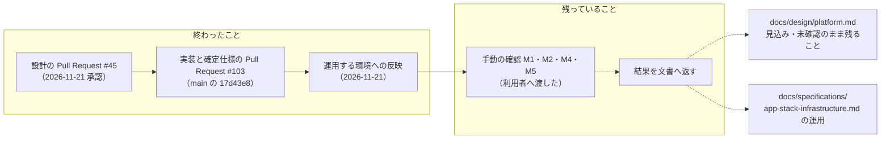
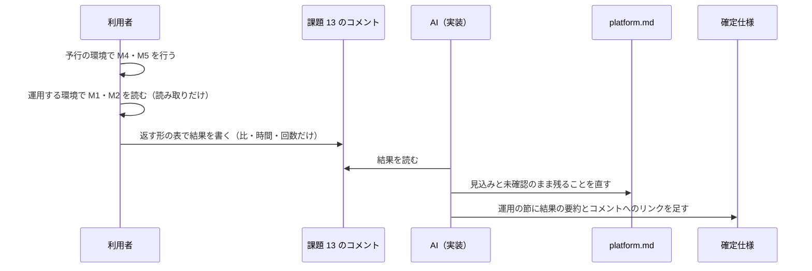

# インフラ: 反映した環境での戻しの予行と実測の結果を、全体の設計の費用の見込みと確定仕様へ返す（#13）

インフラの課題（#13）は、アプリのスタックへ自前の VPC・Aurora・ECS のクラスタ・費用の見張りを足して反映まで終えた。残っているのは、反映した環境でしか確認できない受け入れ条件 6（戻しの予行の記録）と 7（接続しない実測を費用の見込みへ返す）である（要求は [issue-13-requirements.md](./issue-13-requirements.md)）。利用者が運用する環境と予行の環境で手動の確認（M1・M2・M4・M5）を行って結果を課題へ返し、AI がその結果を、全体の設計の費用の見込みと、詳細設計を書き直した確定仕様へ書き入れる。採らなかった案は「決定の記録」に、外部の調査を省いた理由は末尾の「外部の調査」にある。

## 今の姿

何が起きたか・目的・受け入れ条件は要求仕様（[issue-13-requirements.md](./issue-13-requirements.md)、正は [#13](https://github.com/devbasex/nd-factory/issues/13) の本文）にある。この文書は「どう解くか」と「なぜその解き方か」だけを書く。

図の点線が、この変更で足す位置である。設計に要る今の構造は次のとおりである。

- 今回の完了の判定は、受け入れ条件 6 と 7 だけを対象にする。1〜5・8〜10 は、要求の「受け入れ条件の確認」の表に示した証跡（Pull Request #103 の CI と、設計の Pull Request #45）で確認済みである。要求の受け入れ条件のチェック欄は 2026-11-24 の時点ですべて未チェックのままで、確認の結果にそろえる直しは要求の工程へ返す
- 手動の確認の手順と合格の目安は、[#13 のコメント（2026-11-21）](https://github.com/devbasex/nd-factory/issues/13#issuecomment-7069916588) で利用者へ渡した。同じ表が確定仕様 [app-stack-infrastructure.md の「運用」](../docs/specifications/app-stack-infrastructure.md#運用) にあり、手順と合格の目安はそちらが正である。確認を行う環境は 2 つに分かれる
  - 運用する環境: M1・M2。どちらも読み取りだけで、反映はしない
  - 予行の環境: M4・M5。運用する環境と別の `environment` の値で、設置のコマンドから立てた環境である（確定仕様の「運用」）

  | # | 受け入れ条件 | 行う環境 | 確認すること | 合格の目安（確定仕様の「運用」） |
  | --- | --- | --- | --- | --- |
  | M4 | 6 | 予行の環境 | 状態を持つ資源に触れない小さな変更を反映する前に保存した合成の結果を、設置のコマンドの `deploy` で反映し直す。前後で Aurora のクラスタと利用者の表が残ることと、確認の値の違う `deploy` が止まることを読む | クラスタの識別子とリソースの ID が同じ・利用者の表の項目が残る・確認の値の違う `deploy` が止まる |
  | M1 | 7 | 運用する環境 | 反映の後 3 日の `ServerlessDatabaseCapacity`（5 分の粒度）が 0 ACU を超えた時間の合計と、超えた区間の数（保守で Aurora が再開した回数） | 0 ACU を超えた区間が、保守による再開（1 回 20 分程度）だけ |
  | M2 | 7 | 運用する環境 | EventBridge Scheduler・DynamoDB の PITR とストリームの単価の、見込みの額への効き | 見込みの額への効きを書く |
  | M5 | 含めない | 予行の環境 | 予算の通知のメールが設定の送信先に届くこと | 宛先に届く |

- M5 は受け入れ条件 6・7 の合否と別に扱う。結果は #13 のコメントと確定仕様の「運用」の結果の表に書き、届かなかったときは運用の課題として起票する。M5 の結果で #13 の完了を止めない
- M3 は、今の確認の対象に無い。番号が抜けている理由は、#13 の設計の記録からは確かめられていない

- 運用する環境へは 2026-11-21 に反映した（[#13 のコメント](https://github.com/devbasex/nd-factory/issues/13)）。2026-11-24 の時点で、#13 のコメントは 3 件で、結果を返したコメントは無い
- 結果を返す先は 2 つある
  - 全体の設計の費用の見込み: [platform.md の「見込み」](../docs/design/platform.md#見込み) の表と「読み方」の段落。「未確認のまま残ること」の表の「Aurora の一時停止（接続なし）」の行（875 行目。#13 の受け持ち）
  - 詳細設計: #13 の詳細設計書は Pull Request #103 で確定仕様 [app-stack-infrastructure.md](../docs/specifications/app-stack-infrastructure.md) へ書き直され、`issues/` から消えた。元の詳細設計書は、同じスプリントの #104 が記録として `docs/design-process/issue-13/design-detail.md` へ写す。その記録は後から追わない（記録の時点のまま残し、今の設計に合わせて直さない。[issue-104-design.md](./issue-104-design.md)）
- 進行表の DB へ接続する実測（再開の待ち・カタログの分け方・ACU の平均など）は #44 が受け、この課題には含まない

## 文脈と制約

- AI は AWS に触れず、反映も手動の確認も打たない。反映は利用者が打つ（リリース承認ゲートの答え「承認する（自分で反映）」と、要求の「境界」）
- 結果には、比・時間・回数・同じか違うかだけを書く（AGENTS.md の「秘密とインフラの値を置かない」）。実際の値（アカウント ID・資源の ID・ARN・端点・profile の名前・環境の名前・リージョンの名前）は書かない
- 単価の実測（M2）は設置したリージョンで読むため、リージョンの名前も単価の値も書かない。見込みの額への効きは、単価を逆算できない粒度（決定 2）で書く
- `docs/design/` は用語集の禁止語の検査の対象である（`.ndf/glossary.json` の `check.banned.paths`）。書き入れる文は用語集の語で書く
- 結果が利用者から返るまで、文書へ書き入れる作業は始められない

## 解き方の全体像

- 戻しの予行（M4）を行った記録は、#13 のコメントの結果の表と、確定仕様の「運用」の節に足す結果の要約の 2 つで読める（受け入れ条件 6）
- 全体の設計の「見込み」は、実測した一時停止と保守で起きる時間（M1）と単価の効き（M2）を踏まえた額と読み方になる（受け入れ条件 7）
- 「未確認のまま残ること」の表から、実測で分かった「Aurora の一時停止（接続なし）」の行が消え、事実は「見込み」の読み方の 1 か所にだけ残る
- 合格の目安を外れた項目は、結果と外れた点を文書に書き、スタックを直す作業は新しい課題にする（決定 3）。M4 でデータや資源が失われたときは、先に予行を止める（「影響と危険」）

## 決定の記録

### 決定 1: 結果を今の正の文書に残すため、受け入れ条件 7 の「詳細設計」へ返す結果を確定仕様へ書く

- **質問**: 受け入れ条件 7 が結果を返す先とする「詳細設計」を、どの文書として扱うか
- **選んだ案**: 詳細設計を書き直した確定仕様 [app-stack-infrastructure.md](../docs/specifications/app-stack-infrastructure.md) の「運用」の節へ書く。確認の表の直後に、確認ごとの実施日・結果（合格 / 不合格 / 保留）・読んだもの（比・時間・回数）と、結果を返した #13 のコメントへのリンクを足す
- 採らなかった案: #104 が写す記録の詳細設計書（`docs/design-process/issue-13/design-detail.md`）へ書く（その記録は後から追わないと README が書く。#104 の受け入れ条件 2 も中身の変更を禁じる）
- 採らなかった案: `issues/issue-13-design-detail.md` を作り直して書く（確定仕様と同じ事実を 2 か所に持ち、確定仕様にする工程でまた消える）
- **代償**: 確定仕様に、反映した環境で 1 回行った確認の結果という、振る舞いでない記録が入る
- 根拠: Value 10「同じ事実を 2 か所に持たない」（MVV バージョン 3）

### 決定 2: 実測で分かった事実を 1 か所に置くため、合格した項目の未確認の行を消して見込みの読み方へ移す

- **質問**: M1 が合格の目安を満たしたとき、「未確認のまま残ること」の表の「Aurora の一時停止（接続なし）」の行を残すか
- **選んだ案**: M1 が合格なら行を消し、実測した事実を「見込み」の「読み方」の段落に書く。合格の目安は、確定仕様の「運用」の M1 の行にある「0 ACU を超えた区間が、保守による再開（1 回 20 分程度）だけ」である
  - 書く事実: 反映の後 3 日の `ServerlessDatabaseCapacity` が 0 ACU を超えた時間の合計と、保守で Aurora が再開した回数
  - 行を消す条件: 0 ACU を超えた区間が、どれも保守による再開だと確かめられたとき。保守のほかで Aurora が動いた区間が 1 つでもあれば不合格とし、行を残して「内容」の列を実測した事実に書き直す
- **見込みの表の額の直し方**: 見込みの表は、今の出典のとおり `us-east-1` の公開単価と、各列（使わない月・1 人のチーム・5 人のチーム）の前提の使い方で計算したままにする
  - M1 の時間と回数、M2 の費用の項目を、`us-east-1` の公開単価と各列の前提に当てて、列ごとの月の額の差を出す
  - 差が 0.10 ドル以上になる列だけ、その費用の項目の行と、その列の合計を直す。行の額は今の表と同じく小数 2 桁、合計は 0.1 ドル単位の「約」で書く
  - 設置したリージョンでの M2 の読みは、表の額に使わない。「読み方」の段落に、各列の合計への効きが 0.10 ドル未満か以上かだけを書く。単価・単価の比・額の差は、設置したリージョンの単価を逆算できるため書かない
- 採らなかった案: 行を残して「確認した」と書き足す（分かった事実が「見込み」と「未確認のまま残ること」の 2 か所に並び、未確認でない行が表に残る）
- 採らなかった案: 見込みの表に単価の値を書く（設置したリージョンが分かり、リポジトリに置かない値になる）
- 採らなかった案: 見込みの表を設置したリージョンの単価で計算し直す（`us-east-1` の単価の表に別のリージョンの額が混ざり、差と使う量から単価を逆算できる）
- **代償**: 「未確認のまま残ること」の表から、いつ確認したかが読めなくなる。いつ確認したかは確定仕様の結果と #13 のコメントで読む
- 根拠: Value 10「同じ事実を 2 か所に持たない」・Value 7「インフラの実際の値…をリポジトリ・課題・PR・CI の記録・合成の出力に置かない」（MVV バージョン 3）

### 決定 3: 1 つの課題を 1 つのスプリントで閉じるため、合格の目安を外れた項目のスタックの直しを新しい課題にする

- **質問**: 手動の確認が合格の目安を外れたとき、スタックの直しをこの課題の中で行うか
- **選んだ案**: この課題では結果と外れた点を文書へ書くだけにし、スタックの直しは範囲外の課題として起票する（`out-of-scope`）。受け入れ条件 6・7 は、行った記録と返した結果があれば満たす
  - M4 が不合格のときは、確定仕様の「運用」の結果に、予行を行ったことと、安全に戻せると確かめられなかったことを分けて書く。戻しの手順は、新しい課題が直して予行し直すまで、安全に戻せる手順として扱わない
- 採らなかった案: この課題の中でスタックを直す（直した後にもう一度反映して確認する必要があり、スプリントの中で閉じない。要求の前提 3 の「1 つの子は 1 つのスプリントで閉じる」に反する）
- **代償**: 外れた項目は、新しい課題が直すまで、反映した環境で目安を外れたまま動く
- 根拠: Value 17「目先の手間より、長く良い形を選ぶ」・Value 14「変更はレビューを通してから取り込む」（MVV バージョン 3）

## 影響と危険

- **働く範囲**: このリポジトリの次の 2 か所だけ
  - 全体の設計: `docs/design/platform.md` の「見込み」と「未確認のまま残ること」
  - 確定仕様: `docs/specifications/app-stack-infrastructure.md` の「運用」
  - コード・スタック・設定のファイルは変えない
- **プロジェクトごとに違うもの**: 設置したリージョンの単価と、環境ごとの実測の値。どちらもリポジトリに書かない。実測は時間と回数で、単価の効きは決定 2 の粒度で書く
- **当たるモード**: `standard`。#13 の本文の「進行」の欄の「モード」に書かれている。設計だけの Pull Request をレビューしてマージしてから、実装へ進む進め方である
- **同じファイルを触る別の変更と順序**: #105 を先に取り込み、この課題の実装は、その取り込みと利用者からの結果の受け取りの両方の後に始める。#105 は待つものが無く、この課題は結果が返るまで始められないためである
  - 同じスプリントの #105（[issue-105-design.md](./issue-105-design.md)）が `docs/design/platform.md` の 648 行目と 889 行目を直す。行が違うため内容は重ならないが、同じファイルを触る実装は同時に進めない
  - この課題が 875 行目の行を消すと、889 行目の位置が動く。そのため、どちらの確認も、行の番号でなく行に含まれる文で探す
- **結果が返らないとき**: 利用者が結果を返すまで、この課題の実装は始められない
- **結果が「保留」のとき**: 確定仕様の「運用」の結果の表には、その項目の行を結果「保留」として書く。ほかの文書の扱いと、続ける確認は項目ごとに次のとおりにする。条件 6 か 7 が満たされない間は、課題を開いておく

  | 保留の項目 | `platform.md` の扱い | 続ける確認 |
  | --- | --- | --- |
  | M1 | 「未確認のまま残ること」の「Aurora の一時停止（接続なし）」の行を消さずに残す。「読み方」に実測を書かない | 受け入れ条件 7 |
  | M2 | 見込みの表と「読み方」を M2 の結果で直さない | 受け入れ条件 7 |
  | M4 | 変えない | 受け入れ条件 6 |
  | M5 | 変えない | 無い（6・7 と別に扱い、#13 のコメントに保留と書く） |

- **M4 でデータや資源が失われたとき**: 予行をそこで止め、運用の責任者（運用する環境を反映した利用者）が影響と戻し方を確かめるまで、同じ戻しの手順を使わない。止める合図は次の 3 つで、結果の書き方は決定 3 のとおりである
  - クラスタの識別子かリソースの ID が変わった（資源が置き換わった）
  - 利用者の表の項目が減った
  - 確認の値の違う `deploy` が止まらずに反映された
- **壊れうる箇所**: 結果の文に実際の値（12 桁の数字・ARN・リージョンの名前）が混じると、漏れの検査に当たるか、当たらずに公開される。要求の「検証手段」の `grep` に、リージョンの名前の形を足して確認する

## テスト設計

CI の行のほかは、自動のテストを足さない。実装の Pull Request のレビューで、直した 2 本をこの表の「どう壊したら落ちるべきか」に照らし、当たれば差し戻す。

| 受け入れ条件・不変条件 | どの振る舞いで縛るか | どう壊したら落ちるべきか |
| --- | --- | --- |
| 6. 戻しの予行を 1 回行った記録がある | #13 のコメントに M4 の結果の行（実施日・結果・読んだもの）があり、確定仕様の「運用」の節に M4 の結果の要約とそのコメントへのリンクがある。M4 が不合格なら、予行を行ったことと安全に戻せると確かめられなかったことが分けて書かれている | 確定仕様の要約を欠く・リンクの飛び先が結果のコメントでない・M4 が「保留」なのに条件 6 を満たしたとする・不合格なのに戻しの手順を安全と書くと落ちる |
| 7. 接続しない実測を詳細設計と費用の見込みへ返す | 確定仕様の「運用」の節に M1・M2 の結果があり、platform.md の「見込み」の読み方に M1 の時間と回数・M2 の効きが 0.10 ドル未満か以上かがある。M1 が合格なら「未確認のまま残ること」に「Aurora の一時停止（接続なし）」の行が無い | 見込みへ書かない・合格なのに未確認の行を残す・M1 が保留か不合格なのに行を消す・単価の値・単価の比・リージョンの名前を書くと落ちる |
| 値の混入（非機能のセキュリティ） | 要求の「検証手段」の `grep -nE '(^\|[^0-9-])[0-9]{12}([^0-9-]\|$)\|arn:aws'` と、リージョンの名前の形（`[a-z]{2}-[a-z]+-[0-9]`）の検索が、直した 2 本で作り物の値（`123456789012`・`us-west-2`）と、もとから在る単価の出典の `us-east-1` のほかに当たらない | 結果の文に実際のアカウント ID・ARN・設置したリージョンの名前を書くと落ちる |
| CI | スプリントの Pull Request の CI の `check`・`ref-check`・`leak-check` が通る | 漏れの検査に当たる値を書くと落ちる |

## 設計の結果

| 課題 | 扱い | 統合先 | 触るファイル |
| --- | --- | --- | --- |
| #13 | 実装する | — | `docs/design/platform.md`、`docs/specifications/app-stack-infrastructure.md` |

## 未確認のまま残ること

| 項目 | 内容 |
| --- | --- |
| 手動の確認の結果 | M1・M2・M4・M5 の結果は、2026-11-24 の時点で #13 に返っていない。利用者が反映した環境で確認を行い、#13 のコメントの「返す形」の表で返したときに分かる。M1 は反映の後 3 日の観測が要る |
| 見込みの額が変わるか | M2 の単価の効きで見込みの合計が変わるかは、結果が返るまで分からない。変わるときに直す表の行は、結果を読んでから決める |

## 外部の調査

省く: 利用者が反映した環境で読んだ結果を、このリポジトリの文書へ書き入れる変更で、外部の判断が要らない。足した資源の作り方の調査は、設計の Pull Request #45 の外部の調査（#104 が `docs/design-process/issue-13/survey.md` へ写す）にある
