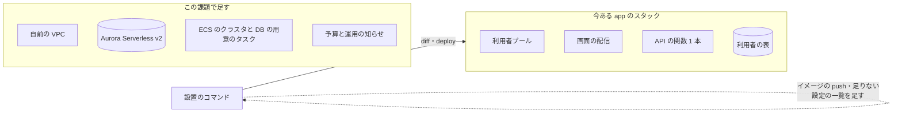
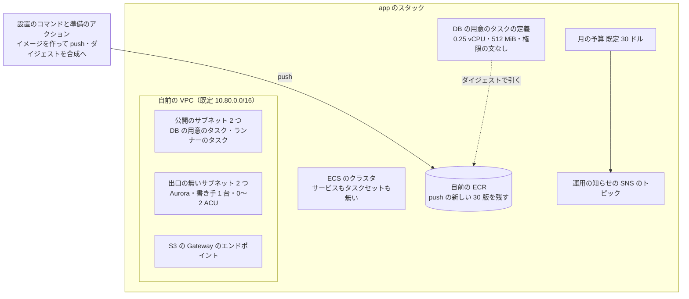
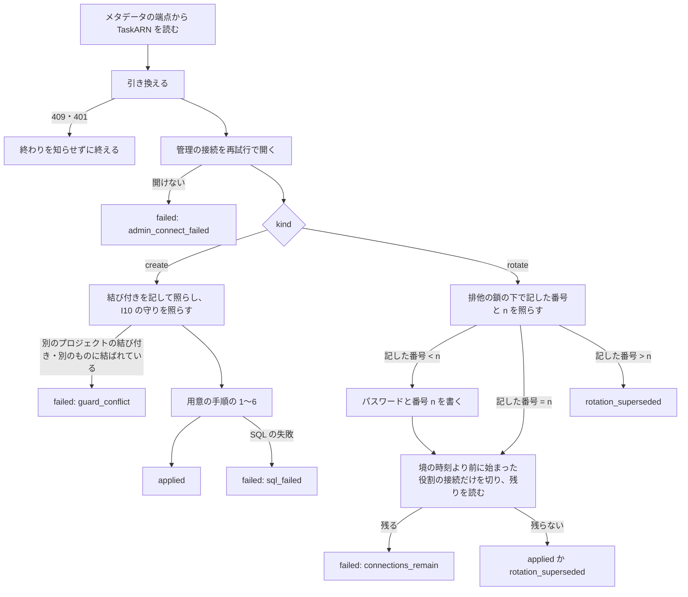
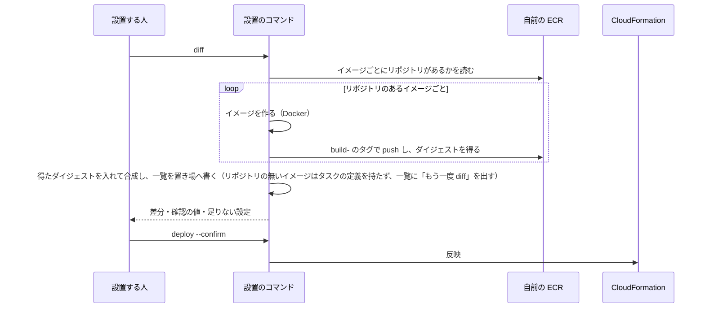

# インフラ: 常駐する計算と NAT なしで、自前の VPC・Aurora・ECS を安く立てられる（#13）

アプリのスタックにはネットワーク・進行表の DB・ECS のクラスタ・費用の見張りが無く、ホステッドのレーン（#6）と DB の用意が動かない。この課題で、NAT を置かない自前の VPC・最小 0 ACU の Aurora・サービスを持たない ECS のクラスタ・DB の用意のタスク・予算と運用の知らせを `app` のスタックへ足し、既定の値と設定のキーと実測の手順を決める。ランナーと DB の用意のイメージは、設置のコマンドと反映のパイプラインが自前の ECR へ push してテンプレートがダイジェストで引く形にし、全体の設計（`docs/design/platform.md` の決定 87）をこの設計 Pull Request の中で直した（決定 1）。採らなかった案は決定ごとに、調べた一次情報は末尾の「外部の調査」にある。

## 今の姿

何が起きたか・目的・受け入れ条件は要求仕様（[issue-13-requirements.md](./issue-13-requirements.md)、正は #13 の本文）にある。この文書は「どう解くか」と「なぜその解き方か」だけを書く。

設計に要る今の構造は次のとおりである。

| 置き場 | 今あるもの | この課題との関わり |
| --- | --- | --- |
| `infra/lib/app-stack.ts` | 利用者プール・画面の配信・API の関数・利用者の表。スタックの環境（アカウントとリージョン）を明示して合成する | ネットワーク・進行表の DB・ECS のクラスタ・予算を足す。明示した環境では AZ の lookup が走るため、AZ の受け方を決める（決定 3） |
| `infra/test/support.ts` | 「時間で費用が掛かる資源」の種類に `AWS::RDS::DBCluster`・`AWS::RDS::DBInstance` を含む | Aurora を足すと今のテストが落ちる。許しの一覧を理由つきで足す（決定 4） |
| `infra/setup/nd-setup.ts` | `diff`（合成・差分・確認の値）と `deploy`（確認の値が同じときだけ反映） | `diff` の前にイメージを作って push し、ダイジェストを合成へ渡す。足りない設定の一覧を足す |
| `infra/lib/pipeline-stack.ts` | 準備と反映のアクションの CodeBuild は特権なしで、反映のアクションは `deploy`・`file-publishing` の役割だけを引き受ける | 準備のアクションがイメージを作れない。準備を特権にして自前の ECR への push を許す（決定 11）。反映のアクションは変えない |
| `packages/contracts/src/settings.ts` | 接頭辞・環境・ログイン・パイプラインのキー。未知のキーは誤り | キーを足す（決定 7） |
| 全体の設計の決定 87 | ランナーと DB の用意のイメージの置き場と、確認の値での縛り方を決めている | 決定 1 で決定 87 を直した。直す前の形を採らなかった理由は決定 1 の「採らなかった案」にある |

## 文脈と制約

- 全体の設計で決めた次の 3 つは決め直さない。資源の形（[プラットフォームの文書のインフラ](../docs/design/platform.md#インフラ)）・進行表の DB の用意の順（[データの文書の進行表の DB](../docs/design/data.md#進行表の-db)）・DB の用意のタスクの HTTP の経路（[API の文書](../docs/design/api.md#ランナー手元のマシンdb-の用意のタスクの-http-の経路)）である
- 全体の設計で直したのはイメージの置き場（決定 87）の 1 件だけで、利用者が 2026-11-21 に承認した
- 並行する #41 が `docs/design/execution.md`・`overview.md` を直す。この課題は全体の設計のうち `platform.md` だけを直す
- 設計の段では AWS に触れない。実測と戻しの予行は、リリース承認ゲートの承認の後に反映した環境で行う
- CI は AWS の資格情報を持たない。合成は lookup を使わずに通る
- 例とテストの値は作り物（アカウント `123456789012`・リージョン `us-west-2`・接頭辞 `acme`・環境 `test`・メール `ops@example.com`）だけを使う
- 横断の部品（`packages/core`）は #2 が作る。この課題はそこへ置かず、DB の用意のタスクの中で閉じる
- DB の用意のタスクの HTTP の経路の API の側の処理と見回りは、plan.md の受け持ち（見回りは K8・K7）のとおり #6 が作る。この課題は要求と応答の形と、見回りが使う値を決める

## 解き方の全体像

- ネットワーク・進行表の DB・ECS のクラスタ・自前の ECR・予算と運用の知らせは `app` のスタックにあり、`diff` の確認の値で縛られる。NAT・ECS のサービスは無い
- ランナーと DB の用意のイメージは、`diff` の前（設置のコマンド）と準備のアクション（反映のパイプライン）で作って自前の ECR へ push され、タスクの定義はダイジェストで引く。中身が変わればダイジェストが変わり、確認の値も変わる。ECR のライフサイクルの規則は、リポジトリごとに push の新しい 30 版を残し、それより古い版を消す（決定 2）
- DB の用意のタスク（`apps/db-prep/`）は、引き換えた値で PostgreSQL にプロジェクトのデータベースと役割を作り、別のプロジェクトのものと重なると書かずに止まる（I10）。CI は PostgreSQL のサービスコンテナでこれを照らす
- 設定のファイルはネットワークの CIDR・最大 ACU・予算・運用の知らせの宛先を受け、どれも既定を持つ。読み手のまだ無いキー（同時のレーンの数・起こし直しの上限・保存期間）は名前と形と既定だけをこの文書に決める
- 設置する人は `diff` で足りない設定（タグの有効化・宛先・AZ・ECR がまだ無いこと）を読む

## ドメインモデル

### コンテキスト

| コンテキスト（用語集の `id`） | 何の語が 1 つの意味に決まるか |
| --- | --- |
| プラットフォーム（`platform`） | 進行表の DB の用意・差し替え・設置・イメージの置き場 |

コンテキストマップは全体の設計のとおりで変えない。DB の用意のタスクはプロジェクトの集約を直に書かず、終わりの報告の HTTP の経路で API へ頼む（[#32 の設計の「集約を書き換える経路」](../docs/design-process/issue-32/design.md#集約を書き換える経路)）。

### 集約

集約は足さない。進行表の DB の列はプロジェクトの集約（[データの文書のテーブル定義](../docs/design/data.md#テーブル定義)）にあり、この課題は値を読むだけである。DB の側の差し替えの番号の表（[差し替えの番号](../docs/design/data.md#差し替えの番号)）と、同じスキーマに置くプロジェクトと名前の結び付きの表（決定 8）は DB の用意のタスクだけが書く。

### 不変条件

受け持つのは全体の設計の I10・I11 で、条件は変えない。この課題で守り方を決める。

| # | 集約 | 条件 | 破れたときの扱い |
| --- | --- | --- | --- |
| I10 | プロジェクト（進行表の DB の列） | 進行表の DB は、プロジェクトごとに別のデータベースとログインの役割を持つ | DB の用意のタスクが、作る前に記したプロジェクトと 2 つの名前の結び付きに外れるか、データベースか役割が別の役割・別のデータベースへ結ばれていると読んだら、何も書かずに失敗（理由 `guard_conflict`）で終わりを知らせる |
| I11 | — | レーンのコンテナは AWS の権限を持たない | タスクの役割に許可の文を足す変更はスタックのテストが落とす |

### ドメインイベント

要求の E1〜E5 を引き継ぐ。

| # | イベント | 発生元 | 受け手 |
| --- | --- | --- | --- |
| E1 | 設置する人が `diff` でイメージの push・差分・確認の値・足りない設定の一覧を読んだ | 設置のコマンド | 設置する人・自前の ECR |
| E2 | アプリのスタックを反映した | 設置のコマンドか反映のパイプライン | AWS（CloudFormation） |
| E3 | DB の用意のタスクがプロジェクトのデータベースと役割を作った | DB の用意のタスク | API（終わりの報告。処理は #6） |
| E4 | 古い版のイメージが消えた | 自前の ECR のライフサイクルの規則 | 自前の ECR（新しい 30 版だけが残る） |
| E5 | 実測と戻しの予行を記録した | 運用する人（リリース後テスト） | 詳細設計と全体の設計の費用の見込み |

この課題に残した実測と戻しの予行（受け入れ条件 6・7）は E2 の後に行い、E3 を待たない。E3 を起こす引き換えの経路は #6 が作るため（決定 13）、E3 を前提にする実測は #44 が受ける。要求の E5 の「順序の前提」も E2 にそろえた（#13 の本文を直し、写しを作り直した）。

## 構成要素

| 要素 | 責務 |
| --- | --- |
| ネットワーク（`infra/lib/network.ts`） | VPC・4 つのサブネット・S3 の Gateway のエンドポイント・タスクの SG・Aurora の SG |
| 進行表の DB（`infra/lib/progress-db.ts`） | Aurora Serverless v2 のクラスタ・書き手・管理の役割の秘密の器 |
| ECS のクラスタ（`infra/lib/tasks.ts`） | ECS のクラスタ・タスクの実行の役割・DB の用意のタスクの定義とログ。ランナーのタスクの定義が使う値（クラスタ・サブネット・SG・既定の大きさ）を #6 へ渡す |
| イメージの置き場（`infra/lib/images.ts`） | イメージごとの自前の ECR と、ライフサイクルの規則。#6 のランナーのイメージも同じ部品でリポジトリを足す |
| 費用の見張り（`infra/lib/cost-watch.ts`） | 運用の知らせの SNS のトピックと宛先の購読・月の予算と 3 つの知らせ |
| DB の用意のタスク（`apps/db-prep/`） | 引き換え・用意の手順の 1〜6・差し替え・終わりの報告。I10 の守り |
| 形の正本（`packages/contracts/`） | 設定のファイルのキー・DB の用意のタスクの 2 つの HTTP の経路の要求と応答の形 |
| 設置のコマンド（`infra/setup/`） | イメージを作って push し、ダイジェストを合成へ渡す（`diff` の前）・足りない設定の一覧（`diff` の 1 欄） |
| 反映のパイプライン（`infra/lib/pipeline-stack.ts`） | 準備のアクションを特権にしてイメージを作らせ、自前の ECR への push を許す |
| スタックのテスト（`infra/test/`） | 全体の設計の「スタックのテストに足す行」と、Aurora の許し |

構成要素の図は「解き方の全体像」の図である。配置は [プラットフォームの文書の配置の図](../docs/design/platform.md#配置の図) のとおりで変えない。

## 入出力のコントラクト

### 設定のファイル

形の正本 `packages/contracts/src/settings.ts` に足す。どれも任意で、無ければ既定を使う。今の設定のファイルはそのまま読める。

| キー | 形 | 既定 | 読む構成要素 | 足す課題 |
| --- | --- | --- | --- | --- |
| `network.vpc_cidr` | IPv4 の CIDR。接頭辞の長さ 16〜20 | `10.80.0.0/16` | ネットワーク | #13 |
| `progress_db.max_acu` | 数。1〜16、0.5 刻み | `2` | 進行表の DB | #13 |
| `budget.monthly_usd` | 整数。1〜100,000 | `30` | 費用の見張り | #13 |
| `budget.scope` | `tags` か `account` | `tags` | 費用の見張り・足りない設定の一覧 | #13 |
| `ops.notify_emails` | メールの配列。0〜10 件 | 空（購読を作らない） | 費用の見張り | #13 |
| `limits.max_concurrent_lanes` | 整数。1〜1,000 | `20` | 使える量の判定 | #29 |
| `progress_db.rotation_retry_limit` | 整数。1〜10 | `3` | 見回り | #6 |
| `retention.records_days` | 整数。30〜3,650 | `365` | 承認資料の本文と操作の記録の期限 | 期限を置く子（#8・#11） |

「足す課題」が #13 でないキーは、読み手の無いキーを先に足さない決まり（[settings.md](../docs/operations/settings.md)）のとおり、読む構成要素と同じ変更でその課題が足す。名前・形・既定はこの表を正にする。

### DB の用意のタスクの HTTP の経路

経路・主体・順序は [API の文書](../docs/design/api.md#ランナー手元のマシンdb-の用意のタスクの-http-の経路) のとおりで、この課題は要素の項目を決めて形の正本 `packages/contracts/src/db-prep-api.ts` に書く。本文は配列で、要素は 1 個である（I12）。

| 経路 | 向き | 項目 |
| --- | --- | --- |
| `/v1/db_prep/exchanges/create` | 要求 | `task_arn`（文字列。タスクのメタデータの端点の `TaskARN`） |
| 同上 | 応答 | `prep_id`・`kind`（`create` か `rotate`）・`admin`（`host`・`port`・`database`・`user`・`password`）・`project`（`id`・`database`・`role`・`password`・`rotation_seq`。`id` はプロジェクトの ID で I10 の結び付きの照らしに使う。`rotation_seq` は `rotate` だけ）・`completion_token` |
| `/v1/db_prep/completions/create` | 要求 | `prep_id`・`kind`・`result`（`applied`・`rotation_superseded`・`failed`）・`rotation_seq`（`rotate` だけ。タスクが受けた番号 n）・`recorded_seq`（`rotation_superseded` だけ。DB に記してあった番号）・`reason`（`failed` だけ。下の表） |
| 同上 | 応答 | `status`（`accepted`）。用意の ID か番号が今の値と合わなければ要素の 409 `state_mismatch` |

応答は [API の文書の要素の結果](../docs/design/api.md) の包みに入る。上の表の「応答」の項目は、成功の要素 `{"ok": true, "item": {…}}` の `item` の中身である。失敗の要素は HTTP 200 の中の `{"ok": false, "status": <数>, "reason": "<コード>"}` で返り、状態の不一致は `status: 409`（引き換えでは使い終えた・期限の切れた引き換えの token、終わりの報告では `state_mismatch`）になる。token が認証できないときだけは要求全体の誤りで、HTTP 401 と RFC 9457 の本文（`reason: unauthorized`）になる。タスクは HTTP の状態で 401 を、HTTP 200 の要素の `ok` と `status` で 409 を見分ける。どちらも繰り返さない（詳細設計の「DB の用意のタスク」）。

| `reason` | 起きたこと |
| --- | --- |
| `admin_connect_failed` | 管理の接続が再試行の後も開けない（Aurora の再開の待ちを超えた） |
| `guard_conflict` | データベースか役割が、別のプロジェクトの結び付きに記されていた、または別の役割・別のデータベースへ結ばれていた（I10） |
| `connections_remain` | 役割の古い接続（境の時刻より前に始まった接続）を切った後も残っていた（I17） |
| `sql_failed` | ほかの SQL の失敗 |

パスワードと管理の接続の値は応答の中だけにあり、ログ・終わりの報告・合成の出力に出さない。

### 設置のコマンド

| コマンド | 足すもの | 終了コード |
| --- | --- | --- |
| `npm run nd-setup -- diff …` | 合成の前に、イメージを作って自前の ECR へ push し、ダイジェストを合成の入力へ渡す。イメージとダイジェストの一覧を合成の結果の置き場へ書く（要約値に入る）。出力の最後に「足りない設定」の欄（1 件 1 行。0 件なら「無し」） | 足りない設定では変えない。Docker が無い・push できないときは合成せずに止まる（今の合成の失敗と同じ `EXIT.BUILD`） |

`diff` は AWS へ書く（自前の ECR への push）。push したイメージは、その合成の結果を `deploy` するまでどのタスクの定義からも引かれない。リポジトリの有無はイメージごとに扱う。リポジトリのまだ無いイメージ（初めての設置の DB の用意、#6 が足す初回のランナー）は push せず、そのタスクの定義を持たない版を合成し、足りない設定の一覧に「反映の後にもう一度 `diff` と `deploy` を打つ」と出す（打つ順は詳細設計の「初めての設置の手順」）。リポジトリのあるイメージはそのまま push して一覧に載せるため、既にあるタスクの定義は消えない。反映のパイプラインの準備のアクションも同じ部品で push し、同じ一覧を合成の結果に書く。

## 処理の流れ

### DB の用意のタスク

順序の正本は [データの文書の用意と差し替えの順](../docs/design/data.md#用意と差し替えの順) で、ここではタスクの中の分かれだけを示す。

差し替えで切るのは「古い接続」だけである。古い接続とは、番号 n のパスワードを書いたトランザクションが確定した後に記す境の時刻より前に始まった、その役割の接続をいう。同じ番号 n の起こし直しのタスクが先に終わりを知らせて保留が下り、新しいパスワードでレーンが接続を始めた後に、遅れていた前のタスクが切りに来ても、新しい接続は境の時刻より後に始まっているため切られない。境の時刻は、どのタスクも終わりを知らせる前に必ず記す（切りの段で記されていなければ記す）ため、保留が下りる前に定まる（詳細設計の「並行と排他」）。境の時刻は [差し替えの番号](../docs/design/data.md#差し替えの番号) の表に足す 1 列で、読み書きするのは DB の用意のタスクだけである（表の置き場・書き手・読み手は変えない）。

### イメージの push

反映のパイプラインでは、準備のアクションが `diff` の側（push）を受け持つ。反映のアクションは今のまま反映だけを打つ。ライフサイクルの規則は、リポジトリごとに push の新しい 30 版を残し、それより古い版を消す（決定 2）。

## 非機能の実現方式

| 大項目 | 要求の条件 | 実現方式 | 確かめ方 |
| --- | --- | --- | --- |
| 可用性 | 表とバケットと Aurora のクラスタはスタックから消しても残る | `RemovalPolicy.RETAIN` と、表の PITR・クラスタの削除の保護 | スタックのテストの行。戻しの予行 |
| 運用・保守性 | 予算の知らせと運用の知らせが宛先へ届く | 予算の 3 つの知らせを運用の知らせのトピックへ送り、宛先のメールを購読にする。タグを有効にできない設置先はアカウントの全体を数える（決定 6） | 低い額の予算で知らせを試す（実測） |
| セキュリティ | タスクは権限を持たず、外から入れない。進行表の DB への通信は TLS | タスクの役割に文を持たせず、タスクの SG の受け入れを空にする。管理の役割の秘密は器に置き、合成の出力には動的な参照だけ。クラスタは `rds.force_ssl: 1` で TLS でない接続を断り、DB の用意のタスクは RDS の CA の束と端点の名前を検証して接続する（LIB18。詳細設計の「進行表の DB」） | スタックのテスト・`connectAdmin` の単体テスト |
| システム環境 | 合成は資格情報なしで通る | AZ は `Fn::GetAZs` から選び、lookup を使わない（決定 3）。`Fn::GetAZs` が 2 つ以上の AZ を返す設置先を前提にし、`diff` の一覧で確かめる | CI の `synth`。前提の照らしは単体テスト |

## 決定の記録

### 決定 1: 人が承認したイメージだけを反映し古い版を確実に消すため、イメージを自前の ECR へ push してダイジェストで引く（全体の設計を直した）

- **質問**: ランナーと DB の用意のイメージをどこに置き、どう確認の値で縛り、古い版をどう消すか
- **選んだ案**: `app` のスタックにイメージごとの nd-factory 専用の ECR を置く。設置のコマンド（`diff` の前）と反映のパイプライン（準備のアクション）が作って push し、テンプレートはダイジェスト（`<リポジトリ>@sha256:…`）で引く。中身が変わればダイジェストが変わり、テンプレートと確認の値が変わるため、承認した中身だけが反映される（Value 8）。古い版は ECR のライフサイクルの規則で消す（決定 2）。ダイジェストは合成の入力（CDK の context で渡す一覧のファイルのパス）で受け、設定のファイルには置かない（詳細設計の「イメージ」）。全体の設計は [プラットフォームの文書の決定 87](../docs/design/platform.md#決定の記録) を直し、ECR の行・費用の見込みの ECR の行・設置の段の表・ランナーのイメージの前提・未確認のまま残ることを合わせた。#6 のランナーのイメージも同じ部品・同じ置き場・同じ規則に乗る
- 採らなかった案: 直す前の全体の設計の決定 87 のとおり、イメージを CDK のアセットにする（アセットのイメージは CDK の bootstrap のアセットのリポジトリにしか置けず、自前の ECR に掛けるライフサイクルの規則（LIB85）で古い版を消せない）
- 採らなかった案: イメージを CDK のアセットのままにし、使われなくなったアセットを CDK の CLI のアセットの片付けで消す（片付けが設置する人の手の操作に依り、その機能は安定でない（`--unstable` を付けたときだけ動く）。アセットの置き場は CDK の bootstrap のリポジトリで、ほかのアプリと共有されうるため、片付けがほかのアプリのアセットにも及ぶ）
- 採らなかった案: アセットのイメージを自前の ECR へ写してライフサイクルの規則を掛ける（写す部品の依存が増え、写す元の bootstrap のリポジトリに古い版が残るため保管の費用が下がらない）
- 採らなかった案: 設定のファイルにダイジェストを書く（設置する人が手で写す手数が増え、設定のファイルが版ごとに変わる。合成の入力で渡せば `diff` が自分で作って渡せる）
- **代償**: `diff` が承認の前に ECR へ書く（push）。反映されなければ使われないが、`diff` は AWS へ書かないという今の決まりが変わる。`diff` を打つ端末と準備のアクションに Docker が要る。初めての設置では、ECR を作る反映の後にもう一度 `diff` と `deploy` を打つ
- 作り方: ライブラリやサービスを使う
- 比べた候補: LIB85 / LIB7
- 根拠: Value 8 / Value 6（MVV 版 1）。利用者の決定（2026-11-21）

### 決定 2: 戻したい版を残したまま作り込みを持たずに保管を抑えるため、ECR のライフサイクルの規則 1 つで push の新しい 30 版を残す

- **質問**: ECR のライフサイクルの規則の残し方と、残す数の既定をどうするか。push は承認の前に起き、`docker build` はふつうビット単位で再現しないため、中身を変えない `diff` や準備でも毎回ダイジェストの違う版が push され、反映しない版も数に入る
- **選んだ案**: 規則は 1 つで、リポジトリごとに push の新しい 30 版を残し、それより古い版を消す（`imageCountMoreThan`。LIB7）。push は `build-<時刻>` のタグで行い、リポジトリのタグは書き換えられない（`IMMUTABLE`）設定にする。30 は、戻したい版（直前の 1〜3 版）に、反映しない `diff` と準備の push の余裕を足しても十分多い数である。`deploy` と反映のアクションは、引くイメージの在りかを確かめない
- 採らなかった案: 反映中の候補・使用中の版・戻し先に守りのタグを付け、反映した版に印のタグを付けて残す（使用中の版が数から押し出される稀な場合を防げるが、守りの付け外しと照合の仕組みが反映の前後とパイプラインに要る。保管で節約できるのは月に数十セントから数ドルで、作り込みが見合わない）
- 採らなかった案: push の前に使用中の版を押し出さないかを照らし、反映の前に引く版が残す数にあるかを確かめる（同じく稀な場合のための照らしで、ECS とパイプラインの権限と終了コードが増える）
- 採らなかった案: 最後に取得した日で残す（`sinceImagePulled`）（使わない期間が長い設置先で、使用中の版が消え、次のタスクが起動できない）
- **代償**: 30 より古い版へ戻すときは、その版のコミットで `diff` からイメージを作り直して push し直す。ビルドは再現しないため、作り直した版はダイジェストが違い、差分と確認の値が変わり、承認し直して反映する。反映しないまま 30 を超えて push すると使用中の版も消え、そのイメージのタスクの起動が失敗する（ECS の止まった理由に `CannotPullContainerError` が出る）。そのときも同じコミットで `diff` から作り直して反映すれば直る。版を多めに残す分の保管は、版の間で共有されるレイヤーが 1 度だけ数えられるなら小さいと置き、実測で確かめる
- 根拠: Value 6 / Value 1（MVV 版 1）。LIB7。利用者の決定（2026-11-21）

### 決定 3: 合成を資格情報なしで通すため、AZ を `Fn::GetAZs` から 2 つ選び、VPC の CIDR の既定を `10.80.0.0/16` にする

- **質問**: スタックが環境を明示すると AZ の lookup が走る。AZ と CIDR をどう決めるか
- **選んだ案**: `AppStack` の `availabilityZones` を `Fn::Select(0|1, Fn::GetAZs(""))` の 2 つで返す。VPC の CIDR は `network.vpc_cidr`（既定 `10.80.0.0/16`）で、4 つのサブネットを接頭辞の長さ +2（既定は /18）で等しく切る。`10.80.0.0/16` は、AWS の既定の VPC（`172.31.0.0/16`）と、手元のネットワークに多い `10.0.0.0/16`・`192.168.0.0/16` を避けた値である
- **設置の前提**: `Fn::GetAZs` は、既定の VPC の既定のサブネットが一部の AZ にだけあるとその AZ だけを返す（LIB6）。既定のサブネットが 1 つの AZ にしか無い設置先では `Fn::Select(1, …)` が反映の時に失敗する（合成と CI は通る）。そのため設置先は「`Fn::GetAZs` が 2 つ以上の AZ を返す」ことを前提にし、`diff` の足りない設定の一覧（決定 12 の (5)）で確かめる。確かめ方は、`DescribeSubnets`（`default-for-az=true`）で既定のサブネットのある AZ を読み、1 つ以上あればその数、無ければ `DescribeAvailabilityZones` の使える AZ の数を、`Fn::GetAZs` の返す数と見なす。2 未満なら、既定の VPC の別の AZ に既定のサブネットを作る（`CreateDefaultSubnet`）か、既定のサブネットをすべて消すよう一覧に出す。反映した場合も CloudFormation の戻しで前の状態へ戻り、状態を持つ資源は壊れない
- 採らなかった案: 合成の前に AZ を lookup して `cdk.context.json` に置く（CI の合成に資格情報が要り、設置する人ごとの値がリポジトリに入る）
- 採らなかった案: AZ の名前を設定のキーで受ける（多くの設置する人は既定のサブネットが全 AZ にあり、値を選ぶ材料を求めるだけ手数が増える。前提の外れは一覧で知らせれば直せる）
- 採らなかった案: CIDR を必須のキーにする（多くの設置する人は値を選ぶ材料を持たず、手数が増える）
- **代償**: AZ の名前は合成の出力に現れず、差分では読めない。CIDR の既定がほかのネットワークと重なる人はキーで変える
- 根拠: Value 8 / Value 6 / Value 1（MVV 版 1）

### 決定 4: 使わない間の計算の費用を 0 にしたまま上限を抑えるため、Aurora の最大 ACU の既定を 2 にし、最小 0・一時停止 300 秒のクラスタだけをスタックのテストで許す

- **質問**: 最大 ACU の既定をいくつにし、「時間で費用が掛かる資源」のテストと Aurora をどう両立させるか
- **選んだ案**: 最大 ACU は `progress_db.max_acu`（既定 2）。進行表は NDF と DBOS の状態の小さい表で、2 ACU（約 4 GiB）で 5 人のチームの並行の 2 本を受けられると置き、実測で確かめる。版は aws-cdk-lib が持つ PostgreSQL 16 の最新（今は 16.13。自動の一時停止は 16.3 以上）に固定する。スタックのテストの「時間で費用が掛かる資源」の許しに、最小 0 ACU・自動の一時停止 300 秒・Serverless v2 の書き手 1 台のクラスタだけを足し、どれかが外れると落とす
- 採らなかった案: 既定を 1 ACU にする（再開の直後の起動の負荷で詰まりやすく、待ちが延びる）
- 採らなかった案: 既定を 4 ACU 以上にする（起きている間の上限の費用が倍になり、見込みの使い方では要らない）
- **代償**: 起きている間の最大の費用は 1 時間 0.24 ドル（2 ACU × 0.12 ドル/ACU 時。単価はバージニア北部（`us-east-1`）の公開の単価で、[全体の設計の費用の見込み](../docs/design/platform.md#見込み) の Aurora の計算の行による。ほかのリージョンは違う）に抑えられるが、並行のレーンが多い設置では待ちが延びうる。キーで上げる
- 根拠: Value 6（MVV 版 1）。[全体の設計の LIB80](../docs/design/platform.md#ライブラリとサービス)・[費用の見込み](../docs/design/platform.md#見込み)

### 決定 5: 動く間だけの費用を見込みに合わせるため、DB の用意のタスクを 0.25 vCPU・512 MiB、ランナーのタスクの既定を 1 vCPU・2 GB にする

- **質問**: ECS のタスクの大きさの既定をいくつにするか
- **選んだ案**: DB の用意のタスクは 0.25 vCPU・512 MiB（Fargate の最小の組。SQL を数回打つだけ）。ランナーのタスクは 1 vCPU・2 GB（全体の設計の費用の見込みの前提）を既定として #6 へ渡し、タスクの定義は #6 が作る。どちらも x86_64・一時の保存は既定の 20 GiB
- 採らなかった案: ランナーを 0.5 vCPU にする（claude と NDF を同じコンテナで動かし、git の操作もするため遅れが待ち時間に出る）
- 採らなかった案: 大きさを設定のキーにする（読み手の無い今のうちから選ぶ材料を設置する人へ求める。要る日に #6 が足す）
- **代償**: ランナーの既定が実測で足りなければ、#6 が見込みの額とともに直す
- 根拠: Value 6 / Value 1（MVV 版 1）。LIB2

### 決定 6: 費用の増えに気づけるよう、月の予算の既定を 30 ドルにし、タグで絞って運用の知らせのトピックへ送り、タグの有効化を足りない設定に出す

- **質問**: 予算の既定の額と、何を数えるか
- **選んだ案**: 既定は 30 ドル（全体の設計の見込みの 5 人のチームの月 18.0 ドルに、見込みの外れの余裕を足した額）。予算はタグ `app-prefix`・`app-env` で絞り（`budget.scope` の既定 `tags`）、実績 80%・100%・見込み 100% で運用の知らせのトピックへ送る。ユーザーの付けたタグで絞るにはコスト配分タグの有効化が要り（LIB1）、CloudFormation では作れないため、`diff` がタグの状態を読み、有効でなければ足りない設定に出す。タグで絞る予算に Fargate の実行の費用を載せるため、#6 は `RunTask` に `propagateTags: TASK_DEFINITION` を渡す（LIB19。詳細設計の「ECS のクラスタ」）。
- **組織のメンバーのアカウント**: コスト配分タグを有効にできるのは、組織の管理のアカウントと組織に入っていないアカウントだけで、メンバーのアカウントは権限を足した profile に替えても有効にできない（LIB1）。そのため足りない設定の行は、権限の不足と区別して次を 1 行で示す
  - タグが有効でない間、予算は 0 を数え続け、知らせが鳴らないこと
  - 有効にする先: 組織に入っていなければこのアカウント（請求の画面の「コスト配分タグ」で `app-prefix`・`app-env` を有効にする）。組織のメンバーなら組織の管理のアカウント（`organizations:DescribeOrganization` で読めればその ID を示し、読めなければ「組織の管理のアカウント」とだけ示す）へ有効化を頼む
  - 有効にできないときの代わり: 設定のファイルの `budget.scope` を `account` にする
- **代わりの費用の見張り**: `budget.scope` が `account` のとき、予算はタグで絞らず、設置したアカウントの費用の全体を数える（メンバーのアカウントの予算は、そのアカウントの費用を数える）。額と 3 つの知らせは変えない。nd-factory だけを置くアカウントでは見張りの効きは同じで、ほかの資源と相乗りのアカウントでは知らせが早く鳴る側へ外れる（気づき損ねない側）。`account` のときはタグの行を一覧に出さない
- 採らなかった案: アカウントの全体を既定で数える（同じアカウントのほかの資源の費用で知らせが鳴り、nd-factory の増えを見分けられない。タグを有効にできない設置先だけが選ぶ代わりにした）
- 採らなかった案: 設置のコマンドがタグを有効にする（`diff` が AWS へ書くことになり、メンバーのアカウントでは打っても通らない）
- 採らなかった案: Cost Anomaly Detection のタグの見張りで代える（タグで絞る見張りもコスト配分タグの有効化が要り、同じところで止まる）
- **代償**: タグを有効にするまで予算は 0 を数え続ける。有効になるまで最大 48 時間かかる。`account` を選んだ設置先は、nd-factory の分の増えを相乗りの費用と見分けられない
- 根拠: Value 6 / Vision（MVV 版 1）。LIB1

### 決定 7: 読み手の無いキーを先に足さないため、#13 が読むキーだけを形の正本に足し、ほかは名前と形と既定をこの文書に決める

- **質問**: #32 が #13 へ渡した 7 つのキーのうち、どれを形の正本へ足すか
- **選んだ案**: ネットワークの CIDR・最大 ACU・予算の額・予算の数える範囲（決定 6）・運用の知らせの宛先の 5 つを足す。同時のレーンの数（#29）・差し替えの起こし直しの上限（#6）・保存期間（期限を置く子）は、名前と形と既定を「入出力のコントラクト」の表に決め、読む構成要素と同じ変更で読む課題が足す
- 採らなかった案: 7 つをすべて今足す（読み手の無いキーを先に足さない決まりに反し、値を書いても効かない設定を設置する人へ見せる）
- **代償**: 3 つのキーは、読む課題が足すまで形の正本に無い
- 根拠: Value 7 / Value 1（MVV 版 1）

### 決定 8: 2 つのプロジェクトが同じデータベースか役割を使わないよう、DB の用意のタスクが書く前に結び付きを照らし、CI の PostgreSQL で接続まで確かめる

- **質問**: I10 をどこで縛り、AWS に触れない CI でどう確かめるか
- **選んだ案**: DB の用意のタスクは、データベースも役割も作る前に、管理のデータベースの `nd_prep` スキーマの結び付きの表（プロジェクトの ID・データベースの名前・役割の名前。それぞれ一意。[差し替えの番号](../docs/design/data.md#差し替えの番号) の表と同じく DB の用意のタスクだけが読み書きする）へ、排他の鎖の下で今のプロジェクトと 2 つの名前の対応を記す。同じ対応の行が既にあれば打ち直しとして続け、プロジェクトの ID・データベース・役割のどれかが別の対応の行に記されていれば `guard_conflict` で終える。行が無いのにデータベースか役割が既にあれば、結び付きの無い資源として `guard_conflict` で終える。これで、作成の途中（最後の `GRANT` の前）で止まったプロジェクトの資源を、別のプロジェクトが片方の名前で渡しても通らない。そのうえで、データベースが既にあれば `CONNECT` を持つ役割が渡された役割と管理の役割だけであること、役割が既にあれば `CONNECT` を持つデータベースが渡されたデータベースだけであることを照らし、外れれば何も書かずに `guard_conflict` で終える。ただし接続を許さない（`ALLOW_CONNECTIONS false`）データベースでは、`PUBLIC` の `CONNECT`（作った直後の既定の ACL）を結び付きに数えない。用意の手順の 2 の後・3 の `REVOKE` の前に止まった作成を、同じ結び付きで打ち直せるようにするためで、その間は誰も接続できない。名前の無作為の生成は API（#6）が持つ。CI の `check` のジョブに PostgreSQL 16 のサービスコンテナを足し、用意の手順で 2 つのプロジェクトを作って、A の役割から B のデータベース・`postgres`・`template1` へ接続できないこと、カタログから B の名前を読めないことを照らす
- 採らなかった案: `CONNECT` の結び付きだけで打ち直しと衝突を見分ける（最後の `GRANT` の前に止まった資源は `CONNECT` を持たず、別のプロジェクトが片方の名前を渡すと打ち直しとして通る）
- 採らなかった案: 名前の生成だけを単体テストで縛る（重なりの起こる経路が生成のほかにもあり、DB の側の権限が正しいかは縛れない）
- 採らなかった案: 接続のテストを反映した環境の実測だけにする（毎回の変更で確かめられず、壊しても CI が落ちない）
- **代償**: CI のジョブにサービスコンテナが増え、`check` が数十秒延びる。Aurora の管理の役割は superuser でないため、CI で通っても Aurora での振る舞い（手順の 4）は実測で確かめる
- 作り方: ライブラリやサービスを使う
- 比べた候補: LIB3 / LIB4
- 根拠: Value 9 / Value 7（MVV 版 1）

### 決定 9: 遅い起動を誤って止めずに失敗を拾うため、作成の時間切れと差し替えの期限を 15 分、見回りの間隔を 5 分、起こし直しの上限を 3 回にする

- **質問**: 全体の設計が値を決めていない、作成の時間切れ（I18）・差し替えの期限（I22）・見回りの間隔をいくつにするか
- **選んだ案**: 作成の時間切れと差し替えの期限は 15 分（タスクの起動 1〜2 分・Aurora の再開（通常は約 15 秒、停止が 24 時間を超えると 30 秒以上。[全体の設計の LIB80](../docs/design/platform.md#ライブラリとサービス)）・用意の SQL 数秒に、イメージの取得の遅れの余裕を足した値）。見回りの間隔は 5 分（EventBridge のスケジュール。月 8,640 回で無料の枠の中、LIB5）。起こし直しの上限は 3 回（全体の設計の既定）で、キーは `progress_db.rotation_retry_limit`。これらを読むのは見回りと API で、#6 が作る
- 採らなかった案: 時間切れを 5 分にする（24 時間を超えた停止からの再開とイメージの取得が重なると届かず、誤って止める）
- 採らなかった案: 見回りを 1 分ごとにする（時間切れの検出が 4 分早まるだけで、DB の用意は人の操作の待ちにならない）
- **代償**: 失敗した用意のやり直しは最大で 20 分ほど待つ
- 根拠: Value 6 / Value 1（MVV 版 1）。[全体の設計の LIB80](../docs/design/platform.md#ライブラリとサービス)

### 決定 10: 前の版へ戻せることを確かめるため、戻しの予行を「状態を持つ資源を消さない変更の前後」で行う

- **質問**: 戻しの予行で何を戻すか
- **選んだ案**: 予行は、運用する環境と別の `environment` の値で設置のコマンドから立てた自分で設置する環境（予行の環境）で行う。運用する環境の `app` は反映のパイプラインだけで反映する決まり（AGENTS.md の「反映の経路」）のため、設置のコマンドで前の合成の結果を反映し直す予行は運用する環境では打たない。予行の環境にこの課題の版を反映した後に、状態を持つ資源に触れない小さな変更（運用の知らせのトピックの表示名など）を反映し、保存した前の合成の結果を設置のコマンドで反映し直して戻す。戻した後に、Aurora のクラスタが同じもの（クラスタの識別子とリソースの ID が前後で同じ）で、利用者の表の既存の項目が残り、確認の値の照らしが通ることを記録する。プロジェクトのデータベースはこの課題では作れない（引き換えの経路が #6 まで無い。決定 13）ため、プロジェクトのデータベースが戻しの後も残ることは #44 の実測で確かめる。前の版のイメージが ECR に残っていて、作り直さずに戻せることも合わせて読む（決定 2）
- 採らなかった案: 運用する環境で、戻しのコミットを起点のブランチへ push して反映のパイプラインで戻す（予行のために運用する環境の起点のブランチへ戻しと戻し直しの 2 つのコミットが入り、承認も 2 回増える。戻しの道筋は予行の環境で同じに確かめられる）
- 採らなかった案: この課題の前の版（ネットワークと DB の無い版）へ戻す（残す設定のクラスタが孤立し、もう一度進めると同じ名前で作れずに止まる）
- **代償**: 予行は戻しの道筋を確かめるだけで、資源を消す戻しは確かめない
- 根拠: Value 8 / Vision（MVV 版 1）

### 決定 11: 準備のアクションがイメージを push できるよう、1 つのスプリントの Pull Request のまま、パイプラインのスタックを先に反映してから main へ入れる

- **質問**: DB の用意のイメージが、反映のパイプラインで最初に push されるイメージになる。パイプラインのスタックの直し（準備のアクションの特権と push の権限・準備の手順のイメージの段）とイメージを引くアプリのスタックを、#6 との 2 つの PR に分けるか
- **選んだ案**: 前提の直し（`setup.md` の Docker・パイプラインのスタック）と DB の用意のイメージを、同じスプリントの Pull Request に入れる。リリース承認ゲートの承認の後、スプリントの Pull Request の HEAD で `npm run nd-setup -- diff --profile <profile> --settings <設定のファイル> --out <新しい版の置き場> --stack pipeline` と `npm run nd-setup -- deploy --profile <profile> --assembly <新しい版の置き場> --confirm <確認の値>` を打ってパイプラインのスタックを先に反映し、その後に main へマージする。パイプラインのスタックは起点のブランチへの push では変わらないため、この順で準備のアクションは新しい役割でイメージを push できる。#6 のランナーのイメージは、この反映の後にリポジトリとイメージの定義を足すだけになる
- **マージの後の 2 回の実行**: パイプラインのスタックを先に反映しても、自前の ECR は `app` のスタックにあり、まだ無い。そのため main へのマージで起きる最初の実行は ECR を作るまでで、DB の用意のタスクの定義を含まない（準備のアクションは ECR の無いことを記録へ出して、一覧を持たない版を合成する。詳細設計の「反映のパイプライン」の移行の間の動き）。同じコミットで 2 回目を次の順に打つ
  1. 最初の実行の承認では、準備の記録の差分が自前の ECR のリポジトリを足し、DB の用意のタスクの定義を含まないことと、記録に「ECR がまだ無い」の行があることを読んで承認する
  2. 最初の実行の反映が成功した後、運用する人が `aws codepipeline start-pipeline-execution --name <パイプラインの名前> --profile <profile>`（または画面の「変更をリリースする」）を打ち、起点のブランチの同じ HEAD で準備を再び走らせる。起点のブランチへ新しいコミットを push しない
  3. 2 回目の実行の準備の記録で、コミットが最初の実行と同じこと・DB の用意のイメージを push した行とダイジェスト・差分が DB の用意のタスクの定義（イメージは `<リポジトリ>@sha256:…` で、ダイジェストが push の行と同じ）を足し、リポジトリの作り直しやほかの資源の消しが無いことを読む
  4. 2 回目の承認は、最初の承認とは別に、上の 3 を読んでから人が承認する（承認の通知の合成の結果の要約値は最初の実行と違う）
- 採らなかった案: 前提の直しを別の PR で先に main へ入れる（スプリントの外に PR とリリース承認ゲートが 1 つ増え、前提だけの版が main に残る）
- **先に反映する前に保存するもの**: 先の反映の前に、運用する人が main の今の HEAD（マージの基点）で、先の反映と同じ profile と設定のファイルを指して `npm run nd-setup -- diff --profile <profile> --settings <設定のファイル> --out <前の版の置き場> --stack pipeline` を打ち、次の 4 つを運用する環境の手元に残す（リポジトリと課題には値を書かない）
  - 前の版のコミット（main の HEAD の SHA）
  - その合成の結果の置き場（`cdk.out` と `nd-setup-stacks.json`）と確認の値。この時点の差分が空であること（今のパイプラインのスタックが main と同じ版であること）も読む
  - 先の反映で打った確認の値（新しい版の置き場の要約値）
  - 先の反映で使った profile の名前と設定のファイルの置き場（保存・再合成・戻しの反映・反映の後の照合は、すべてこの同じ profile と設定のファイルで打つ）
- **戻しを始める条件**: 先の反映の後、次のどれかが起きたら、同じ日のうちにパイプラインのスタックを前の版へ戻す
  - スプリントの Pull Request をマージせずに閉じた（取り下げ）
  - リリース承認ゲートの承認を取り消した、または承認の後に変更を求めた（新しい HEAD でやり直す）
  - 先の反映から 3 日のうちにマージできない（CI の失敗・衝突などでマージが止まった）
- **前の版へ戻す手順**: パイプラインのスタックの直し（上の質問の括弧の中）を外すのも、ほかの反映と同じく差分を読んで承認してから打つ
  1. 保存した前の版のコミットを取り出し、保存した profile と設定のファイルで `npm run nd-setup -- diff --profile <profile> --settings <設定のファイル> --out <戻しの置き場> --stack pipeline` を打つ。差分が「準備のアクションの特権と push の権限、準備の手順のイメージの段を外す」だけであることを読む。ほかの差分があれば打たずに止め、原因を調べる
  2. 新しい確認の値の要約値の部分が、保存した前の版の確認の値と同じであることを照らす（前の版を同じに作り直せたこと）。同じなら、反映に使う置き場は戻しの置き場、確認の値は手順 1 の新しい値で、承認は手順 1 で読んだ差分のままとする。違えば戻しの置き場は使わず、反映に使う置き場を保存した前の版の置き場に替える。手順 1 の差分は再合成した結果に対するものなので、その承認は使わない。保存した前の版の置き場を合成し直さずに今のパイプラインのスタックと比べ（固定の版の CLI で `cdk diff --app <保存した前の版の置き場> --method=template --profile <profile>`。profile は保存したものと同じ）、差分が手順 1 と同じ直しを外すだけであることを読んで承認する。ほかの差分があれば打たずに止め、原因を調べる
  3. 手順 2 で決めた置き場と、それに対応する確認の値で反映する。戻しの置き場なら `npm run nd-setup -- deploy --profile <profile> --assembly <戻しの置き場> --confirm <手順 1 の確認の値>`、保存した前の版の置き場なら `npm run nd-setup -- deploy --profile <profile> --assembly <保存した前の版の置き場> --confirm <保存した前の版の確認の値>`（保存した後に置き場が 1 バイトでも変わっていれば 7 で止まり、何も書かない。そのときは打たずに原因を調べる）。反映の後、反映に使った置き場を手順 2 と同じ `cdk diff --app <反映に使った置き場> --method=template --profile <profile>`（profile は反映に使ったものと同じ）で今のスタックと比べ、差分が空になったことを読む
  4. 反映のパイプラインがイメージを引く版を反映していないこと（main に入っていない）を確かめる。先の反映の間に push されたイメージは、どのタスクの定義からも引かれず、新しい版が 10 を超えると規則で消える（決定 2）
  - 先の反映が CloudFormation の戻しで失敗したときは、パイプラインのスタックは前の版のままで、戻しは要らない
- 採らなかった案: 戻しを持たず、次のスプリントで同じ版が入るのを待つ（特権の CodeBuild と push の権限が、要る理由の無いまま運用する環境に残る）
- **代償**: 運用する環境では、マージの前にパイプラインのスタックだけが新しい版になる時間がある。その間の古いアプリのスタックの反映は今のとおり動く（前の版の `Source` は `images-cli.ts` を持たないため、準備のアクションはイメージの段を飛ばして今のとおり合成し、反映のアクションはイメージの一覧の無い置き場を今のとおり反映する）。マージの後は、上の 2 回の実行の承認が要る。戻しの手順は決定 10 の `app` の予行とは別で、この課題の予行では打たない（打つのは上の条件が起きたときだけ）
- 根拠: Value 8（MVV 版 1）

### 決定 12: 設置する人が反映の前に止まる理由を読めるよう、足りない設定の一覧に 5 種類を出す

- **質問**: `diff` の足りない設定の一覧に何を出すか
- **選んだ案**: この課題が受け持つ 5 種類を出す。(1) Google のクライアントの ID が無い（ログインを待つ。全体の設計の設置の段の表が一覧の例に挙げる今ある不足で、一覧を作るこの課題が最初の行として移す）、(2) コスト配分タグ `app-prefix`・`app-env` が有効でない・読めない（予算が数えない。有効でないときの行の中身は決定 6。読めないときは、権限の不足と組織の制限のどちらでも読み取りが失敗するため、組織の管理のアカウントを読んで次の操作を分ける。組織に入っていなければ `ce:ListCostAllocationTags` を許した profile での打ち直し、組織のメンバーなら管理のアカウントへの有効化の依頼と、頼めないときの `budget.scope: account`、組織に入っているか読めなければ両方を示す）、(3) 運用の知らせの宛先が空（知らせが届かない）、(4) ECR がまだ無い（初めての設置。イメージを持たない版を合成したので、反映の後にもう一度 `diff` と `deploy` を打つ。詳細設計の「初めての設置の手順」）、(5) `Fn::GetAZs` が返す AZ が 2 つ未満（`deploy` がネットワークを作れずに止まる。決定 3）。Docker が無いことは一覧に出さず、`diff` が止まる（イメージを作れないと合成できない）。一覧の行は関数の配列で持ち、ほかの子（GitHub の App・Bedrock のリージョンなど）は行を足すだけにする
- 採らなかった案: 足りない設定で終了コードを変える（足りない設定があっても反映はでき、反映の前に直すかを設置する人が決める。plan.md の決まり）
- **代償**: タグの状態を読むには profile に `ce:ListCostAllocationTags`、AZ を読むには `ec2:DescribeSubnets`・`ec2:DescribeAvailabilityZones` が要る。読めなければ「確かめられない」と、上の (2) の次の操作を出す
- 根拠: Value 1 / Value 6（MVV 版 1）

### 決定 13: 1 つのスプリントで閉じるため、進行表の DB へ接続して確かめる実測を #44 へ分ける

- **質問**: 受け入れ条件 7 の実測のうち、Aurora へ接続する項目をこの課題のスプリントの中で確かめられるか
- **選んだ案**: 確かめられない。DB の用意のタスクは API の引き換えの経路（`/v1/db_prep/exchanges/create`）から管理の接続を受けるが、その経路は #6 が作る。接続しない項目（接続の無い間の一時停止・保守で起きる回数・単価・ECR のライフサイクルの規則・プロジェクトのデータベースを含まない戻しの予行）をこの課題に残し、接続する項目を新しい課題 #44（#13 と #6 の後）へ分けた。#13 の本文の受け入れ条件 7 を取り消し線つきで直した
- 採らなかった案: 実測のために管理の資格情報をタスクの環境の上書きで渡す（`DescribeTasks` から読める所に管理の資格情報が残り、タスクは秘密に触れない全体の設計の決まりに反する）
- 採らなかった案: 引き換えの経路をこの課題で先に作る（プロジェクトの集約と token の仕組みを持つ #6・#5 の範囲を先に作ることになる）
- **代償**: カタログの分け方が Aurora で外せない場合に分かるのが #6 の後になる。CI の PostgreSQL のテスト（決定 8）で分け方の SQL は毎回確かめる
- 根拠: Value 6 / Value 9（MVV 版 1）。plan.md の「1 子の大きさ」

### 決定 14: 自前の実装を減らすため、自前で作る処理ごとに広く使われるライブラリとサービスを比べ、使えるものに乗り換える（MVV 版 2 の Value 15）

- **質問**: この設計が自前で作るとした処理のうち、広く使われ保守の活発な既存のライブラリ・サービス・CDK の構成部品で置き換えられるものはどれか
- **選んだ案**: 処理ごとに次の表のとおり決めた。乗り換えたのは、管理の接続と終わりの報告の再試行（`p-retry`）・DB の用意のタスクのログ（`pino`）・ダイジェストを合成へ渡す道（CDK の context）の 3 つである。比べた候補の版・ライセンス・保守の様子は「外部の調査」の LIB8〜LIB17 にある

| 処理 | 選んだもの | 比べて採らなかったもの（理由） |
| --- | --- | --- |
| PostgreSQL への接続と SQL | `pg`（LIB3）。識別子と文字列の組み立ては `pg` の `escapeIdentifier`・`escapeLiteral` | `postgres`（LIB4。DDL の組み立てに利点が無い）・`pg-format`（LIB9。最後のリリースが 2022 年で保守が止まっている） |
| 管理の接続の再試行・終わりの報告の再試行 | `p-retry`（LIB8）。回数と間隔だけを渡す | 自前の繰り返し（Value 15）。横断の部品の再試行（#2 がまだ作っていない。そろえ方は #56） |
| DB の用意のタスクのログ | `pino`（LIB10）。1 行の JSON を標準出力へ出し、伏せる項目を `redact` で外す | AWS Lambda Powertools の Logger（LIB11。Lambda の文脈を前提にした項目が多く、ECS のタスクでは利点が少ない）・自前の `JSON.stringify`（Value 15。横断の部品とのそろえ方は #56） |
| 資格情報の差し替え | 今の設計のまま、DB の用意のタスクが差し替える（全体の設計の決定 95） | Secrets Manager の公式のローテーションの Lambda（LIB12。Lambda を VPC に入れ、Secrets Manager の端点へ NAT か Interface 型のエンドポイントで出る必要があり、時間で費用が掛かる。予定による差し替えで、割り当ての移しを引き金に番号を照らす I17 の形を持たない） |
| 管理の役割のパスワード | 今の設計のまま、CDK が生成して自前の秘密の器 `<prefix>/<environment>/progress-db-admin` に置く | Aurora が管理するマスターユーザーのパスワード（LIB13。秘密の器の名前を選べず `rds!cluster-…` になり、API の関数が読める器を `<prefix>/<environment>/` の頭に絞る全体の設計の決定 90 と合わない。7 日ごとの差し替えでクラスタが起きる） |
| DB の用意そのもの | 今の設計のまま、ECS の DB の用意のタスク | RDS Data API（LIB14。API の関数から VPC に入らずに SQL を打て、タスク・イメージ・引き換えの経路・時間切れの見回りを外せる見込みがある。ただし全体の設計の決定 83 が使わないと決めており、`data.md`・`api.md` に及ぶため、この課題では乗り換えず #55 で確かめる） |
| イメージを作って ECR へ push する | Docker の CLI と AWS SDK の ECR のクライアント | CDK の `DockerImageAsset`（決定 1）・`cdk-ecr-deployment`（LIB15。アセットを写すため bootstrap のリポジトリに古い版が残る）・`cdk-docker-image-deployment`（LIB16。版が 0.0 のままで、中継の ECR にアセットの仕組みで置き、ダイジェストで引く形を持たない） |
| ダイジェストを合成へ渡す | CDK の context（`cdk synth -c nd:images=<一覧のファイル>`。スタックは `node.tryGetContext` で読む） | 自前の環境の値（CDK に値を渡す標準の仕組みがあり、要らない） |
| スタックの決まりの検査 | `aws-cdk-lib/assertions` の `Template` で照らす今の形 | `cdk-nag`（LIB17。広く使われる規則の集まりだが、この課題の 8 つの決まり（NAT 0 件・ECS のサービス 0 件など）は製品の決まりで、独自の規則を書く手間は変わらない） |
| 予算と知らせ | CDK の `CfnBudget`（AWS の公式の構成部品）と SNS | — |
| 足りない設定の一覧 | 自前の小さい関数の並び | 当たるライブラリが無い（設置のコマンドの出力の欄） |

- 採らなかった案: 今の設計のまま比べ直さない（Value 15 は調べた候補と選んだ理由を設計文書に書くことを求め、自前の再試行とログが残る）
- **代償**: DB の用意のタスクの依存が 2 つ増える（`p-retry`・`pino`）。横断の部品（#2）が別の形を選ぶと 2 か所に分かれうるため、#56 でそろえる
- 作り方: ライブラリやサービスを使う
- 比べた候補: LIB3 / LIB4 / LIB8 / LIB9 / LIB10 / LIB11 / LIB12 / LIB13 / LIB14 / LIB15 / LIB16 / LIB17
- 根拠: Value 15 / Value 13 / Value 6（MVV 版 2）

## 影響と危険

- **働く範囲**: このリポジトリの `app` と `pipeline` のスタック・設置のコマンド・形の正本・新しい `apps/db-prep/`・CI の `check` のジョブ。全体の設計は `platform.md` だけを直した。#6 のランナーのイメージは、この課題の部品（イメージの置き場・push・在りかの確かめ）を使う
- **プロジェクトごとに違うもの**: ネットワークの CIDR・最大 ACU・予算・運用の知らせの宛先は設定のファイルで受ける。イメージのダイジェストは合成の入力で受ける
- **当たるモード**: `standard`

| 危険 | 扱い |
| --- | --- |
| `diff` が承認の前に ECR へ push する | push したイメージは、その合成の結果を反映するまでどのタスクの定義からも引かれない。反映されなかった版も 10 の数に入り、それより古くなると規則で消える（決定 2）。push の先は自前の ECR だけで、ほかの資源へは書かない |
| 使用中と戻し先のイメージが消える | 規則は push の新しい 30 版を残し、戻したい直前の 1〜3 版より十分多い。ビルドは再現せず反映しない `diff` や準備でも版が増えるため、反映しないまま 30 を超えて push すると使用中の版も消えうる。そのときと、30 より古い版へ戻すときは、その版のコミットで `diff` から作り直して反映する（決定 2 の代償） |
| イメージを作る場所の Docker | `diff` を打つ端末と準備のアクションに Docker が要る。`setup.md` の前提の表に載せ、無ければ `diff` が止まる |
| 予算がタグの有効化まで 0 を数える | 足りない設定の一覧に、0 を数え続けることと有効にする先（組織のメンバーなら組織の管理のアカウント）を出す。有効にできない設置先は `budget.scope` を `account` にする（決定 6） |
| Aurora を足すと今の「時間で費用が掛かる資源」のテストが落ちる | 同じ変更で許しの一覧に理由つきで足す（決定 4） |
| 利用者の表に PITR が無い | 「PITR が無い」の行を足すと今の表が落ちるため、同じ変更で PITR を有効にする |
| 並行する #41 | `execution.md`・`overview.md`・`api.md` と用語集の描画を触らない。この設計は `platform.md` だけを直す |
| 用語集の描画の検査が止まる | `ndf records glossary render --check` は NDF 11 の描画が作る文書（`docs/glossary/<コンテキスト>.md`）が無いため止まる。#41 と重なり、描き直しは #43 が受けるため、この課題では描画し直さない。この課題は用語集に語を足さない |
| 1 つのスプリントに収まるか | 接続する実測を #44 へ分け（決定 13）、残りは実装と反映した後の接続しない実測で収まると見積もる。一時停止の数日はリリース後テストの待ちになる |

### このリポジトリだけの事情

- 無し（作るものは自分で設置する人と運用する環境で同じに働き、運用の値はすべて設定のファイルで受ける）

## テスト設計

| 受け入れ条件・不変条件 | どの振る舞いで縛るか | どう壊したら落ちるべきか |
| --- | --- | --- |
| 1・I10 | DB の用意の手順で 2 つのプロジェクトを PostgreSQL に作り、A の役割で B のデータベース・`postgres`・`template1` へ接続を試み、カタログから B の名前を探す。既にある別のプロジェクトのデータベースか役割を渡すと `guard_conflict`。A の作成をデータベースと役割を作った後・最後の `GRANT` の前で止め、B が A のデータベースの名前か役割の名前の片方を渡すと `guard_conflict`、A の打ち直しは通る | 2 つに同じデータベースか役割を渡しても作れる・途中で止まった A の名前を B が片方だけ渡して通る・A から B へ接続できる・カタログから B の名前を読めると落ちる |
| 2・I11 | 合成の出力のタスクの役割（DB の用意。ランナーは #6 が同じ検査を使う）に、インラインとマネージドのどちらの許可の文も無い | タスクの役割に文を 1 つ足すと落ちる |
| 3 | スタックのテストの 8 行（NAT・タスクの SG の受け入れ・VPC の中の Lambda・ECS のサービスとタスクセット・タスクの役割の文・Aurora の最小・消せる設定・PITR の欠け） | 行ごとに違反を 1 つ入れた合成の出力で、その行だけが落ちる |
| 3（Aurora の許し） | 最小 0・一時停止 300 秒・書き手 1 台のクラスタだけを許す | 最小を 0.5 にする・一時停止を外す・読み手を足すと落ちる |
| 4 | ネットワーク・進行表の DB・ECS のクラスタ・予算が `app` のスタックの合成の出力にあり、要約値に入る | 資源を別のスタックへ移すと落ちる |
| 5 | `diff` の出力の最後に足りない設定の欄が出て、5 種類が当たる入力でそれぞれ 1 行になる。タグの行は、0 を数え続けることと有効にする先（組織のメンバーなら管理のアカウント）と `budget.scope` の代わりを含み、`budget.scope` が `account` なら出ない。既定のサブネットが 1 つの AZ にだけある入力で (5) の行が出て、既定のサブネットが無く使える AZ が 2 つ以上ある入力では出ない | 欄が出ない・終了コードが変わる・1 つの AZ の入力で行が出ないと落ちる |
| 6 | 戻しの予行の記録（手動確認） | — |
| 7 | 接続しない実測の記録（手動確認）。接続する項目は #44 | — |
| 9 | 合成の出力のタスクの定義が、合成の入力のダイジェストで自前の ECR のイメージを引く（`@sha256:`）。ダイジェストを変えると要約値（確認の値）が変わる。ECR のライフサイクルの規則が 1 つで、push の新しい 30 版を残す。リポジトリの無いイメージがあっても、ほかのイメージのタスクの定義は残る | タグで引く・ダイジェストを変えても確認の値が同じ・規則の数が変わる・新しいリポジトリを足す初回に既存のタスクの定義が消えると落ちる |
| 8 | 詳細設計があり、全体の設計の直しがイメージの置き場（決定 87）の 1 件だけ（設計 Pull Request の差分で `docs/design/` の変更が `platform.md` だけであることを読む） | — |
| 10 | `platform.md` の決定 87 が自前の ECR へ push してダイジェストで引く形で、ほかの行がそれに合う（設計 Pull Request のレビューで読む） | — |
| 設定のキー | 5 つのキーの既定・境界（CIDR の接頭辞 15 と 21・ACU の 0.5 と 16.5・予算 0・範囲の `tags` と `account` のほかの値）・未知のキー | 範囲の外を受ける・既定が変わると落ちる |

## 設計の結果

詳細設計: [issue-13-design-detail.md](./issue-13-design-detail.md)

| 課題 | 扱い | 統合先 | 触るファイル |
| --- | --- | --- | --- |
| #13 | 実装する | — | `packages/contracts/src/settings.ts`、`packages/contracts/src/db-prep-api.ts`（新設）、`packages/contracts/test/settings.test.ts`、`packages/contracts/test/db-prep-api.test.ts`（新設）、`packages/contracts/schema/settings.schema.json`、`packages/contracts/data/exit-codes.json`、`infra/settings.example.json`、`docs/operations/settings.md`、`docs/operations/setup.md`、`docs/operations/pipeline-approval.md`、`infra/lib/app-stack.ts`、`infra/lib/naming.ts`、`infra/lib/network.ts`（新設）、`infra/lib/progress-db.ts`（新設）、`infra/lib/tasks.ts`（新設）、`infra/lib/cost-watch.ts`（新設）、`infra/lib/images.ts`（新設）、`infra/bin/app.ts`、`infra/lib/pipeline-stack.ts`、`infra/test/support.ts`、`infra/test/app-stack.test.ts`、`infra/test/stack-rules.test.ts`（新設）、`infra/test/pipeline-stack.test.ts`、`infra/test/naming.test.ts`、`infra/setup/nd-setup.ts`、`infra/setup/missing-settings.ts`（新設）、`infra/setup/images.ts`（新設）、`infra/setup/images-cli.ts`（新設）、`infra/setup/aws-reader.ts`、`infra/test/nd-setup.test.ts`、`infra/test/missing-settings.test.ts`（新設）、`infra/test/images.test.ts`（新設）、`apps/db-prep/package.json`（新設）、`apps/db-prep/tsconfig.json`（新設）、`apps/db-prep/Dockerfile`（新設）、`apps/db-prep/certs/rds-global-bundle.pem`（新設）、`apps/db-prep/src/main.ts`（新設）、`apps/db-prep/src/exchange.ts`（新設）、`apps/db-prep/src/provision.ts`（新設）、`apps/db-prep/src/rotate.ts`（新設）、`apps/db-prep/test/provision.test.ts`（新設）、`apps/db-prep/test/rotate.test.ts`（新設）、`apps/db-prep/test/exchange.test.ts`（新設）、`.github/workflows/ci.yml`、`package-lock.json` |

## 未確認のまま残ること

実測の手順は [詳細設計の「実測と戻しの予行の手順」](./issue-13-design-detail.md#実測と戻しの予行の手順) にある。

| 項目 | 内容 |
| --- | --- |
| Aurora の一時停止 | 接続の無い間に一時停止に入り続けること・保守で起きる回数（骨組みの環境で数日。この課題） |
| 単価 | EventBridge のスケジュール（無料の枠の外の単価）・DynamoDB の PITR とストリーム（この課題） |
| 接続して確かめる項目 | 戻しの後もプロジェクトのデータベースが残ること（決定 10）・再開の待ち・カタログの分け方（Aurora の管理の役割は superuser でなく、CI の PostgreSQL の結果と違いうる）・`ALTER ROLE` と排他の鎖・DBOS と PostgreSQL 16.13・ACU の平均と既定 2 ACU・`StopTask` と `ListTasks` の時間。#6 の引き換えの経路ができるまで DB の用意のタスクが Aurora へ着けないため、#44 へ分けた（決定 13） |
| ECR のライフサイクルの規則 | push の新しい 30 版を残し、それより古い版だけを消すこと。版の間でレイヤーがどれだけ共有され、保管の量が見込みに収まるか（反映した環境で規則の試しと版の大きさを読む。この課題） |

## 外部の調査

| 種類 | 調べるか | 理由 |
| --- | --- | --- |
| 標準・仕様 | 調べない | 資源の形と DB の側の排他（STD83）は全体の設計が調べた。この課題が新しく従う標準は無い |
| 主要な製品 | 調べない | 構成は MVV の Value 6 と全体の設計で決まり、ほかの製品の構成で変わらない |
| ライブラリとサービス | 調べる | 予算のタグ・Fargate の大きさ・DB の用意のタスクの PostgreSQL の部品・スケジュールの単価が既定の値と作り方を決める。ECR のライフサイクルの規則の基本は全体の設計の LIB85 にあり、規則の優先の振る舞いを LIB7 に足した |

### ライブラリとサービス

| # | 候補 | バージョン | ライセンス | 最後のリリースの日付 | 終了のアナウンス | 要件を満たすか | 出典 |
| --- | --- | --- | --- | --- | --- | --- | --- |
| LIB1 | コスト配分タグ（AWS Billing） | — | AWS のサービス | — | 無し | 満たす。ユーザーの付けたタグは請求の側で有効にしてから使える。付けてから最大 24 時間で一覧に出て、有効になるまでさらに最大 24 時間。`UpdateCostAllocationTagsStatus` の API で有効にできる。有効にできるのは組織の管理のアカウントと組織に入っていないアカウントだけで、組織のメンバーのアカウントはできない | https://docs.aws.amazon.com/awsaccountbilling/latest/aboutv2/activating-tags.html ・ https://docs.aws.amazon.com/us_en/awsaccountbilling/latest/aboutv2/custom-tags.html （2026-11-21） |
| LIB2 | Fargate のタスクの大きさ | プラットフォームの版 1.4.0 | AWS のサービス | — | 無し | 満たす。0.25 vCPU は 512 MiB・1 GB・2 GB、1 vCPU は 2〜8 GB を選べる | https://docs.aws.amazon.com/AmazonECS/latest/developerguide/fargate-tasks-services.html （2026-11-21） |
| LIB3 | `pg`（node-postgres） | 8.23.1 | MIT | 2026-09-30 | 無し | 満たす。広く使われる PostgreSQL のクライアントで、トランザクションと識別子の手書きの組み立てが要る `CREATE ROLE` を素の SQL で打てる。DB の用意のタスクに採る | `npm view pg version license time.modified`（2026-11-21） |
| LIB4 | `postgres`（postgres.js） | 4.1.1 | Unlicense | 2026-11-11 | 無し | 満たす。ただし識別子の組み立ての書き方が独自で、DDL を打つ道具として `pg` より利点が無い | `npm view postgres version license time.modified`（2026-11-21） |
| LIB5 | EventBridge Scheduler | — | AWS のサービス | — | 無し | 満たす。月 1,400 万回の呼び出しまでは無料の枠。例の計算では枠の外は 100 万回あたり 1.00 ドル | https://aws.amazon.com/eventbridge/pricing/ （2026-11-21） |
| LIB6 | CloudFormation の `Fn::GetAZs` | — | AWS のサービス | — | 無し | 条件つきで満たす。既定の VPC の既定のサブネットがある AZ だけを返し、既定のサブネットが無ければ使える AZ をすべて返す。既定のサブネットが 1 つの AZ にだけあると 1 つしか返さない | https://docs.aws.amazon.com/AWSCloudFormation/latest/TemplateReference/intrinsic-function-reference-getavailabilityzones.html （2026-11-21） |
| LIB7 | ECR のライフサイクルの規則の評価 | — | AWS のサービス | — | 無し | 満たす。規則はすべて同時に評価し、優先の順に当てる。1 つのイメージを消すのは 0 か 1 つの規則で、ある規則のタグの条件に当たるイメージは、それより優先の低い規則では消えない。`imageCountMoreThan` は push の時刻の新しい順に並べて数を超えたものを消す。`tagPrefixList` は `tagStatus` が `tagged` のときだけ使える。消すのは条件に当たってから 24 時間のうち | https://docs.aws.amazon.com/AmazonECR/latest/userguide/LifecyclePolicies.html ・ https://docs.aws.amazon.com/AmazonECR/latest/userguide/lifecycle_policy_parameters.html （2026-11-21） |
| LIB8 | `p-retry` | 9.0.0 | MIT | 2026-11-02 | 無し | 満たす。Promise を返す処理を回数と間隔（指数の待ち）で繰り返す。広く使われ、保守が続く | `npm view p-retry version license time.modified`（2026-11-21） |
| LIB9 | `pg-format` | 1.0.4 | MIT | 2022-06-23 | 無し | 満たさない。識別子と文字列の組み立てを書式で行えるが、最後のリリースが 2022 年で保守が止まっている。`pg` の `escapeIdentifier`・`escapeLiteral` で足りる | `npm view pg-format version license time.modified`（2026-11-21） |
| LIB10 | `pino` | 10.4.0 | MIT | 2026-10-02 | 無し | 満たす。1 行の JSON のログを速く出し、項目を `redact` で伏せられる。広く使われ、保守が続く | `npm view pino version license time.modified`（2026-11-21） |
| LIB11 | AWS Lambda Powertools の Logger（`@aws-lambda-powertools/logger`） | 2.36.0 | MIT-0 | 2026-10-06 | 無し | 条件つきで満たす。構造化したログを出すが、Lambda の文脈の項目を前提にしている | `npm view @aws-lambda-powertools/logger version license time.modified`（2026-11-21） |
| LIB12 | Secrets Manager の Lambda によるローテーション | — | AWS のサービス | — | 無し | 満たさない。ローテーションの関数は Secrets Manager の端点へ届く必要があり、インターネットへ出られない VPC の中では Interface 型のエンドポイントか NAT が要る。予定で差し替える | https://docs.aws.amazon.com/secretsmanager/latest/userguide/rotation-function-network-access.html ・ https://docs.aws.amazon.com/secretsmanager/latest/userguide/rotate-secrets_lambda.html （2026-11-21） |
| LIB13 | Aurora が管理するマスターユーザーのパスワード（Secrets Manager との統合） | — | AWS のサービス | — | 無し | 条件つきで満たす。Aurora がパスワードを作って Secrets Manager に置き、既定で 7 日ごとに差し替える。秘密の器の名前は Aurora が決める（例の ARN は `rds!cluster-…`） | https://docs.aws.amazon.com/AmazonRDS/latest/AuroraUserGuide/rds-secrets-manager.html （2026-11-21） |
| LIB14 | RDS Data API | — | AWS のサービス | — | 無し | 条件つきで満たす。HTTPS の端点で SQL を打て、Lambda を VPC に入れずに届く。資格情報は Secrets Manager の秘密の器から使う。Aurora Serverless v2 では、一時停止の間に要求が来ると書き手を再開してから処理する | https://docs.aws.amazon.com/AmazonRDS/latest/AuroraUserGuide/data-api.html ・ https://docs.aws.amazon.com/AmazonRDS/latest/AuroraUserGuide/aurora-serverless-v2-auto-pause.html （2026-11-21） |
| LIB15 | `cdk-ecr-deployment` | 4.2.92 | Apache-2.0 | 2026-11-17 | 無し | 満たさない。CDK のアセットのイメージを別の ECR へ写すため、写す元の bootstrap のリポジトリに古い版が残る | `npm view cdk-ecr-deployment version license time.modified`（2026-11-21） |
| LIB16 | `cdk-docker-image-deployment` | 0.0.1042 | Apache-2.0 | 2026-11-16 | 無し | 満たさない。手元のイメージをアセットの仕組みで中継の ECR に置き、CodeBuild がタグを付けて送り先へ push する。版が 0.0 のままで、送り先をダイジェストで引く形は書かれていない | https://github.com/cdklabs/cdk-docker-image-deployment ・ `npm view cdk-docker-image-deployment version license time.modified`（2026-11-21） |
| LIB17 | `cdk-nag` | — | Apache-2.0 | — | 無し | 条件つきで満たす。CDK のスタックを規則の集まりで照らす広く使われる道具で、独自の規則も書ける | 試していない（下の「確かめられなかったこと」） |
| LIB18 | Aurora PostgreSQL の TLS（`rds.force_ssl`） | — | AWS のサービス | — | 無し | 満たす。`rds.force_ssl` を 1 にすると TLS でない接続を断る。既定は Aurora PostgreSQL 17 以上で 1、16 以下で 0 | https://docs.aws.amazon.com/AmazonRDS/latest/AuroraUserGuide/AuroraPostgreSQL.Security.html （2026-11-21） |
| LIB19 | ECS の `RunTask` のタグの伝播（`propagateTags`） | — | AWS のサービス | — | 無し | 満たす。`propagateTags` に `TASK_DEFINITION` を渡すと、タスクの定義のタグを作る時に実行するタスクへ写す。値を渡さなければ写さず、作った後には `TagResource` でしか付けられない | https://docs.aws.amazon.com/AmazonECS/latest/APIReference/API_RunTask.html （2026-11-21） |
| LIB20 | AWS Budgets の SNS の知らせ | — | AWS のサービス | — | 無し | 満たす。トピックの資源の方針で `budgets.amazonaws.com` に `SNS:Publish` を許す。許していないトピックは「Invalid SNS topic」として受けない。暗号化したトピックは追加の許しが要る | https://docs.aws.amazon.com/cost-management/latest/userguide/budgets-sns-policy.html （2026-11-21） |

### 確かめられなかったこと

| 対象 | 試した手段 | 結果と理由 |
| --- | --- | --- |
| `cdk-nag` の版と保守の様子 | 試していない | 独自の規則を書く手間が変わらないため採らないと決め、版を取得しなかった |
| DynamoDB の PITR とストリームの単価 | 試していない | 見込みの額への効きが小さいため、実測の段で単価の頁を読む |

調べた量: 候補 17 件・取得の試み 19 回（2026-11-21。レビューの指摘で LIB6 とコスト配分タグの頁を、イメージの置き場の作り直しで LIB7 を、MVV 版 2 の Value 15 に照らして LIB8〜LIB17 を足した）。
