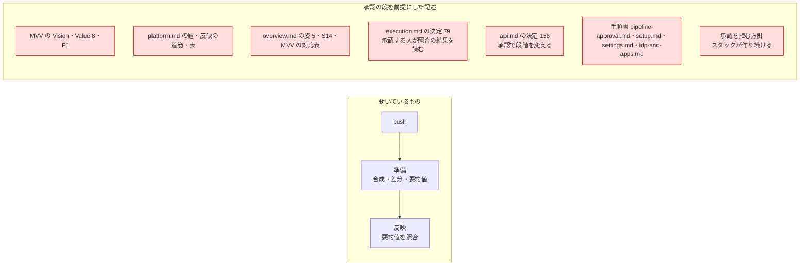
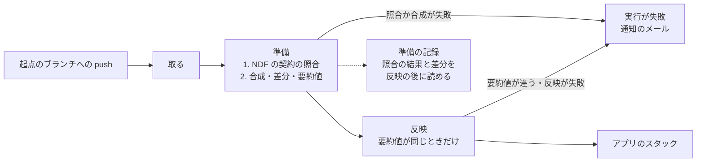
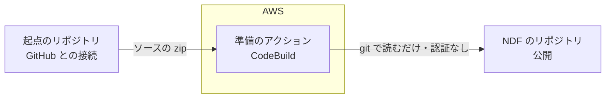

# 反映のパイプライン: push から人を待たずに反映し、準備でも NDF の契約を照合して、設計と手順書をその流れにそろえる（#164）

反映のパイプラインから人の承認の段を外した（[#165](https://github.com/devbasex/nd-factory/pull/165)）が、全体の設計・MVV・手順書は承認の段がある流れのまま残り、承認の段で人が読んでいた NDF の契約の照合の確かめも、どこでも行われていない。そこで、パイプラインの準備に同じ照合を追加し、効く対象の無くなった承認を拒む方針をスタックと手順書から消して、設計・手順書・開発の指針を承認の段の無い流れに書き直す。MVV の改訂と、権限・運用の指示・反映の段の状態を変える操作は、「人へ残す判断」に挙げて持ち主の承認を受ける。比べた作り方は「決定の記録」に、調べた一次情報は末尾の「外部の調査」にある。

## 今の姿

何が起きたか・目的・受け入れ条件は要求仕様（[issue-164-requirements.md](./issue-164-requirements.md)、正は #164 の本文）にある。この文書は「どう解くか」と「なぜその解き方か」だけを書く。

パイプラインの定義は承認の段を持たない形に変わった。一方で、設計と手順書は承認の段を前提にしたままである。図の赤い箱が、承認の段の無い流れとずれている所である。



設計に要る今の構造は次のとおりである（2026-11-25 に main（69fd0b9）で読んだ）。

| 置き場 | 今の中身 |
| --- | --- |
| `infra/lib/pipeline-stack.ts` | 取る → 準備 → 反映の 3 段。準備が合成の結果・差分（`approval/diff.txt`）・要約値を作り、反映が要約値を数え直して `EXPECTED_DIGEST` と同じときだけ反映する。失敗の通知は EventBridge の規則（`<prefix>-<environment>-pipeline-failed`）から SNS のトピックへ送る。承認の依頼の通知は既に無い。承認を拒む管理の方針（`<prefix>-<environment>-deny-approval`、`codepipeline:PutApprovalResult` を拒む）をまだ作っている |
| `infra/lib/naming.ts` | `pipelineResourceNames` が方針の名前 `denyApprovalPolicy` を返す |
| 準備の段 | `npm ci` の後に画面のビルドと合成を行う。NDF の契約の照合（`npm run ndf-contract`。このリポジトリの NDF の使い方が、NDF のリポジトリが公開する契約と食い違わないかを調べる検査）は走らせていない |
| `.github/workflows/ndf-contract.yml` | Pull Request・main への push・毎日・手動で `npm run ndf-contract` を走らせる。AWS の資格情報を持たず、NDF のリポジトリ（公開）を `git` で読むだけ |
| `docs/design/platform.md` | 題と「反映の道筋は 2 つだけにする」の行が「push → 準備 → 人の承認 → 反映」と書く。決定 87（ランナーのイメージを自前の ECR へ push し、ダイジェストで引いて確認の値で縛る）と決定 89（資源をアプリのスタックへまとめる）は、題と理由を「人が承認したものだけを反映する」「承認する人が 1 つの差分で承認できる」と書く |
| `docs/design/overview.md` | 姿 5（目指す姿のうち、誰でも設置のコマンドで差分を見て反映でき、使わない間の費用が 0 に近いこと）が「運用する環境は反映のパイプラインで人が承認した差分だけを反映する」と書き、その根拠の行も MVV の Value 8 を「人が差分を見て承認する」と要約する。場面 S14（運用する環境を反映する）は「準備・人の承認・反映が流れる」と書く |
| `docs/design/api.md` | 決定 156 と「人の確定の段階」が、段階を決める 2 つのキー（`launch_declared`・`environment_kind`）を変える経路として、人が打つ設置のコマンドと、反映のパイプラインの人の承認を挙げる |
| `docs/operations/pipeline-approval.md` | 冒頭は承認を待たない流れ。「承認する人が読むもの」「承認を拒む方針を AI の主体へ付ける」の節と、順序のまとめの「承認」の行が残る |

### この文書で使う言葉と役割

この文書は、NDF の工程の言葉と、nd-factory の API の設計の言葉を使う。読む前に次の表で確かめる。

| 言葉 | 意味 |
| --- | --- |
| NDF | nd-factory が工程と検査に使う外部のツール群。公開リポジトリ `devbasex/ai-plugins` にあり、使うコミットを `ndf-pin.json` で固定する |
| NDF の契約 | NDF の固定コミットが公開するコマンド・入出力の仕様。このリポジトリでの使い方がこの仕様と食い違わないかを、`npm run ndf-contract`（契約の照合）で調べる |
| 設計承認ゲート | 設計 PR（この課題では [#178](https://github.com/devbasex/nd-factory/pull/178)）をマージする前に、持ち主が設計と変更方針を承認する場。持ち主は #178 のマージ前に、この設計書と `docs/design/` の変更方針を承認し、「人へ残す判断」の MVV 改訂案の採否を決める。改訂を見送れば `docs/design/` の差分はマージしない（「設計の結果」） |
| リリース承認ゲート | 実装 PR をマージして本番へ適用する前に、持ち主が実装 PR の差分と、適用する権限の変更を確認して承認する場 |
| 持ち主 | nd-factory のプロジェクトの持ち主。MVV の改訂、2 つのゲートの承認、下の「承認を受ける操作」の表で求める承認を行う |
| 運用担当者 | 運用する環境の AWS で操作する権限を持つ人（全体の設計の利用者 A7「運用する人」）。承認を受けた操作を AWS で打つ。設置のコマンドでパイプラインのスタックを反映するのもこの人である。持ち主が兼ねてもよいが、打つ前に要る承認は兼ねても省かない |
| 設置を運用する人 | `docs/design/api.md` での呼び方。運用する環境では運用担当者を、自分で設置した環境では自分で設置する人（A6）を指す |
| レッドライン（C1〜C8） | NDF の共通原則が定める、必ず人の承認が要る操作の種類。この文書では C1（秘密に触れる）・C2（認証・認可を変える）・C7（運用の指示を変える）が出る |
| P1 | MVV の「必ず人の承認が要る操作」の 1 つ目。反映のパイプラインと設置のコマンドの外で AWS の資源を作る・変える・消す操作と、`cdk bootstrap` を打つ・その版を上げる操作である |
| 人の確定の段階（段階 `ai`・`human`） | 承認や一部の問いへの回答を確定できる主体を、設置ごとに切り替える設定（`docs/design/api.md` の決定 156）。設定が有効なときは、商用利用を宣言した本番の設置を `human`、ほかの設置を `ai` とする。設定が読めない場合や必要なキーが欠けている場合は `human` とする（決定 6） |
| 確定・`human_only` | 確定は、承認の依頼や問いへの回答を最終的に決める操作である。`human_only` は、API の操作の表で人に限ると印を付けた確定と操作である。段階 `human` では人のログインセッションから確定する。段階 `ai` では、操作に必要な権限を持つ委任（人が任せた AI のエージェント）からも確定できる。段階の判定は API 設計の「人の確定の段階」に従う。製品の API と MCP の認可の話で、反映のパイプラインの実行の承認とは別である |
| 運用の記録 | 公開のリポジトリ・課題・PR に書けない実値（ARN・アカウント ID・ルールセットの ID・判定の材料の SHA-256・実行の ID・判定の結果の本文）を残す、リポジトリの外の非公開の保管先。運用担当者は、運用環境ごとに指定された保管先へ実値を記録する。閲覧権限は、その環境の運用担当者と承認者（持ち主）だけに付与する。保管先は環境ごとに持ち主が決め、運用担当者が使い始める前に持ち主の承認を受ける。保管先の名前や場所も公開の場に書かず、課題のコメントには「保管先を指定済み」とだけ書く。保管先が決まるまでは、実値を取る確かめを行わず、遷移を止めたままにする。この記録は、A2 の承認の資料、承認のときの判定との照合、遷移を戻す条件の確認に使う |
| 承認を受ける操作（A1〜A6） | 文書の後ろの「人へ残す判断」にある表「承認を受ける操作」の行の番号。A1: パイプラインのスタックの権限の変更。A2: 前の版の方針を IAM の主体から外す操作。A3: スタックの外での IAM の拒否の追加・境界の移行・方針の追加のバージョンの削除。A4: 反映の段への入口の遷移の停止・再開、待つ実行の停止、失敗した段のやり直し。A5: `AGENTS.md` と開発の指針の Skill の書き換え。A6: 起点のブランチの保護・迂回できる主体・起点の変更。A1・A2・A5 は、決める内容を設計承認ゲートで、権限の差分や外す対象の一覧をリリース承認ゲートで承認してから打つ。A3 と A6 は、打つ前に人へ戻して持ち主の承認を受ける。A4 は、設計承認ゲートで承認した表の場面と条件の範囲だけを打ち、範囲外は人へ戻す |
| MVV の Value 4・7・8・12・13・14・17 | 本文の根拠で引く MVV（バージョン 3）の項目。4: 承認の確定は人だけが行う（AI の委任でも確定できない）。7: 公開を前提に、実際の値を置かない。8: 反映は差分を見て承認した範囲だけ（この設計で改訂を求める）。12: リファクタリングを続け、読みやすさを保つ。13: 同じ規則・定数・処理を 1 か所に置く。14: 自動のテストとレビューを通してから取り込む。17: 目先の手間より、長く良い形を選ぶ |

### 要求仕様のコピーの補足

要求仕様のコピー（[issue-164-requirements.md](./issue-164-requirements.md)）は取得した時点の記録なので書き換えない。次の 3 か所は、ここで補う。

- 「影響」の表の「公開インタフェース | 変わらない。設定のファイルの形と、設置のコマンドの引数は変えない」: この設計では、設置のコマンドの引数と設定の項目の名前は変えないが、起点のブランチ名（`pipeline.branch`）に使える文字を英数字と `.`・`_`・`-`・`/` に限る（決定 5）。ほかの文字を含むブランチ名を使っている設置では、設置のコマンドが設定の誤りとして止まり、パイプラインのスタックを更新できない。その場合は、持ち主の承認を得て起点のブランチを使える名前へ変えてから更新する（A6）。課題の本文のこの行を次の文へ直すことを、設計承認ゲートで持ち主に求める（「人へ残す判断」）
  - 直した後の行: 「公開インタフェース | 設置のコマンドの引数と設定の項目の名前は変えない。起点のブランチ名（`pipeline.branch`）に使える文字を、英数字と `.`・`_`・`-`・`/` に限る。ほかの文字を含む名前を使っている設置は、持ち主の承認を得て起点のブランチを変えてから更新する」

- 「MVV と食い違う変更は、承認ゲートの前の MVV の判定で、反する疑いとして止まり続ける」: 今の MVV は、準備の後に人が差分を承認することを求めている。そのため、承認の段を外す変更は、NDF が設計承認ゲートとリリース承認ゲートの前に PR の方針適合性を確かめるときに、MVV に反する疑いとして保留される。保留されるのは PR の承認で、運用中の CodePipeline の実行は止まらない。運用中のパイプラインを止める手順は、「人へ残す判断」と決定 5 の「満たさないときの扱い」に定める
- E5「後の push の実行が、段の前で待つ前の実行を打ち切った」: このパイプラインの実行のモードは `SUPERSEDED` である。前の実行が段の入口で待っている間に次の push で新しい実行が来ると、新しい実行が前の実行に置き換わり、前の実行はその段へ進まずに終わる

## 文脈と制約

- nd-factory は、公開リポジトリ `devbasex/ai-plugins`（NDF）の固定コミットが公開するコマンドや入出力の仕様（NDF の契約）を使う。利用方法とこの仕様を照合する CI は維持する。CI は Pull Request とブランチのコミットを照合するが、反映するコミットを照合した結果は、これまで承認の段で人が読んで確かめていた（決定 79）。承認の段が無い今、その確かめはどこでも行われていない。そこで、デプロイ対象のコミットも確かめるため、パイプラインの準備に同じ照合を追加する
- 承認を待たずに反映する決定は、商用利用の開始前の運用に当てる（要求の前提 1）。商用利用の開始の後の扱いは決め直す
- 自分で設置する人の経路（`nd-setup diff` → `deploy --confirm`）の振る舞いを変えない（受け入れ条件 11。条件の文は決定 4 で改訂を求める）。設置のコマンドのコード（`infra/setup/`）には触れない
- CI は AWS の資格情報を持たない（AGENTS.md）。逆向きに、パイプラインへ GitHub の token を持たせると秘密が 1 つ増える（C1。C1〜C8 はレッドライン、つまりレビューで人の承認が要るとされる変更の種類の番号）
- パイプラインのスタック自身は、設置のコマンド（`--stack pipeline`）でだけ反映する。この変更でスタックを変えたら、リリースの後に設置のコマンドで反映し直す
- 設計を作った経緯の文書（`docs/design-process/`）は書き換えない（要求の S9）。そこから手順書へのリンクがある
- `.ndf/mvv.*` は C7 に当たる。改訂は持ち主の承認で成立する（MVV の「改訂」）

## 解き方の全体像



- 起点のブランチへ push すると、人を待たずに取る → 準備 → 反映が進む。準備は最初に NDF の契約の照合を走らせ、固定の点で食い違えば反映せずに失敗する（決定 1）
- 承認を拒む方針はパイプラインのスタックから消え、手順書には付ける手順の代わりに、前の版で付けた方針を外す手順だけが残る（決定 2）
- 手順書は同じパス（`docs/operations/pipeline-approval.md`）のまま、題と節を承認の段の無い流れに書き直す（決定 3）
- 起点のブランチは、存在し、次の保護を持つブランチに限る。Pull Request とレビューの承認を必須にし、承認の後に足した変更で承認を失効させ、作成・削除・強制 push による付け替えを禁じる（従来のブランチの保護なら、作成の制限の代わりにブランチが存在し削除を許さないこと）。人を含めて誰もこれらを迂回できない。既に動いている環境では、この変更を含むパイプラインのスタックを `--stack pipeline` で反映する前に、起点のブランチの保護と、信頼できる基点から先端までの変更を確かめる。初めての設置と起点の変更でも、そのパイプラインのスタックの反映の前に確かめる。起点のブランチ名は、AWS のトリガーで完全一致となる文字だけに限る。反映のアクションは、起点のブランチへの push で始まった実行でなければ反映しない。パイプラインを作ったときの最初の実行と、手動で始めた実行は、人が始めたものも反映されない。AI の主体には、直にも、引き受けられるロールや委任の経路を通しても、実行を手動で始める操作と、反映の段への遷移を戻す操作・反映の段をやり直す操作を使わせない。止めた遷移は、待っている実行を確かめて要件を満たさないものを止めてから戻す（決定 5）
- 人の確定の段階を決める設定（`launch_declared`・`environment_kind`）を変える経路を、人が打つ設置のコマンドだけにする。この設定は、承認や一部の問いへの回答を確定できる主体を設置ごとに切り替える（「この文書で使う言葉と役割」）。反映のアクションは、準備で読んだ設定の版が反映の時点の版と違えば反映しない。#164 は反映の側の照合だけを実装し、設定のキー・合成の環境変数・API の読み取りは [#181](https://github.com/devbasex/nd-factory/issues/181) で同時に実装する（決定 6）
- 全体の設計を、この設計 PR の中で承認の段の無い流れに書き直す。対象は `platform.md`・`overview.md`・`execution.md` の決定 79・`api.md` の決定 156 である。運用の手順書（`setup.md` の運用する環境の節・`settings.md`・`idp-and-apps.md`）と開発の指針の Skill は、実装 PR で書き直す（決定 4）
- 権限を変える操作（C2）・運用の指示を変える操作（C7）・パイプラインと設置のコマンドの外で AWS の資源を変える操作（P1）は、「人へ残す判断」の「承認を受ける操作」の表のとおり、既存の承認ゲートで人が承認するか、実行の前に人へ戻す
- MVV の Vision・Value 8・P1 は「人へ残す判断」の改訂の案のとおりに、持ち主の承認を受けて改訂する。`docs/design/` の差分は MVV の改訂と同じ PR（#178）で同時にマージし、改訂が見送られたら `docs/design/` の差分をマージしない。改訂が成立するか承認の段が戻るまで、反映の段への遷移を止める。止める操作の承認は、設計承認ゲートを待たずに先に求める。改訂が成立したときだけ、承認を待たない反映を正式な運用にする。見送られたら実装を保留し、承認の段を戻すかを持ち主へ戻す
- 承認を待たない反映は、商用利用の開始前の運用に当てる。商用利用を始める前（本番の設置で `launch_declared` を真にする前）に、本番の反映の承認方式を持ち主が決め直す

## 構成要素

| 要素 | 責務 | 変えること |
| --- | --- | --- |
| 準備のアクション（`prepareBuildSpec`） | 反映してよい合成の結果を作る | `npm ci` の直後、合成より前に NDF の契約の照合を走らせる。照合が 0 以外で終われば、その後の命令を打たずに準備が失敗する。照合の要約を成果物の `approval/` に残す。設定のパラメーターの版と値の SHA-256 を出力の変数に書く（決定 6） |
| 反映のアクション（`deployBuildSpec`） | 準備した合成の結果だけを反映する | 要約値を比べる前に、自分の実行が起点のブランチへの push で始まったこと（決定 5）と、設定のパラメーターの版と値が準備のときと同じこと、合成の結果に入った確定の段階が設定から決めた段階と同じこと（決定 6）を確かめ、違えば反映せずに失敗する。商用利用を宣言した本番（`launch_declared` が真で、`environment_kind` が `production`）を設定が示す場合、この反映のアクションは `exit 1` で終了する。承認を待つ処理は持たない。キーが無い・値の形が違う設定では終了しない（決定 6） |
| パイプラインのスタック（`PipelineStack`） | 段・権限・通知の資源を作る | 承認を拒む管理の方針を作らない。起点のブランチへの push だけで始まる V2 のトリガーを定義し、ソースのアクションの自動の変更検知を使わない（決定 5）。反映のアクションへ実行の ID・設定の版・設定の SHA-256 を渡し、反映のプロジェクトのロールに、このパイプラインへの `codepipeline:GetPipelineExecution` と設定のパラメーターへの `ssm:GetParameter` を足す |
| 資源の名前（`pipelineResourceNames`） | パイプラインの資源の名前を返す | 方針の名前を返さない |
| 設定のスキーマ（`packages/contracts/src/settings.ts`） | 設定のファイルの形の正本 | `pipeline.branch` を、英数字と `.`・`_`・`-`・`/` だけからなる名前に限る。AWS のトリガーで glob の特殊文字として読まれる文字を含む値を拒む（決定 5）。`npm run generate` で生成物を作り直す |
| 手順書（`pipeline-approval.md`） | 運用する環境の反映の手順 | 承認の段の無い流れで書き直す。前の版で付けた方針を外す手順（決定 2）と、起点のブランチの存在と保護と、手動の開始・遷移の再開・段のやり直しの権限を確かめ、満たさない間は反映の段への遷移を止め、要件を満たす実行だけを残して戻す手順（決定 5）と、設定のパラメーターを書ける主体を確かめる手順（決定 6）を足す |
| 全体の設計・運用の手順書・開発の指針 | 今の設計と判断の基準 | 承認の段を前提にした文を、承認の段の無い流れへ直す |

準備のアクションから、公開されている NDF のリポジトリを読みに行く通信が増える。



## 決定の記録

### 決定 1: 反映の前に NDF の契約の食い違いを止めるため、準備の段で契約の照合を走らせる

- **質問**: 決定 79 は、反映するコミットの照合の結果を承認する人が読むことで保っていた。承認の段が無い流れで、誰がいつその結果を確認するか
- **選んだ案**: 準備のアクションが `npm ci` の直後に契約の照合を走らせ、照合が 0 以外で終われば準備を止める。照合の要約は差分と同じ成果物に残す
  - 打ち方: 準備のアクションの作業ディレクトリはリポジトリのルートである。照合の前に `mkdir -p infra/approval` で出力先を作り、`npm run ndf-contract -- --summary infra/approval/ndf-contract.md` を打つ。`--summary` を付けないと要約はファイルに書かれない。照合は出力先のディレクトリを作らず、書けなければ終了コード 2 で終わるので、先に作る。成果物の基準ディレクトリは今のまま `infra` で、`approval/**/*` に要約が入る
  - 終了コードを失わない: 照合の行をパイプや `|| true` でつながず、そのまま打つ。CodeBuild は、`build` の段の命令が 0 以外で終わると、その後の命令（画面のビルド・合成・差分・要約値）を打たずにビルドを失敗にする（`on-failure` は既定のまま）
  - 照合の結果ごとの扱いは次の表のとおりである。準備が失敗すると反映の段へ進まず、失敗の通知が届く

  | 照合の結果 | 終了コード | 準備 |
  | --- | --- | --- |
  | 固定の点（`ndf-pin.json` で固定した NDF のコミット）の契約と食い違う | 1 | 止める |
  | 使い方の書き出し（このリポジトリが NDF の契約のどこを使うかをまとめたデータ）が無い | 1 | 止める |
  | 固定の点の契約を読めない（NDF のリポジトリを取得できない）・固定の点や書き出しを読めない・要約を書けない | 2 | 止める |
  | NDF のデフォルトブランチの先端の契約とだけ食い違う。CI と同じく要約に並べる | 0 | 反映へ進む |
  | 先端の契約だけを読めない。警告を出し、先端は照合しない | 固定の点の照合の結果（合えば 0） | 固定の点の照合が通れば反映へ進む |
- 採らなかった案: 反映の段に入る前の条件（`Commands` の規則）で照合する。規則は準備の CodeBuild とは別の実行環境で動き、ソースを取り直すので、`npm ci` を 2 回打つことになる。照合したソースと合成したソースが同じだと、記録から示せない
- 採らなかった案: 準備の段から GitHub の API でコミットの `ndf-contract` の実行の結論を読む。パイプラインに GitHub の token を持たせるので秘密が増え（C1）、push と同時に始まる CI の終わりを待つ仕組みも要る
- 採らなかった案: 起点のブランチを main に限り、Pull Request の必須のチェックに任せる。決定 79 が挙げたとおり、main への push の実行の失敗や、マージした結果のコミットが Pull Request で照合したコミットと違う場合を拾えない
- 採らなかった案: 照合を反映の前に行わず、反映の後に記録を読む。食い違ったコミットが運用する環境へ入ってから分かる
- **代償**: NDF のリポジトリを読めない間（GitHub の障害など）は準備が失敗し、反映が止まる。直ったら、人が失敗した準備の段をやり直す（`retry-stage-execution`）。やり直しは同じ実行の中で打ち直すので、手動で始めた実行と違い、反映の段で拒まれない（決定 5 の「手動の開始」の項）。やり直しは P1 に当たる（設計承認ゲートで承認した範囲で打つ。「承認を受ける操作」の A4）。準備の時間が照合の分だけ延びる
- 作り方: ライブラリやサービスを使う・標準に倣う
- 比べた候補: STD1 / LIB1 / LIB2 / LIB3
- 根拠: Value 17「目先の手間より、長く良い形を選ぶ」（MVV バージョン 3）と Value 7「公開を前提に、値を置かない」（MVV バージョン 3）。人の目に頼る確認を、毎回必ず走る自動の検査へ置き換える。秘密の値を増やさないため、GitHub の token を持たせる案を採らない。STD1

### 決定 2: 効く対象の無い権限の資源を残さないため、承認を拒む方針をスタックから消し、前の版で付けた方針を外す手順だけを残す

- **質問**: 承認の段が無くなり、承認を拒む方針（`codepipeline:PutApprovalResult` を拒む）は効く対象を持たない。残すか消すか
- **選んだ案**: パイプラインのスタックと `pipelineResourceNames` から方針を消す。手順書から「付ける」手順を消し、「承認の段を持っていた版から上げるとき」の節に、パイプラインのスタックを反映し直す前に行う次の手順を置く。付けた主体が残ったままだと、方針を消す反映が失敗しうるためである
  1. 外してよいかを、外した後も承認の送信が拒まれたままかで確かめる。この方針の拒否は `resources: ["*"]` なので、このパイプラインだけでなく、ほかのパイプラインの承認の段にも効いている。確かめ終わらない対象が 1 つでも残れば、手順 2 と手順 3（参照の取り外しと再プロビジョニング）へ進まない
     - 対象のアカウント: 方針が存在するアカウントと、手順 3 で参照を外す許可セットを割り当てたすべてのアカウントである。カスタマー管理ポリシーはアカウントごとの資源なので、同じ名前とパスでも、中身と付いた主体はアカウントごとに `get-policy-version` と `list-entities-for-policy` で確かめる
     - 方針の本文: 外す前に、アカウントごとに方針の本文が前の版の方針と同じ働きであることを確かめる。前の版の方針は、文が 1 つだけで、`Effect` が `Deny`、`Action` が `codepipeline:PutApprovalResult` だけ、`Resource` が `*` だけで、`Condition` を持たない。デフォルトのバージョンの本文（`get-policy-version`）がこれと違えば、つまりほかの操作の許可や拒否・条件・別の資源を含めば、そのアカウントでは手順 2 と手順 3（参照の取り外しと再プロビジョニング）へ進まず、人へ戻す。同じ名前の方針がほかの操作も制御していると、外したときに、その許可セットの利用者が業務に要る権限を失うか、拒まれていた操作をできるようになるためである
     - 対象のリージョン: 対象のアカウントで有効なすべてのリージョンである。`aws codepipeline list-pipelines` はリージョンごとの一覧なので、リージョンごとに打ち、`get-pipeline` で手動の承認のアクションを持つパイプラインを一覧する
     - 対象の主体: 実際に権限を使うユーザーとロールである。グループに付いていれば、そのグループに属するユーザーごとに確かめる。許可セットなら、各アカウントに作られたロールごとに確かめる
     - 方針の使われ方: 方針は、権限のポリシーとして付くほかに、ユーザーやロールのアクセス許可の境界として参照されることがある。アカウントごとに `aws iam list-entities-for-policy` を `--policy-usage-filter PermissionsPolicy` と `--policy-usage-filter PermissionsBoundary` で分けて打つ。許可セットは `aws sso-admin get-permissions-boundary-for-permission-set` で境界の参照を確かめる。境界として使う主体か許可セットが 1 つでもあれば、そのアカウントでは手順 2 と手順 3 へ進まず、人へ戻す。境界は、その主体ができる操作の上限を決めている。外すと、境界が抑えていた操作（承認の送信に限らない）ができるようになるためである。境界をどう移すかは、その主体の持ち主が承認した境界の移行の手順で決める（このスタックの外の IAM の変更なので、P1 と C2 に当たる。打つ前に人へ戻し、持ち主の承認を受ける。「承認を受ける操作」の A3）（[IAM のポリシーのアタッチと境界](https://docs.aws.amazon.com/IAM/latest/UserGuide/access_policies_manage-attach-detach.html)）
     - 確かめ方: 主体ごとに、この方針を除いた残りの方針（直に付けた方針・インラインの方針・属するグループの方針）の本文を集める。アクセス許可の境界は `--permissions-boundary-policy-input-list` に渡す。そのうえで、承認のアクションの ARN ごとに `aws iam simulate-custom-policy --action-names codepipeline:PutApprovalResult` を打つ
     - 条件の扱い: シミュレーションは、渡した条件の値の組み合わせ 1 つずつでしか評価しない。各条件の境界の内と外を代表する値を試すだけでは、拒否が保たれる証拠にならない。複数の方針の文が別々の条件を持つと、境界の同じ側の値でも、別の文に当たって結果が変わるためである。そこで、次のとおり評価のケースを網羅する
       - 残りの方針から、`codepipeline:PutApprovalResult` に当たりうる文を、許可と拒否の両方ですべて書き出し、各文の条件（送信元の IP・VPC エンドポイント・MFA・セッションのタグなど）を並べる
       - その主体が取り得る条件の値の範囲を、セッションの種類（コンソール・アクセスキー・ロールの引き受け）ごとに確定する
       - 取り得る値の範囲を、すべての文の条件の真偽の組み合わせで区画に分ける。1 つの区画の中では、どの値でもすべての文の条件の真偽が同じなので、評価の結果も同じになる
       - 区画ごとに、その区画に入る値の組み合わせを 1 つ `--context-entries` に渡して打つ
     - 外してよい: すべての承認のアクションと、すべての区画で、結果が `allowed` でなく、`MissingContextValues` が空である
     - 外さない: どれかの組み合わせで `allowed` になる。その主体からは外さず、そのパイプラインの持ち主が、その承認のアクションに絞った拒否を別に用意して付けるまで待つ（用意するのはこのスタックの外の IAM の変更なので、P1 と C2 に当たる。打つ前に人へ戻し、持ち主の承認を受ける。「承認を受ける操作」の A3）
     - 止める: 区画を網羅できない（主体が取り得る条件の値の範囲を確定できない、例えば送信元のネットワークを限れない。条件が多く、真偽の組み合わせを書き出しきれない）、`MissingContextValues` が空でない、方針の本文を集めきれない、など判定できない。拒否が保たれると確かめられるまで外さず、人へ戻す
     - 記録: リポジトリと課題は公開されているので、承認のアクションと方針の ARN・アカウント ID・シミュレーションの結果の本文は、アクセスを制限した運用の記録（「この文書で使う言葉と役割」の「運用の記録」）に残す。運用する環境の作業の課題のコメントには、判定（外した・外さない・止めた）と未解決の事項だけを書く（Value 7「公開を前提に、値を置かない」（MVV バージョン 3））
     - 外す前の承認: 手順 2 と手順 3 は、権限を変える操作（C2）で、スタックの外の IAM の変更（P1）でもある。そのため、外してよいと判定した対象のアカウント・方針・主体と許可セット・外す順序・外した後の権限の差分を運用の記録にまとめ、リリース承認ゲートで持ち主がその一覧を承認するまで、手順 2 へ進まない（「人へ残す判断」の「承認を受ける操作」の A2）。承認した一覧に無い対象と、承認の後に付いた主体や本文が変わった対象は外さず、人へ戻す
     - 外す直前の再確認: 承認された判定は、判定に使った権限の情報が変わらない間だけ有効である。外す方針の本文と付け先が同じでも、残りの方針や境界が変われば、承認の送信が拒まれるかの結果も変わる。そこで、運用担当者は主体ごとに、外す直前に判定に使った次の情報を取り直し、承認のときに運用の記録へ残した内容と比べる
       - その主体に直に付いた方針・インラインの方針・属するグループとその方針の一覧と、各方針のデフォルトのバージョンの本文
       - その主体と許可セットのアクセス許可の境界
       - 許可セットに登録した管理ポリシー・カスタマー管理ポリシーの参照・インラインの方針
       - 判定に使った承認のアクションの一覧（リージョンごとの `list-pipelines` と `get-pipeline`）
     - 1 つでも違えば、その主体からは外さない。手順 1 の判定をやり直し、変わった判定の一覧で A2 の承認を受け直してから外す。比べるために、手順 1 の判定のときに、これらの情報そのもの（か、その SHA-256）を運用の記録に残しておく
  2. IAM のユーザー・ロール・グループに、権限のポリシーとして直に付けた方針を外す。`aws iam list-entities-for-policy --policy-usage-filter PermissionsPolicy` で付けた主体を一覧する。一覧した主体から `detach-user-policy`・`detach-role-policy`・`detach-group-policy` で外す。IAM Identity Center が許可セットから作ったロールは、ここでは外さない。名前が `AWSReservedSSO_` で始まり、パスが `/aws-reserved/sso.amazonaws.com/` のロールである。これらは IAM Identity Center が管理するロールで、IAM から直に外そうとするとエラーになるので、手順 3 の許可セットの更新と再プロビジョニングで外す。境界として使う主体は手順 1 で人へ戻しているので、ここには来ない
  3. IAM Identity Center の許可セットに登録した方針を外す。前の版の手順書は、許可セットから入る主体には、許可セットの「カスタマー管理ポリシー」に方針を足すよう案内していた。IAM 側のロールから外すだけでは、許可セットに参照が残る。参照が残ったまま方針が消えると、その許可セットを再プロビジョニングできなくなる。`aws sso-admin list-customer-managed-policy-references-in-permission-set` で参照のある許可セットを探す。見つけた許可セットから `detach-customer-managed-policy-reference-from-permission-set` で参照を外す。続けて `provision-permission-set` で再プロビジョニングする。対象は、許可セットを割り当てたすべてのアカウントである。`describe-permission-set-provisioning-status` で完了を待つ
  4. `aws iam list-entities-for-policy` を使われ方で絞らずに打ち（権限のポリシーと境界の両方を返す）、ユーザー・ロール・グループのどれも返さないことを確かめてから、パイプラインのスタックを反映し直す。方針を消すスタックの差分は、実装 PR のリリース承認ゲートで人が承認したものである（A1）。方針の本体は消さない。消すのは CloudFormation に任せる（「未確認のまま残ること」と LIB3）
- 採らなかった案: 方針を残し、手順書に「効く対象は無い」と注記する（使わない資源と、付けるかを迷わせる記述が残る。今の手順書がこの形で、受け入れ条件 5 を満たさない）
- 採らなかった案: 承認の段を戻すときの備えとして残す（戻すなら、その設計で方針も作り直せばよく、今残す理由にならない）
- **代償**: 前の版で方針を AI の主体へ付けた環境では、パイプラインのスタックを反映し直す前に、外す対象の一覧に持ち主の承認を受け、人が 1 回だけ外す手間が要る。確かめる範囲は、許可セットを割り当てたすべてのアカウントと、その有効なすべてのリージョンに及ぶ。同じ主体がほかのパイプラインの承認の段にも承認を送れる環境では、そのパイプラインの側の拒否が用意されるまで、このスタックの反映し直しを待つ
- 根拠: Value 13「使わなくなったコード・設定・文書は残さない」（MVV バージョン 3）。[IAM Identity Center の参照を外す API](https://docs.aws.amazon.com/singlesignon/latest/APIReference/API_DetachCustomerManagedPolicyReferenceFromPermissionSet.html)・[ListPipelines の API](https://docs.aws.amazon.com/codepipeline/latest/APIReference/API_ListPipelines.html)・[SimulateCustomPolicy の API](https://docs.aws.amazon.com/IAM/latest/APIReference/API_SimulateCustomPolicy.html)・[IAM ポリシーシミュレーターの条件の評価](https://docs.aws.amazon.com/IAM/latest/UserGuide/access_policies_testing-policies.html)（2026-11-25）

### 決定 3: 過去の記録からのリンクを壊さないため、手順書のパスを `docs/operations/pipeline-approval.md` のまま保ち、題と節を書き直す

- **質問**: 手順書の名前は「承認」を含む。名前を変えるか
- **選んだ案**: パスは保ち、題を「反映のパイプライン」に変え、承認の段の無い流れで節を組み直す。節は、段・反映の後に記録を読む・失敗したとき・承認の段を持っていた版から上げるとき・接続を有効にする・順序のまとめである。成果物の `approval/` のディレクトリの名前も保つ
- 採らなかった案: `docs/operations/pipeline.md` へ名前を変える。書き換えない `docs/design-process/issue-1/design.md` からのリンクが壊れる
- **代償**: パスの名前と中身が少しずれる。題と冒頭の 1 文で中身を示す
- 根拠: Value 12「リファクタリングを続け、読みやすさと直しやすさを保つ」（MVV バージョン 3）。題と節を整えて読みやすさを保ちつつ、既存のリンクを壊す直しは避ける

### 決定 4: 承認の段を前提にした判断が生まれないよう、承認の段を書いた記述を、運用する環境の手順と全体の設計からすべて書き直す

- **質問**: 受け入れ条件 7 の検索は 2 つの言い回しだけを数える。直す範囲を検索に当たる文だけにするか
- **選んだ案**: 「今の姿」の図の置き場で、承認の段・承認する人・承認を拒む方針を今の流れとして書いた文をすべて直す。`setup.md` は「運用する環境」の節の 2 行だけを直し、自分で設置する人の節と設置のコマンドの節は変えない。`AGENTS.md` は「リポジトリの形」の表の `docs/operations/` の行の「反映の承認」を直す（「反映の経路」は #165 で直してある）。`AGENTS.md` と開発の指針の Skill の書き換えは運用の指示を変える操作（C7）なので、書き換える決定をこの設計承認ゲートで、差分を実装 PR のリリース承認ゲートで人が承認する（「人へ残す判断」の「承認を受ける操作」の A5）。`docs/specifications/app-stack-infrastructure.md` の「反映は差分を見て承認した範囲だけ」は、設置のコマンドで反映する予行の環境の話なので直さない
- 採らなかった案: 検索に当たる文だけを直す。検索に当たらない次の箇所に承認の段が残り、受け入れ条件の目的を満たさない
  - `platform.md` の題
  - `platform.md` の決定 87（人が承認したものだけを反映するため、ランナーのイメージを自前の ECR へ push し、ダイジェストで引いて確認の値で縛る）の題と理由
  - `platform.md` の決定 89（承認する人が 1 つの差分と確認の値で反映を承認できるよう、資源をアプリのスタックへまとめる）の題と理由
  - `overview.md` の姿 5（誰でも設置のコマンドで差分を見て反映でき、運用する環境は人が承認した差分だけを反映する、という目指す姿）とその根拠の行
- 採らなかった案: `setup.md` を一切変えない（「承認を拒む方針を付けるまで push しない」が消える方針を指したまま残る）
- **代償**: `setup.md` に差分が出る。課題 #164 の本文の受け入れ条件 11 は「`setup.md` が変わっていない」と書くので、そのままでは満たせない。設計承認ゲートで持ち主に、条件 11 を次の文へ改訂することの承認を求める（「人へ残す判断」）。実装とテストは改訂後の条件 11 で確かめる
  - 改訂後の条件 11: 自分で設置する人の経路（`nd-setup diff` → `deploy --confirm`）の振る舞いが変わっていない。`infra/setup/` に差分が無い。`docs/operations/setup.md` の差分は「運用する環境」の節（`### 運用する環境`）の中だけにあり、「自分で設置する人」の節と設置のコマンドの節（「diff」「足りない設定」「確認の値」「deploy」「終了コード」など、ほかのすべての節）に差分が無い（退行しない）
  - 要求仕様のコピー（[issue-164-requirements.md](./issue-164-requirements.md)）は取得した時点の記録なので書き換えない。課題の本文を改訂したら、そちらが正になる
- 根拠: Value 13「重複と冗長を作らない」（MVV バージョン 3）と Value 14「モダンな開発の手順で品質を確かめる」（MVV バージョン 3）。使わなくなった文書の記述を残さない。設計の判断は理由とともに設計文書に残し、古い判断を今の設計として残さない

### 決定 5: レビューを経ない変更を反映しないため、起点のブランチをレビュー必須の保護があるブランチに限る

- **質問**: パイプラインは設定された起点のブランチ（`pipeline.branch`）への push を直に受け、起点は main とは限らない。承認の段が無い今、レビューを経ていないコミットが反映されないことを何で保つか
- **選んだ案**: 起点のブランチは、存在し、GitHub の保護で次の 5 つを満たすブランチに限る。加えて、手動で始めた実行は、人が始めたものも含めて反映の段で反映を拒む。止めた反映を再開させる経路は、AI の主体に使わせない。手順書の順序のまとめに、確かめる手順、満たさないときに反映を止める手順、要件を満たす実行だけを残して反映を再開する手順を置く
  - 変更は Pull Request からだけ入る（直の push を許さない）
  - マージの前に 1 人以上のレビューの承認が要る
  - 差分を変えるコミットが Pull Request に足されたら、それまでの承認を失効させる。設定は、ルールセットの `dismiss_stale_reviews_on_push` と、従来のブランチの保護の「Dismiss stale pull request approvals when new commits are pushed」である。承認の後に足した変更も、マージの前に承認を受け直す
  - ブランチの参照を Pull Request の外で付け替えられない。付け替えられると、ブランチを消して任意のコミットで作り直すか、強制 push で書き換えるだけで、レビューを経ていないコミットが先端になるためである。ルールセットなら、次の 3 つが効いている。作成の制限（Restrict creations、ルールの型 `creation`）・削除の制限（Restrict deletions、`deletion`）・強制 push の禁止（Block force pushes、`non_fast_forward`）である。従来のブランチの保護なら、強制 push と削除を許さない（`allow_force_pushes` と `allow_deletions` が偽）。従来の保護には作成を制限する設定が無いので、ブランチが存在し、削除を許さないことで代える（[ルールセットで使えるルール](https://docs.github.com/en/repositories/configuring-branches-and-merges-in-your-repository/managing-rulesets/available-rules-for-rulesets)）
  - Pull Request の必須・レビューの承認・上の参照の付け替えの制限を省ける例外を、人の主体を含めて誰にも設定しない。ルールセットなら、これらのルールを持つルールセットの迂回できる主体（bypass）の一覧が空である。従来のブランチの保護なら、管理者にも保護を当て（`enforce_admins`）、Pull Request の必須を迂回できる主体の一覧が空である。人が迂回できると、その人が入れたレビューを経ない変更が運用する環境へ自動で反映されるためである
  - 確かめる時期: 既に動いている環境（#165 で承認の段を外したパイプライン）では、この変更を含むパイプラインのスタックを `--stack pipeline` で反映する前に確かめる。初めて設置するときと、`pipeline.repository` か `pipeline.branch` を変えるときも、そのパイプラインのスタックを反映する前に確かめる。保護か迂回できる主体を変えたときも確かめ直す
  - 保護を変えられる主体: ルールセットや従来の保護を編集・無効化できる主体（リポジトリの管理者、組織の管理者、ルールセットの管理権限を持つ GitHub App、個人のアクセストークンなど）を、持ち主が承認した管理主体だけに絞る。AI が使うアカウントと GitHub App は、承認した管理主体に含めない。運用担当者は、確かめるたびに、保護を編集できる主体の一覧（`gh api repos/<起点のリポジトリ>/collaborators` の管理者と、組織のルールセットの管理権限、リポジトリにインストールされた GitHub App の権限）を取り、持ち主が承認した管理主体の一覧と比べる。個人のアクセストークンはどの API でも列挙できないので、列挙ではなく発行元の管理で確かめる。組織の設定で細かい権限のトークンを禁止するか承認制にし、承認した管理者のアカウントの一覧とトークンの有無を持ち主が運用の記録に残し、その記録が最新であることを確かめる。「取り切れない」と判定するのは、列挙できる 3 種類（管理者・ルールセットの管理権限・GitHub App）の API が権限不足やページ送りの失敗で最後まで返らないとき、またはトークンの発行元の管理の記録が無い・古いときだけである。一覧に無い主体が保護を編集できる、または取り切れないときは、満たさないものとして扱い、「満たさないときの扱い」で遷移を止める。承認した管理主体の一覧は実値を含むので、運用の記録に残す。主体を足す操作は、権限を変える操作（C2）なので、A6 で承認を受ける
  - 保護と起点を変えるとき: 保護か迂回できる主体を変える操作と、起点（`pipeline.repository`・`pipeline.branch`）を変える操作は、反映を許す主体とレビューの要件を変えるので、権限を変える操作（C2）に当たる。この課題では行わない。後で変えるときは、変える前に人へ戻し、持ち主が変更の中身を承認してから適用する（「人へ残す判断」の「承認を受ける操作」の A6）。変えた後に下の要件を満たさなくなるなら、適用の前に「満たさないときの扱い」のとおり遷移を止める
  - 先端に既に入っている変更の確かめ: 保護は、保護を付けた後に入る変更しか縛らない。最初に反映される push の実行は、起点のブランチの先端までの履歴をすべて含む。そのため、保護を付ける前に入った、レビューの承認を受けていない変更も反映されうる。これは、初めて設置するとき、起点を変えるとき、既に動いている環境で保護を足して同じブランチのまま新しいパイプラインへ移るときのどれでも起きる。運用担当者は、パイプラインのスタックを設置のコマンドで反映する前に、次を確かめる
    1. 信頼する基点を決める。基点にできるのは、承認済みと確かめられるリビジョンだけである。既に動いている環境と起点を変えるときは、その環境へ最後に反映したリビジョンのうち、承認の段で人が承認した実行か、この決定の確かめを終えた後の push の実行で反映したものを基点にする。#165 で承認の段を外した後に承認なしで反映したリビジョンは、基点にしない。承認の段で人が承認したかは、「人へ残す判断」の「承認の段を戻したときに遷移を戻す条件」の 5 と同じく、`list-action-executions` と CloudTrail の `PutApprovalResult` を照らして確かめる。初めて設置するときと、承認済みのリビジョンを確かめられないときは、持ち主が中身を確かめて信頼すると決めたコミットを基点にし、その決定を運用の記録に残す。基点を決められなければ、起点にしない
    2. 基点から起点のブランチの先端までに入った変更が、すべてレビューの承認を受けた Pull Request から入っていることを確かめる。基点が先端の祖先でなければ、基点と先端の差分のすべてを同じ扱いで確かめる。確かめきれない変更が 1 つでもあれば、起点にしない
    3. 確かめた先端のコミットを運用の記録に残す。確かめてからパイプラインのスタックを反映するまでに先端が進んだら、進んだ分を 2 と同じく確かめ直す
    - 既に動いている環境で、この確かめを終えずにパイプラインのスタックを反映したか起点を変えてしまったときは、「満たさないときの扱い」のとおり反映の段への遷移を止め、「遷移を戻すとき」の 2 で確かめてから戻す
  - 確かめ方: 最初に、起点のブランチが存在することを `gh api repos/<起点のリポジトリ>/branches/<起点のブランチ>` で確かめる。ルールを返す次の API は、ブランチが存在しなくても、名前に当たるルールを返すので、ブランチの存在の証拠にならない（[ブランチのルールの取得](https://docs.github.com/en/rest/repos/rules#get-rules-for-a-branch)）。存在しなければ満たさない。`gh api repos/<起点のリポジトリ>/rules/branches/<起点のブランチ>` は、そのブランチに効いているルールを返すが、迂回できる主体の一覧は返さない。そのため、まずこの API で効いているルール（Pull Request の必須・作成の制限・削除の制限・強制 push の禁止）とその元のルールセットを列挙する。次に、リポジトリと組織の各ルールセットの詳細（`gh api repos/<起点のリポジトリ>/rulesets/<ID>`、組織なら `gh api orgs/<組織>/rulesets/<ID>`）を読む。読むのは、迂回の設定を読める権限（リポジトリか組織の管理者）である。Pull Request の必須・レビューの承認・作成の制限・削除の制限・強制 push の禁止のどれかを持つルールセットで、迂回できる主体の一覧が空であることを確かめる。一覧にアプリ・チーム・ロール（リポジトリのロールと組織の管理者）が 1 つでもあれば満たさない。従来のブランチの保護（`gh api repos/<起点のリポジトリ>/branches/<起点のブランチ>/protection`）なら、次の 3 つを確かめる。管理者にも保護を当てているか（`enforce_admins`）、個別の例外（Pull Request の必須を迂回できる主体）が誰にも無いか、`allow_force_pushes` と `allow_deletions` が偽かである。権限が足りないなどで確かめきれなければ、満たさないものとして扱う
    - 承認の件数と失効の設定も、どちらの方式でも実効の値で確かめる。Pull Request のルールや保護があるだけでは、承認 0 件や、承認を失効させない設定も通ってしまうためである。確かめる値は次の表のとおりである。ルールセットが複数あるときは、迂回できる主体の無いルールセットの Pull Request のルールのうち、少なくとも 1 つが両方の値を満たせばよい。GitHub は重なったルールのうち最も厳しいものを当てるためである（[ルールセットの重なり](https://docs.github.com/en/repositories/configuring-branches-and-merges-in-your-repository/managing-rulesets/about-rulesets#about-rule-layering)）

      | 方式 | 読む API | 承認の件数 | 差分を変えるコミットでの承認の失効 |
      | --- | --- | --- | --- |
      | ルールセット | 各ルールセットの詳細の `rules` のうち `type` が `pull_request` のもの | `parameters.required_approving_review_count` が 1 以上 | `parameters.dismiss_stale_reviews_on_push` が真 |
      | 従来のブランチの保護 | `branches/<起点のブランチ>/protection` | `required_pull_request_reviews.required_approving_review_count` が 1 以上 | `required_pull_request_reviews.dismiss_stale_reviews` が真 |

      どちらの方式でも、値が無い・読めないときは満たさないものとして扱う（[ブランチの保護の API](https://docs.github.com/en/rest/branches/branch-protection)・[ルールセットの API](https://docs.github.com/en/rest/repos/rules)）
  - 満たさないときの扱い: 起点にしない。既に動いている環境なら、運用担当者が反映の段（`Deploy`）への入口の遷移を止める。`disable-stage-transition` は、パイプラインの名前・段の名前・遷移の種類・止める理由がどれも必須なので、次の形で打つ。パイプラインの名前は `pipelineResourceNames` の `pipeline`（`<prefix>-<environment>-pipeline`）で、運用する環境の実際の名前は運用の記録から取る。止める理由には、止めた場面（「起点のブランチの要件を満たさない」など）を書き、アカウント ID などの実値を書かない（[disable-stage-transition](https://docs.aws.amazon.com/cli/latest/reference/codepipeline/disable-stage-transition.html)）。この文書のほかの箇所で遷移を止めるときも、同じ形で打つ。戻すときは `aws codepipeline enable-stage-transition --pipeline-name <パイプラインの名前> --stage-name Deploy --transition-type Inbound` を打つ

    ```sh
    aws codepipeline disable-stage-transition \
      --pipeline-name <パイプラインの名前> \
      --stage-name Deploy \
      --transition-type Inbound \
      --reason "<止めた場面>"
    ```

    遷移を止める・戻す操作と待つ実行の停止は P1 に当たり、設計承認ゲートで承認した範囲（「承認を受ける操作」の A4 の「起点のブランチの要件を満たさない」の行）で打つ。保護を整えて確かめ直し、下の「遷移を戻すとき」の条件をすべて満たすまで、`enable-stage-transition` で戻さない。止めている間は反映しない。人が準備の差分を読んでから遷移を一時的に戻す手順は、承認の代わりにならないので使わない。このパイプラインの実行のモードは `SUPERSEDED` で、遷移の前で待つ実行は、後から来た実行に置き換わる。そのため、人が差分を読んだ実行と、遷移を戻したときに反映される実行が同じだと保てない（[CodePipeline の実行とステージ遷移](https://docs.aws.amazon.com/codepipeline/latest/userguide/concepts-how-it-works.html)）
  - 止めた直後に、進行中の反映を確かめる: 入口の遷移を止めても、既に反映の段に入った実行は止まらず、最後まで進む。運用担当者は `aws codepipeline get-pipeline-state` で反映の段に実行があるかを確かめ、あれば、その実行のソースのリビジョン（`list-pipeline-executions` の `sourceRevisions`）を運用の記録に残す。そのリビジョンが、レビューを通って起点のブランチへ入った変更だけでできていると確かめられなければ、人へ戻す。反映を途中で打ち切る（`stop-pipeline-execution --abandon`）と、スタックの更新が途中の状態で残りうるので、手順書では行わない。反映された中身を戻すかは持ち主が決め、戻すときは、戻しの変更をレビューを通して起点のブランチへ入れ、遷移を戻した後の通常の流れで反映する
  - 遷移を戻すとき: CodePipeline は、遷移を戻すと入口で待っていた実行をそのまま反映の段へ進める（[ステージ遷移](https://docs.aws.amazon.com/codepipeline/latest/userguide/transitions.html)）。そのため、運用担当者は次をすべて満たしてから `enable-stage-transition` で戻す。ここで確かめるのは実行が要件を満たすかだけで、差分の中身を承認するのではない
    1. 起点のブランチの存在と保護と、AI の主体が実行を手動で始められず、反映の段の遷移を戻せず、反映の段をやり直せないこと（下の「AWS の側から反映を再開する操作」）と、反映のプロジェクトを直に起動・変更できず、反映用のロールを引き受けられないこと（下の「反映のプロジェクトを直に動かす操作」）を確かめ直し、満たしている
    2. 信頼する基点（上の「先端に既に入っている変更の確かめ」の 1 で決める、承認済みと確かめられるリビジョン）から起点のブランチの先端までに入った変更が、すべてレビューの承認を受けた Pull Request から入っている。最後に反映したリビジョンが承認なしの反映だったときは、それを基点にせず、その前の承認済みのリビジョンから確かめる。保護が無かった間に入った変更も含めて確かめる。確かめきれなければ戻さず、人へ戻す
    3. 入口で待っている実行を `get-pipeline-state` と `list-pipeline-executions` で確かめる。ソースのリビジョンが 2 で確かめた起点のブランチのコミットでない実行と、照合を持たない前の版の準備で作った実行は、`aws codepipeline stop-pipeline-execution` で止める（[待っている実行の停止](https://docs.aws.amazon.com/codepipeline/latest/userguide/pipelines-stop.html)）
    4. 入口で待つ実行が、2 で確かめた起点のブランチへの push で始まり、照合を含む今の版の準備が成功した実行 1 つだけになっている。そのような実行が無ければ、遷移を戻さずに、次の Pull Request が起点のブランチへマージされ、その push で始まった実行の準備が成功するのを待つ。手動で始めた実行は、下の「手動の開始」のとおり反映の段で拒まれるので、ここでは使えない
    - 戻した後に来た実行が待っていた実行を置き換えても、その実行も保護されたブランチへの push から今の版の準備を通るので、要件を満たす
  - 手動の開始: CodeConnections のソースを使うパイプラインは、実行を手動で始めるとき（`StartPipelineExecution`）にソースのリビジョンを指定できる。このとき起点のブランチの保護は効かない（[ソースのリビジョンの指定](https://docs.aws.amazon.com/codepipeline/latest/userguide/pipelines-trigger-source-overrides.html)）。IAM の権限では、リビジョンの指定を許すかどうかを分けられない（「未確認のまま残ること」）ので、手順書の決まりでは人の指定を防げない。そこで、反映のアクションが、反映の前に自分の実行の始まり方を確かめ、起点のブランチへの push で始まった実行でなければ反映せずに失敗する
    - push で実行を始める仕組み: 今の定義は、ソースのアクションの自動の変更検知（`triggerOnPush: true`、テンプレートでは `DetectChanges`）で push を拾っている。この方式で始まった実行の始まり方は `Webhook` で、下の確かめ方が許す `WebhookV2` にならない（[パイプラインのトリガー](https://docs.aws.amazon.com/codepipeline/latest/userguide/pipelines-triggers.html)）。そのまま始まり方の確認を足すと、承認済みの Pull Request をマージしても、push で始まった実行がすべて反映の段で失敗する。そこで実装 PR で、パイプラインに V2 のトリガー（CDK の `triggers`）を定義し、ソースのアクションの自動の変更検知を使わない（`triggerOnPush: false`）。トリガーは、プロバイダーを `CodeStarSourceConnection`、ソースのアクションをこのソースのアクション、push の絞り込みを起点のブランチ（`pipeline.branch`）だけを含むブランチの一覧にする。起点のブランチ以外への push では実行を始めない。
    - ブランチ名をリテラルとして扱う: トリガーのブランチの一覧は glob のパターンとして読まれ、`*`・`?`・`[]`・`{}`・`!`・`\` などが特殊文字になる（[glob のパターン](https://docs.aws.amazon.com/codepipeline/latest/userguide/syntax-glob.html)）。ブランチ名をそのまま渡すと、特殊文字を含む名前では、指定したブランチの push で始まらないか、保護を確かめていない別のブランチの push で始まる。エスケープして渡す形は、glob の解釈の細部に頼るので採らない。設定の正本（`packages/contracts/src/settings.ts`）で、`pipeline.branch` を英数字と `.`・`_`・`-`・`/` だけからなる名前に限り、ほかの文字を含む値を設定の読み込みで拒む。これらの文字だけの名前は glob でも自分自身にだけ完全一致するので、トリガーへそのまま渡す。今の設定の値が限った形に合わなければ、設置のコマンドが設定の誤りとして止まるので、起点のブランチを合う名前へ変える（起点の変更なので A6 に当たる）。既存の方式のまま `Webhook` を許す案は採らない。`Webhook` は自動の変更検知で始まった実行の値で、起点のブランチに絞ったことをトリガーの定義で示せないためである
    - 確かめ方: 反映のアクションに、パイプラインの変数 `#{codepipeline.PipelineExecutionId}` を環境変数として渡す。反映の手順は、要約値を比べる前に `aws codepipeline get-pipeline-execution` で自分の実行を読む。`trigger.triggerType` が `WebhookV2`（起点のブランチへの push）のときだけ進む。`CreatePipeline`（パイプラインを作ったときの、起点のブランチの先端を取る最初の実行）・`StartPipelineExecution`（手動の開始）・`ManualRollback`・`AutomatedRollback`（前の実行の成果物を反映し直すロールバック）・`PutActionRevision` など、ほかの値と値が無いときは `exit 1` する（[実行の始まり方の値](https://docs.aws.amazon.com/codepipeline/latest/APIReference/API_ExecutionTrigger.html)）。反映のプロジェクトのロールに、このパイプラインへの `codepipeline:GetPipelineExecution` を足す
    - パイプラインを作ったときの最初の実行（`CreatePipeline`）を拒む理由: この実行は、パイプラインのスタックを反映した時点の先端を取る。運用担当者が確かめた先端と、反映した時点の先端が同じだと、反映のアクションからは示せない。そのため、初めての設置でも、最初の反映はレビュー済みの Pull Request を起点のブランチへマージした push を待つ。最初の実行は反映の段で失敗し、失敗の通知が届く。これは想定どおりで、手順書に書く
    - これで、人が始めた実行も、リビジョンの指定の有無によらず反映されない。人が反映を進め直す経路は次の 2 つだけになり、どちらも起点のブランチへの push で始まった実行のソースを使う
      - 失敗した段のやり直し（`aws codepipeline retry-stage-execution`）。同じ実行の中で失敗したアクションを打ち直すので、ソースのリビジョンも始まり方も変わらない（[RetryStageExecution の API](https://docs.aws.amazon.com/codepipeline/latest/APIReference/API_RetryStageExecution.html)）。照合が NDF のリポジトリを読めずに準備が失敗したとき（決定 1）は、これで準備をやり直す
      - 新しい Pull Request を起点のブランチへマージする。古い状態へ戻すときも、戻しの変更を Pull Request でレビューを通して起点のブランチへ入れる
  - AWS の側から反映を再開する操作: 反映の段（`Deploy`）への遷移を戻す操作（`EnableStageTransition`）は、止めた反映を再開させる。反映の段のやり直し（`RetryStageExecution`）は、遷移を止める前に反映の段で失敗した実行を、遷移を通らずに反映し直す。この 2 つの操作は運用担当者だけに許す。手動の開始は上のとおり反映の段で拒まれるが、要らない準備を走らせないよう、`StartPipelineExecution` も AI の主体に許さない
    - 確かめる主体: AI エージェントが直に使う主体だけでなく、その主体が引き受けられるロール（`sts:AssumeRole` などで許された先と、その先からさらに引き受けられるロール）と、AI の主体が動かせる委任の経路が使うロールも確かめる。委任の経路は、ロールを渡して動かせるサービス（ロールを持つ CodeBuild のプロジェクト・Lambda・CloudFormation のスタックなど）を AI の主体が起動・更新できる場合の、そのロールである
    - 確かめる資源: 操作ごとに IAM の資源の種類が違う。`StartPipelineExecution` の資源はパイプラインの ARN（`arn:aws:codepipeline:<リージョン>:<アカウント>:<パイプライン>`）である。`EnableStageTransition` と `RetryStageExecution` の資源はステージの ARN である。ここでは反映の段の ARN（`arn:aws:codepipeline:<リージョン>:<アカウント>:<パイプライン>/Deploy`）になる（[CodePipeline の IAM のアクションと資源](https://docs.aws.amazon.com/service-authorization/latest/reference/list_codepipeline.html)）。パイプラインの ARN だけを書いた拒否は、ステージの ARN に当たらないので、遷移の再開を拒めない
    - 確かめ方: 確かめる主体ごとに、上の資源で 3 つの操作が許されていないことを `simulate-custom-policy --action-names <操作> --resource-arns <その操作の資源の ARN>` で確かめる。範囲（アカウント・リージョン）と判定基準（「条件の扱い」の区画をすべて網羅する）は、決定 2 の手順 1 と同じにする。引き受けられるロールや委任の経路を列挙しきれないか、区画を網羅できなければ、許されているものとして扱う
    - 許されているとき: 操作ごとに上と同じ資源の ARN を指定した拒否を、その主体とロールに付ける。`StartPipelineExecution` はパイプラインの ARN、`EnableStageTransition` と `RetryStageExecution` は反映の段の ARN を指定する。付けるまで、上の「満たさないときの扱い」で反映を止める（付けるのはこのスタックの外の IAM の変更なので、P1 と C2 に当たる。打つ前に人へ戻し、持ち主の承認を受ける。「承認を受ける操作」の A3）。付けた後に、同じ資源の ARN で上のシミュレーションを打ち直し、拒まれることを確かめてから遷移を戻す
  - 反映のプロジェクトを直に動かす操作: 反映の段の手順（始まり方の確かめ・要約値の照合・設定の照合）は、パイプラインが反映のプロジェクト（CodeBuild）を起動したときにだけ働く。CodeBuild の `StartBuild` はビルド仕様（`buildspecOverride`）とソースを上書きでき、反映のプロジェクトのロールは反映用の CDK のロールを引き受けられる（[StartBuild の API](https://docs.aws.amazon.com/codebuild/latest/APIReference/API_StartBuild.html)）。そのため、反映のプロジェクトを直に起動できる主体は、遷移を止めていても、ブランチのレビューと反映時の検査を経ずにアプリを反映できる。プロジェクトの定義を変えられる主体も、パイプラインの起動のときに走るビルド仕様を書き換えられる。そこで、反映の権限が渡るのを、パイプラインの正規の実行が反映のプロジェクトを起動したときだけにする
    - 確かめる操作と資源: 反映のプロジェクトの ARN（`arn:aws:codebuild:<リージョン>:<アカウント>:project/<反映のプロジェクト>`）への `codebuild:StartBuild`・`codebuild:StartBuildBatch`・`codebuild:RetryBuild`・`codebuild:RetryBuildBatch`・`codebuild:UpdateProject`・`codebuild:DeleteProject`・`codebuild:CreateWebhook`・`codebuild:UpdateWebhook` である。あわせて、反映のプロジェクトのロールを渡す `iam:PassRole` と、そのロールと反映用の CDK のロール（`cdk bootstrap` が作った反映のロール・CloudFormation の実行のロール）を引き受ける `sts:AssumeRole` も確かめる。CDK の反映のロールは、既定ではアカウントの主体を信頼するので、引き受けを許された主体は反映のプロジェクトを通らずに反映できる
    - 許してよい主体: パイプラインのロール（反映のプロジェクトを起動する）だけである。AI の主体と、それが引き受けられるロール・委任の経路には許さない。確かめる主体の範囲と判定基準は、上の「AWS の側から反映を再開する操作」と同じにする
    - 許されているとき: 遷移を止めても、この経路は止まらない。そのため、見つけた主体と経路をすぐに人へ戻し、上の操作と資源を指定した拒否の承認を求める（A3）。拒否を付けて同じ判定で拒まれることを確かめるまで、遷移を止めたままにする。封じるまでの間に反映されたアプリがないかを、決定 6 の「反映の経路そのものを変えられるときの扱い」と同じく、CloudTrail の `StartBuild`・`UpdateProject` の記録と、反映のプロジェクトのビルドの履歴（起動した主体が `codepipeline/<パイプラインの名前>` でないビルド）で確かめる。確かめられない場合は遷移を戻さず、人へ戻す
  - 記録: 決定 2 の手順 1 と同じく、課題のコメントには判定と未解決の事項だけを書き、ルールセットの ID・主体の名前・ARN などの実値はアクセスを制限した運用の記録に残す
- 採らなかった案: パイプラインの側で保護を確かめる。パイプラインに GitHub の token を持たせるので秘密が増える（C1）。準備の段に置いても、設定を変えた後の push で初めて分かる
- 採らなかった案: 起点を main に固定する。今の設定の形（`pipeline.branch`）は起点を main 以外にでき、この課題はそのキーを消さない（「影響と危険」）。main に固定しても、main の保護を確かめる手順は同じく要る
- 採らなかった案: 準備の段で、ソースのリビジョンが起点のブランチに入っているかを確かめる。起点のブランチの先端を読むには、GitHub の token か、ソースの取り方を git の複製へ変えて接続を準備の段で使う形が要る。後者で起点のブランチの履歴を取れるかは確かめていない
- 採らなかった案: 人の手動の開始を残し、リビジョンを指定しないことを手順書で定め、指定したかを CloudTrail の記録で後から確かめる。反映の前に止められず、指定した実行は反映された後に分かる
- **代償**: 保護はパイプラインの外の GitHub の設定なので、後から保護を緩めてもパイプラインは気付かない。保護を変える変更は、起点のブランチを変える変更と同じく、適用の前に持ち主の承認を受け（A6）、この手順で確かめ直す。手動で始めた実行とパイプラインを作ったときの最初の実行は反映されないので、新しい実行で反映するには Pull Request を起点のブランチへマージする。起点のブランチ名に使える文字が狭まる。失敗した実行は、人が段をやり直して再開する（決定 1）。遷移を戻す前の確かめに、待っている実行と、最後に反映してからの変更の確認の手間が掛かる
- 根拠: Value 14「モダンな開発の手順で品質を確かめる」（MVV バージョン 3）。Value 14 は変更をレビューを通してから取り込むと定める。Vision の改訂の案（「人へ残す判断」）が約束する「レビューを通って起点のブランチへ入った変更だけ」を、この前提で保つ。[GitHub のルールセットの API](https://docs.github.com/en/rest/repos/rules)・[GitHub のブランチの保護の設定](https://docs.github.com/en/repositories/configuring-branches-and-merges-in-your-repository/managing-protected-branches/managing-a-branch-protection-rule)・[CodePipeline のソースのリビジョンの指定](https://docs.aws.amazon.com/codepipeline/latest/userguide/pipelines-trigger-source-overrides.html)・[CodePipeline のステージ遷移](https://docs.aws.amazon.com/codepipeline/latest/userguide/transitions.html)・[CodePipeline の実行の停止](https://docs.aws.amazon.com/codepipeline/latest/userguide/pipelines-stop.html)（2026-11-25）

### 決定 6: 人の確定の段階を AI やリポジトリの利用者が変えられないよう、段階を決める設定を変える経路を人が打つ設置のコマンドだけにする

- **質問**: `docs/design/api.md` の決定 156 は、段階を決める 2 つのキー（`launch_declared`・`environment_kind`）を変える経路として、人が打つ設置のコマンドと、反映のパイプラインの人の承認を挙げる。承認の段が無い今、誰がどの操作で変えるか。商用利用を宣言した本番（段階 `human`）ではどう縛るか
- **選んだ案**: 変える経路は、運用担当者が打つ設置のコマンドだけにする。この設計 PR で、`api.md` の「人の確定の段階」の「段階を変えられる人」と決定 156 をこの形に直す
  - 運用する環境の設定のファイルの正本は SSM のパラメーター `/<prefix>/<environment>/settings` で、パイプラインのスタックが書く（`docs/operations/settings.md`）。パイプラインのスタックは設置のコマンド（`--stack pipeline`）でだけ反映する。起点のブランチへの push とそのレビューはこのパラメーターを変えないので、ブランチのレビューは段階を変える認可にならない
  - 段階はアプリの合成のときに取り込む。準備のアクションがパラメーターを読んで合成し、API は動いている間にパラメーターを読まない。そのため、パラメーターの値がアプリに届くのは、準備で合成した結果を反映の段が反映したときだけである。この前提を `api.md` の「段階の保存先」に書く
  - 反映する合成の結果を、反映の時点のパラメーターの版に結び付ける。準備は、パラメーターの版（`Parameter.Version`）を先に読み、その版を指定して（`<名前>:<版>`）値を読んで合成し、版と値の SHA-256 を出力の変数（`SETTINGS_VERSION`・`SETTINGS_SHA256`）に書く。反映の手順は、要約値を比べる前にパラメーターを読み直し、版と値の SHA-256 のどちらかが準備のものと違えば `exit 1` する。反映のプロジェクトのロールに、このパラメーターへの `ssm:GetParameter` を足す。これで、持ち主が段階を `human` へ変えた後に、変える前の設定で準備した実行は反映されない。新しい設定は、次に起点のブランチへの push で始まった実行で反映される（手動の開始は決定 5 のとおり反映されない）。消して作り直すと版が 1 から数え直されるので、値の SHA-256 も比べる。`docs/operations/settings.md` の書き換えた後の反映の行は、実装 PR で下の手順に直す
  - 合成の結果に入った段階を、反映の側で設定と照らす: 版と SHA-256 の照合で分かるのは、準備と反映が同じ設定を読んだことだけで、合成の結果に入った段階が設定どおりかは分からない。合成するのは起点のブランチのコードなので、レビューを通った合成のコードの変更で、設定によらず段階を `ai` にした合成の結果を作れる。そうなると、設置の権限を持たないリポジトリの利用者が本番の段階を変えられる。そこで、起点のブランチから変えられない反映のアクションの手順（パイプラインのスタックが持つ `deployBuildSpec`。パイプラインのスタックは設置のコマンドでだけ反映する）で、次を確かめる
    1. 合成の結果に段階を入れる場所を 1 つに決める。API の関数の環境変数 `ND_CONFIRMATION_STAGE`（値は `ai` か `human`）とし、API はこの値だけから段階を決め、無い・形が違うときは `human` にする。この決まりを `api.md` の「段階の保存先」に書く
    2. 反映の手順は、版を確かめたパラメーターの値から、期待する段階を自分で決める。`launch_declared` が真で、`environment_kind` が `production` のときだけ `human`、それ以外は `ai` で、値が読めない・キーが無い・形が違うときは `human` にする（`api.md` の「段階の保存先」と同じ決まり）
    3. アプリのスタックの合成の結果（`cdk.out` のテンプレート）にある `ND_CONFIRMATION_STAGE` をすべて読み、1 つでも期待する段階と違えば `exit 1` する。期待する段階が `ai` で値が 1 つも無いときも `exit 1` する。期待する段階が `human` で値が無いときは、API が `human` にするので進む
    - この照合で防げるのは、設定と違う段階の値を合成の結果に入れる変更である。API が `ND_CONFIRMATION_STAGE` を読まなくなる変更や、`human_only` の判定そのものを外す変更は、値の照合では見つからない。ブランチのレビューだけを通ったこれらの変更が反映されると、設置の持ち主が段階 `human` を保っていても、AI の委任が本番の確定を行える。そこで、環境変数の照合とは別に、段階に従う認可の変更を人の承認なしに宣言した本番へ反映させない（下の 4）
    4. 設定の値が商用利用を宣言した本番（`launch_declared` が真で、`environment_kind` が `production`）を示すときは、上の 1〜3 によらず `exit 1` し、反映しない。承認を待たないこのパイプラインは、商用利用の開始前にだけ使う（Value 8 の改訂の案）。宣言した本番へ反映するには、持ち主が決め直した承認方式（下の「商用利用の開始の手順」）をパイプラインに入れる必要がある。その承認方式では、API の認可と段階の判定のコード（`human_only` の判定と `ND_CONFIRMATION_STAGE` の読み取り）の変更を、人が差分を承認してから反映する対象に含める。この拒否を外せるのは、その承認方式を入れる設計 PR とリリース承認ゲートを経た、パイプラインのスタックの変更だけである。パイプラインのスタックは設置のコマンドでだけ反映するので、起点のブランチの変更からは外せない
       - 2 つのキーの値がそろって宣言した本番を示す設定は、いつも拒む
       - キーが無い・値の形が違うために 2 で期待する段階が `human` になる設定は、旧版からの移行か、商用利用を始めた後の設定の異常かを区別する。区別には、宣言した状態を設定の値だけに頼らず、パラメーターの版の履歴（`ssm:GetParameterHistory`）で保持する。反映のアクションのロールに `ssm:GetParameterHistory` を足す（A1）
         - 履歴のどれかの版が宣言した本番を示すか、履歴の最も古い版の番号が 1 でない（履歴が切れている）ときは、設定の異常とみなし、`exit 1` して反映しない
         - 履歴のすべての版が宣言した本番を示さず、最も古い版の番号が 1 で、履歴を読めたときだけ、商用利用の開始前（旧版からの移行を含む）とみなし、承認を待たない反映を使える。履歴を読めないときは `exit 1` する。#181 より前の運用する環境はキーを持たないので、この扱いで反映は止まらない（下の「担当と順序」）
         - 設定の異常で拒まれた環境は、持ち主が設定を直す変更を承認してから、人が設置のコマンドで書き直す（下の「段階が `human` の本番で」の項）。API の側で段階を `human` にするのは、委任に確定を開きすぎないための安全側の扱いで、反映の拒否とは別の仕組みである
       - 宣言した本番の設定を作り直し、履歴ごと消すことは、パラメーターの削除を AI の主体に許さない拒否（下の「パラメーターを書く経路」）と、設定を変える前の持ち主の承認で防ぐ
    5. 反映するアセンブリの形式を、反映の手順で制限する。レビューを通った起点のブランチのコードが作る合成の結果を、権限の強い反映のプロジェクトが処理するためである。CDK のアセットの定義（`*.assets.json`）は、ファイルのアセットの `source.executable` で外部のコマンドを実行できる（[FileSource](https://docs.aws.amazon.com/cdk/api/v2/docs/aws-cdk-lib.cloud_assembly_schema.FileSource.html)）。次を `cdk deploy` より前に確かめ、1 つでも違えば `exit 1` する
       - 合成の結果のスタックは、このアプリのスタックの名前の許可リストにあるものだけで、種類は CloudFormation のスタック（`aws:cloudformation:stack`）だけにする。パイプラインのスタックを含めない。スタックのほかに許す成果物は、許可したアプリのスタックが依存するアセットのマニフェスト（`cdk:asset-manifest`）と、CDK が必ず出力する付随のファイル（`cdk:tree` など）だけである。`NodejsFunction` を使う `infra/lib/app-stack.ts` は通常の Lambda アセットを作るので、このマニフェストを拒むと正常な合成の結果まで拒否してしまう。許したマニフェストの中身は次の項目で検査し、それ以外の種類の成果物は拒否する
       - アセットの定義のどのエントリにも、`executable` を持つ `source` を許さない。ファイルのアセット（`source.path` と `packaging`）とコンテナのイメージのアセット（`source.directory`）だけを受け入れる。`executable` が 1 つでもあれば反映しない
       - `cdk deploy` へ渡す合成の結果は、検査した後のディレクトリそのものにし、検査の後に差し替えない
       - 反映のプロジェクトのロールは、アプリの反映だけに絞る。許すのは、`cdk bootstrap` が作った反映のロール・ファイルとイメージの公開のロール・CloudFormation の実行のロールの引き受けと、このパラメーターとこのパイプラインの読み取りだけにする。パイプラインのスタックの更新・IAM の変更・パイプラインの定義の変更を許さない。CloudFormation の実行のロールにも同じ制約を掛ける。`cdk bootstrap` は実行ポリシーを指定しないと `AdministratorAccess` を付けるので、設置のコマンドの bootstrap に `--cloudformation-execution-policies` で、アプリのスタックの資源の作成・更新に必要な権限だけを許し、パイプラインのスタックの更新、パイプラインと反映のプロジェクトのロール・ポリシーの変更、パイプラインの定義の変更、設定のパラメーターの書き込みを拒む管理ポリシー（拒否を含む）を指定する。反映の前の条件として、準備の手順で、実行のロールに付いたポリシーがこの管理ポリシーだけであること（`AdministratorAccess` が付いていないこと）を読んで確かめ、違えば `exit 1` する。反映のプロジェクトのロールと実行のロールの両方でこの制約が効くまで、反映の段への遷移を戻さない。実装 PR は、今のロールの権限を調べて差分を示し、リリース承認ゲートで承認を受ける（A1）
    - 2 つの対策の分担は次のとおりである
      | 防ぐ変更 | 止める仕組み | 承認する人 |
      | --- | --- | --- |
      | 設定と違う段階の値を合成の結果に入れる変更 | 反映のアクションの環境変数の照合（上の 2 と 3） | 人の承認は要らない。設定から決めた段階と食い違えば機械的に拒む |
      | API が段階を読まなくなる、`human_only` の判定を外すなど、段階に従う認可そのものを変える変更 | 段階 `ai` の設置: 決定 156 のテストとブランチのレビュー。段階 `ai` では委任も確定できるので、人に限る確定は無い。宣言した本番: 上の 4 で承認を待たない反映を拒み、持ち主が決め直した承認方式で人が差分を承認する。キーが無い・値の形が違うために段階 `human` になる設置のうち、履歴が宣言した状態を持たない旧版からの移行は商用利用の開始前なので、段階 `ai` の設置と同じ扱いにする。履歴が宣言した状態を持つ設置は設定の異常として拒む | 宣言した本番では、その設置の持ち主
    - 段階の判定規則の正本と契約テスト: 判定の規則は `docs/design/api.md` の「段階の保存先」を文章の正本にし、入力と期待する結果の表を機械が読める正本として `packages/contracts/test/fixtures/confirmation-stage-cases.json` に 1 つだけ置く。入力は設定の値（宣言した本番・宣言していない本番・開発・キーが無い・値の形が違う・読めない）と、設定のパラメーターの版の履歴（宣言した版がある・すべて宣言していない・履歴が切れている・読めない）で、結果は期待する段階と、反映を拒むかである。合成側は設定の履歴を読まないので、合成側のテストは入力の設定の値から期待する段階だけを検査する。履歴による反映の拒否は反映側の責務なので、反映側のテストが、段階と拒否の有無の両方を検査する。反映側の手順（`deployBuildSpec`）と、#181 で入る設定のスキーマと合成側の実装は、独立した実行の境界のままにし、どちらも同じ表をテストで読む。#164 の実装 PR が表を作り、反映側のテスト（`infra/test/pipeline-stack.test.ts`）が表の全行で反映の手順の判定を打つ。#181 は、同じ表の全行で合成側の判定を打つテストを足す。片方だけ規則を変えると、表を読むもう片方のテストが落ちる。表を変える変更は、`api.md` の規則の変更と同じ PR に入れる
    - 担当と順序: #164 は反映時の検査（上の 2〜5、アセンブリの形式の検査を含む）を実装する。設定のスキーマへの 2 つのキーの追加と生成物、合成時の `ND_CONFIRMATION_STAGE` の設定、API の認可への接続は、[#181](https://github.com/devbasex/nd-factory/issues/181) で 1 つの PR に入れて同時に実装する。順序は、#164 の実装 PR を先に入れ、その後に #181 を入れる。#181 の版の準備と反映が運用する環境で使えるまで、運用する環境の設定へ `launch_declared` と `environment_kind` を書かない。キーが無い間は期待する段階が `human` で、合成の結果に値が無くても反映は進む。宣言した本番の設定でもないので、上の 4 の拒否でも止まらない。#181 より前にキーを書いて段階 `ai` を期待させると、合成の結果に値が無いので反映が毎回失敗する
  - 設定を書き換える手順: 反映のアクションが版を比べた後に設定を書き換えると、その実行は古い設定のまま最後まで反映する。進行中の実行が無いことを確かめるだけでは、確かめてから書き換えるまでに新しい実行が反映の段に入るのを防げない。そこで、運用担当者は、新しい反映と再試行を先に止めてから書き換える
    1. 反映の段（`Deploy`）への入口の遷移を `disable-stage-transition` で止める。決定 5 の「満たさないときの扱い」の形で、パイプラインの名前・段の名前 `Deploy`・`--transition-type Inbound`・止める理由（「設定のパラメーターを書き換える」）を渡す。これで新しい実行は反映の段に入らない（[ステージ遷移](https://docs.aws.amazon.com/codepipeline/latest/userguide/transitions.html)）。止める操作と、5 の待つ実行の停止と 7 の遷移の再開は P1 に当たり、設計承認ゲートで承認した範囲（「承認を受ける操作」の A4 の「設定のパラメーターを書き換える」の行）で打つ
    2. 書き換えが終わるまで、反映の段をやり直さない（`retry-stage-execution` を打たない）。AI の主体がやり直せないことは、決定 5 の「AWS の側から反映を再開する操作」で確かめてある
    3. `get-pipeline-state` で反映の段に進行中の実行が無くなるまで待つ。遷移を止めても、既に反映の段に入った実行は最後まで進むためである
    4. 設置のコマンドでパイプラインのスタックを反映し、パラメーターを書き換える
    5. 入口で待っている実行は、古い設定で準備したものなので、`stop-pipeline-execution` で止める。止めずに残しても反映のアクションが版の違いで拒むが、記録を分かりやすくするために止める
    6. 遷移を止めたまま、レビュー済みの Pull Request を起点のブランチへマージする。その push で始まった実行が新しい設定で準備を通り、反映の段の入口で待っていることを `get-pipeline-state` で確かめる。push の実行は準備までは遷移を止めていても進むので、再開の前に作れる
    7. 決定 5 の「遷移を戻すとき」の条件を満たしてから遷移を戻す。入口で待っていた 6 の実行が、新しい設定で反映される
  - パラメーターを書く経路を、パイプラインのスタックの反映と、それを動かす人のロールだけに絞る。AI エージェントの主体が、このパラメーターを書き換える・消す操作（`ssm:PutParameter`・`ssm:DeleteParameter`・`ssm:DeleteParameters`）を許されていないことを、パラメーターの ARN を資源に指定して確かめる。主体の範囲（引き受けられるロールと委任の経路を含む）と判定基準は、決定 5 の「AWS の側から反映を再開する操作」と同じにする
    - 確かめる委任の経路には、CloudFormation を通して書く経路を含める。AI の主体が次を使えるかを確かめる。パイプラインのスタックを更新できる CloudFormation の操作（`cloudformation:UpdateStack`・`CreateChangeSet`・`ExecuteChangeSet` など）と、`cdk bootstrap` が作った反映のロール・CloudFormation の実行のロールである。これらを使えれば、パラメーターへの直の拒否があっても、パイプラインのスタックの更新でパラメーターを書ける
    - パラメーターの KMS キーは確かめる対象に含めない。パラメーターの型は `String`（`StringParameter`）で、KMS キーで暗号化していないので、キーの権限は書き込みに関わらない。型を `SecureString` に変えるときは、キーの `kms:Encrypt` も確かめる対象に足す
    - 許されているときの止め方: 決定 5 の「満たさないときの扱い」で反映の段への入口の遷移を止める。上の前提のとおり、AI の主体がパラメーターを直に書き換えても、反映の段が動かなければ値はアプリに届かず、動いている API の段階は変わらない。遷移を戻せないことは、決定 5 の「AWS の側から反映を再開する操作」で確かめてある
    - 反映の経路そのものを変えられるときの扱い: 遷移の停止で止まるのは、今のパイプラインの定義を使う実行だけである。AI の主体が、上の CloudFormation の経路か、パイプラインの定義を変える操作（`codepipeline:UpdatePipeline`）か、パイプライン・準備と反映のプロジェクトのロールの権限を変える IAM の操作か、反映のプロジェクトを直に起動・変更する操作（決定 5 の「反映のプロジェクトを直に動かす操作」）を使えるなら、遷移を止めている間も反映の経路を書き換えられる。そのため、運用担当者は次の順に進める
      1. 遷移を止めたうえで、見つけた経路と主体をすぐに人へ戻し、その経路を封じる拒否の承認を求める（A3）。承認を受けたら、パラメーターへの拒否より先に、この経路への拒否を付け、同じ判定で拒まれることを確かめる
      2. 封じた後に、反映の経路が承認済みの状態のままかを照合する。パイプラインの定義（`get-pipeline`）とパイプラインのスタック（`detect-stack-drift` と、承認済みの版から合成したテンプレートとの比較）、パイプライン・準備と反映のプロジェクトのロールの権限、設定のパラメーターの値の SHA-256（下の「遷移を戻すとき」の 2 と同じ比べ方）を、リリース承認ゲートで承認した状態と比べる
      3. 1 つでも違えば遷移を戻さず、人へ戻す。どう戻すかは持ち主が決める（パイプラインと設置のコマンドの外で資源を変えるなら P1 に当たる）
      - 2 の照合で確かめられるのは今の状態だけなので、封じるまでの間に反映されたアプリは、記録で別に確かめる。封じるまでは、遷移を止めていても経路を書き換えられる。書き換えた経路で未承認のアプリを反映し、その後に経路を元へ戻されると、2 の照合では見つからない。そのため、遷移を戻す前に、経路を変えられた期間の操作の記録（CloudTrail）とパイプラインの実行の履歴を確かめ、動いているアプリが承認済みの版のままであることを確かめる。確かめられない場合は遷移を戻さず、人へ戻す。どう復旧するかは持ち主が決める
    - 遷移を戻すとき: 決定 5 の「遷移を戻すとき」の条件に加え、次の 1〜3 をすべて満たす。1〜3 をすべて満たし、反映の経路そのものを変えられた場合は 4 も満たしてから、決定 5 に従って再開する。SHA-256 が同じでも、3 の更新記録の確認を省かない。
      1. 書き込みの拒否を確認する。拒否を AI の主体とロールに付け、同じ判定で拒まれることを確かめ直す。拒否の対象は、パラメーターの ARN への `ssm:PutParameter`・`ssm:DeleteParameter`・`ssm:DeleteParameters` と、上の CloudFormation の経路である。拒否を付けるのは P1 と C2 に当たる。打つ前に人へ戻し、持ち主の承認を受ける（A3）
      2. 承認済み設定と現在値を比較する。人が、パラメーターの今の値の SHA-256 と、比較元の値の SHA-256 を比べる
         - 比較元は、承認済みの合成の結果（リリース承認ゲートの後に設置のコマンドの `deploy` へ `--assembly` で渡したもの）にあるパイプラインのスタックのテンプレートの、設定のパラメーターの資源（`AWS::SSM::Parameter`）の `Value` である
         - 設置のコマンドに渡した設定のファイルそのものとは比べない。パイプラインのスタックは `JSON.stringify(設定, null, 2)` で書き直した文字列を入れるので、末尾の改行や空白・キーの書き方の違いでファイルの SHA-256 と一致しないためである
         - 両方とも、取り出した文字列に改行を足さずに SHA-256 を数える
         - 違えば戻さず、人へ戻す。パラメーターだけを直に書き換えられた場合、テンプレートは変わらないので、設置のコマンドを打ち直しても CloudFormation はパラメーターを書き直さない。どう書き直すかは持ち主が決める（パイプラインと設置のコマンドの外で資源を変えるなら P1 に当たる。A4 の表に無い操作なので、打つ前に人へ戻す）
      3. 一致した場合も、書き込めた期間以降の更新記録を確認する。2 で分かるのは今の値だけである。書けた間にパラメーターを書き換え、その設定で準備した実行が反映され、その後に値を元へ戻されると、今の値は同じでも、承認していない段階のアプリが動いている。準備と反映が同じ書き換えた値を読むので、反映のアクションの版の照合でも止まらない。運用担当者は次を確かめる
        3-1. 確かめる期間を決める。始まりは、AI の主体にパラメーターを書ける権限が付いた時点とする。分からなければ、前に書けないことを確かめた時点とする。それも分からなければ、パラメーターを作った時点とする。終わりは、1 の拒否で書けないことを確かめた時点とする
        3-2. その期間の CloudTrail の `PutParameter`・`DeleteParameter`・`DeleteParameters` の記録と、パラメーターの版の履歴（`get-parameter-history`）を読む。どの版も、パイプラインのスタックの反映（CloudFormation）が書いたものであることを確かめる
        3-3. その期間と、それより後にアプリのスタックを変えた更新を、パイプラインの実行の結果ではなく、CloudFormation の更新の記録から挙げる。反映の段が失敗・停止した実行でも、`cdk deploy` がアプリのスタックを更新し終えた後に段が失敗すれば、アプリは変わっているためである。アプリのスタックのイベント（`describe-stack-events`）と、CloudTrail の `UpdateStack`・`CreateChangeSet`・`ExecuteChangeSet` の記録を読み、更新ごとに、始まった時刻・終わった状態（`UPDATE_COMPLETE` か、ロールバックで戻ったか）・呼び出した主体を書き出す
        3-4. 3-3 の更新を、それを起こした実行に結び付ける。結果（成功・失敗・停止）を問わず、その期間と、それより後のパイプラインの実行をすべて、実行の履歴（`list-pipeline-executions`）から挙げる。各実行の反映のアクションが動いた時刻と呼び出したビルド（`list-action-executions`）を読み、更新の時刻と主体がそのビルドの反映と合うことを確かめる。どの実行にも結び付かない更新があれば、パイプラインの外でアプリが変えられたので、食い違いとする。結び付いた実行ごとに、準備のアクションの出力の変数 `SETTINGS_SHA256` を読み、その時点で承認済みだった設定の値の SHA-256 と同じことと、ソースのコミットが起点のブランチのレビュー済みのコミットであることを確かめる。承認済みの値は、各時点で設置のコマンドの `deploy` に渡した合成の結果のテンプレートから取る（上の 2 と同じ比べ方）。ロールバックで戻った更新も確かめる対象に含める
        3-5. 動いているアプリのスタックが、承認済みの反映の結果のままであることを確かめる。3-3 で完了した更新があれば、最後に完了した更新が、3-4 で確かめた実行の 1 つによるものであることを確かめる。完了した更新が 1 つも無ければ、期間が始まる前に最後にアプリのスタックを更新した実行を、同じくスタックのイベントと実行の履歴から特定する。その実行について、3-4 と同じく `SETTINGS_SHA256` とソースのコミットを確かめ、その更新の後にアプリのスタックの更新が無いことをスタックのイベントで確かめる。これで、書けた期間に反映が一度も無かった場合も、直前の承認済みの反映から変わっていないことを確かめて遷移を戻せる
         - 3-1〜3-5 のどれかで食い違うか、記録が足りずに確かめられない場合は、遷移を戻さず人へ戻す。どう復旧するかは持ち主が決める（パイプラインと設置のコマンドの外で資源を変えるなら P1 に当たる）
      4. 反映の経路そのものを変えられたときは、上の「反映の経路そのものを変えられるときの扱い」の 2 の照合で承認済みの状態と同じだったことと、記録で動いているアプリが承認済みの版のままだったことも確かめる
      5. 1〜4 を満たしたら、決定 5 の「遷移を戻すとき」に従って再開する。入口で待つ実行は、比べる前に準備したものなので、決定 5 の「遷移を戻すとき」の 3 で止め、比べた後の push で始まった実行の準備が成功してから戻す
  - 段階が `human` の本番で、`launch_declared` を偽に戻すか `environment_kind` を変えると、`human_only` の確定が AI へ開く。どちらかのキーを消す・値の形を崩しても、パラメーターの版の履歴が宣言した状態を保つので、反映のアクションは拒み続ける（「合成の結果に入った段階を、反映の側で設定と照らす」の 4）。ただし、履歴が切れたり作り直されたりした場合は、この拒否の根拠が失われる。そのため、どの変更も、その設置の持ち主の承認を受けてから、人が設置のコマンドを打つ
  - 商用利用の開始の手順: 設定に `launch_declared` を書いただけでは、本番の API の段階は変わらない。段階が API に届くのは、新しい設定で合成した結果を反映した後である。書いてから反映するまでの間に商用利用を始めると、人に限るはずの本番の確定を AI の委任が行える。そこで、商用利用の開始の宣言は、次の 4 つをすべて満たしたときに成立するものとし、満たすまで商用利用を始めない（正式版として公開しない）
    - 運用する環境（反映のパイプラインを使う）は、次の 1〜4 をすべて満たす
      1. 持ち主が本番の反映の承認方式を決め直し、その承認方式を入れたパイプラインのスタックを、運用担当者が設置のコマンドで反映した。人の承認を経る新しいパイプラインでは、「合成の結果に入った段階を、反映の側で設定と照らす」の手順 4 で定めた、宣言済み本番への一律の反映拒否を外す
      2. 運用担当者が「設定を書き換える手順」のとおり、本番の設定の `launch_declared` を真にした
      3. 新しい設定で準備した実行が、決め直した承認方式で人の承認を受け、本番へ反映された
      4. 本番の API の関数の `ND_CONFIRMATION_STAGE` が `human` であることと、委任から `human_only` の確定を送ると拒まれることを、運用担当者が確かめた
    - 自分で設置する環境（パイプラインを使わない）は、パイプラインを追加せず、次の 1〜3 をすべて満たす。設定を書き換えるのは自分で設置する人で、その環境の持ち主を兼ねる
      1. 設定を `launch_declared: true` に変更し、その設定で設置のコマンドの `diff` を実行して差分を確認する
      2. その `diff` が保存した合成の結果を、対応する確認の値で本番へ反映する
      3. 運用する環境の 4 と同じ確かめを行う
    - 反映か確かめが失敗したときは、商用利用を始めない。原因を直して、反映と確かめをやり直す。`launch_declared` を偽に戻すかは、その設置の持ち主が決める。宣言が成立していない間は商用利用の開始前なので、AI の委任が確定できても決定 156 に反しない
    - この手順を `docs/design/api.md` の「商用利用の開始」に書く
- 採らなかった案: 起点のブランチのレビューを、段階の変更の認可として扱う。設置を運用する権限の無いリポジトリの利用者が、レビューを通すだけで本番の段階を変えられる。設定のファイルはリポジトリに入らない（Value 7）ので、そもそもレビューの対象でもない
- 採らなかった案: API が動いている間に SSM のパラメーターを読んで段階を決める。設定を変えてすぐに効くが、AI の主体がパラメーターを書き換えると、反映を止めていても段階が変わる。読めないときに `human` へ倒しても、書き換えた値は読めるので防げない
- **代償**: 段階を変えるたびに、運用担当者が設置のコマンドでパイプラインのスタックを反映し、レビュー済みの変更を起点のブランチへマージして、その実行が準備を通ってから遷移を戻す。設定を書き換えた時点で入口に待っていた実行は反映されない
- 根拠: Value 4「AI からも人と同じく使える」（MVV バージョン 3）の、承認の確定は人だけが行うという決まり。決定 156 は商用利用の後の本番でこの決まりを効かせており、段階を AI やリポジトリの利用者が変えられると、その効き目が失われる

## 影響と危険

- **働く範囲**: このリポジトリだけ。変わるのはパイプラインのスタックである。対象は、運用する環境と、自分で設置した環境のうちパイプラインを設定したものである
- **プロジェクトごとに違うもの**: 無し。設定のファイルのキー（`pipeline.*`）は変えない。`pipeline.branch` が受け付ける値は、英数字と `.`・`_`・`-`・`/` だけからなる名前に狭める（決定 5）。通知の宛先 `pipeline.notify_emails` の意味を「実行の失敗の通知の宛先」に直す（形は変えない）
- **当たるモード**: `standard`
- **壊れうる箇所と扱い**:
  - 準備で照合が失敗すると反映が止まる。原因が NDF のリポジトリを読めないことなら、人が準備の段をやり直す。固定の点の食い違いなら、Pull Request で直してから push する
  - 前の版で方針を付けた主体が残ったまま反映し直すと、方針を消す更新が失敗しうる。手順書の「承認の段を持っていた版から上げるとき」を先に行う
  - 同じ主体がほかのパイプラインの承認の段へ承認を送れる環境で方針を外すと、そのパイプラインで人に限っていた承認を AI の主体が送れるようになる。決定 2 の手順 1 で確かめ、当たれば外さない
  - 起点のブランチの保護が緩いと、レビューを経ないコミットが契約の照合だけを通って反映される。AWS の側からリビジョンを指定して実行を始めても、同じことが起きる。決定 5 の前提で防ぎ、満たさない間は反映の段への遷移を止める。手動で始めた実行は、反映のアクションが始まり方を確かめて拒む
  - 反映のアクションが許す始まり方の値（`WebhookV2`）が、起点のブランチへの push で実際に付く値と違うと、すべての反映が失敗する。反映は止まるが、レビューを経ない変更は入らない。リリースの後の最初の実行で確かめる（「未確認のまま残ること」）
  - 止めた遷移をそのまま戻すと、入口で待っていた実行（保護の前に入った変更や、照合を持たない前の版の準備で作った実行）が反映される。決定 5 の「遷移を戻すとき」で、要件を満たさない実行を止めてから戻す
  - 段階を決める設定を変える経路が残ると、本番で `human_only` の確定が AI へ開く。決定 6 で、変える経路を人が打つ設置のコマンドだけにし、AI の主体が書ける間は反映の段への遷移を止める
  - 設定を書き換える前に準備した実行が反映されると、古い段階のアプリが動く。決定 6 で、反映のアクションが設定の版を比べて拒む
  - この変更は、人の承認が要る操作を含む。権限を変える操作（C2。パイプラインのスタックの権限の変更、スタックの外の IAM の変更、起点のブランチの保護の変更）、運用の指示を変える操作（C7。`AGENTS.md`・開発の指針の Skill・MVV）、パイプラインと設置のコマンドの外で AWS の資源を変える操作（P1。反映の段への遷移の停止と再開、スタックの外の IAM の変更）である。共通原則は、これらの承認を AI の解釈で緩めないと定める。そのため、どれも「人へ残す判断」に挙げ、操作ごとにいつ・どの承認で人が承認するかを「承認を受ける操作」の表に書く。設計承認ゲートで承認する範囲に含まれない操作は、実行の前に人へ戻す
  - MVV（`.ndf/mvv.*`）の改訂は、C7 に加えて、MVV 自身の「改訂」の節が、改訂は利用者（持ち主）の承認で成立すると定めている。そのため、改訂の案の文そのものを持ち主が承認する
  - 同じファイルを触る別の変更: `docs/design/platform.md` と `overview.md` は全体の設計の見直しの課題が後で触る（要求のコメント）。この課題を先にマージする

## テスト設計

| 受け入れ条件・決定 | どの振る舞いで縛るか | どう壊したら落ちるべきか |
| --- | --- | --- |
| 1 | 合成したパイプラインの段の名前が取る・準備・反映の 3 つだけである | 承認の段を足すと落ちる |
| 2 | 反映の手順が要約値を数え直し、`EXPECTED_DIGEST` が準備の `ASSEMBLY_DIGEST` を指し、違えば `exit 1` する | 比べる行を消す・変数のつなぎを外すと落ちる |
| 3 | SNS のトピックとメールの購読があり、実行の失敗の規則がトピックへ送る | 規則か購読を消すと落ちる |
| 4・決定 2 | 合成したテンプレートに管理の方針（`AWS::IAM::ManagedPolicy`）が無い。`pipelineResourceNames` が方針の名前を返さない。`git grep -n -E "deny-approval\|PutApprovalResult" -- infra docs/design` が 0 件 | 方針を作り直すと落ちる |
| 決定 1（位置と出力先） | 準備の手順（`infra/test/pipeline-stack.test.ts`）で、`mkdir -p infra/approval` が照合より前にあり、照合 `npm run ndf-contract -- --summary infra/approval/ndf-contract.md` が `npm ci` の後、画面のビルドと合成より前にある。成果物の基準ディレクトリが `infra` で、`approval/**/*` を含む | 照合の行を消す・合成の後へ動かす・`--summary` を外す・`mkdir` を照合の後へ動かすと落ちる |
| 決定 1（照合の失敗で止まる） | 準備の手順（同）で、照合の命令がパイプ（`\|`）・`\|\| true`・`;` でほかの命令とつながっておらず、`build` の段に `on-failure: CONTINUE` が無い。CodeBuild は `build` の段で 0 以外を返した命令の後を打たないので、これで固定の点の食い違い（1）・取得のエラー（2）では合成・要約値の書き出しへ進まず、反映の段も動かない | 照合の行に `\|\| true` を足す・`tee` へパイプする・`on-failure: CONTINUE` を足すと落ちる |
| 決定 1（照合の終了コード） | 既にある `tools/test/ndf-contract-check.test.ts` の `mainNdfContractCheck` のテストで、固定の点だけの食い違いが 1、固定の点を取れないと 2、先端だけの食い違いが 0、先端を取れないときは固定の点の結果で終わる、要約に書けないと 2 になる。この課題では照合のコードを変えないので、テストも変えず、通ることを確かめる | 終了コードの決め方を変えると落ちる |
| 決定 5（push のトリガー） | 合成したパイプライン（`infra/test/pipeline-stack.test.ts`）の `Triggers` に、プロバイダーが `CodeStarSourceConnection`、ソースのアクションが `Source`、push の絞り込みのブランチの一覧が起点のブランチだけのトリガーが 1 つある。ソースのアクションの `DetectChanges` が偽である | トリガーを消す・ブランチの絞り込みを外すか別のブランチを足す・`triggerOnPush: true` に戻すと落ちる |
| 決定 5（起点のブランチ名） | 設定のスキーマのテスト（`packages/contracts/test/settings.test.ts`）で、`pipeline.branch` が `main`・`release/v1`・`feature_x-1.2` を受け、`*`・`?`・`[`・`]`・`{`・`}`・`!`・`\`・空白を含む値を拒む。`npm run generate` の生成物（`settings.schema.json`）が同じ形を持つ | 形の制限を外す・特殊文字を許すと落ちる |
| 決定 5（実行の始まり方） | 反映の手順（`infra/test/pipeline-stack.test.ts`）で、`get-pipeline-execution` で `trigger.triggerType` を読む行が `cdk deploy` より前にあり、`WebhookV2` 以外（`CreatePipeline` を含む）では `exit 1` する。反映のアクションに `#{codepipeline.PipelineExecutionId}` が渡り、反映のプロジェクトのロールにこのパイプラインへの `codepipeline:GetPipelineExecution` がある | 始まり方を確かめる行を消す・`cdk deploy` の後へ動かす・`StartPipelineExecution` か `CreatePipeline` を許す値に足すと落ちる |
| 決定 6（設定の版） | 準備の手順で、パラメーターの版を読み、その版を指定して値を読み、`SETTINGS_VERSION`・`SETTINGS_SHA256` を出力の変数に書く。反映の手順で、`cdk deploy` より前にパラメーターを読み直し、版か SHA-256 が違えば `exit 1` する。反映のプロジェクトのロールにパラメーターへの `ssm:GetParameter` がある | 比べる行を消す・版だけを比べて SHA-256 を比べない・変数のつなぎを外すと落ちる |
| 決定 6（合成の結果の段階） | 反映の手順で、`cdk deploy` より前に、パラメーターの値から期待する段階を決め、合成の結果のテンプレートの `ND_CONFIRMATION_STAGE` をすべて比べ、1 つでも違えば `exit 1` する。期待する段階を決める手順を、設定の値の組み合わせ（宣言した本番・宣言していない本番・開発・キーが無い・形が違う）と、テンプレートの値（同じ・違う・無い・一部だけ違う）の組み合わせで打つ。反映を拒むかは、設定の値に加えて設定のパラメーターの版の履歴で決まる。履歴のどれかの版が宣言した本番を示す・履歴が切れている・履歴を読めないときは拒み、すべての版が宣言した本番を示さず最も古い版の番号が 1 のときは拒まない。この条件を、共通の表の履歴の列を使って打つ（合成側のテストは段階だけを検査し、拒否の有無は検査しない）。`human` を期待するのに `ai` が 1 つでもあれば失敗する | 比べる行を消す・値の 1 つ目だけを比べる・キーが無いときに `ai` を期待すると落ちる |
| 決定 6（アセンブリの形式） | 反映の手順で、`cdk deploy` より前に、合成の結果のスタックが許可リストのアプリのスタックだけで種類が CloudFormation のスタックだけであること、アセットの定義に `executable` を持つ `source` が無いことを確かめ、違えば `exit 1` する。正常な合成の結果（`NodejsFunction` の Lambda アセットとそのマニフェストを含む）を受け入れるケースと、実行のロールに `AdministratorAccess` が付いているときに拒むケースも打つ。反映のプロジェクトのロールが、`cdk bootstrap` のロールの引き受けと、パラメーター・パイプラインの読み取りだけで、パイプラインのスタックの更新・IAM の変更・パイプラインの定義の変更を許さない。`executable` を持つアセット・許可リストに無いスタック・許可外の種類の成果物・余分な権限の 4 ケースを別々に打つ | 検査の行を消す・`executable` を許す・ロールの権限を広げると落ちる |
| 決定 6（段階の判定の契約） | `packages/contracts/test/fixtures/confirmation-stage-cases.json` の全行で、反映側の判定が期待する段階と拒否の有無を返す。#181 は同じ表の全行で合成側を打つ。表に、キーが無い（履歴に宣言が無い・ある）・履歴が切れている・履歴を読めない行がある | 表を使わず判定を別に書く・片方だけ規則を変えると落ちる |
| 決定 5（保護を編集できる主体） | 手順書に、保護を編集できる主体の一覧を取り、持ち主が承認した管理主体の一覧と比べ、一覧に無い主体か取り切れないときに遷移を止める手順がある。AI のアカウントと GitHub App を承認した管理主体に含めないと書いてある（読んで確認） | — |
| 決定 5 | 手順書の順序のまとめに、起点のブランチの存在と保護（Pull Request 必須・レビューの承認 1 件以上・差分を変えるコミットで承認を失効させる・強制 push の禁止・人を含めて誰も迂回の主体に入れない。加えて、ルールセットなら作成の制限と削除の制限、従来のブランチの保護なら削除を許さないこと）を確かめる手順がある。従来のブランチの保護に作成の制限を求めない（ブランチの存在と削除の禁止で代える）と書いてある。ブランチの存在を、ルールの取得とは別にブランチの取得で確かめると書いてある。確かめる時期が、既に動いている環境・初めての設置・起点の変更のどれでも、この変更を含むパイプラインのスタックを `--stack pipeline` で反映する前である。既に動いている環境・初めての設置・起点の変更のどれでも、パイプラインのスタックを反映する前に、信頼する基点（承認の段で人が承認したか、この決定の確かめの後の push で反映したリビジョン。無ければ持ち主が信頼すると決めたコミット。#165 の後に承認なしで反映したリビジョンは基点にしない）から先端までの変更がすべてレビューの承認を受けた Pull Request から入っていることを確かめ、確かめきれなければ起点にしない手順がある。確かめ方が、承認の件数が 1 以上であることと、差分を変えるコミットで承認が失効することを、ルールセット（`required_approving_review_count`・`dismiss_stale_reviews_on_push`）と従来の保護（`required_approving_review_count`・`dismiss_stale_reviews`）のそれぞれの実効の値で確かめると書いてある。確かめ方が、効いているルールの列挙に加えて、各ルールセットの詳細を迂回の設定を読める権限で読み、迂回できる主体の一覧が空であることと、従来の保護の管理者への適用と個別の例外が無いことを確かめる。確かめきれないときと満たさないときに、反映の段への遷移を止め、確かめ直すまで戻さない手順がある。止めている間に遷移を一時的に戻して反映する手順が無い。止めた直後に反映の段の進行中の実行を確かめて記録する手順と、遷移を戻す前に、信頼する基点からの変更がレビューを通ったこと、待っている実行のうち要件を満たさないものを止めること、要件を満たす実行 1 つだけで戻すことを定めた手順がある。手動で始めた実行とパイプラインを作ったときの最初の実行が反映されないことと、反映を進め直す経路が段のやり直しと Pull Request のマージだけであることが書いてある。AI の主体・引き受けられるロール・委任の経路が、区画を網羅した判定で、パイプラインの ARN での実行の開始と、反映の段の ARN での遷移の再開と段のやり直しを許されないことを確かめ、網羅できなければ反映を止める手順がある。同じ範囲と判定で、反映のプロジェクトの ARN での直の起動（`StartBuild` など）と定義の変更（`UpdateProject` など）、反映用のロールの `iam:PassRole` と引き受けを許されないことを確かめ、許されていれば拒否を付けるまで遷移を止め、封じるまでのビルドの履歴を確かめる手順がある。実値を課題に書かず、アクセスを制限した運用の記録に残すと書いてある（読んで確認） | — |
| 決定 2（手順 1） | 手順書の手順 1 が、許可セットを割り当てたすべてのアカウントと有効なすべてのリージョンを対象にし、アカウントごとの方針の本文が前の版の承認を拒むだけの方針と同じ働きでなければ手順 2・3 へ進まないと書いてある。方針が境界として使われていれば手順 2・3 へ進まず人へ戻すと書いてある。実際に権限を使うユーザーとロールごとに、方針を除いた残りの方針で拒否が保たれるかを、すべての文の条件の真偽で分けた区画を網羅して確かめ、網羅できないときと判定できないときは止めると書いてある。外す直前に判定の材料（残りの方針・境界・許可セットの方針・承認のアクションの一覧）を取り直し、承認のときと違えば外さずに判定と承認をやり直すと書いてある。手順 2 が IAM Identity Center の管理するロールを除き、手順 3 で外すと書いてある。実値を課題に書かないと書いてある（読んで確認） | — |
| 決定 6 | `docs/design/api.md` の「段階を変えられる人」と決定 156 が、段階を変える経路を人が打つ設置のコマンドだけと書き、反映のパイプラインの承認を経路に挙げていない。`api.md` の「段階の保存先」が、段階を合成のときに取り込み、API が動いている間にパラメーターを読まないと書いている。手順書に、AI の主体が設定の SSM のパラメーターを直にも CloudFormation の経路でも書き換えられないことを確かめる手順と、書けるときに反映の段への遷移を止め、拒否を付けて同じ判定で拒まれることを確かめ直すまで戻さない手順がある。遷移を戻す条件が、番号付きの別の項目に分かれて書いてある。書き込みの拒否の確認、承認済み設定と現在値の SHA-256 の比較（合成の結果のテンプレートの値と比べ、設定のファイルそのものとは比べない）、書き込めた期間以降の更新記録の確認（CloudTrail・パラメーターの版の履歴・アプリのスタックの更新を起こした実行の準備の `SETTINGS_SHA256`）、経路が変わったときの追加の照合、全条件を満たしてからの決定 5 に従う再開である。SHA-256 が一致しても、更新記録の確認を省けないと書いてある。値が一致して更新記録が食い違うケースと、値が食い違うケースを、別のケースとして読んで確かめる。現在値が異なる場合は、遷移を再開せず、持ち主が設定の復旧方法を決める（設置のコマンドを打ち直しても書き直されないため）。履歴に食い違いがある場合も遷移を再開せず、持ち主が稼働中のアプリの復旧方法を決める。 AI の主体がパイプラインのスタック・パイプラインの定義・パイプラインとプロジェクトのロールの権限を変えられるときに、その経路を先に封じ、その後にパイプラインの定義・スタック・権限・設定を承認済みの状態と照合し、違えば遷移を戻さない手順がある。あわせて、経路を変えられた期間の操作の記録とパイプラインの実行の履歴で、動いているアプリが承認済みの版のままかを確かめ、確かめられなければ遷移を戻さない手順がある。設置のコマンドでパラメーターを書き換える前に、反映の段への入口の遷移を止め、反映の段をやり直さず、進行中の実行が終わるのを待ってから書き換え、待っている古い実行を止め、遷移を止めたままレビュー済みの変更をマージしてその実行が新しい設定で準備を通ったことを確かめてから、決定 5 の条件で遷移を戻す手順がある。`api.md` の「商用利用の開始」が、宣言の成立に、決め直した承認方式での本番への反映と `ND_CONFIRMATION_STAGE` が `human` であることの確かめを含め、失敗したら商用利用を始めないと書いている（読んで確認） | — |
| 決定 6（宣言した本番での反映の拒否） | 反映の手順（`infra/test/pipeline-stack.test.ts`）で、`cdk deploy` より前に、設定の値が `launch_declared` 真かつ `environment_kind` が `production` なら `exit 1` する。キーが無い・値の形が違う（期待する段階が `human` になる）・宣言していない本番・開発の設定では、この行で止まらない | 拒否の行を消す・`cdk deploy` の後へ動かす・`environment_kind` だけで判定すると落ちる |
| 改訂を見送ったとき | 「人へ残す判断」の「承認の段を戻したときに遷移を戻す条件」のとおり、承認のアクションが反映の段より前にあること、AI の主体が承認を送れないこと、待っていた実行をすべて止めること、失敗した実行をやり直さず、AI の主体が反映の段をやり直せないことを確かめること、反映した実行ごとに、承認のアクションの成功（`list-action-executions`）と承認した主体（CloudTrail の `PutApprovalResult`）を照らし合わせて人の承認を確かめることを、承認の段を戻す設計の手順書に入れる（読んで確認） | — |
| 承認を受ける操作 | 手順書の決定 2 の手順に、外す対象の一覧をリリース承認ゲートで持ち主が承認するまで手順 2 へ進まず、一覧に無い対象を外さないと書いてある。拒否を足す・境界を移す・追加のバージョンを消す手順に、打つ前に人へ戻して持ち主の承認を受け、それまで遷移を止めたままにすると書いてある。遷移を止める・戻す・待つ実行を止める・段をやり直す手順が、A4 の表の場面と条件だけを挙げ、表に無い操作（`--abandon` での停止、条件を満たさないままの遷移の再開）を人へ戻すと書いてある。保護と起点を変える前に人へ戻すと書いてある。実装 PR の本文が、権限の差分（A1）と `AGENTS.md`・開発の指針の Skill の差分（A5）をリリース承認ゲートで人が見る対象として挙げている（読んで確認） | — |
| 5 | 手順書に「承認する人が読むもの」「承認を拒む方針を AI の主体へ付ける」の見出しが無く、順序のまとめに承認の行が無い | 見出しを戻すと検索に当たる |
| 6 | `AGENTS.md` の「反映の経路」が承認の段の無い流れを書いている（#165 で済み。読んで確認） | — |
| 7 | `git grep -n -E "人の承認 → 反映\|準備・人の承認" -- docs/design` が 0 件 | 文を戻すと当たる |
| 8 | 決定 79 の本文が、準備の段の照合で反映の前に止めることを書き、承認する人が読むと書いた文が無い | — |
| 9 | 持ち主の決定が設計承認ゲートの記録にあり、改訂するなら `ndf records mvv current --base main` の版が上がっている | — |
| 10 | 開発の指針の Skill の「進め方」に、反映のパイプラインの実行は承認を待たない行がある | — |
| 11（決定 4 の改訂後の条件） | `git diff main -- infra/setup` が空で、`docs/operations/setup.md` の差分が「運用する環境」の節の中だけにある。`npm run check` の設置のコマンドのテストが通る | 自分で設置する人の節を変えると差分に出る |

リリースの後に、運用する環境で次を確かめ、判定を課題のコメントに残す。実行の ID や成果物の置き場などの実値は、アクセスを制限した運用の記録に残す。

| 確かめること | 手段 |
| --- | --- |
| 新しい準備のアクションで照合が実際に走り、成功で終わった | 起点のブランチへの push で始まった実行の、準備の CodeBuild の記録に `checked: fixed <固定の点> 1-6` の行があり、準備が成功している |
| 反映の後に、差分と照合の要約を読める | その実行の準備の成果物（S3 の成果物の置き場）から `approval/diff.txt` と `approval/ndf-contract.md` を取得して開ける |
| 反映まで人の操作なしに進んだ（受け入れ条件 1） | CodePipeline の実行の記録で、取る → 準備 → 反映が成功している |
| push で始まった実行の始まり方が、反映のアクションが許す値である | 承認済みの Pull Request を起点のブランチへマージした push で始まった実行の `get-pipeline-execution` の `trigger.triggerType` が `WebhookV2` で、反映の CodeBuild の記録に始まり方の確認が通った行があり、反映が成功している |
| 起点のブランチ以外への push で実行が始まらない | 起点のブランチ以外のブランチへ push した後に、`list-pipeline-executions` に新しい実行が無い |

## 設計の結果

設計の正本（`docs/design/`）の変更は、この設計 PR（[#178](https://github.com/devbasex/nd-factory/pull/178)）に入れて設計承認ゲートで承認を受ける。実装 PR は `docs/design/` を変えず、承認された設計を参照する。

`docs/design/` の差分は、MVV の改訂が成立することを前提に書いている。今の MVV（版 3）の Value 8 は承認の段のある反映だけを認めるので、改訂より先に `docs/design/` だけを main へ入れると、設計と MVV が食い違ったまま残る。そのため、次の条件でだけ #178 をマージする。

- 持ち主が設計承認ゲートで MVV の改訂を承認したら、マージの前に `.ndf/mvv.md`・`.ndf/mvv.json` の改訂を #178 へ足し、`docs/design/` の差分と同時にマージする。改訂の文は持ち主が承認した文そのものにする
- 持ち主が改訂を見送ったら、`docs/design/` の差分を #178 から外す。承認の段を戻す設計へ切り替えるかを持ち主へ戻す（「人へ残す判断」）

| 課題 | 扱い | 統合先 | 触るファイル |
| --- | --- | --- | --- |
| #164 の設計 PR（#178） | 設計を承認する | — | `issues/issue-164-design.md`、`issues/issue-164-requirements.md`、`docs/design/platform.md`（反映の経路・決定 87・決定 89）、`docs/design/overview.md`（姿 5・S14・MVV の対応表）、`docs/design/execution.md`（決定 79）、`docs/design/api.md`（決定 156・人の確定の段階）、`.ndf/mvv.md`・`.ndf/mvv.json`（持ち主が改訂を承認したときだけ、マージの前に足す） |
| #164 の実装 PR | 実装する | — | `infra/lib/pipeline-stack.ts`（準備の照合・反映時の始まり方と設定の版と段階の検査・トリガー）、`infra/lib/app-stack.ts`（資源を同じスタックに置く理由を「承認する人」で書いたコメントの文言だけを、決定 89 の新しい題に合わせて直す。`ND_CONFIRMATION_STAGE` は入れない）、`infra/lib/naming.ts`、`infra/test/pipeline-stack.test.ts`、`infra/test/naming.test.ts`、`packages/contracts/src/settings.ts`（`pipeline.branch` の形）と `npm run generate` の生成物、`packages/contracts/test/settings.test.ts`、`docs/operations/pipeline-approval.md`、`docs/operations/setup.md`、`docs/operations/settings.md`、`docs/operations/idp-and-apps.md`、`AGENTS.md`、`.claude/skills/nd-factory-dev-guidelines/SKILL.md` |
| [#181](https://github.com/devbasex/nd-factory/issues/181) | #164 の実装 PR の後に実装する | — | 設定のスキーマへの `launch_declared`・`environment_kind` の追加と生成物、アプリの合成で `ND_CONFIRMATION_STAGE` を入れるコード、API がそれを読んで認可へつなぐコード。3 つを同じ PR に入れる。この版の準備と反映が運用する環境で使えるまで、運用する環境の設定へ 2 つのキーを書かない（決定 6） |

## 人へ残す判断

| 判断 | 当たるレッドライン | なぜ当たるか |
| --- | --- | --- |
| MVV の Vision・Value 8・P1 を下の案で改訂するか | C7 | `.ndf/` の利用者の設定を書き換え、MVV の改訂は利用者の承認で成立するため |
| 改訂が成立するか承認の段が戻るまで、運用する環境のパイプラインの反映の段への遷移を止める操作を承認するか（下の表の A4 の「MVV の改訂を待つ」の行）。この承認だけは設計承認ゲートを待たず、この設計を持ち主へ出した時点で先に求める | P1 | パイプラインと設置のコマンドの外から、運用する環境の AWS の資源の状態を変えるため。止めること自体は今の Value 8 から求められ、任意の選択肢ではない |
| 権限と運用の指示を変える操作と、反映の段の状態を変える操作を、下の「承認を受ける操作」の表の時点と範囲で承認するか | C2・C7・P1 | 表の操作ごとの欄のとおり |
| 課題 #164 の受け入れ条件を次のとおり直すか。条件 11 を決定 4 の改訂後の条件へ書き換える。条件 12 を、表の下の「足す条件 12 の文」のとおり足す（決定 5）。あわせて「影響」の表の公開インタフェースの行を、「要求仕様のコピーの補足」の直した後の行へ書き換える | — | 要求の受け入れ条件は持ち主が決めたものなので、AI が書き換えない。承認されたら課題の本文を書き換える |

足す条件 12 の文（箇条ごとに 1 つの要件。全体で 1 つの条件として課題の本文へ足す）:

- 起点のブランチが存在し、Pull Request 必須・レビューの承認 1 件以上・差分を変えるコミットで承認を失効させる・削除と強制 push を禁じる保護を持ち、ルールセットならブランチの作成も禁じ（従来のブランチの保護には作成を制限する設定が無いので、ブランチが存在し削除を許さないことで代える）、人を含めて誰もこれらを迂回できない。
- 承認の件数と承認の失効は、使う方式の実効の値で確かめてある。
- 既に動いている環境・初めての設置・起点の変更のどれでも、承認済みと確かめられる信頼する基点から先端までの変更がレビューを経たことを、パイプラインのスタックの反映の前に確かめてある。
- ブランチの存在は、ルールの取得とは別に確かめてある。
- 迂回できる主体が無いことは、各ルールセットの詳細の迂回の一覧、従来の保護の管理者への適用と個別の例外まで確かめてある。
- 手動で始めた実行は、人が始めたものも反映されない。パイプラインを作ったときの最初の実行も反映されない。
- 起点のブランチ名は、設定の正本で英数字と `.`・`_`・`-`・`/` だけに限られている。
- AI の主体が、取り得るセッションと条件の値の範囲全体で、このパイプラインの実行を手動で始められず、反映の段への遷移を戻せず、反映の段をやり直せない。
- AI の主体が、反映のプロジェクトを直に起動できず、その定義を変えられず、反映用のロールを渡すことも引き受けることもできない。
- 既に動いている環境・初めての設置・起点の変更のどれでも、この変更を含むパイプラインのスタックを `--stack pipeline` で反映する前に、起点のブランチの保護と、信頼する基点から先端までの変更を確かめ、判定が課題に、実値を含む結果がアクセスを制限した運用の記録に残っている。
- 確かめきれないか満たさない間は、反映の段への遷移が止まっている。

この設計は、MVV の改訂が成立することを前提にする。今の Value 8 は、運用する環境への反映の経路として「起点のブランチへの push → 準備 → 人の承認 → 反映」だけを認めている。承認の段の無いパイプラインが反映を続けると、改訂の判断を待つ間も、人が差分を見て承認していない変更が運用する環境へ入る。

そこで、改訂が成立するか、個別の実行を承認できる経路（承認の段）が戻るまで、反映の段への入口の遷移を止める。止めるかどうかを任意の選択肢にはしない。遷移を止める操作と戻す操作は、パイプラインと設置のコマンドの外から AWS の資源の状態を変えるので P1 に当たる。

止める操作の承認は、設計承認ゲートを待たずに先に求める。ゲートまで待つと、持ち主が改訂を判断している間も、承認の段の無い今のパイプラインが反映を続けるためである。この設計を持ち主へ出した時点で、止める操作の承認を求める（「承認を受ける操作」の A4 の「MVV の改訂を待つ」の行）。戻す操作の承認は、改訂の判断と同時に設計承認ゲートで求める。改訂が成立したときと見送ったときで、戻す条件が違う。承認を受けた運用担当者が止め、表の条件を満たしたときだけ戻す。止め方と、止めた直後に進行中の反映を確かめる手順は、決定 5 の「満たさないときの扱い」と同じである。持ち主が止めないと決めた場合は、今の Value 8 に反する反映が続くので、この設計を進めず、その決定を課題に残す。

改訂の判断を待つ間と、判断の後とで、従う MVV と有効な手順が変わる。この文書の決定 1〜6 のうち、承認を待たない反映を前提にした手順は、改訂が成立した後にだけ有効になる。

| 時期 | 従う MVV | 運用する環境への反映 | 有効な手順 |
| --- | --- | --- | --- |
| 持ち主が改訂を判断するまで（移行の状態） | 今の版 3（Value 8 は人の承認の段を求める） | 反映の段への遷移を止め、反映しない | 決定 5 の「満たさないときの扱い」の止め方と、止めた直後に進行中の反映を確かめる手順。準備の差分を読んで遷移を一時的に戻す手順は使わない |
| 改訂が成立した後 | 改訂した版 | 起点のブランチへの push で始まり、準備の検査を通った実行だけを、人を待たずに反映する | 決定 1〜6 の手順。止めた遷移は、下の A4 の表の条件を満たしてから戻す |
| 改訂を見送った後 | 版 3 | 承認の段が戻るまで反映しない | 下の「承認の段を戻したときに遷移を戻す条件」 |

設計承認ゲートでの持ち主の決定ごとに、次のとおり進める。

| 持ち主の決定 | 進め方 |
| --- | --- |
| 下の案（か、持ち主が直した文）で改訂する | 改訂した MVV の版を `.ndf/mvv.json` に記録し、承認を待たない反映を正式な運用にする。この設計のとおり実装する。止めた遷移は、照合を含む準備を持つ版のパイプラインのスタックを反映した後に、決定 5 の「遷移を戻すとき」に従って戻す |
| 改訂を見送る | 今の Value 8（反映は「起点のブランチへの push → 準備 → 人の承認 → 反映」だけ）と承認を待たない運用は両立しない。そのため、上で止めた反映の段（`Deploy`）への入口の遷移を止めたままにし、そのことを課題に書く。止めている間は反映しない。人が準備の差分を読んでから遷移を一時的に戻す運用は、承認の代わりにならないので採らない。実行のモードが `SUPERSEDED` なので、差分を読んだ実行が後から来た実行に置き換わり、読んだ実行と反映される実行をひも付けられないためである（決定 5）。反映は、個別の実行にひも付く承認（承認の段）が戻るまで止める。この課題の実装を保留し、パイプラインに承認の段を戻すか（#165 を戻す）を持ち主へ戻す。遷移を止めたままにするのは、承認の段を戻したパイプラインを設置のコマンドで反映するか、MVV の改訂が成立するまでである。承認の段を戻して遷移を戻すときは、下の「承認の段を戻したときに遷移を戻す条件」に従う。決定 5 の「遷移を戻すとき」は、照合を含む今の版の準備を求めるので、この場合には当てない。見送った理由は課題に残す（受け入れ条件 9）。決定 1（準備の段の照合）は承認の段を戻しても役に立つので、持ち主が望めば単独で進める |

承認の段を戻したときに遷移を戻す条件: 承認の段を戻せば、今の Value 8 が求める実行ごとの人の承認で反映を縛れる。そのため、ブランチの保護や準備の照合ではなく、承認の段が反映の前に必ず効くことを確かめて戻す。遷移を止めていた間に入口へ来た実行は、承認の段を通っていないので反映させない。運用担当者は次をすべて満たしてから `enable-stage-transition` で反映の段への遷移を戻す。

1. 設置のコマンドで反映したパイプラインの定義（`aws codepipeline get-pipeline`）で、手動の承認のアクションが反映の段より前にあり、承認を経ずに反映の段へ進む道筋が無い
2. AI の主体と、それが引き受けられるロール・委任の経路が、その承認のアクションへ承認を送れない（`codepipeline:PutApprovalResult`）。決定 2 の手順 1 と同じ範囲と判定基準で、承認のアクションの ARN を資源に指定して確かめる。許されていれば、拒否を付けて確かめ直すまで戻さない（拒否を付けるのは P1 と C2 に当たる。打つ前に人へ戻し、持ち主の承認を受ける。「承認を受ける操作」の A3）
3. 反映の段の入口で待っている実行を `get-pipeline-state` と `list-pipeline-executions` で一覧し、すべて `stop-pipeline-execution` で止める。これらは承認の段を戻す前の定義で準備され、人の承認を受けていない
4. 反映の段で失敗したまま残る実行を、やり直させない。やり直す（`retry-stage-execution`）と、承認を受けていない成果物が遷移を通らずに反映されるためである。運用担当者が打たないだけでは足りず、AI の主体も打てない状態にしてから戻す。AI の主体と、それが引き受けられるロール・委任の経路が、反映の段の ARN で `codepipeline:RetryStageExecution` を許されていないことを、決定 5 の「AWS の側から反映を再開する操作」と同じ範囲と判定基準で確かめる。許されていれば、反映の段の ARN を指定した拒否を付け、確かめ直すまで戻さない（拒否を付けるのは P1 と C2 に当たる。打つ前に人へ戻し、持ち主の承認を受ける。「承認を受ける操作」の A3）
5. 遷移を戻した後に反映の段へ進んだ実行ごとに、承認が人の主体によるものだったかを確かめる。`list-action-executions` の応答で分かるのは承認のアクションの成否だけで、承認した IAM の主体は分からない（[ListActionExecutions の API](https://docs.aws.amazon.com/codepipeline/latest/APIReference/API_ListActionExecutions.html)）。そのため、次の 2 つの記録を照らし合わせる
   - `list-action-executions` で、その実行の承認のアクションが成功している
   - 同じ承認の操作に当たる CloudTrail の `PutApprovalResult` のイベントで、承認した主体（`userIdentity`）が人の主体である。同じ承認の操作かは、次の 2 つで照らす。イベントの要求のパイプラインの名前・段の名前・アクションの名前が、その実行の承認のアクションと同じであること。イベントの時刻が、`list-action-executions` のそのアクションの開始（`startTime`）から最後の更新（`lastUpdateTime`）までの間にあること。同じ範囲に `PutApprovalResult` のイベントが 2 つ以上あれば、照らし合わせられないものとして扱う
   - 判定を課題に、実値をアクセスを制限した運用の記録に残す。どちらかの記録が無い・照らし合わせられないときは、人の承認とみなさず、持ち主へ戻す

P1 は MVV の「必ず人の承認が要る操作」の 1 つ目で、反映のパイプラインと設置のコマンドの外で AWS の資源を作る・変える・消す操作と、`cdk bootstrap` を打つ・その版を上げる操作に人の承認を求める。案は P1 の操作の欄を変えず、理由の欄だけを書き換える。

改訂の案（変わる文だけ。今の欄は版 3 の全文）:

| 項目 | 今（版 3） | 案 |
| --- | --- | --- |
| Vision の最後の文 | 運用する環境へも自分で設置した環境へも、人が差分を見て承認した範囲だけが反映される。 | 商用利用を始めるまで、運用する環境へは、レビューを通って起点のブランチへ入り、反映の前の検査を通った変更だけが反映される。自分で設置した環境へは、人が差分を見て承認した範囲だけが反映される。 |
| Value 8 の見出し | 反映は差分を見て承認した範囲だけ | 反映は決まった経路と検査を通った範囲だけ |
| Value 8 の 1 文目 | 運用する環境へは、反映のパイプライン（起点のブランチへの push → 準備 → 人の承認 → 反映）だけで反映する。 | 運用する環境へは、反映のパイプライン（起点のブランチへの push → 準備 → 反映）だけで反映する。パイプラインは人の承認を待たず、準備の検査が通り、準備で作った合成の結果と同じ要約値のものだけを反映する。差分は準備の記録に残り、反映の後に読める。人の承認を待たない反映は、商用利用の開始前に当てる。商用利用を始める前（本番の設置で `launch_declared` を真にする前）に、本番の反映の承認方式を持ち主が決め直す。 |
| P1 の操作（変えない） | 反映のパイプラインと設置のコマンドの外で AWS の資源を作る・変える・消す、`cdk bootstrap` を打つ・その版を上げる | 変えない |
| P1 の理由 | 人が差分を見て承認する経路を通らず、反映した状態を照らす記録も残らない | 決まった反映の経路と検査を通らず、反映した状態を照合する記録も残らない |

### 承認を受ける操作

この変更に含まれる、人の承認が要る操作は次の 6 つである。設計承認ゲートでは #178 のマージ前に、持ち主が変更方針を承認する。リリース承認ゲートでは、実装 PR の差分と適用する権限変更を、表に示す承認者（持ち主）が本番適用前に確認する。AWS での適用は、対象環境の権限を持つ運用担当者が行う。持ち主と運用担当者を同じ人が兼ねても、打つ前に要る承認は省かない。どの承認も、自動の承認では通さない。対象と中身が運用する環境の確かめの結果で決まる操作は、ゲートでは前もって承認できないので、実行の前に人へ戻して持ち主が決める。どの操作も、承認した範囲に含まれないものは打たずに人へ戻す。

| # | 操作 | 当たるレッドライン | 承認の時点と範囲 | 承認した範囲に含まれないとき |
| --- | --- | --- | --- | --- |
| A1 | パイプラインのスタックの権限を変える。承認を拒む方針をスタックから消し（決定 2）、反映のプロジェクトのロールに、このパイプラインへの `codepipeline:GetPipelineExecution` と設定のパラメーターへの `ssm:GetParameter` を足す（決定 5・決定 6） | C2 | 変える決定は、この設計承認ゲートで持ち主が承認する。合成したテンプレートの権限の差分は、実装 PR のリリース承認ゲートで人が見て承認する。人が設置のコマンド（`--stack pipeline`）で反映するのは、その承認の後である | 差分に、この表に無い権限の変更があれば反映せず、人へ戻す |
| A2 | 前の版で付けた方針を、IAM の主体から外し、許可セットの参照を外して再プロビジョニングする（決定 2 の手順 2・3） | C2・P1 | 外す操作をこの手順で行う決定は、この設計承認ゲートで持ち主が承認する。外す対象は運用する環境で手順 1 を行うまで決まらないので、手順 1 の後に、対象のアカウント・方針・主体と許可セット・外す順序・外した後の権限の差分（手順 1 の判定）をアクセスを制限した運用の記録にまとめ、リリース承認ゲートで持ち主がその一覧を承認する。ゲートの資料には判定と記録の在りかだけを書き、実値を書かない（Value 7） | 一覧に無い対象と、承認の後に付いた主体や本文が変わった対象は外さず、人へ戻す。外す直前に取り直した判定の材料（残りの方針・境界・許可セットの方針・承認のアクションの一覧）が承認のときと違う主体も外さず、判定をやり直して承認を受け直す |
| A3 | スタックの外で IAM の拒否を足す・境界を移す・方針の追加のバージョンを消す。決定 5 の「許されているとき」の拒否と、反映のプロジェクトを直に動かす操作への拒否、決定 6 のパラメーターと CloudFormation の経路への拒否と、パイプラインの定義とロールの権限を変える経路への拒否、「承認の段を戻したときに遷移を戻す条件」の 2 と 4 の拒否、決定 2 の手順 1 の「外さない」の別の拒否と境界の移行、「未確認のまま残ること」の追加のバージョンの削除 | C2・P1 | 対象の主体・資源の ARN・拒否の本文が、確かめの結果で初めて決まる。そのため、設計承認ゲートでは承認しない。運用担当者が対象と本文を運用の記録にまとめ、打つ前に人へ戻し、持ち主が承認してから打つ。承認を受けるまで、反映の段への遷移を止めたままにする | — |
| A4 | 運用する環境の反映のパイプラインで、反映の段（`Deploy`）への入口の遷移を止める・戻す、入口で待つ実行を止める（`stop-pipeline-execution`。`--abandon` は付けない）、起点のブランチへの push で始まった実行の失敗した段をやり直す（`retry-stage-execution`） | P1 | この設計承認ゲートで、対象のパイプラインと、下の「A4 で承認する状態の変更」の表の場面と操作を、持ち主が承認する。ただし「MVV の改訂を待つ」の行の遷移を止める操作は、ゲートを待たずに先に承認する。運用担当者は、表の条件を満たしたときに、表の操作だけを打つ | 表に無い場面での操作、表の条件を満たさないままの遷移の再開、`--abandon` での停止、手動の実行の開始は打たず、人へ戻す |
| A5 | `AGENTS.md`（「リポジトリの形」の表の `docs/operations/` の行）と、開発の指針の Skill（`.claude/skills/nd-factory-dev-guidelines/SKILL.md` の「進め方」）を書き換える（決定 4・受け入れ条件 10） | C7 | 書き換える決定は、この設計承認ゲートで持ち主が承認する。書き換えた文の差分は、実装 PR のリリース承認ゲートで人が見て承認する | 差分に、決定 4 と受け入れ条件 10 に無い指示の変更があればマージせず、人へ戻す |
| A6 | 起点のブランチの保護か迂回できる主体を変える、起点（`pipeline.repository`・`pipeline.branch`）を変える（決定 5） | C2 | この課題では行わない。後で変えるときは、反映を許す主体とレビューの要件が変わるので、変える前に人へ戻し、持ち主が変更の中身を承認してから適用する。変えた後に決定 5 の要件を満たさなくなるなら、適用の前に A4 の「起点のブランチの要件を満たさない」の行のとおり遷移を止める | — |

A4 で承認する状態の変更は次のとおりである。止める操作と戻す操作の手順は、決定 5 と決定 6 の各項目にある。

| 場面 | 遷移を止める | 待つ実行を止める | 遷移を戻す |
| --- | --- | --- | --- |
| MVV の改訂を待つ（上の「改訂が成立するか承認の段が戻るまで」） | この設計を持ち主へ出した時点で止める操作の承認を求め、承認の後すぐ（設計承認ゲートを待たない） | 遷移を戻す前に、条件を満たさない実行 | 改訂が成立したら、照合を含む準備を持つ版のパイプラインのスタックを反映した後、決定 5 の「遷移を戻すとき」を満たしたとき。見送ったら、承認の段を戻したパイプラインのスタックを反映した後、「承認の段を戻したときに遷移を戻す条件」を満たしたとき |
| 起点のブランチの要件を満たさない（決定 5 の「満たさないときの扱い」、A3 の拒否を待つ間を含む） | 満たさないと分かったとき | 遷移を戻す前に、決定 5 の「遷移を戻すとき」の 3 の実行 | 決定 5 の「遷移を戻すとき」を満たしたとき |
| 設定のパラメーターを書き換える（決定 6 の「設定を書き換える手順」） | 書き換える前 | 書き換えた後に、入口で待つ古い設定の実行 | 決定 5 の「遷移を戻すとき」を満たしたとき |
| AI の主体が設定のパラメーターを書ける（決定 6 の「許されているときの止め方」） | 書けると分かったとき | 遷移を戻す前に、決定 6 の「遷移を戻すとき」の実行 | 決定 6 の「遷移を戻すとき」を満たしたとき |

段のやり直しは、起点のブランチへの push で始まった実行の、失敗した段にだけ打つ。準備の段をやり直すのは、照合が NDF のリポジトリを読めずに失敗したときである（決定 1）。反映の段をやり直すのは、反映の段への遷移を止めていない間だけである。遷移を止めている間は、反映の段をやり直さない。

## 未確認のまま残ること

| 項目 | 内容 |
| --- | --- |
| 運用する環境で方針を付けた主体 | 前の版の手順で方針を AI の主体へ付けたかは、リポジトリからは分からない。パイプラインのスタックを反映し直す前に、`aws iam list-entities-for-policy` の結果で分かる |
| 方針を CloudFormation が消すときの振る舞い | IAM の `DeletePolicy` は、付いた主体がある方針と、デフォルト以外のポリシーバージョンが残る方針を消せない（LIB3）。CloudFormation が付いた主体から外すか、追加のバージョンを消してから方針を消すかは確認できていない。付け外しは先に手順で行う（決定 2）。前の版の環境に追加のバージョンがあるか（`aws iam list-policy-versions`）を反映し直す前に記録し、パイプラインのスタックの更新が `UPDATE_COMPLETE` で終わり方針が消えたことを、リリースの後に確かめる。更新が失敗したら、追加のバージョンを消すかを人が決める（このスタックの外の IAM の変更なので、P1 と C2 に当たる。打つ前に人へ戻し、持ち主の承認を受ける。「承認を受ける操作」の A3） |
| リビジョンを指定した手動の開始を IAM で分けられるか | CodePipeline の IAM の条件キーで、`StartPipelineExecution` のソースのリビジョンの指定を許すかを分けられるものは見つけていない。そのため、手動で始めた実行を、指定の有無によらず反映のアクションで拒む（決定 5） |
| 起点のブランチへの push で付く始まり方の値 | CodeConnections のソースで、起点のブランチに絞った V2 のトリガー（決定 5）で始まった push の実行は `WebhookV2` が付くと見込んでいるが、実際の実行では確かめていない。自動の変更検知の方式（`Webhook`）へ戻すと、この見込みは外れる。違う値なら、反映はすべて失敗する（反映は止まるが、レビューを経ない変更は入らない）。リリースの後の最初の実行の記録で確かめ、違えば許す値を直す |
| CodeBuild の準備の環境で照合が通るか | 照合は `git` で NDF のリポジトリを読む。CodeBuild の標準のイメージで通ることは、リリースの後の最初の実行の記録で分かる |

## 外部の調査

| 種類 | 調べるか | 理由 |
| --- | --- | --- |
| 標準・仕様 | 調べる | 手動の承認を自動の検査へ置き換える進め方に、AWS の公開の指針がある |
| 主要な製品 | 調べない | 使う製品は CodePipeline に決まっており、ほかの CI/CD の製品と比べても、パイプラインの中で検査を走らせる形は同じになる |
| ライブラリとサービス | 調べる | 反映の前の検査を、CodePipeline の段の条件で置くか、準備のアクションの中で走らせるかを比べる。方針を消すときの IAM の振る舞いを確認する |

### 標準・仕様

| # | 標準・仕様 | 何を定めているか | 設計への反映 | 出典 |
| --- | --- | --- | --- | --- |
| STD1 | AWS Well-Architected DevOps Guidance DL.CD.7「Remove manual approvals to practice continuous deployment」 | 継続的デプロイでは承認の段を持たず、人の承認が担っていた監督を自動の検査と監視で置き換える | 承認する人の確認（決定 79）を、準備の段の自動の照合へ置き換える（決定 1） | https://docs.aws.amazon.com/wellarchitected/latest/devops-guidance/dl.cd.7-remove-manual-approvals-to-practice-continuous-deployment.html（2026-11-25） |

### ライブラリとサービス

| # | 候補 | バージョン | ライセンス | 最後のリリースの日付 | 終了のアナウンス | 要件を満たすか | 出典 |
| --- | --- | --- | --- | --- | --- | --- | --- |
| LIB1 | CodeBuild のアクション（準備のアクションの中で照合する） | パイプラインの種類 V2 | AWS のサービス | — | 無し | 満たす。準備と同じソースと `npm ci` の結果で照合でき、失敗で段が止まる | `infra/lib/pipeline-stack.ts`（2026-11-25） |
| LIB2 | CodePipeline の段の条件（入る前の条件の `Commands` の規則） | パイプラインの種類 V2 | AWS のサービス | 2024-12（`Commands` の規則の追加） | 無し | 満たすが、規則は準備とは別の実行環境で動き、準備と入力を共有しない | https://docs.aws.amazon.com/codepipeline/latest/userguide/stage-conditions.html ・ https://docs.aws.amazon.com/codepipeline/latest/userguide/rule-reference-Commands.html（2026-11-25） |
| LIB3 | IAM の `DeletePolicy` | — | AWS のサービス | — | 無し | `DeletePolicy` は、すべての付け外しと、デフォルト以外のポリシーバージョンの削除を前提に要る（満たさなければ `DeleteConflict`）。移行の手順は承認を得た付け外しまでにし、方針の本体の削除は CloudFormation に任せる。前の版の環境に追加のバージョンがあるときのスタックの更新の結果も確かめる | https://docs.aws.amazon.com/IAM/latest/APIReference/API_DeletePolicy.html（2026-11-25） |

### 確かめられなかったこと

| 対象 | 試した手段 | 結果と理由 |
| --- | --- | --- |
| `AWS::IAM::ManagedPolicy` を消すときに CloudFormation が付いた主体から外すか | 検索「CloudFormation AWS::IAM::ManagedPolicy delete attached users roles detach」（docs.aws.amazon.com） | CloudFormation の資源の説明は結果に出ず、IAM の API の説明だけが出た |

調べた量: 候補 4 件・取得の試み 3 回。
