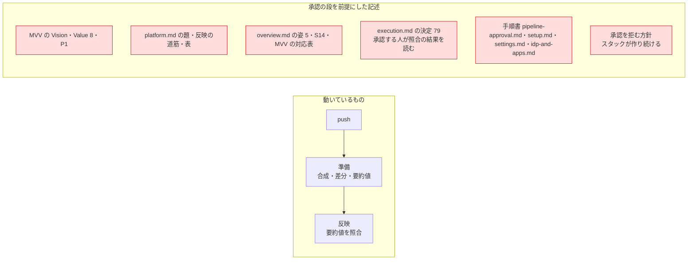
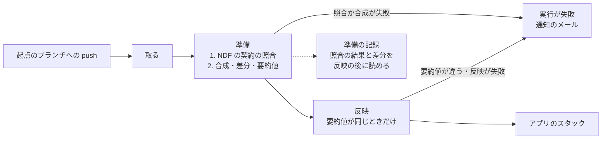
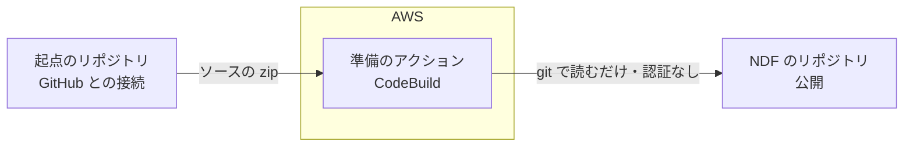

# 反映のパイプライン: push から人を待たずに反映し、契約の照合を準備へ移して、設計と手順書をその流れにそろえる（#164）

反映のパイプラインから人の承認の段を外した（#165）が、全体の設計・MVV・手順書は承認の段がある流れのまま残り、承認する人が担っていた NDF の契約の照合の確認（決定 79）はどこでも行われていない。準備の段で契約の照合を走らせて反映の前に食い違いを止め、効く対象の無くなった承認を拒む方針をスタックと手順書から消し、設計・手順書・開発の指針を承認の段の無い流れに書き直す。MVV の Vision・Value 8・P1 は改訂の案を示し、持ち主の承認で改訂する。比べた作り方は「決定の記録」に、調べた一次情報は末尾の「外部の調査」にある。

## 今の姿

何が起きたか・目的・受け入れ条件は要求仕様（[issue-164-requirements.md](./issue-164-requirements.md)、正は #164 の本文）にある。この文書は「どう解くか」と「なぜその解き方か」だけを書く。

パイプラインの定義は承認の段を持たない形に変わった。一方で、設計と手順書は承認の段を前提にしたままである。図の赤い箱が、承認の段の無い流れとずれている所である。

設計に要る今の構造は次のとおりである（2026-11-25 に main（69fd0b9）で読んだ）。

| 置き場 | 今の中身 |
| --- | --- |
| `infra/lib/pipeline-stack.ts` | 取る → 準備 → 反映の 3 段。準備が合成の結果・差分（`approval/diff.txt`）・要約値を作り、反映が要約値を数え直して `EXPECTED_DIGEST` と同じときだけ反映する。失敗の通知は EventBridge の規則（`<prefix>-<environment>-pipeline-failed`）から SNS のトピックへ送る。承認の依頼の通知は既に無い。承認を拒む管理の方針（`<prefix>-<environment>-deny-approval`、`codepipeline:PutApprovalResult` を拒む）をまだ作っている |
| `infra/lib/naming.ts` | `pipelineResourceNames` が方針の名前 `denyApprovalPolicy` を返す |
| 準備の段 | `npm ci` の後に画面のビルドと合成を行う。NDF の契約の照合（`npm run ndf-contract`。このリポジトリの NDF の使い方が、NDF のリポジトリが公開する契約と食い違わないかを調べる検査）は走らせていない |
| `.github/workflows/ndf-contract.yml` | Pull Request・main への push・毎日・手動で `npm run ndf-contract` を走らせる。AWS の資格情報を持たず、NDF のリポジトリ（公開）を `git` で読むだけ |
| `docs/design/platform.md` | 題と「反映の道筋は 2 つだけにする」の行が「push → 準備 → 人の承認 → 反映」と書く。決定 87（ランナーのイメージを自前の ECR へ push し、ダイジェストで引いて確認の値で縛る）と決定 89（資源をアプリのスタックへまとめる）は、題と理由を「人が承認したものだけを反映する」「承認する人が 1 つの差分で承認できる」と書く |
| `docs/design/overview.md` | 姿 5（目指す姿のうち、誰でも設置のコマンドで差分を見て反映でき、使わない間の費用が 0 に近いこと）が「運用する環境は反映のパイプラインで人が承認した差分だけを反映する」と書き、その根拠の行も MVV の Value 8 を「人が差分を見て承認する」と要約する。場面 S14（運用する環境を反映する）は「準備・人の承認・反映が流れる」と書く |
| `docs/operations/pipeline-approval.md` | 冒頭は承認を待たない流れ。「承認する人が読むもの」「承認を拒む方針を AI の主体へ付ける」の節と、順序のまとめの「承認」の行が残る |

## 文脈と制約

- 承認を待たずに反映する決定は、商用利用の開始前の運用に当てる（要求の前提 1）。商用利用の開始の後の扱いは決め直す
- 自分で設置する人の経路（`nd-setup diff` → `deploy --confirm`）の振る舞いを変えない（受け入れ条件 11。条件の文は決定 4 で改訂を求める）。設置のコマンドのコード（`infra/setup/`）には触れない
- CI は AWS の資格情報を持たない（AGENTS.md）。逆向きに、パイプラインへ GitHub の token を持たせると秘密が 1 つ増える（C1。C1〜C8 はレッドライン、つまりレビューで人の承認が要るとされる変更の種類の番号）
- パイプラインのスタック自身は、設置のコマンド（`--stack pipeline`）でだけ反映する。この変更でスタックを変えたら、リリースの後に設置のコマンドで反映し直す
- 設計を作った経緯の文書（`docs/design-process/`）は書き換えない（要求の S9）。そこから手順書へのリンクがある
- `.ndf/mvv.*` は C7 に当たる。改訂は持ち主の承認で成立する（MVV の「改訂」）

## 解き方の全体像

- 起点のブランチへ push すると、人を待たずに取る → 準備 → 反映が進む。準備は最初に NDF の契約の照合を走らせ、固定の点で食い違えば反映せずに失敗する（決定 1）
- 承認を拒む方針はパイプラインのスタックから消え、手順書には付ける手順の代わりに、前の版で付けた方針を外す手順だけが残る（決定 2）
- 手順書は同じパス（`docs/operations/pipeline-approval.md`）のまま、題と節を承認の段の無い流れに書き直す（決定 3）
- 起点のブランチは、Pull Request とレビューの承認を必須にし、承認の後に足した変更で承認を失効させる保護のあるブランチに限る。既に動いている環境ではこの変更を入れる最初の更新の前に、初めての設置と起点の変更ではその反映の前に確かめる。AI の主体には、リビジョンを指定して実行を手動で始める経路を使わせない（決定 5）
- 全体の設計・運用の手順書・開発の指針の Skill を、承認の段の無い流れに書き直す（決定 4）。全体の設計は `platform.md`・`overview.md`・`execution.md` の決定 79 である。運用の手順書は `setup.md` の運用する環境の節・`settings.md`・`idp-and-apps.md` である
- MVV の Vision・Value 8・P1 は「人へ残す判断」の改訂の案のとおりに、持ち主の承認を受けて改訂する。改訂が成立したときだけ、承認を待たない反映を正式な運用にする。見送られたら実装を保留し、承認の段を戻すかを持ち主へ戻す

## 構成要素

| 要素 | 責務 | 変えること |
| --- | --- | --- |
| 準備のアクション（`prepareBuildSpec`） | 反映してよい合成の結果を作る | `npm ci` の直後、合成より前に NDF の契約の照合を走らせる。照合が 0 以外で終われば、その後の命令を打たずに準備が失敗する。照合の要約を成果物の `approval/` に残す |
| パイプラインのスタック（`PipelineStack`） | 段・権限・通知の資源を作る | 承認を拒む管理の方針を作らない |
| 資源の名前（`pipelineResourceNames`） | パイプラインの資源の名前を返す | 方針の名前を返さない |
| 手順書（`pipeline-approval.md`） | 運用する環境の反映の手順 | 承認の段の無い流れで書き直す。前の版で付けた方針を外す手順（決定 2）と、起点のブランチの保護と手動の開始の権限を確かめ、満たさない間は反映の段への遷移を止める手順（決定 5）を足す |
| 全体の設計・運用の手順書・開発の指針 | 今の設計と判断の基準 | 承認の段を前提にした文を、承認の段の無い流れへ直す |

準備のアクションから、公開されている NDF のリポジトリを読みに行く通信が増える。

## 決定の記録

### 決定 1: 反映の前に NDF の契約の食い違いを止めるため、準備の段で契約の照合を走らせる

- **質問**: 決定 79 は、反映するコミットの照合の結果を承認する人が読むことで保っていた。承認の段が無い流れで、誰がいつその結果を確認するか
- **選んだ案**: 準備のアクションが `npm ci` の直後に契約の照合を走らせ、照合が 0 以外で終われば準備を止める。照合の要約は差分と同じ成果物に残す
  - 打ち方: 準備のアクションの作業ディレクトリはリポジトリのルートである。照合の前に `mkdir -p infra/approval` で出力先を作り、`npm run ndf-contract -- --summary infra/approval/ndf-contract.md` を打つ。`--summary` を付けないと要約はファイルに書かれない。照合は出力先のディレクトリを作らず、書けなければ終了コード 2 で終わるので、先に作る。成果物の基準ディレクトリは今のまま `infra` で、`approval/**/*` に要約が入る
  - 終了コードを失わない: 照合の行をパイプや `|| true` でつながず、そのまま打つ。CodeBuild は、`build` の段の命令が 0 以外で終わると、その後の命令（画面のビルド・合成・差分・要約値）を打たずにビルドを失敗にする（`on-failure` は既定のまま）
  - 照合の結果ごとの扱いは次の表のとおりである。準備が失敗すると反映の段へ進まず、失敗の通知が届く

  | 照合の結果 | 終了コード | 準備 |
  | --- | --- | --- |
  | 固定の点（`ndf-pin.json` で固定した NDF のコミット）の契約と食い違う | 1 | 止める |
  | 使い方の書き出し（このリポジトリが NDF の契約のどこを使うかをまとめたデータ）が無い | 1 | 止める |
  | 固定の点の契約を読めない（NDF のリポジトリを取得できない）・固定の点や書き出しを読めない・要約を書けない | 2 | 止める |
  | NDF のデフォルトブランチの先端の契約とだけ食い違う。CI と同じく要約に並べる | 0 | 反映へ進む |
  | 先端の契約だけを読めない。警告を出し、先端は照合しない | 固定の点の照合の結果（合えば 0） | 固定の点の照合が通れば反映へ進む |
- 採らなかった案: 反映の段に入る前の条件（`Commands` の規則）で照合する。規則は準備の CodeBuild とは別の実行環境で動き、ソースを取り直すので、`npm ci` を 2 回打つことになる。照合したソースと合成したソースが同じだと、記録から示せない
- 採らなかった案: 準備の段から GitHub の API でコミットの `ndf-contract` の実行の結論を読む。パイプラインに GitHub の token を持たせるので秘密が増え（C1）、push と同時に始まる CI の終わりを待つ仕組みも要る
- 採らなかった案: 起点のブランチを main に限り、Pull Request の必須のチェックに任せる。決定 79 が挙げたとおり、main への push の実行の失敗や、マージした結果のコミットが Pull Request で照合したコミットと違う場合を拾えない
- 採らなかった案: 照合を反映の前に行わず、反映の後に記録を読む。食い違ったコミットが運用する環境へ入ってから分かる
- **代償**: NDF のリポジトリを読めない間（GitHub の障害など）は準備が失敗し、反映が止まる。直ったら実行を再開する。準備の時間が照合の分だけ延びる
- 作り方: ライブラリやサービスを使う・標準に倣う
- 比べた候補: STD1 / LIB1 / LIB2 / LIB3
- 根拠: Value 17「目先の手間より、長く良い形を選ぶ」（MVV バージョン 3）と Value 7「公開を前提に、値を置かない」（MVV バージョン 3）。人の目に頼る確認を、毎回必ず走る自動の検査へ置き換える。秘密の値を増やさないため、GitHub の token を持たせる案を採らない。STD1

### 決定 2: 効く対象の無い権限の資源を残さないため、承認を拒む方針をスタックから消し、前の版で付けた方針を外す手順だけを残す

- **質問**: 承認の段が無くなり、承認を拒む方針（`codepipeline:PutApprovalResult` を拒む）は効く対象を持たない。残すか消すか
- **選んだ案**: パイプラインのスタックと `pipelineResourceNames` から方針を消す。手順書から「付ける」手順を消し、「承認の段を持っていた版から上げるとき」の節に、パイプラインのスタックを反映し直す前に行う次の手順を置く。付けた主体が残ったままだと、方針を消す反映が失敗しうるためである
  1. 外してよいかを、外した後も承認の送信が拒まれたままかで確かめる。この方針の拒否は `resources: ["*"]` なので、このパイプラインだけでなく、ほかのパイプラインの承認の段にも効いている。確かめ終わらない対象が 1 つでも残れば、手順 2 と手順 3（参照の取り外しと再プロビジョニング）へ進まない
     - 対象のアカウント: 方針が存在するアカウントと、手順 3 で参照を外す許可セットを割り当てたすべてのアカウントである。カスタマー管理ポリシーはアカウントごとの資源なので、同じ名前とパスでも、中身と付いた主体はアカウントごとに `get-policy-version` と `list-entities-for-policy` で確かめる
     - 対象のリージョン: 対象のアカウントで有効なすべてのリージョンである。`aws codepipeline list-pipelines` はリージョンごとの一覧なので、リージョンごとに打ち、`get-pipeline` で手動の承認のアクションを持つパイプラインを一覧する
     - 対象の主体: 実際に権限を使うユーザーとロールである。グループに付いていれば、そのグループに属するユーザーごとに確かめる。許可セットなら、各アカウントに作られたロールごとに確かめる
     - 確かめ方: 主体ごとに、この方針を除いた残りの方針（直に付けた方針・インラインの方針・属するグループの方針。アクセス許可の境界は `--permissions-boundary-policy-input-list` に渡す）の本文を集め、承認のアクションの ARN ごとに `aws iam simulate-custom-policy --action-names codepipeline:PutApprovalResult` を打つ。条件に要るキー（送信元の IP・MFA・タグなど）は、AI の主体が実際に操作するときの値を `--context-entries` に渡す
     - 外してよい: すべての承認のアクションで結果が `allowed` でなく、`MissingContextValues` が空である
     - 外さない: どれかで `allowed` になる。その主体からは外さず、そのパイプラインの持ち主が、その承認のアクションに絞った拒否を別に用意して付けるまで待つ（用意するのはこのスタックの外の IAM の変更なので、P1 と C2 に当たり人の承認が要る）
     - 止める: `MissingContextValues` が空でない、方針の本文を集めきれない、など判定できない。外さずに人へ戻す
     - 記録: リポジトリと課題は公開されているので、承認のアクションと方針の ARN・アカウント ID・シミュレーションの結果の本文は、アクセスを制限した運用の記録に残す。運用する環境の作業の課題のコメントには、判定（外した・外さない・止めた）と未解決の事項だけを書く（Value 7「公開を前提に、値を置かない」（MVV バージョン 3））
  2. IAM のユーザーとロールに直に付けた方針を外す。`aws iam list-entities-for-policy` で付けた主体を一覧し、`detach-user-policy`・`detach-role-policy`・`detach-group-policy` で外す
  3. IAM Identity Center の許可セットに登録した方針を外す。前の版の手順書は、許可セットから入る主体には、許可セットの「カスタマー管理ポリシー」に方針を足すよう案内していた。IAM 側のロールから外すだけでは、許可セットに参照が残る。参照が残ったまま方針が消えると、その許可セットを再プロビジョニングできなくなる。`aws sso-admin list-customer-managed-policy-references-in-permission-set` で参照のある許可セットを探し、`detach-customer-managed-policy-reference-from-permission-set` で参照を外し、`provision-permission-set`（対象は許可セットを割り当てたすべてのアカウント）で再プロビジョニングする。`describe-permission-set-provisioning-status` で完了を待つ
  4. `aws iam list-entities-for-policy` が、ユーザー・ロール・グループのどれも返さないことを確かめてから、パイプラインのスタックを反映し直す。方針の本体は消さない。消すのは CloudFormation に任せる（「未確認のまま残ること」と LIB3）
- 採らなかった案: 方針を残し、手順書に「効く対象は無い」と注記する（使わない資源と、付けるかを迷わせる記述が残る。今の手順書がこの形で、受け入れ条件 5 を満たさない）
- 採らなかった案: 承認の段を戻すときの備えとして残す（戻すなら、その設計で方針も作り直せばよく、今残す理由にならない）
- **代償**: 前の版で方針を AI の主体へ付けた環境では、パイプラインのスタックを反映し直す前に、人が 1 回だけ外す手間が要る。確かめる範囲は、許可セットを割り当てたすべてのアカウントと、その有効なすべてのリージョンに及ぶ。同じ主体がほかのパイプラインの承認の段にも承認を送れる環境では、そのパイプラインの側の拒否が用意されるまで、このスタックの反映し直しを待つ
- 根拠: Value 13「使わなくなったコード・設定・文書は残さない」（MVV バージョン 3）。[IAM Identity Center の参照を外す API](https://docs.aws.amazon.com/singlesignon/latest/APIReference/API_DetachCustomerManagedPolicyReferenceFromPermissionSet.html)・[ListPipelines の API](https://docs.aws.amazon.com/codepipeline/latest/APIReference/API_ListPipelines.html)・[SimulateCustomPolicy の API](https://docs.aws.amazon.com/IAM/latest/APIReference/API_SimulateCustomPolicy.html)（2026-11-25）

### 決定 3: 過去の記録からのリンクを壊さないため、手順書のパスを `docs/operations/pipeline-approval.md` のまま保ち、題と節を書き直す

- **質問**: 手順書の名前は「承認」を含む。名前を変えるか
- **選んだ案**: パスは保ち、題を「反映のパイプライン」に変え、承認の段の無い流れで節を組み直す。節は、段・反映の後に記録を読む・失敗したとき・承認の段を持っていた版から上げるとき・接続を有効にする・順序のまとめである。成果物の `approval/` のディレクトリの名前も保つ
- 採らなかった案: `docs/operations/pipeline.md` へ名前を変える。書き換えない `docs/design-process/issue-1/design.md` からのリンクが壊れる
- **代償**: パスの名前と中身が少しずれる。題と冒頭の 1 文で中身を示す
- 根拠: Value 12「リファクタリングを続け、読みやすさと直しやすさを保つ」（MVV バージョン 3）。題と節を整えて読みやすさを保ちつつ、既存のリンクを壊す直しは避ける

### 決定 4: 承認の段を前提にした判断が生まれないよう、承認の段を書いた記述を、運用する環境の手順と全体の設計からすべて書き直す

- **質問**: 受け入れ条件 7 の検索は 2 つの言い回しだけを数える。直す範囲を検索に当たる文だけにするか
- **選んだ案**: 「今の姿」の図の置き場で、承認の段・承認する人・承認を拒む方針を今の流れとして書いた文をすべて直す。`setup.md` は「運用する環境」の節の 2 行だけを直し、自分で設置する人の節と設置のコマンドの節は変えない。`AGENTS.md` は「リポジトリの形」の表の `docs/operations/` の行の「反映の承認」を直す（「反映の経路」は #165 で直してある）。`docs/specifications/app-stack-infrastructure.md` の「反映は差分を見て承認した範囲だけ」は、設置のコマンドで反映する予行の環境の話なので直さない
- 採らなかった案: 検索に当たる文だけを直す。検索に当たらない次の箇所に承認の段が残り、受け入れ条件の目的を満たさない
  - `platform.md` の題
  - `platform.md` の決定 87（人が承認したものだけを反映するため、ランナーのイメージを自前の ECR へ push し、ダイジェストで引いて確認の値で縛る）の題と理由
  - `platform.md` の決定 89（承認する人が 1 つの差分と確認の値で反映を承認できるよう、資源をアプリのスタックへまとめる）の題と理由
  - `overview.md` の姿 5（誰でも設置のコマンドで差分を見て反映でき、運用する環境は人が承認した差分だけを反映する、という目指す姿）とその根拠の行
- 採らなかった案: `setup.md` を一切変えない（「承認を拒む方針を付けるまで push しない」が消える方針を指したまま残る）
- **代償**: `setup.md` に差分が出る。課題 #164 の本文の受け入れ条件 11 は「`setup.md` が変わっていない」と書くので、そのままでは満たせない。設計承認ゲートで持ち主に、条件 11 を次の文へ改訂することの承認を求める（「人へ残す判断」）。実装とテストは改訂後の条件 11 で確かめる
  - 改訂後の条件 11: 自分で設置する人の経路（`nd-setup diff` → `deploy --confirm`）の振る舞いが変わっていない。`infra/setup/` に差分が無い。`docs/operations/setup.md` の差分は「運用する環境」の節（`### 運用する環境`）の中だけにあり、「自分で設置する人」の節と設置のコマンドの節（「diff」「足りない設定」「確認の値」「deploy」「終了コード」など、ほかのすべての節）に差分が無い（退行しない）
  - 要求仕様のコピー（[issue-164-requirements.md](./issue-164-requirements.md)）は取得した時点の記録なので書き換えない。課題の本文を改訂したら、そちらが正になる
- 根拠: Value 13「重複と冗長を作らない」（MVV バージョン 3）と Value 14「モダンな開発の手順で品質を確かめる」（MVV バージョン 3）。使わなくなった文書の記述を残さない。設計の判断は理由とともに設計文書に残し、古い判断を今の設計として残さない

### 決定 5: レビューを経ない変更を反映しないため、起点のブランチをレビュー必須の保護があるブランチに限る

- **質問**: パイプラインは設定された起点のブランチ（`pipeline.branch`）への push を直に受け、起点は main とは限らない。承認の段が無い今、レビューを経ていないコミットが反映されないことを何で保つか
- **選んだ案**: 起点のブランチは、GitHub の保護で次の 4 つを満たすブランチに限る。加えて、AWS の側から起点のブランチに入っていないリビジョンを反映させる経路を、AI の主体に使わせない。手順書の順序のまとめに、確かめる手順と、満たさないときに反映を止める手順を置く
  - 変更は Pull Request からだけ入る（直の push を許さない）
  - マージの前に 1 人以上のレビューの承認が要る
  - 差分を変えるコミットが Pull Request に足されたら、それまでの承認を失効させる（ルールセットの `dismiss_stale_reviews_on_push`、従来のブランチの保護の「Dismiss stale pull request approvals when new commits are pushed」）。承認の後に足した変更も、マージの前に承認を受け直す
  - 保護を迂回できる主体（bypass）に、AI が使う主体を入れない
  - 確かめる時期: 既に動いている環境（#165 で承認の段を外したパイプライン）では、この変更を入れる最初の更新の前に確かめる。初めて設置するときと、`pipeline.repository` か `pipeline.branch` を変えるときは、その反映の前に確かめる。保護を緩める変更をしたときも確かめ直す
  - 確かめ方: `gh api repos/<起点のリポジトリ>/rules/branches/<起点のブランチ>` は、そのブランチに効いているルールを返すが、迂回できる主体の一覧は返さない。そのため、まずこの API で効いているルールとその元のルールセットを列挙する。次に、リポジトリと組織の各ルールセットの詳細（`gh api repos/<起点のリポジトリ>/rulesets/<ID>`、組織なら `gh api orgs/<組織>/rulesets/<ID>`）を、迂回の設定を読める権限（リポジトリか組織の管理者）で読み、迂回できる主体を確かめる。迂回できる主体は、アプリ・チーム・ロール（リポジトリのロールと組織の管理者）経由で AI の主体を含みうるので、それぞれの構成員も確かめる。従来のブランチの保護（`gh api repos/<起点のリポジトリ>/branches/<起点のブランチ>/protection`）なら、管理者にも保護を当てているか（`enforce_admins`）と、個別に許した例外（Pull Request の必須を迂回できる主体、push を許した主体）を確かめる。権限が足りないなどで確かめきれなければ、満たさないものとして扱う
  - 満たさないときの扱い: 起点にしない。既に動いている環境なら、運用担当者（人）が反映の段（`Deploy`）への入口の遷移を `aws codepipeline disable-stage-transition --transition-type Inbound` で止め、保護を整えて確かめ直してから `enable-stage-transition` で戻す。止めている間に反映するときは、人が準備の差分を読んでから遷移を戻し、反映の後に再び止める
  - AWS の側から始める実行: CodeConnections のソースを使うパイプラインは、実行を手動で始めるとき（`StartPipelineExecution`）にソースのリビジョンを指定できる。このとき起点のブランチの保護は効かない。手順書では、指定なしの開始（起点のブランチの先端を取る）だけを使うと定める。AI の主体が、このパイプラインに `codepipeline:StartPipelineExecution` を許されていないことを、決定 2 の手順 1 と同じ範囲と手段（`simulate-custom-policy`）で確かめる。許されていれば、このパイプラインの ARN に絞った拒否を付けるまで、上の「満たさないときの扱い」で反映を止める（付けるのはこのスタックの外の IAM の変更なので、P1 と C2 に当たり人の承認が要る）。実行を手動で始めるのは運用担当者（人）だけにする
  - 記録: 決定 2 の手順 1 と同じく、課題のコメントには判定と未解決の事項だけを書き、ルールセットの ID・主体の名前・ARN などの実値はアクセスを制限した運用の記録に残す
- 採らなかった案: パイプラインの側で保護を確かめる。パイプラインに GitHub の token を持たせるので秘密が増える（C1）。準備の段に置いても、設定を変えた後の push で初めて分かる
- 採らなかった案: 起点を main に固定する。決定 1 のとおり起点を main 以外にする運用を残しており、設定の形（`pipeline.branch`）も変えない（「影響と危険」）
- 採らなかった案: 準備の段で、ソースのリビジョンが起点のブランチに入っているかを確かめる。起点のブランチの先端を読むには、GitHub の token か、ソースの取り方を git の複製へ変えて接続を準備の段で使う形が要る。後者で起点のブランチの履歴を取れるかは確かめていない
- **代償**: 保護はパイプラインの外の GitHub の設定なので、後から保護を緩めてもパイプラインは気付かない。保護を緩める変更は、起点のブランチを変える変更と同じく、この手順で確かめ直す。AI の主体が実行を手動で始められないため、照合の失敗の後の再開（決定 1）は人が行う
- 根拠: Value 14「モダンな開発の手順で品質を確かめる」（MVV バージョン 3）。Value 14 は変更をレビューを通してから取り込むと定める。Vision の改訂の案（「人へ残す判断」）が約束する「レビューを通って起点のブランチへ入った変更だけ」を、この前提で保つ。[GitHub のルールセットの API](https://docs.github.com/en/rest/repos/rules)・[GitHub のブランチの保護の設定](https://docs.github.com/en/repositories/configuring-branches-and-merges-in-your-repository/managing-protected-branches/managing-a-branch-protection-rule)・[CodePipeline のソースのリビジョンの指定](https://docs.aws.amazon.com/codepipeline/latest/userguide/pipelines-trigger-source-overrides.html)（2026-11-25）

## 影響と危険

- **働く範囲**: このリポジトリだけ。変わるのはパイプラインのスタックである。対象は、運用する環境と、自分で設置した環境のうちパイプラインを設定したものである
- **プロジェクトごとに違うもの**: 無し。設定のファイルのキー（`pipeline.*`）は変えない。通知の宛先 `pipeline.notify_emails` の意味を「実行の失敗の通知の宛先」に直す（形は変えない）
- **当たるモード**: `standard`
- **壊れうる箇所と扱い**:
  - 準備で照合が失敗すると反映が止まる。原因が NDF のリポジトリを読めないことなら、実行を再開する。固定の点の食い違いなら、Pull Request で直してから push する
  - 前の版で方針を付けた主体が残ったまま反映し直すと、方針を消す更新が失敗しうる。手順書の「承認の段を持っていた版から上げるとき」を先に行う
  - 同じ主体がほかのパイプラインの承認の段へ承認を送れる環境で方針を外すと、そのパイプラインで人に限っていた承認を AI の主体が送れるようになる。決定 2 の手順 1 で確かめ、当たれば外さない
  - 起点のブランチの保護が緩いと、レビューを経ないコミットが契約の照合だけを通って反映される。AWS の側からリビジョンを指定して実行を始めても、同じことが起きる。決定 5 の前提で防ぎ、満たさない間は反映の段への遷移を止める
  - `AGENTS.md`（C7）と IAM の資源（C2）を変える。どちらも本来は人の承認が要るレッドラインに当たる。開発の指針は、商用利用の開始前はレッドラインの指摘も AI が決めると定めている。そのため「人へ残す判断」には入れず、設計で決めて承認資料に載せる
  - MVV（`.ndf/mvv.*`）も同じ C7 に当たるが、「人へ残す判断」に入れる。開発の指針の決まりより先に、MVV 自身の「改訂」の節が、改訂は利用者（持ち主）の承認で成立すると定めているためである。MVV は共通原則の範囲で開発の指針より上位にあり、AI の判断で改訂の版を作れない
  - 同じファイルを触る別の変更: `docs/design/platform.md` と `overview.md` は全体の設計の見直しの課題が後で触る（要求のコメント）。この課題を先にマージする

## テスト設計

| 受け入れ条件・決定 | どの振る舞いで縛るか | どう壊したら落ちるべきか |
| --- | --- | --- |
| 1 | 合成したパイプラインの段の名前が取る・準備・反映の 3 つだけである | 承認の段を足すと落ちる |
| 2 | 反映の手順が要約値を数え直し、`EXPECTED_DIGEST` が準備の `ASSEMBLY_DIGEST` を指し、違えば `exit 1` する | 比べる行を消す・変数のつなぎを外すと落ちる |
| 3 | SNS のトピックとメールの購読があり、実行の失敗の規則がトピックへ送る | 規則か購読を消すと落ちる |
| 4・決定 2 | 合成したテンプレートに管理の方針（`AWS::IAM::ManagedPolicy`）が無い。`pipelineResourceNames` が方針の名前を返さない。`git grep -n -E "deny-approval\|PutApprovalResult" -- infra docs/design` が 0 件 | 方針を作り直すと落ちる |
| 決定 1（位置と出力先） | 準備の手順（`infra/test/pipeline-stack.test.ts`）で、`mkdir -p infra/approval` が照合より前にあり、照合 `npm run ndf-contract -- --summary infra/approval/ndf-contract.md` が `npm ci` の後、画面のビルドと合成より前にある。成果物の基準ディレクトリが `infra` で、`approval/**/*` を含む | 照合の行を消す・合成の後へ動かす・`--summary` を外す・`mkdir` を照合の後へ動かすと落ちる |
| 決定 1（照合の失敗で止まる） | 準備の手順（同）で、照合の命令がパイプ（`\|`）・`\|\| true`・`;` でほかの命令とつながっておらず、`build` の段に `on-failure: CONTINUE` が無い。CodeBuild は `build` の段で 0 以外を返した命令の後を打たないので、これで固定の点の食い違い（1）・取得のエラー（2）では合成・要約値の書き出しへ進まず、反映の段も動かない | 照合の行に `\|\| true` を足す・`tee` へパイプする・`on-failure: CONTINUE` を足すと落ちる |
| 決定 1（照合の終了コード） | 既にある `tools/test/ndf-contract-check.test.ts` の `mainNdfContractCheck` のテストで、固定の点だけの食い違いが 1、固定の点を取れないと 2、先端だけの食い違いが 0、先端を取れないときは固定の点の結果で終わる、要約に書けないと 2 になる。この課題では照合のコードを変えないので、テストも変えず、通ることを確かめる | 終了コードの決め方を変えると落ちる |
| 決定 5 | 手順書の順序のまとめに、起点のブランチの保護（Pull Request 必須・レビューの承認 1 件以上・差分を変えるコミットで承認を失効させる・AI の主体を迂回の主体に入れない）を確かめる手順がある。確かめる時期が、既に動いている環境ではこの変更を入れる最初の更新の前、初めての設置と起点の変更ではその反映の前である。確かめ方が、効いているルールの列挙に加えて、各ルールセットの詳細を迂回の設定を読める権限で読み、アプリ・チーム・ロール経由の主体と、従来の保護の管理者への適用と個別の例外を確かめる。確かめきれないときと満たさないときに、反映の段への遷移を止める手順がある。リビジョンを指定した手動の開始を使わないことと、AI の主体が実行を手動で始められないことを確かめる手順がある。実値を課題に書かず、アクセスを制限した運用の記録に残すと書いてある（読んで確認） | — |
| 決定 2（手順 1） | 手順書の手順 1 が、許可セットを割り当てたすべてのアカウントと有効なすべてのリージョンを対象にし、実際に権限を使うユーザーとロールごとに、方針を除いた残りの方針で拒否が保たれるかを条件のキーを渡して確かめ、判定できなければ止めると書いてある。実値を課題に書かないと書いてある（読んで確認） | — |
| 5 | 手順書に「承認する人が読むもの」「承認を拒む方針を AI の主体へ付ける」の見出しが無く、順序のまとめに承認の行が無い | 見出しを戻すと検索に当たる |
| 6 | `AGENTS.md` の「反映の経路」が承認の段の無い流れを書いている（#165 で済み。読んで確認） | — |
| 7 | `git grep -n -E "人の承認 → 反映\|準備・人の承認" -- docs/design` が 0 件 | 文を戻すと当たる |
| 8 | 決定 79 の本文が、準備の段の照合で反映の前に止めることを書き、承認する人が読むと書いた文が無い | — |
| 9 | 持ち主の決定が設計承認ゲートの記録にあり、改訂するなら `ndf records mvv current --base main` の版が上がっている | — |
| 10 | 開発の指針の Skill の「進め方」に、反映のパイプラインの実行は承認を待たない行がある | — |
| 11（決定 4 の改訂後の条件） | `git diff main -- infra/setup` が空で、`docs/operations/setup.md` の差分が「運用する環境」の節の中だけにある。`npm run check` の設置のコマンドのテストが通る | 自分で設置する人の節を変えると差分に出る |

リリースの後に、運用する環境で次を確かめ、判定を課題のコメントに残す。実行の ID や成果物の置き場などの実値は、アクセスを制限した運用の記録に残す。

| 確かめること | 手段 |
| --- | --- |
| 新しい準備のアクションで照合が実際に走り、成功で終わった | 起点のブランチへの push で始まった実行の、準備の CodeBuild の記録に `checked: fixed <固定の点> 1-6` の行があり、準備が成功している |
| 反映の後に、差分と照合の要約を読める | その実行の準備の成果物（S3 の成果物の置き場）から `approval/diff.txt` と `approval/ndf-contract.md` を取得して開ける |
| 反映まで人の操作なしに進んだ（受け入れ条件 1） | CodePipeline の実行の記録で、取る → 準備 → 反映が成功している |

## 設計の結果

| 課題 | 扱い | 統合先 | 触るファイル |
| --- | --- | --- | --- |
| #164 | 実装する | — | `infra/lib/pipeline-stack.ts`、`infra/lib/naming.ts`、`infra/test/pipeline-stack.test.ts`、`infra/test/naming.test.ts`、`docs/operations/pipeline-approval.md`、`docs/operations/setup.md`、`docs/operations/settings.md`、`docs/operations/idp-and-apps.md`、`docs/design/platform.md`、`docs/design/overview.md`、`docs/design/execution.md`、`AGENTS.md`、`.claude/skills/nd-factory-dev-guidelines/SKILL.md`、`.ndf/mvv.md`、`.ndf/mvv.json`（MVV は持ち主が改訂を承認したときだけ） |

## 人へ残す判断

| 判断 | 当たるレッドライン | なぜ当たるか |
| --- | --- | --- |
| MVV の Vision・Value 8・P1 を下の案で改訂するか | C7 | `.ndf/` の利用者の設定を書き換え、MVV の改訂は利用者の承認で成立するため |
| 改訂が成立するまでの間、運用する環境のパイプラインの反映の段への遷移を止めておくか | P1 | パイプラインと設置のコマンドの外から、運用する環境の AWS の資源の状態を変えるため |
| 課題 #164 の受け入れ条件を次のとおり直すか。条件 11 を決定 4 の改訂後の条件へ書き換える。条件 12「起点のブランチが、Pull Request 必須・レビューの承認 1 件以上・差分を変えるコミットで承認を失効させる・AI の主体を迂回の主体に入れない保護を持つ。迂回できる主体は、各ルールセットの詳細とアプリ・チーム・ロール経由の主体、従来の保護の管理者への適用と個別の例外まで確かめてある。AI の主体がこのパイプラインの実行を手動で始められない。既に動いている環境ではこの変更を入れる最初の更新の前に、初めての設置と起点の変更ではその反映の前に確かめ、判定が課題に、実値を含む結果がアクセスを制限した運用の記録に残っている。確かめきれないか満たさない間は、反映の段への遷移が止まっている」を足す（決定 5） | — | 要求の受け入れ条件は持ち主が決めたものなので、AI が書き換えない。承認されたら課題の本文を書き換える |

この設計は、MVV の改訂が成立することを前提にする。持ち主が決めるまでの間も、承認の段の無いパイプラインは動いており、今の Value 8 と食い違う。そこで、この設計を出す設計承認ゲートで、決めるまでの間も運用担当者（人）が反映の段への入口の遷移を止めておくか（下の「改訂を見送る」の行と同じ止め方）を、改訂と同時に持ち主へ問う。遷移を止める操作は、パイプラインと設置のコマンドの外から AWS の資源の状態を変えるので、P1 に当たるものとして人が行う。設計承認ゲートでの持ち主の決定ごとに、次のとおり進める。

| 持ち主の決定 | 進め方 |
| --- | --- |
| 下の案（か、持ち主が直した文）で改訂する | 改訂した MVV の版を `.ndf/mvv.json` に記録し、承認を待たない反映を正式な運用にする。この設計のとおり実装する |
| 改訂を見送る | 今の Value 8（反映は「起点のブランチへの push → 準備 → 人の承認 → 反映」だけ）と承認を待たない運用は両立しない。そのため、運用担当者（人）が、運用する環境のパイプラインの反映の段（`Deploy`）への入口の遷移を `aws codepipeline disable-stage-transition --transition-type Inbound` で止め、止めたことを課題に書く。止めている間に反映するときは、人が準備の差分を読んでから `enable-stage-transition` で遷移を戻し、反映の後に再び止める。これが人の承認の代わりになる。この課題の実装を保留し、パイプラインに承認の段を戻すか（#165 を戻す）を持ち主へ戻す。遷移を止めたままにするのは、承認の段を戻したパイプラインを設置のコマンドで反映するか、MVV の改訂が成立するまでである。見送った理由は課題に残す（受け入れ条件 9）。決定 1（準備の段の照合）は承認の段を戻しても役に立つので、持ち主が望めば単独で進める |

P1 は MVV の「必ず人の承認が要る操作」の 1 つ目で、反映のパイプラインと設置のコマンドの外で AWS の資源を作る・変える・消す操作と、`cdk bootstrap` を打つ・その版を上げる操作に人の承認を求める。案は P1 の操作の欄を変えず、理由の欄だけを書き換える。

改訂の案（変わる文だけ。今の欄は版 3 の全文）:

| 項目 | 今（版 3） | 案 |
| --- | --- | --- |
| Vision の最後の文 | 運用する環境へも自分で設置した環境へも、人が差分を見て承認した範囲だけが反映される。 | 運用する環境へは、レビューを通って起点のブランチへ入り、反映の前の検査を通った変更だけが反映され、自分で設置した環境へは、人が差分を見て承認した範囲だけが反映される。 |
| Value 8 の見出し | 反映は差分を見て承認した範囲だけ | 反映は決まった経路と検査を通った範囲だけ |
| Value 8 の 1 文目 | 運用する環境へは、反映のパイプライン（起点のブランチへの push → 準備 → 人の承認 → 反映）だけで反映する。 | 運用する環境へは、反映のパイプライン（起点のブランチへの push → 準備 → 反映）だけで反映する。パイプラインは人の承認を待たず、準備の検査が通り、準備で作った合成の結果と同じ要約値のものだけを反映する。差分は準備の記録に残り、反映の後に読める。 |
| P1 の操作（変えない） | 反映のパイプラインと設置のコマンドの外で AWS の資源を作る・変える・消す、`cdk bootstrap` を打つ・その版を上げる | 変えない |
| P1 の理由 | 人が差分を見て承認する経路を通らず、反映した状態を照らす記録も残らない | 決まった反映の経路と検査を通らず、反映した状態を照合する記録も残らない |

## 未確認のまま残ること

| 項目 | 内容 |
| --- | --- |
| 運用する環境で方針を付けた主体 | 前の版の手順で方針を AI の主体へ付けたかは、リポジトリからは分からない。パイプラインのスタックを反映し直す前に、`aws iam list-entities-for-policy` の結果で分かる |
| 方針を CloudFormation が消すときの振る舞い | IAM の `DeletePolicy` は、付いた主体がある方針と、デフォルト以外のポリシーバージョンが残る方針を消せない（LIB3）。CloudFormation が付いた主体から外すか、追加のバージョンを消してから方針を消すかは確認できていない。付け外しは先に手順で行う（決定 2）。前の版の環境に追加のバージョンがあるか（`aws iam list-policy-versions`）を反映し直す前に記録し、パイプラインのスタックの更新が `UPDATE_COMPLETE` で終わり方針が消えたことを、リリースの後に確かめる。更新が失敗したら、追加のバージョンを消すかを人が決める（このスタックの外の IAM の変更なので、P1 と C2 に当たる） |
| CodeBuild の準備の環境で照合が通るか | 照合は `git` で NDF のリポジトリを読む。CodeBuild の標準のイメージで通ることは、リリースの後の最初の実行の記録で分かる |

## 外部の調査

| 種類 | 調べるか | 理由 |
| --- | --- | --- |
| 標準・仕様 | 調べる | 手動の承認を自動の検査へ置き換える進め方に、AWS の公開の指針がある |
| 主要な製品 | 調べない | 使う製品は CodePipeline に決まっており、ほかの CI/CD の製品と比べても、パイプラインの中で検査を走らせる形は同じになる |
| ライブラリとサービス | 調べる | 反映の前の検査を、CodePipeline の段の条件で置くか、準備のアクションの中で走らせるかを比べる。方針を消すときの IAM の振る舞いを確認する |

### 標準・仕様

| # | 標準・仕様 | 何を定めているか | 設計への反映 | 出典 |
| --- | --- | --- | --- | --- |
| STD1 | AWS Well-Architected DevOps Guidance DL.CD.7「Remove manual approvals to practice continuous deployment」 | 継続的デプロイでは承認の段を持たず、人の承認が担っていた監督を自動の検査と監視で置き換える | 承認する人の確認（決定 79）を、準備の段の自動の照合へ置き換える（決定 1） | https://docs.aws.amazon.com/wellarchitected/latest/devops-guidance/dl.cd.7-remove-manual-approvals-to-practice-continuous-deployment.html（2026-11-25） |

### ライブラリとサービス

| # | 候補 | バージョン | ライセンス | 最後のリリースの日付 | 終了のアナウンス | 要件を満たすか | 出典 |
| --- | --- | --- | --- | --- | --- | --- | --- |
| LIB1 | CodeBuild のアクション（準備のアクションの中で照合する） | パイプラインの種類 V2 | AWS のサービス | — | 無し | 満たす。準備と同じソースと `npm ci` の結果で照合でき、失敗で段が止まる | `infra/lib/pipeline-stack.ts`（2026-11-25） |
| LIB2 | CodePipeline の段の条件（入る前の条件の `Commands` の規則） | パイプラインの種類 V2 | AWS のサービス | 2024-12（`Commands` の規則の追加） | 無し | 満たすが、規則は準備とは別の実行環境で動き、準備と入力を共有しない | https://docs.aws.amazon.com/codepipeline/latest/userguide/stage-conditions.html ・ https://docs.aws.amazon.com/codepipeline/latest/userguide/rule-reference-Commands.html（2026-11-25） |
| LIB3 | IAM の `DeletePolicy` | — | AWS のサービス | — | 無し | `DeletePolicy` は、すべての付け外しと、デフォルト以外のポリシーバージョンの削除を前提に要る（満たさなければ `DeleteConflict`）。移行の手順は承認を得た付け外しまでにし、方針の本体の削除は CloudFormation に任せる。前の版の環境に追加のバージョンがあるときのスタックの更新の結果も確かめる | https://docs.aws.amazon.com/IAM/latest/APIReference/API_DeletePolicy.html（2026-11-25） |

### 確かめられなかったこと

| 対象 | 試した手段 | 結果と理由 |
| --- | --- | --- |
| `AWS::IAM::ManagedPolicy` を消すときに CloudFormation が付いた主体から外すか | 検索「CloudFormation AWS::IAM::ManagedPolicy delete attached users roles detach」（docs.aws.amazon.com） | CloudFormation の資源の説明は結果に出ず、IAM の API の説明だけが出た |

調べた量: 候補 4 件・取得の試み 3 回。
