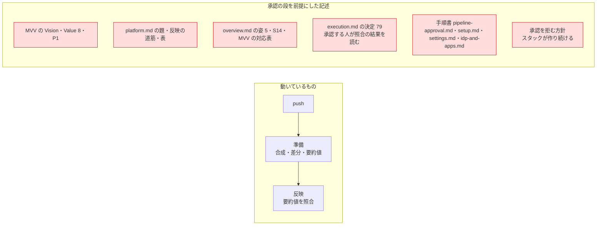
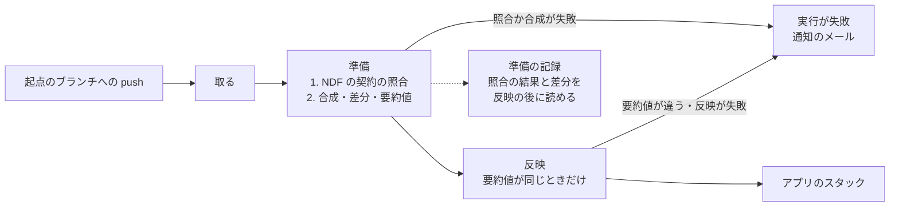
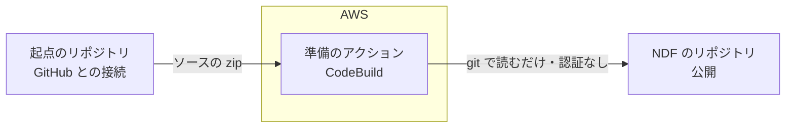

# 反映のパイプライン: push から人を待たずに反映し、契約の照合を準備へ移して、設計と手順書をその流れにそろえる（#164）

反映のパイプラインから人の承認の段を外した（#165）が、全体の設計・MVV・手順書は承認の段がある流れのまま残り、承認する人が担っていた NDF の契約の照合の確認（決定 79）はどこでも行われていない。準備の段で契約の照合を走らせて反映の前に食い違いを止め、効く対象の無くなった承認を拒む方針をスタックと手順書から消し、設計・手順書・開発の指針を承認の段の無い流れに書き直す。MVV の Vision・Value 8・P1 は改訂の案を示し、持ち主の承認で改訂する。比べた作り方は「決定の記録」に、調べた一次情報は末尾の「外部の調査」にある。

## 今の姿

何が起きたか・目的・受け入れ条件は要求仕様（[issue-164-requirements.md](./issue-164-requirements.md)、正は #164 の本文）にある。この文書は「どう解くか」と「なぜその解き方か」だけを書く。

パイプラインの定義は承認の段を持たない形に変わった。一方で、設計と手順書は承認の段を前提にしたままである。図の赤い箱が、承認の段の無い流れとずれている所である。

設計に要る今の構造は次のとおりである（2026-11-25 に main（69fd0b9）で読んだ）。

| 置き場 | 今の中身 |
| --- | --- |
| `infra/lib/pipeline-stack.ts` | 取る → 準備 → 反映の 3 段。準備が合成の結果・差分（`approval/diff.txt`）・要約値を作り、反映が要約値を数え直して `EXPECTED_DIGEST` と同じときだけ反映する。失敗の通知は EventBridge の規則（`<prefix>-<environment>-pipeline-failed`）から SNS のトピックへ送る。承認の依頼の通知は既に無い。承認を拒む管理の方針（`<prefix>-<environment>-deny-approval`、`codepipeline:PutApprovalResult` を拒む）をまだ作っている |
| `infra/lib/naming.ts` | `pipelineResourceNames` が方針の名前 `denyApprovalPolicy` を返す |
| 準備の段 | `npm ci` の後に画面のビルドと合成を行う。NDF の契約の照合（`npm run ndf-contract`。このリポジトリの NDF の使い方が、NDF のリポジトリが公開する契約と食い違わないかを調べる検査）は走らせていない |
| `.github/workflows/ndf-contract.yml` | Pull Request・main への push・毎日・手動で `npm run ndf-contract` を走らせる。AWS の資格情報を持たず、NDF のリポジトリ（公開）を `git` で読むだけ |
| `docs/operations/pipeline-approval.md` | 冒頭は承認を待たない流れ。「承認する人が読むもの」「承認を拒む方針を AI の主体へ付ける」の節と、順序のまとめの「承認」の行が残る |

## 文脈と制約

- 承認を待たずに反映する決定は、商用利用の開始前の運用に当てる（要求の前提 1）。商用利用の開始の後の扱いは決め直す
- 自分で設置する人の経路（`nd-setup diff` → `deploy --confirm`）の振る舞いを変えない（受け入れ条件 11）。設置のコマンドのコード（`infra/setup/`）には触れない
- CI は AWS の資格情報を持たない（AGENTS.md）。逆向きに、パイプラインへ GitHub の token を持たせると秘密が 1 つ増える（C1。C1〜C8 はレッドライン、つまりレビューで人の承認が要るとされる変更の種類の番号）
- パイプラインのスタック自身は、設置のコマンド（`--stack pipeline`）でだけ反映する。この変更でスタックを変えたら、リリースの後に設置のコマンドで反映し直す
- 設計を作った経緯の文書（`docs/design-process/`）は書き換えない（要求の S9）。そこから手順書へのリンクがある
- `.ndf/mvv.*` は C7 に当たる。改訂は持ち主の承認で成立する（MVV の「改訂」）

## 解き方の全体像

- 起点のブランチへ push すると、人を待たずに取る → 準備 → 反映が進む。準備は最初に NDF の契約の照合を走らせ、固定の点で食い違えば反映せずに失敗する（決定 1）
- 承認を拒む方針はパイプラインのスタックから消え、手順書には付ける手順の代わりに、前の版で付けた方針を外す手順だけが残る（決定 2）
- 手順書は同じパス（`docs/operations/pipeline-approval.md`）のまま、題と節を承認の段の無い流れに書き直す（決定 3）
- 全体の設計・運用の手順書・開発の指針の Skill を、承認の段の無い流れに書き直す（決定 4）。全体の設計は `platform.md`・`overview.md`・`execution.md` の決定 79 である。運用の手順書は `setup.md` の運用する環境の節・`settings.md`・`idp-and-apps.md` である
- MVV の Vision・Value 8・P1 は「人へ残す判断」の改訂の案のとおりに、持ち主の承認を受けて改訂する

## 構成要素

| 要素 | 責務 | 変えること |
| --- | --- | --- |
| 準備のアクション（`prepareBuildSpec`） | 反映してよい合成の結果を作る | `npm ci` の直後、合成より前に NDF の契約の照合を走らせる。照合が 0 以外で終われば、その後の命令を打たずに準備が失敗する。照合の要約を成果物の `approval/` に残す |
| パイプラインのスタック（`PipelineStack`） | 段・権限・通知の資源を作る | 承認を拒む管理の方針を作らない |
| 資源の名前（`pipelineResourceNames`） | パイプラインの資源の名前を返す | 方針の名前を返さない |
| 手順書（`pipeline-approval.md`） | 運用する環境の反映の手順 | 承認の段の無い流れで書き直す。前の版で付けた方針を外す手順を足す |
| 全体の設計・運用の手順書・開発の指針 | 今の設計と判断の基準 | 承認の段を前提にした文を、承認の段の無い流れへ直す |

準備のアクションから、公開されている NDF のリポジトリを読みに行く通信が増える。

## 決定の記録

### 決定 1: 反映の前に NDF の契約の食い違いを止めるため、準備の段で契約の照合を走らせる

- **質問**: 決定 79 は、反映するコミットの照合の結果を承認する人が読むことで保っていた。承認の段が無い流れで、誰がいつその結果を確認するか
- **選んだ案**: 準備のアクションが `npm ci` の直後に `npm run ndf-contract` を走らせる。照合の結果ごとの扱いは次のとおりである
  - 準備を失敗させる（終了コード 1 か 2）: 次の 3 つのどれかに当たるとき。準備が失敗すると反映の段へ進まず、失敗の通知が届く
    - 固定の点（`ndf-pin.json` で固定した NDF のコミット）の契約と食い違う
    - 使い方の書き出し（このリポジトリが NDF の契約のどこを使うかをまとめたデータ）が無い
    - 契約を読めない
  - 止めない（終了コード 0）: NDF のデフォルトブランチの先端の契約とだけ食い違う。CI と同じく要約に並べる
  - 照合の要約は成果物の `approval/` に置き、差分と並べて反映の後に読める
- 採らなかった案: 反映の段に入る前の条件（`Commands` の規則）で照合する。規則は準備の CodeBuild とは別の実行環境で動き、ソースを取り直すので、`npm ci` を 2 回打つことになる。照合したソースと合成したソースが同じだと、記録から示せない
- 採らなかった案: 準備の段から GitHub の API でコミットの `ndf-contract` の実行の結論を読む。パイプラインに GitHub の token を持たせるので秘密が増え（C1）、push と同時に始まる CI の終わりを待つ仕組みも要る
- 採らなかった案: 起点のブランチを main に限り、Pull Request の必須のチェックに任せる。決定 79 が挙げたとおり、main への push の実行の失敗や、マージした結果のコミットが Pull Request で照合したコミットと違う場合を拾えない
- 採らなかった案: 照合を反映の前に行わず、反映の後に記録を読む。食い違ったコミットが運用する環境へ入ってから分かる
- **代償**: NDF のリポジトリを読めない間（GitHub の障害など）は準備が失敗し、反映が止まる。直ったら実行を再開する。準備の時間が照合の分だけ延びる
- 作り方: ライブラリやサービスを使う・標準に倣う
- 比べた候補: STD1 / LIB1 / LIB2 / LIB3
- 根拠: Value 17・Value 7（MVV バージョン 3）。STD1

### 決定 2: 効く対象の無い権限の資源を残さないため、承認を拒む方針をスタックから消し、前の版で付けた方針を外す手順だけを残す

- **質問**: 承認の段が無くなり、承認を拒む方針（`codepipeline:PutApprovalResult` を拒む）は効く対象を持たない。残すか消すか
- **選んだ案**: パイプラインのスタックと `pipelineResourceNames` から方針を消す。手順書から「付ける」手順を消し、「承認の段を持っていた版から上げるとき」の節に、パイプラインのスタックを反映し直す前に方針を付けた主体を一覧して外す手順を置く。付けた主体が残ったままだと、方針を消す反映が失敗しうるためである
- 採らなかった案: 方針を残し、手順書に「効く対象は無い」と注記する（使わない資源と、付けるかを迷わせる記述が残る。今の手順書がこの形で、受け入れ条件 5 を満たさない）
- 採らなかった案: 承認の段を戻すときの備えとして残す（戻すなら、その設計で方針も作り直せばよく、今残す理由にならない）
- **代償**: 前の版で方針を AI の主体へ付けた環境では、パイプラインのスタックを反映し直す前に、人が 1 回だけ外す手間が要る
- 根拠: Value 13「使わなくなったコード・設定・文書は残さない」（MVV バージョン 3）

### 決定 3: 過去の記録からのリンクを壊さないため、手順書のパスを `docs/operations/pipeline-approval.md` のまま保ち、題と節を書き直す

- **質問**: 手順書の名前は「承認」を含む。名前を変えるか
- **選んだ案**: パスは保ち、題を「反映のパイプライン」に変え、承認の段の無い流れで節を組み直す。節は、段・反映の後に記録を読む・失敗したとき・承認の段を持っていた版から上げるとき・接続を有効にする・順序のまとめである。成果物の `approval/` のディレクトリの名前も保つ
- 採らなかった案: `docs/operations/pipeline.md` へ名前を変える。書き換えない `docs/design-process/issue-1/design.md` からのリンクが壊れる
- **代償**: パスの名前と中身が少しずれる。題と冒頭の 1 文で中身を示す
- 根拠: Value 12（MVV バージョン 3）

### 決定 4: 承認の段を前提にした判断が生まれないよう、承認の段を書いた記述を、運用する環境の手順と全体の設計からすべて書き直す

- **質問**: 受け入れ条件 7 の検索は 2 つの言い回しだけを数える。直す範囲を検索に当たる文だけにするか
- **選んだ案**: 「今の姿」の図の置き場で、承認の段・承認する人・承認を拒む方針を今の流れとして書いた文をすべて直す。`setup.md` は「運用する環境」の節の 2 行だけを直し、自分で設置する人の節と設置のコマンドの節は変えない。`AGENTS.md` は「リポジトリの形」の表の `docs/operations/` の行の「反映の承認」を直す（「反映の経路」は #165 で直してある）。`docs/specifications/app-stack-infrastructure.md` の「反映は差分を見て承認した範囲だけ」は、設置のコマンドで反映する予行の環境の話なので直さない
- 採らなかった案: 検索に当たる文だけを直す（`platform.md` の題・決定 87 と 89 の理由・`overview.md` の姿 5 などに承認の段が残り、受け入れ条件の目的を満たさない）
- 採らなかった案: `setup.md` を一切変えない（「承認を拒む方針を付けるまで push しない」が消える方針を指したまま残る）
- **代償**: `setup.md` に差分が出る。受け入れ条件 11 は、自分で設置する人の節と設置のコマンドに差分が無いことで確認する
- 根拠: Value 13・Value 14（MVV バージョン 3）

## 影響と危険

- **働く範囲**: このリポジトリだけ。変わるのはパイプラインのスタックである。対象は、運用する環境と、自分で設置した環境のうちパイプラインを設定したものである
- **プロジェクトごとに違うもの**: 無し。設定のファイルのキー（`pipeline.*`）は変えない。通知の宛先 `pipeline.notify_emails` の意味を「実行の失敗の通知の宛先」に直す（形は変えない）
- **当たるモード**: `standard`
- **壊れうる箇所と扱い**:
  - 準備で照合が失敗すると反映が止まる。原因が NDF のリポジトリを読めないことなら、実行を再開する。固定の点の食い違いなら、Pull Request で直してから push する
  - 前の版で方針を付けた主体が残ったまま反映し直すと、方針を消す更新が失敗しうる。手順書の「承認の段を持っていた版から上げるとき」を先に行う
  - `AGENTS.md`（C7）と IAM の資源（C2）を変える。どちらも本来は人の承認が要るレッドラインに当たる。開発の指針は、商用利用の開始前はレッドラインの指摘も AI が決めると定めている。そのため「人へ残す判断」には入れず、設計で決めて承認資料に載せる
  - 同じファイルを触る別の変更: `docs/design/platform.md` と `overview.md` は全体の設計の見直しの課題が後で触る（要求のコメント）。この課題を先にマージする

## テスト設計

| 受け入れ条件・決定 | どの振る舞いで縛るか | どう壊したら落ちるべきか |
| --- | --- | --- |
| 1 | 合成したパイプラインの段の名前が取る・準備・反映の 3 つだけである | 承認の段を足すと落ちる |
| 2 | 反映の手順が要約値を数え直し、`EXPECTED_DIGEST` が準備の `ASSEMBLY_DIGEST` を指し、違えば `exit 1` する | 比べる行を消す・変数のつなぎを外すと落ちる |
| 3 | SNS のトピックとメールの購読があり、実行の失敗の規則がトピックへ送る | 規則か購読を消すと落ちる |
| 4・決定 2 | 合成したテンプレートに管理の方針（`AWS::IAM::ManagedPolicy`）が無い。`pipelineResourceNames` が方針の名前を返さない。`git grep -n -E "deny-approval\|PutApprovalResult" -- infra docs/design` が 0 件 | 方針を作り直すと落ちる |
| 決定 1 | 準備の手順で、契約の照合が `npm ci` の後、合成より前にあり、要約を `approval/` へ書く | 照合の行を消す・合成の後へ動かすと落ちる |
| 5 | 手順書に「承認する人が読むもの」「承認を拒む方針を AI の主体へ付ける」の見出しが無く、順序のまとめに承認の行が無い | 見出しを戻すと検索に当たる |
| 6 | `AGENTS.md` の「反映の経路」が承認の段の無い流れを書いている（#165 で済み。読んで確認） | — |
| 7 | `git grep -n -E "人の承認 → 反映\|準備・人の承認" -- docs/design` が 0 件 | 文を戻すと当たる |
| 8 | 決定 79 の本文が、準備の段の照合で反映の前に止めることを書き、承認する人が読むと書いた文が無い | — |
| 9 | 持ち主の決定が設計承認ゲートの記録にあり、改訂するなら `ndf records mvv current --base main` の版が上がっている | — |
| 10 | 開発の指針の Skill の「進め方」に、反映のパイプラインの実行は承認を待たない行がある | — |
| 11 | `git diff main -- infra/setup` が空で、`docs/operations/setup.md` の差分が「運用する環境」の節の中だけにある。`npm run check` の設置のコマンドのテストが通る | 自分で設置する人の節を変えると差分に出る |

## 設計の結果

| 課題 | 扱い | 統合先 | 触るファイル |
| --- | --- | --- | --- |
| #164 | 実装する | — | `infra/lib/pipeline-stack.ts`、`infra/lib/naming.ts`、`infra/test/pipeline-stack.test.ts`、`infra/test/naming.test.ts`、`docs/operations/pipeline-approval.md`、`docs/operations/setup.md`、`docs/operations/settings.md`、`docs/operations/idp-and-apps.md`、`docs/design/platform.md`、`docs/design/overview.md`、`docs/design/execution.md`、`AGENTS.md`、`.claude/skills/nd-factory-dev-guidelines/SKILL.md`、`.ndf/mvv.md`、`.ndf/mvv.json`（MVV は持ち主が改訂を承認したときだけ） |

## 人へ残す判断

| 判断 | 当たるレッドライン | なぜ当たるか |
| --- | --- | --- |
| MVV の Vision・Value 8・P1 を下の案で改訂するか | C7 | `.ndf/` の利用者の設定を書き換え、MVV の改訂は利用者の承認で成立するため |

改訂の案（変わる文だけ。改訂しないなら、承認の段の無い流れが Value 8 と食い違う理由を課題に残す）:

| 項目 | 今（版 3） | 案 |
| --- | --- | --- |
| Vision の最後の文 | 運用する環境へも自分で設置した環境へも、人が差分を見て承認した範囲だけが反映される。 | 運用する環境へは、レビューを通って起点のブランチへ入り、反映の前の検査を通った変更だけが反映され、自分で設置した環境へは、人が差分を見て承認した範囲だけが反映される。 |
| Value 8 の見出し | 反映は差分を見て承認した範囲だけ | 反映は決まった経路と検査を通った範囲だけ |
| Value 8 の 1 文目 | 運用する環境へは、反映のパイプライン（起点のブランチへの push → 準備 → 人の承認 → 反映）だけで反映する。 | 運用する環境へは、反映のパイプライン（起点のブランチへの push → 準備 → 反映）だけで反映する。パイプラインは人の承認を待たず、準備の検査が通り、準備で作った合成の結果と同じ要約値のものだけを反映する。差分は準備の記録に残り、反映の後に読める。 |
| P1 の理由 | `.ndf/mvv.md` の P1 の理由の欄。「人が差分を見て承認する経路を通らず」で始まる | 決まった反映の経路と検査を通らず、反映した状態を照合する記録も残らない |

## 未確認のまま残ること

| 項目 | 内容 |
| --- | --- |
| 運用する環境で方針を付けた主体 | 前の版の手順で方針を AI の主体へ付けたかは、リポジトリからは分からない。パイプラインのスタックを反映し直す前に、`aws iam list-entities-for-policy` の結果で分かる |
| 付けたままの方針を CloudFormation が消すときの振る舞い | IAM の API は、付いている方針の削除を `DeleteConflict` で拒む（LIB3）。CloudFormation が付いた主体から外してから消すかは確認できていない。先に外す手順にしたので、どちらでも反映は通る |
| CodeBuild の準備の環境で照合が通るか | 照合は `git` で NDF のリポジトリを読む。CodeBuild の標準のイメージで通ることは、リリースの後の最初の実行の記録で分かる |

## 外部の調査

| 種類 | 調べるか | 理由 |
| --- | --- | --- |
| 標準・仕様 | 調べる | 手動の承認を自動の検査へ置き換える進め方に、AWS の公開の指針がある |
| 主要な製品 | 調べない | 使う製品は CodePipeline に決まっており、ほかの CI/CD の製品と比べても、パイプラインの中で検査を走らせる形は同じになる |
| ライブラリとサービス | 調べる | 反映の前の検査を、CodePipeline の段の条件で置くか、準備のアクションの中で走らせるかを比べる。方針を消すときの IAM の振る舞いを確認する |

### 標準・仕様

| # | 標準・仕様 | 何を定めているか | 設計への反映 | 出典 |
| --- | --- | --- | --- | --- |
| STD1 | AWS Well-Architected DevOps Guidance DL.CD.7「Remove manual approvals to practice continuous deployment」 | 継続的デプロイでは承認の段を持たず、人の承認が担っていた監督を自動の検査と監視で置き換える | 承認する人の確認（決定 79）を、準備の段の自動の照合へ置き換える（決定 1） | https://docs.aws.amazon.com/wellarchitected/latest/devops-guidance/dl.cd.7-remove-manual-approvals-to-practice-continuous-deployment.html（2026-11-25） |

### ライブラリとサービス

| # | 候補 | バージョン | ライセンス | 最後のリリースの日付 | 終了のアナウンス | 要件を満たすか | 出典 |
| --- | --- | --- | --- | --- | --- | --- | --- |
| LIB1 | CodeBuild のアクション（準備のアクションの中で照合する） | パイプラインの種類 V2 | AWS のサービス | — | 無し | 満たす。準備と同じソースと `npm ci` の結果で照合でき、失敗で段が止まる | `infra/lib/pipeline-stack.ts`（2026-11-25） |
| LIB2 | CodePipeline の段の条件（入る前の条件の `Commands` の規則） | パイプラインの種類 V2 | AWS のサービス | 2024-12（`Commands` の規則の追加） | 無し | 満たすが、規則は準備とは別の実行環境で動き、準備と入力を共有しない | https://docs.aws.amazon.com/codepipeline/latest/userguide/stage-conditions.html ・ https://docs.aws.amazon.com/codepipeline/latest/userguide/rule-reference-Commands.html（2026-11-25） |
| LIB3 | IAM の `DeletePolicy` | — | AWS のサービス | — | 無し | 付いた主体がある方針は `DeleteConflict` で消せない。先に外す | https://docs.aws.amazon.com/IAM/latest/APIReference/API_DeletePolicy.html（2026-11-25） |

### 確かめられなかったこと

| 対象 | 試した手段 | 結果と理由 |
| --- | --- | --- |
| `AWS::IAM::ManagedPolicy` を消すときに CloudFormation が付いた主体から外すか | 検索「CloudFormation AWS::IAM::ManagedPolicy delete attached users roles detach」（docs.aws.amazon.com） | CloudFormation の資源の説明は結果に出ず、IAM の API の説明だけが出た |

調べた量: 候補 4 件・取得の試み 3 回。
