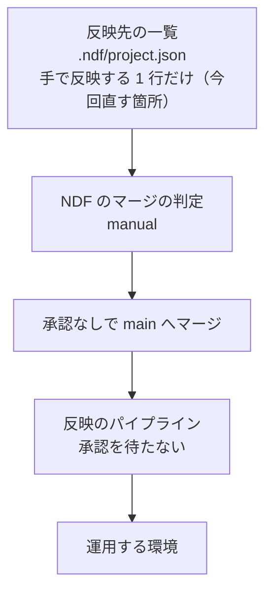
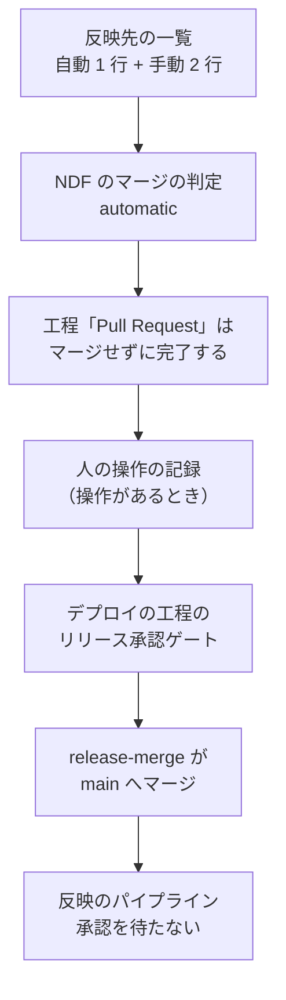
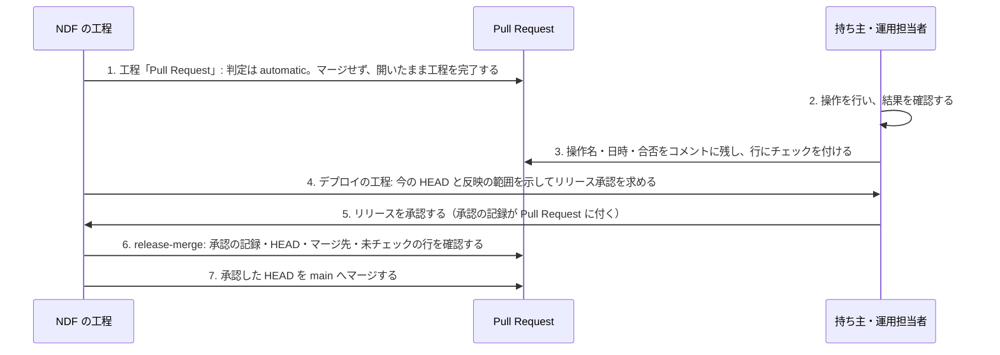

# ブランチ戦略の設定: main へのマージがリリース承認ゲートを通るようにする（#166）

main へのマージは運用する環境へ自動で反映されるのに、開発の工程を進める仕組み（NDF）の設定は「手で反映」なので、承認なしでマージされる。反映先の一覧を実際の 3 つの経路に合わせて自動の反映の行を足し、NDF が持つマージの判定をそのまま働かせる。あわせて、承認する時点を決定の記録・指針・手順書でそろえ、マージの前に人が済ませる操作が残る場合に NDF にマージさせないための、Pull Request の本文の書き方を手順書に定める。切り替えは、`main` の保護が反映元の条件を満たすことを前提にする（今は保護が無い。決定 8）。採らなかった案は「決定の記録」に、外部の調査を省いた理由は末尾の「外部の調査」にある。

## 今の姿

何が起きたか・目的・受け入れ条件は要求仕様（[issue-166-requirements.md](./issue-166-requirements.md)、正は [#166](https://github.com/devbasex/nd-factory/issues/166) の本文）にある。この文書は「どう解くか」と「なぜその解き方か」だけを書く。



設定を読む側は 2 つあり、読む場所が違う。

| 読む側 | 対象 | 設定を読む場所 | 自動の反映の行があるときの動き |
| --- | --- | --- | --- |
| NDF のマージ（`ndf ci merge`） | 工程が行うマージ | マージ先のブランチ（GitHub の上の `main`） | 本番のブランチ宛ては、承認の記録が Pull Request に無ければマージしない |
| 監視（hook の `merge-production`） | エージェントが直接打つ `gh pr merge` | コマンドを打つ作業場所の `.ndf/project.json` | 本番向けの行があれば、Pull Request のマージ先も承認の記録も確認せずに止める |

NDF 11.0.43 の監視は、作業場所の設定に本番向けの自動の反映の行があれば、承認の後でも直接の `gh pr merge` を止める。承認の後のマージは NDF の工程から実行する。

原因は、反映のパイプラインから承認の段を外したときに、反映先の一覧を直さなかったことである。判定の仕組みは、設定のとおりに動いている。

## 文脈と制約

- 本番のブランチと開発の起点のブランチは、どちらも `main` である
- 反映のパイプライン、自分で設置する人のコマンド、NDF の判定の仕組みは変えない
- この変更をマージする時点の `main` の設定は「手で反映」なので、NDF の判定はこの変更の Pull Request に承認を求めない（要求の前提 2）。そのため、設計 PR の [#195](https://github.com/devbasex/nd-factory/pull/195) と、設定を変える後続の Pull Request の 2 本は、NDF の判定に頼らず、本文の未チェックの行で止めて持ち主の承認を取る（決定 5）
- `.ndf/project.json` のブランチ戦略の設定は手で編集せず、`ndf project branch-strategy write` で書く（NDF の決まり）
- インフラの実際の値を、設定・手順書・記録に書かない
- 2026-11-26 の時点で、`main` にはブランチの保護もルールセットも無い。全体の設計が反映のパイプラインのソースブランチに求める条件を満たしていない（決定 8）
- 実際の値を照合する漏れの検査は、公開しない場所で動く（非公開の検査）。NDF 11.0.43 はこの検査を起動しないので、検査を使える NDF が入るまで、この変更の Pull Request はマージしない（決定 5）

## 解き方の全体像



- 反映先の一覧は、経路ごとに 1 行の 3 行になる。運用する環境のアプリの行だけが自動で反映する行である
- アプリの反映を人が承認する時点は、`main` へのマージの前の 1 つだけになる。マージの後のパイプラインの実行は承認を待たない
- この承認は人の回答で取り、AI の判定では代えない（決定 9）。承認資料には、まだ反映されていない `main` 上の変更も書く（決定 10）
- 承認した後に `main` が進んだ場合にマージが成立しないことは、GitHub の `main` の保護で強制する（決定 8）
- マージの前に人が行う操作は、Pull Request の本文の未チェックの行として残り、残る間は NDF がマージしない
- 同じ説明は全体の設計の決定の記録（決定 142。設計 PR で足す）に置き、指針・`AGENTS.md`・手順書はそこを指す

## 処理の流れ

設定を切り替えた後の、通常のスプリントの順序である。工程「Pull Request」は Pull Request を開いたまま完了し、デプロイの工程で承認を受けてからマージする。マージの前に人が行う操作が無ければ、2〜3 を飛ばす。



4 の承認資料には、今の Pull Request の差分に加えて、まだ反映されていない `main` 上の変更を書く（決定 10）。マージの時点でも成り立つ必要がある操作は、2〜3 の扱いが変わる（決定 4）。

7 の後は、反映のパイプラインが承認を待たずに反映まで進む。スプリントを通さない修正では、マージの工程が承認待ちで止まり、承認の後にその工程がマージする。この変更自身は設定の切り替え前なので、決定 5 の手順を使う。

## 非機能の実現方式

| 大項目 | 要求の条件 | 実現方式 | 確認の仕方 |
| --- | --- | --- | --- |
| 運用・保守性 | 手順書の確認の手順は、会話の記録や引継ぎのメモを読まなくても、手順書と課題・Pull Request だけで実行できる | 行う操作・見るもの・合格の状態を Pull Request の本文の行とコメントに持たせ、書き方を手順書に置く（決定 4） | 手順書と Pull Request だけを読んで、次の操作が決まることをレビューで確認する |
| セキュリティ | 設定・手順書・記録に、インフラの実際の値を書かない | 反映先の一覧の行はコマンドの形と置き換え記号だけを持ち、反映の結果を読むコマンドを持たない（決定 6）。マージの前の確認のコメントには、操作名・確認した日時・合否（合格か不合格）だけを書く。実行の ID・ARN などの確認の証跡は、運用担当者が運用の記録に残す（下の「運用の記録」） | 漏れの検査（CI と NDF のマージの直前の検査）と差分のレビュー |

**運用の記録**は、公開できない実際の値を残す、リポジトリの外の非公開の保管先である（[反映のパイプラインの仕様の用語](../docs/specifications/deploy-pipeline.md#用語)）。運用担当者が書き、Pull Request の番号と操作名を添えて、公開のコメントと対応が取れるようにする。具体的な置き場と閲覧できる人は（未確認: 保存先）で、人へ残す判断に置く。決まるまでも、値は Pull Request・課題・リポジトリに書かない。

## 決定の記録

各決定の「根拠」の Value の番号は、プロジェクトの判断の基準（MVV、[.ndf/mvv.md](../.ndf/mvv.md)）の項目である。

| 番号 | 項目の名前 |
| --- | --- |
| Value 7 | 公開を前提に、値を置かない |
| Value 13 | 重複と冗長を作らない |
| Value 14 | モダンな開発の手順で品質を確かめる |
| Value 15 | 車輪の再発明をしない |
| Value 17 | 目先の手間より、長く良い形を選ぶ |

### 決定 1: 本番へ届くマージを承認なしで通さないため、main へのマージにリリース承認ゲートを掛け、自動の反映の行を足す

- **質問**: `main` へのマージを承認の対象にするか。するなら何で効かせるか
- **選んだ案**: 対象にする。反映先の一覧に `kind: auto`・`channel: production` の行を足し、NDF が持つ判定と監視をそのまま働かせる。ブランチ名は行に写さない（本番のブランチは `branches.production` が持つ）。反映の段を一時的に止めている間や、準備の段が失敗している間も、行はそのままにする
- 採らなかった案: 手で反映する行のままにし、承認は人と AI の注意で守る（工程の自動のマージは、人や AI の注意を読み取らない。2026-11-26 には承認なしのマージが起きた）
- 採らなかった案: 反映のパイプラインに承認の段を戻す（持ち主の「パイプラインの実行は承認不要」に反し、要求の対象外である）
- 採らなかった案: NDF の側の直し（[ai-plugins#4579](https://github.com/devbasex/ai-plugins/issues/4579)）を待つ（設定が実態と違う状態が残り、その間のマージが承認を通らない）
- **代償**: 文書だけの Pull Request も承認の対象になる。承認の回数は、スプリントでは 1 回である。工程「Pull Request」はマージせずに完了し、デプロイの工程でリリースを承認した後に、同じ工程の `release-merge` が承認した HEAD を `main` へマージする。スプリントを通さない修正では Pull Request ごとに 1 回である
- 根拠: Value 14（MVV バージョン 4）

### 決定 2: どの経路でだれが承認するかを一覧から読めるよう、反映先の一覧を 3 行に分ける

- **質問**: 3 つの経路を何行で表すか
- **選んだ案**: 次の 3 行にする。手で反映する 2 行には、自動にしない理由（`manual_reason`）を書く。`release.cd` は `null` のままにする（判定は反映先の一覧があれば一覧だけを読む）

| 行の対象 | `kind` | `channel` | 起こし方の欄（`trigger`）に書くこと | 自動にしない理由 |
| --- | --- | --- | --- | --- |
| 運用する環境のアプリのスタック | `auto` | `production` | `main` への push で準備から反映まで進む。実行は承認を待たないので、マージの前にリリース承認ゲートを通す | — |
| 運用する環境の反映のパイプラインのスタック | `manual` | `production` | `diff --stack pipeline` の差分をリリース承認ゲートで承認した後に `deploy --confirm` | パイプラインが自分自身を自動で反映すると、push だけで反映の権限を変えられるようになる |
| 自分で設置する人の AWS | `manual` | 省く | 設置する人が `diff` の差分と確認の値を読み、`deploy --confirm`。このリポジトリのデプロイの工程では打たない | 設置する人が自分の AWS で差分を読んで反映する |

- 採らなかった案: パイプラインのスタックの経路を、ほかの行の説明に含める（承認の仕方が違う経路が 1 行に混ざり、今の説明文と同じ読み違いが起きる）
- **代償**: 本番への反映の承認で人が読む資料（承認資料）には、反映先ごとに、どう届くかを書く欄がある。その欄に、このリポジトリが打たない「自分で設置する人」の行も出る。打たないことは行の文で示す
- 根拠: Value 14（MVV バージョン 4）

### 決定 3: 承認する時点の解釈が分かれないよう、マージの承認と実行の承認の関係を全体の設計の決定 142 に置く

- **質問**: 「パイプラインの実行は承認不要」と、マージの承認の関係をどこに、どう書くか
- **選んだ案**: 持ち主の言う「実行は承認不要」はマージの後の個々の実行を指し、マージの前の承認と両立すると定める。[全体の設計](../docs/design/platform.md#決定の記録)の決定の記録に決定 142 を足し、ほかの文書は 1〜2 文とリンクにする。決定 142 と全体の設計の書き換えは、承認済みの設計を変えるので、この設計書と同じ設計 PR に含めて承認を受ける。指針・`AGENTS.md`・手順書・仕様は、承認された決定 142 に沿って後続の Pull Request で直す

決定 142 に書くことは次のとおりである。

| 項目 | 中身 |
| --- | --- |
| 承認する時点 | 反映を起動するソースブランチへのマージの前（リリース承認ゲート）。このリポジトリでは `main`。別のブランチをソースブランチにする設置では、そのブランチ。反映のパイプラインのスタックは `deploy` の前 |
| 承認しない時点 | マージの後の、アプリのスタックの個々の実行（準備・反映） |
| 承認する人 | 持ち主。AI の判定（MVV 判定）では代えない（決定 9） |
| 承認の対象 | 最後に成功した反映のソースから、今回のマージ候補までの変更（決定 10） |
| 漏れの検査 | 承認に加えて、そのマージ候補に非公開の検査が成功した場合だけマージする。公開の CI の `leak-check` の合格だけではマージしない（決定 5） |
| 切り替えの前提 | `main` の保護がソースブランチの条件を満たす。2026-11-26 の時点では保護もルールセットも無い（決定 8） |
| 止める仕組みの経路ごとの違い | 工程のマージはマージ先の `main` の設定を読む。監視は打った作業場所の設定を読むので、切り替えの前の設定を持つ作業場所が残る間は、`main` へのマージを工程のマージだけで行う。GitHub の画面や人の端末からのマージは、`main` を更新できる主体をマージ用のアカウントだけに限る保護が拒む（決定 8） |
| 変わらない承認 | 反映の段への遷移の停止と再開・失敗した段のやり直しなどの運用の操作は、[承認を受ける操作](../docs/specifications/deploy-pipeline.md#承認を受ける操作)の条件のまま |
| 理由 | パイプラインは人を待たないので、マージより後に人が止める時点が無い |
| 事故の経緯 | 2026-11-26（UTC）に、実装の [#190](https://github.com/devbasex/nd-factory/pull/190) と、追加の直しの [#194](https://github.com/devbasex/nd-factory/pull/194) が、工程「Pull Request」の自動のマージで、承認ゲートを通らずに `main` へ入った。反映先の一覧が手で反映のままで、NDF が本番へ届く操作と扱わなかった。反映のパイプラインは準備の段で失敗し、2 本の変更は運用する環境へ反映されなかった（反映されたのは文書だけの [#192](https://github.com/devbasex/nd-factory/pull/192)） |
| 適用する期間 | 商用利用の開始前。開始後の方式は持ち主が決め直す |

指針と文書は次のように直す。全体の設計の行は設計 PR で、ほかの行は後続の Pull Request で直す。CI の検査の手順書の「規則を変える Pull Request をマージの直前に確かめる」には、設計 PR で、手でのマージを使わなくなる時点と、その後のマージの経路だけを先に書く。

| 文書 | 直すこと |
| --- | --- |
| 開発の指針の「反映のパイプラインの実行は人の承認を待たない」の行 | 「本番系へ届く操作に含めない」を、マージの後の個々の実行に限る形に書き換え、`main` へのマージが本番系へ届く操作に当たると書く |
| `AGENTS.md` の「反映の経路」 | 運用する環境の行に、マージの前にリリース承認ゲートを通ることと、マージの前の確認の手順へのリンクを足す |
| 全体の設計の「解決の方針」と「2 つの反映の道筋」の運用する環境のアプリの行 | 個別の実行は承認せず、承認はマージの前に取ることを足し、決定 142 を指す |
| `.ndf/pace.json` の `boundary_paths` | `**` を足す（決定 9） |
| 漏れの検査の仕様と CI の検査の手順書の「`main` にはブランチの保護が無い」という記述 | `main` に保護を付けた後の状態に合わせる（決定 8） |
| CI の検査の手順書の「規則を変える Pull Request をマージの直前に確かめる」 | 手でのマージ（M1〜M6）を、変更後の規則での履歴の探し（M2）を済ませた HEAD で承認を求め、承認した HEAD とマージ先を渡した `ndf ci merge` でマージする手順に書き換える（決定 142） |
| 反映のパイプラインの手順書の冒頭と「順序のまとめ」、設置の手順の「運用する環境」、反映のパイプラインの仕様の「承認を受ける操作」 | 「承認を待たない」がマージの後の実行を指すことと、マージの前の承認を 1 文で足す |

- 採らなかった案: 指針の行だけを直し、決定の記録を足さない（理由と事故の経緯が残らず、受け入れ条件 8 を満たさない）
- **代償**: 承認の扱いを変えるとき、決定 142 と、それを指す文をあわせて直す
- 根拠: Value 13・Value 14（MVV バージョン 4）

### 決定 4: 人の操作が残る Pull Request を自動の流れがマージしないよう、本文の「マージの前に決める」の行で確認する

- **質問**: 設計が「マージの前に人が行うこと」とした操作が済んだことを、何で確認し、済むまでどう止めるか
- **選んだ案**: 反映のパイプラインの手順書に「main へのマージの前の確認」の節を置き、次の形を定める。NDF のマージは、本文に未チェックの「マージの前に決める」の行が残る Pull Request を拒むので、新しい仕組みは足さない

合格の記録は、記録した時点の対象にだけ有効である。そのため、操作を次の 2 種類に分け、設計書の「マージの前に人が行うこと」の節にどちらかを書く。

| 種類 | 合格の状態 | 例 | チェックを付ける時点 |
| --- | --- | --- | --- |
| マージの前に済んでいればよい操作 | 操作を実施した | 反映用の権限を作成する | 合格を記録したとき |
| マージの時点でも成り立つ必要がある条件 | マージの時点で、その状態になっている | 反映用の権限が有効である。反映の段への遷移が止まっている | リリースの承認の後、マージの直前に確認し直したとき |

操作の結果がマージの時点でも必要なら、実施の記録だけでは合格にしない。たとえば権限は、「作成する」の行と「有効である」の行の 2 行に分ける。

| 順 | だれが | すること |
| --- | --- | --- |
| 1 | 設計する人・AI | 要る操作があれば、設計書に「マージの前に人が行うこと」の節を置き、操作・種類・行う人・見るもの・合格の状態を書く |
| 2 | Pull Request を作る人・AI | 操作 1 つを本文の 1 行にする: `- [ ] マージの前に決める: <操作>（確認: <見るものと合格の状態>）` |
| 3 | 持ち主か運用担当者 | 操作を行い、見るもの（例: 反映の段への遷移を止める操作なら `get-pipeline-state` の遷移が無効）を確認する。Pull Request のコメントに、操作名・確認した日時・合否・確認した時点の Pull Request の HEAD と `main` の先端を残す。操作の対象（どの環境のどの資源か）と、実際の値を含む証跡は、運用の記録に残す |
| 4 | 持ち主か運用担当者。AI は人が残した合格のコメントがあるときだけ | マージの前に済んでいればよい操作は、最新の人の記録が有効な合格のときに行にチェックを付ける。マージの時点でも成り立つ必要がある条件は、ここではチェックを付けない |
| 5 | リリースを承認する人 | 承認の前に、全部の操作の最新の人の記録が有効な合格であることを確認する。1 つでも満たさなければ承認しない |
| 6 | 持ち主か運用担当者 | 承認の後、マージの直前に、マージの時点でも成り立つ必要がある条件を全部確認し直し、3 の形で新しい記録を残す |
| 7 | マージする人・AI | マージが実行され得るコマンドを打つ直前に、全部の行（チェック済みの行を含む）の最新の人の記録を、今の Pull Request の HEAD・`main` の先端・操作の対象と照合する。失効か不合格の行は未チェックにする。全部の行が有効な合格の場合だけ、残るチェックを付けて、すぐにマージする。1 つでも満たさなければマージせず、その操作を 3 か 6 から確認し直す |

記録は、次のどれかに当たると失効する。失効した操作は、行を未チェックに戻して確認し直す。NDF は行のチェックの有無だけを見て、記録の失効は見ない。そのため、失効した行を残さないことは 7 の照合で確かめる。

- Pull Request の HEAD か `main` の先端が、記録の値と違う
- 操作の対象が変わった（反映先の環境や資源を作り直した、など）
- 後から不合格が記録された、または操作を打ち消した（遷移を再開した、など）

確認し直すことは、操作をやり直すことではない。持ち主か運用担当者は、次の表のとおり確かめ、今の Pull Request の HEAD と `main` の先端を添えた新しい記録を 3 の形で残す。

| 種類 | 確かめること | 合格の後 |
| --- | --- | --- |
| マージの前に済んでいればよい操作（実施済み） | 運用の記録の証跡を読み、操作の対象が同じで、操作が打ち消されていないことを確かめる。操作は繰り返さない | 4 のとおり行にチェックを付ける |
| マージの時点でも成り立つ必要がある条件 | 今もその状態であることを確かめる | チェックは付けない（6・7 で付ける） |

操作そのものをやり直すのは、次のどれかに当たる場合だけである。やり直した後に、3 の形で記録を残す。

- 実施したことを示す証跡が無いか、読めない
- 操作の対象が変わった
- 操作が打ち消された
- 不合格で、原因を直すには操作が要る
- 新しい HEAD か `main` の変更で、操作の中身（作る権限の内容など）が変わった

条件を確認し直してからマージが終わるまで、その条件を打ち消す操作はしない。

6 と 7 を行う時点は、マージの時点でも成り立つ必要がある条件の行があるかで変わる。

| その条件の行 | 承認の回答を記録して工程を進めたときの動き | 6 と 7 を行う時点 |
| --- | --- | --- |
| ある | 行が未チェックなので、マージの工程が一度止まる。これは想定した動きである | 工程が止まった後。チェックを付けてから、工程をやり直してマージする |
| 無い | 全部の行がチェック済みなら、工程は止まらずにマージする | 工程を進める前（行うのは 7 だけ） |

「ある」の場合の動きは、条件の行が未チェックで残っていることが前提である。以前の試行で付けたチェックが残っていると、NDF は記録の失効を見ないので、初回の `ndf progress next` がそのままマージする。そのため、進める人・AI は次のとおり確認する。工程を途中から再開するときも同じである。

- **いつ**: リリースの承認を求める前と、初回の `ndf progress next` の直前
- **何を**: この決定の終わりにある確認のコマンド（`premerge_risks`）の出力に、条件の行がすべて並ぶこと（未チェックであること）
- **並ばない行があれば**: その行を未チェックに戻してから進む。承認を求めた後に戻すと本文が変わり、NDF が承認を問い直すので、出し直された承認に答える

スプリントのデプロイの工程で使うコマンドは、決定 5 の「承認からマージまで」にある後続の Pull Request の手順 3〜5 と同じである。単発の修正で工程をやり直すコマンドは未確認である（「未確認のまま残ること」）。

手順書には、次の 2 つも書く。`main` へのマージは NDF の工程のマージで行う。GitHub の画面や人の端末からのマージは、マージ用のアカウントだけが `main` を更新できる保護が拒む（決定 8）。「マージの前に決める」の語を含む行は、チェック欄の無い見出し・説明文・コードブロックの行でもマージを止める。そのため、この語は 2 の行のほかには本文に書かない。

確認の行は、本文を直すときに消さないようにする。手順書には次を定める。

- Pull Request の本文を書き直す人・AI（`/ndf:pr` での更新、`gh pr edit`、レビューの指摘の直し）は、直す前の本文の「マージの前に決める」を含む行を、そのまま新しい本文へ引き継ぐ
- 行は「## 通した工程」「## 進行」の節の外に置く。NDF の進捗の記録は、この 2 つの節を丸ごと書き直す
- 工程「Pull Request」を始める前（始めずに終える場合は、終える記録の前）と、本文を直した後に、行が NDF の判定に渡ることを下のコマンドで確認する。読むだけで、マージはしない。操作の残る行がすべて出力に並べば合格である

```bash
NDF_SRC="$HOME/.claude/plugins/cache/ai-plugins/ndf/11.0.43/src"  # 例。使う NDF の src ディレクトリに合わせる
gh pr view <番号> --json body --jq .body | python3 -I -B -c 'import sys; sys.path.insert(0, sys.argv[1]); from ndf.adapters.github_merge import premerge_risks; print(premerge_risks(sys.stdin.read()))' "$NDF_SRC"
```

開発の指針には、設計と Pull Request を作るときにこの節を読む 1 行を足す。これは承認の工程を足すものではなく、承認の前提になる操作の確認である。

- 採らなかった案: 手順書の文章だけで定める（自動のマージは手順書を読まず、操作が残ったまま進む）
- 採らなかった案: CI が AWS の状態を読んで必須のチェックにする（CI は AWS の資格情報を持たない決まりである）
- **代償**: 行を本文に書き忘れると、機械では止まらない。リリース承認ゲートで人が設計書と突き合わせる
- 根拠: Value 13・Value 17（MVV バージョン 4）

### 決定 5: この変更自身を承認の前に本番へ反映しないよう、2 本の Pull Request に未チェックの行を置き、承認した HEAD だけをマージする

- **質問**: この変更をマージする時点では、`main` の設定はまだ手で反映である。承認の前にマージされないように、どう止め、何を承認してもらい、承認した対象だけをどうマージするか
- **選んだ案**: 2 本の本文に `- [ ] マージの前に決める: <承認の中身>（確認: 持ち主の回答の記録）` の行を置いて自動のマージを止める。承認は既にある承認ゲートで取り、マージするコマンドには承認した HEAD とマージ先を渡す

| Pull Request | 持つもの | 行を置く時点 | 使う承認ゲート | 何を承認するか |
| --- | --- | --- | --- | --- |
| 設計 PR の [#195](https://github.com/devbasex/nd-factory/pull/195)（開いている） | 設計書、要求仕様、全体の設計（決定 142） | 設計の承認資料を出す前に、進める人・AI が本文へ足す（今の本文には行が無い） | 工程「設計」の設計承認ゲート | 設計の内容と、#195 を `main` へマージして運用する環境への反映が起動し得ること。1 回の回答で両方を受ける。後続の Pull Request のマージは含まない |
| 設定を変える後続の Pull Request | 反映先の一覧、指針、`AGENTS.md`、手順書、仕様 | ブランチを push して `gh pr create --body-file` で作るとき。本文に行と `Refs #166` を書く | 工程「デプロイ」のリリース承認ゲート | その HEAD を `main` へマージすることと、起動する運用する環境への反映 |

どちらも新しい承認の工程は足さず、持ち主が答える（`ndf answer` の `--by human`。AI の判定では通さない）。

切り替えの前提は 2 つある。`main` の保護が反映元の条件を満たすこと（決定 8）と、次の非公開の漏れ検査である。どちらかが欠ける間は、2 本をマージしない。

#### 切り替えの前提: 非公開の漏れ検査

2 本とも、対象のマージ候補（その HEAD と、その時点の `main` を合わせた内容）に非公開の検査が成功した場合だけマージする。検査を使える状態になるまでは、2 本を開いたままにする。切り替えの後の `main` へのマージにも同じ条件を掛ける（決定 142 の「漏れの検査」）。

NDF 11.0.43 の `ndf ci merge` と `release-merge` は、非公開の検査を起動せず、結果も照合しない。必須のチェックの `leak-check` は、実際の値を使う検査を含まない（[漏れの検査の仕様](../docs/specifications/leak-check.md)）。そのため、この版のままではどちらのコマンドでもマージしない。手で起動した検査の成功を根拠にマージすることもしない（[導入の順序](../docs/operations/ci-checks.md#導入の順序)の手順 3 と同じ扱い）。

| 確認すること | いつ | だれが | 合格 |
| --- | --- | --- | --- |
| 非公開の検査が使える | 承認資料を出す前 | 持ち主 | [導入の順序](../docs/operations/ci-checks.md#導入の順序)の手順 6（NDF の利用者の設定で非公開の検査を有効にし、有効にする 2 本目の Pull Request を NDF がマージする）まで済んでいる |
| 下のマージの手順が、使う NDF の版でも成り立つ | 承認資料を出す前 | 進める人・AI | 下の手順は 11.0.43 の定義とコードを読んで決めた。非公開の検査を持つ版の定義とコードを読み直し、違いがあれば設計を直してから進む |
| このマージ候補の検査が成功した | マージのとき | NDF が照合し、持ち主が非公開の記録で確かめる | NDF が[受け入れる条件](../docs/specifications/leak-check.md#ndf-が非公開の検査の結果を受け入れる条件)を満たしてマージした。確かめた結果は運用の記録に残し、公開の Pull Request には書かない |

#### 承認資料に書く反映の範囲

この節の書き方は、切り替えの後の通常のマージにも使う（決定 10）。

どちらのマージも `main` への push なので、反映のパイプラインが起動し、運用する環境へ反映し得る。反映されるのは Pull Request の差分だけではなく `main` の先端の全体で、まだ反映されていない先の変更（2026-11-26 の #190・#194 のようなもの）も含み得る。そのため、2 本とも承認資料を出す前に次を調べて書く。

承認資料は、承認する人への説明を先に置き、その根拠のコミットを後ろに置く。

| 書くもの | だれが、どう調べるか |
| --- | --- |
| 承認する人への説明（資料の先頭） | 進める人・AI が、下の 3 行を調べた後に、コミットや差分を読まなくても分かる言葉で書く。何が変わるか（まだ反映されていない先の変更があれば、それも 1 件ずつ）、運用する環境への影響（利用者や運用で何が変わるか、影響が無いならその理由）、今回の回答で承認する範囲と含まないもの |
| 最後に反映されたソースのコミット | 運用担当者が、反映の段が最後に成功した実行のソースのリビジョンを読む |
| 照合した `main` の先端のコミット | 進める人・AI が `git fetch origin main` の後に読む |
| このマージで反映対象になる変更 | 進める人・AI が、最後に反映されたコミットから `main` の先端までのコミット（`git log <反映済み>..origin/main`）と、Pull Request の差分を並べる |

最後に反映されたコミットを確認できなければ、承認に出さない。

#### 承認した候補だけをマージする

承認資料に書いた HEAD と `main` の先端の組（マージ候補）が崩れたら、GitHub か NDF がマージを拒むようにする。

| 固定するもの | 何が拒むか |
| --- | --- |
| Pull Request の HEAD | NDF がマージの要求に承認した HEAD を添え、違えば GitHub が拒む |
| マージ先のブランチの名前 | NDF の `--approved-base` |
| `main` の先端 | GitHub の保護の「最新の `main` を取り込んだ HEAD で必須のチェックが通っていること」（決定 8） |

承認する HEAD が `main` の先端を含んでいれば、承認の後に `main` が進んだ時点で、その HEAD は最新でなくなり、マージできない。`main` を取り込むと HEAD が変わるので、承認の取り直しになる。人と AI が「その間は書き込まない」と取り決める手順は使わない。

| 順 | だれが | すること |
| --- | --- | --- |
| 1 | 進める人・AI | 承認資料を出す前に、ブランチへ `main` を取り込んで push する。`git merge-base --is-ancestor <main の先端> <HEAD>` が成功することを確かめ、両方を承認資料に書く |
| 2 | 運用担当者 | `main` の保護が決定 8 の条件を満たすことを、その場で読み直して確かめる |
| 3 | レビューする人 | 保護が求めるレビューの承認を、その HEAD に付ける |
| 4 | 進める人・AI | 下の「承認からマージまで」の手順でマージする。直前に `git fetch origin main` の後の先端が承認資料と同じことを確かめ、違えば「承認を取り直す」に進む |
| 5 | 進める人・AI | マージでできたコミット（`gh pr view <番号> --json mergeCommit`）の最初の親（`gh api repos/devbasex/nd-factory/commits/<コミット> --jq '.parents[0].sha'`）が、承認資料の `main` の先端と同じことを確かめる |

- 1〜3 のどれかを満たせなければ、マージを保留する
- 5 が違えば、保護が働いていないか、承認していない変更が反映の対象に入っている。直ちに持ち主へ戻す。反映を止めるか（[承認を受ける操作](../docs/specifications/deploy-pipeline.md#承認を受ける操作)の条件に従う）、変更を戻すかは持ち主が決める

#### 承認からマージまで

承認の記録は Pull Request のコメントに残し、PR 番号・承認した HEAD・マージ先・照合した `main` の先端・回答を書く。

NDF 11.0.43 の `ndf ci merge` は、`--approved-head` を受け取らなければ、実行した時点の HEAD をマージする。受け取れば、HEAD かマージ先が違うときに `approval_stale` で止まる。この版の工程のうち、承認の回答の HEAD とマージ先を渡すのはデプロイの `release-merge` だけで、設計 PR のマージ（`design-merge`）は渡さない。そのため、2 本の手順は次のように分かれる。

承認の行（持ち主の承認を確認する行）は、決定 4 の操作と状態の行とは扱いが違う。承認の行の合格の記録は持ち主の回答そのものなので、承認の前には記録が無い。

- 承認を求める前に合格の記録を確認する（決定 4 の手順 5）のは、操作と状態の行だけである
- 承認の行は、持ち主の回答を記録するまで未チェックにする。チェックを付けるのは、未チェックの行で工程が止まった後である（#195 の手順 2、後続の Pull Request の手順 4）
- 2 本とも、承認を求める前と初回の `ndf progress next` の直前に、承認の行が未チェックであることを確認する（決定 4）。以前の試行のチェックが残っていれば戻す

設計 PR の #195:

1. 持ち主の回答を受けたら反映の範囲を読み直し（決定 10）、行が未チェックであることを確認する。範囲が変わっていれば、回答を記録せずに「承認を取り直す」の「回答の前の提示し直し」に進む。変わっていなければ設計承認ゲートの回答を `ndf answer` で記録して、工程を流す（`ndf progress next`）。`design-merge` は未チェックの行を理由にマージを拒み、工程「設計」が止まる
2. 止まった後、チェックを付ける直前に、運用担当者が最後に成功した反映を、進める人・AI が `main` の先端を読み直す。どちらかが承認資料と違えば、チェックを付けずに「承認を取り直す」に進む。同じなら、承認の記録をコメントに残し、行にチェックを付ける
3. 直前に `main` の先端を照合し（「承認した候補だけをマージする」の 4）、工程を再実行せずに、下のコマンドでマージする。マージの後に親のコミットを確かめる（同じく 5）
4. `design_pr` と、設計工程が記録した `mvv_gate` を出力のファイルに入れ、`ndf progress check <ID> 設計 --output <ファイル>` で確かめてから、`ndf progress finish <ID> 設計 --output <ファイル> --reason <理由>` で終える。どちらかのキーが欠けると `finish` は拒む

```bash
ndf ci merge --pr 195 --approved-head <承認した HEAD> --approved-base main --method squash \
  --budget 1800 --required=<必須のチェック>  # --required は .ndf/project.json の ci.required_checks の数だけ並べる
```

4 の出力のファイルは `{"outputs": {"design_pr": 195, "mvv_gate": {…}}}` の形である。`mvv_gate` の値は、設計工程の中の判定のステップ `design-mvv`（承認ゲートを省けるかの MVV 判定）が記録している。`ndf progress show <ID>` の `metrics.history` から、`row_key` が `設計`、`kind` が `step_recorded`、`payload.step` が `design-mvv` の最も新しい記録を選び、その `payload.report.outputs.mvv_gate` を書き換えずに写す。

後続の Pull Request:

工程「Pull Request」は流さない。流すと、その中のマージが未チェックの行で拒まれて工程が止まり、リリース承認ゲートがあるデプロイの工程へ進めないためである。

1. 本文に行がある Pull Request を作った後、工程「Pull Request」を `ndf progress finish`（出力に `pr`）で終える。必須のチェックは `release-merge` が待つ。デプロイより前の工程「確定仕様化」は `ndf progress disable` で無効にする。仕様の書き換えはこの Pull Request が持ち、流すと同じブランチの push と Pull Request の作成で止まり得るためである
2. 工程を順に流し、デプロイの工程のリリース承認ゲートに承認資料を出す
3. 持ち主の回答を受けたら反映の範囲を読み直し（決定 10）、変わっていれば、回答を記録せずに「承認を取り直す」の「回答の前の提示し直し」に進む。変わっていなければ、初回の `ndf progress next` より前に本文の行を照合する。照合の中身は、下の表のとおり条件の行があるかで変わる。照合の後に、回答を `ndf answer` で記録して `ndf progress next` を打つ
4. **未チェックの行でデプロイの工程が止まった場合だけ行う。** チェックを付ける直前に、運用担当者が最後に成功した反映を、進める人・AI が `main` の先端を読み直す。どちらかが承認資料と違えば、チェックを付けずに「承認を取り直す」に進む。同じなら、決定 4 の 6・7 で全部の行を確認し、承認の記録をコメントに残して、行にチェックを付ける
5. **4 を行った場合だけ行う。** 直前に `main` の先端を照合し（「承認した候補だけをマージする」の 4）、`ndf progress retry <ID> デプロイ --reason <理由>` と `ndf progress next` を打つ。承認ゲートは済んだままで、`release-merge` が回答の HEAD とマージ先を `--approved-head`・`--approved-base` で受けてマージする

3 か 5 でマージした後は、親のコミットを確かめる（「承認した候補だけをマージする」の 5）。

| 条件の行 | 3 の照合 | 初回の `ndf progress next` の結果 |
| --- | --- | --- |
| ある（この変更の後続の Pull Request は、承認の行があるので常にこちら） | 条件の行がすべて未チェックであることを確認する | `release-merge` が未チェックの行を理由にマージを拒み、工程が止まる。4・5 に進む。**チェックは止まる前に付けない**。先に付けると、本文が変わったので NDF が承認を問い直す |
| 無い | 決定 4 の 7 のとおり、全部の行（チェック済みの行を含む）の記録を照合する。失効か不合格の行があれば、回答を記録せず、確認し直す | 全部の行が有効な合格でチェック済みなら、この 1 回でマージする。4・5 は行わない |

#### 承認を取り直す

HEAD・マージ先・`main` の先端・最後に反映されたコミットのどれかが承認資料か承認の記録と違えば、マージせず、行を未チェックに戻す。進む手順は、違いを見つけた時点で変わる。回答を記録する前なら承認ゲートはまだ回答を待っているので、資料を作り直して提示し直す。回答を記録した後なら、記録した古い回答を失効させてから問い直す。

| 違いを見つけた時点 | 工程の状態 | 進む手順 |
| --- | --- | --- |
| 持ち主の回答を NDF に記録する前（#195 の手順 1、後続の Pull Request の手順 3） | 承認ゲートが回答を待っている。`ndf progress next` は承認ゲートで待ち、マージのステップへ進まない | 下の「回答の前の提示し直し」 |
| 回答を記録し、未チェックの行で工程が止まった後（#195 の手順 2、後続の Pull Request の手順 4） | 古い回答が記録されている | #195 は下の「#195 の承認の取り直し」、後続の Pull Request は下の「後続の Pull Request の承認の取り直し」 |

**回答の前の提示し直し**は、2 本とも同じである。古い回答は記録せず、`approval_stale` の停止も待たない。違いが最後に成功した反映だけでも、必ず HEAD を変えて、古い承認資料と回答の経路を失効させる。

NDF 11.0.43 の承認ゲートは、承認資料と提示（回答を結び付ける識別子）を、提示した HEAD とマージ先が今のものと違うときだけ作り直す。同じなら、前の資料と提示をそのまま使い直す（`progress/gate/asking.py` の `_write_pair`。コードを読んで決めた。「未確認のまま残ること」）。最後に成功した反映は比べる対象に入らないので、反映だけが変わった場合に工程を表示し直しても、古い範囲の資料と古い回答の経路が持ち主に出る。

1. 受けた回答を `ndf answer` で記録しない
2. 進める人・AI が、HEAD を変えて push する。`main` が進んでいればブランチへ `main` を取り込む。進んでいなければ（最後に成功した反映だけが変わった場合）、空のコミット（`git commit --allow-empty`）を足す
3. 「承認した候補だけをマージする」の 1〜3 を、新しい HEAD でやり直す。HEAD が変わったので、前の合格の記録は失効する。後続の Pull Request の取り直しの手順 3 と同じく、全部の操作を新しい HEAD に対して確かめ直す
4. 今の HEAD・`main` の先端・最後に成功した反映で承認資料を作り直し、`ndf progress next` で待っている同じ承認ゲートを表示し直す。NDF は提示した HEAD が今の HEAD と違うので、古い承認資料と提示を消し、新しい資料と新しい提示の識別子を発行する
5. 進める人・AI が、表示された承認資料の HEAD が新しい HEAD であることと、提示の識別子（承認資料の隣の `.target.json` の `presentation`）が前の提示と違うことを確かめる。同じなら持ち主に提示せず、2 からやり直す
6. 持ち主に、前の資料と回答の経路は使えなくなったことを伝え、新しい資料と新しい回答の経路で答えてもらう。古い経路で届いた回答は記録しない
7. 持ち主の新しい回答を受けたら、「承認からマージまで」の #195 の手順 1、後続の Pull Request の手順 3 から進める。範囲の読み直しもそこでもう一度行う

**後続の Pull Request の承認の取り直し**は、回答を記録してデプロイの工程が止まった後に違いを見つけた場合の手順である。行にチェックを付ける前に、リリース承認ゲートを開き直す。NDF の承認の記録が持つのは HEAD とマージ先だけである。この 2 つが同じまま `main` の先端か最後に反映されたコミットだけが変わっても、`release-merge` は `approval_stale` にならない。前の回答のまま再試行してチェックを付けると、持ち主に問い直さずにマージされる。

1. 進める人・AI が、HEAD かマージ先が承認の記録と違うことを確かめる。どちらも同じなら、HEAD を変えて push する。`main` が進んでいればブランチへ `main` を取り込み、進んでいなければ空のコミット（`git commit --allow-empty`）を足す
2. 「承認した候補だけをマージする」の 1〜3 を、今の HEAD でやり直す
3. HEAD が変わると、前の合格の記録はすべて失効する（決定 4）。持ち主か運用担当者が、新しい HEAD と `main` の先端に対して、決定 4 の「確認し直すことは、操作をやり直すことではない」の表のとおり全部の操作を確かめ、新しい記録を残す。実施済みの操作は証跡を確かめ、やり直す条件に当たるものだけをやり直す。承認の行は未チェックのままにする
4. `release-merge` がまだ `approval_stale` で止まっていなければ、`ndf progress retry <ID> デプロイ --reason <理由>` と `ndf progress next` を打つ。前の回答の HEAD かマージ先と違うので、`approval_stale` で止まる
5. 全部の操作の最新の記録が有効な合格であることを確認してから（決定 4 の 5）、止まった結果に出る `routes.retry` と `next` のコマンドを順に打ち、作り直した承認資料でリリース承認ゲートに答え直す。その後は「承認からマージまで」の後続の Pull Request の手順 3 から進める

**#195 の承認の取り直し**は、回答を記録して工程「設計」が止まった後に違いを見つけた場合の手順である。新しい回答を記録し、行にチェックを付け直し、最新の承認対象を照合してからマージする。NDF 11.0.43 では、読み終えた設計承認ゲートの回答を開き直せない（`ndf progress retry` は済んだステップを残す）。そのため `ndf answer` は使わず、同じ設計の承認を持ち主へ直接問い直す。

1. 進める人・AI が、今の HEAD と `main` の先端で承認資料を作り直し、持ち主に問う
2. 持ち主が答える（AI の判定では代えない）。進める人・AI が、新しい承認の記録を Pull Request のコメントに残す
3. 回答が承認なら、チェックを付ける直前に、HEAD・マージ先・`main` の先端・最後に成功した反映を新しい承認資料と照合する。すべて同じなら行にチェックを付け直し、違えば 1 からやり直す。承認でなければ未チェックのままにする
4. 「承認した候補だけをマージする」の順で、新しい記録の HEAD・マージ先・`main` の先端を照合し、新しい HEAD を `--approved-head` に渡して上のコマンドでマージする
5. 「承認からマージまで」の #195 の手順 4 のとおり、工程「設計」を終える

- 採らなかった案: 進める人と AI の申し合わせだけで止める（2026-11-26 と同じ形で、自動の流れがマージする）
- 採らなかった案: チェックを付けて、マージを持つ工程をそのまま再実行する（`design-merge` と工程「Pull Request」は承認した HEAD を受け取らず、承認の後に push されたコミットもマージする）
- 採らなかった案: 先に反映先の一覧だけを `main` へ入れる（その Pull Request のマージも同じ理由で承認の対象にならず、Pull Request が増える）
- **代償**: 後続の Pull Request を手で作り、2 本とも工程の一部を手で終える。マージの工程が 1 回止まる。運用担当者が反映済みのコミットを読む手間が増える。非公開の検査を使える NDF が入り、`main` の保護が条件を満たすまで、切り替えが遅れる。`main` が進むたびに、取り込み・必須のチェック・レビューの承認・リリースの承認をやり直す
- 根拠: Value 14（MVV バージョン 4）

### 決定 6: 実際の値をリポジトリに置かないため、自動の反映の行に結果を読むコマンドを持たせない

- **質問**: 自動の反映の行に、反映の結果の読み方（`result`）を書くか
- **選んだ案**: 書かない。NDF はデプロイの結果を「未確定」と記録する。リリース後テストの工程で、閲覧権限のある運用担当者が反映の状態を確認する（確認の手順と合格の状態は、下の「リリース後の確認」）
- 採らなかった案: パイプラインの実行を読むコマンドを書く（profile と資源の名前が要り、AI と CI は AWS の資格情報を前提にできない）
- **代償**: 反映の成否は自動で記録されない。失敗は今の通知のメールで届くが、成功と停止中は通知されないので、運用担当者が見に行く
- 根拠: Value 7（MVV バージョン 4）

### 決定 7: 承認の扱いを直す変更を小さく保つため、「設定が古い」の解消はこの変更に含めない

- **質問**: `ndf project check` の「設定が古い」を同じ変更で解消するか
- **選んだ案**: 含めない。「設定が古い」の理由は CI の定義や依存の定義が変わったことで、反映先の一覧を指すものではない。解消は次のスプリントの開始時の自動の再解析が行う。再解析はブランチ戦略の設定を書き換えない
- 採らなかった案: 再解析をこの変更に含める（言語やテストの設定の差分が混ざり、人の承認が要るファイルの差分が読みにくくなる）
- **代償**: 受け入れ条件 6 の記録は、終了コード 3 と「変わった入力」の一覧になる。この結果だけでは、変えた設定が正しいとは言えない
  - NDF 11.0.43 の `ndf project check` は、古さを調べる前に、設定を JSON として読んで設定のスキーマ（反映先の一覧の各行の形を含む）で検査し、合わなければ終了コード 2 で止まる
  - ただし読むのはメインディレクトリの `.ndf/project.json` で、作業場所で変えた設定ではない
  - そのため受け入れ条件 6 では、変えた設定を NDF のブランチ戦略の検査に別に掛ける（テスト設計）
- 根拠: Value 13（MVV バージョン 4）

### 決定 8: NDF を通らない書き込みで本番へ反映されないよう、`main` の保護が反映元の条件を満たすことを切り替えの前提にする

- **質問**: `main` には保護が無い。NDF の承認の設定だけで切り替えてよいか
- **今の状態**: 2026-11-26 に `gh api` で読んだ。`repos/devbasex/nd-factory/branches/main` の `protected` は偽で、`rules/branches/main` と `rulesets` はどちらも空である。全体の設計は、反映のパイプラインのソースブランチを保護のあるブランチに限り、このリポジトリでは `main` をソースブランチとしている。つまり今の `main` は、承認済みの反映元の条件を満たしていない
- **選んだ案**: 条件を満たすまで、決定 5 の 2 本をマージしない。条件は、反映のパイプラインの手順書の[起点のブランチの保護と反映を始められる主体](../docs/operations/pipeline-approval.md#起点のブランチの保護と反映を始められる主体)にある、ブランチの保護・保護を編集できる主体・先端に既に入っている変更の 3 つである。このリポジトリの `main` には、加えて「必須のチェックは最新の `main` を取り込んだ HEAD で通す」を有効にする（ルールセットの `strict_required_status_checks_policy`、従来の保護の `required_status_checks.strict`）。必須のチェックは `.ndf/project.json` の `ci.required_checks` と同じものにする
- **マージできる主体**: 非公開の漏れ検査を通らないマージを GitHub の側でも拒むため、`main` を更新できる主体を、NDF がマージに使う専用のアカウント（マージ用のアカウント）だけに限る。NDF は、非公開の検査の結果を受け入れた候補だけをマージする（[受け入れる条件](../docs/specifications/leak-check.md#ndf-が非公開の検査の結果を受け入れる条件)）。そのため、マージ用のアカウントだけが更新できれば、検査を通らない通常のマージは GitHub が拒む
  - 従来の保護の、プッシュできる主体の制限（`restrictions`）にマージ用のアカウントだけを入れ、管理者にも適用する（`enforce_admins`）。制限に入った主体も、レビューの承認と最新の `main` の取り込みは迂回できない
  - ルールセットの迂回できる主体（bypass）には、マージ用のアカウントを入れない。迂回できる主体はそのルールセットの規則をすべて迂回でき、ソースブランチの条件「誰も迂回できない保護」に反するためである
  - マージ用のアカウントは、持ち主と人の担当者のアカウントと分ける。人はこのアカウントで GitHub の画面や端末から操作しない
  - プッシュできる主体の制限は、組織が持つリポジトリでだけ使える。使えなければ切り替えない
- **資格情報を使える処理**: `restrictions` が確かめるのは「誰が更新したか」だけで、その主体が承認と非公開の検査を確かめたかは見ない。そのため、マージ用のアカウントの資格情報は、エージェントが作業する環境（シェル・環境変数・ファイル・`gh` の認証）から読めない所に置く。資格情報を使えるのは、次の 3 つを自分で確かめてからマージの API を呼ぶ処理（マージの処理）だけにする
  1. 持ち主の承認の証跡が、渡された Pull Request の番号・承認した HEAD・マージ先と一致する
  2. 同じ HEAD とマージ先の候補に、非公開の検査が成功した結果がある（[受け入れる条件](../docs/specifications/leak-check.md#ndf-が非公開の検査の結果を受け入れる条件)）
  3. 今の Pull Request の HEAD とマージ先が、承認したものと同じである
  - エージェントがマージの処理に渡せるのは、Pull Request の番号・承認した HEAD・マージ先だけにする。資格情報そのものや、その資格情報で作った token は受け取れない
  - NDF 11.0.43 の `ndf ci merge` は、エージェントと同じ環境の `gh` の認証でマージするので、この条件を満たさない。資格情報を分けたマージの処理を NDF で用意できるかは、非公開の検査の機能と合わせて NDF に依頼して決める（未確認: 置き場所と呼び出し方は依頼で決まる）。用意できるまで、`main` の更新をマージ用のアカウントに限る切り替えはしない
- **変える人**: 保護と迂回できる主体の変更は、[承認を受ける操作](../docs/specifications/deploy-pipeline.md#承認を受ける操作)の A6 である。変える前に持ち主が中身を承認してから適用し、AI は自分で変えない

`main` へ書き込む経路ごとの止まり方は、次のとおりである。

| `main` へ書き込む経路 | NDF の設定を切り替えただけの場合 | 条件を満たす保護がある場合 |
| --- | --- | --- |
| NDF の工程のマージ | 承認の記録が無ければ止まる | 左に加え、レビューの承認が無いか HEAD が最新でなければ GitHub が拒む |
| エージェントが直接打つ `gh pr merge` | 監視（hook の `merge-production`）が止める。ただし、切り替えの後の設定を取り込んだ作業場所で打った場合だけ | 左に加え、エージェントの環境にはマージ用のアカウントの資格情報が無いので GitHub が拒む |
| GitHub の画面や人の端末からの Pull Request のマージ | 止まらない | マージ用のアカウントでなければ GitHub が拒む |
| `main` への直の push・強制 push・削除 | 止まらない | GitHub が拒む |

保護を付けた後に `main` を更新できるのは、承認と非公開の検査を確かめるマージの処理だけになる。エージェントは資格情報を読めないので、直接の `gh pr merge` や API の呼び出しでマージ用のアカウントとしてマージすることはできない。書き込みの権限を持つ人も、レビューの承認があっても画面からはマージできない。

監視は、マージ先の設定ではなく、`gh pr merge` を打った作業場所の `.ndf/project.json` を読む。切り替えの前から開いている作業場所は、`main` を取り込むまで古い設定のままで、そこからの直接の `gh pr merge` は止まらない。そのため、切り替えのマージの直後に、メインディレクトリと開いているすべての作業場所へ `main` を取り込む。取り込みが済むまでは、`main` へのマージを NDF の工程のマージ（マージ先の `main` の設定を読む）だけで行い、エージェントに直接の `gh pr merge` を打たせない。

- 採らなかった案: 保護を付けず、NDF の設定と「その間は `main` に書き込まない」という取り決めで切り替える（NDF を通らない書き込みは承認なしで反映され、照合した後に `main` が進んでもマージが成立する）
- 採らなかった案: マージキューで候補を固定する（キューは承認の後に進んだ `main` と合わせた内容をマージするので、承認した内容と一致しない）
- 採らなかった案: 書き込める人が画面からマージする経路を残し、「画面からはマージしない」という手順書の取り決めで扱う（Value 7 は混入を検査で機械的に止めることを求める。取り決めでは、公開の CI で見つからない実際の値が `main` に入り得る）
- 採らなかった案: 非公開の検査の結果を、公開のリポジトリの必須のチェックにする（漏れの検査の仕様は、結果と外れ方を公開の Pull Request とチェックに出さないと定めている）
- **代償**: `main` へのすべてのマージにレビューの承認が要る。持ち主は、マージ用のアカウントを用意して管理する。資格情報を分けたマージの処理を NDF で用意できるまで、切り替えはできない。人の手でのマージはできなくなる。Pull Request の作成者は自分の Pull Request を承認できないので、承認できる別のアカウントを持ち主が用意するまでマージできない（#195 の作成者は持ち主のアカウントである）。手順書は、AI が使うアカウントを保護の管理主体に含めないことも求める。漏れの検査の仕様と CI の検査の手順書は「`main` には保護が無い」と書いているので、保護を付けた後に後続の Pull Request で直す。漏れの検査のためには保護を作らないという仕様の判断は変えない
- 根拠: Value 7・Value 14・Value 15（MVV バージョン 4）

### 決定 9: AI の判定だけで本番へ反映されないよう、`.ndf/pace.json` で MVV 判定による承認の省略を止める

- **質問**: NDF 11.0.43 は、進め方（`pace`）が `fast` か `auto` のスプリントで、AI がプロジェクトの MVV に照らす判定（MVV 判定）を承認の記録として受け入れる。反映先の一覧に行を足すだけでは、人の承認を強制できない。どう止めるか
- **選んだ案**: 後続の Pull Request で、`.ndf/pace.json` の `boundary_paths` に `**` を足す。MVV 判定は、変えたファイルがこの一覧に当たる Pull Request の承認を省かない。`**` はすべてのファイルに当たるので、どの進め方でも承認は人の回答になる。NDF はマージ先のブランチの `.ndf/pace.json` を読むので、マージする Pull Request 自身の書き換えでは外れない
- **今の版で省かれ得る範囲**: NDF 11.0.43 はリリース承認ゲートを MVV 判定で省かないが、設計承認ゲートは省き得る。切り替えの後の設計 PR のマージも `main` への push で反映を起動するので、この経路が当たる
- **切り替えの 2 本**: この設定が `main` に入る前なので、決定 5 のとおり持ち主が答える
- 採らなかった案: スプリントを `pace: normal` で始めると手順書に書く（始め方を誤れば自動で承認される）
- 採らなかった案: NDF の判定の仕組みを変える（要求の対象外である）
- **代償**: `fast`・`auto` のスプリントでも、このリポジトリの承認ゲートは毎回人が答える。`.ndf/pace.json` の書き換えは、持ち主が設計の承認とリリースの承認で見る
- 根拠: Value 14・Value 15（MVV バージョン 4）

### 決定 10: 前回の未反映の変更を知らずに本番へ出さないよう、通常のマージの承認資料にも反映の範囲を書く

- **質問**: パイプラインが失敗した後の `main` には、反映されていない変更が残る。次のマージの承認では何を承認するか
- **選んだ案**: `main` へのすべてのマージで、承認の対象を「最後に成功した反映のソースのコミットから、今回のマージ候補まで」にする。承認資料の書き方は決定 5 の「承認資料に書く反映の範囲」と同じで、手順書の「main へのマージの前の確認」の節に定める。スプリントの設計 PR・デプロイの工程・単発の修正のどれにも使う
- **範囲の確認し直し**: 次の 2 つの時点で、運用担当者が最後に成功した反映を読み直し、進める人・AI が `main` の先端を読み直す。どちらかが承認資料と違えば、資料を作り直して問い直す
  - 持ち主の回答を NDF に記録する直前。違えば回答を記録しない
  - 未チェックの行で工程が止まった後、チェックを付けて `retry` と `next`（またはマージのコマンド）を打つ直前。違えばチェックを付けない。止まっている間に前のマージの反映が成功すると、範囲が変わるためである
- **NDF が確かめないこと**: NDF の承認の記録が持つのは HEAD とマージ先のブランチで、反映の範囲は持たない。範囲の確認は手順書の取り決めである。`main` の先端が進んだ場合は、決定 8 の保護でマージが止まる
- 最後に成功した反映を確認できなければ、承認に出さない

切り替えの後の設計 PR も、承認した候補だけをマージする。決定 5 の「承認した候補だけをマージする」の 1〜5（承認資料を出す前に `main` を取り込む、保護を確かめる、レビューの承認を付ける、直前に `main` の先端を照合する、マージの後に最初の親を確かめる）を、そのまま使う。

マージのコマンドも #195 と同じにする。`design-merge` にはマージさせず、承認した HEAD とマージ先を `ndf ci merge` に渡してマージする。`design-merge` は承認した HEAD とマージ先を引数に取らず、マージ先によっては承認の証跡を照らさないためである。

- NDF 11.0.43 の `ndf ci merge` は、承認が要るかを今のマージ先で判定し、要ると判定したときだけ証跡（PR の番号・マージ先・HEAD）を照らす（`ci_cli.py` の `_approved_by`）
- 承認の後に Pull Request のマージ先が承認の要らないブランチへ変わると、`--approved-base` を受けない `design-merge` は証跡を照らさずにマージする。持ち主が承認していないブランチに設計が入る
- `--approved-head` と `--approved-base` を受けた `ndf ci merge` は、承認が要るかを判定する前に、両方を今の Pull Request と照らす（`_approved_mismatch`）。違えば、マージ先がどのブランチでも `approval_stale` で止まる

（NDF 11.0.43 のコードを読んで決めた。「未確認のまま残ること」）

手順は、決定 5 の「承認からマージまで」の #195 の手順 1〜4 と同じである。

1. 設計 PR の本文に、持ち主の承認を確認する行を未チェックで置く。持ち主の回答を受けたら反映の範囲を読み直し、回答を記録して工程を流す。`design-merge` は未チェックの行を理由にマージを拒み、工程「設計」が止まる
2. 止まった後、チェックを付ける直前に反映の範囲を読み直す。同じなら承認の記録をコメントに残し、行にチェックを付ける
3. 工程を再実行せずに、`ndf ci merge --pr <番号> --approved-head <承認した HEAD> --approved-base main` に、#195 のコマンドと同じ `--method`・`--budget`・`--required` を付けてマージする。マージの後に最初の親を確かめる
4. 出力のファイルを作り、`ndf progress finish <ID> 設計` で工程を終える

承認した HEAD とマージ先は、このコマンドの引数で固定する。引数に入らない 2 つは、次のとおり固定する。

| 引数で固定しないもの | 固定の仕方 |
| --- | --- |
| 承認した時点の `main` の先端 | 承認資料を出す前に、ブランチへ `main` を取り込んだ HEAD で承認を求める。承認の後に `main` が進めば、決定 8 の保護がマージを拒む |
| 最後に成功した反映 | 上の「範囲の確認し直し」の 2 つの時点で読み直す |

候補が変わったときの承認の取り直しは、違いを見つけた時点で分ける。

| 違いを見つけた時点 | 手順 |
| --- | --- |
| 持ち主の回答を記録する前 | 決定 5 の「回答の前の提示し直し」と同じ |
| 回答を記録し、未チェックの行で工程「設計」が止まった後 | 決定 5 の「#195 の承認の取り直し」と同じ。持ち主へ直接問い直し、新しい記録の HEAD とマージ先を `ndf ci merge` に渡す |
- 採らなかった案: 今の Pull Request の差分だけを承認する（前回の未反映の変更を、承認者が知らないまま反映する）
- **代償**: マージのたびに、運用担当者が反映済みのコミットを読む。承認の前後で前のマージの反映が終わると、範囲が変わり、承認を取り直す
- 根拠: Value 14（MVV バージョン 4）

## 影響と危険

- **働く範囲**: このリポジトリだけ。利用先の設置（自分で設置する人）の手順とコマンドは変わらない
- **プロジェクトごとに違うもの**: 無し。NDF の設定の値と、このリポジトリの文書だけを直す
- **当たるモード**: `main` 宛ての Pull Request を持つ、NDF のすべての作業の進め方（モード。スプリント・単発の修正・クローズ）

| 壊れうる箇所 | 扱い |
| --- | --- |
| この変更をマージする前の `main` は手で反映のままである。並行して進むほかの作業の Pull Request が承認なしで入る | 直し終わるまで、`main` へ入るスプリントのほかの Pull Request をマージしない（要求の前提 3）。この変更の Pull Request は決定 5 で止める |
| 監視は、`gh pr merge` を打った作業場所の設定を読む。直しを取り込んでいない作業場所では、直接の `gh pr merge` が止まらない | マージの直後に、メインディレクトリと開いているすべての作業場所へ `main` を取り込む。取り込みが済むまでは、`main` へのマージを工程のマージだけで行い、エージェントに直接の `gh pr merge` を打たせない。工程のマージは `main` の設定を読むので、取り込みの前でも止まる（決定 8） |
| 監視はマージ先も承認の記録も確認しないので、`main` 以外へ向けた直接の `gh pr merge` も、承認の後の直接の `gh pr merge` も止まる | 工程のマージ（`ndf ci merge`）を使う。工程のマージは、`main` 以外の宛先をそのまま通し、`main` 宛ては承認の記録があれば通す |
| 非公開の検査を使える NDF が入るまで、反映先の一覧は手で反映のままになる | 2 本をマージしない。この間は[導入の順序](../docs/operations/ci-checks.md#導入の順序)の手順 3 により、NDF にほかの Pull Request もマージさせない |
| `main` には保護が無く、直の push と、GitHub の画面や人の端末からのマージが承認なしで反映される | 保護が条件を満たすまで切り替えない。保護は、`main` を更新できる主体をマージ用のアカウントだけに限り、画面や人の端末からのマージを拒む（決定 8） |
| 反映元の条件を満たさない間は、手順書の定めでは反映の段への遷移を止める対象である。今の遷移の状態は（未確認: この課題は AWS の状態を読まない） | 持ち主と運用担当者が手順書に従って扱う |
| レビューの承認ができるアカウントが無いと、保護を付けた後は `main` へ何もマージできない | 保護を適用する前に、持ち主が承認できるアカウントを決める（決定 8） |
| Pull Request の本文を作り直すと、確認の行が消えうる。設定の切り替え前の Pull Request は、行が消えると承認なしでマージされる | 本文を直す人・AI が行を引き継ぎ、工程「Pull Request」の前と直した後に、行が NDF の判定に渡ることを読むだけのコマンドで確認する（決定 4）。後続の Pull Request は行を入れて作り、工程「Pull Request」を流さずに終える（決定 5） |
| `AGENTS.md`・開発の指針・全体の設計は、並行して進むほかの作業も触る | 実装の前と Pull Request の前に `main` を取り込む |

`AGENTS.md` と開発の指針の反映の指示の書き換えは、持ち主の承認が要る操作（[承認を受ける操作](../docs/specifications/deploy-pipeline.md#承認を受ける操作)の A5）である。設計の承認とリリースの承認で持ち主が見る。

## テスト設計

コードを足さないので、新しいテストは書かない。反映先の一覧から判定する規則は、NDF の側のテストが確認している。確認は下のコマンドと読み合わせで行い、結果を課題か Pull Request に残す。`npm run check` は退行の確認に通す。

受け入れ条件 4 は、直した作業場所の根で次を打つ。`NDF_SRC` には、使う NDF のプラグインの `src` ディレクトリを入れる。

```bash
NDF_SRC="$HOME/.claude/plugins/cache/ai-plugins/ndf/11.0.43/src"  # 例。使う NDF の src ディレクトリに合わせる
python3 -I -B -c 'import sys; sys.path.insert(0, sys.argv[1]); from ndf.core import production_merge as p; r = "devbasex/nd-factory"; print(p.judge_project_text(open(".ndf/project.json").read(), "main", source_repo=r, repo=r).value)' "$NDF_SRC"
```

受け入れ条件 6 の、変えた設定の形の検査は、同じ場所で次を打つ。NDF の依存が要るので、NDF の仮想環境の Python を使う。`[]` が出れば合格で、違反があれば規則とキーの位置が出る。

```bash
NDF_PYTHON="${XDG_CACHE_HOME:-$HOME/.cache}/ndf/venv/11.0.43/bin/python"
"$NDF_PYTHON" -I -B -c 'import json, sys; sys.path.insert(0, sys.argv[1]); from ndf.core import branch_strategy as bs; print(bs.validate(json.load(open(".ndf/project.json"))["branch_strategy"]))' "$NDF_SRC"
```

受け入れ条件 12 は、直した作業場所の根で次を打つ。NDF の関数に、直した一覧と、任意のファイル名を渡すだけで、Pull Request も LLM も使わない。`レッドラインのパスに当たる` で始まる文が出れば合格で、`None` なら不合格である。

```bash
"$NDF_PYTHON" -I -B -c 'import json, sys; sys.path.insert(0, sys.argv[1]); from ndf.progress.gate import checks as c; paths = tuple(json.load(open(".ndf/pace.json"))["boundary_paths"]); f = c.MvvFacts("approved", None, None, None, "standard", changed=(c.Changed("README.md"),), boundary_paths=paths); print(c.check_boundary(f))' "$NDF_SRC"
```

受け入れ条件 5 は、変更後の `.ndf/project.json` が入った `main` のコミットを取り込んだ作業場所で、対象の NDF のバージョンの hook を有効にして確認する。使ったコミットと NDF のバージョンを結果に残す。

| 受け入れ条件 | どの振る舞いで縛るか | どう壊したら落ちるべきか |
| --- | --- | --- |
| 1 | 一覧に `kind: auto`・`channel: production` の行がある | 行を消すか `manual` にすると、受け入れ条件 4 の判定が `manual` になる |
| 2 | 自分で設置する人の行が `manual` で、自動の行と別にある | 1 行にまとめると、差分の読み合わせで経路が数えられない |
| 3 | どの行の説明にも「パイプラインの承認の後」が無く、パイプラインのスタックの行が `manual` である | 一覧を「パイプラインの承認の後」で検索して当たれば不合格 |
| 4 | 上のコマンドが `automatic` を返す | 今の `main` の設定では `manual` が返る |
| 5 | `main` へ入った後、そのコミットを取り込んだ作業場所で、実在しない番号の `gh pr merge` が監視に止められる（承認の記録の有無は見ない） | 直す前の設定を持つ作業場所では、監視は止めない |
| 6 | `ndf project check` の指摘に、反映の経路の設定を指す項目が無い。加えて、変えた設定の形の検査が `[]` を返す | 反映先の一覧の行の `kind` を `auto`・`manual` 以外にすると、形の検査がその行の位置を返す |
| 7 | 受け入れ条件 4 は設定を読むだけで確認する。5 は実在しない Pull Request の番号に `gh pr merge` を打つ。6 は `ndf project check` と、作業場所で変更した設定の読み取り専用の形の検査を行う。マージするコマンド（`ndf ci merge`）は使わない | 開いている Pull Request の番号を使う手順は不合格 |
| 8 | 決定 142 に、掛けること・理由・事故の経緯（Pull Request の番号・原因・反映の結果）がある | どれかが欠ければ読み合わせで不合格 |
| 9 | 決定 142・開発の指針・`AGENTS.md`・反映の手順書で、承認する時点としない時点が同じである | 「承認」を検索し、マージの前の承認を不要と読める文があれば不合格 |
| 10 | 手順書に、行う人・見るもの・済んでいなければマージしないことがある。未チェックの行がある本文を NDF の関数（`github_merge.premerge_risks`）へ渡すと行が返り、チェックを付けると返らない | 行の形が手順書と違い「マージの前に決める」を含まなければ、関数が何も返さない |
| 決定 4 | 手順書で、操作の最新の人の記録が有効な合格の場合だけチェックと承認へ進み、マージの時点でも成り立つ必要がある条件はマージの直前に確認し直し、全部の行の記録を照合してからマージする | 不合格か失効した記録で進めると読める文、直前の確認や全部の行の照合なしでマージできると読める文があれば、読み合わせで不合格 |
| 決定 4・5 | 承認を求める前と初回の `ndf progress next` の直前（再開を含む）に、条件の行が未チェックであることを確認する。条件の行が無い場合は、初回の `next` の前に全部の行の記録を照合し、`retry` は未チェックの行で止まった場合だけ打つ | 以前の試行のチェックが残ったまま初回の `next` を打てる文、初回の `next` が必ず止まると読める文があれば、読み合わせで不合格 |
| 決定 5・10 | 初回の実行が未チェックの行で止まっている間に前の反映が成功し、最後に成功した反映のコミットが変わった場合は、チェックを付けずに承認を取り直す | `main` の先端だけを照合してチェックと `retry` へ進める文があれば、読み合わせで不合格 |
| 決定 4・5 | 承認の取り直しで HEAD を変えた後、承認を求める前に、全部の操作の新しい合格の記録を残す。実施済みの操作は証跡を確かめ、やり直す条件に当たらなければ繰り返さない | 前の HEAD の記録のまま承認へ進める文、HEAD が変わるだけで操作をやり直すと読める文があれば、読み合わせで不合格 |
| 決定 4・5 | 工程「Pull Request」を終える記録の前に、後続の Pull Request の実際の本文を `premerge_risks` へ渡すと確認の行が返る（マージはしない） | 本文の書き直しで行が消えると何も返らず、工程を終えない |
| 決定 5 | #195 のマージのコマンドと、後続の `release-merge` の記録に、承認の記録と同じ HEAD とマージ先が渡っている | HEAD を渡さないマージ、記録と違う HEAD のマージは不合格 |
| 決定 5 | 2 本とも、非公開の検査が有効な状態でマージし、マージでできたコミットの最初の親が承認資料の `main` の先端と同じである | 非公開の検査を有効にする前のマージ、親が違うマージは不合格 |
| 決定 5 | 承認の取り直しの手順が、後続の Pull Request では HEAD かマージ先が前の承認の記録と違う状態にしてからリリース承認ゲートを開き直す | 最後に反映されたコミットだけが変わった場合に、前の回答のままマージできると読める文があれば、読み合わせで不合格 |
| 決定 5 | 回答の前の提示し直しで、最後に成功した反映だけが変わった場合も HEAD を変えてから承認ゲートを表示し直し、提示の識別子が前と違うことを確かめてから持ち主に提示する | HEAD を変えずに同じ承認ゲートを表示し直すと読める文があれば、読み合わせで不合格 |
| 決定 8 | 2 本のマージの前に、`main` の保護が条件を満たすことを `gh api` で読んだ記録がある | `protected` が偽、迂回できる主体がある、`main` を更新できる主体がマージ用のアカウントに限られていない、最新の `main` の取り込みを求めない、のどれかでマージすれば不合格 |
| 受け入れ条件 12（決定 9） | 上のコマンドが `レッドラインのパスに当たる` で始まる文を返す | `**` を消すと `None` が返る |
| 決定 10 | 切り替えの後の設計 PR を、`design-merge` ではなく、承認した HEAD とマージ先を `--approved-head`・`--approved-base` に渡した `ndf ci merge` でマージする | 設計 PR を `design-merge` にマージさせると読める文があれば、読み合わせで不合格 |
| 決定 10 | 手順書で、`main` へのマージの承認資料が、最後に成功した反映から今回の候補までを書き、範囲が変われば取り直す | 今の Pull Request の差分だけで承認できると読める文があれば不合格 |
| 決定 10 | 手順書で、切り替えの後の設計 PR が、`main` を取り込んだ HEAD で承認を求め、マージの直前に `main` の先端を照合し、マージの後に最初の親を確かめる。候補が変われば、回答の前は提示し直し、回答の後は決定 5 の「#195 の承認の取り直し」と同じく持ち主へ直接問い直し、新しい回答の HEAD とマージ先を `ndf ci merge` に渡す（古い組を渡すと `approval_stale` で止まる） | 設計 PR で `main` の先端を照合せずにマージできると読める文、回答の前に `approval_stale` を待つと読める文、回答の後に `ndf answer` で答え直すと読める文があれば、読み合わせで不合格 |
| 決定 142 | `main` へのマージは、非公開の検査がそのマージ候補に成功した場合だけ行い、`main` を更新できる主体はマージ用のアカウントだけに限る。切り替えの前の設定を持つ作業場所が残る間は、工程のマージだけでマージする | 公開の `leak-check` の合格だけでマージできると読める文、切り替えた時点で既存の作業場所の監視が効くと読める文があれば、読み合わせで不合格 |
| 11 | 差分が `infra/` と設置のコマンドに触れず、`npm run check` が通る | `infra/` の差分があれば不合格 |

## リリース後の確認

| 確認すること | だれが | 何を見るか | 合格 | 記録 |
| --- | --- | --- | --- | --- |
| 直接の `gh pr merge` が止まる（受け入れ条件 5） | 進める人・AI | 変更後の設定が入った `main` のコミットを取り込んだ作業場所で、実在しない番号の `gh pr merge` を打つ | 監視（hook の `merge-production`）が止める | 使ったコミット・NDF のバージョン・結果 |
| 承認した変更が運用する環境へ反映された | 閲覧権限のある運用担当者（AI と CI は AWS の資格情報を持たない） | 承認した Pull Request のマージで `main` にできたコミット（`gh pr view <番号> --json mergeCommit`）を、パイプラインの実行のソースのリビジョンと照らす | そのコミットの実行の反映の段が成功した。後の push で打ち切られた場合は、下の「後の実行で代える条件」を満たす | Pull Request のコメントに、確認日時・コミット・状態（成功・停止中・進行中・失敗・未確認）。実行の ID は運用の記録 |

**後の実行で代える条件**は、次の 3 つをすべて満たすことである。祖先であることだけでは、後のコミットが変更を取り消していないと分からない。

1. 後の実行の反映の段が成功した
2. 承認した変更のコミットが、その実行のソースのコミットの祖先である（`git merge-base --is-ancestor <承認した変更のコミット> <ソースのコミット>`）
3. その実行のソースで、承認した変更が取り消されていない。承認した Pull Request が触れたファイルについて `git diff <承認した変更のコミット> <ソースのコミット> -- <ファイル>` を読み、変更が残っていることを確かめる

3 を確認できない場合は「未確認」と記録する。停止中・進行中・失敗・未確認と、対応する実行が見つからない場合は、反映済みとして扱わない。前に成功した別のコミットの実行も合格にしない。

## 設計の結果

| 課題 | 扱い | 統合先 | 設計 PR で触るファイル | 後続の Pull Request で触るファイル |
| --- | --- | --- | --- | --- |
| #166 | 実装する | — | `docs/design/platform.md` | `.ndf/project.json`、`.ndf/pace.json`、`AGENTS.md`、`.claude/skills/nd-factory-dev-guidelines/SKILL.md`、`docs/operations/pipeline-approval.md`、`docs/operations/setup.md`、`docs/operations/ci-checks.md`、`docs/specifications/deploy-pipeline.md`、`docs/specifications/leak-check.md` |

## 人へ残す判断

| 判断 | 当たるレッドライン | なぜ当たるか |
| --- | --- | --- |
| 反映先の一覧と `AGENTS.md` の反映の経路を書き換え、`main` へのマージを承認の対象にする（決定 1・3。「パイプラインの実行は承認不要」はマージの後の実行を指すという読み方を含む） | C7（NDF の共通原則で、必ず人の承認が要る操作の 1 つ） | 利用者の設定（`.ndf/`）と指示書を書き換え、持ち主の決定の適用の範囲を定める。設計の承認とリリースの承認で持ち主が見る |
| #195 のマージで運用する環境への反映が起動し得ることを、設計の承認と合わせて認める（決定 5） | —（本番へ届く操作） | 今の設定では NDF が承認の対象にしないので、承認資料に書かないと持ち主が知らないまま反映される |
| `main` に保護を付け、レビューの承認ができるアカウント・`main` を更新できるマージ用のアカウント・保護の管理主体を決める（決定 8） | C2（認証・認可の変更）。A6 | `main` へだれが何を書けるかが変わる。適用の前に持ち主が中身を承認する |
| `.ndf/pace.json` に `**` を足し、このリポジトリの承認ゲートを常に人の回答にする（決定 9） | C7 | 利用者の設定を書き換える。設計の承認とリリースの承認で持ち主が見る |
| 運用の記録の置き場と閲覧できる人を決める | —（MVV の Value 7） | インフラの実際の値を残す先が、リポジトリの文書では特定されていない |

## 未確認のまま残ること

| 項目 | 内容 |
| --- | --- |
| 監視が直接の `gh pr merge` を止めること | `main` へ入った後に受け入れ条件 5 の手順で確認する |
| 決定 5・10 の工程の操作が想定どおりに動くか | 工程の終了の記録・再実行・承認の問い直し（回答の前に HEAD を変えると古い承認資料と提示が消え、新しい提示の識別子が発行されること、`--approved-head` と `--approved-base` を受けた `ndf ci merge` が、マージ先によらず承認した組との違いで `approval_stale` で止まることを含む）は、NDF 11.0.43 の定義とコードを読んで決めた手順で、実際には流していない。決定 5 の手順はこの変更で流すときに、決定 10 の設計 PR の手順は切り替えの後の最初の設計 PR で流すときに、結果と Pull Request の本文を読んで確認する。想定と違えばマージせずに持ち主へ戻す |
| `main` の保護を付ける時期と方式 | ルールセットか従来の保護かは、適用の前に持ち主が決める。「最新の `main` の取り込みを求める」設定がマージを拒むことは GitHub の設定の説明に基づき、このリポジトリでは試していない。違えばマージを保留して持ち主へ戻す |
| 単発の修正で、マージの直前の確認の後にやり直すコマンド（決定 4） | 手順書を書く時点で、使う NDF の版の定義を読んで定める |
| 非公開の検査が使える時期 | NDF 11.0.43 には無い。NDF に入る版と、その版でのマージの手順は、2 本の承認資料を出す前に確かめる |
| 運用の記録の保存先 | 具体的な置き場と閲覧できる人。持ち主か運用担当者が、確認の手順を最初に使う前に決める |
| 結果の読み方が無い自動の行で、デプロイの工程がどう記録するか | この変更の次のデプロイの工程の記録を読んで確認する |

## 外部の調査

省く: NDF が持つ判定へ渡す設定の値と、このリポジトリの手順の取り決めだけで形が決まり、外部の判断が要らないため
