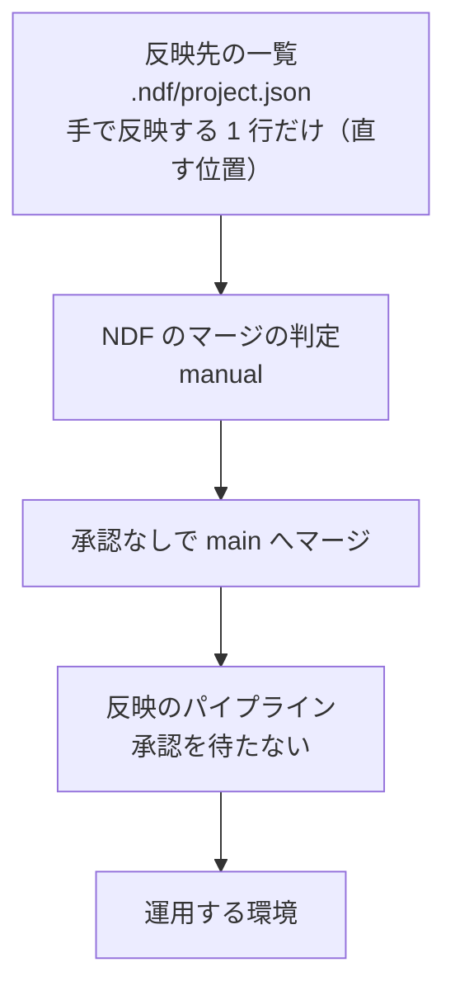
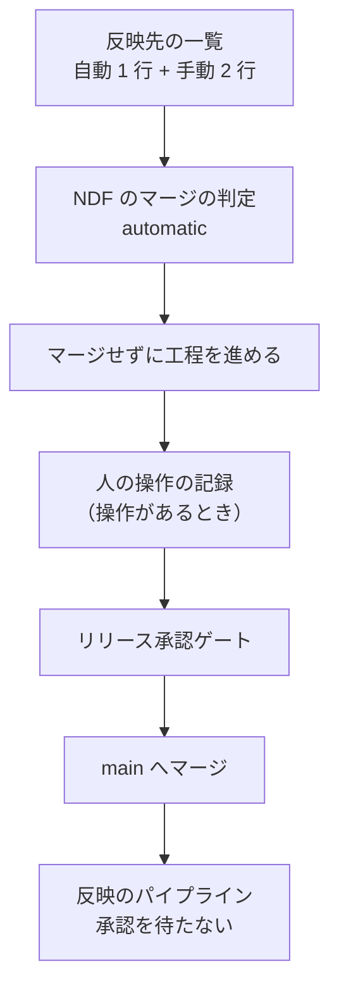
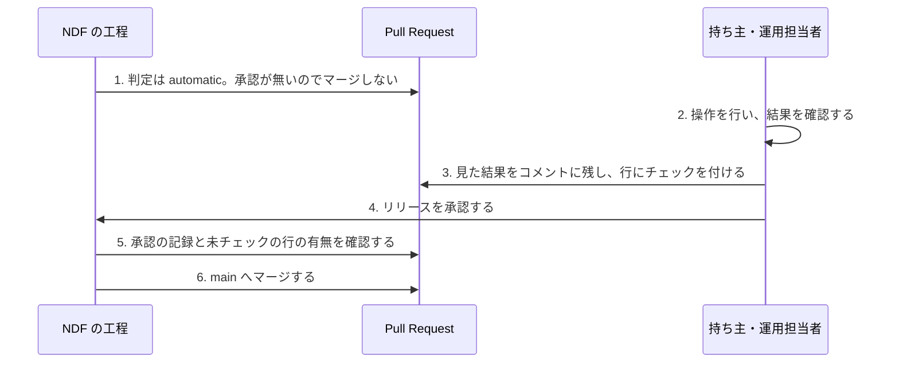

# ブランチ戦略の設定: main へのマージがリリース承認ゲートを通るようにする（#166）

main へのマージは運用する環境へ自動で反映されるのに、開発の工程を進める仕組み（NDF）の設定は「手で反映」なので、承認なしでマージされる。反映先の一覧を実際の 3 つの経路に合わせて自動の反映の行を足し、NDF が持つマージの判定をそのまま働かせる。あわせて、承認する時点を決定の記録・指針・手順書でそろえ、マージの前に人が済ませる操作が残る Pull Request を NDF がマージしない書き方を手順書に定める。採らなかった案は「決定の記録」に、外部の調査を省いた理由は末尾の「外部の調査」にある。

## 今の姿

何が起きたか・目的・受け入れ条件は要求仕様（[issue-166-requirements.md](./issue-166-requirements.md)、正は [#166](https://github.com/devbasex/nd-factory/issues/166) の本文）にある。この文書は「どう解くか」と「なぜその解き方か」だけを書く。



設定を読む側は 2 つあり、読む場所が違う。

| 読む側 | 対象 | 設定を読む場所 | 自動の反映の行があるときの動き |
| --- | --- | --- | --- |
| NDF のマージ（`ndf ci merge`） | 工程が行うマージ | マージ先のブランチ（GitHub の上の `main`） | 本番のブランチ宛ては、承認の記録が Pull Request に無ければマージしない |
| 監視（hook の `merge-production`） | エージェントが直接打つ `gh pr merge` | コマンドを打つ作業場所の `.ndf/project.json` | マージ先のブランチによらず止める |

原因は、反映のパイプラインから承認の段を外したときに、反映先の一覧を直さなかったことである。判定の仕組みは、設定のとおりに動いている。

## 文脈と制約

- 本番のブランチと開発の起点のブランチは、どちらも `main` である
- 反映のパイプライン、自分で設置する人のコマンド、NDF の判定の仕組みは変えない
- この変更をマージする時点の `main` の設定は「手で反映」なので、NDF はこの変更の Pull Request を承認の対象にしない（要求の前提 2）
- `.ndf/project.json` のブランチ戦略の設定は手で編集せず、`ndf project branch-strategy write` で書く（NDF の決まり）
- インフラの実際の値を、設定・手順書・記録に書かない

## 解き方の全体像



- 反映先の一覧は、経路ごとに 1 行の 3 行になる。運用する環境のアプリの行だけが自動で反映する行である
- アプリの反映を人が承認する時点は、`main` へのマージの前の 1 つだけになる。マージの後のパイプラインの実行は承認を待たない
- マージの前に人が行う操作は、Pull Request の本文の未チェックの行として残り、残る間は NDF がマージしない
- 同じ説明は全体の設計の決定の記録に置き、指針・`AGENTS.md`・手順書はそこを指す

## 処理の流れ

マージの前に人が行う操作がある Pull Request の順序である。操作が無ければ、2〜3 を飛ばす。



6 の後は、反映のパイプラインが承認を待たずに反映まで進む。

## 非機能の実現方式

| 大項目 | 要求の条件 | 実現方式 | 確認の仕方 |
| --- | --- | --- | --- |
| 運用・保守性 | 手順書の確認の手順は、会話の記録や引継ぎのメモを読まなくても、手順書と課題・Pull Request だけで実行できる | 行う操作・見るもの・合格の状態を Pull Request の本文の行とコメントに持たせ、書き方を手順書に置く（決定 4） | 手順書と Pull Request だけを読んで、次の操作が決まることをレビューで確認する |
| セキュリティ | 設定・手順書・記録に、インフラの実際の値を書かない | 反映先の一覧の行はコマンドの形と置き換え記号だけを持ち、反映の結果を読むコマンドを持たない（決定 6）。コメントには判定だけを書き、値はアクセスを制限した運用の記録に残す | 漏れの検査（CI と NDF のマージの直前の検査）と差分のレビュー |

## 決定の記録

### 決定 1: 本番へ届くマージを承認なしで通さないため、main へのマージにリリース承認ゲートを掛け、自動の反映の行を足す

- **質問**: `main` へのマージを承認の対象にするか。するなら何で効かせるか
- **選んだ案**: 対象にする。反映先の一覧に `kind: auto`・`channel: production` の行を足し、NDF が持つ判定と監視をそのまま働かせる。ブランチ名は行に写さない（本番のブランチは `branches.production` が持つ）。反映の段を一時的に止めている間や、準備の段が失敗している間も、行はそのままにする
- 採らなかった案: 手で反映する行のままにし、承認は人と AI の注意で守る（工程の自動のマージは注意を読まない。2026-11-26 に起きた）
- 採らなかった案: 反映のパイプラインに承認の段を戻す（持ち主の「パイプラインの実行は承認不要」に反し、要求の対象外である）
- 採らなかった案: NDF の側の直し（[ai-plugins#4579](https://github.com/devbasex/ai-plugins/issues/4579)）を待つ（設定が実態と違う状態が残り、その間のマージが承認を通らない）
- **代償**: 文書だけの Pull Request も承認の対象になる。スプリントはデプロイの工程で 1 回、スプリントを通さない修正は Pull Request ごとに 1 回の承認が要る
- 根拠: Value 14（MVV バージョン 4）

### 決定 2: どの経路でだれが承認するかを一覧から読めるよう、反映先の一覧を 3 行に分ける

- **質問**: 3 つの経路を何行で表すか
- **選んだ案**: 次の 3 行にする。手で反映する 2 行には、自動にしない理由（`manual_reason`）を書く。`release.cd` は `null` のままにする（判定は反映先の一覧があれば一覧だけを読む）

| 行の対象 | `kind` | `channel` | 起こし方の欄（`trigger`）に書くこと | 自動にしない理由 |
| --- | --- | --- | --- | --- |
| 運用する環境のアプリのスタック | `auto` | `production` | `main` への push で準備から反映まで進む。実行は承認を待たないので、マージの前にリリース承認ゲートを通す | — |
| 運用する環境の反映のパイプラインのスタック | `manual` | `production` | `diff --stack pipeline` の差分をリリース承認ゲートで承認した後に `deploy --confirm` | 自分自身を反映すると、push だけで反映の権限を変えられる |
| 自分で設置する人の AWS | `manual` | 省く | 設置する人が `diff` の差分と確認の値を読み、`deploy --confirm`。このリポジトリのデプロイの工程では打たない | 設置する人が自分の AWS で差分を読んで反映する |

- 採らなかった案: パイプラインのスタックの経路を、ほかの行の説明に含める（承認の仕方が違う経路が 1 行に混ざり、今の説明文と同じ読み違いが起きる）
- **代償**: 本番の承認資料の届き方の欄に、このリポジトリが打たない「自分で設置する人」の行も出る。行の文で打たないことを示す
- 根拠: Value 14（MVV バージョン 4）

### 決定 3: 承認する時点を 1 つに読めるよう、マージの承認と実行の承認の関係を全体の設計の決定 142 に置く

- **質問**: 「パイプラインの実行は承認不要」と、マージの承認の関係をどこに、どう書くか
- **選んだ案**: 持ち主の言う「実行は承認不要」はマージの後の個々の実行を指し、マージの前の承認と両立すると定める。[全体の設計](../docs/design/platform.md)の決定の記録に決定 142 を足し、ほかの文書は 1〜2 文とリンクにする

決定 142 に書くことは次のとおりである。

| 項目 | 中身 |
| --- | --- |
| 承認する時点 | `main` へのマージの前（リリース承認ゲート）。反映のパイプラインのスタックは `deploy` の前 |
| 承認しない時点 | マージの後の、アプリのスタックの個々の実行（準備・反映） |
| 変わらない承認 | 遷移の停止と再開・段のやり直しなどの運用の操作は、[承認を受ける操作](../docs/specifications/deploy-pipeline.md#承認を受ける操作)の条件のまま |
| 理由 | パイプラインは人を待たないので、マージより後に人が止める時点が無い |
| 事故の経緯 | 2026-11-26（UTC）に、実装の [#190](https://github.com/devbasex/nd-factory/pull/190) と追いの [#194](https://github.com/devbasex/nd-factory/pull/194) が、工程「Pull Request」の自動のマージで、承認ゲートを通らずに `main` へ入った。反映先の一覧が手で反映のままで、NDF が本番へ届く操作と扱わなかった。反映のパイプラインは準備の段で失敗し、2 本の変更は運用する環境へ反映されなかった（反映されたのは文書だけの [#192](https://github.com/devbasex/nd-factory/pull/192)） |
| 当てる期間 | 商用利用の開始前。開始後の方式は持ち主が決め直す |

指針と文書は次のように直す。

| 文書 | 直すこと |
| --- | --- |
| 開発の指針の「反映のパイプラインの実行は人の承認を待たない」の行 | 「本番系へ届く操作に含めない」を、マージの後の個々の実行に限る形に書き換え、`main` へのマージが本番系へ届く操作に当たると書く |
| `AGENTS.md` の「反映の経路」 | 運用する環境の行に、マージの前にリリース承認ゲートを通ることと、マージの前の確認の手順へのリンクを足す |
| 全体の設計の「2 つの反映の道筋」の運用する環境のアプリの行 | 個別の実行は承認せず、承認はマージの前に取ることを足し、決定 142 を指す |
| 反映のパイプラインの手順書の冒頭と「順序のまとめ」、設置の手順の「運用する環境」、反映のパイプラインの仕様の「承認を受ける操作」 | 「承認を待たない」がマージの後の実行を指すことと、マージの前の承認を 1 文で足す |

- 採らなかった案: 指針の行だけを直し、決定の記録を足さない（理由と事故の経緯が残らず、受け入れ条件 8 を満たさない）
- **代償**: 承認の扱いを変えるとき、決定 142 と、それを指す文をあわせて直す
- 根拠: Value 13・Value 14（MVV バージョン 4）

### 決定 4: 人の操作が残る Pull Request を自動の流れがマージしないよう、本文の「マージの前に決める」の行で確認する

- **質問**: 設計が「マージの前に人が行うこと」とした操作が済んだことを、何で確認し、済むまでどう止めるか
- **選んだ案**: 反映のパイプラインの手順書に「main へのマージの前の確認」の節を置き、次の形を定める。NDF のマージは、本文に未チェックの「マージの前に決める」の行が残る Pull Request を拒むので、新しい仕組みは足さない

| 順 | だれが | すること |
| --- | --- | --- |
| 1 | 設計する人・AI | 要る操作があれば、設計書に「マージの前に人が行うこと」の節を置き、操作・行う人・見るもの・合格の状態を書く |
| 2 | Pull Request を作る人・AI | 操作 1 つを本文の 1 行にする: `- [ ] マージの前に決める: <操作>（確認: <見るものと合格の状態>）` |
| 3 | 持ち主か運用担当者 | 操作を行い、見るもの（例: 反映の段への遷移を止める操作なら `get-pipeline-state` の遷移が無効）を確認し、日時と判定を Pull Request のコメントに残す |
| 4 | 持ち主か運用担当者。AI は 3 のコメントがあるときだけ | 行にチェックを付ける。AI は人の記録が無い行にチェックを付けない |
| 5 | リリースを承認する人 | 承認の前に、全部の行にチェックと記録があることを確認する。済んでいなければ承認せず、マージしない |

手順書には、次の 2 つも書く。GitHub の画面からのマージは止まらないので、人も同じ確認を済ませるまでマージしない。「マージの前に決める」の語を含む行は、見出し・説明文・コードブロックでもマージを止めるので、2 の行のほかには本文に書かない。

開発の指針には、設計と Pull Request を作るときにこの節を読む 1 行を足す。これは承認の工程を足すものではなく、承認の前提になる操作の確認である。

- 採らなかった案: 手順書の文章だけで定める（自動のマージは手順書を読まず、操作が残ったまま進む）
- 採らなかった案: CI が AWS の状態を読んで必須のチェックにする（CI は AWS の資格情報を持たない決まりである）
- **代償**: 行を本文に書き忘れると、機械では止まらない。リリース承認ゲートで人が設計書と突き合わせる
- 根拠: Value 13・Value 17（MVV バージョン 4）

### 決定 5: この変更自身を承認なしでマージしないよう、その Pull Request の本文にも未チェックの行を置く

- **質問**: マージの時点の `main` の設定が手で反映のこの変更を、どう承認の後まで止めるか
- **選んだ案**: この変更を含む Pull Request を作るときに、`- [ ] マージの前に決める: 持ち主のリリース承認（確認: 持ち主の回答の記録）` を本文に置く。工程の自動のマージはこの行で止まる。持ち主が承認した後にチェックを付けて、工程を再実行する
- 採らなかった案: 進める人と AI の申し合わせだけで止める（2026-11-26 と同じ形で、自動の流れがマージする）
- 採らなかった案: 先に反映先の一覧だけを `main` へ入れる（その Pull Request のマージも同じ理由で承認の対象にならず、Pull Request が 2 本に増える）
- **代償**: 工程「Pull Request」が拒まれて 1 回止まる
- 根拠: Value 14（MVV バージョン 4）

### 決定 6: 実際の値をリポジトリに置かないため、自動の反映の行に結果を読むコマンドを持たせない

- **質問**: 自動の反映の行に、反映の結果の読み方（`result`）を書くか
- **選んだ案**: 書かない。NDF はデプロイの結果を「未確定」と記録し、リリース後テストの工程で反映の状態を確認する
- 採らなかった案: パイプラインの実行を読むコマンドを書く（profile と資源の名前が要り、AI と CI は AWS の資格情報を前提にできない）
- **代償**: 反映の成否は自動で記録されない。失敗は今の通知のメールで届く
- 根拠: Value 7（MVV バージョン 4）

### 決定 7: 承認の直しを小さく保つため、「設定が古い」の解消はこの変更に含めない

- **質問**: `ndf project check` の「設定が古い」を同じ変更で解消するか
- **選んだ案**: 含めない。理由は CI の定義や依存の定義の変化で、反映先の一覧を指さない。解消は次のスプリントの開始時の自動の再解析が行う。再解析はブランチ戦略の設定を書き換えない
- 採らなかった案: 再解析をこの変更に含める（言語やテストの設定の差分が混ざり、人の承認が要るファイルの差分が読みにくくなる）
- **代償**: 受け入れ条件 6 の記録は、終了コード 3 と「変わった入力」の一覧になる
- 根拠: Value 13（MVV バージョン 4）

## 影響と危険

- **働く範囲**: このリポジトリだけ。利用先の設置（自分で設置する人）の手順とコマンドは変わらない
- **プロジェクトごとに違うもの**: 無し。NDF の設定の値と、このリポジトリの文書だけを直す
- **当たるモード**: `main` 宛ての Pull Request を持つすべてのモード（スプリント・単発の修正・クローズ）

| 壊れうる箇所 | 扱い |
| --- | --- |
| この変更をマージする前の `main` は手で反映のままである。ほかのレーンの Pull Request が承認なしで入る | 直し終わるまで、`main` へ入るスプリントのほかの Pull Request をマージしない（要求の前提 3）。この変更の Pull Request は決定 5 で止める |
| 監視は、打った作業場所の設定を読む。直しを取り込んでいない作業場所では、直接の `gh pr merge` が止まらない | マージの後に、メインディレクトリと開いている作業場所へ `main` を取り込む。工程のマージは `main` の設定を読むので、取り込みの前でも止まる |
| 監視はマージ先を区別しないので、`main` 以外へ向けた直接の `gh pr merge` も止まる | 工程のマージ（`ndf ci merge`）を使う。`main` 以外の宛先はそのまま通る |
| GitHub の画面や人の端末からのマージは止まらない | 手順書に、人も同じ確認の後にマージすると書く |
| Pull Request の本文を工程が作り直すと、確認の行が消えうる | 承認の前に本文を読み直す（決定 4 の 5） |
| `AGENTS.md`・開発の指針・全体の設計は、ほかのレーンも触る | 実装の前と Pull Request の前に `main` を取り込む |

`AGENTS.md` と開発の指針の反映の指示の書き換えは、持ち主の承認が要る操作（[承認を受ける操作](../docs/specifications/deploy-pipeline.md#承認を受ける操作)の A5）である。設計の承認とリリースの承認で持ち主が見る。

## テスト設計

コードを足さないので、新しいテストは書かない。反映先の一覧の判定の規則は NDF がテストを持つ。確認は下のコマンドと読み合わせで行い、結果を課題か Pull Request に残す。`npm run check` は退行の確認に通す。

受け入れ条件 4 は、直した作業場所で次を打つ（`<NDF の src>` は NDF のプラグインの `src` ディレクトリ）。

```bash
python3 -I -B -c 'import sys; sys.path.insert(0, sys.argv[1]); from ndf.core import production_merge as p; r = "devbasex/nd-factory"; print(p.judge_project_text(open(".ndf/project.json").read(), "main", source_repo=r, repo=r).value)' <NDF の src>
```

| 受け入れ条件 | どの振る舞いで縛るか | どう壊したら落ちるべきか |
| --- | --- | --- |
| 1 | 一覧に `kind: auto`・`channel: production` の行がある | 行を消すか `manual` にすると、4 の判定が `manual` になる |
| 2 | 自分で設置する人の行が `manual` で、自動の行と別にある | 1 行にまとめると、差分の読み合わせで経路が数えられない |
| 3 | どの行の説明にも「パイプラインの承認の後」が無く、パイプラインのスタックの行が `manual` である | 一覧を「パイプラインの承認の後」で検索して当たれば不合格 |
| 4 | 上のコマンドが `automatic` を返す | 今の `main` の設定では `manual` が返る |
| 5 | `main` へ入った後、直しを取り込んだ作業場所で、実在しない番号の `gh pr merge` が監視に止められる | 直す前の設定を持つ作業場所では、監視は止めない |
| 6 | `ndf project check` の指摘に、反映の経路の設定を指す項目が無い | `branch_strategy` の形が壊れると、その指摘が出る |
| 7 | 4 は読み取りだけ、5 は実在しない番号、6 は確認だけで打つ。マージするコマンド（`ndf ci merge`）は使わない | 開いている Pull Request の番号を使う手順は不合格 |
| 8 | 決定 142 に、掛けること・理由・事故の経緯（Pull Request の番号・原因・反映の結果）がある | どれかが欠ければ読み合わせで不合格 |
| 9 | 決定 142・開発の指針・`AGENTS.md`・反映の手順書で、承認する時点としない時点が同じである | 「承認」を検索し、マージの前の承認を不要と読める文があれば不合格 |
| 10 | 手順書に、行う人・見るもの・済んでいなければマージしないことがある。未チェックの行がある本文を NDF の関数（`github_merge.premerge_risks`）へ渡すと行が返り、チェックを付けると返らない | 行の形が手順書と違い「マージの前に決める」を含まなければ、関数が何も返さない |
| 11 | 差分が `infra/` と設置のコマンドに触れず、`npm run check` が通る | `infra/` の差分があれば不合格 |

## 設計の結果

| 課題 | 扱い | 統合先 | 触るファイル |
| --- | --- | --- | --- |
| #166 | 実装する | — | `.ndf/project.json`、`AGENTS.md`、`.claude/skills/nd-factory-dev-guidelines/SKILL.md`、`docs/design/platform.md`、`docs/operations/pipeline-approval.md`、`docs/operations/setup.md`、`docs/specifications/deploy-pipeline.md` |

## 人へ残す判断

| 判断 | 当たるレッドライン | なぜ当たるか |
| --- | --- | --- |
| 反映先の一覧と `AGENTS.md` の反映の経路を書き換え、`main` へのマージを承認の対象にする（決定 1・3。「パイプラインの実行は承認不要」はマージの後の実行を指すという読み方を含む） | C7 | 利用者の設定（`.ndf/`）と指示書を書き換え、持ち主の決定の適用の範囲を定める。設計の承認とリリースの承認で持ち主が見る |

## 未確認のまま残ること

| 項目 | 内容 |
| --- | --- |
| 監視が直接の `gh pr merge` を止めること | `main` へ入った後に受け入れ条件 5 の手順で確認する |
| 工程が本文を作り直すときに確認の行が残るか | この変更の Pull Request（決定 5）で、工程を再実行する前後の本文を読んで確認する |
| 結果の読み方が無い自動の行で、デプロイの工程がどう記録するか | この変更の次のデプロイの工程の記録を読んで確認する |

## 外部の調査

省く: NDF が持つ判定へ渡す設定の値と、このリポジトリの手順の取り決めだけで形が決まり、外部の判断が要らないため
