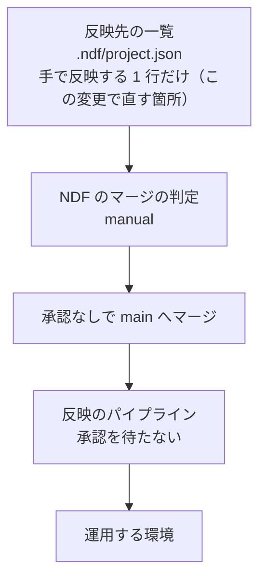
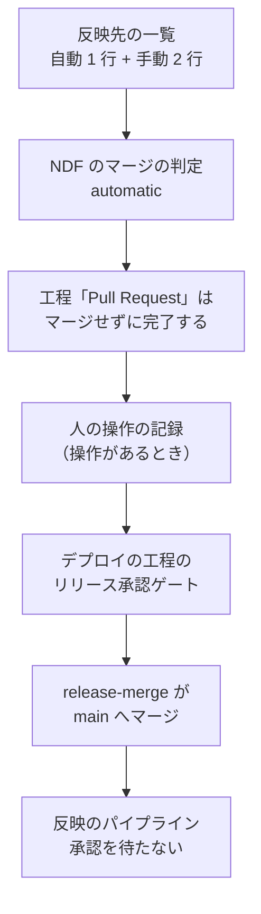
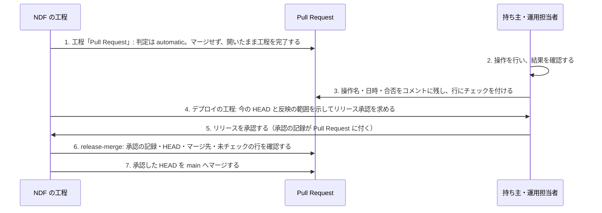

# ブランチ戦略の設定: main へのマージがリリース承認ゲートを通るようにする（#166）

main へのマージは運用する環境へ自動で反映されるのに、開発の工程を進める仕組み（NDF）の設定は「手で反映」なので、承認なしでマージされる。反映先の一覧を実際の 3 つの経路に合わせて自動の反映の行を足し、NDF が持つマージの判定をそのまま働かせる。あわせて、承認する時点を決定の記録・指針・手順書でそろえ、マージの前に人が済ませる操作が残る間は NDF にマージさせない Pull Request の本文の書き方を、手順書に定める。採らなかった案は「決定の記録」に、[#198](https://github.com/devbasex/nd-factory/issues/198)・[#199](https://github.com/devbasex/nd-factory/issues/199) が入るまで止まらない経路は「影響と危険」と決定 8 に、外部の調査を省いた理由は末尾の「外部の調査」にある。

## 今の姿

何が起きたか・目的・受け入れ条件は要求仕様（[issue-166-requirements.md](./issue-166-requirements.md)、正は [#166](https://github.com/devbasex/nd-factory/issues/166) の本文）にある。この文書は「どう解くか」と「なぜその解き方か」だけを書く。



設定を読む側は 2 つあり、読む場所が違う。

| 読む側 | 対象 | 設定を読む場所 | 自動の反映の行があるときの動き |
| --- | --- | --- | --- |
| NDF のマージ（`ndf ci merge`） | 工程が行うマージ | マージ先のブランチ（GitHub の上の `main`） | 本番のブランチ宛ては、承認の記録が Pull Request に無ければマージしない |
| 監視（hook の `merge-production`） | エージェントが直接打つ `gh pr merge` | コマンドを打つ作業場所の `.ndf/project.json` | 本番向けの行があれば、Pull Request のマージ先も承認の記録も確認せずに止める |

NDF 11.0.43 の監視は、作業場所の設定に本番向けの自動の反映の行があれば、承認の後でも直接の `gh pr merge` を止める。承認の後のマージは NDF の工程から実行する。

原因は、反映のパイプラインから承認の段を外したときに、反映先の一覧を直さなかったことである。判定の仕組みは、設定のとおりに動いている。

## 文脈と制約

- 本番のブランチと開発の起点のブランチは、どちらも `main` である
- 反映のパイプライン、自分で設置する人のコマンド、NDF の判定の仕組みは変えない
- この変更をマージする時点の `main` の設定は「手で反映」なので、NDF の判定はこの変更の Pull Request に承認を求めない（要求の前提 2）。そのため、設計 PR の [#195](https://github.com/devbasex/nd-factory/pull/195) と、設定を変える後続の Pull Request の 2 本は、NDF の判定に頼らずに止める。本文に未チェックの確認の行を置くと、NDF のマージはその行を理由にマージを拒む。この行で止めて、持ち主の承認を取る（決定 4・5）
- この文書の「切り替え」は、反映先の一覧に自動の反映の行を足す `.ndf/project.json` の変更（設定を変える後続の Pull Request）が `main` に入ることを指す。「切り替えの前」「切り替えの後」も、この時点で分ける。直しが効くのは、この設計を含む設計 PR（#195）が承認され、切り替えが `main` に入った後である
- この文書の「反映の段への遷移」は、反映のパイプライン（AWS CodePipeline）で、前の段から反映の段へ進む入口を指す。遷移を止める（無効にする）と、実行は反映の段の手前の入口で待つ
- 非公開の漏れ検査と `main` の保護は、持ち主の決定（2026-11-26「範囲を分ける」）で切り替えの前提から外し、#198・#199 で扱う（下の `main` の保護と非公開の検査の行）
- `.ndf/project.json` のブランチ戦略の設定は手で編集せず、`ndf project branch-strategy write` で書く（NDF の決まり）
- インフラの実際の値を、設定・手順書・記録に書かない
- 2026-11-26 の時点で、`main` にはブランチの保護もルールセットも無い。全体の設計が反映のパイプラインのソースブランチに求める条件を満たしていない。保護は #199 で扱い、この変更の切り替えの前提にしない（決定 8）
- 実際の値を照合する漏れの検査は、公開しない場所で動く（非公開の検査）。NDF 11.0.43 はこの検査を起動しない。検査をマージの条件にすることは #198 で扱い、この変更の切り替えの前提にしない（決定 5）
- NDF のリポジトリ（ai-plugins）へは、この変更のための起票も依頼もしない（持ち主の決定、2026-11-26）

## 解き方の全体像



- 反映先の一覧は、経路ごとに 1 行の 3 行になる。運用する環境のアプリの行だけが自動で反映する行である
- アプリの反映を人が承認する時点は、`main` へのマージの前の 1 つだけになる。マージの後のパイプラインの実行は承認を待たない
- この承認は人の回答で取り、AI の判定では代えない（決定 9）。承認資料には、まだ反映されていない `main` 上の変更も書く（決定 10）
- 承認した後に `main` が進んだことは、マージの直前の照合とマージの後の確かめで見つける。GitHub の側でマージを拒む保護は #199 で扱う（決定 5・8）
- マージの前に人が行う操作は、Pull Request の本文の未チェックの行として残り、残る間は NDF がマージしない
- 同じ説明は全体の設計の決定の記録（決定 142。設計 PR で足す）に置き、指針・`AGENTS.md`・手順書はそこを指す

## 処理の流れ

設定を切り替えた後の、通常のスプリントの順序である。工程「Pull Request」は Pull Request を開いたまま完了し、デプロイの工程で承認を受けてからマージする。マージの前に人が行う操作が無ければ、2〜3 を飛ばす。



4 の承認資料には、今の Pull Request の差分に加えて、まだ反映されていない `main` 上の変更を書く（決定 10）。マージの時点でも成り立つ必要がある操作は、2〜3 の扱いが変わる（決定 4）。

7 の後は、反映のパイプラインが承認を待たずに反映まで進む。スプリントを通さない修正では、マージの工程が承認待ちで止まる。承認の後は、その工程にマージさせず、「影響と危険」の「クローズとマージの工程で、承認した対象だけをマージする」の手順でマージする。この変更自身は設定の切り替え前なので、決定 5 の手順を使う。

## 非機能の実現方式

| 大項目 | 要求の条件 | 実現方式 | 確認の仕方 |
| --- | --- | --- | --- |
| 運用・保守性 | 手順書の確認の手順は、会話の記録や引継ぎのメモを読まなくても、手順書と課題・Pull Request だけで実行できる | 行う操作・見るもの・合格の状態を Pull Request の本文の行とコメントに持たせ、書き方を手順書に置く（決定 4） | 手順書と Pull Request だけを読んで、次の操作が決まることをレビューで確認する |
| セキュリティ | 設定・手順書・記録に、インフラの実際の値を書かない | 反映先の一覧の行はコマンドの形と置き換え記号だけを持ち、反映の結果を読むコマンドを持たない（決定 6）。マージの前の確認のコメントには、操作名・確認した日時・合否（合格か不合格）だけを書く。実行の ID・ARN などの確認の証跡は、運用担当者が運用の記録に残す（下の「運用の記録」） | 公開の CI の漏れの検査と差分のレビュー（非公開の検査をマージの条件にすることは #198 で扱う） |

**運用の記録**は、公開できない実際の値を残す、リポジトリの外の非公開の保管先である（[反映のパイプラインの仕様の用語](../docs/specifications/deploy-pipeline.md#用語)）。運用担当者が書き、Pull Request の番号と操作名を添えて、公開のコメントと対応が取れるようにする。具体的な置き場と閲覧できる人は、まだ決まっていない（未確認: 保存先）。だれがいつ決めるかは「未確認のまま残ること」にある。決まるまでも、値は Pull Request・課題・リポジトリに書かない。

## 決定の記録

各決定の「根拠」の Value の番号は、プロジェクトの判断の基準（MVV、[.ndf/mvv.md](../.ndf/mvv.md)）の項目である。

| 番号 | 項目の名前 |
| --- | --- |
| Value 7 | 公開を前提に、値を置かない |
| Value 13 | 重複と冗長を作らない |
| Value 14 | モダンな開発の手順で品質を確かめる |
| Value 15 | 車輪の再発明をしない |
| Value 17 | 目先の手間より、長く良い形を選ぶ |

### 決定 1: 本番へ届くマージを承認なしで通さないため、main へのマージにリリース承認ゲートを掛け、自動の反映の行を足す

- **質問**: `main` へのマージを承認の対象にするか。するなら何で効かせるか
- **選んだ案**: 対象にする。反映先の一覧に `kind: auto`・`channel: production` の行を足し、NDF が持つ判定と監視をそのまま働かせる。ブランチ名は行に写さない（本番のブランチは `branches.production` が持つ）。反映の段を一時的に止めている間や、準備の段が失敗している間も、行はそのままにする
- 採らなかった案: 手で反映する行のままにし、承認は人と AI の注意で守る（工程の自動のマージは、人や AI の注意を読み取らない。2026-11-26 には承認なしのマージが起きた）
- 採らなかった案: 反映のパイプラインに承認の段を戻す（持ち主の「パイプラインの実行は承認不要」に反し、要求の対象外である）
- 採らなかった案: NDF の側の直し（[ai-plugins#4579](https://github.com/devbasex/ai-plugins/issues/4579)）を待つ（設定が実態と違う状態が残り、その間のマージが承認を通らない）
- **代償**: 文書だけの Pull Request も承認の対象になる。承認の回数は、スプリントでは 1 回である。工程「Pull Request」はマージせずに完了し、デプロイの工程でリリースを承認した後に、同じ工程の `release-merge` が承認した HEAD を `main` へマージする。スプリントを通さない修正では Pull Request ごとに 1 回である
- 根拠: Value 14（MVV バージョン 4）

### 決定 2: どの経路でだれが承認するかを一覧から読めるよう、反映先の一覧を 3 行に分ける

- **質問**: 3 つの経路を何行で表すか
- **選んだ案**: 次の 3 行にする。手で反映する 2 行には、自動にしない理由（`manual_reason`）を書く。`release.cd` は `null` のままにする（判定は反映先の一覧があれば一覧だけを読む）

| 行の対象 | `kind` | `channel` | 起こし方の欄（`trigger`）に書くこと | 自動にしない理由 |
| --- | --- | --- | --- | --- |
| 運用する環境のアプリのスタック | `auto` | `production` | `main` への push で準備から反映まで進む。実行は承認を待たないので、マージの前にリリース承認ゲートを通す | — |
| 運用する環境の反映のパイプラインのスタック | `manual` | `production` | `diff --stack pipeline` の差分をリリース承認ゲートで承認した後に `deploy --confirm` | パイプラインが自分自身を自動で反映すると、push だけで反映の権限を変えられるようになる |
| 自分で設置する人の AWS | `manual` | 省く | 設置する人が `diff` の差分と確認の値を読み、`deploy --confirm`。このリポジトリのデプロイの工程では打たない | 設置する人が自分の AWS で差分を読んで反映する |

- 採らなかった案: パイプラインのスタックの経路を、ほかの行の説明に含める（承認の仕方が違う経路が 1 行に混ざり、今の説明文と同じ読み違いが起きる）
- **代償**: 本番への反映の承認で人が読む資料（承認資料）には、反映先ごとに、どう届くかを書く欄がある。その欄に、このリポジトリが打たない「自分で設置する人」の行も出る。打たないことは行の文で示す
- 根拠: Value 14（MVV バージョン 4）

### 決定 3: 承認する時点の解釈が分かれないよう、マージの承認と実行の承認の関係を全体の設計の決定 142 に置く

- **質問**: 「パイプラインの実行は承認不要」と、マージの承認の関係をどこに、どう書くか
- **選んだ案**: 持ち主の言う「実行は承認不要」はマージの後の個々の実行を指し、マージの前の承認と両立すると定める。[全体の設計](../docs/design/platform.md#決定の記録)の決定の記録に決定 142 を足し、ほかの文書は 1〜2 文とリンクにする。決定 142 と全体の設計の書き換えは、承認済みの設計を変えるので、この設計書と同じ設計 PR に含めて承認を受ける。指針・`AGENTS.md`・手順書・仕様は、承認された決定 142 に沿って後続の Pull Request で直す

全体の設計の決定 142（この決定 3 の中身を置く先）に書くことは次のとおりである。

| 項目 | 中身 |
| --- | --- |
| 承認する時点 | 反映を起動するソースブランチへのマージの前（リリース承認ゲート）。このリポジトリでは `main`。このリポジトリがソースブランチを `main` から変えたときは、変えた後のブランチ。利用先の設置（自分で設置する人）には当てはめない。反映のパイプラインのスタックは `deploy` の前 |
| 承認しない時点 | マージの後の、アプリのスタックの個々の実行（準備・反映） |
| 承認する人 | 持ち主。AI の判定（MVV 判定）では代えない（決定 9） |
| 承認の対象 | 最後に成功した反映のソースから、今回のマージ候補までの変更（決定 10） |
| 漏れの検査 | マージ候補に非公開の検査が成功したことをマージの条件にする方法は、#198 で決める。この決定の切り替えの前提にしない（決定 5） |
| `main` の保護 | `main` を更新できる主体を限る保護は、#199 で決める。この決定の切り替えの前提にしない。2026-11-26 の時点では保護もルールセットも無い（決定 8） |
| 止める仕組みの経路ごとの違い | 工程のマージはマージ先の `main` の設定を読む。監視は打った作業場所の設定を読むので、切り替えの前の設定を持つ作業場所が残る間は、`main` へのマージを工程のマージだけで行う。GitHub の画面や人の端末からのマージと `main` への直の push は、#199 が入るまで止まらない。非公開の検査が止めるべき変更は、#198 が入るまで止まらない（決定 8） |
| 変わらない承認 | 反映の段への遷移の停止と再開・失敗した段のやり直しなどの運用の操作は、[承認を受ける操作](../docs/specifications/deploy-pipeline.md#承認を受ける操作)の条件のまま |
| 理由 | パイプラインは人を待たないので、マージより後に人が止める時点が無い |
| 事故の経緯 | 2026-11-26（UTC）に、実装の [#190](https://github.com/devbasex/nd-factory/pull/190) と、追加の直しの [#194](https://github.com/devbasex/nd-factory/pull/194) が、工程「Pull Request」の自動のマージで、承認ゲートを通らずに `main` へ入った。反映先の一覧が手で反映のままで、NDF が本番へ届く操作と扱わなかった。反映のパイプラインは準備の段で失敗し、2 本の変更は運用する環境へ反映されなかった（反映されたのは文書だけの [#192](https://github.com/devbasex/nd-factory/pull/192)）。2026-11-27 00:09:27Z（UTC）にも、画面の基盤の [#197](https://github.com/devbasex/nd-factory/pull/197) が同じ経路で、リリースの承認が無いまま `main` へ入った（[事故の記録](https://github.com/devbasex/nd-factory/issues/12#issuecomment-7206616632)）。この反映も準備の段で失敗した。3 本は打ち消さずに `main` に残り、準備の段が通った時点でまとめて反映の対象になる |
| 適用する期間 | 商用利用の開始前。開始後の方式は持ち主が決め直す |

指針と文書は次のように直す。全体の設計の行は設計 PR で、ほかの行は後続の Pull Request で直す。

CI の検査の手順書（`docs/operations/ci-checks.md`）は、一部を設計 PR で先に直し、残りを後続の Pull Request で直す。設計 PR で書くのは、切り替えの前から効く扱いと、切り替えの後の手順の本体である。手順の正本は手順書で、決定 142 には決めたことと理由だけを書き、手順は手順書へのリンクにする。

| 設計 PR で手順書に書くこと | 手順書の場所 | 先に書く理由 |
| --- | --- | --- |
| 作業の記録の置き場と読める人、記録として数えるコメント、結果不明の要求の付け方と閉じ方、未解決の確かめ方、運用の記録の保管先の決め方 | 冒頭の「作業の記録」 | 停止を解く条件や引き継ぎが、この記録に未解決のものが無いことを条件にするため（決定 4 の「作業の記録の置き場」） |
| 適用する時点。手でのマージを使わなくなるのは、切り替えが `main` に入った時点である | 「規則を変える Pull Request をマージの直前に確かめる」の冒頭 | 設計 PR のマージの時点では、まだ手でのマージを使うため |
| 導入中の例外。非公開の検査を有効にする前に、どの Pull Request をマージしてよいか | 同じ節の手順 5 の項目の表 | 承認の前と後で例外の範囲が変わるため（決定 5） |
| 切り替えの後の承認・マージ・復旧。承認の受け方、`ndf ci merge` の結果の読み方、結果不明の要求の扱い、`main` を止める時点と解く時点、秘密が漏れたときの交換 | 同じ節の小見出し「切り替えの後のマージ」 | 切り替えの直後から使うため |
| 秘密を変える間の `main` へのマージの停止と、停止の前に送られた要求の確かめ | 「秘密を変える手順」の準備 1〜4 | 切り替えの後は、秘密の世代（漏れの検査の秘密の版を表す、手順書の変数 `LEAK_CHECK_GENERATION`。秘密を変える間は `0` にする）を `0` にしても NDF のマージ（`ndf ci merge`）が止まらないため。`ndf ci merge` は世代を照合せず、送った要求を NDF の未解決の記録にも載せない。そのため、担当者の間でマージを止め、止める前の要求を確かめる必要がある |
| 非公開の検査を NDF が起動しない間の注意 | 「検査ごとの秘密の受け方と結果の見え方」と「導入の順序」の手順 6 | NDF 11.0.43 は非公開の検査を起動しないので、有効にできたと誤って読まないようにするため（#198） |

| 文書 | 直すこと |
| --- | --- |
| 開発の指針の「反映のパイプラインの実行は人の承認を待たない」の行 | 「本番系へ届く操作に含めない」を、マージの後の個々の実行に限る形に書き換え、`main` へのマージが本番系へ届く操作に当たると書く |
| `AGENTS.md` の「反映の経路」 | 運用する環境の行に、マージの前にリリース承認ゲートを通ることと、マージの前の確認の手順へのリンクを足す |
| 全体の設計の「解決の方針」と「2 つの反映の道筋」の運用する環境のアプリの行 | 個別の実行は承認せず、承認はマージの前に取ることを足し、決定 142 を指す |
| `.ndf/pace.json` の `boundary_paths` | `**` を足す（決定 9） |
| CI の検査の手順書の「規則を変える Pull Request をマージの直前に確かめる」 | マージの API を直接打つ所だけを、承認の後の `ndf ci merge` に置き換え、ほかの手順は残す。直し方は表の下の「CI の検査の手順書の直し方」にある（決定 142） |
| 反映のパイプラインの手順書の冒頭と「順序のまとめ」、設置の手順の「運用する環境」、反映のパイプラインの仕様の「承認を受ける操作」 | 「承認を待たない」がマージの後の実行を指すことと、マージの前の承認を 1 文で足す |

**CI の検査の手順書の直し方**: 対象は、手順書の「規則を変える Pull Request をマージの直前に確かめる」の節である。この節では、漏れの検査の規則を変える Pull Request を、人が手元で確かめてからマージする。この節の手順には、2 種類の番号が振られている。手順 1〜7 はマージの直前の確認の流れで、M1〜M6 は手でのマージの 6 つの手順である。それぞれの中身は次のとおりである。

| 番号 | 何をする手順か |
| --- | --- |
| 手順 1〜4 | Pull Request の取得の API で GitHub にマージの候補を作り直させ、マージ先が `main` であること、候補のマージコミットが探したものと同じであること、その親が今の `main` の先端と探した head であることを照合する。違えば探し直す |
| 手順 5 | マージの間の決まり（`main` を止める、マージ先を変えない、`ndf ci merge` を使わない、非公開の検査を有効にする前にマージしてよい Pull Request の表）と、M1〜M6 の順 |
| 手順 6 | マージの後に、できたコミットの親と木が、探した組と同じことを確かめる |
| 手順 7 | 手順 6 が違ったときに、実際にマージされたコミットの木・全履歴・途中のコミットを探し直す |
| M1 | 必須の CI がすべて通るのを待つ |
| M2 | 変更後の規則で、Pull Request の途中のコミットに現れたパスの名前と中身を探す（`history` の探し） |
| M3 | 非公開の検査を手で起動し、成功を確かめる |
| M4 | マージの直前に、候補（手順 3 の 4 つ）と秘密の世代を読み直す |
| M5 | 探した head を指定して、マージの API を直接打つ |
| M6 | マージの API の応答が返らないときに結果を確定させる。M6-1 で要求を記録し、M6-2 で読み直し、M6-3 で打ち直し、M6-4 で打ち直しの結果を読み、M6-5 でリポジトリの管理者に引き継ぐ。M6-6 は、確定の前に秘密が漏れたときの切り替えである |

次の表の「候補の木と全履歴の探し」は、探したマージコミットの木と、そこから到達できる全履歴を、漏れの検査に掛けることを指す。掛け方は、手順書の節「main のコミットを手元で探し直す」にある。直し方は次のとおりである。

| 扱い | 対象 |
| --- | --- |
| 置き換える | マージの API を直接打つ所（M5 と、M6-3 の打ち直し）。承認の後の `ndf ci merge`（承認した HEAD・マージ先・`--required`・`--budget` を渡す）にする |
| 解除する | 手順 5 の「`ndf ci merge` は使わない」 |
| 読み方を変える | M6 と手順 6 の結果は、`ndf ci merge` の結果の JSON で読む。M4 では、最後に成功した反映も読み直す |
| 残す | M1 の必須の CI の待ち、候補の照合（手順 1〜4・M4・手順 6）、候補の木と全履歴の探し、途中のコミットの探し（M2）、M3、応答が分からないときの M6、`main` を止める間のほかのマージ・直接の push・マージ先の変更の禁止 |

- 採らなかった案: 指針の行だけを直し、決定の記録を足さない（理由と事故の経緯が残らず、受け入れ条件 8 を満たさない）
- **代償**: 承認の扱いを変えるとき、決定 142 と、それを指す文をあわせて直す
- 根拠: Value 13・Value 14（MVV バージョン 4）

### 決定 4: 人の操作が残る Pull Request を自動の流れがマージしないよう、本文の「マージの前に決める」の行で確認する

- **質問**: 設計が「マージの前に人が行うこと」とした操作が済んだことを、何で確認し、済むまでどう止めるか
- **選んだ案**: 反映のパイプラインの手順書に「main へのマージの前の確認」の節を置き、次の形を定める。NDF のマージは、「マージの前に決める」の語を含む未チェックの行が本文に残る Pull Request を拒む。そのため、新しい仕組みは足さない。NDF は行をこの語で見つけるので、語を言い換えた行ではマージが止まらない（テスト設計の受け入れ条件 10）

#### 操作の 2 種類と確認の手順

合格の記録は、記録した時点の対象にだけ有効である。そのため、操作を次の 2 種類に分け、設計書の「マージの前に人が行うこと」の節にどちらかを書く。

| 種類 | 合格の状態 | 例 | チェックを付ける時点 |
| --- | --- | --- | --- |
| マージの前に済んでいればよい操作 | 操作を実施した | 反映用の権限を作成する | 合格を記録したとき |
| マージの時点でも成り立つ必要がある条件 | マージの時点で、その状態になっている | 反映用の権限が有効である。反映の段への遷移が止まっている | リリースの承認の後、必須の CI がすべて成功してから、人が今の状態を確認して記録し（下の 6）、マージする人がその記録を照合したとき（下の 7）。チェックを付けたら、続けてマージする |

操作の結果がマージの時点でも必要なら、実施の記録だけでは合格にしない。たとえば権限は、「作成する」の行と「有効である」の行の 2 行に分ける。

| 順 | だれが | すること |
| --- | --- | --- |
| 1 | 設計する人・AI | 要る操作があれば、設計書に「マージの前に人が行うこと」の節を置き、操作・種類・行う人・見るもの・合格の状態を書く |
| 2 | Pull Request を作る人・AI | 操作 1 つを本文の 1 行にする: `- [ ] マージの前に決める: <操作>（確認: <見るものと合格の状態>）` |
| 3 | 持ち主か運用担当者 | 操作を行い、見るもの（例: 反映の段への遷移を止める操作なら `get-pipeline-state` の遷移が無効）を確認する。Pull Request のコメントに、操作名・確認した日時・合否・確認した時点の Pull Request の HEAD と `main` の先端を残す。操作の対象（どの環境のどの資源か）と、実際の値を含む証跡は、運用の記録に残す |
| 4 | 持ち主か運用担当者。AI は人が残した合格のコメントがあるときだけ | マージの前に済んでいればよい操作は、最新の人の記録が有効な合格のときに行にチェックを付ける。マージの時点でも成り立つ必要がある条件は、ここではチェックを付けない |
| 5 | リリースを承認する人 | 承認の前に、全部の操作の最新の人の記録が有効な合格であることを確認する。1 つでも満たさなければ承認しない |
| 6 | 持ち主か運用担当者 | 承認の後、必須の CI がすべて成功してから、マージの直前に、マージの時点でも成り立つ必要がある条件を全部確認し直し、3 の形で新しい記録を残す。CI を待つ前の確認は、待つ間に状態が変わり得るので使わない |
| 7 | マージする人・AI | マージが実行され得るコマンドを打つ直前に、全部の行（チェック済みの行を含む）の最新の人の記録を、今の Pull Request の HEAD・`main` の先端・操作の対象と照合する。失効か不合格の行は未チェックにする。全部の行が有効な合格の場合だけ、未チェックで残る行にチェックを付けて、すぐにマージする。1 つでも満たさなければマージせず、その操作を 3 か 6 から確認し直す |

#### 記録の失効と確認し直し

記録は、次のどれかに当たると失効する。失効した操作は、行を未チェックに戻して確認し直す。NDF は行のチェックの有無だけを見て、記録の失効は見ない。そのため、失効した行を残さないことは 7 の照合で確かめる。

- Pull Request の HEAD か `main` の先端が、記録の値と違う
- 操作の対象が変わった（反映先の環境や資源を作り直した、など）
- 後から不合格が記録された、または操作を打ち消した（遷移を再開した、など）

確認し直すことは、操作をやり直すことではない。持ち主か運用担当者は、次の表のとおり確かめ、今の Pull Request の HEAD と `main` の先端を添えた新しい記録を 3 の形で残す。

| 種類 | 確かめること | 合格の後 |
| --- | --- | --- |
| マージの前に済んでいればよい操作（実施済み） | 運用の記録の証跡を読み、操作の対象が同じで、操作が打ち消されていないことを確かめる。操作は繰り返さない | 4 のとおり行にチェックを付ける |
| マージの時点でも成り立つ必要がある条件 | 今もその状態であることを確かめる | チェックは付けない（6・7 で付ける） |

操作そのものをやり直すのは、次のどれかに当たる場合だけである。やり直した後に、3 の形で記録を残す。

- 実施したことを示す証跡が無いか、読めない
- 操作の対象が変わった
- 操作が打ち消された
- 不合格で、原因を直すには操作が要る
- 新しい HEAD か `main` の変更で、操作の中身（作る権限の内容など）が変わった

条件を確認し直してからマージが終わるまで、その条件を打ち消す操作はしない。

#### 6 と 7 を行う時点

6 と 7 を行う時点は、マージの時点でも成り立つ必要がある条件の行があるかで変わる。

| その条件の行 | 承認の回答を記録して工程を進めたときの動き | 6 と 7 を行う時点 |
| --- | --- | --- |
| ある | 行が未チェックなので、マージの工程が一度止まる。これは想定した動きである | 工程が止まり、必須の CI がすべて成功した後。6 と 7 を行ってチェックを付け、続けて工程をやり直してマージする |
| 無い | 全部の行がチェック済みなら、工程は止まらずにマージする | 工程を進める前（行うのは 7 だけ） |

上の表の「ある」の場合（マージの時点でも成り立つ必要がある条件の行が本文にある場合）の動きは、その条件の行が未チェックで残っていることが前提である。以前の試行で付けたチェックが残っていると、NDF は記録の失効を見ないので、初回の `ndf progress next` がそのままマージする。そのため、進める人・AI は次のとおり確認する。工程を途中から再開するときも同じである。

- **いつ**: リリースの承認を求める前と、初回の `ndf progress next` の直前
- **何を**: この決定の終わりにある確認のコマンド（`premerge_risks`）の出力に、条件の行がすべて並ぶこと（未チェックであること）
- **並ばない行があれば**: その行を未チェックに戻してから進む。承認を求めた後に戻した場合は、持ち主に今の本文を見せ、最新の質問の回答コマンドで答え直してもらう（下の「本文の変更と回答の照合」）

#### 本文の変更と回答の照合

本文を変えた後は、変える前の本文を見た回答は使えない。NDF 11.0.43 は、回答に本文の SHA-256 が記録されているときだけ、それを今の本文と照合する。`progress/gate/asking.py` の `Target.differs` が、回答の側にも値があるときだけ本文を比べるためである。`ndf answer` を手で組み立てて `--body-sha256` を省くと、本文は照合されない。

そのため、持ち主の回答は、最新の質問の回答コマンドで記録する。回答コマンドとは、承認ゲートで止まった結果の `routes` に、回答の語ごとに出る `ndf answer` のコマンドである。このコマンドには、質問を出した時点の本文の `--body-sha256` が入っている。持ち主には、その時点の本文を見せる。決定 5 と決定 10 で `ndf answer` を使う初回の回答と答え直しは、この回答コマンドで記録する。決定 5 の「#195 の承認の取り直し」と #201 の承認は `ndf answer` を使わないので、当たらない。

- 回答コマンドに `--body-sha256` が無ければ、本文を照合できない。回答を記録せず、持ち主へ戻す
- `--body-sha256` を消したり、別の値に書き換えたりして打たない

照合するのは、次の 2 つの時点だけである。

| 時点 | 照合する処理 | 違ったときの動き |
| --- | --- | --- |
| `ndf answer` が回答を記録するとき | `progress/gate/answering.py` の `_refusal` | 回答を断る。承認ゲートは待ちのまま残る |
| 工程が記録済みの回答を読み込む直前 | 同じファイルの `recheck` | 承認ゲートを待ちへ戻し、新しい質問の id で問い直す |

本文が変わっても、承認資料と提示の識別子は作り直されない。`progress/gate/asking.py` の `_write_pair` が作り直すのは、提示した HEAD かマージ先が今のものと違うときだけである。そのため、本文を変えた後は、新しい資料や識別子を待たずに、持ち主に今の本文を見せ、最新の質問（待ちへ戻した後なら新しい質問）の回答コマンドで答え直してもらう。答え直しも、上の回答コマンドで記録する。

マージの工程が止まった後の通常の `ndf progress retry` は、読み込み済みの回答に本文の照合を繰り返さない。そのため、止まった後に本文から確認の行が消えたり、行の条件が書き換わったりしても、承認は問い直されない。この決定の手順の 7（全部の行の記録を確かめる照合）は、本文に残った行の記録だけを確かめるので、消えた行や書き換わった条件は見つけられない。進める人・AI は、止まった後に再開する前に、確認の行の一覧を承認したときのものと照合する。（コードを読んで決めた。「未確認のまま残ること」）

- **承認したときの一覧**: 承認を提示した担当者が、持ち主に提示する前に、対象の Pull Request に作業の記録のコメント（種類は `承認したときの確認の行`）を残す。コメントには、提示の識別子、提示した HEAD、一覧を書く。続けて、そのコメントの URL を承認資料（識別子の無い提示では、持ち主に示す文）に書いてから、持ち主に示す。こうすると、持ち主が答えた資料から、承認したときの一覧を 1 つに決められる。一覧は、本文の「マージの前に決める」を含む行を、チェック欄（`[ ]`・`[x]`）を除いて並べたものである。提示の識別子は、スプリントの工程では承認資料の隣の `.target.json` の `presentation` である。マージの工程では `presented-merge.json` の `presented_id` である。識別子の無い提示（#195 の承認の取り直しと #201 の承認）では、提示した日時を書く
- **照合**: 再開する担当者は、記録済みの回答が結び付いた承認資料に書いた URL のコメントだけを、正の一覧とする。同じ提示の識別子を持つほかのコメントは、照合に使わない。今の本文から同じ形で一覧を作り、正の一覧と比べる。承認資料に URL が無いか、そのコメントが手順書の「作業の記録」の数える条件（書いた時点で担当者だったと名簿で確かめられる人が書き、書いた後に編集されていない。今の権限だけでは数えない）を満たさなければ、一覧が違うときと同じく承認を取り直す
- **違えば**: 行の追加・削除・条件の変更のどれかがあれば、チェックを付けずに承認を取り直す（決定 5 の「承認を取り直す」）
- **同じなら**: 7 で全部の行の記録を確かめ直してから、チェックを付ける

スプリントのデプロイの工程で使うコマンドは、決定 5 の「承認からマージまで」にある後続の Pull Request の手順 3〜5 と同じである。単発の修正で工程をやり直すコマンドは未確認である（「未確認のまま残ること」）。

#### 作業の記録の置き場

停止を解く条件や引き継ぎは、作業の記録に未解決のものが無いことを条件にする。担当者が誰でも同じ記録を読めるよう、置き場・記録として数えるコメント・結果不明の要求の付け方と閉じ方・未解決の確かめ方は、CI の検査の手順書の冒頭の「[作業の記録](../docs/operations/ci-checks.md#作業の記録)」だけに定める。この節には、そう決めた理由を書く。決めた手順は、会話の記録を読まずに手順書と Pull Request だけで実行できる（非機能の条件）。

- **公開と非公開に分ける理由**: 担当者の誰もが読めるよう、作業の記録は公開の Pull Request のコメントに置く。漏れの検査の合否・当たりの有無・場所は、運用の記録（「非機能の実現方式」の下）に置く。当たりがあることを公開すると、どのコミットに実際の値があるかを示すことになるためである。探したコミットの組は公開してよいが、その組の検査結果と同じコメントには書かない
- **コメントを正本にする理由**: コメントは追記で残り、結果不明の要求ごとに、記録と閉じた記録を識別子で対応付けられる。今の状態（未解決の要求があるか）は、この追記の記録から求める（Value 10）
- **ラベルを写しとして足す理由**: コメントだけでは、全 Pull Request のコメントを読まないと未解決の要求を見つけられない。そこで、読む Pull Request を探すための写しとして、ラベル `merge-unresolved` を足す（Value 10）。ラベルは手で付け外すので、付け損ねると正本とずれる。ずれても見落とさないよう、ラベルは記録の前に付け、確かめるときはラベルとコメントの検索の両方で Pull Request を集め、集めた Pull Request のコメントで照合する。ラベルだけでは、未解決の要求が無いと判断しない
- **記録として数える書き手を限る理由**: 公開のリポジトリでは、GitHub のアカウントを持つ誰でもコメントを書ける。権限の無い人が書いた「記録を閉じた」「停止を解いた」を数えると、未解決の要求が残ったまま停止を解き得る。そのため、記録を閉じる・停止を解く・承認したときの一覧など、停止や記録を緩める根拠にするコメントは、書いた時点で担当者だった人が書き、編集されていないものに限る。停止を続ける根拠になる結果不明の要求は、この制限の対象ではなく、今の書き込みの権限を持つ人のものも数える（次の項目）
- **担当者の名簿を正本にする理由**: GitHub の権限を読む API は、照合する時点の権限しか返さない。そのため、権限を外された担当者が担当中に書いた要求と、もともと権限の無い人が書いた要求を見分けられない。前者を数えないと残った要求を見落とし、後者を数えると、権限の無い人のコメント 1 つで `main` の停止を解けなくなる。また、公開のリポジトリへの書き込みの権限は、今回の作業の担当者に任命していない人も持ち得る。そこで、担当者ごとに担当した期間を `<非公開リポジトリ>` の README の名簿に書き、コメントを書いた時点で担当者だったかを名簿で決める。停止を続ける根拠になる結果不明の要求は、今の書き込みの権限を持つ人のものも数えるが、記録を閉じる・停止を解くなど緩める根拠になるコメントは、名簿の担当者が担当の期間に書いたものだけを数える。login はアカウントの本人が変えられるので、名簿の照合には GitHub のアカウント ID を使う。名簿を変えられるのは `<非公開リポジトリ>` に書き込みの権限を持つ人だけで、変えた人と時刻はコミットの履歴に残る
- 採らなかった案: 今は権限の無い人が書いた未解決の要求も、書いた時点で権限が無かったと証明できるまで数える。証明には組織の監査ログなどを使う（証明できない公開のコメントを誰でも書けるので、権限の無い人が停止の解除を止められる）
- 採らなかった案: ラベルだけで未解決を判断する（ラベルの付与に失敗すると、未解決の要求があるのに一覧が空になる）
- 採らなかった案: ラベルを使わず、コメントだけを全件読む（Pull Request が増えると、確かめに漏れが出やすい）

#### 手順書に書く、マージの経路と確認の行の扱い

手順書には、次の 2 つも書く。`main` へのマージは NDF の工程のマージで行い、GitHub の画面や人の端末からはマージしない。この経路を GitHub の側で拒む保護は #199 で扱い、それまでは止まらない（決定 8）。「マージの前に決める」の語を含む行は、チェック欄の無い見出し・説明文・コードブロックの行でもマージを止める。そのため、この語は 2 の行のほかには本文に書かない。

確認の行は、本文を直すときに消さないようにする。手順書には次を定める。

- Pull Request の本文を書き直す人・AI は、直す前の本文の「マージの前に決める」を含む行を、そのまま新しい本文へ引き継ぐ。書き直しには、`/ndf:pr` での更新、`gh pr edit`、レビューの指摘の直しを含む
- 行は「## 通した工程」「## 進行」の節の外に置く。NDF の進捗の記録は、この 2 つの節を丸ごと書き直す
- 工程「Pull Request」を始める前（始めずに終える場合は、終える記録の前）と、本文を直した後に、行が NDF の判定に渡ることを下のコマンドで確認する。読むだけで、マージはしない。操作の残る行がすべて出力に並べば合格である

```bash
NDF_SRC="$HOME/.claude/plugins/cache/ai-plugins/ndf/11.0.43/src"  # 例。使う NDF の src ディレクトリに合わせる
gh pr view <番号> --json body --jq .body | python3 -I -B -c 'import sys; sys.path.insert(0, sys.argv[1]); from ndf.adapters.github_merge import premerge_risks; print(premerge_risks(sys.stdin.read()))' "$NDF_SRC"
```

開発の指針には、設計と Pull Request を作るときにこの節を読む 1 行を足す。これは承認の工程を足すものではなく、承認の前提になる操作の確認である。

- 採らなかった案: 手順書の文章だけで定める（自動のマージは手順書を読まず、操作が残ったまま進む）
- 採らなかった案: CI が AWS の状態を読んで必須のチェックにする（CI は AWS の資格情報を持たない決まりである）
- **代償**: 行を本文に書き忘れると、機械では止まらない。リリース承認ゲートで人が設計書と突き合わせる
- 根拠: Value 13・Value 17（MVV バージョン 4）

### 決定 5: この変更自身を承認の前に本番へ反映しないよう、2 本の Pull Request に未チェックの行を置き、承認した HEAD だけをマージする

- **質問**: この変更をマージする時点では、`main` の設定はまだ手で反映である。承認の前にマージされないように、どう止め、何を承認してもらい、承認した対象だけをどうマージするか
- **選んだ案**: 2 本の本文に `- [ ] マージの前に決める: <承認の中身>（確認: 持ち主の回答の記録）` の行を置いて自動のマージを止める。承認は既にある承認ゲートで取り、マージするコマンドには承認した HEAD とマージ先を渡す

| Pull Request | 持つもの | 行を置く時点 | 使う承認ゲート | 何を承認するか |
| --- | --- | --- | --- | --- |
| 設計 PR の [#195](https://github.com/devbasex/nd-factory/pull/195)（2026-11-27 に、持ち主が HEAD `7ee0b8d` を承認した後にマージ済み） | 設計書、要求仕様、全体の設計（決定 142） | 設計の承認資料を出す前に、進める人・AI が本文へ足す | 工程「設計」の設計承認ゲート | 設計の内容と、#195 を `main` へマージして運用する環境への反映が起動し得ること。1 回の回答で両方を受ける。後続の Pull Request のマージは含まない |
| 設定を変える後続の Pull Request | 反映先の一覧、指針、`AGENTS.md`、手順書、仕様 | ブランチを push して `gh pr create --body-file` で作るとき。本文に行と `Refs #166` を書く | 工程「デプロイ」のリリース承認ゲート | その HEAD を `main` へマージすることと、起動する運用する環境への反映 |

どちらも新しい承認の工程は足さず、持ち主が答える（`ndf answer` の `--by human`。AI の判定では通さない）。

#### #195 の後に設計書を直す Pull Request（#201）

設計書を組み直す [#201](https://github.com/devbasex/nd-factory/pull/201)（開いている）は、#195 の承認にも例外にも含まれないので、持ち主が #201 を名指しで承認するまでマージしない。#201 も `main` へのマージなので、マージすると反映のパイプラインが起動し得る。#195 の承認の記録（[2026-11-27 のコメント](https://github.com/devbasex/nd-factory/pull/195)）は HEAD `7ee0b8d` だけを対象にしている。回答にメモが無かったので、導入の順序の手順 3 の例外も #195 と #197 のほかに広げていない。

#201 の承認は、NDF のどの承認ゲートでも取れないので、持ち主へ直接問い、`ndf ci merge` でマージする。#201 を開いた工程は「ドキュメントレビュー」で、承認ゲートを持たない。最後のステップ `docs-merge` は、今の `main` の設定では承認を求めずにマージする。工程「設計」は #195 の承認を受けて終わっているので、その設計承認ゲートでも新しい質問を出せない。

本文の行は、承認資料の準備を待たずに置く。2026-11-27 に、次の 2 行を未チェックで #201 の本文に置き、決定 4 のコマンドで 2 行とも NDF の判定に渡ることを確かめた。

- 承認の行: `- [ ] マージの前に決める: 設計の内容と、このマージで運用する環境への反映が起動し得ることと、この Pull Request を導入の順序の手順 3 の例外に入れることを、持ち主がこの Pull Request を名指しして承認した（確認: 持ち主の回答の記録）`
- 遷移の確認の行: 下の「反映元の条件を満たさない間の遷移の確認」の行

`docs-merge` は未チェックの行を理由にマージを拒み、工程「ドキュメントレビュー」が止まる。その後は、次の手順で進める。手順は、下の「承認を取り直す」の「#195 の承認の取り直し」と同じく、`ndf answer` を使わない。

1. 進める人・AI が、#201 の今の HEAD・本文・`main` の先端・最後に成功した反映を書いた承認資料を作る。資料には、`main` へのマージで反映のパイプラインが起動し得ることを書く。続けて、決定 4 の「承認したときの一覧」のコメントを #201 に残す。この提示には識別子が無いので、提示した日時を書く
2. 持ち主に、資料と一緒に、設計の内容、#201 のマージで反映が起動し得ること、#201 を導入の順序の手順 3 の例外に入れることの 3 つを、#201 を名指しして問う
3. 持ち主が答える（AI の判定では代えない）。進める人・AI が、承認の記録を #201 のコメントに残す。コメントには、下の「承認からマージまで」の項目に加えて、例外の対象として #201 を書く。承認でなければ、行を未チェックのまま残してマージしない
4. `docs-merge` が未チェックの行で止まったことを確かめる。止まる前に承認が届いた場合は、行を未チェックのまま `ndf progress next` を打ち、止まるのを待つ
5. 下の「承認からマージまで」の #195 の手順 2・3 と同じ順で進める。最後に成功した反映・`main` の先端・確認の行の一覧を照合し、必須の CI を待ち終え、`main` の更新を止め、条件を確認して記録し、直前の照合を行う。どれかが承認資料と違えば、行を未チェックのまま 1 からやり直す。同じなら行にチェックを付け、工程を再実行せずに次のコマンドでマージする。マージの後に親のコミットを確かめる

```bash
ndf ci merge --pr 201 --approved-head <承認した HEAD> --approved-base main --method squash \
  --budget 1800 --required=<必須のチェック>  # --required は .ndf/project.json の ci.required_checks の数だけ並べる
```

6. 工程「ドキュメントレビュー」を、出力の無い工程として終える。出力のファイルに `{"outputs": {}}` を書き、`ndf progress check <ID> ドキュメントレビュー --output <ファイル>` で確かめた後に、`ndf progress finish <ID> ドキュメントレビュー --output <ファイル> --reason <理由>` を打つ。`retry` で工程を流し直すと、`docs-merge` が承認した HEAD を受け取らずにマージし得るので、流し直さない

持ち主が例外に入れなければ、#201 は #198 で手順 3 を直すまでマージしない。

#### 切り替えの前提にしないもの: 非公開の漏れ検査と `main` の保護

持ち主の決定（2026-11-26「範囲を分ける」）で、次の 2 つを 2 本の切り替えの前提から外した。2 本は、これらが揃うのを待たずにマージする。

| 外したもの | 扱う課題 | 入るまでの状態 |
| --- | --- | --- |
| 非公開の漏れ検査をマージの条件にすること | [#198](https://github.com/devbasex/nd-factory/issues/198) | NDF 11.0.43 の `ndf ci merge` と `release-merge` は、非公開の検査を起動せず、結果も照合しない。必須のチェックの `leak-check` は、実際の値を使う検査を含まない（[漏れの検査の仕様](../docs/specifications/leak-check.md)）。そのため、非公開の検査が止めるべき変更は止まらない |
| `main` の保護、マージ専用のアカウント、資格情報を分けたマージの仕組み | [#199](https://github.com/devbasex/nd-factory/issues/199) | GitHub の画面や人の端末からのマージと、`main` への直の push は止まらない（決定 8） |

- NDF のリポジトリ（ai-plugins）へは、起票も依頼もしない。NDF の機能を待つか、このリポジトリの中で用意するかは、#198・#199 で決める
- [導入の順序](../docs/operations/ci-checks.md#導入の順序)の手順 1〜6 も #198 で扱う
- 止まらない経路と変更は、承認資料に書いて持ち主に示す（「影響と危険」）

導入の順序の手順 3 は、非公開の検査を有効にするまで、NDF にほかの Pull Request をマージさせないと定めている。この例外の範囲は、持ち主がまだ決めていない。

- **持ち主が決めたこと**: 2026-11-26 に範囲を分けたとき、#195 と #197 を個別に例外とし、承認の後にマージすると決めた。ただし #197 は、その後に承認の無いまま `main` へ入った（経緯は決定 3 の事故の経緯にある）
- **この設計の提案**: #198 で手順 3 を直すまで、次の Pull Request にも例外を広げる。この案は、この設計を書いた進める人・AI が出したもので、持ち主は今回の設計の承認で判断する（「人へ残す判断」の下の段落）
  - 反映先の一覧を切り替える実装の Pull Request
  - 手順書の表の 4 行: 切り替えの前のスプリント・切り替えの前の単発の修正とクローズ・切り替えの後の設計 PR・切り替えの後のそのほかの Pull Request
- **設計の承認の前**: 例外は #195 だけである。ほかの Pull Request は、#198 で手順 3 を直すまでマージしない
- **設計の承認の後**: 持ち主が認めた行の Pull Request だけを、その行の条件でマージする。認めなかった行の Pull Request は、#198 で手順 3 を直すまでマージしない。どの行を認めたかは、承認の記録のコメントに書く

Pull Request の種類ごとの表は、CI の検査の手順書の「[規則を変える Pull Request をマージの直前に確かめる](../docs/operations/ci-checks.md#規則を変える-pull-request-をマージの直前に確かめる)」の手順 5 だけに置く。表は、どの承認ゲートで承認を受け、どの手順でマージしてよいかを種類ごとに定める。手順書だけを直したときに、この設計書が古くならないようにするためである。承認を受けられなかった Pull Request はマージしない。表の行をこう分けた理由は次のとおりである。

- **規則を変える Pull Request を例外に含めない理由**: 手順書のマージの手順が条件にする非公開の検査の成功（M3）を、非公開の検査を有効にするまで確かめられないためである。規則を変える Pull Request の範囲は、手順書の同じ節の冒頭のとおりである
- **切り替えの前の単発の修正とクローズを、切り替えの前にマージしない理由**: この行の Pull Request は、切り替えの後に、切り替えの後の行の条件でマージする。切り替えの前は、NDF が `main` を手で反映と判定し、その工程のマージの前に承認を求めないためである（要求の前提 3、「影響と危険」）
- **切り替えの後の設計 PR を別の行にする理由**: 決定 10 のとおり、設計承認ゲートの回答を受けて `ndf ci merge` でマージし、取り直しにはマージの工程の承認ゲートを使う。スプリントの実装の Pull Request（リリース承認ゲート）とも、単発の修正とクローズ（マージの工程の承認ゲート）とも、使う承認ゲートが違うためである。例外を広げる提案はこの行にも及び、持ち主はこの行を認めるかも行ごとに決める
- **どの行にも遷移の確認を掛ける理由**: どの行の Pull Request のマージも、`main` への push で反映を起動するためである。そのため #199 が入るまでは、下の「反映元の条件を満たさない間の遷移の確認」の条件を満たしたときだけマージする

#### 反映元の条件を満たさない間の遷移の確認

#199 が入るまでは、`main` へのマージはどれも、反映の段への遷移が止まっているか、持ち主が承認した例外の対象に今回の反映が含まれるときだけ行う。この 2 本に限らず、手順書の表で認めたほかの Pull Request と、切り替えの後の Pull Request も含む。例外の対象に入らない Pull Request は、遷移が開いている間はマージしない。理由は、#199 が入るまで `main` が反映元の条件（全体の設計が求める、保護のあるブランチであること）を満たさないことである。反映のパイプラインの手順書は、その間は反映の段への遷移を止めると定めている（[満たさないときと、遷移を戻すとき](../docs/operations/pipeline-approval.md#満たさないときと遷移を戻すとき)）。止めずに反映を続ける例外は、持ち主の承認の対象である（「人へ残す判断」）。

例外と、止めた遷移を戻す操作は別のものである。

- **止めずに反映を続ける例外**: 遷移がまだ止まっていない間に、持ち主が承認した期間と対象に限って、遷移を止めないままにする。下の表の「例外を認めるとき」の承認だけで足りる
- **止めた遷移を戻す操作**: 一度止めた遷移を、例外の開始や例外の期間の後に戻す。手順書の「[満たさないときと、遷移を戻すとき](../docs/operations/pipeline-approval.md#満たさないときと遷移を戻すとき)」の条件（起点のブランチの保護と、信頼する基点から先端までの変更がすべてレビューを通ったことの確認を含む）を、免除せずにすべて満たしてから戻す。例外の承認は、この条件の代わりにしない。#199 が入るまで `main` は保護の条件を満たさないので、止めた遷移は #199 が入るまで戻さない。止めた後に例外を始めることはできない

| 時点 | だれが | すること |
| --- | --- | --- |
| Pull Request の本文を作るとき | 進める人・AI | #199 が入るまで、`main` へ向けたすべての Pull Request の本文に、決定 4 の「マージの時点でも成り立つ必要がある条件」の行を 1 行置く。`- [ ] マージの前に決める: 反映の段への遷移が止まっているか、持ち主が承認した例外の期間と対象に今回の反映が含まれる（確認: 反映のパイプラインの遷移の状態と、例外を承認した持ち主の回答の記録）`。#195 では、承認の行と同じく、設計の承認資料を出す前に足す |
| 承認資料を出す前 | 進める人・AI | AWS を読み取りだけで今の遷移の状態を調べ、遷移が止まっているか、例外に当たるかを承認資料に書く。実際の値は書かない。どちらにも当たらなければ、承認に出さない |
| 例外を認めるとき | 持ち主 | 期間（始まりと終わりの日時）と対象（どの Pull Request の、どのコミットまでの反映か）を決めて承認する。回答は記録に残す。期間を過ぎているか、今回のマージ候補の反映の範囲（決定 10）が対象に入っていなければ、例外に当たらない |
| マージの直前（必須の CI がすべて成功した後） | 持ち主か運用担当者と、進める人・AI | 決定 4 の 6 で遷移の状態を確かめ直して記録を残し、「承認した候補だけをマージする」の 2 の直前の照合で、その記録を照合する。遷移が止まっておらず、例外にも当たらなければ、マージしない。行を未チェックのまま残し、遷移を止めるか、例外の承認を受けるまで保留する |
| マージの要求を送る直前（例外に当たるとき） | 進める人・AI | 次の 3 つがすべて当たるときだけ、マージのコマンドを打つ。1 つでも外れたら打たず、遷移を止めるか、例外を承認し直してもらう。1 つ目は、今が例外の始まりの日時より後であること。2 つ目は、今の時刻にマージのコマンドの待ちの上限（`--budget` の秒数）を足しても、例外の終わりの日時より前であること。待ちの上限の中で結果が出る通常の要求を、期間の中で終わらせるためである。3 つ目は、反映の段に到達し得る実行のソースのリビジョンが、どれも例外の対象に入ること。対象の外の実行が先に反映の段へ進まないようにするためである。照合する実行は、AWS を読み取りだけで調べた、反映のパイプラインで終わっていないすべての実行である。反映の段に入っている実行と入口で待つ実行だけでなく、ソースの取得や準備など、反映より前の段で進んでいる実行も含む。遷移が開いていれば、これらも反映の段へ進むためである。対象の外の実行が 1 つでもあるか、終わっていない実行を読み切れなければ、マージのコマンドを打たず、遷移を止める。止めた後は、上の「止めた遷移を戻す操作」の条件を満たすまで戻さない |
| 照合からマージの結果が確定するまで | 全員 | 遷移を戻さない。決定 4 の「条件を確認し直してからマージが終わるまで、その条件を打ち消す操作はしない」と同じである |
| 止めた遷移を戻すとき | 持ち主か運用担当者 | 例外の承認を根拠にして戻さない。手順書の「[満たさないときと、遷移を戻すとき](../docs/operations/pipeline-approval.md#満たさないときと遷移を戻すとき)」の条件をすべて満たしてから、その手順で戻す。起点のブランチの保護を確かめられない間（#199 が入るまで）は戻さない。条件を満たせなければ、戻さずに持ち主へ戻す |
| 例外の期間を終えるとき | 持ち主か運用担当者 | 表の下の「例外の期間を終える手順」のとおり進める |

**例外の期間を終える手順**（持ち主か運用担当者が行う）:

1. 終わりの日時までに遷移を止める。結果不明のマージの要求やマージキューで待つ要求が残っていても、その結果を待たずに止める。止めた後にその要求が成立しても、反映は入口で待つ。止めた遷移は上の「止めた遷移を戻す操作」の条件を満たすまで（#199 が入るまで）戻さないので、期間の外に反映の段へ進まない
2. 止めた直後に、反映の段に入っている実行と入口で待つ実行のソースのリビジョンを読み、例外の対象と期間に入るかを照合する。入口で待つ実行は、遷移を止めたままなので進まない。反映の段に入った実行が対象の外なら、持ち主へ戻す
3. 例外の期間に送った要求は、期間を終えた後は、新しいマージの要求を送らずに結果を確定させる。確かめ方は、Pull Request の読み直し（手順書の M6-2）と、リポジトリの管理者への引き継ぎ（M6-5）だけである。M6-3 の打ち直しは新しいマージの要求で、持ち主が認めた期間の外に要求を送ることになる。そのため、結果を確かめるつもりでも打たない
4. 要求が成立したら持ち主へ伝える。成立せず、今後も処理されないと確定して打ち直しが要るときは、記録を閉じた後に、遷移が止まっていることと、持ち主が承認した範囲（決定 10 の反映の範囲）を照合し直す。そのうえで、上の表の「マージの直前」の行からマージの判断をやり直す
5. 対象と期間は運用の記録に、照合の合否は Pull Request のコメントに残す

遷移を止める操作と戻す操作は、[承認を受ける操作](../docs/specifications/deploy-pipeline.md#承認を受ける操作)の条件で行う。

#### 承認資料に書く反映の範囲

この節の書き方は、切り替えの後の通常のマージにも使う（決定 10）。

どちらのマージも `main` への push なので、反映のパイプラインが起動し、運用する環境へ反映し得る。反映されるのは Pull Request の差分だけではなく `main` の先端の全体で、まだ反映されていない先の変更（2026-11-26 の #190・#194 のようなもの）も含み得る。そのため、2 本とも承認資料を出す前に次を調べて書く。

承認資料は、承認する人への説明を先に置き、その根拠のコミットを後ろに置く。

| 書くもの | だれが、どう調べるか |
| --- | --- |
| 承認する人への説明（資料の先頭） | 進める人・AI が、下の 3 行を調べた後に、コミットや差分を読まなくても分かる言葉で書く。何が変わるか（まだ反映されていない先の変更があれば、それも 1 件ずつ）、運用する環境への影響（利用者や運用で何が変わるか、影響が無いならその理由）、今回の回答で承認する範囲と含まないもの |
| 最後に反映されたソースのコミット | 進める人・AI が、AWS を読み取りだけで調べ、反映の段が最後に成功した実行のソースのリビジョンを読む。調べるときの profile の名前・パイプラインの名前・アカウント ID などの実際の値は、承認資料・Pull Request・リポジトリに書かない |
| 照合した `main` の先端のコミット | 進める人・AI が `git fetch origin main` の後に読む |
| このマージで反映対象になる変更 | 進める人・AI が、最後に反映されたコミットから `main` の先端までのコミット（`git log <反映済み>..origin/main`）と、Pull Request の差分を並べる |

最後に反映されたコミットは、次の 3 つのどれかに分けて扱う。

| 調べた結果 | 扱い |
| --- | --- |
| 反映の段が成功した実行があり、そのソースのリビジョンを読めた | そのコミットを「最後に反映されたコミット」として書き、そこから `main` の先端までを反映の範囲にする |
| 運用する環境を初めて設置してから今までに、反映の段が成功した実行が 1 つも無いと、下の確かめ方で確かめた（初回の反映） | 「未反映（初回）」と書き、確かめた日時を添える。反映の範囲は、`main` の先端の全体（`git log origin/main` の全コミット）と Pull Request の差分にする。説明の欄にも、初めての反映で `main` の全体が運用する環境へ出ることを書く |
| 履歴を取得できない、実行の履歴か運用の記録に欠けがある、設置してからの成功の有無を確かめられない | 承認に出さず、保留する。取得や確認の失敗を「未反映」として扱わない |

「未反映（初回）」とするのは、運用する環境を初めて設置してから今までに反映の成功が無いことを、保持期間を確かめた実行の履歴と運用の記録で確かめられたときだけである。CodePipeline の実行の履歴は最長 12 か月しか残らないので（[ListPipelineExecutions](https://docs.aws.amazon.com/codepipeline/latest/APIReference/API_ListPipelineExecutions.html)）、取得できる全ページが、設置してからの全履歴とは限らない。

実行の履歴はパイプラインごとに残るので、設置の後にパイプラインを作り直していれば、今のパイプラインの履歴は設置の時点まで続いていない。そこで、設置してから今までの期間全体を、使ったすべてのパイプラインの記録でつないで確かめる。

- 初めて設置した日時を、運用の記録で確かめる。分からなければ保留する
- 設置してから今までに反映に使ったパイプラインと、それぞれを使った期間を、運用の記録で確かめる。今のパイプラインの作成日時（[GetPipeline](https://docs.aws.amazon.com/codepipeline/latest/APIReference/API_GetPipeline.html) の `metadata.created`）が設置した日時より後なら、作り直したものとして扱い、前のパイプラインも対象にする。使ったパイプラインの期間をつないでも設置から今までを覆えなければ、保留する
- パイプラインごとに、使った期間のうち実行の履歴の保持期間の中の部分は、実行の履歴を全ページ読み、反映の段が成功した実行が無いことを確かめる。消したパイプラインの履歴は読めないので、運用の記録で確かめる
- 保持期間より前の部分と、消したパイプラインの期間は、反映が成功していないことを運用の記録で確かめる。確かめられなければ保留する

切り替えの後の規則を変える Pull Request の承認資料と、マージの直前の読み直しにも、同じ判定を使う。CI の検査の手順書の「切り替えの後のマージ」の、承認資料を出して承認を受ける S6 と、マージの直前に照合し直す S9 である。

初回として承認した後に照合し直す時点（決定 10 の「範囲の確認し直し」）では、反映の段が成功した実行がまだ無いことを確かめ直す。その間に成功した実行があれば、最後に成功した反映が変わったときと同じく承認を取り直す。

#### 承認した候補だけをマージする

承認資料に書いた HEAD と `main` の先端の組（マージ候補）が今のものと違えば、マージしない。マージの後に違いが分かった場合は、持ち主へ戻す。

| 固定するもの | 何が拒むか・何で見つけるか |
| --- | --- |
| Pull Request の HEAD | NDF がマージの要求に承認した HEAD を添え、違えば GitHub が拒む |
| マージ先のブランチの名前 | NDF の `--approved-base` |
| `main` の先端 | 下の 2 の直前の照合と、3 のマージの後の確かめ。GitHub の側で拒む保護（最新の `main` を取り込んだ HEAD で必須のチェックを通す）は #199 で扱う |

#199 が入るまで、GitHub は承認の後に進んだ `main` へのマージを拒まない。`--approved-base main` が照合するのはマージ先のブランチの名前だけで、`main` の先端は照合しない。また、3 で最初の親を確かめる時点では、マージの push で反映のパイプラインがすでに起動し得る。そのため、`main` が進んだことを 3 で見つけるだけでは、承認資料の範囲の外の変更が反映の対象に入るのを防げない。#199 が入るまでは、次のとおり `main` の更新を手順で止める。

- 進める人・AI は、下の 2 の直前の照合を始める前に、`main` へマージし得る担当者（人と、工程を流している AI）に知らせて、`main` の更新を止める。止めるのは、ほかの Pull Request のマージ（NDF の工程のマージを含む）、`main` への直の push、この Pull Request のマージ先の変更である
- 担当者が新しい操作を止めても、停止を知らせる前に送ったマージの要求と `main` への直接の push は、後から成立し得る。そのため、進める人・AI は、停止を知らせた後、2 の照合に進む前に、担当者ごとに次の 3 つの結果を確定させる
  - 呼び出しの途中の書き込み（`ndf ci merge`・工程のマージ・`gh pr merge`・`main` への `git push`）: 終了するまで待つ。途中で打ち切ると要求を送ったかが分からなくなるので、打ち切らない。`git push` は、打った担当者に成否を確かめる。結果不明の直接の push は、対象の ref と送った SHA を記録し、担当者の結果か、その更新を特定できるサーバー側の記録（GitHub のリポジトリの活動の記録）で確定させる。先端の比較だけでは、個々の push の成否は確定しない。不成立とするのは、その要求が拒否され、今後も処理されないという証拠があるときだけで、記録が見つからないことや先端から到達できないことは不成立の根拠にしない。判定できなければ停止を保ち、2 の照合に進まない。記録の形と確かめ方は、CI の検査の手順書の「[結果不明の直接の push の記録](../docs/operations/ci-checks.md#結果不明の直接の-push-の記録)」にある
  - 終わったマージの呼び出しのうち、要求を送ったか、GitHub が後でマージし得るかが分からないもの（結果不明）: Pull Request の番号・渡した head・打った時刻を作業の記録に残す。その Pull Request がマージされたか、今後マージされないことを確かめるまで、記録を閉じない。読み方と確かめ方は、CI の検査の手順書の「[秘密を変える手順](../docs/operations/ci-checks.md#秘密を変える手順)」の準備 2〜4 と同じである。ただし、結果を確かめるためにマージの要求を送り直さない
  - マージキューにある `main` 宛ての Pull Request: 同じ準備 4 の方法で確かめ、キューから外れるかマージされるまで待つ
- 3 つのどれかが確定しないか、停止を確かめられない担当者が残っていれば、停止を保ったまま 2 の照合に進まず、マージを保留する。確定を待つ間にほかの Pull Request がマージされて `main` が進んだ場合は、2 の照合で見つけ、「承認を取り直す」に進む
- 停止は、3 の確かめでマージの結果が確定するまで保つ。マージの要求の結果が分からないときは、結果が確定するまで保つ
- マージせずに今回のマージをやめるときは、この Pull Request の要求が今後成立しないと確定したら、停止を解く。持ち主の回答や CI の直しを待つ間も止め続けると、ほかの承認済みの Pull Request を `main` に取り込めなくなるためである。やめる場合には、「承認を取り直す」に進むとき、必須の CI の失敗や待機の期限切れで止まったとき、持ち主が却下したとき、担当者が作業を中止したときを含む。再開するときは、2 の照合の前に、上のとおり停止を始め直し、停止の前の要求とマージキューを確定させ直す。要求が成立しないと確定するのは、次のどちらかのときである
  - この Pull Request のマージの要求を送らなかったとき（2 の照合で違いが見つかった、必須の CI の待ちで止まった結果（`metrics` に `rounds` がある）だった、など）
  - 要求を送った後に、HEAD の変更などで GitHub がマージせずに要求を拒んだとき。今回とそれ以前のすべての要求について、マージされていないことと、今後マージされないこと（マージキューに無いことを含む）を確かめる
- 停止を知らせた時点の `main` の先端（`gh api repos/devbasex/nd-factory/commits/main --jq .sha`）を、停止を始めた時刻と一緒に控える。停止の後に `main` が進んでいないかを確かめるためである。個々の直接の push の成否は、この先端との比較では決めない
- 停止を始めた時刻と解いた時刻は、対象の Pull Request に作業の記録（決定 4 の「作業の記録の置き場」）として残す
- 上の 3 つのどれかがまだ確定していない間と、この Pull Request の要求に結果不明の記録が残っている間は、停止を解かない

この停止は、#199 で GitHub の保護が入るまでの暫定の手順である。停止していても 3 は省かない。

`release-merge` と `ndf ci merge` は、マージの前に必須の CI を待つ。この待ちが直前の照合の後に長く続くと、照合の外で `main` が進む隙が広がる。そのため、必須の CI の待機は直前の照合より前に終えておく（下の 2）。CI を待つ間には、前のマージの反映が成功して、最後に成功した反映も変わり得る。そのため、直前の照合では、`main` の先端と最後に成功した反映の両方を、CI の待機の後に読み直す。確認の行と状態の記録の照合も、同じ時点で行う。条件の行が無く、回答の記録から初回の `ndf progress next` の中のマージまでが一続きになる通常の経路でも同じである。

| 順 | だれが | すること |
| --- | --- | --- |
| 1 | 進める人・AI | 承認資料を出す前に、ブランチへ `main` を取り込んで push する。`git merge-base --is-ancestor <main の先端> <HEAD>` が成功することを確かめ、両方を承認資料に書く |
| 2 | 進める人・AI | 下の「承認からマージまで」の手順でマージする。必須の CI の待ち・停止・直前の照合・マージのコマンドの順は、表の下の「2 の進め方」にある |
| 3 | 進める人・AI | マージでできたコミット（`gh pr view <番号> --json mergeCommit`）の最初の親（`gh api repos/devbasex/nd-factory/commits/<コミット> --jq '.parents[0].sha'`）が、承認資料の `main` の先端と同じことを確かめる。同じなら、`main` の更新の停止を解く。違えば、持ち主が扱いを決めるまで停止を保つ |

**2 の進め方**:

1. 直前の照合の前に、今の HEAD で `ndf ci watch --pr <番号> --budget <待つ秒数>` を打ち、必須のチェックがすべて通った結果を得る。`.ndf/project.json` の `ci.required_checks` の名前を 1 つずつ `--required <名前>` で付ける。通らなければマージに進まない
2. CI を待ち終えた後に、上の `main` の更新の停止を始め、停止の前に送られた要求とマージキューの結果を上のとおり確定させる
3. マージの時点でも成り立つ必要がある条件の行があれば、持ち主か運用担当者が、決定 4 の 6 で今の状態を確認して記録を残す
4. 直前の照合として、次の 4 つをまとめて確かめる。どれかが違えば「承認を取り直す」に進む
   - `git fetch origin main` の後の `main` の先端が承認資料と同じこと
   - 最後に成功した反映（AWS を読み取りだけで調べる）が承認資料と同じこと
   - 反映の段への遷移が止まっているか、持ち主が承認した例外の期間と対象に今回の反映が含まれること（上の「反映元の条件を満たさない間の遷移の確認」）
   - 確認の行の一覧が承認したときと同じで、操作と状態の行の記録が有効な合格であること（決定 4 の「本文の変更と回答の照合」と決定 4 の 7）
5. すべて同じなら、照合の後すぐにマージのコマンド（`ndf progress next`・`retry` を含む）を打つ。マージのコマンドの中の CI の待ちは、同じ HEAD の結果を読むだけになる

- 1 を満たせなければ、マージを保留する
- 2 の照合の後、マージまでの間に `main` が進んだ場合は、マージの後の 3 で見つける
- 2 の照合の後、マージまでの間に HEAD が変わった場合は、GitHub がマージの要求を拒むので、マージされずに止まる。3 には進まない
- どちらの場合も「承認を取り直す」に進む
- 3 が違えば、承認していない変更が反映の対象に入っている。直ちに持ち主へ戻す。反映を止めるか（[承認を受ける操作](../docs/specifications/deploy-pipeline.md#承認を受ける操作)の条件に従う）、変更を戻すかは持ち主が決める

#### 承認からマージまで

承認の記録は Pull Request のコメントに残し、PR 番号・承認した HEAD・マージ先・照合した `main` の先端・回答を書く。

NDF 11.0.43 の `ndf ci merge` は、`--approved-head` を受け取らなければ、実行した時点の HEAD をマージする。受け取れば、HEAD かマージ先が違うときに `approval_stale` で止まる。この版の工程のうち、承認の回答の HEAD とマージ先を渡すのはデプロイの `release-merge` だけで、設計 PR のマージ（`design-merge`）は渡さない。そのため、2 本の手順は次のように分かれる。

承認の行（持ち主の承認を確認する行）は、決定 4 の操作と状態の行とは扱いが違う。承認の行の合格の記録は持ち主の回答そのものなので、承認の前には記録が無い。

- 承認を求める前に合格の記録を確認する（決定 4 の手順 5）のは、操作と状態の行だけである
- 承認の行は、持ち主の回答を記録するまで未チェックにする。チェックを付けるのは、未チェックの行で工程が止まり、必須の CI の成功と直前の照合を終えた後である（#195 の手順 3、後続の Pull Request の手順 5）
- 2 本とも、承認を求める前と初回の `ndf progress next` の直前に、承認の行が未チェックであることを確認する（決定 4）。以前の試行のチェックが残っていれば戻す

設計 PR の #195:

1. 持ち主の回答を受けたら反映の範囲を読み直し（決定 10）、行が未チェックであることを確認する。範囲が変わっていれば、回答を記録せずに「承認を取り直す」の「回答の前の提示し直し」に進む。変わっていなければ、設計承認ゲートの回答を記録して、工程を流す（`ndf progress next`）。回答は、決定 4 の「本文の変更と回答の照合」の回答コマンド（`--body-sha256` を含む `ndf answer`）で記録する。`design-merge` は未チェックの行を理由にマージを拒み、工程「設計」が止まる
2. 止まった後、進める人・AI が最後に成功した反映（AWS を読み取りだけで調べる）と `main` の先端を読み直す。続けて、確認の行の一覧を承認したときのものと照合する（決定 4 の「本文の変更と回答の照合」）。どれかが承認したときと違えば、「承認を取り直す」に進む。同じなら、まだチェックを付けずに 3 へ進む
3. 後続の Pull Request の手順 5 の 1〜4 と同じ順で、必須の CI を待ち終え、`main` の更新を止め、条件を確認して記録し、直前の照合を行う。違えば、チェックを付けずに「承認を取り直す」に進む。同じなら、承認の記録をコメントに残し、行にチェックを付けて、工程を再実行せずに、下のコマンドでマージする。マージの後に親のコミットを確かめる（「承認した候補だけをマージする」の 3）
4. `design_pr` と、設計工程が記録した `mvv_gate` を出力のファイルに入れる。出力のファイルは `ndf progress check <ID> 設計 --output <ファイル>` で確かめる。確かめた後に、`ndf progress finish <ID> 設計 --output <ファイル> --reason <理由>` で終える。どちらかのキーが欠けると `finish` は拒む

```bash
ndf ci merge --pr 195 --approved-head <承認した HEAD> --approved-base main --method squash \
  --budget 1800 --required=<必須のチェック>  # --required は .ndf/project.json の ci.required_checks の数だけ並べる
```

4 の出力のファイルは `{"outputs": {"design_pr": 195, "mvv_gate": {…}}}` の形である。`mvv_gate` の値は、設計工程の中の判定のステップ `design-mvv`（承認ゲートを省けるかの MVV 判定）が記録している。写す元の記録は、`ndf progress show <ID>` の `metrics.history` にある。その中で、`row_key` が `設計`、`kind` が `step_recorded`、`payload.step` が `design-mvv` の記録のうち、最も新しいものである。その `payload.report.outputs.mvv_gate` を書き換えずに写す。

後続の Pull Request（反映先の一覧を切り替える実装の Pull Request）の手順:

工程「Pull Request」は流さない。流すと、その中のマージが未チェックの行で拒まれて工程が止まり、リリース承認ゲートがあるデプロイの工程へ進めないためである。

1. 本文に行がある Pull Request を作った後、工程「Pull Request」を `ndf progress finish`（出力に `pr`）で終える。必須のチェックは `release-merge` が待つ。デプロイより前の工程「確定仕様化」は `ndf progress disable` で無効にし、仕様の変更はこの Pull Request に含める。工程「確定仕様化」（NDF の `plan-to-spec` のテンプレート）は、仕様化の変更を同じブランチへ push した後、`gh pr create` で別の Pull Request を作る。今回はそのブランチの Pull Request を作成済みで、同じ head と base の Pull Request が開いているので、この作成が失敗し、デプロイの工程へ進めなくなる。失敗の前に、既存の Pull Request へ追加の変更も push される
2. 工程を順に流し、デプロイの工程のリリース承認ゲートに承認資料を出す
3. 持ち主の回答を受けたら反映の範囲を読み直し（決定 10）、変わっていれば、回答を記録せずに「承認を取り直す」の「回答の前の提示し直し」に進む。変わっていなければ、初回の `ndf progress next` より前に本文の行を照合する。照合の中身は、下の表のとおり条件の行があるかで変わる。条件の行が無い場合は、回答の記録からマージまでが一続きになる。そのため、先に必須の CI を待ち終え、その後に「承認した候補だけをマージする」の 2 の直前の照合（`main` の先端と最後に成功した反映の両方を読み直し、全部の行の記録を照合する）を行う。どれかが違えば回答を記録せず、「回答の前の提示し直し」に進む。照合の後に、回答を決定 4 の「本文の変更と回答の照合」の回答コマンド（`--body-sha256` を含む `ndf answer`）で記録して、`ndf progress next` を打つ
4. **未チェックの行でデプロイの工程が止まった場合だけ行う。** ほかの理由で止まった場合は、下の「止まった理由ごとの再開」に従う。進める人・AI が最後に成功した反映（AWS を読み取りだけで調べる）と `main` の先端を読み直す。続けて、確認の行の一覧を承認したときのものと照合する（決定 4 の「本文の変更と回答の照合」）。どれかが承認したときと違えば、「承認を取り直す」に進む。同じなら、まだチェックを付けずに 5 へ進む
5. **4 を行った場合だけ行う。** 次の順で進める。チェックは、CI の成功と照合の後にだけ付ける。CI を待つ間に状態が変わっても、変わる前の合格の記録でマージしないためである
   1. 必須の CI を待ち終える
   2. 「承認した候補だけをマージする」の 2 のとおり、`main` の更新を止め、停止の前の要求とマージキューの結果を確定させる
   3. 持ち主か運用担当者が、決定 4 の 6 で、マージの時点でも成り立つ必要がある条件を今の状態で確認し、記録を残す
   4. 進める人・AI が、直前の照合を行う。`main` の先端と最後に成功した反映を読み直し、確認の行の一覧を照合し、決定 4 の 7 で全部の行の記録を照合する。どれかが違えば、チェックを付けずに「承認を取り直す」に進む
   5. すべて同じなら、承認の記録をコメントに残し、全部の行にチェックを付ける。続けて `ndf progress retry <ID> デプロイ --reason <理由>` と `ndf progress next` を打つ。承認ゲートは済んだままで、`release-merge` が回答の HEAD とマージ先を `--approved-head`・`--approved-base` で受けてマージする

3 か 5 でマージした後は、親のコミットを確かめる（「承認した候補だけをマージする」の 3）。

| 条件の行 | 3 の照合 | 初回の `ndf progress next` の結果 |
| --- | --- | --- |
| ある（この表では、承認の行も条件の行に数える。この変更の後続の Pull Request は、承認の行があるので常にこちら） | 条件の行がすべて未チェックであることを確認する | 必須の CI が通れば、`release-merge` が未チェックの行を理由にマージを拒み、工程が止まる。必須の CI の失敗や待機の期限切れで先に止まることもある。どちらも下の「止まった理由ごとの再開」に進む。注意は表の下にある |
| 無い | 決定 4 の 7 のとおり、全部の行（チェック済みの行を含む）の記録を照合する。失効か不合格の行があれば、回答を記録せず、確認し直す | 全部の行が有効な合格でチェック済みなら、この 1 回でマージする。4・5 は行わない。ほかの理由で止まったら、下の「止まった理由ごとの再開」に従う |

条件の行がある場合の注意:

- **チェックは止まる前に付けない**。全部の行にチェックが付いていると、初回の `ndf progress next` が決定 4 の 6・7 を待たずにマージする
- 回答を記録した後、読み込まれる前に本文を変えると、NDF は本文の照合で承認ゲートを待ちへ戻す（決定 4 の「本文の変更と回答の照合」）。その場合は今の本文を見せ、最新の質問の回答コマンドで答え直してもらう
- 止まった後に付けるチェックは、読み込み済みの回答を照合し直す契機にならない。そのため、決定 4 の 7 で対象を照合する

**止まった理由ごとの再開**: `release-merge` は NDF 11.0.43 の `ndf ci merge` を使う。`ndf ci merge` は、必須の CI を待った後に、承認の記録と未チェックの行を調べる（`ci_cli.py` の `_merge`）。そのため、未チェックの行より先に CI で止まることがある。止まった結果の理由を読み、次の表で再開する。どの再開でも、`retry` と `next` を打つ前に、最後に成功した反映と `main` の先端を承認資料と読み直す。あわせて、確認の行の一覧を承認したときのものと照合する（決定 4 の「本文の変更と回答の照合」）。違えば「承認を取り直す」に進む。同じなら、承認の範囲が変わっていないので、表のとおり行を照合して再開する。

| 止まった理由 | 再開の手順 |
| --- | --- |
| 未チェックの行 | 上の 4・5 |
| 必須の CI の失敗で、直すのにコミットが要る | HEAD が変わるので、下の「後続の Pull Request の承認の取り直し」に進む |
| 必須の CI の失敗で、コミットを足さずに CI を再実行して通る（一時的な失敗） | 再実行が通った後、条件の行（上の表と同じく、承認の行も数える。この変更の後続の Pull Request は常にある）があれば、すべて未チェックのままであることを確認し、`ndf progress retry <ID> デプロイ --reason <理由>` と `ndf progress next` を打つ。この試行は未チェックの行で止まり、マージしない。止まったら 4・5 に進む。条件の行が無ければ、この `retry` と `next` でマージが成立し得る。そのため、「承認した候補だけをマージする」の 2 のとおり、`main` の更新を止め、停止の前の要求とマージキューの結果を確定させ、直前の照合（`main` の先端・最後に成功した反映・確認の行の一覧・決定 4 の 7）を行ってから打つ。マージの後は同じく 3 で最初の親を確かめてから停止を解く |
| 必須の CI の待機の期限切れ | `ndf ci watch` で結論が出るまで待つ。通ればすぐ上の行と同じ。失敗なら、上の 2 行のどちらかに従う |
| `approval_stale`（HEAD かマージ先が承認と違う） | 下の「後続の Pull Request の承認の取り直し」の 5 |
| 上のどれにも当たらない（マージの要求の失敗など） | `gh pr view <番号> --json state,mergeCommit` でマージされたかを確かめる。マージされていれば、下の親のコミットの確かめに進む。されていなければ再開しない。止まった結果が、CI の検査の手順書の「[`ndf ci merge` の結果の読み方](../docs/operations/ci-checks.md#ndf-ci-merge-の結果の読み方)」で「返らなかった」に当たるとき（結果の JSON が出ない、`metrics` に `rounds` が無い `unknown`・`infra_wait`・`ci_pending`）は、要求が後から成立し得る。下の表の下の「結果不明のリリースの要求」のとおり記録してから、止まった結果を添えて持ち主へ戻す。断られた結果なら、そのまま持ち主へ戻す |

**結果不明のリリースの要求**: 通常のリリースで `release-merge` の要求の結果が分からないときは、共通の記録に載せる。この記録は、規則を変える Pull Request でマージの要求を送る S10（CI の検査の手順書の「[切り替えの後のマージ](../docs/operations/ci-checks.md#切り替えの後のマージ)」）が使うものと同じである。記録が残っている間は、担当を引き継いだ人も、秘密を変える手順の準備 4 と停止を解く前の確かめで、この要求を見つけられる。

1. 進める人・AI が、CI の検査の手順書の「[結果不明の要求の記録](../docs/operations/ci-checks.md#結果不明の要求の記録)」のとおり、Pull Request にラベルを付ける。続けて、要求の識別子・`--approved-head` に渡した HEAD・送った時刻を書いたコメントを残す
2. 「承認した候補だけをマージする」の `main` の更新の停止を保つ。結果が確定して記録を閉じるまで解かない
3. 結果は、同じ手順書の M6-2 の読み直しで確かめる。確定しなければ、M6-5 のとおりリポジトリの管理者に引き継いで確定させる。結果を確かめるために、`retry` や `next` でマージの要求を送り直さない
4. マージされたと確定したら、記録を閉じて親のコミットの確かめに進む。マージされず、今後もマージされないと確定したら、記録を閉じる。そのあと、承認を取り直すかを持ち主が決める

#### 承認を取り直す

HEAD・マージ先・`main` の先端・最後に反映されたコミットのどれかが承認資料か承認の記録と違えば、マージせず、行を未チェックに戻す。進む手順は、違いを見つけた時点で変わる。回答を記録する前なら承認ゲートはまだ回答を待っているので、資料を作り直して提示し直す。回答を記録した後なら、記録した古い回答を失効させてから問い直す。

| 違いを見つけた時点 | 工程の状態 | 進む手順 |
| --- | --- | --- |
| 持ち主の回答を NDF に記録する前（#195 の手順 1、後続の Pull Request の手順 3） | 承認ゲートが回答を待っている。`ndf progress next` は承認ゲートで待ち、マージのステップへ進まない | 下の「回答の前の提示し直し」 |
| 回答を記録し、工程が止まった後（#195 の手順 2・3、後続の Pull Request の手順 4・5 と「止まった理由ごとの再開」） | 古い回答が記録されている | #195 は下の「#195 の承認の取り直し」、後続の Pull Request は下の「後続の Pull Request の承認の取り直し」 |

**回答の前の提示し直し**は、2 本（#195 と後続の Pull Request）とも同じである。古い回答は記録せず、`approval_stale` の停止も待たない。違いが最後に成功した反映だけでも、必ず HEAD を変えて、古い承認資料と、古い提示（持ち主の回答を承認ゲートに結び付ける識別子。次の段落）に結び付いた回答コマンドを失効させる。

NDF 11.0.43 の承認ゲートは、承認資料と提示（回答を結び付ける識別子）を、提示した HEAD とマージ先が今のものと違うときだけ作り直す。同じなら、前の資料と提示をそのまま使い直す（`progress/gate/asking.py` の `_write_pair`。コードを読んで決めた。「未確認のまま残ること」）。最後に成功した反映は比べる対象に入らないので、反映だけが変わった場合に工程を表示し直しても、古い範囲の資料と古い回答コマンドが持ち主に出る。

1. 受けた回答を `ndf answer` で記録しない
2. 進める人・AI が、HEAD を変えて push する。`main` が進んでいればブランチへ `main` を取り込む。進んでいなければ（最後に成功した反映だけが変わった場合）、空のコミット（`git commit --allow-empty`）を足す
3. 「承認した候補だけをマージする」の 1 を、新しい HEAD でやり直す。HEAD が変わったので、前の合格の記録は失効する。後続の Pull Request の取り直しの手順 3 と同じく、全部の操作を新しい HEAD に対して確かめ直す
4. 今の HEAD・`main` の先端・最後に成功した反映で承認資料を作り直し、`ndf progress next` で待っている同じ承認ゲートを表示し直す。NDF は提示した HEAD が今の HEAD と違うので、古い承認資料と提示を消し、新しい資料と新しい提示の識別子を発行する
5. 進める人・AI が、表示された承認資料の HEAD が新しい HEAD であることを確かめる。あわせて、提示の識別子（承認資料の隣の `.target.json` の `presentation`）が前の提示と違うことを確かめる。同じなら持ち主に提示せず、2 からやり直す
6. 持ち主に、前の資料と回答コマンドは使えなくなったことを伝え、新しい資料と新しい回答コマンドで答えてもらう。古い回答コマンドで届いた回答は記録しない
7. 持ち主の新しい回答を受けたら、「承認からマージまで」の #195 の手順 1、後続の Pull Request の手順 3 から進める。範囲の読み直しもそこでもう一度行う

**後続の Pull Request の承認の取り直し**は、回答を記録してデプロイの工程が止まった後に違いを見つけた場合の手順である。行にチェックを付ける前に、リリース承認ゲートを開き直す。NDF の承認の記録が持つのは HEAD とマージ先だけである。この 2 つが同じまま `main` の先端か最後に反映されたコミットだけが変わっても、`release-merge` は `approval_stale` にならない。前の回答のまま再試行してチェックを付けると、持ち主に問い直さずにマージされる。

1. 進める人・AI が、HEAD かマージ先が承認の記録と違うことを確かめる。どちらも同じなら、HEAD を変えて push する。`main` が進んでいればブランチへ `main` を取り込み、進んでいなければ空のコミット（`git commit --allow-empty`）を足す
2. 「承認した候補だけをマージする」の 1 を、今の HEAD でやり直す
3. HEAD が変わると、前の合格の記録はすべて失効する（決定 4）。持ち主か運用担当者が、新しい HEAD と `main` の先端に対して、決定 4 の「確認し直すことは、操作をやり直すことではない」の表のとおり全部の操作を確かめ、新しい記録を残す。実施済みの操作は証跡を確かめ、やり直す条件に当たるものだけをやり直す。承認の行は未チェックのままにする
4. `release-merge` がまだ `approval_stale` で止まっていないときだけ行う。`ndf progress retry <ID> デプロイ --reason <理由>` と `ndf progress next` を打つ。前の回答の HEAD かマージ先と違うので、`approval_stale` で止まる
5. 全部の操作の最新の記録が有効な合格であることを確認する（決定 4 の 5）。続けて、止まった結果に出る `routes.retry` と `next` のコマンドを順に打ち、作り直した承認資料でリリース承認ゲートに答え直す。答え直しは、決定 4 の「本文の変更と回答の照合」の回答コマンドで記録する。その後は「承認からマージまで」の後続の Pull Request の手順 3 から進める

**#195 の承認の取り直し**は、回答を記録して工程「設計」が止まった後に違いを見つけた場合の手順である。新しい回答を記録し、行にチェックを付け直し、最新の承認対象を照合してからマージする。NDF 11.0.43 では、読み終えた設計承認ゲートの回答を開き直せない（`ndf progress retry` は済んだステップを残す）。そのため `ndf answer` は使わず、同じ設計の承認を持ち主へ直接問い直す。

1. 進める人・AI が、今の HEAD と `main` の先端で承認資料を作り直し、持ち主に問う
2. 持ち主が答える（AI の判定では代えない）。進める人・AI が、新しい承認の記録を Pull Request のコメントに残す
3. 回答が承認なら、HEAD・マージ先・`main` の先端・最後に成功した反映を新しい承認資料と照合する。違えば 1 からやり直す。同じなら、行は未チェックのまま 4 へ進む。承認でなければ未チェックのままにし、マージしない
4. 後続の Pull Request の手順 5 の 1〜4 と同じ順で進める。必須の CI を待ち終え、`main` の更新を止め、条件を確認して記録し、新しい記録の HEAD・マージ先・`main` の先端で直前の照合を行う。違えば 1 からやり直す。同じなら行にチェックを付け直し、新しい HEAD を `--approved-head` に渡して上のコマンドでマージする
5. 「承認からマージまで」の #195 の手順 4 のとおり、工程「設計」を終える

- 採らなかった案: 進める人と AI の申し合わせだけで止める（2026-11-26 と同じ形で、自動の流れがマージする）
- 採らなかった案: チェックを付けて、マージを持つ工程をそのまま再実行する（`design-merge` と工程「Pull Request」は承認した HEAD を受け取らない。そのため、承認の後に push されたコミットもマージする）
- 採らなかった案: 先に反映先の一覧だけを `main` へ入れる（その Pull Request のマージも同じ理由で承認の対象にならず、Pull Request が増える）
- **代償**: 後続の Pull Request を手で作り、2 本とも工程の一部を手で終える。マージの工程が 1 回止まる。進める人・AI が AWS を読み取りだけで調べ、反映済みのコミットを読む手間が増える。`main` が進むたびに、取り込み・必須のチェック・リリースの承認をやり直す。#198・#199 が入るまで、GitHub の画面や人の端末からのマージ、`main` への直の push、非公開の検査が止めるべき変更は止まらない
- 根拠: Value 14（MVV バージョン 4）

### 決定 6: 実際の値をリポジトリに置かないため、自動の反映の行に結果を読むコマンドを持たせない

- **質問**: 自動の反映の行に、反映の結果の読み方（`result`）を書くか
- **選んだ案**: 書かない。NDF はデプロイの結果を「未確定」と記録する。リリース後テストの工程で、進める人・AI が AWS を読み取りだけで調べ、反映の状態を確認する（確認の手順と合格の状態は、下の「リリース後の確認」）
- 採らなかった案: パイプラインの実行を読むコマンドを書く（profile と資源の名前が要り、実際の値を一覧に書くことになる。CI は AWS の資格情報を持たない）
- **代償**: 反映の成否は自動で記録されない。失敗は今の通知のメールで届くが、成功と停止中は通知されないので、進める人・AI が読み取りだけで見に行く
- 根拠: Value 7（MVV バージョン 4）

### 決定 7: 承認の扱いを直す変更を小さく保つため、「設定が古い」の解消はこの変更に含めない

- **質問**: `ndf project check` の「設定が古い」を同じ変更で解消するか
- **選んだ案**: 含めない。「設定が古い」の理由は CI の定義や依存の定義が変わったことで、反映先の一覧を指すものではない。解消は次のスプリントの開始時の自動の再解析が行う。再解析はブランチ戦略の設定を書き換えない
- 採らなかった案: 再解析をこの変更に含める（言語やテストの設定の差分が混ざり、人の承認が要るファイルの差分が読みにくくなる）
- **代償**: 受け入れ条件 6 の記録は、終了コード 3 と「変わった入力」の一覧になる。この結果だけでは、変えた設定が正しいとは言えない
  - NDF 11.0.43 の `ndf project check` は、古さを調べる前に、設定を JSON として読み、設定のスキーマ（反映先の一覧の各行の形を含む）で検査する。合わなければ終了コード 2 で止まる
  - ただし読むのはメインディレクトリの `.ndf/project.json` で、作業場所で変えた設定ではない
  - そのため受け入れ条件 6 では、変えた設定を NDF のブランチ戦略の検査に別に掛ける（テスト設計）
- 根拠: Value 13（MVV バージョン 4）

### 決定 8: 切り替えを保護の用意で遅らせないため、`main` の保護は #199 で扱って切り替えの前提にせず、保護が入るまで止まらない経路を明記する

- **質問**: `main` には保護が無い。NDF の承認の設定だけで切り替えてよいか
- **今の状態**: 2026-11-26 に `gh api` で読んだ。`repos/devbasex/nd-factory/branches/main` の `protected` は偽で、`rules/branches/main` と `rulesets` はどちらも空である。全体の設計は、反映のパイプラインのソースブランチを保護のあるブランチに限り、このリポジトリでは `main` をソースブランチとしている。つまり今の `main` は、承認済みの反映元の条件を満たしていない
- **選んだ案**: 保護を待たずに切り替える。保護は [#199](https://github.com/devbasex/nd-factory/issues/199) で扱い、この変更の切り替えの前提にしない（持ち主の決定、2026-11-26「範囲を分ける」）
- **#199 で決めること**: 次の 4 つ。NDF のリポジトリには依頼せず、#199 の中で決める
  - 反映のパイプラインの手順書の[起点のブランチの保護と反映を始められる主体](../docs/operations/pipeline-approval.md#起点のブランチの保護と反映を始められる主体)の条件
  - 「必須のチェックは最新の `main` を取り込んだ HEAD で通す」の設定
  - マージ専用のアカウント
  - その資格情報を AI の作業する環境から読めない所に置くマージの仕組み
- **変える人**: 保護と迂回できる主体の変更は、[承認を受ける操作](../docs/specifications/deploy-pipeline.md#承認を受ける操作)の A6 である。#199 で、変える前に持ち主が中身を承認してから適用する

`main` へ書き込む経路ごとの止まり方は、次のとおりである。

| `main` へ書き込む経路 | 切り替えの後、#199 が入るまでの止まり方 |
| --- | --- |
| NDF の工程のマージ | 承認の記録が無ければ止まる。承認の後に `main` が進んだことは、マージの直前の照合とマージの後の最初の親の確かめで見つける（決定 5） |
| エージェントが直接打つ `gh pr merge` | 監視（hook の `merge-production`）が止める。ただし、切り替えの後の設定を取り込んだ作業場所で打った場合だけ |
| GitHub の画面や人の端末からの Pull Request のマージ | 止まらない |
| `main` への直の push・強制 push・削除 | 止まらない |

非公開の漏れ検査が止めるべき変更も、[#198](https://github.com/devbasex/nd-factory/issues/198) が入るまで止まらない（決定 5）。止まらない経路は、手順書で「`main` へのマージは NDF の工程のマージで行う」と定めて扱い、機械では止めない。

監視は、マージ先の設定ではなく、`gh pr merge` を打った作業場所の `.ndf/project.json` を読む。切り替えの前から開いている作業場所は、`main` を取り込むまで古い設定のままで、そこからの直接の `gh pr merge` は止まらない。そのため、切り替えのマージの直後に、メインディレクトリと開いているすべての作業場所へ `main` を取り込む。取り込みが済むまでは、`main` へのマージを NDF の工程のマージ（マージ先の `main` の設定を読む）だけで行い、エージェントに直接の `gh pr merge` を打たせない。

- 採らなかった案: 保護とマージ専用のアカウントが揃うまで切り替えない（揃うまでの間、工程の自動のマージが承認なしで `main` へ入り続ける。2026-11-26 の事故を直すこの課題が、別の仕組みの用意を待つことになる）
- 採らなかった案: 保護の用意を NDF のリポジトリへ依頼して決める（持ち主の決定で、NDF のリポジトリへは起票も依頼もしない）
- **代償**: #199 が入るまで、GitHub の画面や人の端末からのマージと `main` への直の push は、承認なしで運用する環境へ反映される。承認の後に `main` が進んだことは GitHub が拒まず、マージの後に見つけることがある。反映のパイプラインの手順書が求める反映元の条件を、#199 が入るまで満たさない
- 根拠: Value 14（MVV バージョン 4）。範囲の分け方は持ち主の決定（2026-11-26）

### 決定 9: AI の判定だけで本番へ反映されないよう、`.ndf/pace.json` で MVV 判定による承認の省略を止める

- **質問**: NDF 11.0.43 は、進め方（`pace`）が `fast` か `auto` のスプリントで、AI がプロジェクトの MVV に照らす判定（MVV 判定）を承認の記録として受け入れる。反映先の一覧に行を足すだけでは、人の承認を強制できない。どう止めるか
- **選んだ案**: 後続の Pull Request で、`.ndf/pace.json` の `boundary_paths` に `**` を足す。MVV 判定は、変えたファイルがこの一覧に当たる Pull Request の承認を省かない。`**` はすべてのファイルに当たるので、どの進め方でも承認は人の回答になる。NDF はマージ先のブランチの `.ndf/pace.json` を読むので、マージする Pull Request 自身の書き換えでは外れない
- **今の版で省かれ得る範囲**: NDF 11.0.43 はリリース承認ゲートを MVV 判定で省かないが、設計承認ゲートは省き得る。切り替えの後の設計 PR のマージも `main` への push で反映を起動するので、この経路が当たる
- **切り替えの 2 本**: この設定が `main` に入る前なので、決定 5 のとおり持ち主が答える
- 採らなかった案: スプリントを `pace: normal` で始めると手順書に書く（始め方を誤れば自動で承認される）
- 採らなかった案: NDF の判定の仕組みを変える（要求の対象外である）
- **代償**: `fast`・`auto` のスプリントでも、このリポジトリの承認ゲートは毎回人が答える。`.ndf/pace.json` の書き換えは、持ち主が設計の承認とリリースの承認で見る
- 根拠: Value 14・Value 15（MVV バージョン 4）

### 決定 10: 前回の未反映の変更を知らずに本番へ出さないよう、通常のマージの承認資料にも反映の範囲を書く

- **質問**: パイプラインが失敗した後の `main` には、反映されていない変更が残る。次のマージの承認では何を承認するか
- **選んだ案**: `main` へのすべてのマージで、承認の対象を「最後に成功した反映のソースのコミットから、今回のマージ候補まで」にする。承認資料の書き方は決定 5 の「承認資料に書く反映の範囲」と同じで、手順書の「main へのマージの前の確認」の節に定める。スプリントの設計 PR・デプロイの工程・単発の修正のどれにも使う
- **範囲の確認し直し**: 次の時点で、進める人・AI が最後に成功した反映（AWS を読み取りだけで調べる）と `main` の先端を読み直す。どちらかが承認資料と違えば、資料を作り直して問い直す
  - 持ち主の回答を NDF に記録する直前。違えば回答を記録しない
  - 未チェックの行で工程が止まった後、チェックを付ける前。違えばチェックを付けない。止まっている間に前のマージの反映が成功すると、範囲が変わるためである
  - マージのコマンド（`retry` と `next`、または `ndf ci merge`）を打つ直前。必須の CI を待ち終えた後に、両方を読み直し、確認の行と状態の記録もこの時点で照合する（決定 5 の「承認した候補だけをマージする」の 2）。違えばマージせず、チェックを外して取り直す。CI を待つ間にも、前のマージの反映が成功して範囲が変わり得るためである
- **NDF が確かめないこと**: NDF の承認の記録が持つのは HEAD とマージ先のブランチで、反映の範囲は持たない。範囲の確認は手順書の取り決めである。`main` の先端が進んだことは、マージの直前の照合とマージの後の最初の親の確かめで見つける。GitHub の側でマージを拒む保護は #199 で扱う（決定 8）
- **通常のリリースの CI の待ち**: 条件の行が無い経路では、回答の記録から初回の `ndf progress next` の中のマージまでが一続きである。`release-merge` はその中で必須の CI を待つ。`release-merge` は承認した時点の `main` の SHA を引数に受けない。そのため、通常のリリースでも、必須の CI の待機を直前の照合より前に終える。回答を記録する直前の照合は、CI を待ち終えた後に行い、`main` の先端と最後に成功した反映の両方を読み直し、全部の行の記録も同じ時点で照合する。照合の後に候補が変わった場合は、マージの後の最初の親の確かめで見つけ、違えば持ち主へ戻す（決定 5 の「承認した候補だけをマージする」）
- 最後に成功した反映を確認できなければ、承認に出さない。まだ一度も反映が成功していないと確かめたときは、初回として `main` の全体を承認の範囲にする（決定 5 の「承認資料に書く反映の範囲」）

切り替えの後の設計 PR も、承認した候補だけをマージする。決定 5 の「承認した候補だけをマージする」の 1〜3 を、そのまま使う。1〜3 は、承認資料を出す前に `main` を取り込む、CI の待機の後に `main` の先端と最後に成功した反映を照合する、マージの後に最初の親を確かめる、の 3 つである。

マージのコマンドも #195 と同じにする。`design-merge` にはマージさせず、承認した HEAD とマージ先を `ndf ci merge` に渡してマージする。`design-merge` は承認した HEAD とマージ先を引数に取らず、マージ先によっては承認の証跡を照らさないためである。

- NDF 11.0.43 の `ndf ci merge` は、承認が要るかを今のマージ先で判定する。要ると判定したときだけ、証跡（PR の番号・マージ先・HEAD）を照らす（`ci_cli.py` の `_approved_by`）
- 承認の後に Pull Request のマージ先が承認の要らないブランチへ変わると、`--approved-base` を受けない `design-merge` は証跡を照らさずにマージする。持ち主が承認していないブランチに設計が入る
- `ndf ci merge` は、`--approved-head` と `--approved-base` を受けると、両方を今の Pull Request と照らす（`_approved_mismatch`）。照らすのは、承認が要るかを判定する前である。違えば、マージ先がどのブランチでも `approval_stale` で止まる

（NDF 11.0.43 のコードを読んで決めた。「未確認のまま残ること」）

手順は、決定 5 の「承認からマージまで」の #195 の手順 1〜4 とほぼ同じである。#195 と違うのは、承認の記録の扱いである。#195 のマージ先の `main` は、切り替えの前の設定では承認の要らないブランチなので、`ndf ci merge` は証跡を照らさない。切り替えの後の設計 PR では、`ndf ci merge` が証跡を照らす。

- NDF 11.0.43 の `ndf ci merge` は、承認が要るマージ先なら、NDF が書いたマージの承認の証跡を読む。Pull Request のコメントの文章からは承認を読み取らない（`ci_cli.py` の `_approved_by`）
- 証跡は、PR の番号・マージ先・HEAD の組と、本番へ反映されるかに結び付いている。判定は、今の組への証跡のうち最も新しいものが承認のときだけ通す。却下の証跡は、同じ組への先の承認を取り消す（`core/merge_approval.py` の `merge_judgment`）
- 証跡を書くのは、承認ゲートへの回答を NDF が記録したときである。設計承認ゲートの回答（`ndf answer`）と、マージの工程の `approve-merge`（`ndf ci answer`）が書く
- そのため、持ち主の回答をコメントに残すだけでは、判定に届かない。HEAD が変われば、前の証跡は今の組に当たらず、マージは止まる。HEAD を変えずに持ち主が承認を撤回しても、コメントだけでは却下の証跡が書かれず、前の承認が判定に残る

（NDF 11.0.43 のコードを読んで決めた。「未確認のまま残ること」）

1. 設計 PR の本文に、持ち主の承認を確認する行を未チェックで置く。持ち主の回答を受けたら反映の範囲を読み直し、回答を決定 4 の「本文の変更と回答の照合」の回答コマンドで記録して工程を流す。この回答で、NDF が今の HEAD とマージ先への証跡を書く。`design-merge` は未チェックの行を理由にマージを拒み、工程「設計」が止まる
2. 止まった後、反映の範囲を読み直し、確認の行の一覧を承認したときのものと照合する。同じなら、まだチェックを付けずに 3 へ進む
3. 決定 5 の後続の Pull Request の手順 5 の 1〜4 と同じ順で、必須の CI を待ち終え、`main` の更新を止め、条件を確認して記録し、直前の照合を行う。同じなら、承認の記録をコメントに残し、行にチェックを付ける。工程は再実行せず、`ndf ci merge --pr <番号> --approved-head <承認した HEAD> --approved-base main` でマージする。#195 のコマンドと同じ `--method`・`--budget`・`--required` を付ける。マージの後に最初の親を確かめる
4. 出力のファイルを作り、`ndf progress finish <ID> 設計` で工程を終える

承認した HEAD とマージ先は、このコマンドの引数で固定する。引数に入らない 2 つは、次のとおり固定する。

| 引数で固定しないもの | 固定の仕方 |
| --- | --- |
| 承認した時点の `main` の先端 | 承認資料を出す前に、ブランチへ `main` を取り込んだ HEAD で承認を求める。承認の後に `main` が進んだことは、マージの直前の照合とマージの後の最初の親の確かめで見つける。GitHub の側で拒む保護は #199 で扱う |
| 最後に成功した反映 | 上の「範囲の確認し直し」の時点で読み直す |

候補が変わったときの承認の取り直しは、違いを見つけた時点で分ける。

| 違いを見つけた時点 | 手順 |
| --- | --- |
| 持ち主の回答を記録する前 | 決定 5 の「回答の前の提示し直し」と同じ |
| 回答を記録し、未チェックの行で工程「設計」が止まった後。または、持ち主が HEAD を変えずに承認を撤回した後 | 下の「切り替えの後の設計 PR の承認の取り直し」。#195 と違い、持ち主へ直接問い直すだけでは済ませない |

**切り替えの後の設計 PR の承認の取り直し**: 読み終えた設計承認ゲートは開き直せないので、既存のマージの工程（テンプレート `merge`）の承認ゲートで問い直す。最新の回答が新しい証跡として受理されたことを確かめてから、チェックを付ける。

1. 行を未チェックに戻す。進める人・AI が、HEAD を変えて push する。`main` が進んでいればブランチへ `main` を取り込み、進んでいなければ空のコミット（`git commit --allow-empty`）を足す。持ち主が HEAD を変えずに撤回した場合も、HEAD を変える。前の承認の証跡が今の組に当たらなくなり、前の承認でマージされなくなる
2. 決定 5 の「承認した候補だけをマージする」の 1 と、決定 4 の全部の操作の確かめを、新しい HEAD でやり直す
3. その Pull Request を、NDF のマージの工程（テンプレート `merge`）で流す。手順は「影響と危険」の「クローズとマージの工程で、承認した対象だけをマージする」の表の 2〜6 と同じである。`merge` のステップが新しい HEAD の承認を求めたら、反映の範囲を書いた承認資料を持ち主に示す。表の 2・3 で `main` の先端か最後に成功した反映の違いを見つけたときは、表の 2・3 のとおり、表の下の「マージの工程での提示し直し」に進む。決定 5 の「回答の前の提示し直し」は使わない
4. 持ち主の回答を `ndf plan next --answer <回答> --by human` で記録する。工程は、承認なら `approve-merge`、却下なら `reject-merge` のステップへ進む（テンプレート `merge` の `on_answer`）。どちらも `ndf ci answer` を打つ。回答に対応するステップの結果を、次のとおり確かめる
   - 承認: `approve-merge` の結果が、`status` が `ok` で、`metrics.answer` が `approved` であることを確かめる。`ok` でなければ、証跡は書かれていない。チェックを付けずに止まった理由を読み、「マージの工程での提示し直し」に進む
   - 却下: `reject-merge` の結果が、`status` が `ok` で、`metrics.answer` が `rejected` であることを確かめる。結果によらず、行を未チェックのまま残し、マージしない。提示し直さない。`ok` でなければ、止まった理由を作業の記録に残し、持ち主へ伝える
5. 回答が承認で、`merge` のステップが未チェックの行で止まったら、同じ表の 4〜6 のとおり進める。決定 10 の範囲の確認し直しを行い、必須の CI の成功と直前の照合の後に行にチェックを付ける。`presented-merge.json` の `head`・`base` を `ndf ci merge` に渡してマージし、マージの後に最初の親を確かめる
6. この取り直しの前に挙げた、切り替えの後の設計 PR の手順 4（出力のファイルを作り、`ndf progress finish <ID> 設計` で工程を終える）のとおり、工程「設計」を終える

- 採らなかった案: 今の Pull Request の差分だけを承認する（前回の未反映の変更を、承認者が知らないまま反映する）
- **代償**: マージのたびに、進める人・AI が AWS を読み取りだけで調べ、反映済みのコミットを読む。承認の前後で前のマージの反映が終わると、範囲が変わり、承認を取り直す
- 根拠: Value 14（MVV バージョン 4）

## 影響と危険

- **働く範囲**: このリポジトリだけ。利用先の設置（自分で設置する人）の手順とコマンドは変わらない
- **プロジェクトごとに違うもの**: 無し。NDF の設定の値と、このリポジトリの文書だけを直す
- **当たるモード**: `main` 宛ての Pull Request を持つ、NDF のすべての作業の進め方（モード）。スプリント、単発の修正、クローズの 3 つである
  - クローズは、作業の完了時に確定仕様を作り、変更があれば仕様の Pull Request を開いて、CI とマージへ進む NDF の進め方である（テンプレート `close`）。マージのステップ（`merge`）の `ndf ci merge` は、`main` 宛てを本番のブランチ宛てとして承認を求める。持ち主の回答をステップ `approve-merge`（`ndf ci answer`）が証跡に書いた後、工程は同じ `merge` のステップへ戻る。承認資料には決定 10 の反映の範囲を書く
  - クローズが仕様の Pull Request を `main` へマージせずに終えた場合（承認されなかった、止まった）は、その Pull Request を開いたまま残す。後でマージするときは、NDF のマージの工程（テンプレート `merge`）でその Pull Request を流す。この工程も、同じ `merge` と `approve-merge` のステップを持つ。GitHub の画面や手元の `gh pr merge` ではマージしない

**クローズとマージの工程で、承認した対象だけをマージする**: 2 つの工程の `merge` のステップに、承認の後のマージを任せない。このステップが打つのは `ndf ci merge --branch` で、`--approved-head` と `--approved-base` を渡さないためである（テンプレートの定義を読んで決めた）。

- NDF 11.0.43 は、承認が要るかをその時点のマージ先で判定する（`ci_cli.py` の `_approved_by`）
- 回答を記録した後に Pull Request のマージ先が承認の要らないブランチへ変わると、`approve-merge` の後の `merge` のステップは証跡を照らさずにマージする。持ち主が承認していないブランチへ入る
- 決定 10 が設計 PR の `design-merge` で避けた問題と同じなので、決定 10 と同じ形で、承認した HEAD とマージ先を固定してマージする

| 順 | だれが | すること |
| --- | --- | --- |
| 1 | 進める人・AI | 仕様の Pull Request の本文に、持ち主の承認を確認する行（`- [ ] マージの前に決める: …`）を未チェックで置く。クローズでは、Pull Request を作るときの本文のファイル（テンプレートの `body_file`）に書く。マージの工程では、流す前に本文へ足す。決定 4 のコマンドで、行が判定に渡ることを確かめる |
| 2 | 進める人・AI | `merge` のステップが承認を求めたら、持ち主に示す前に、提示された HEAD が `main` の先端を含むこと（`git merge-base --is-ancestor <main の先端> <HEAD>`）を確かめる。含まなければ示さずに、表の下の「マージの工程での提示し直し」に進む。含めば、確認の行の一覧を作業の記録に残し、承認資料に決定 10 の反映の範囲とそのコメントの URL を書く（決定 4 の「本文の変更と回答の照合」） |
| 3 | 進める人・AI | 持ち主の回答を受けたら、記録する直前に最後に成功した反映と `main` の先端を読み直す（反映の範囲を照合する 1 つ目の時点）。違えば回答を記録せずに、表の下の「マージの工程での提示し直し」に進む。同じなら回答を記録して（`ndf plan next --answer <回答> --by human`）工程を流す。`approve-merge` が証跡を書いた後の `merge` のステップは、未チェックの行を理由にマージを拒み、工程が止まる |
| 4 | 進める人・AI | 止まった後、最後に成功した反映と `main` の先端を読み直し、確認の行の一覧を承認したときのものと照合する（反映の範囲を照合する 2 つ目の時点）。違えば行を未チェックのまま残し、表の下の「回答を記録した後の取り直し」に進む。同じなら、まだチェックを付けずに 5 へ進む |
| 5 | 進める人・AI | 決定 5 の後続の Pull Request の手順 5 の 1〜4 と同じ順で、必須の CI を待ち終え、`main` の更新を止め、条件を確認して記録し、そのうえで決定 5 の「承認した候補だけをマージする」の 2 の直前の照合を行う。`main` の先端と最後に成功した反映の両方を読み直し、確認の行の一覧と状態の記録も照合する。違えば、`ndf ci merge` を打たずに行を未チェックのまま残し、表の下の「回答を記録した後の取り直し」に進む。すべて同じなら、承認の記録をコメントに残し、行にチェックを付けて、工程を再実行せずに `ndf ci merge --pr <番号> --approved-head <承認した HEAD> --approved-base main` を打つ。#195 のコマンドと同じ `--method`・`--budget`・`--required` を付ける。承認した HEAD とマージ先は、承認を求めたときの提示のファイル（工程の保存先の `presented-merge.json` の `head`・`base`）で読む。マージ先が変わっていれば `approval_stale` で止まり、マージしない |
| 6 | 進める人・AI | マージの後に、最初の親を確かめる（決定 5 の「承認した候補だけをマージする」の 3）。続けて工程を流し直すと、`merge` のステップは済んだかの確かめ（`probe`。Pull Request が `MERGED` か）で済みと扱われ、マージを繰り返さない |

**マージの工程での提示し直し**: 決定 5 の「回答の前の提示し直し」は、スプリントの工程の承認ゲートで使う手順である。承認ゲートを `ndf progress next` で表示し直し、提示を承認資料の隣の `.target.json` で読む。マージの工程の待ちは `ndf plan` が持ち、提示は工程の保存先の `presented-merge.json` に書かれるので、この手順は使えない。マージの工程では、次のとおり提示し直す。`merge` のステップ（`ndf ci merge --branch … --presented-out …`）は、承認を求めるたびに新しい提示の識別子（`presented_id`）を作る。あわせて、承認資料と `presented-merge.json` を書き直す（NDF 11.0.43 の `ci_cli.py` の `_presented`。コードを読んで決めた）。

1. 受けた回答を `ndf plan next --answer` で記録しない
2. 進める人・AI が、HEAD を変えて push する。`main` が進んでいればブランチへ `main` を取り込み、進んでいなければ（最後に成功した反映だけが変わった場合）空のコミット（`git commit --allow-empty`）を足す。決定 5 と同じく、前の資料と前の承認の証跡を、今の候補から切り離すためである
3. 決定 5 の「承認した候補だけをマージする」の 1 と、決定 4 の全部の操作の確かめを、新しい HEAD でやり直す
4. マージの工程を新しい回として先頭から流し直す（`ndf plan next <プランのファイル> --fresh`）。`merge` のステップが承認を求めたら、上の表の 2 の確かめを行い、承認資料を今の HEAD・`main` の先端・最後に成功した反映で作り直す
5. `presented-merge.json` の `head` が新しい HEAD で、`presented_id` が前の提示と違うことを確かめる。`head` が新しい HEAD でないか、`presented_id` が前と同じなら、持ち主に示さず、2 からやり直す
6. 持ち主に、前の資料への回答は使えなくなったことを伝え、新しい資料で答えてもらう。古い資料への回答は記録しない
7. 新しい回答を受けたら、上の表の 3 から進める。切り替えの後の設計 PR の承認の取り直しでは、その手順 4 から進める

**回答を記録した後の取り直し**: 上の表の 4・5 の照合で違いを見つけたときは、回答はすでに記録され、`approve-merge` が前の HEAD への承認の証跡を書いている。この状態では、記録した回答の工程を再開せず、新しい承認を求める。前の証跡は前の HEAD にしか当たらないので、HEAD を変えれば今の候補には使えなくなり、新しい回の `approve-merge` が新しい証跡を書くためである。手順は次のとおりである。

1. 行が未チェックであることを確かめる。以前の試行で付けたチェックが残っていれば外す。チェックが付いたまま流し直すと、新しい証跡を書いた直後に `merge` のステップがマージし、表の 4・5 の照合を通らない
2. 上の「マージの工程での提示し直し」の 2〜7 を行う。工程は 4 のとおり `--fresh` で新しい回として流し直す
3. 行は、新しい回答の後に表の 4 の照合を通るまで未チェックのまま保つ

この取り直しは、マージの工程（`ndf plan`）で流す Pull Request に使い、コマンドは上の `--fresh` で確定している。単発の修正でマージの直前の確認の後にやり直すコマンドだけは、「未確認のまま残ること」の表のとおり、手順書を書く時点で使う NDF の版の定義を読んで定める。

| 壊れうる箇所 | 扱い |
| --- | --- |
| この変更をマージする前の `main` は、実際にはパイプラインが自動で反映するのに、反映先の一覧の設定は手で反映のままである。並行して進むほかの作業の Pull Request が承認なしで入る。単発の修正とクローズの `merge` のステップも、`main` を手で反映と判定するので、承認を求めずにマージする | 直し終わるまで、`main` 宛てのほかの Pull Request を、どの進め方で作ったものでも、持ち主のリリースの承認を受けずにマージしない（要求の前提 3）。並行して進むスプリントでは、工程「Pull Request」が古い設定のまま自動でマージするので、この工程を動かす前に止める。手順はこの表の下の「切り替えの前に並行して進むスプリントの止め方」にある。単発の修正とクローズの Pull Request は、作るときの本文のファイル（テンプレートの `body_file`）に未チェックの `- [ ] マージの前に決める: …` の行を置き、決定 4 のコマンドで行が判定に渡ることを確かめる。`merge` のステップは行を理由にマージを拒むので、工程はマージせずに止まる。その Pull Request は開いたまま残し、直し終わった後に、上の「クローズとマージの工程で、承認した対象だけをマージする」の手順でマージする。それまで待てない変更はスプリントとして進める。この変更の Pull Request は決定 5 で止める |
| 監視は、`gh pr merge` を打った作業場所の設定を読む。直しを取り込んでいない作業場所では、直接の `gh pr merge` が止まらない | マージの直後に、メインディレクトリと開いているすべての作業場所へ `main` を取り込む。取り込みが済むまでは、`main` へのマージを工程のマージだけで行い、エージェントに直接の `gh pr merge` を打たせない。工程のマージは `main` の設定を読むので、取り込みの前でも止まる（決定 8） |
| 監視はマージ先も承認の記録も確認しないので、`main` 以外へ向けた直接の `gh pr merge` も、承認の後の直接の `gh pr merge` も止まる | 工程のマージ（`ndf ci merge`）を使う。工程のマージは、`main` 以外の宛先をそのまま通し、`main` 宛ては承認の記録があれば通す |
| [#198](https://github.com/devbasex/nd-factory/issues/198) が入るまで、非公開の漏れ検査はマージの条件にならない。実際の値の混入など、非公開の検査が止めるべき変更は止まらず、`main` へ入れば運用する環境へ反映され得る | 切り替えの前提にしない（持ち主の決定、2026-11-26）。止まらないことを承認資料に書く。[導入の順序](../docs/operations/ci-checks.md#導入の順序)の手順 1〜6 とあわせて #198 で扱う（決定 5） |
| [#199](https://github.com/devbasex/nd-factory/issues/199) が入るまで、`main` には保護が無い。GitHub の画面や人の端末からのマージと、`main` への直の push は、承認なしで運用する環境へ反映される | 切り替えの前提にしない（持ち主の決定、2026-11-26）。手順書で `main` へのマージを NDF の工程のマージに限り、止まらないことを承認資料に書く。保護とマージ専用のアカウントは #199 で扱う（決定 8） |
| 反映元の条件を満たさない間は、手順書の定めでは反映の段への遷移を止める対象である | #199 を設定の切り替えの前提から外すことは、稼働中のパイプラインの扱いを変えない。稼働中のパイプラインは、反映のパイプラインの手順書の[満たさないときと、遷移を戻すとき](../docs/operations/pipeline-approval.md#満たさないときと遷移を戻すとき)に従い、反映の段への遷移を止め、条件を確かめ直すまで戻さない。止めずに反映を続けるのは手順書の例外で、例外を認めるか、認めるならどの期間・どの変更に限るかは、持ち主の承認の対象である（人へ残す判断）。#199 が入るまでは、2 本に限らず `main` へのどのマージも、遷移が止まっているか、持ち主が承認した例外の期間と対象に今回の反映が含まれるときだけ行う。本文の状態の行と、承認資料・マージの直前の確かめ方は、決定 5 の「反映元の条件を満たさない間の遷移の確認」にある。遷移を止める操作と戻す操作は、[承認を受ける操作](../docs/specifications/deploy-pipeline.md#承認を受ける操作)の条件で行う |
| Pull Request の本文を作り直すと、確認の行が消えうる。設定の切り替え前の Pull Request は、行が消えると承認なしでマージされる | 本文を直す人・AI が行を引き継ぎ、工程「Pull Request」の前と直した後に、行が NDF の判定に渡ることを読むだけのコマンドで確認する（決定 4）。後続の Pull Request は行を入れて作り、工程「Pull Request」を流さずに終える（決定 5） |
| `AGENTS.md`・開発の指針・全体の設計は、並行して進むほかの作業も触る | 実装の前と Pull Request の前に `main` を取り込む |

**切り替えの前に並行して進むスプリントの止め方**: 切り替えの前の工程「Pull Request」は、`main` を手で反映と判定し、承認を求めずにマージする。そのため、並行するスプリントの Pull Request は、この変更の後続の Pull Request と同じ扱いにし、マージを持つ工程を動かす前に止める。既に開いている Pull Request も含む。

| 順 | だれが | すること |
| --- | --- | --- |
| 1 | 進める人・AI | 切り替えが `main` に入るまでの間、`main` 宛ての開いた Pull Request と、工程「Pull Request」をまだ終えていないスプリントを洗い出す。工程「Pull Request」が途中なら、次の `ndf progress next` を打たずに止める |
| 2 | 進める人・AI | 工程「Pull Request」を流す前（既に開いている Pull Request では今）に、本文に未チェックの `- [ ] マージの前に決める: 持ち主のリリースの承認（確認: 持ち主の回答の記録）` の行を置く。決定 4 のコマンドで、行が NDF の判定に渡ることを確かめる |
| 3 | 進める人・AI | 工程「Pull Request」は流さず、`ndf progress finish`（出力に `pr`）で終える。工程「確定仕様化」の扱いも含め、決定 5 の後続の Pull Request の手順 1 と同じである |
| 4 | 進める人・AI と持ち主 | デプロイの工程のリリース承認ゲートで承認を受け、決定 5 の後続の Pull Request の手順 2〜5（「承認した候補だけをマージする」を含む）でマージする |

工程「Pull Request」が既にマージした Pull Request は、承認なしで `main` に入ったものとして持ち主へ報告し、決定 3 の事故の経緯と同じく扱いを決めてもらう。

`AGENTS.md` と開発の指針の反映の指示の書き換えは、持ち主の承認が要る操作（[承認を受ける操作](../docs/specifications/deploy-pipeline.md#承認を受ける操作)の A5）である。設計の承認とリリースの承認で持ち主が見る。

## テスト設計

コードを足さないので、新しいテストは書かない。反映先の一覧から判定する規則は、NDF の側のテストが確認している。確認は下のコマンドと読み合わせで行い、結果を課題か Pull Request に残す。`npm run check` は退行の確認に通す。

### 受け入れ条件の確かめ方

要求仕様の受け入れ条件 12 が指す「受け入れ条件の確かめ方」は、この小見出しである。受け入れ条件 12 は、下の 1〜3 で確かめる。例のファイル 1 つを判定の関数へ渡すだけでは、一部のパスにしか当たらない設定でも合格するためである。要求仕様の写し（[issue-166-requirements.md](./issue-166-requirements.md)）も、この 1〜3 で確かめると書いている。

受け入れ条件 4 は、直した作業場所の根で次を打つ。`NDF_SRC` には、使う NDF のプラグインの `src` ディレクトリを入れる。

```bash
NDF_SRC="$HOME/.claude/plugins/cache/ai-plugins/ndf/11.0.43/src"  # 例。使う NDF の src ディレクトリに合わせる
python3 -I -B -c 'import sys; sys.path.insert(0, sys.argv[1]); from ndf.core import production_merge as p; r = "devbasex/nd-factory"; print(p.judge_project_text(open(".ndf/project.json").read(), "main", source_repo=r, repo=r).value)' "$NDF_SRC"
```

受け入れ条件 6 の、変えた設定の形の検査は、同じ場所で次を打つ。NDF の依存が要るので、NDF の仮想環境の Python を使う。`[]` が出れば合格で、違反があれば規則とキーの位置が出る。

```bash
NDF_PYTHON="${XDG_CACHE_HOME:-$HOME/.cache}/ndf/venv/11.0.43/bin/python"
"$NDF_PYTHON" -I -B -c 'import json, sys; sys.path.insert(0, sys.argv[1]); from ndf.core import branch_strategy as bs; print(bs.validate(json.load(open(".ndf/project.json"))["branch_strategy"]))' "$NDF_SRC"
```

受け入れ条件 12 は、次の 3 つをすべて満たせば合格である。どれも Pull Request も LLM も使わず、マージもしない。

**1. 設定に `**` があること。** 直した作業場所の根で次を打つ。`True` が出れば合格である。`README.md` などのファイル名を渡す判定だけでは、一部のパスにしか当たらない設定でも合格してしまうので、設定の値を直接確かめる。

```bash
python3 -I -B -c 'import json; print("**" in json.load(open(".ndf/pace.json"))["boundary_paths"])'
```

**2. MVV 判定がどのファイルでも承認を省かないこと。** 同じ場所で次を打つ。NDF の関数に、直した一覧と、場所の違う 3 つのファイル名を 1 つずつ渡す。3 行とも `レッドラインのパスに当たる` で始まる文が出れば合格で、1 行でも `None` なら不合格である。

```bash
"$NDF_PYTHON" -I -B -c 'import json, sys; sys.path.insert(0, sys.argv[1]); from ndf.progress.gate import checks as c; paths = tuple(json.load(open(".ndf/pace.json"))["boundary_paths"]); [print(c.check_boundary(c.MvvFacts("approved", None, None, None, "standard", changed=(c.Changed(n),), boundary_paths=paths))) for n in ("README.md", "apps/web/src/index.ts", "docs/design/platform.md")]' "$NDF_SRC"
```

**3. 人の承認が無いときと変更要求があるときに、本番のブランチ宛ての `ndf ci merge` がマージしないこと。** 1・2 の関数は MVV 判定が承認を省くかだけを見て、マージの判定は見ない。そのため、使う NDF の版の既存のテストを読んで別に確かめる。テストは打たない（このリポジトリはテストを CI に寄せている）。

読むテストは、今回の工程のマージが通る `ci_cli.py` の `_merge` を、`ci_cli.main(["merge", …])` で呼ぶものに限る。`tests/domains/release/test_release_approval.py` の `test_production_merge_needs_approval` は根拠にしない。別のマージの実装（`release.land.Lander`）を検査するためである。確かめる担当者は、次の 2 つの場合を検査するテストの名前（場面の id）と NDF の版を結果に残す。

| 場合 | NDF 11.0.43 で読むもの |
| --- | --- |
| 承認の記録が無い Pull Request の、本番のブランチ宛ての `ndf ci merge` がマージしない | `tests/adapters/test_ci_cli.py` の `_merge_without_approval_stops_for_automatic_unset_and_unknown` の自動反映の場合（場面の id `merge_without_approval_stops_for_automatic_unset_and_unknown-automatic`）と、`_merge_defers_and_stales_without_approval` |
| 人の承認の後に変更要求（却下）の記録があると、`ndf ci merge` がマージしない | 同じファイルの `_merge_ignores_stale_rejected_or_not_production_trails` の `rejected` の場合（場面の id `merge_ignores_stale_rejected_or_not_production_trails-rejected-later`） |

使う NDF の版で、どちらかの場合を検査するテストが見つからなければ、合格にせず、「未確認」として持ち主へ戻す。

受け入れ条件 5 は、変更後の `.ndf/project.json` が入った `main` のコミットを取り込んだ作業場所で、対象の NDF のバージョンの hook を有効にして確認する。使ったコミットと NDF のバージョンを結果に残す。

| 受け入れ条件 | どの振る舞いで縛るか | どう壊したら落ちるべきか |
| --- | --- | --- |
| 1 | 一覧に `kind: auto`・`channel: production` の行がある | 行を消すか `manual` にすると、受け入れ条件 4 の判定が `manual` になる |
| 2 | 自分で設置する人の行が `manual` で、自動の行と別にある | 1 行にまとめると、差分の読み合わせで経路が数えられない |
| 3 | どの行の説明にも「パイプラインの承認の後」が無く、パイプラインのスタックの行が `manual` である | 一覧を「パイプラインの承認の後」で検索して当たれば不合格 |
| 4 | 上のコマンドが `automatic` を返す | 今の `main` の設定では `manual` が返る |
| 5 | `main` へ入った後、そのコミットを取り込んだ作業場所で、実在しない番号の `gh pr merge` が監視に止められる（承認の記録の有無は見ない） | 直す前の設定を持つ作業場所では、監視は止めない |
| 6 | `ndf project check` の指摘に、反映の経路の設定を指す項目が無い。加えて、変えた設定の形の検査が `[]` を返す | 反映先の一覧の行の `kind` を `auto`・`manual` 以外にすると、形の検査がその行の位置を返す |
| 7 | 受け入れ条件 4 は設定を読むだけで確認する。5 は実在しない Pull Request の番号に `gh pr merge` を打つ。6 は `ndf project check` と、作業場所で変更した設定の読み取り専用の形の検査を行う。マージするコマンド（`ndf ci merge`）は使わない | 開いている Pull Request の番号を使う手順は不合格 |
| 8 | 決定 142 に、掛けること・理由・事故の経緯（Pull Request の番号・原因・反映の結果）がある | どれかが欠ければ読み合わせで不合格 |
| 9 | 決定 142・開発の指針・`AGENTS.md`・反映の手順書で、承認する時点としない時点が同じである | 「承認」を検索し、マージの前の承認を不要と読める文があれば不合格 |
| 10 | 手順書に、行う人・見るもの・済んでいなければマージしないことがある。未チェックの行がある本文を NDF の関数（`github_merge.premerge_risks`）へ渡すと行が返り、チェックを付けると返らない | 行の形が手順書と違い「マージの前に決める」を含まなければ、関数が何も返さない |
| 決定 4 | 手順書で、操作の最新の人の記録が有効な合格の場合だけチェックと承認へ進み、マージの時点でも成り立つ必要がある条件はマージの直前に確認し直し、全部の行の記録を照合してからマージする | 不合格か失効した記録で進めると読める文、直前の確認や全部の行の照合なしでマージできると読める文があれば、読み合わせで不合格 |
| 決定 4・5 | 承認を求める前と初回の `ndf progress next` の直前（再開を含む）に、条件の行が未チェックであることを確認する。条件の行が無い場合は、初回の `next` の前に全部の行の記録を照合する。未チェックの行を理由に止まった場合は、決定 5 の後続の Pull Request の手順 4・5 で再開する。必須の CI が先に失敗した場合は、決定 5 の「止まった理由ごとの再開」に従う。CI が先に失敗し、コミットを足さずに再実行して通った場合は、その表のとおり `retry` と `next` で再開する。条件の行が無ければ、その前に `main` の更新を止めて直前の照合を行う。マージの時点でも成り立つ必要がある条件は、必須の CI の成功の後に確認して記録し、その記録を照合してからチェックを付ける | 以前の試行のチェックが残ったまま初回の `next` を打てる文、CI を待つ前の確認の記録でチェックを付けてマージへ進めると読める文、マージが成立し得る再開で `main` の更新を止めずに進めると読める文、初回の `next` が必ず止まると読める文、CI の再実行が通った後に `retry` で再開できないと読める文、CI の失敗で止まった後に行のチェックを付けてから再開すると読める文があれば、読み合わせで不合格 |
| 決定 5・10 | 初回の実行が未チェックの行で止まっている間か、必須の CI を待つ間に前の反映が成功し、最後に成功した反映のコミットが変わった場合は、マージせずに承認を取り直す。マージの直前の照合は CI の待機の後に行い、`main` の先端・最後に成功した反映・確認の行と状態の記録をその時点で確かめる | `main` の先端だけを照合してチェックと `retry` へ進める文、CI を待つ前の照合だけでマージへ進める文があれば、読み合わせで不合格 |
| 決定 4・5 | 承認の取り直しで HEAD を変えた後、承認を求める前に、全部の操作の新しい合格の記録を残す。実施済みの操作は証跡を確かめ、やり直す条件に当たらなければ繰り返さない | 前の HEAD の記録のまま承認へ進める文、HEAD が変わるだけで操作をやり直すと読める文があれば、読み合わせで不合格 |
| 決定 4・5 | 工程「Pull Request」を終える記録の前に、後続の Pull Request の実際の本文を `premerge_risks` へ渡すと確認の行が返る（マージはしない） | 本文の書き直しで行が消えると何も返らず、工程を終えない |
| 決定 5 | #195 のマージのコマンドと、後続の `release-merge` の記録に、承認の記録と同じ HEAD とマージ先が渡っている | HEAD を渡さないマージ、記録と違う HEAD のマージは不合格 |
| 決定 5 | 2 本とも、マージでできたコミットの最初の親が承認資料の `main` の先端と同じである。承認資料に、#198・#199 が入るまで止まらない経路と変更が書かれている | 親が違うマージ、止まらない経路を書かずに承認を求めた資料は不合格 |
| 決定 5・10 | 承認資料の「最後に反映されたソースのコミット」を、承認を求める前に進める人・AI が AWS を読み取りだけで調べ、実際の値を書かずに残す | 運用担当者に読んでもらう前提の文、profile の名前・パイプラインの名前・アカウント ID が文書に出る文があれば不合格 |
| 決定 5 | 承認の取り直しの手順が、後続の Pull Request では HEAD かマージ先が前の承認の記録と違う状態にしてからリリース承認ゲートを開き直す | 最後に反映されたコミットだけが変わった場合に、前の回答のままマージできると読める文があれば、読み合わせで不合格 |
| 決定 5 | 回答の前の提示し直しで、最後に成功した反映だけが変わった場合も HEAD を変えてから承認ゲートを表示し直し、提示の識別子が前と違うことを確かめてから持ち主に提示する | HEAD を変えずに同じ承認ゲートを表示し直すと読める文があれば、読み合わせで不合格 |
| 決定 8 | 設計書と決定 142 が、`main` の保護を切り替えの前提にせず #199 で扱うと書き、#199 が入るまで止まらない経路（GitHub の画面や人の端末からのマージ、`main` への直の push）を明記している | 保護が揃うまで 2 本をマージしないと読める文、止まらない経路を書かない文があれば、読み合わせで不合格 |
| 受け入れ条件 12（決定 9） | 上の 1 が `True` を返し、2 が 3 行とも `レッドラインのパスに当たる` で始まる文を返し、3 の 2 つの場合を検査するテストの名前が結果に残る | `**` を消すと 1 が `False` を返す。`boundary_paths` を `README.md` だけにすると、1 が `False`、2 の 2・3 行目が `None` を返す |
| 決定 10 | 切り替えの後の設計 PR を、`design-merge` ではなく、承認した HEAD とマージ先を `--approved-head`・`--approved-base` に渡した `ndf ci merge` でマージする | 設計 PR を `design-merge` にマージさせると読める文があれば、読み合わせで不合格 |
| 影響と危険（クローズ・マージの工程） | 手順書で、2 つの工程の承認の後のマージを、承認資料の HEAD とマージ先を `--approved-head`・`--approved-base` に渡した `ndf ci merge` で打ち、回答を記録する直前とチェックを付ける直前に反映の範囲を照合する | `approve-merge` の後の `merge` のステップにマージさせると読める文があれば、読み合わせで不合格 |
| 決定 10 | 手順書で、`main` へのマージの承認資料が、最後に成功した反映から今回の候補までを書き、範囲が変われば取り直す | 今の Pull Request の差分だけで承認できると読める文があれば不合格 |
| 決定 10 | 手順書で、切り替えの後の設計 PR が、`main` を取り込んだ HEAD で承認を求め、マージの直前に `main` の先端を照合し、マージの後に最初の親を確かめる。候補が変われば、回答の前は提示し直す。回答の後と、HEAD を変えない撤回の後は、HEAD を変えてからマージの工程（テンプレート `merge`）の承認ゲートで問い直し、`approve-merge` の結果で新しい回答が証跡として受理されたことを確かめてからチェックを付ける。新しい回答の HEAD とマージ先を `ndf ci merge` に渡す（古い組を渡すと `approval_stale` で止まる） | 設計 PR で `main` の先端を照合せずにマージできると読める文、回答の前に `approval_stale` を待つと読める文、回答の後に `ndf answer` で答え直すと読める文、持ち主の回答をコメントに残すだけでチェックを付けると読める文があれば、読み合わせで不合格 |
| 決定 142 | 非公開の検査をマージの条件にすることと `main` を更新できる主体を限ることは、#198・#199 で扱い、切り替えの前提にしない。切り替えの前の設定を持つ作業場所が残る間は、工程のマージだけでマージする | 非公開の検査か保護が揃うまで切り替えないと読める文、切り替えた時点で既存の作業場所の監視が効くと読める文があれば、読み合わせで不合格 |
| 11 | 差分が `infra/` と設置のコマンドに触れず、`npm run check` が通る | `infra/` の差分があれば不合格 |

## リリース後の確認

| 確認すること | だれが | 何を見るか | 合格 | 記録 |
| --- | --- | --- | --- | --- |
| 直接の `gh pr merge` が止まる（受け入れ条件 5） | 進める人・AI | 変更後の設定が入った `main` のコミットを取り込んだ作業場所で、実在しない番号の `gh pr merge` を打つ | 監視（hook の `merge-production`）が止める | 使ったコミット・NDF のバージョン・結果 |
| 承認した変更が運用する環境へ反映された | 進める人・AI（AWS を読み取りだけで調べる。CI は AWS の資格情報を持たない） | 承認した Pull Request のマージで `main` にできたコミット（`gh pr view <番号> --json mergeCommit`）を、パイプラインの実行のソースのリビジョンと照らす | そのコミットの実行の反映の段が成功した。後の push で打ち切られた場合は、下の「後の実行で代える条件」を満たす | Pull Request のコメントに、確認日時・コミット・状態（成功・停止中・進行中・失敗・未確認）。実行の ID は運用の記録 |

**後の実行で代える条件**は、次の 3 つをすべて満たすことである。祖先であることだけでは、後のコミットが変更を取り消していないと分からない。

1. 後の実行の反映の段が成功した
2. 承認した変更のコミットが、その実行のソースのコミットの祖先である（`git merge-base --is-ancestor <承認した変更のコミット> <ソースのコミット>`）
3. その実行のソースで、承認した変更が取り消されていない。承認した Pull Request が触れたファイルについて `git diff <承認した変更のコミット> <ソースのコミット> -- <ファイル>` を読み、変更が残っていることを確かめる

3 を確認できない場合は「未確認」と記録する。停止中・進行中・失敗・未確認と、対応する実行が見つからない場合は、反映済みとして扱わない。前に成功した別のコミットの実行も合格にしない。

## どこを変えるか

詳細設計は別の文書にせず、このセクションに書く。変えるのは設定のファイルと文書だけで、新設する関数は 0、シグネチャを変える関数は 0 であるため。

| ファイル | 変える中身 | 決定 |
| --- | --- | --- |
| `docs/design/platform.md` | 設計 PR で直す。決定の記録に決定 142（承認する時点・承認しない時点・承認する人・承認の対象・漏れの検査と `main` の保護の扱い・止める仕組みの経路ごとの違い・事故の経緯・適用する期間）を足す。「解決の方針」と「2 つの反映の道筋」の運用する環境のアプリの行に、個々の実行は承認せず、承認はマージの前に取ることを足し、決定 142 を指す | 3・8・9・10 |
| `docs/operations/ci-checks.md` | 設計 PR で、決定 3 の「設計 PR で手順書に書くこと」の表の 6 項目（作業の記録、適用する時点、導入中の例外、切り替えの後のマージ、秘密を変える間のマージの停止、非公開の検査を NDF が起動しない間の注意）を書く。後続の Pull Request で、「規則を変える Pull Request をマージの直前に確かめる」の M5 と M6-3 の打ち直しを承認の後の `ndf ci merge` に置き換え、手順 5 の「`ndf ci merge` は使わない」を外し、M6・手順 6 の結果を `ndf ci merge` の結果の JSON で読む形にする。M4 では、最後に成功した反映も読み直す。決定 3 の直し方の表で「残す」とした手順は変えない | 3・4・5 |
| `.ndf/project.json` | 後続の Pull Request で、`ndf project branch-strategy write` を使って反映先の一覧を決定 2 の 3 行にする（運用する環境のアプリは `kind: auto`・`channel: production`、パイプラインのスタックと自分で設置する人の行は `manual` と `manual_reason`）。自動の行には結果を読むコマンド（`result`）を書かない。`release.cd` は `null` のままにする | 1・2・6 |
| `.ndf/pace.json` | 後続の Pull Request で、`boundary_paths` に `**` を足す | 9 |
| `AGENTS.md` | 後続の Pull Request で、「反映の経路」の運用する環境の行に、マージの前にリリース承認ゲートを通ることと、マージの前の確認の手順へのリンクを足す | 3 |
| `.claude/skills/nd-factory-dev-guidelines/SKILL.md` | 後続の Pull Request で、「反映のパイプラインの実行は人の承認を待たない」の行を、マージの後の個々の実行に限る形に書き換え、`main` へのマージが本番系へ届く操作に当たると書く | 3 |
| `docs/operations/pipeline-approval.md` | 後続の Pull Request で、冒頭と「順序のまとめ」に、「承認を待たない」がマージの後の実行を指すことと、マージの前の承認を 1 文で足す。「main へのマージの前の確認」の節を置き、「マージの前に決める」の行の書き方・引き継ぎ方・確認のコマンド、マージの経路、承認資料に書く反映の範囲を定める | 3・4・5・10 |
| `docs/operations/setup.md` | 後続の Pull Request で、「運用する環境」に、「承認を待たない」がマージの後の実行を指すことと、マージの前の承認を 1 文で足す | 3 |
| `docs/specifications/deploy-pipeline.md` | 後続の Pull Request で、「承認を受ける操作」に、「承認を待たない」がマージの後の実行を指すことと、マージの前の承認を 1 文で足す | 3 |

## 設計の結果

| 課題 | 扱い | 統合先 | 設計 PR で触るファイル | 後続の Pull Request で触るファイル |
| --- | --- | --- | --- | --- |
| #166 | 実装する | — | `docs/design/platform.md`、`docs/operations/ci-checks.md`（決定 3 の「設計 PR で手順書に書くこと」の表の範囲。作業の記録の置き場、適用する時点、導入中の例外、切り替えの後の承認・マージ・復旧、秘密を変える間の `main` へのマージの停止、非公開の検査を NDF が起動しない間の注意） | `.ndf/project.json`、`.ndf/pace.json`、`AGENTS.md`、`.claude/skills/nd-factory-dev-guidelines/SKILL.md`、`docs/operations/pipeline-approval.md`、`docs/operations/setup.md`、`docs/operations/ci-checks.md`、`docs/specifications/deploy-pipeline.md` |

## 人へ残す判断

| 判断 | 当たるレッドライン | なぜ当たるか |
| --- | --- | --- |
| 反映先の一覧と `AGENTS.md` の反映の経路を書き換え、`main` へのマージを承認の対象にする（決定 1・3。「パイプラインの実行は承認不要」はマージの後の実行を指すという読み方を含む） | C7（NDF の共通原則で、必ず人の承認が要る操作の 1 つ） | 利用者の設定（`.ndf/`）と指示書を書き換え、持ち主の決定の適用の範囲を定める。設計の承認とリリースの承認で持ち主が見る |
| `.ndf/pace.json` に `**` を足し、このリポジトリの承認ゲートを常に人の回答にする（決定 9） | C7 | 利用者の設定を書き換える。設計の承認とリリースの承認で持ち主が見る |
| `main` が反映元の条件を満たさない間（#199 が入るまで）、稼働中のパイプラインの反映の段への遷移を手順書のとおり止めるか、止めずに反映を続ける例外を認めるか。認めるなら、その期間と対象の変更（決定 5） | P1（反映のパイプラインと設置のコマンドの外で AWS の資源を変える） | 遷移の停止と再開は、パイプラインの実行ではなく AWS の操作で状態を変える（[承認を受ける操作](../docs/specifications/deploy-pipeline.md#承認を受ける操作)の A4）。手順書は止めることを求めている。例外を認めると、リリースの承認を伴わない `main` への更新（GitHub の画面からのマージ、直の push）も運用する環境へ届く。例外は止めていない遷移にだけ使え、一度止めた遷移は、例外を認めても手順書の戻す条件を満たすまで戻さない（決定 5） |

次の判断はレッドラインの操作には当たらないが、持ち主の決定（2026-11-26「範囲を分ける」）の範囲を広げるので、設計の承認で持ち主が判断する。承認資料には、判断を求める項目として載せる。

- **導入の順序の手順 3 の例外を、#195 のほかの Pull Request にも広げるか**（決定 5 の「切り替えの前提にしないもの」）: 持ち主が決めたのは #195 と #197 の個別の例外である。広げる案は、この設計を書いた進める人・AI が出した。対象は、反映先の一覧を切り替える実装の Pull Request と、手順書の表の 4 行である。4 行は、切り替えの前のスプリント・切り替えの前の単発の修正とクローズ・切り替えの後の設計 PR・切り替えの後のそのほかの Pull Request で、規則を変えるものを除く。例外は #198 で手順 3 を直すまで使う。広げると、これらの Pull Request は非公開の漏れ検査を経ずに `main` へ入り、実際の値が混ざっていても運用する環境へ反映され得る。広げなければ、実装の Pull Request を含め、#198 が入るまでマージしない。持ち主は行ごとに認めるかを決め、認めた行を承認の記録のコメントに書く

## 未確認のまま残ること

| 項目 | 内容 |
| --- | --- |
| 監視が直接の `gh pr merge` を止めること | `main` へ入った後に受け入れ条件 5 の手順で確認する |
| 決定 5・10 と、クローズ・マージの工程の操作が想定どおりに動くか | クローズとマージの工程で、`approve-merge` の後の `merge` のステップが未チェックの行で止まること、手でマージした後に流し直すと `probe` で済みと扱われることは、テンプレートの定義とコードを読んで決めた。切り替えの後に 2 つの工程を最初に流すときに確認する。工程の終了の記録・再実行・承認の問い直し（回答の前に HEAD を変えると古い承認資料と提示が消え、新しい提示の識別子が発行されること、`--approved-head` と `--approved-base` を受けた `ndf ci merge` が、マージ先によらず承認した組との違いで `approval_stale` で止まること、本文を変えると回答の記録と読み込みの直前の照合で回答が断られ、止まった後の `retry` では照合しないこと、`ndf ci merge` が未チェックの行より先に必須の CI を待つことを含む）は、NDF 11.0.43 の定義とコードを読んで決めた手順で、実際には流していない。決定 5 の手順はこの変更で流すときに、決定 10 の設計 PR の手順は切り替えの後の最初の設計 PR で流すときに、結果と Pull Request の本文を読んで確認する。想定と違えばマージせずに持ち主へ戻す |
| #198・#199 が入る時期 | この課題では扱わない。入るまでの扱いは「影響と危険」と決定 8 にある |
| 単発の修正で、マージの直前の確認の後にやり直すコマンド（決定 4） | 手順書を書く時点で、使う NDF の版の定義を読んで定める |
| 運用の記録の保存先 | 具体的な置き場と閲覧できる人。持ち主か運用担当者が、確認の手順を最初に使う前に決め、`<非公開リポジトリ>` の README に書く（CI の検査の手順書の「運用の記録の保管先」） |
| 結果の読み方が無い自動の行で、デプロイの工程がどう記録するか | この変更の次のデプロイの工程の記録を読んで確認する |

## 外部の調査

省く: NDF が持つ判定へ渡す設定の値と、このリポジトリの手順の取り決めだけで形が決まり、外部の判断が要らないため
