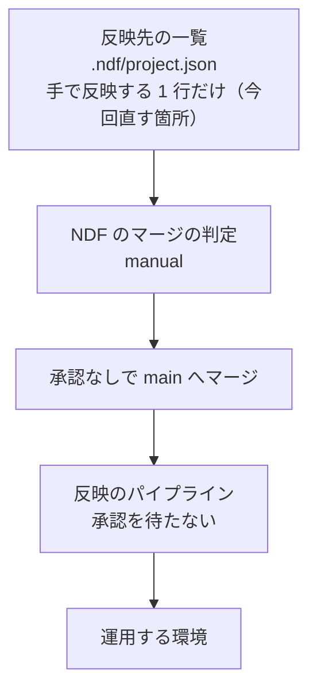
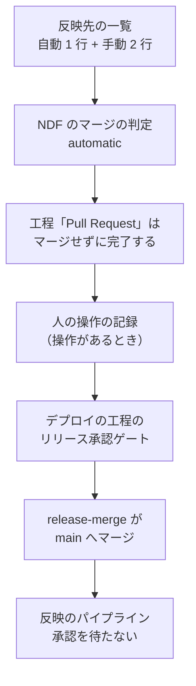
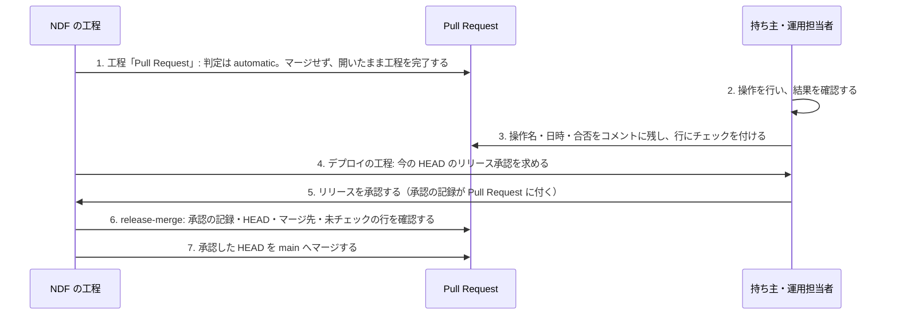

# ブランチ戦略の設定: main へのマージがリリース承認ゲートを通るようにする（#166）

main へのマージは運用する環境へ自動で反映されるのに、開発の工程を進める仕組み（NDF）の設定は「手で反映」なので、承認なしでマージされる。反映先の一覧を実際の 3 つの経路に合わせて自動の反映の行を足し、NDF が持つマージの判定をそのまま働かせる。あわせて、承認する時点を決定の記録・指針・手順書でそろえ、マージの前に人が済ませる操作が残る場合に NDF にマージさせないための、Pull Request の本文の書き方を手順書に定める。採らなかった案は「決定の記録」に、外部の調査を省いた理由は末尾の「外部の調査」にある。

## 今の姿

何が起きたか・目的・受け入れ条件は要求仕様（[issue-166-requirements.md](./issue-166-requirements.md)、正は [#166](https://github.com/devbasex/nd-factory/issues/166) の本文）にある。この文書は「どう解くか」と「なぜその解き方か」だけを書く。



設定を読む側は 2 つあり、読む場所が違う。

| 読む側 | 対象 | 設定を読む場所 | 自動の反映の行があるときの動き |
| --- | --- | --- | --- |
| NDF のマージ（`ndf ci merge`） | 工程が行うマージ | マージ先のブランチ（GitHub の上の `main`） | 本番のブランチ宛ては、承認の記録が Pull Request に無ければマージしない |
| 監視（hook の `merge-production`） | エージェントが直接打つ `gh pr merge` | コマンドを打つ作業場所の `.ndf/project.json` | 本番向けの行があれば、Pull Request のマージ先も承認の記録も確認せずに止める |

NDF 11.0.43 の監視は、作業場所の設定に本番向けの自動の反映の行があれば、承認の後でも直接の `gh pr merge` を止める。承認の後のマージは NDF の工程から実行する。

原因は、反映のパイプラインから承認の段を外したときに、反映先の一覧を直さなかったことである。判定の仕組みは、設定のとおりに動いている。

## 文脈と制約

- 本番のブランチと開発の起点のブランチは、どちらも `main` である
- 反映のパイプライン、自分で設置する人のコマンド、NDF の判定の仕組みは変えない
- この変更をマージする時点の `main` の設定は「手で反映」なので、NDF はこの変更の Pull Request を承認の対象にしない（要求の前提 2）。対象は、設計 PR の [#195](https://github.com/devbasex/nd-factory/pull/195) と、設定を変える後続の Pull Request の 2 本である（決定 5）
- `.ndf/project.json` のブランチ戦略の設定は手で編集せず、`ndf project branch-strategy write` で書く（NDF の決まり）
- インフラの実際の値を、設定・手順書・記録に書かない
- 実際の値を照合する漏れの検査は、公開しない場所で動く（非公開の検査）。NDF 11.0.43 はこの検査を起動しないので、検査を使える NDF が入るまで、この変更の Pull Request はマージしない（決定 5）

## 解き方の全体像



- 反映先の一覧は、経路ごとに 1 行の 3 行になる。運用する環境のアプリの行だけが自動で反映する行である
- アプリの反映を人が承認する時点は、`main` へのマージの前の 1 つだけになる。マージの後のパイプラインの実行は承認を待たない
- マージの前に人が行う操作は、Pull Request の本文の未チェックの行として残り、残る間は NDF がマージしない
- 同じ説明は全体の設計の決定の記録（決定 142。設計 PR で足す）に置き、指針・`AGENTS.md`・手順書はそこを指す

## 処理の流れ

設定を切り替えた後の、通常のスプリントの順序である。工程「Pull Request」は Pull Request を開いたまま完了し、デプロイの工程で承認を受けてからマージする。マージの前に人が行う操作が無ければ、2〜3 を飛ばす。



7 の後は、反映のパイプラインが承認を待たずに反映まで進む。スプリントを通さない修正では、マージの工程が承認待ちで止まり、承認の後にその工程がマージする。この変更自身は設定の切り替え前なので、決定 5 の手順を使う。

## 非機能の実現方式

| 大項目 | 要求の条件 | 実現方式 | 確認の仕方 |
| --- | --- | --- | --- |
| 運用・保守性 | 手順書の確認の手順は、会話の記録や引継ぎのメモを読まなくても、手順書と課題・Pull Request だけで実行できる | 行う操作・見るもの・合格の状態を Pull Request の本文の行とコメントに持たせ、書き方を手順書に置く（決定 4） | 手順書と Pull Request だけを読んで、次の操作が決まることをレビューで確認する |
| セキュリティ | 設定・手順書・記録に、インフラの実際の値を書かない | 反映先の一覧の行はコマンドの形と置き換え記号だけを持ち、反映の結果を読むコマンドを持たない（決定 6）。マージの前の確認のコメントには、操作名・確認した日時・合否（合格か不合格）だけを書く。実行の ID・ARN などの確認の証跡は、運用担当者が運用の記録に残す（下の「運用の記録」） | 漏れの検査（CI と NDF のマージの直前の検査）と差分のレビュー |

**運用の記録**は、公開できない実際の値を残す、リポジトリの外の非公開の保管先である（[反映のパイプラインの仕様の用語](../docs/specifications/deploy-pipeline.md#用語)）。運用担当者が書き、Pull Request の番号と操作名を添えて、公開のコメントと対応が取れるようにする。具体的な置き場と閲覧できる人は（未確認: 保存先）で、人へ残す判断に置く。決まるまでも、値は Pull Request・課題・リポジトリに書かない。

## 決定の記録

各決定の「根拠」の Value の番号は、プロジェクトの判断の基準（MVV、[.ndf/mvv.md](../.ndf/mvv.md)）の項目である。

| 番号 | 項目の名前 |
| --- | --- |
| Value 7 | 公開を前提に、値を置かない |
| Value 13 | 重複と冗長を作らない |
| Value 14 | モダンな開発の手順で品質を確かめる |
| Value 17 | 目先の手間より、長く良い形を選ぶ |

### 決定 1: 本番へ届くマージを承認なしで通さないため、main へのマージにリリース承認ゲートを掛け、自動の反映の行を足す

- **質問**: `main` へのマージを承認の対象にするか。するなら何で効かせるか
- **選んだ案**: 対象にする。反映先の一覧に `kind: auto`・`channel: production` の行を足し、NDF が持つ判定と監視をそのまま働かせる。ブランチ名は行に写さない（本番のブランチは `branches.production` が持つ）。反映の段を一時的に止めている間や、準備の段が失敗している間も、行はそのままにする
- 採らなかった案: 手で反映する行のままにし、承認は人と AI の注意で守る（工程の自動のマージは、人や AI の注意を読み取らない。2026-11-26 には承認なしのマージが起きた）
- 採らなかった案: 反映のパイプラインに承認の段を戻す（持ち主の「パイプラインの実行は承認不要」に反し、要求の対象外である）
- 採らなかった案: NDF の側の直し（[ai-plugins#4579](https://github.com/devbasex/ai-plugins/issues/4579)）を待つ（設定が実態と違う状態が残り、その間のマージが承認を通らない）
- **代償**: 文書だけの Pull Request も承認の対象になる。承認の回数は、スプリントでは 1 回である。工程「Pull Request」はマージせずに完了し、デプロイの工程でリリースを承認した後に、同じ工程の `release-merge` が承認した HEAD を `main` へマージする。スプリントを通さない修正では Pull Request ごとに 1 回である
- 根拠: Value 14（MVV バージョン 4）

### 決定 2: どの経路でだれが承認するかを一覧から読めるよう、反映先の一覧を 3 行に分ける

- **質問**: 3 つの経路を何行で表すか
- **選んだ案**: 次の 3 行にする。手で反映する 2 行には、自動にしない理由（`manual_reason`）を書く。`release.cd` は `null` のままにする（判定は反映先の一覧があれば一覧だけを読む）

| 行の対象 | `kind` | `channel` | 起こし方の欄（`trigger`）に書くこと | 自動にしない理由 |
| --- | --- | --- | --- | --- |
| 運用する環境のアプリのスタック | `auto` | `production` | `main` への push で準備から反映まで進む。実行は承認を待たないので、マージの前にリリース承認ゲートを通す | — |
| 運用する環境の反映のパイプラインのスタック | `manual` | `production` | `diff --stack pipeline` の差分をリリース承認ゲートで承認した後に `deploy --confirm` | パイプラインが自分自身を自動で反映すると、push だけで反映の権限を変えられるようになる |
| 自分で設置する人の AWS | `manual` | 省く | 設置する人が `diff` の差分と確認の値を読み、`deploy --confirm`。このリポジトリのデプロイの工程では打たない | 設置する人が自分の AWS で差分を読んで反映する |

- 採らなかった案: パイプラインのスタックの経路を、ほかの行の説明に含める（承認の仕方が違う経路が 1 行に混ざり、今の説明文と同じ読み違いが起きる）
- **代償**: 本番への反映の承認で人が読む資料（承認資料）には、反映先ごとに、どう届くかを書く欄がある。その欄に、このリポジトリが打たない「自分で設置する人」の行も出る。打たないことは行の文で示す
- 根拠: Value 14（MVV バージョン 4）

### 決定 3: 承認する時点の解釈が分かれないよう、マージの承認と実行の承認の関係を全体の設計の決定 142 に置く

- **質問**: 「パイプラインの実行は承認不要」と、マージの承認の関係をどこに、どう書くか
- **選んだ案**: 持ち主の言う「実行は承認不要」はマージの後の個々の実行を指し、マージの前の承認と両立すると定める。[全体の設計](../docs/design/platform.md#決定の記録)の決定の記録に決定 142 を足し、ほかの文書は 1〜2 文とリンクにする。決定 142 と全体の設計の書き換えは、承認済みの設計を変えるので、この設計書と同じ設計 PR に含めて承認を受ける。指針・`AGENTS.md`・手順書・仕様は、承認された決定 142 に沿って後続の Pull Request で直す

決定 142 に書くことは次のとおりである。

| 項目 | 中身 |
| --- | --- |
| 承認する時点 | 反映を起動するソースブランチへのマージの前（リリース承認ゲート）。このリポジトリでは `main`。別のブランチをソースブランチにする設置では、そのブランチ。反映のパイプラインのスタックは `deploy` の前 |
| 承認しない時点 | マージの後の、アプリのスタックの個々の実行（準備・反映） |
| 変わらない承認 | 反映の段への遷移の停止と再開・失敗した段のやり直しなどの運用の操作は、[承認を受ける操作](../docs/specifications/deploy-pipeline.md#承認を受ける操作)の条件のまま |
| 理由 | パイプラインは人を待たないので、マージより後に人が止める時点が無い |
| 事故の経緯 | 2026-11-26（UTC）に、実装の [#190](https://github.com/devbasex/nd-factory/pull/190) と、追加の直しの [#194](https://github.com/devbasex/nd-factory/pull/194) が、工程「Pull Request」の自動のマージで、承認ゲートを通らずに `main` へ入った。反映先の一覧が手で反映のままで、NDF が本番へ届く操作と扱わなかった。反映のパイプラインは準備の段で失敗し、2 本の変更は運用する環境へ反映されなかった（反映されたのは文書だけの [#192](https://github.com/devbasex/nd-factory/pull/192)） |
| 適用する期間 | 商用利用の開始前。開始後の方式は持ち主が決め直す |

指針と文書は次のように直す。全体の設計の行は設計 PR で、ほかの行は後続の Pull Request で直す。

| 文書 | 直すこと |
| --- | --- |
| 開発の指針の「反映のパイプラインの実行は人の承認を待たない」の行 | 「本番系へ届く操作に含めない」を、マージの後の個々の実行に限る形に書き換え、`main` へのマージが本番系へ届く操作に当たると書く |
| `AGENTS.md` の「反映の経路」 | 運用する環境の行に、マージの前にリリース承認ゲートを通ることと、マージの前の確認の手順へのリンクを足す |
| 全体の設計の「解決の方針」と「2 つの反映の道筋」の運用する環境のアプリの行 | 個別の実行は承認せず、承認はマージの前に取ることを足し、決定 142 を指す |
| 反映のパイプラインの手順書の冒頭と「順序のまとめ」、設置の手順の「運用する環境」、反映のパイプラインの仕様の「承認を受ける操作」 | 「承認を待たない」がマージの後の実行を指すことと、マージの前の承認を 1 文で足す |

- 採らなかった案: 指針の行だけを直し、決定の記録を足さない（理由と事故の経緯が残らず、受け入れ条件 8 を満たさない）
- **代償**: 承認の扱いを変えるとき、決定 142 と、それを指す文をあわせて直す
- 根拠: Value 13・Value 14（MVV バージョン 4）

### 決定 4: 人の操作が残る Pull Request を自動の流れがマージしないよう、本文の「マージの前に決める」の行で確認する

- **質問**: 設計が「マージの前に人が行うこと」とした操作が済んだことを、何で確認し、済むまでどう止めるか
- **選んだ案**: 反映のパイプラインの手順書に「main へのマージの前の確認」の節を置き、次の形を定める。NDF のマージは、本文に未チェックの「マージの前に決める」の行が残る Pull Request を拒むので、新しい仕組みは足さない

| 順 | だれが | すること |
| --- | --- | --- |
| 1 | 設計する人・AI | 要る操作があれば、設計書に「マージの前に人が行うこと」の節を置き、操作・行う人・見るもの・合格の状態を書く |
| 2 | Pull Request を作る人・AI | 操作 1 つを本文の 1 行にする: `- [ ] マージの前に決める: <操作>（確認: <見るものと合格の状態>）` |
| 3 | 持ち主か運用担当者 | 操作を行い、見るもの（例: 反映の段への遷移を止める操作なら `get-pipeline-state` の遷移が無効）を確認する。操作名・確認した日時・合否を Pull Request のコメントに残し、実際の値を含む証跡は運用担当者が運用の記録に残す |
| 4 | 持ち主か運用担当者。AI は人が残した合格のコメントがあるときだけ | その操作の最新の人の記録が合格のときだけ、行にチェックを付ける。最新の記録が不合格か、記録が無ければ、未チェックのままにする |
| 5 | リリースを承認する人 | 承認の前に、全部の行にチェックがあり、各操作の最新の人の記録が合格であることを確認する。1 つでも満たさなければ承認せず、マージしない。チェックの後に不合格が記録された行は、未チェックに戻す |

手順書には、次の 2 つも書く。GitHub の画面からのマージは止まらないので、人も同じ確認を済ませるまでマージしない。「マージの前に決める」の語を含む行は、チェック欄の無い見出し・説明文・コードブロックの行でもマージを止める。そのため、この語は 2 の行のほかには本文に書かない。

確認の行は、本文を直すときに消さないようにする。手順書には次を定める。

- Pull Request の本文を書き直す人・AI（`/ndf:pr` での更新、`gh pr edit`、レビューの指摘の直し）は、直す前の本文の「マージの前に決める」を含む行を、そのまま新しい本文へ引き継ぐ
- 行は「## 通した工程」「## 進行」の節の外に置く。NDF の進捗の記録は、この 2 つの節を丸ごと書き直す
- 工程「Pull Request」を始める前（始めずに終える場合は、終える記録の前）と、本文を直した後に、行が NDF の判定に渡ることを下のコマンドで確認する。読むだけで、マージはしない。操作の残る行がすべて出力に並べば合格である

```bash
NDF_SRC="$HOME/.claude/plugins/cache/ai-plugins/ndf/11.0.43/src"  # 例。使う NDF の src ディレクトリに合わせる
gh pr view <番号> --json body --jq .body | python3 -I -B -c 'import sys; sys.path.insert(0, sys.argv[1]); from ndf.adapters.github_merge import premerge_risks; print(premerge_risks(sys.stdin.read()))' "$NDF_SRC"
```

開発の指針には、設計と Pull Request を作るときにこの節を読む 1 行を足す。これは承認の工程を足すものではなく、承認の前提になる操作の確認である。

- 採らなかった案: 手順書の文章だけで定める（自動のマージは手順書を読まず、操作が残ったまま進む）
- 採らなかった案: CI が AWS の状態を読んで必須のチェックにする（CI は AWS の資格情報を持たない決まりである）
- **代償**: 行を本文に書き忘れると、機械では止まらない。リリース承認ゲートで人が設計書と突き合わせる
- 根拠: Value 13・Value 17（MVV バージョン 4）

### 決定 5: この変更自身を承認の前に本番へ反映しないよう、2 本の Pull Request に未チェックの行を置き、承認した HEAD だけをマージする

- **質問**: この変更をマージする時点では、`main` の設定はまだ手で反映である。承認の前にマージされないように、どう止め、何を承認してもらい、承認した対象だけをどうマージするか
- **選んだ案**: 2 本の本文に `- [ ] マージの前に決める: <承認の中身>（確認: 持ち主の回答の記録）` の行を置いて自動のマージを止める。承認は既にある承認ゲートで取り、マージするコマンドには承認した HEAD とマージ先を渡す

| Pull Request | 持つもの | 行を置く時点 | 使う承認ゲート | 何を承認するか |
| --- | --- | --- | --- | --- |
| 設計 PR の [#195](https://github.com/devbasex/nd-factory/pull/195)（開いている） | 設計書、要求仕様、全体の設計（決定 142） | 設計の承認資料を出す前に、進める人・AI が本文へ足す（今の本文には行が無い） | 工程「設計」の設計承認ゲート | 設計の内容と、#195 を `main` へマージして運用する環境への反映が起動し得ること。1 回の回答で両方を受ける。後続の Pull Request のマージは含まない |
| 設定を変える後続の Pull Request | 反映先の一覧、指針、`AGENTS.md`、手順書、仕様 | ブランチを push して `gh pr create --body-file` で作るとき。本文に行と `Refs #166` を書く | 工程「デプロイ」のリリース承認ゲート | その HEAD を `main` へマージすることと、起動する運用する環境への反映 |

どちらも新しい承認の工程は足さず、持ち主が答える（`ndf answer` の `--by human`。AI の判定では通さない）。

#### 切り替えの前提: 非公開の漏れ検査

2 本とも、対象のマージ候補（その HEAD と、その時点の `main` を合わせた内容）に非公開の検査が成功した場合だけマージする。検査を使える状態になるまでは、2 本を開いたままにする。

NDF 11.0.43 の `ndf ci merge` と `release-merge` は、非公開の検査を起動せず、結果も照合しない。必須のチェックの `leak-check` は、実際の値を使う検査を含まない（[漏れの検査の仕様](../docs/specifications/leak-check.md)）。そのため、この版のままではどちらのコマンドでもマージしない。手で起動した検査の成功を根拠にマージすることもしない（[導入の順序](../docs/operations/ci-checks.md#導入の順序)の手順 3 と同じ扱い）。

| 確認すること | いつ | だれが | 合格 |
| --- | --- | --- | --- |
| 非公開の検査が使える | 承認資料を出す前 | 持ち主 | [導入の順序](../docs/operations/ci-checks.md#導入の順序)の手順 6（NDF の利用者の設定で非公開の検査を有効にし、有効にする 2 本目の Pull Request を NDF がマージする）まで済んでいる |
| 下のマージの手順が、使う NDF の版でも成り立つ | 承認資料を出す前 | 進める人・AI | 下の手順は 11.0.43 の定義とコードを読んで決めた。非公開の検査を持つ版の定義とコードを読み直し、違いがあれば設計を直してから進む |
| このマージ候補の検査が成功した | マージのとき | NDF が照合し、持ち主が非公開の記録で確かめる | NDF が[受け入れる条件](../docs/specifications/leak-check.md#ndf-が非公開の検査の結果を受け入れる条件)を満たしてマージした。確かめた結果は運用の記録に残し、公開の Pull Request には書かない |

#### 承認資料に書く反映の範囲

どちらのマージも `main` への push なので、反映のパイプラインが起動し、運用する環境へ反映し得る。反映されるのは Pull Request の差分だけではなく `main` の先端の全体で、まだ反映されていない先の変更（2026-11-26 の #190・#194 のようなもの）も含み得る。そのため、2 本とも承認資料を出す前に次を調べて書く。

承認資料は、承認する人への説明を先に置き、その根拠のコミットを後ろに置く。

| 書くもの | だれが、どう調べるか |
| --- | --- |
| 承認する人への説明（資料の先頭） | 進める人・AI が、下の 3 行を調べた後に、コミットや差分を読まなくても分かる言葉で書く。何が変わるか（まだ反映されていない先の変更があれば、それも 1 件ずつ）、運用する環境への影響（利用者や運用で何が変わるか、影響が無いならその理由）、今回の回答で承認する範囲と含まないもの |
| 最後に反映されたソースのコミット | 運用担当者が、反映の段が最後に成功した実行のソースのリビジョンを読む |
| 照合した `main` の先端のコミット | 進める人・AI が `git fetch origin main` の後に読む |
| このマージで反映対象になる変更 | 進める人・AI が、最後に反映されたコミットから `main` の先端までのコミット（`git log <反映済み>..origin/main`）と、Pull Request の差分を並べる |

最後に反映されたコミットを確認できなければ、承認に出さない。

#### main を止めてマージする

承認資料に書いた `main` の先端の上にマージするため、照合からマージの成立の確認まで、ほかの変更を `main` へ入れない。NDF がマージの要求で固定するのは Pull Request の HEAD だけで、`--approved-base main` が比べるのはブランチの名前である。`main` にはブランチの保護もルールセットも無いので、止めるのは次の手順の取り決めである。

| 順 | だれが | すること |
| --- | --- | --- |
| 1 | 持ち主（進める人・AI が依頼する） | `main` を止める。`main` へ書き込める人と AI の全員に知らせ、ほかの Pull Request のマージ（NDF と GitHub の画面）と、`main` への直の push を止める |
| 2 | 進める人・AI | `git fetch origin main` の後の先端が、承認資料のコミットと同じことを確かめる。違えば反映の範囲が変わったと扱い、下の「承認を取り直す」に進む |
| 3 | 進める人・AI | 下の「承認からマージまで」のコマンドでマージする |
| 4 | 進める人・AI | マージでできたコミット（`gh pr view <番号> --json mergeCommit`）の最初の親（`gh api repos/devbasex/nd-factory/commits/<コミット> --jq '.parents[0].sha'`）が、承認資料のコミットと同じことを確かめる |
| 5 | 持ち主 | 4 が同じなら、`main` の停止を解く |

- マージの要求の結果が分からない間は、結果が確定するまで `main` を止めたままにする。マージせずに終える場合は、マージされていないことを確かめてから停止を解く
- 4 が違えば、承認していない変更が反映の対象に入っている。直ちに持ち主へ戻し、停止は解かない。反映を止めるか（[承認を受ける操作](../docs/specifications/deploy-pipeline.md#承認を受ける操作)の条件に従う）、変更を戻すかは持ち主が決める

#### 承認からマージまで

承認の記録は Pull Request のコメントに残し、PR 番号・承認した HEAD・マージ先・照合した `main` の先端・回答を書く。

NDF 11.0.43 の `ndf ci merge` は、`--approved-head` を受け取らなければ、実行した時点の HEAD をマージする。受け取れば、HEAD かマージ先が違うときに `approval_stale` で止まる。この版の工程のうち、承認の回答の HEAD とマージ先を渡すのはデプロイの `release-merge` だけで、設計 PR のマージ（`design-merge`）は渡さない。そのため、2 本の手順は次のように分かれる。

設計 PR の #195:

1. 設計承認ゲートの回答を `ndf answer` で記録し、工程を流す（`ndf progress next`）。`design-merge` は未チェックの行を理由にマージを拒み、工程「設計」が止まる
2. 承認の記録をコメントに残し、行にチェックを付ける
3. `main` を止めて先端を照合し（「main を止めてマージする」の 1・2）、工程を再実行せずに、下のコマンドでマージする。マージの後に親のコミットを確かめる（同じく 4・5）
4. `design_pr` と、設計工程が記録した `mvv_gate` を出力のファイルに入れ、`ndf progress check <ID> 設計 --output <ファイル>` で確かめてから、`ndf progress finish <ID> 設計 --output <ファイル> --reason <理由>` で終える。どちらかのキーが欠けると `finish` は拒む

```bash
ndf ci merge --pr 195 --approved-head <承認した HEAD> --approved-base main --method squash \
  --budget 1800 --required=<必須のチェック>  # --required は .ndf/project.json の ci.required_checks の数だけ並べる
```

4 の出力のファイルは `{"outputs": {"design_pr": 195, "mvv_gate": {…}}}` の形である。`mvv_gate` の値は、設計工程の中の判定のステップ `design-mvv`（承認ゲートを省けるかの MVV 判定）が記録している。`ndf progress show <ID>` の `metrics.history` から、`row_key` が `設計`、`kind` が `step_recorded`、`payload.step` が `design-mvv` の最も新しい記録を選び、その `payload.report.outputs.mvv_gate` を書き換えずに写す。

後続の Pull Request:

工程「Pull Request」は流さない。流すと、その中のマージが未チェックの行で拒まれて工程が止まり、リリース承認ゲートがあるデプロイの工程へ進めないためである。

1. 本文に行がある Pull Request を作った後、工程「Pull Request」を `ndf progress finish`（出力に `pr`）で終える。必須のチェックは `release-merge` が待つ。デプロイより前の工程「確定仕様化」は `ndf progress disable` で無効にする。仕様の書き換えはこの Pull Request が持ち、流すと同じブランチの push と Pull Request の作成で止まり得るためである
2. 工程を順に流し、デプロイの工程のリリース承認ゲートに承認資料を出す
3. 回答を `ndf answer` で記録し、**チェックを付ける前に** `ndf progress next` を打つ。`release-merge` は未チェックの行を理由にマージを拒み、デプロイの工程が止まる。先にチェックを付けると、本文が変わったので NDF が承認を問い直す
4. 承認の記録をコメントに残し、行にチェックを付ける
5. `main` を止めて先端を照合し（「main を止めてマージする」の 1・2）、`ndf progress retry <ID> デプロイ --reason <理由>` と `ndf progress next` を打つ。マージの後に親のコミットを確かめる（同じく 4・5）。承認ゲートは済んだままで、`release-merge` が回答の HEAD とマージ先を `--approved-head`・`--approved-base` で受けてマージする

#### 承認を取り直す

HEAD・マージ先・`main` の先端のどれかが承認の記録と違えば、マージせず、行を未チェックに戻す。承認資料を作り直し、同じ承認ゲートの承認を持ち主に問い直して、新しい記録を残す。

- #195 は、下の「#195 の承認の取り直し」の順で進める
- 後続の Pull Request は、`release-merge` が `approval_stale` で止まった結果に出る `routes.retry` と `next` のコマンドを順に打ち、リリース承認ゲートに答え直す。まだ `approval_stale` で止まっていなければ、上の手順 5 の `retry` と `next` を打って止める
- HEAD が同じまま `main` だけが進んだ場合は、先にブランチへ `main` を取り込んで push し、HEAD を変える。こうすると `release-merge` は前の回答の HEAD ではマージできず、`approval_stale` で止まる

**#195 の承認の取り直し**では、新しい回答を記録し、行にチェックを付け直し、最新の承認対象を照合してからマージする。NDF 11.0.43 では、読み終えた設計承認ゲートの回答を開き直せない（`ndf progress retry` は済んだステップを残す）。そのため `ndf answer` は使わず、同じ設計の承認を持ち主へ直接問い直す。

1. 進める人・AI が、今の HEAD と `main` の先端で承認資料を作り直し、持ち主に問う
2. 持ち主が答える（AI の判定では代えない）。進める人・AI が、新しい承認の記録を Pull Request のコメントに残す
3. 回答が承認なら、行にチェックを付け直す。承認でなければ未チェックのままにする
4. 「main を止めてマージする」の順で、新しい記録の HEAD・マージ先・`main` の先端を照合し、新しい HEAD を `--approved-head` に渡して上のコマンドでマージする
5. 「承認からマージまで」の #195 の手順 4 のとおり、工程「設計」を終える

- 採らなかった案: 進める人と AI の申し合わせだけで止める（2026-11-26 と同じ形で、自動の流れがマージする）
- 採らなかった案: チェックを付けて、マージを持つ工程をそのまま再実行する（`design-merge` と工程「Pull Request」は承認した HEAD を受け取らず、承認の後に push されたコミットもマージする）
- 採らなかった案: 先に反映先の一覧だけを `main` へ入れる（その Pull Request のマージも同じ理由で承認の対象にならず、Pull Request が増える）
- **代償**: 後続の Pull Request を手で作り、2 本とも工程の一部を手で終える。マージの工程が 1 回止まる。運用担当者が反映済みのコミットを読む手間が増える。非公開の検査を使える NDF が入るまで切り替えが遅れる。マージのたびに `main` を止め、止め忘れた書き込みはマージの後にしか分からない
- 根拠: Value 14（MVV バージョン 4）

### 決定 6: 実際の値をリポジトリに置かないため、自動の反映の行に結果を読むコマンドを持たせない

- **質問**: 自動の反映の行に、反映の結果の読み方（`result`）を書くか
- **選んだ案**: 書かない。NDF はデプロイの結果を「未確定」と記録する。リリース後テストの工程で、閲覧権限のある運用担当者が反映の状態を確認する（確認の手順と合格の状態は、下の「リリース後の確認」）
- 採らなかった案: パイプラインの実行を読むコマンドを書く（profile と資源の名前が要り、AI と CI は AWS の資格情報を前提にできない）
- **代償**: 反映の成否は自動で記録されない。失敗は今の通知のメールで届くが、成功と停止中は通知されないので、運用担当者が見に行く
- 根拠: Value 7（MVV バージョン 4）

### 決定 7: 承認の扱いを直す変更を小さく保つため、「設定が古い」の解消はこの変更に含めない

- **質問**: `ndf project check` の「設定が古い」を同じ変更で解消するか
- **選んだ案**: 含めない。「設定が古い」の理由は CI の定義や依存の定義が変わったことで、反映先の一覧を指すものではない。解消は次のスプリントの開始時の自動の再解析が行う。再解析はブランチ戦略の設定を書き換えない
- 採らなかった案: 再解析をこの変更に含める（言語やテストの設定の差分が混ざり、人の承認が要るファイルの差分が読みにくくなる）
- **代償**: 受け入れ条件 6 の記録は、終了コード 3 と「変わった入力」の一覧になる。この結果だけでは、変えた設定が正しいとは言えない
  - NDF 11.0.43 の `ndf project check` は、古さを調べる前に、設定を JSON として読んで設定のスキーマ（反映先の一覧の各行の形を含む）で検査し、合わなければ終了コード 2 で止まる
  - ただし読むのはメインディレクトリの `.ndf/project.json` で、作業場所で変えた設定ではない
  - そのため受け入れ条件 6 では、変えた設定を NDF のブランチ戦略の検査に別に掛ける（テスト設計）
- 根拠: Value 13（MVV バージョン 4）

## 影響と危険

- **働く範囲**: このリポジトリだけ。利用先の設置（自分で設置する人）の手順とコマンドは変わらない
- **プロジェクトごとに違うもの**: 無し。NDF の設定の値と、このリポジトリの文書だけを直す
- **当たるモード**: `main` 宛ての Pull Request を持つ、NDF のすべての作業の進め方（モード。スプリント・単発の修正・クローズ）

| 壊れうる箇所 | 扱い |
| --- | --- |
| この変更をマージする前の `main` は手で反映のままである。並行して進むほかの作業の Pull Request が承認なしで入る | 直し終わるまで、`main` へ入るスプリントのほかの Pull Request をマージしない（要求の前提 3）。この変更の Pull Request は決定 5 で止める |
| 監視は、`gh pr merge` を打った作業場所の設定を読む。直しを取り込んでいない作業場所では、直接の `gh pr merge` が止まらない | マージの後に、メインディレクトリと開いている作業場所へ `main` を取り込む。工程のマージは `main` の設定を読むので、取り込みの前でも止まる |
| 監視はマージ先も承認の記録も確認しないので、`main` 以外へ向けた直接の `gh pr merge` も、承認の後の直接の `gh pr merge` も止まる | 工程のマージ（`ndf ci merge`）を使う。工程のマージは、`main` 以外の宛先をそのまま通し、`main` 宛ては承認の記録があれば通す |
| 非公開の検査を使える NDF が入るまで、反映先の一覧は手で反映のままになる | 2 本をマージしない。この間は[導入の順序](../docs/operations/ci-checks.md#導入の順序)の手順 3 により、NDF にほかの Pull Request もマージさせない |
| GitHub の画面や人の端末からのマージは止まらない | 手順書に、人も同じ確認の後にマージすると書く |
| Pull Request の本文を作り直すと、確認の行が消えうる。設定の切り替え前の Pull Request は、行が消えると承認なしでマージされる | 本文を直す人・AI が行を引き継ぎ、工程「Pull Request」の前と直した後に、行が NDF の判定に渡ることを読むだけのコマンドで確認する（決定 4）。後続の Pull Request は行を入れて作り、工程「Pull Request」を流さずに終える（決定 5） |
| `AGENTS.md`・開発の指針・全体の設計は、並行して進むほかの作業も触る | 実装の前と Pull Request の前に `main` を取り込む |

`AGENTS.md` と開発の指針の反映の指示の書き換えは、持ち主の承認が要る操作（[承認を受ける操作](../docs/specifications/deploy-pipeline.md#承認を受ける操作)の A5）である。設計の承認とリリースの承認で持ち主が見る。

## テスト設計

コードを足さないので、新しいテストは書かない。反映先の一覧から判定する規則は、NDF の側のテストが確認している。確認は下のコマンドと読み合わせで行い、結果を課題か Pull Request に残す。`npm run check` は退行の確認に通す。

受け入れ条件 4 は、直した作業場所の根で次を打つ。`NDF_SRC` には、使う NDF のプラグインの `src` ディレクトリを入れる。

```bash
NDF_SRC="$HOME/.claude/plugins/cache/ai-plugins/ndf/11.0.43/src"  # 例。使う NDF の src ディレクトリに合わせる
python3 -I -B -c 'import sys; sys.path.insert(0, sys.argv[1]); from ndf.core import production_merge as p; r = "devbasex/nd-factory"; print(p.judge_project_text(open(".ndf/project.json").read(), "main", source_repo=r, repo=r).value)' "$NDF_SRC"
```

受け入れ条件 6 の、変えた設定の形の検査は、同じ場所で次を打つ。NDF の依存が要るので、NDF の仮想環境の Python を使う。`[]` が出れば合格で、違反があれば規則とキーの位置が出る。

```bash
NDF_PYTHON="${XDG_CACHE_HOME:-$HOME/.cache}/ndf/venv/11.0.43/bin/python"
"$NDF_PYTHON" -I -B -c 'import json, sys; sys.path.insert(0, sys.argv[1]); from ndf.core import branch_strategy as bs; print(bs.validate(json.load(open(".ndf/project.json"))["branch_strategy"]))' "$NDF_SRC"
```

受け入れ条件 5 は、変更後の `.ndf/project.json` が入った `main` のコミットを取り込んだ作業場所で、対象の NDF のバージョンの hook を有効にして確認する。使ったコミットと NDF のバージョンを結果に残す。

| 受け入れ条件 | どの振る舞いで縛るか | どう壊したら落ちるべきか |
| --- | --- | --- |
| 1 | 一覧に `kind: auto`・`channel: production` の行がある | 行を消すか `manual` にすると、受け入れ条件 4 の判定が `manual` になる |
| 2 | 自分で設置する人の行が `manual` で、自動の行と別にある | 1 行にまとめると、差分の読み合わせで経路が数えられない |
| 3 | どの行の説明にも「パイプラインの承認の後」が無く、パイプラインのスタックの行が `manual` である | 一覧を「パイプラインの承認の後」で検索して当たれば不合格 |
| 4 | 上のコマンドが `automatic` を返す | 今の `main` の設定では `manual` が返る |
| 5 | `main` へ入った後、そのコミットを取り込んだ作業場所で、実在しない番号の `gh pr merge` が監視に止められる（承認の記録の有無は見ない） | 直す前の設定を持つ作業場所では、監視は止めない |
| 6 | `ndf project check` の指摘に、反映の経路の設定を指す項目が無い。加えて、変えた設定の形の検査が `[]` を返す | 反映先の一覧の行の `kind` を `auto`・`manual` 以外にすると、形の検査がその行の位置を返す |
| 7 | 受け入れ条件 4 は設定を読むだけで確認する。5 は実在しない Pull Request の番号に `gh pr merge` を打つ。6 は `ndf project check` と、作業場所で変更した設定の読み取り専用の形の検査を行う。マージするコマンド（`ndf ci merge`）は使わない | 開いている Pull Request の番号を使う手順は不合格 |
| 8 | 決定 142 に、掛けること・理由・事故の経緯（Pull Request の番号・原因・反映の結果）がある | どれかが欠ければ読み合わせで不合格 |
| 9 | 決定 142・開発の指針・`AGENTS.md`・反映の手順書で、承認する時点としない時点が同じである | 「承認」を検索し、マージの前の承認を不要と読める文があれば不合格 |
| 10 | 手順書に、行う人・見るもの・済んでいなければマージしないことがある。未チェックの行がある本文を NDF の関数（`github_merge.premerge_risks`）へ渡すと行が返り、チェックを付けると返らない | 行の形が手順書と違い「マージの前に決める」を含まなければ、関数が何も返さない |
| 決定 4 | 手順書で、操作の最新の人の記録が合格の場合だけチェックと承認へ進む | 不合格の記録でチェックや承認へ進めると読める文があれば、読み合わせで不合格 |
| 決定 4・5 | 工程「Pull Request」を終える記録の前に、後続の Pull Request の実際の本文を `premerge_risks` へ渡すと確認の行が返る（マージはしない） | 本文の書き直しで行が消えると何も返らず、工程を終えない |
| 決定 5 | #195 のマージのコマンドと、後続の `release-merge` の記録に、承認の記録と同じ HEAD とマージ先が渡っている | HEAD を渡さないマージ、記録と違う HEAD のマージは不合格 |
| 決定 5 | 2 本とも、非公開の検査が有効な状態でマージし、マージでできたコミットの最初の親が承認資料の `main` の先端と同じである | 非公開の検査を有効にする前のマージ、親が違うマージは不合格 |
| 11 | 差分が `infra/` と設置のコマンドに触れず、`npm run check` が通る | `infra/` の差分があれば不合格 |

## リリース後の確認

| 確認すること | だれが | 何を見るか | 合格 | 記録 |
| --- | --- | --- | --- | --- |
| 直接の `gh pr merge` が止まる（受け入れ条件 5） | 進める人・AI | 変更後の設定が入った `main` のコミットを取り込んだ作業場所で、実在しない番号の `gh pr merge` を打つ | 監視（hook の `merge-production`）が止める | 使ったコミット・NDF のバージョン・結果 |
| 承認した変更が運用する環境へ反映された | 閲覧権限のある運用担当者（AI と CI は AWS の資格情報を持たない） | 承認した Pull Request のマージで `main` にできたコミット（`gh pr view <番号> --json mergeCommit`）を、パイプラインの実行のソースのリビジョンと照らす | そのコミットの実行の反映の段が成功した。後の push で打ち切られた場合は、下の「後の実行で代える条件」を満たす | Pull Request のコメントに、確認日時・コミット・状態（成功・停止中・進行中・失敗・未確認）。実行の ID は運用の記録 |

**後の実行で代える条件**は、次の 3 つをすべて満たすことである。祖先であることだけでは、後のコミットが変更を取り消していないと分からない。

1. 後の実行の反映の段が成功した
2. 承認した変更のコミットが、その実行のソースのコミットの祖先である（`git merge-base --is-ancestor <承認した変更のコミット> <ソースのコミット>`）
3. その実行のソースで、承認した変更が取り消されていない。承認した Pull Request が触れたファイルについて `git diff <承認した変更のコミット> <ソースのコミット> -- <ファイル>` を読み、変更が残っていることを確かめる

3 を確認できない場合は「未確認」と記録する。停止中・進行中・失敗・未確認と、対応する実行が見つからない場合は、反映済みとして扱わない。前に成功した別のコミットの実行も合格にしない。

## 設計の結果

| 課題 | 扱い | 統合先 | 設計 PR で触るファイル | 後続の Pull Request で触るファイル |
| --- | --- | --- | --- | --- |
| #166 | 実装する | — | `docs/design/platform.md` | `.ndf/project.json`、`AGENTS.md`、`.claude/skills/nd-factory-dev-guidelines/SKILL.md`、`docs/operations/pipeline-approval.md`、`docs/operations/setup.md`、`docs/specifications/deploy-pipeline.md` |

## 人へ残す判断

| 判断 | 当たるレッドライン | なぜ当たるか |
| --- | --- | --- |
| 反映先の一覧と `AGENTS.md` の反映の経路を書き換え、`main` へのマージを承認の対象にする（決定 1・3。「パイプラインの実行は承認不要」はマージの後の実行を指すという読み方を含む） | C7（NDF の共通原則で、必ず人の承認が要る操作の 1 つ） | 利用者の設定（`.ndf/`）と指示書を書き換え、持ち主の決定の適用の範囲を定める。設計の承認とリリースの承認で持ち主が見る |
| #195 のマージで運用する環境への反映が起動し得ることを、設計の承認と合わせて認める（決定 5） | —（本番へ届く操作） | 今の設定では NDF が承認の対象にしないので、承認資料に書かないと持ち主が知らないまま反映される |
| 運用の記録の置き場と閲覧できる人を決める | —（MVV の Value 7） | インフラの実際の値を残す先が、リポジトリの文書では特定されていない |

## 未確認のまま残ること

| 項目 | 内容 |
| --- | --- |
| 監視が直接の `gh pr merge` を止めること | `main` へ入った後に受け入れ条件 5 の手順で確認する |
| 決定 5 の工程の操作が想定どおりに動くか | 工程の終了の記録・再実行・承認の問い直しは、NDF 11.0.43 の定義とコードを読んで決めた手順で、実際には流していない。この変更で流すときに、結果と Pull Request の本文を読んで確認する。想定と違えばマージせずに持ち主へ戻す |
| 非公開の検査が使える時期 | NDF 11.0.43 には無い。NDF に入る版と、その版でのマージの手順は、2 本の承認資料を出す前に確かめる |
| 運用の記録の保存先 | 具体的な置き場と閲覧できる人。持ち主か運用担当者が、確認の手順を最初に使う前に決める |
| 結果の読み方が無い自動の行で、デプロイの工程がどう記録するか | この変更の次のデプロイの工程の記録を読んで確認する |

## 外部の調査

省く: NDF が持つ判定へ渡す設定の値と、このリポジトリの手順の取り決めだけで形が決まり、外部の判断が要らないため
