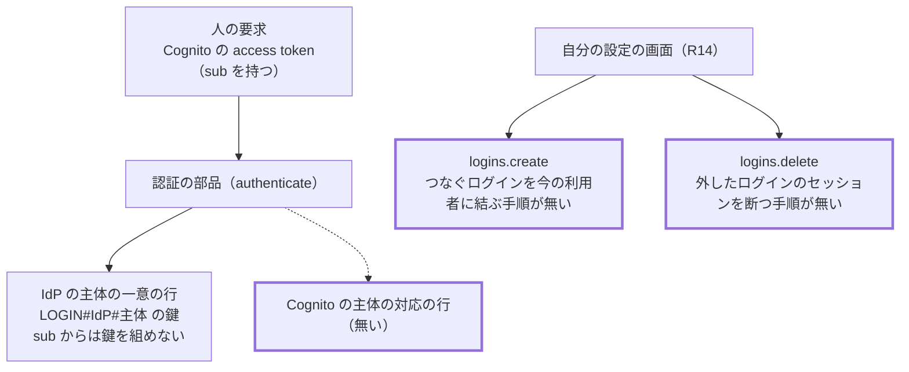
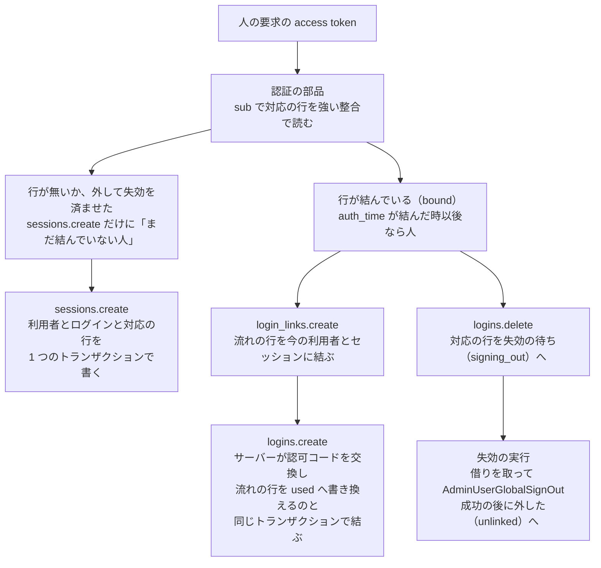

# 人の認証: Cognito の access token から利用者を引き、ログインをつなぐ・外す流れを安全に通す（#2）

承認済みの設計では、人の要求が持つ Cognito の access token が IdP の主体を持たないため、認証が利用者を引けず、ログインをつなぐ・外す流れにも別の利用者へ結べる隙が残っていた。Cognito の `sub` ごとに利用者を引く行（Cognito の主体の対応の行）を置き、ログインをつなぐ流れをサーバーが今の利用者とそのセッション（IdP でのサインイン 1 回ごとに Cognito が作る、refresh token を持つ単位）に結び、外したログインの失効が済むまで結び直させない。決めたことは下の 4 つの決定に、行と手順の細部は全体の設計（[データの文書](../docs/design/data.md#cognito-の主体の対応の行)・[API の文書](../docs/design/api.md#冪等の鍵)・[詳細設計](../docs/design/detail.md#関数の仕様)・[画面の文書](../docs/design/screens.md)・[プラットフォームの文書](../docs/design/platform.md#資源ごとの形)）と [#2 の詳細設計](./issue-2-design-detail.md) にある。

## 今の姿

要求仕様は [issue-2-requirements.md](./issue-2-requirements.md) に、承認済みの設計は [issue-2-design.md](./issue-2-design.md) にある。変更の位置は次の図の太枠である。

- 人の要求の認証は、Cognito の access token の署名・発行元・クライアント・期限・種類を照らす。token から利用者を引く行は無い。サインインは IdP の主体の一意の行（`LOGIN#<IdP>#<主体>`。IdP は `google` か `github`、主体は各 IdP の識別子）を読んで利用者を引くと決めている（[プラットフォームの文書](../docs/design/platform.md) の決定 99）が、access token が持つのは Cognito の利用者の `sub` で、この鍵を組めない
- 初めてサインインした人は、まだ利用者の行を持たない。利用者を作る `sessions.create` に届く前に、認証が主体を決められない
- ログインの組の行と IdP の主体の一意の行は `user_id` だけを持つ。ログインを外す操作は、外すログインに当たる Cognito の利用者を引けない
- `logins.create` の流れ（IdP へ移って戻る）と、ログインを外した後に残るセッションの扱いは、承認済みの設計に手順が無い
- 冪等の鍵は主体の利用者・操作の名前・鍵の 3 つの組で区切る。利用者がまだ無い初めてのサインインの区切りは決めていない
- 画面の地図は 14 本の HTTP の経路で、サインインの戻りは `/` で受ける。CDN は地図の経路に `index.html` を返す（[画面の文書](../docs/design/screens.md) の決定 38）

## 文脈と制約

- Cognito は IdP のアカウントごとに別の Cognito の利用者（別の `sub`）を作る。そのため Cognito の `sub` とログインの組は 1 対 1 に当たる
- Cognito の access token は IdP の主体を持たない。IdP と主体は、token の `username` で利用者プールを読み（`AdminGetUser`）、属性 `identities` から得る
- access token を refresh token で取り直しても、IdP でサインインした時刻（`auth_time`）は変わらない
- `AdminUserGlobalSignOut` は、その Cognito の利用者のすべてのセッションの refresh token を取り消す。呼び出しをクライアントで打ち切っても、Cognito に届いた要求の実行は取り消せない
- 認可の URL の `identity_provider` はブラウザーの側で変えられる。PKCE は認可コードと流れを結ぶだけで、流れを始めたときに選んだ IdP を保証しない
- Cognito が既存のブラウザーセッションを使うと、選んだ IdP で認証し直さずに token が返る。`prompt=login` は managed login でだけ効く
- 画面のアプリのクライアントは、シークレットを持たない公開クライアントである。トークンの端点との交換は本文に `client_id` を要る
- 形の正本では、要求全体の理由（`unauthorized` など）を要素の理由に使えない
- `aws-jwt-verify` は時計を受けず、`exp` と `nbf` を実時刻で照らす
- 全体の設計の I16（1 つの IdP のアカウントは 1 人の利用者だけに結ぶ）と決定 99 の一意の行は決め直さない
- 1 子 1 スプリント（[開発の計画](../docs/design-process/issue-24/plan.md)の決まり）。CI は AWS の資格情報を持たない

## 解き方の全体像

- 認証は Cognito の `sub` で対応の行を読み、結んでいる行で、token の `auth_time` が行を結んだ時以後なら人として通す。行が無い主体と、外して失効を済ませた後にサインインした主体は、`sessions.create` にだけ「まだ結んでいない人」として渡る
- 結ぶ値（IdP と主体）は要求の本文から採らず、検証した token の `username` で利用者プールを読んで得る。結ぶ token は 5 分の内のサインインだけを受ける
- ログインをつなぐ流れは `login_links.create` で始まり、サーバーが流れの `code_verifier` で認可コードを交換し、流れを 1 回だけ使う。戻りは連携専用の戻り先 `/me/logins/return` で受ける
- ログインを外すと対応の行は失効の待ちになり、`AdminUserGlobalSignOut` の成功を確かめてから外した状態へ進む。行は消さずに失効の境（`revoked_before`）を残す

## 決定の記録

### 決定 1: 認証が access token から利用者を引き、外した前のセッションを結び直した後へ通さないため、Cognito の `sub` ごとに対応の行を置き、外しても消さずに状態と失効の境を持たせる

- **質問**: IdP の主体を持たない Cognito の access token から、どの行で利用者を引くか。ログインを外した後と、同じ `sub` を結び直した後に、外す前のセッションの token をどう断つか
- **選んだ案**: `db-users` に Cognito の主体の対応の行（`COGNITO#<Cognito の sub>` / `COGNITO`）を置く。行は状態（`bound`・`signing_out`・`unlinked`）・外した回数（`binding_epoch`）・結ぶのに使った token の `auth_time`（`bound_auth_time`）・失効を済ませた時刻（`revoked_before`）を持つ。認証はこの行を強い整合で読み、`bound` で `auth_time` が `bound_auth_time` 以後の token だけを人として通す。行が無い主体と、`unlinked` で `auth_time` が `revoked_before` より後の主体は、`sessions.create` にだけ「まだ結んでいない人」（`newcomer`）として渡り、ほかの操作は 401 にする。結ぶ IdP と主体は、検証した token の `username` で利用者プールを読んで得て、`auth_time` が 5 分（`LOGIN_BIND_FRESH_MS`）の内のサインインだけを結ぶ。ログインの組の行と IdP の主体の一意の行に `cognito_sub` を持たせ、`logins.delete` はそこから対応の行の鍵を組む。利用者の行に結んだログインの数（`login_count`）を持たせ、外すときはその行の版と「2 以上」を条件に 1 引く。`sessions.create` の冪等の鍵は、主体の利用者の代わりに Cognito の `sub` と `binding_epoch` の組で区切る
- 採らなかった案: IdP と主体を要求の本文から受けて結ぶ（本人確認を済ませていないログインを利用者へ結べる）
- 採らなかった案: ログインを外すときに対応の行を消す（失効の境が残らず、外す前のセッションの token が 5 分の内なら結び直しに使え、結び直した後の利用者へ届く）
- 採らなかった案: `sessions.create` の冪等の鍵も主体の利用者で区切る（初回の書き込みの後に応答を失って送り直すと、主体が「まだ結んでいない人」から人へ変わり、初回の確定した結果を引けない）
- 採らなかった案: `sessions.create` の冪等の鍵を Cognito の `sub` だけで区切る（同じ `sub` を外した後に別の利用者へ結ぶと、外す前の鍵で前の利用者の結果が返る）
- 採らなかった案: 最後のログインを外さない照らしを、外す 3 行の条件だけで行う（別々のログインを同じ時に外す 2 つの要求が、互いにもう一方が残ると読んで両方通る）
- **代償**: `db-users` に行の種類が 1 つ増え、人の要求ごとに対応の行の強い整合の読みが 1 回増える。初めてのサインインとログインをつなぐときに利用者プールの読み（`AdminGetUser`）が 1 回増える。IdP でサインインしてから 5 分を過ぎた token では結べず、サインインし直しになる
- 根拠: Value 9 / Value 4（MVV バージョン 2）

### 決定 2: つなぐログインを今の利用者がそのセッションで始めた流れで得たものに限るため、`login_links.create` で流れを今の利用者とセッションに結び、認可コードをサーバーが交換して流れを 1 回だけ使う

- **質問**: `logins.create` が結ぶログインが、今の利用者が自分のセッションで始めた連携で得たものであることを、どこで照らすか
- **選んだ案**: 操作 `login_links.create` を足す（F1・人だけ・書く・受け持ちは #4）。ハンドラーは `code_verifier` と流れの ID を作り、ログインをつなぐ流れの行（`USER#<利用者>` / `LINK#<流れの ID>`）に今の利用者・要求の Cognito の `sub`・セッションの識別子（token の `origin_jti`）・`binding_epoch`・選んだ IdP・`code_verifier`・10 分（`LOGIN_LINK_TTL_MS`）の期限を書き、認可の URL を返す。URL は `identity_provider`（選んだ IdP）と `prompt=login` と PKCE を持つ。画面は連携専用の戻り先 `/me/logins/return` で戻りを受け、通常のサインインの戻りより先に見て、控えた流れの ID と `state` が同じときだけ `logins.create` へ送る。`logins.create` は交換と確定の 2 つの要素で行う。交換の要素では、ハンドラーが流れの行を照らし、サーバーがその行の `code_verifier` と `client_id` で認可コードを交換し、得た token を `verifyLoginToLink` で照らす（`auth_time` は流れの行の `created_at` 以後に限る。`prompt=login` はブラウザーの側で変えられる指定のため頼らない）。照らしたつなぐ主体は流れの行を `verified` にして残し、画面はつなぐアカウント（IdP と表示の名前）を出して、利用者が「つなぐ」を押したときだけ確定の要素を送る。確定の要素が流れの行に残したつなぐ主体で結ぶ。利用者プールから得た IdP が流れの行の IdP と違えば、既に結んだことより先に要素の 409 `link_invalid` にする。選んだ IdP で既に結んだ主体は要素の 409 `already_linked` にする。流れの行は結ぶのと同じトランザクションで `open` から `used` へ書き換え（`code_verifier` を消し、確定した要素の冪等の鍵と結んだログインを残す）、開始元の対応の行が同じ利用者・同じ世代の `bound` であることを条件に照らす。結果の分からない送り直しには、ハンドラーが `used` の流れの行から、同じ冪等の鍵のときだけ初回の成功を返す。CDN は `/me/logins/return` にも `index.html` を返す（最後の区切りに `.` を持たない path を `/index.html` に書き換える CloudFront Function）
- 採らなかった案: 画面がつなぐログインの token を要求で渡し、`state` と PKCE を画面の側だけで照らす（別の流れで得た直近の token を API へ直に渡すと、別の利用者へ結べる）
- 採らなかった案: 流れを Cognito の `sub` だけに結ぶ（`sub` は同じログインの別のサインインでも同じで、認可コードの交換の間に開始元のログインが外されても結べる）
- 採らなかった案: 交換で得た token の `auth_time` を新しさの境（5 分）だけで照らし、交換したらすぐ結ぶ（`prompt=login` を外した認可の URL では Cognito の既存のブラウザーセッションが流れを始める前のサインインを返し、利用者が見ないまま意図しないアカウントを結べる）
- 採らなかった案: 結果の分からない送り直しの成否を、画面がログインの一覧の増減で決める（別のタブや端末が同じ時に同じ IdP の別のアカウントをつなぐと、失敗した流れまで成功と出す）
- 採らなかった案: 連携の戻りも通常のサインインの戻り先 `/` で受ける（連携の `state` はサーバーが作り、通常のサインインの状態の控えに無いため、通常のサインインの戻りの処理が受けられない）
- 採らなかった案: 認可の URL で IdP と認証し直しを指定しない（Cognito が既存のブラウザーセッションを使い、既に結んだ主体か 5 分を過ぎたサインインの token が返って、つなげない）
- 採らなかった案: 流れの外れを要素の 401 で返し、既に結んだ主体と確定の衝突を同じ理由で返す（401 は要求全体の理由で要素に使えず、画面が「別のアカウントを選び直す」と「始め直す」を分けられない）
- 採らなかった案: 既に結んだことを、選んだ IdP と違うことより先に照らす（流れを外れた戻りに、選び直しの案内が出る）
- 採らなかった案: S3 の 403・404 を `index.html` に替える誤りの応答の設定で、直に開いた path を返す（無いビルドの出力や Service Worker のファイルまで `index.html` で隠す）
- **代償**: 操作が 1 つ（`login_links.create`）、行の種類が 1 つ、画面の戻り先が 1 つ、配信の CloudFront Function が 1 つ増える。Cognito の利用者プールに managed login の見た目を割り当て、アプリのクライアントに認可コードの付与・PKCE・token の取り消しと 2 つの戻り先を許す設定が要る。連携は始めてから 10 分の内に、同じブラウザーで終える必要がある
- 根拠: Value 9 / Value 4（MVV バージョン 2）

### 決定 3: 外したログインの失効を結び直した後のセッションへ届かせないため、`AdminUserGlobalSignOut` を外した世代の借りで 1 つに限り、応答を失った呼び出しの結果の分からない期間を待ってから結び直させる

- **質問**: ログインを外した後に、その Cognito の利用者のセッションをどう取り消し、同じ `sub` をいつから結び直させるか
- **選んだ案**: `logins.delete` は対応の行を `signing_out` へ書き換え、`binding_epoch` を 1 上げ、`AdminUserGlobalSignOut` の「行う予定」の行をその世代に固定して同じトランザクションで書く。予定の行の実行は、呼ぶ前に同じ世代の `signing_out` の行へ借り（`SIGNOUT_LEASE_MS`、1 分）を取り、借りを取った実行だけが呼ぶ。成功の応答を受けずに終えた呼び出しと、結果を書かずに切れた借りがあれば、結果の分からない期間（`SIGNOUT_SETTLE_MS`、15 分）を置き、その期間が過ぎてから始めた呼び出しの成功だけで `unlinked` へ進め、その時刻を `revoked_before` に書く。`signing_out` の間はどの操作も 401 にし、結び直させない
- 採らなかった案: 外したらすぐ同じ `sub` を結び直させる（後から処理される失効が、結び直したセッションの refresh token まで取り消す）
- 採らなかった案: 呼び出しの後にだけ行の版を照らす（予定の行が重なって実行されると、一方が `unlinked` にして結び直した後に、もう一方の失効が届く。古い予定の行が後の外しの `signing_out` を拾う）
- 採らなかった案: 借りの期限が切れたら、前の呼び出しが済んだとみなして次の呼び出しの成功で進める（Cognito に届いた要求はクライアントで打ち切っても取り消せず、後から処理されうる）
- 採らなかった案: 外すログインのセッションだけを選んで取り消す（Cognito の利用者はログインと 1 対 1 で、外すログインのセッションはその Cognito の利用者のすべてのセッションに当たる。`AdminUserGlobalSignOut` はその全部を取り消す）
- **代償**: 外したログインを結び直せるのは、失効の呼び出しが成功した後である。応答を失った呼び出しがあれば、少なくとも 15 分待つ。15 分を越えて Cognito に残った要求が後から処理されると、結び直した後のセッションの refresh token が取り消されてサインインし直しになる（外したログインで人として通ることは、認証が対応の行の状態と `bound_auth_time` で断つため起きない）。予定の行を実行する仕組みが要る
- 根拠: Value 9 / Value 17（MVV バージョン 2）

### 決定 4: 認証の読みの後に状態が変わっても、鍵を取り違えても通さないため、1 回だけの token の確定の条件と、期限と鍵と署名の本文の照らしを書き足す

- **質問**: 認証の部品が読んで照らした後に、ランナーのレーンや DB の用意の状態が変わったとき、期限を照らす時計と検証の鍵の種別が想定と違うとき、Webhook の本文が受け口で変わったときに、要求をどう断つか
- **選んだ案**: ランナーの引き換えの token は、レーンが終わっておらず、今の世代が token の世代と同じで、その世代を引き換え済みと記していないことを、引き換えのハンドラーが返す値と同じ `writeAtomically` の条件にする。DB の用意の token も、用意が作成中か差し替えの途中で、用意の ID が同じで、その用途を使い終えていないことを同じく確定の条件にする。認証の部品は読んで断るだけにする。Cognito の `exp` は必須にし、`exp` と `nbf` は注入した時計だけで照らす（`aws-jwt-verify` の照らしは `graceSeconds` を無限にして止める）。Ed25519 の JWT は、検証の鍵が Ed25519 の公開鍵でなければ照らさずに `unavailable` にし、ヘッダーの `alg` は `EdDSA` だけを受ける。GitHub の Webhook は本文を受けたままのバイト列で HMAC を取る
- 採らなかった案: 1 回だけの確定を引き換え済みの印だけで照らす（認証の読みの後にレーンが取り消された・世代が進んだ・用意が終わったときに、古い要求が確定して接続の情報や資格情報を受け取れる）
- 採らなかった案: Cognito の期限を `aws-jwt-verify` の実時刻で照らす（注入した時計で有効な token も、その時計で照らす前に断られ、時計を差し替えたテストと処理が食い違う）
- 採らなかった案: ヘッダーの `alg` だけを照らす（`node:crypto` の `verify` は鍵の種別で方式を選ぶため、設定した鍵が別の方式でも通る）
- 採らなかった案: Webhook の本文を受け口で文字列に直してから HMAC を取る（直した本文は GitHub が署名したバイト列と違いうる）
- **代償**: 引き換えと DB の用意のハンドラーは、条件つきの書き込みを確定に入れる責務を持つ。Cognito の期限の照らしを `aws-jwt-verify` の外で持つ
- 根拠: Value 9 / Value 11（MVV バージョン 2）

## 影響と危険

- **働く範囲**: このリポジトリの全体の設計の 5 本（`docs/design/api.md`・`data.md`・`detail.md`・`platform.md`・`screens.md`）と [#2 の詳細設計](./issue-2-design-detail.md)。利用先のリポジトリは無い
- **プロジェクトごとに違うもの**: 無し。IdP の名前を `google`・`github` に当てる値と Cognito の設定は、設置する人の設定のファイルから受ける
- **当たるモード**: standard
- **実装の分け方**:

| 受け持つもの | 中身 |
| --- | --- |
| #78（U4a 認証） | 認証の部品（`authenticate`）と、対応の行の読み手（Cognito の `sub` から利用者を引く）。決定 1 の認証の照らしと「まだ結んでいない人」の主体（`origin_jti` を必須にして人の主体の `sessionId` に入れ、セッションの取り消しの行で断つ）、冪等の鍵の主体の部分（`idempotencyPrincipalKey`）、操作の記録の `newcomer` の扱い、決定 4 |
| #4（利用者とチーム） | 対応の行の書き手（`sessions.create`・`logins.create`・`logins.delete` のトランザクション）、決定 2 のつなぐ流れ（`login_links.create`・`logins.create` のつなぐ照らし・画面の戻り）、決定 3 の失効（借りと `signing_out` から `unlinked` への移り）。受け入れ条件に次を含める: (a) `logins.delete` の確定の後に予定の行の実行が 1 回起き、起きなくても見回りが `next_attempt_at` を過ぎた予定の行を拾って実行する。(b) 実行が途中で落ちる・応答を失う・借りが切れたとき、予定の行が残り、結果の分からない期間の後の見回りが拾い直して `unlinked` まで進める。(c) `AdminUserGlobalSignOut` は SDK の自動の再試行を切って 1 回の借りで 1 回だけ試す。(d) `UserNotFoundException` は成功と同じに `unlinked` へ進め、設定と権限の誤りの応答は予定の行を `stuck` にして自動の再試行を止め、警報を上げ、運用する人が戻すと再び実行する（[データの文書の「行う予定」の行の起こし方と終わり方](../docs/design/data.md#cognito-の主体の対応の行)）。(e) 主体が人のすべての書く操作（人だけの操作に限らない。`sessions.create`・`sessions.delete` を除く）の要求元の照らしで、要素ごとの操作は要素ごとに、同期に外へ働きかける操作は働きかける前に照らし、照らしの外れた要求では「行う予定」の行も外への処理も起きない。(f) `sessions.delete` のセッションの取り消しの行を refresh token の寿命より長く残し、画面のサインアウトが RevokeToken・端末の認証の状態の削除・Cognito の `/logout` への遷移をこの順で行う（[データの文書のセッションの取り消しの行](../docs/design/data.md#セッションの取り消しの行)・[画面の文書のサインアウトで消す](../docs/design/screens.md#サインアウトで消す)）。(g) IdP は Google だけで受け入れ条件を満たす。GitHub のサインインと連携は、[#86](https://github.com/devbasex/nd-factory/issues/86) が仲介の OIDC の IdP を決めた後にその子が足し、それまでは設定で有効にせず画面に出さない |
| #6・#13 | 決定 4 のランナーの引き換えと DB の用意の確定の条件（各経路のハンドラー。[API の文書の受け持ち](../docs/design/api.md)） |

- **同じファイルを触る別の変更**:
  - #79（U5a2 行の版の読み手と書き手）は `packages/contracts/src/rows/users.ts`・`src/tables.ts`・`test/rows.test.ts` を触る。#78 も同じファイルに対応の行・つなぐ流れの行・セッションの取り消しの行・失効の予定の行の形を足し、同じ変更で `TABLES` の `users` の TTL を有効にし（`ttlAttribute` を `expire_at`。`rows.test.ts` の TTL を持つ表と行の期待もそろえる）、秒の `expire_at` を作る `expireAtSeconds` を足す（つなぐ流れとセッションの取り消しの行の書き手 #4 はこれで書く）。先にマージした方の後で、もう一方が行の形と版の読み手をつなぐ
  - #4 は同じ全体の設計の節（データの文書の Cognito の主体の対応の行・詳細設計の `verifyLoginToLink`）を実装で読み、手順を変えるときはこの設計を直す
- **壊れうる箇所**:
  - 対応の行が無い・結んでいない主体の扱いを誤ると、人の要求がすべて 401 になるか、外したログインで人として通る。認証の単体テストで、`auth_time` が `bound_auth_time` の前と同じ時刻・失効の待ちの間・`revoked_before` の前後を縛る（[詳細設計のテスト](../docs/design/detail.md)）
  - `SIGNOUT_SETTLE_MS`（15 分）は、Cognito が受けた要求を処理し終えるか捨てるまでの時間の上限として置いた値で、Cognito がその上限を文書で示しているかは未確認である。越えたときに起きるのは結び直した後のサインインし直しだけ（決定 3 の代償）
  - `/me/logins/return` と `/signed-out` を直に開いて `index.html` が返ることは、配信の試しで確かめる。CloudFront Function と Cognito の設定（managed login・サインインの 2 つの戻り先・サインアウトの専用の戻り先）を作る子は、この差分では決めていない
  - 失効の「行う予定」の行は、確定の後の 1 回の起動と見回りが実行する。見回りの間隔だけ失効が遅れうるが、その間は `signing_out` のまま 401 で、外したログインで人として通ることは無い

## 同じ PR に載せた行の版の詳細設計の直し（#79）

単位 PR #79（U5a2 行の版の読み手と書き手）の cross-review は 5 ラウンドの上限まで毎ラウンド新しい指摘が出て、直しが詳細設計 `issue-2-design-detail.md` の行の版の節を広げた。単位 PR に設計を変える直しを入れない決まりに合わせ、その差分をこの設計 PR へ移した。認証の決定 1〜4 とは独立で、#79 は承認の後に同じ節に合わせてマージする。

| 直したところ | 中身 |
| --- | --- |
| `rowCodec` の引数 | `downgradable` を足す。書き手を前の版へ戻せる間だけ `true` で、`false` なら `writeVersion` は `latest.version` に限る |
| `writeRow`・`rowUpdateOf` | `downgradable` の間は、`upgrade(downgrade(行))` が元の行に戻らない行（前の版で表せない値を失う行）を書かずに投げる。比べは集合とバイナリを中身まで比べ、変換には `structuredClone` の写しを渡す |
| `RowCodecError` | 固定の理由の符号 `code` を持たせ、移しのログは符号だけを出す（鍵の値を出さない） |
| 移し（`migrateTable`） | 読めない行と上げると値を失う行は書かずに拒み、`refused` に数えて続ける。拒んだ行を事後条件に含め、拒んだ行の復旧の手順を書く |
| 版を上げる子の手順 | 手順 4 から戻すときは、機能の止め・変換・確認の後に `downgradable` を戻す順にする |

## この設計から外して #6 へ移したもの

この PR の cross-review（round 2・3）の直しで、実行の文書 `docs/design/execution.md` のホステッドのランナーの起動（開始を求める心拍・最初の心拍の確定と見回りの起こし直しの排他・`RunTask` の試行の番号・前のタスクの停止の確かめ・片付け）と、それに合わせた API の文書のランナーの 2 つの経路（`/v1/runner/exchanges/create`・`/v1/runner/heartbeats/create`）の要求と応答を書き足していた。認証の 4 つの決定の外のため、利用者の決定（2026-11-21）でこの PR から外し、差分をそのまま実行の課題 #6 の本文の「#84 から移した設計の差分」へ移した。この PR の実行の文書とランナーの 2 つの経路は、元の設計（sprint/issue-2）のままである。

決定 4 のうちこの PR に残すのは、ランナーの引き換えの token を 1 回だけ確定する条件（詳細設計の `authenticate` の受け口 `runner`）と、引き換え済みと記した後に応答を失ったタスクが接続の情報を受けられないことまでである。そのレーンを起こし直す手順は #6 が決める。

## 用語

| 語 | 意味 | 反映 |
| --- | --- | --- |
| セッション | IdP でのサインイン 1 回ごとに Cognito が作る、refresh token を持つ単位。access token の `origin_jti` で見分ける。同じログインでもサインインごとに別になる。Cognito の「ブラウザーセッション」は managed login の側の別のもので、この文書ではその名前で書き分ける | 追加 |
| Cognito の主体の対応の行 | Cognito の `sub` ごとに、結んだ利用者・状態・外した回数・失効の境を持つ行（`COGNITO#` / `COGNITO`） | 追加 |
| まだ結んでいない人 | 検証した Cognito の access token を持つが、利用者へ結んだ対応の行を持たない主体（`newcomer`）。`sessions.create` だけに渡る | 追加 |
| ログインをつなぐ流れ | `login_links.create` が今の利用者とセッションに結んで始め、`logins.create` が 1 回だけ使う連携の流れ（`LINK#<流れの ID>`） | 追加 |
| 失効の借り | 外した世代の `AdminUserGlobalSignOut` を同じ時に 1 つの実行だけが呼ぶための、対応の行の上の期限つきの持ち主の印 | 追加 |
| 結果の分からない期間 | 応答を失った失効の呼び出しが Cognito で後から処理されうる間。この期間が過ぎてから始めた呼び出しの成功だけで外した状態へ進める | 追加 |
